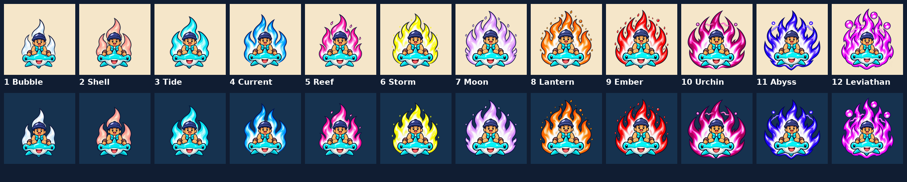

# Aura icons

The twelve pictures on the Auras stall's cards. Hugo, 2026-11-24: "use ... fish rider": option E of
[the options sheet](../../../docs/attachments/aura-icons-options-1.png) (the other five directions stay on branch
`aura-icon-options`). Back to [auras, in the UI note](../../../docs/design/ui.md).

- `aura_01.png` to `aura_12.png`: 1024 pixels square, see-through. 1, 6 and 12 are the sheet's own pictures, byte for byte;
  the other nine were made the same way on 2026-11-24 (the built-in ChatGPT image tool: tiers 2 to 5 as edits of tier 1,
  7 to 11 as edits of tier 6). Every prompt is in `generation.json`.
- The colours are draft 4's of the auras (not in the game yet): 1 #FFFFFF, 2 #FFA399, 3 #00D6E6, 4 #0077FF, 5 #FF4DA6,
  6 #F7FF00, 7 #C999FF, 8 #FF6E00, 9 #E61717, 10 #BF0086, 11 #2200FF, 12 #E019FF. The hex codes are what was asked for, not
  a promise for every shaded pixel.
- `aura_icons.png`: the atlas the game shows (1024 x 768, 4 across, 256 a tier), made by
  `python tools/ui/aura_icons/build.py --studio`, which also checks the set (see-through, 32 clear pixels all round, each
  tier taller than the one before) and copies the atlas into Studio's content folder on this PC.
- **Not uploaded.** The game reads the local copy in Studio and shows the old swatch anywhere else until the atlas's id is in
  `ICONS` in `src/client/UI/AuraShop.luau`.
