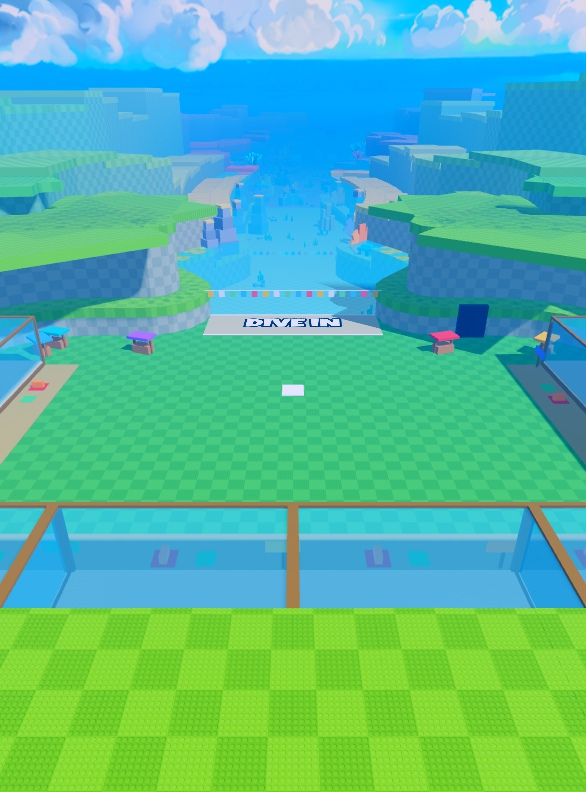
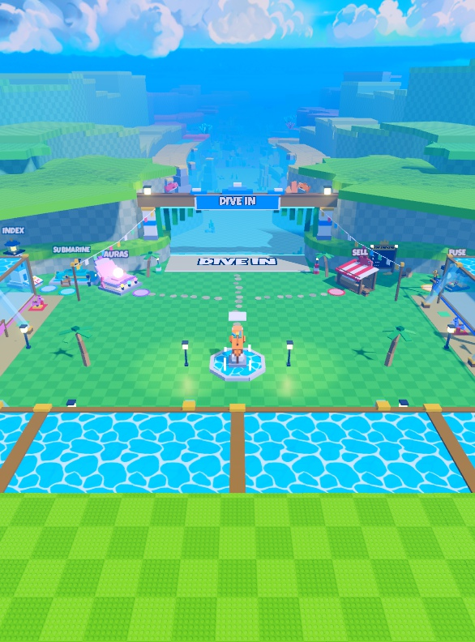
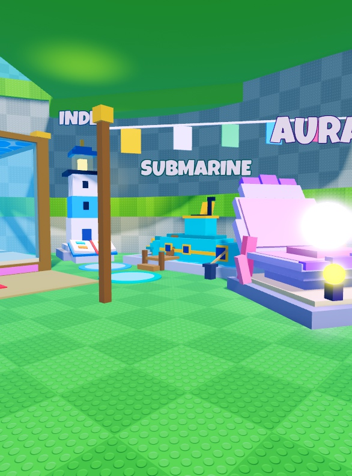
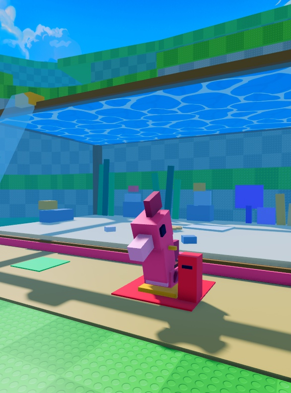

# The refinement: getting everything up to scratch

Written 2026-11-16 by the game-code chat on the user's word: "organise a large scale refinement across the board
on things to get them up to scratch ... the hub to reflect quality and not just a block out ... analyse what
should be done across the board to maximise the potential of our game", with Ride a Dino's core loop "as accurate
and satisfying" as it can be, in our own style. From three surveys of the vault and the code, and a look at the
hub in Studio. **A plan. What has started is marked "going".**

**Four studies came back the same day and change some of this.** The one page over them is
[what the studies found](Findings.md). What they change here is under "What the studies change", after "The
order", and marked "(studies)" where it touches a stream.

## What "up to scratch" means
Three tests, each one a thing a player would notice.
1. **The loop is whole.** Dive, carry home, deposit, earn, buy Oxygen, dive deeper, and it is all still there
   tomorrow. That is the reference's loop. Ours stops at "earn".
2. **Every payoff lands.** A catch, a deposit, a new land, a new best: each has a sound, a burst and a moment.
   Today most are silent.
3. **Nothing a player sees is a grey box.** In our own big-block style.

## Where it stands
| Area | State | The short of it |
|---|---|---|
| The dive (ride, hop, lock, tags) | Strong | The best thing in the game. Tuned many times |
| The herd | Strong, unplayed | Rebuilt today. Measured, not yet played by the user |
| Creatures | Good | All 82 modelled. 14 worked over, 68 first drafts. Colours are tints, not real models |
| The lands | Structure done | Ten lands, walls and water. Five have their own props; five borrow. No landmarks |
| **The hub** | **Grey box** | A flat floor, glass boxes, five stalls made of a counter, two posts and a roof |
| **The loop's second half** | **Half** | A tank earns coins. Coins buy nothing. Oxygen comes from standing on a pad |
| **Saving** | **None** | Everything is gone when you leave |
| **The first two minutes** | **None** | Nothing says what to do. About 45 seconds of play in the first two minutes |
| The dive's HUD | Finished | Never run on a phone |
| **The dock's screens** | **None** | No shop, no tank panel, no Index, no settings |
| **Sound** | **Placeholders** | Roblox's own character sounds, re-pitched. No music. Most payoffs are silent |
| Phones | Unknown | 59,000 parts. Never run on one |
| Publishing | Not ready | The creature models are private to one account. Nothing is measured |

## The work, in ten streams
Each says what is wrong, what done looks like, who does it, and what it needs.

### 1. The hub (going)
**Wrong:** it is the blockout. Seen in Studio today:
- Every stall is the same four boxes, with no name on it.
- A tank is a bare glass box.
- "DIVE IN" reads upside down from where you spawn.
- There is no gate: the wall just has a gap.
- The floor is 480 by 320 studs of empty green. The walk from a tank to the water is 5 to 12 seconds; the
  reference's is 4.
- The trainer is a glowing pad made by code. The toy ride on each plot is an orange box nobody uses.

**Done looks like:** you spawn and want to look round.
| Piece | What it becomes |
|---|---|
| The gate | An arch you dive under, with the words facing the hub, a lit lip, and kelp hanging in its mouth (it also hides where fish come in) |
| Sell | A fishmonger's stall: striped awning, ice crates, a hanging scale |
| Auras | A giant open clam with a glowing pearl |
| Fuse | A machine: three glass pods feeding one |
| Index | A small lighthouse with a great open book at its foot |
| The sub | A real submarine at a mooring, hatch open |
| Top earners | A framed board on the wall with names on it |
| Each tank | A wood and brass frame, the moving water on top, sand, rock and coral inside, a ramp, a proper sign |
| Each trainer | A coin-operated toy seahorse on a spring, on its own pad. The thing you sit on to gain Oxygen |
| The middle | One landmark: a fish and rider on a plinth, with water round it |
| Everywhere | Lamps, crates, barrels, buoys, bunting. A name floating over each station and a coloured ring on the floor in front of it |

- All of it from boxes by script, the way the creatures and props are made. **No uploads, no credits.**
- The names the code leans on stay: `Plots.PlotN` with `TankWater`, `Pad`, `CollectPad`, `SignBoard`,
  `TrainerSpot`, `TrainerRide`; `DockSpawn`; `StartStrip`.

**Done so far (2026-11-16):** the first pass is in Studio, 930 parts, no uploads: the gate arch with kelp, the
five stations and the earners' board, dressed tanks, a toy seahorse on each plot, a fountain, palms and lamps
([the hub's models](design/hub-models.md)). Training now happens on your own plot's seahorse pad, the seahorse
rocks while you train, and the stand-in pad is gone. A second pass followed the same day: a plain pearl, fuller
tanks with clearer water, a seahorse big enough to sit on (1,106 parts). Played for a moment after it. **The
place in Studio is not saved,** and the user has not seen it in person.

**Who:** the map chat builds. The game-code chat wires the trainer and the stations.
**Needs the user:** the hub's size (question 1) and its colours (question 2). The models don't wait for either.

### 2. Close the loop
**Wrong:** coins buy nothing, Oxygen comes from standing still, and nothing is saved.
**Done looks like:**
- **Saving:** Oxygen, coins, the tank, the best depth.
- **The trainer is bought:** the toy ride on your own plot, in levels, each bought with coins. Sitting on it
  gains Oxygen. This is the reference's upgrade machine.
- **Auras:** a multiplier on Oxygen gained, bought at the clam.
- **Selling** what you don't keep.
- **The tank's panel:** what is in it, "equip best", what it earns, and earning while away (capped).
- **A dive summary:** each catch with its size, colour and worth, the depth against your best, and one button:
  dive again.
- Two small rules: a full bag keeps the best seven; a fish that is yours never drowns you.

**(studies)** Three things to know before this is built ([findings](Findings.md), "What we had wrong"):
- **The reference has no cap of seven on a dive's catch.** Its seven are the pen's earning places; the rest is
  sold. Our seven is our own rule. Keep it only on purpose.
- **Its pay while away is half an hour's worth a day.** A token, not a reason to return.
- **Its income rises about as the square of what a fish needs,** so one rare catch is a jackpot. Ours is a
  straight line.

**Who:** the game-code chat. **Needs the user:** a yes to start on saving (question 3), and the pace (question 4).

### 3. The first two minutes
**Wrong:** nothing tells a new player to dive, what the ring is, or what the button does.
**Done looks like:** three small helps and no tutorial screen ([UI](design/ui.md), "The first minute"): "DIVE IN"
with an arrow; "tap to hop to the next fish" when the ring first turns red; a line on the first miss. The first
fish is always one you can hold. Then a short list of goals with a reward. Every step is counted, so we can see
where new players stop.

**(studies)** The reference does far more, and it is what its 78% "lesson done" measures. A script of about
twenty lines, one on screen at a time, over two and a half minutes: a cutscene on the biggest animal, a first
target that can't be missed, the button boxed at each press, the HUD arriving piece by piece, a first failure
that names its cure, and two purchases with coins before minute three. Ours teaches the hop; theirs teaches the
whole loop. So this stream grows, and its second half waits on stream 2 (there must be something to buy).
The lesson, line by line: [Ride a Dino](reference/ride-a-dino-deep.md), "The first minutes".
**Who:** the game-code chat and the UI chat. **Needs:** only code.

### 4. Sound and music
**Wrong:** every sound is one of Roblox's character sounds, re-pitched. There is no music and no water sound.
Silent today: a tame, a new land, a deposit, coins, the warning, the miss, every button.
- **Fixed today:** the smash and a prop's debris were silent. The code asked for a file Roblox doesn't ship.

**Done looks like:** a chosen set (hop, landing, tame, a sting by rarity, new land, warning, drown, deposit, coin,
click), a dock track, a dive track, and a water bed, each with its own volume.
**Who:** the game-code chat. **Needs the user:** where the sounds come from (question 5).

### 5. Payoffs that land
**Wrong:** the biggest moments are the quietest.
| Moment | Today | Should have |
|---|---|---|
| A catch | A banner. It doesn't show size or colour | A burst, a sound by rarity, the size and colour on the banner and in the slot |
| A deposit | Plain text over the tank | Fish dropping in one by one, coins flying, "+$" |
| A new land | A banner | A sound, a flash of the land's colour |
| A new best | 11-point text | A celebration |
| Coins rising | A number changes | "+$" ticking at the counter |
| A rare or giant fish near | A camera shake | A mark and a sound: something worth catching is coming |

**Who:** the UI chat, with the game-code chat. **Needs:** only code, and stream 4's sounds.

### 6. The dock's screens
**Wrong:** there are none.
**Done looks like:** a panel for each station as it gains its job (trainer, auras, sell, tank), then the Index
(every fish in its 24 sizes and colours, paying Oxygen and coins for each new one), and settings (sound, music,
shake, low detail).
**Who:** the UI chat, after stream 2 gives it something to show. **Needs the user:** an upload of the small
icons (question 6).

### 7. The lands
**Wrong:** the structure is finished and the dressing is not. These are the seven art steps the user parked on
2026-11-11 until the whole map and the water were done. Both are done.
1. A colour pair for each land, chosen on a swatch sheet (lands 5 to 10 are first guesses).
2. Landmarks you can see two rooms ahead.
3. A gate at each land's border, with the Oxygen it needs written on it.
4. Their own props for the five lands that borrow (Open Blue, Twilight, Midnight, Vents, Underworld).
5. Lamps in the dark lands.
6. The dive's edge (in stream 1).
7. Thinning for phones.

**Who:** the map chat, after the hub. **Needs the user:** to pick colours from the sheet.

### 8. Creatures and animation
- Tank fish don't beat their tails. Code only.
- Silver, Gold and Rainbow are tints. Real models need an upload (question 6).
- The ten Secrets never spawn. Needs a rule, and an announcement to the whole server.
- Bite, smash and angry are stand-in wobbles. Who authors them is not written down: Hugo, or us?

**Who:** the creature chat and Hugo.

### 9. The numbers
**Wrong:** the progression note was worked out for rules that have changed four times since.
- A fish too strong can now be hopped off, so a land is not a wall. Each such fish also gives a full second
  and the whole meter back, so they can be chained without end (question 10).
- The hop is longer. The herd has a new pace. Every fish has its own speed.
- There is no price for anything, because nothing is sold.

**Done looks like:** the balance model updated to today's rules, then a price for each trainer level and aura
against how long each land should take.
**Done so far (the tuning chat, 2026-11-16):** the model is rewritten for today's rules, and it has prices for
ten trainer levels and four auras at two paces: [progression](design/progression.md), "Today's rules". Two things
it found for stream 2: the prices only work if a full bag keeps its best seven (a dive's catch for a mid-game
player earns 19 coins a second as built, 2,300 with that rule), and the pad must be switched off when the bought
trainer goes in.
**Who:** the tuning chat. **Needs the user:** the pace (question 4) and question 10.

### 10. Phones and publishing
- Run it on a real phone, and an old one. Nobody has. This is the biggest unknown in the game.
- The creature models are private to the user's account. Publishing needs them in a shared group.
- Count the first session's steps, so we know where players leave.
- An icon and a thumbnail.

**(studies)** Three things that decide the launch more than anything above:
- **Roblox's gate.** A new game is shown only to age-checked players of 16 and over until 250 "highly engaged"
  ones have played it within 60 days, or the maker pays 50,000 Robux (refundable). The account must be verified
  with two-step sign-in, and publishing needs a fee or a two-month subscription. Checked on Roblox's own page.
  Ours is a children's game that must first be liked by adults (question 11).
- **The name is taken.** "[UPD] Ride a Fish" is on Roblox with 793,000 visits and a different loop
  (question 12). Not checked by me.
- **The window is short.** The reference is at 3% of its peak, twelve weeks old. Fish games are crowded;
  riding games are not. The title and the icon should say "ride".
- **Draw calls are the phone's cost, not parts:** about 500 in view is the budget. Glass, water, particles,
  beams and labels are where ours go. Measure the hub from the spawn before thinning anything.

**Who:** the user for the phone; the game-code chat for the counting.

## The order
**Changed 2026-11-16 on the user's word:** "go ahead with the rank 1 proposals", and "before we start moving on
to large scale refinements, I'd like to kind of just make sure the main assets and the UI all looks really good
in like the lighting and stuff". So the look comes first, then the loop, with the studies' rank 1 changes in it.

| Wave | What | Waits on |
|---|---|---|
| 1, now: **the look** | The lighting, by the studies' tests in order (quality levels, a warm sun, the shared recipe, Soft against Realistic). The hub's main assets: the tank (one plot five ways, an open one among them), the stalls, the trainer, by the corrected building brief. The UI that is on screen today, made to look right. All of it also looked at on the low quality levels | Studio: one chat at a time. The user's eye on each result |
| 2: **the loop** | Saving, the bought trainer, auras, **the Index (moved up from wave 3)**, the dive summary, the hub's twenty seconds. **The first minutes as a script.** The lands stay open (question 10) | Question 3 (saving) |
| 3: **reasons to stay** | **A rare shoal on a clock,** announced to the server, with a marker. Sounds and music. Payoffs. The stations' panels | Questions 4, 5 |
| 4: **ready to publish** | **A small shop** (the break-even aim): x2 coins and x2 Oxygen gain, shown on the trainer, cheap. A phone pass. The step counting. The name, the icon, the account checks, Roblox's fee | Questions 6, 9, 12. The budget: [money](design/money.md) |
| Later | The lands' dressing. Rebirth. More to sell | Players |

The old order, for the record: hub models and the balance model; then saving, trainer, auras, summary and
first-minute helps; then sounds, payoffs and panels; then the lands' dressing, the Index and Secrets; Robux last.

## What the studies change (2026-11-16)
From [what the studies found](Findings.md). **Rank 1 is agreed (the user, 2026-11-16: "go ahead with the rank 1
proposals"), and it is in the order above.** Only the name is still open. Ranks 2 and 4 are still proposals.
Rank 3, the look tests, is now the first wave, on the user's word that the look comes first.

**The gate, as the user means to meet it:** by paying. About 500 dollars of Robux for the fees, and 100 to 150
dollars or more on adverts. The aim is to break even: [money](design/money.md).

| Rank | Change | Was | Why | Touches |
|---|---|---|---|---|
| 1 | **Plan for Roblox's gate** before any launch work | Not in the plan | Under-16s can't see a new game until it passes. Checked | Stream 10, question 11 |
| 1 | **Settle the name** | "Ride a Fish", working title | A game with that title exists | Stream 10, question 12 |
| 1 | **The Index moves to wave 1,** beside the bought trainer | Wave 3 | It is the active way to the stat, and the answer to "progress comes from standing still" | Streams 2 and 6, question 13 |
| 1 | **The first minutes become a script** that teaches the whole loop | Three small helps | It is what the reference's 78% measures | Stream 3 |
| 1 | **Keep the lands open** until both ways are tried | I had said close them (question 10) | In the reference it is the trailer, and the strongest pull in the videos | Stream 9, question 10 |
| 1 | **One thing that waits for tomorrow:** a rare shoal on a clock, and a goal that can't be finished today | "Daily rewards", last | It is where the reference is weakest: about three visits a player | Streams 2 and 8, question 14 |
| 2 | **The hub's twenty seconds:** Equip Best, the tank's total, Claim All, the next price, a red "!" on what you can afford | A tank panel | Every run in the reference ends on the same four small payouts | Streams 2 and 6 |
| 2 | **The way to your tank:** a trail, a marker or an arrow | None | Every game seen has one | Streams 1 and 3 |
| 2 | **An honest tag and a failure that names its cure** | A banner | Their loudest late complaint, and their best lesson | Stream 5 |
| 2 | **The grace on a too-strong fish: about 2 seconds** | 1 second, from memory | One video, checked | Question 15 |
| 3 | **The lighting tests,** in order: quality levels, a warm sun, the shared recipe, Soft against Realistic | One look, judged at the top level only | [Lighting](reference/look-lighting.md), section 5 | Stream 1, [lighting](design/lighting.md) |
| 3 | **The building tests,** in order: one plot five ways, studs by material, where the draw calls go | The building brief's first rules | [Buildings](reference/look-assets.md), section 5 | Stream 1, [the building brief](style/building-brief.md) |
| 4 | **Robux, when it comes:** x2 money and x2 Oxygen gain, cheap, shown on the trainer; a first price too small to be a decision | "Robux last" | The biggest games sell the fewest things | [Money](design/money.md) |

**What stays as it was:** the hub's models first, saving, the bought trainer, auras, sounds, payoffs. The studies
back all of them. They also back two things we already do: eight to a server, and one trained stat.

## Questions for the user
Each with what I would do.
1. **Make the hub smaller?** It is about twice the reference's floor, and the walk to the water is 5 to 12
   seconds against 4. I would bring it to about 300 by 220.
2. **The hub's colours:** it wears Ride a Dino's own, "for now" (2026-11-11). I would give it ours before anyone
   outside sees it.
3. **Start on saving and spending?** It needs one outside library (ProfileStore, the usual one) added to the
   repo. I would.
4. **How long should each land take to reach?** The old plan says 5, 15, 30, 55, 90 minutes and on. The pad
   today gets to the last land in 49 minutes. The prices come from this.
5. **Sounds:** free ones from Roblox's own library (no upload, usable today), or ones we make and upload? I would
   start with the library and replace the few that matter.
6. **Uploads:** the archetype icons and HUD signs (only Hugo sees them now), and real Silver, Gold and Rainbow
   models. Each is permanent.
7. **How many players a server,** and so how many tanks? Eight is inherited.
8. **The reference's trainer:** a recording of its screen and prices, so ours can match it.
9. **A phone:** ten minutes on a real one, and an old one if there is one.
10. **Should fish that are too strong chain without end?** (From the tuning chat's model, the same day.) Every
    landing gives the whole meter back, on a red fish too. So a player who keeps hopping red fish never runs out:
    the model's new player reaches the third land in a minute and a half, and holding Space can reach the end of
    the last land in about four minutes, catching nothing. If that is too far: **a landing on a red fish gives no
    Oxygen back.** Then it is one red fish for a relaxed player, about six for one holding Space, 400 studs past
    your own land. One line of code. I would do it: it is "sometimes further than you can handle", not "always".
    **Taken back the same day, after the studies:** the reference works exactly this way, and riding to the far
    end to look is the strongest pull in its videos. I would now try both before closing it.
    **Answered 2026-11-16: the lands stay open** (rank 1). Nothing to build: it is how the game works today.

From the studies ([findings](Findings.md)):

11. **The gate:** aim the launch at over-16s first, or plan for the 50,000 Robux? And is the account that will
    own the game verified, with two-step sign-in? I would check the account now and decide the route once the
    loop is whole.
    **Answered 2026-11-16: pay.** About 500 dollars of Robux. Still to check, by the user: that the account (or
    the group's owner) that will own the game has passed Roblox's ID or face check and has two-step sign-in on.
    And one saving: the separate 1,000-Robux publishing fee is waived for an account with a Plus or Premium
    subscription two months old.
12. **The name:** keep "Ride a Fish" beside the game that has it, or change it? Whatever it is, it should say
    "ride".
13. **Bring the Index forward,** beside the bought trainer? I would. **Answered 2026-11-16: yes** (rank 1).
14. **A rare shoal on a clock,** announced to the server, as the reason to stay and to come back? Five minutes
    is what the two biggest games use. I would. **Answered 2026-11-16: yes** (rank 1).
15. **The grace on a too-strong fish: 1 second or 2?** The video shows 2 to 2.5. I would make it 2.
16. **A second look to flip to in play:** the shared lighting recipe beside ours. I would add it.
17. **More open tanks:** mock up one plot five ways, beside the deep slim one. I would.
18. **Ten minutes of Rodeo Stampede,** and nine things to look at in Ride a Dino next time you play:
    [the list](reference/ride-a-dino-deep.md), section 7.

## Parked, to bring up
The user, 2026-11-16: "Keep those small decisions in mind for later. Bring them up." Whichever chat next
reaches the thing a line touches raises it with the user.

| What | When to raise it |
|---|---|
| The grace on a too-strong fish: 1 second or 2 (question 15) | When the riding feel is next tuned |
| The stud picture upload, so studs can be a material. Permanent | When the hub's look is next worked on |
| The name: a game titled "Ride a Fish" exists (question 12) | Before any icon, title or thumbnail work |
| The account checks: ID or face check, two-step sign-in (question 11) | Before the over-16 release |
| A commit and push by hand | At the end of the UI's look pass |
| Saving, which starts the loop (question 3) | When the user says the look is right |
| A phone | When the look is settled: "then optimize it" |

## Who has what
| Chat | Now | Next |
|---|---|---|
| Game code (this one) | This plan. The silent sound | Saving, the trainer, auras, summary, first minute, sounds |
| Map | The hub's models (has Studio) | The lands' dressing |
| Tuning | The balance model, then prices | |
| UI | Waits for stream 2 | Payoffs, the stations' panels, the Index |
| Creature | Waits on question 6 | Variants, Secrets |
| Hugo (void) | His own list | Authored animations, if they are his |
