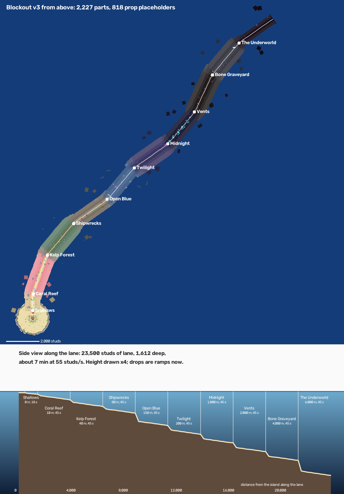
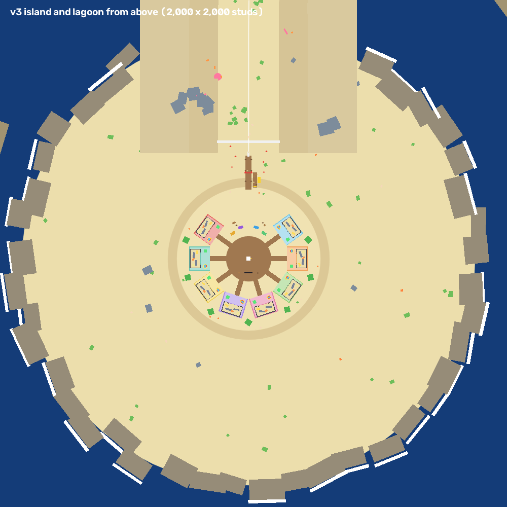
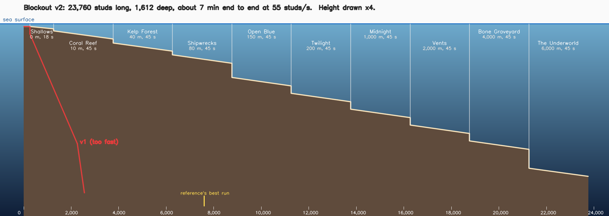
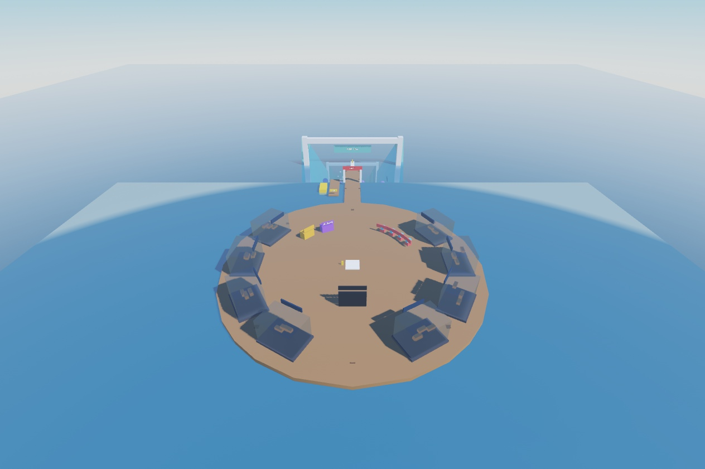
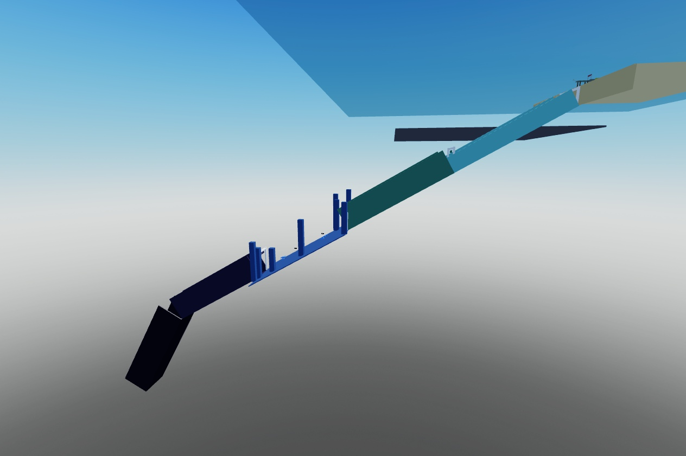
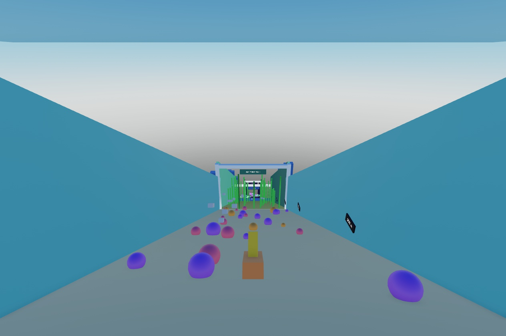
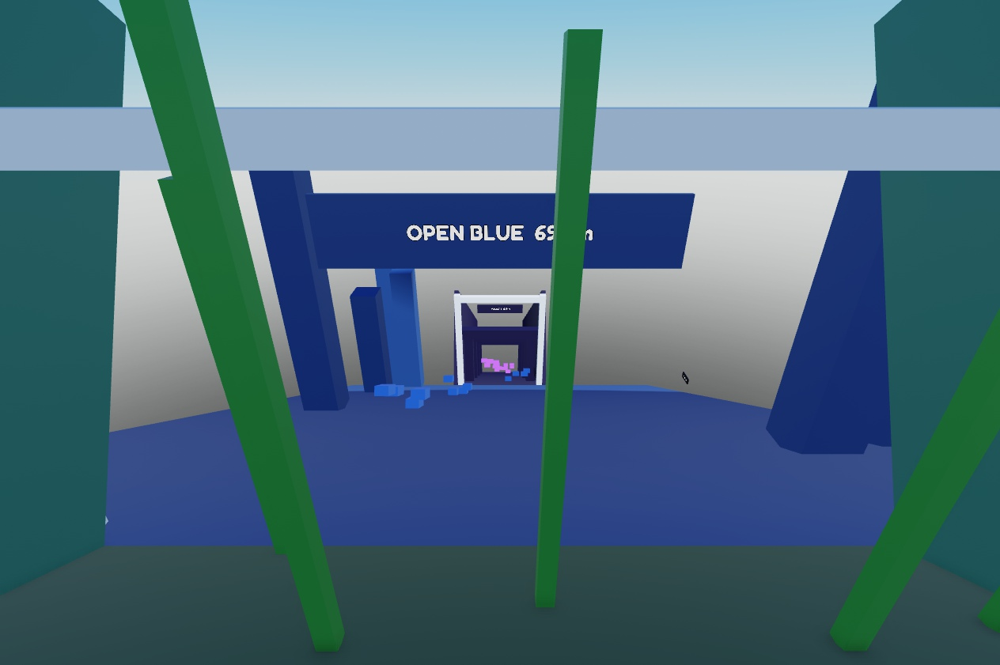

# Blockout

Claude's script-built blockout of the dock and the dive, `tools/studio/claude_blockout.luau`, built into
`Workspace.ClaudeBlockout`, 3,000 studs along X from the baseplate so the baseplate doesn't hide the underwater part. Every number
is at the top of the script. A player is about 5 studs tall.

The plan was two blockouts made separately and compared. The user's verdict on v1 (2026-11-09): theirs would look pretty much
the same, except that the elevation changed far too soon. The descent has to be gradual and the dive much longer, or the depth is
used up early and there's little left to progress through. That made v2.

## v3 (2026-11-09): a big island, a diagonal dive, props placed
**2,227 parts** (the dive 1,806, the island 273, the lagoon 104, the sea 44) and **818 prop placeholders**. On a phone, the fog and
distance mean only a few hundred parts are ever on screen. v2's depth profile and zone lengths are kept: 10 zones, 23,500
studs of lane, 1,612 deep, about 7 minutes at 55 studs a second.

- **The island,** about 5 times v2's dock in area: a sandy island 600 across on a mound running out just under the water, in
  a lagoon 1,900 across ringed by reef.
  - The spawn sits in the middle of a boardwalk plaza, with the Top Earners board behind it. Sell, Auras, Index and Fuse
    stalls stand on the open side toward the pier, with palms between the plots.
  - The pier runs out to the DIVE gate and the dive board, past the sub jetty, with dock props along it.
- **A plot per player** (8, in a horseshoe open toward the pier), each 100 × 84 on its own coloured pad:
  - a **show tank** 76 × 30 × 40 at the back, with stand-ins for two shark-sized fish and three smaller ones;
  - the owner's **sign** above the tank;
  - a **kiddie-ride trainer spot** at the front left: a pad, the ride and a coin box;
  - a **collect pad** at the front right, and a boardwalk to the plaza.

  The parts the code needs have names: `Dock.Plots.PlotN` (attribute `PlotIndex`) holds `TankWater`, `TrainerSpot`,
  `CollectPad` and `SignBoard`.
- **A diagonal, cohesive dive.** The lane leaves the lagoon heading straight out through the gap in the reef. Each zone then
  has its own heading, swinging between 20 and 55 degrees toward +X, so the run sweeps across X and Z as it descends.
  - **Bends:** each turn eases in over 900 studs centred on the zone border, and the zone's drop-off falls in the same
    place, so the run turns and drops at once.
  - **Valley sides:** the seabed is built in short segments along the curve (300 studs on the straights, 150 in the bends
    and on the ramps). Each bank is one tilted slab from one terrace edge to the next, so the sides are faceted slopes
    rather than boxy steps.
  - **Blending:** lane width, bank widths and heights, and colours blend over 600 studs at each border.
  - **Ramps:** v2's cliffs are now ramps, averaging 35 degrees.
  - **Extent:** the lane ends about 14,500 studs along X and 18,000 along Z from the island, still all parts (no terrain, so
    the 1,024-stud terrain limit doesn't apply).
- **Props** from the prop kit ([props.json](../art/props/props.json)), placed in clusters per zone, using only the props
  that list the zone:
  - Shallows: sea grass, shells and coral.
  - Coral Reef: coral heads, with arches you ride through.
  - Kelp Forest: kelp, plus a few spires.
  - Shipwrecks: crates and barrels by the wrecks.
  - The deep: violet rocks and spires.

  Each prop is a **placeholder Model** named after the prop, made of chunky part stand-ins, with these attributes:
  - `PropName`;
  - `PropScale` (the size relative to the kit's mesh);
  - `PropSize` (the size in studs, already scaled);
  - `PropBase` (the world CFrame of its base, where the kit's meshes have their pivot).

  The swap to the imported meshes is 1:1: put the mesh at `PropBase` with `Size = PropSize` (mind that the importer may
  centre the pivot), then delete the Model.
- **Kept from v2:** the zone gates and signs, wrecks, Twilight's arches, jellies, vent chimneys, whale skeletons, the
  Underworld's red cracks, the Megalodon and the end wall, the far silhouettes and the light shafts. **Removed:** v2's
  stand-in fish schools, because the game spawns real fish now.
- **For the game code** ([Zones.luau](../src/shared/Zones.luau)):
  - Each `Dive.NN_NAME` still holds a `Floor`. It's now an invisible marker: the straight chord from the zone's start to
    its end, within 30 studs of the curving lane.
  - The `Dive` folder's `Path` attribute is the exact centreline as JSON, `{s, x, y, z, width}` every 250 studs, in world
    space.

### Building offline
Studio doesn't need to be running. `rojo build default.project.json -o game.rbxl`, then
`lune run tools/studio/bake_map.luau game.rbxl tools/studio/claude_blockout.luau <out.rbxl> <bake.json>`.
- It runs the blockout script in Lune, saves the place with the game code and the map in it, reloads the file and counts
  the parts.
- The repo's rokit.toml has no Lune yet; on Hugo's PC it runs from a folder that has Lune.
- `python tools/art/map_plot.py <bake.json> <views.png> [island.png]` draws the views from the bake's part dump.
- `art/blockout/v3_zones.json` holds the zones and the path.
- Lune has no Roblox `Random`, so an offline build scatters the props differently from a build in Studio. The layout and
  the counts are the same.
- The latest build is `~/Documents/RideAFish/ride-a-fish-map.rbxl`. Studio's Flatpak can only see `~/Documents`.

## v2 (2026-11-09): long and gradual, with the world round it
895 parts. Sized after the reference's measured run (from the user's recording: riding about 55 a second, the first zone about
1,000, the second about 2,500, the player's best run 7,590):

- **10 zones, 23,760 studs, 1,612 studs deep,** about 7 minutes end to end at riding speed, 45 seconds a zone. Inside a zone the
  floor slopes 2 degrees; most borders have a drop-off (20 to 200 studs). The first four zones, the first version's, stay in
  the bright upper ocean (down to 418).
- **Zones** (the [roster](design/roster.md)'s variant C), with the real-ocean depth the gauge would show: Shallows 0 m, Coral
  Reef 10 m, Kelp Forest 40 m, Shipwrecks 80 m, Open Blue 150 m (after the big shelf-break drop), Twilight 200 m, Midnight
  1,000 m, Vents 2,000 m, Bone Graveyard 4,000 m (whale skeletons), The Underworld 6,000 m down to the Challenger Deep, 10,935 m
  (red cracks; the blockout's Megalodon stand-in sits at its end).
- **The world round it** ([workout 1](style/01-going-down.md)): terraces stepping up either side of the lane, built
  differently per zone; huge silhouettes far off (seamounts, kelp towers, whales); light shafts in the shallows; glowing things in
  the deep (jellies, vent chimneys, red cracks).
- **The dock** as in v1, now in a **lagoon ringed by reef**, some rocks breaking the surface with surf. The dive leaves through a gap
  in the ring. The open sea outside reads deep blue from above (a dark plane 300 down).
- `tools/art/depth_profile.py art/blockout/v2_zones.json docs/attachments/blockout-v2-profile.png` draws the side view.

## v1 (2026-11-09): kept for the record
302 parts. The same dock, then a trench sloping 30 degrees through four 500-stud zones (Reef, Kelp Forest, Open Blue, Twilight)
and a 60-degree drop into the deep: 1,800 studs deep within 2,600. Far too fast.

- **The dock** floats on the sea at the surface: a round plaza with the spawn in the middle, eight player tanks in a horseshoe
  round it (glass boxes of water, each with its owner's sign), the stations along the open side (kiddie-ride training machines,
  aura stall, sell stand, sub dock), and a long pier out to the **dive board**, where every dive starts.

