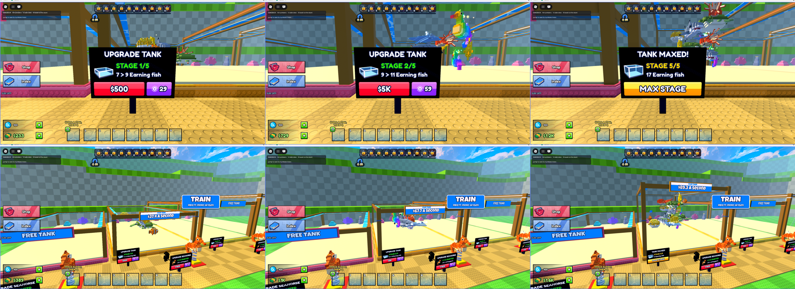
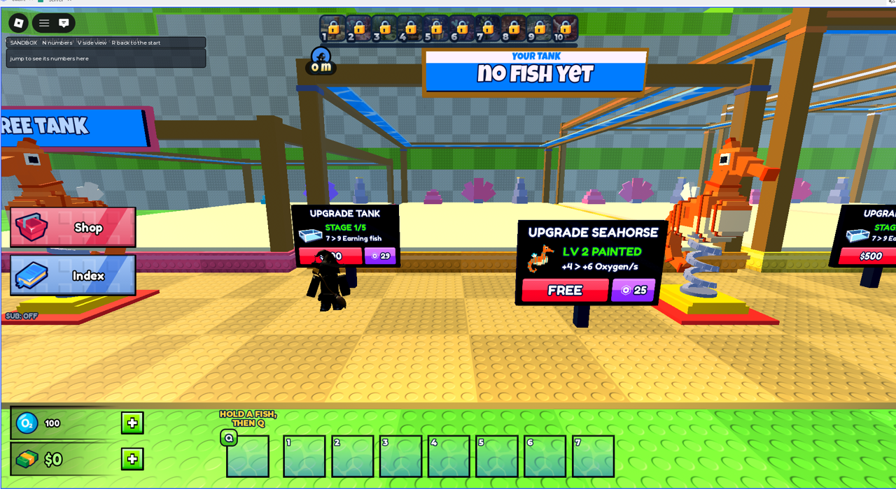
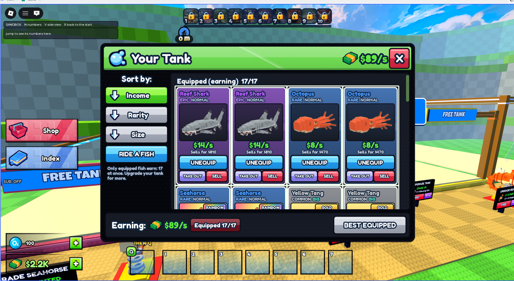
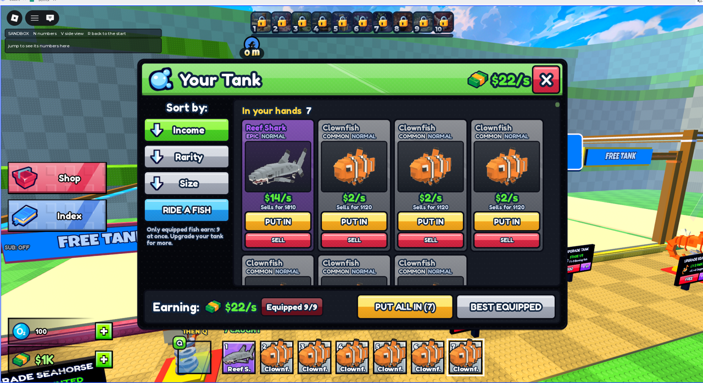
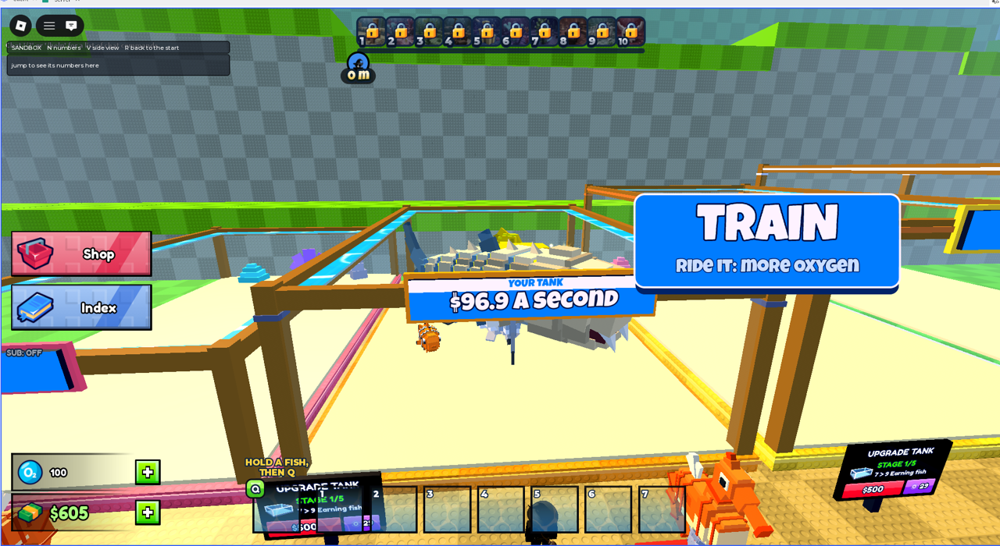
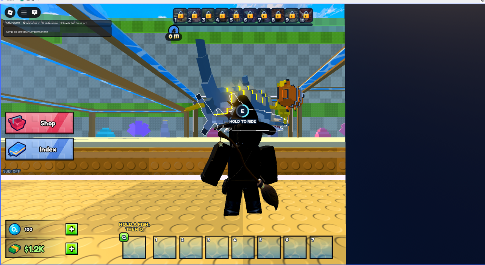
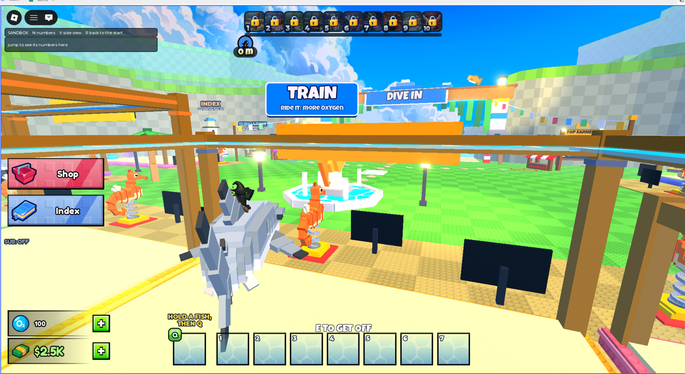

# The aquarium: where a catch goes, and what it earns

> **Studies, 2026-11-16.** Three numbers here were read wrong from the reference: what a size earns, what a colour earns, and income against what a fish needs (theirs rises about as the square). And every trending game shows what a player owns in the open, not behind glass. [Findings](../Findings.md), "What we had wrong" and rank 1, point 7.

Up: [core loop](core-loop.md), [the dock](the-dock.md). Why it came first: [the loop review](loop-review.md).
Built 2026-11-16 on the user's word: "catches are for depositing in your aquarium, in which they then earn money".
The code: `src/server/Services/AquariumService.luau`, `src/client/Controllers/AquariumController.luau`. The numbers:
`Config.Aquarium`. **For the session only: nothing is saved yet.**

## What happens
1. **A tank each.** A player takes the first free plot on the dock as they join, the nearest to the dock's spawn
   first, and gives it up as they leave. Its sign shows their name and what the tank earns.
2. **The catch comes home in your hands.** What you tamed on a dive is still carried at the dock (it was only
   counted before), a failed dive's too. The seven slots stay filled until you put the fish in, and they stay with
   you through the next dive if you don't (you can carry seven).
3. **You wake at your own tank.** With fish in hand, a dive that ends puts you on the floor just in front of your
   tank's glass, facing it, not at the dock's spawn. (Until 2026-11-20 there was a green pad there; Hugo had it
   taken out, task k1.)
4. **You put them in, in the tank's popup** (Hugo, 2026-11-18: "make the player actually be able to place down
   fishes in aquarium once back"; since 2026-11-20, task c1: "make sure that it just outlines the full tank whenever
   you hover over it, remove the click to add and just open the gui when player clicks on it"). Point at your own
   tank from within its reach (36 studs) and the **whole tank** is outlined white (base, glass, frame, sign; outline
   only, no fill); a click (a tap on a phone, which has no hover) opens the popup below, where PUT IN puts one carried
   fish in and PUT ALL IN all of them. There is no control on the glass and no sign over the tank any more, and a
   click on the tank never puts a fish in by itself. A click or number key on a caught slot *holds* that fish (it
   shows on top under IN YOUR HANDS). With fish in the tank the popup's RIDE A FISH (blue, in the left column) gets
   you on the one nearest you (it was the glass control's empty-handed mode). Other players' tanks are neither
   outlined nor clickable. The view turns to the tank and a line rises over it: the fish's name and what it adds a
   second. The server checks it (Action `"Tank"`): on the dock, near your own tank, that fish still in your hands.
   (Before c1: a CLICK / PUT IN TANK control on the glass, task e2, and before that an E prompt and a green pad.)
5. **They swim there and earn.** Up to seven are *equipped* (more with plot upgrades, below): they earn coins every
   second and swim in the tank. The coin row on the HUD shows itself. A new fish takes a free place; with every
   place taken it is *stored* and earns nothing until you equip it (since 2026-11-19, the popup below; before that
   the best seven always earned by themselves). Since 2026-11-22 the tank keeps **any number** of fish (it was 60).
6. **The tank's popup** (Hugo, 2026-11-19: "you should be able to click on the plot from nearby, then get a little
   popup where you can equip the best fish instantly, unequip certain fishes and see how much money they produce
   and their rarities and special traits"). See below.
7. **You can ride them, in the tank** (Hugo, 2026-11-20: "make fishes in the tank rideable (in the tank)"). See
   "Riding in the tank" below.

## The inventory, selling and plot upgrades
Hugo, 2026-11-22 (task b1): "the inventory is unlimited"; every fish can always be sold, kept, or equipped to ride;
you can place a fish in the tank and take it out; depositing is not equipping: equipping is what earns, and only a
limited number can be equipped at once, changeable only by plot upgrades. Built the same day; the numbers are
`Config.Aquarium` and `Config.PlotUpgrades`. **For the session only: nothing is saved yet.**

- **The tank is the inventory, and it has no limit** (`Aquarium.Hold` 0). The hands are still the seven slots.
- **Deposit and take out.** PUT IN / PUT ALL IN put carried fish in. Every tank card has **TAKE OUT**: that fish goes
  back into your hands (equipped or stored; refused, "YOUR HANDS ARE FULL", with seven carried). So a stored fish is
  ridden by taking it out, holding it and pressing Q ([the ride fish](equip.md)).
- **Depositing is not equipping.** *Equipped* means earning and swimming in the tank; *stored* means kept. A fish put
  in takes a free earning place by itself (`Aquarium.AutoEquip` 1; 0: always stored until you press EQUIP).
- **How many may be equipped** is 7 (`Aquarium.Earning`) plus 2 for each plot stage (`Config.earningOf`). Nothing
  else changes it. The server refuses one more ("ALL PLACES TAKEN: UNEQUIP ONE OR UPGRADE YOUR TANK").
- **Sell.** Every card, in the tank or in your hands, has **SELL** and says what the fish sells for. The first
  press asks SURE?, the second sells (a sale can't be undone). The price is the server's: `Config.sellOf`, 60 seconds
  (`Aquarium.SellSeconds`) of what that fish earns, at least 1 coin. A Normal plain Clownfish 120, a Normal plain
  Kraken 67,500. Selling works anywhere on the dock, so the sell stall's UI (task b2) can use the same ask.
- **Plot upgrades: the second sign.** In front of the far-left end of each tank's front (as you face the tank) stands
  a sign in exactly the seahorse sign's style: the same board, post and code (`UI/UpgradeSign.luau`), on the parts
  `PlotBoard` and `PlotPost`, which `AquariumService` makes when the map has none. It says UPGRADE TANK, shows a little
  tank as tall as the next stage makes it, STAGE n/5, "7 > 9 Earning fish", the price on the red cash block and a
  Robux price on the purple block (shown only, as on the seahorse's sign: placeholders, nothing can be bought with
  Robux). A click or tap on the cash block of **your own** sign, from within 14 studs (`PlotUpgrades.SignNear`), buys
  the next stage. At the top: TANK MAXED!, STAGE 5/5 in gold, MAX STAGE.
- **A stage** lets 2 more fish be equipped (`Slots`) and makes the tank 3 studs taller (`Taller`; the water is 14
  high at the start on the first plot, so 29 at stage 5; the plots' tanks are not all one height), growing over 0.6 seconds. The water and the corner posts stretch upward from
  the same floor; the rim, the water's surface and the owner's sign are lifted; the base, sand and reef stay. The
  tank goes back to the map's height when its owner leaves. The hover outline and the click box follow the taller tank.

| Stage | Price (coins) | Equipped at once | Taller than the map's tank |
|---|---|---|---|
| 0 (start) | - | 7 | 0 |
| 1 | 500 | 9 | 3 |
| 2 | 5,000 | 11 | 6 |
| 3 | 50,000 | 13 | 9 |
| 4 | 500,000 | 15 | 12 |
| 5 | 5,000,000 | 17 | 15 |

The prices are Claude's proposal (times ten a stage; the first within the first few dives: seven Shallows fish earn
about 15 to 20 coins a second, and a spare Clownfish sells for 120). Hugo's to change, in `Config.PlotUpgrades.Stages`.

**The server decides everything** (`AquariumService`): the price, the coins, the stage, which fish exist. The client
only asks; it never sends a price or a count.

| Ask (client to server) | Checked | Answer |
|---|---|---|
| Action `"Tank"`, `"TakeOut"`, key | on the dock, near your own tank, the fish in your tank, hands not full | Ride `"TankDenied"`, `"Far"` / `"Gone"` / `"Hands"` |
| Action `"Sell"`, `"Tank"`, key or `"Hand"`, index, id | on the dock, the fish yours (the index-th carried must still be `id`) | Ride `"Sold"`, id, coins or `"TankDenied"`, `"Far"` / `"Gone"` |
| Action `"Plot"`, `"Up"` | your plot, alive, on the dock, not riding in the tank, within `SignNear` of `PlotBoard`, not the top stage, the coins; one ask in `UpAgain` 0.5 s | Ride `"PlotUp"`, stage or `"PlotNo"`, `"Near"` / `"Top"` / `"Coins"` / `"Dead"` / `"Busy"` |

Player attributes: `PlotStage` (0 to 5), `TankEarning` (how many may be equipped). (`AquariumService.stageOf`, `earningOf` and
`sell` were taken out 2026-11-22: nothing called them.)

**Checked by script in a Studio playtest** (2026-11-22; `python tools/studio/b1_inventory_check.py install`, Play,
`... run`, `... shots`, `... remove`; log `work/b1/check.log`): **44 of 44 pass.**
- The sign: at the far-left end of the front (its left edge 0.6 studs in from the tank's corner, 7 in front),
  facing the hub, its board and writing the seahorse sign's size; it says UPGRADE TANK, STAGE 1/5, 7 > 9, $500.
- The price to the coin: refused with 0 and with 499 coins (the block says NOT ENOUGH COINS!), refused from the
  dock's spawn with 500 (Near), bought at the sign with 500, leaving 0. A double click buys one stage and charges once.
  At stage 5 a sixth is refused (Top) and nothing is taken.
- Every stage 1 to 5: the places are 9, 11, 13, 15, 17; EQUIP BEST fills exactly that many and they all swim in the
  tank; one more is refused (Full); the water is 3 studs taller each time from the same floor, the rim and the
  owner's sign lifted with it.
- The inventory: 103 fish kept (the old limit was 60). PUT IN, PUT ALL IN, TAKE OUT of a stored and of an equipped
  fish, put back in; TAKE OUT with seven in the hands refused (Hands).
- Selling: from the hands and from the tank (stored and equipped) for the server's price (a Clownfish 120); a
  made-up id, a key not in the tank and a price sent by the client change nothing.
- The hover outline goes round the taller tank (its box 40.6 studs high at stage 5) and a click still opens the popup.
- Pictures: 
   
  
- **Not checked:** played by hand (the asks are fired as the buttons fire them; the sign is pressed through
  `UpgradeSign.press`, a click's own path after the press); two players; a phone; the tank going back to the map's
  height when its owner leaves; a ride in a taller tank; thousands of fish in one popup (103 were fine).

## Riding in the tank
Practice, nothing at stake (task k1, 2026-11-20; reworked in task b4, 2026-11-22; `Config.TankRide`,
`TankRideService`, `TankRideController`). Hugo, 2026-11-22: "use same floating animation when swimming in aquarium,
make player be able to swim on the fish in the aquarium without oxygen limit while being in full control. This
should be done by holding E for a little second while looking at desired fish", and "fishes are too small in the
tank, make sure they retain their original size even if they clip through".
- **Real size in the tank.** A tank's fish is drawn as long as it is in the sea: its kind's size (BaseScale in) times
  its rolled size (`Aquarium.ShowShare` 1, `ShowLeast` 0, `ShowMost` 1000; it was 0.7 of that, between 7 and 28
  studs). A big one goes through the glass, the sand and the surface: a Normal Dunkleosteus is 52 studs in a tank
  52 by 84, a Colossal Mosasaurus 200. A fish longer than its lap is wide comes round slower (its nose no faster
  than a small fish swims), so a giant doesn't whirl on the spot (`AquariumController`).
- **They swim.** Every tank's fish, in its lap or ridden, moves its joints through the sea's own keyed swim: the same
  cycle `AnimController` plays in the sea, the beat by speed and length (a stand-in: tail beat, sway, fin flaps).
  Not the sea's extra layers (the turn lead, the slow wave, the fits). `TankRide.Swim` 0 turns it off.
- **Getting on: look at a fish, hold E.** On the dock, within 44 studs of your tank's water (`Reach`), the fish of
  **your own** tank that the look is on is outlined white and carries a small ring with the key on it and HOLD TO
  RIDE. The look is the mouse on a PC and the middle of the screen on a pad or a phone; of the fish it passes
  through, the one whose middle it passes nearest (so a small fish in front of or inside a giant can be picked).
  Holding E (a pad's X, the RIDE button on a phone) fills the ring over 0.5 seconds (`Hold`), then you are on.
  Letting go or looking away empties it. Not while the tank's popup is open. The popup's RIDE A FISH still works
  (the fish nearest you).
- **Owner only, checked by the server:** the fish asked for must be in your own plot's tank now; any other is refused
  (`Denied`, `TankRide`, `NotYours`), as is asking from too far (`Far`).
- **Riding, full control:** W (the stick forward) swims at 16 studs a second, S backs at half that, nothing held
  floats on the spot, rising and sinking a little (`Bob`). A and D turn (the view turns with you), and the fish comes
  round to where the camera looks, up and down too. **Your seat** (the fish's Saddle) is what stays inside the water,
  1.5 studs from the glass, sand and surface; the fish's own body may go through them (before b4 the whole fish
  was kept inside, which a real-size fish can't be). Against the glass you slide along it. The server pulls the fish
  back if the seat is ever more than 6 studs out. The camera is held at least 1.1 fish lengths back (at most 90
  studs), so it is outside a giant; your own zoom limits come back when you get off.
- **Safe:** you stay on the dock as far as the game knows (state `Dock`): no Oxygen used, no fail or throw-off, no
  taming, no catch, no coins. The fish stays in the tank and keeps earning.
- **The fish while ridden:** out of its lap from where everyone saw it (the server works out the lap's place), at its
  own size. Getting off puts it back in its lap.
- **Getting off:** E again (a pad's X, the OFF button on a phone; "E TO GET OFF" shows at the bottom). You land on
  the floor in front of the glass. A change to the tank while you ride (the popup's equip) also puts you off.
- **Checked in a Studio playtest by script** (2026-11-22, `tools/studio/b4_tank_ride_check.py`, log
  `work/b4/check.log`): six fish from a Tiny Clownfish (7 studs) to a Colossal Mosasaurus (200) all drawn at their
  real length; all six picked by looking at them, the giants not taking the look from the small ones; E let go at
  0.25 s does nothing; a fish in another plot's tank is refused by the server; from 90 studs away nothing is picked;
  held 0.5 s, on; ridden forward four ways, up, down, back and stopped with the seat never outside the water, state
  `Dock`, Oxygen 100 throughout; E off, back in front of the tank with every fish in its lap; the joints of every
  fish move. **Not played by hand:** the feel, a phone, a pad, two players.
  
  
  

| Number (`Config.TankRide`) | Now | What |
|---|---|---|
| `On` | 1 | 0: tank fish can't be ridden |
| `Hold` | 0.5 | Seconds E is held to get on |
| `Aim` | 3 | Studs the look may miss a fish's body by |
| `Reach` | 44 | Studs from the water within which a fish can be picked (the server allows 48) |
| `Speed`, `Back` | 16, 0.5 | Studs a second forward; backing's share of it |
| `Ease` | 5 | How quickly it comes up to speed and stops |
| `Turn` | 110 | Degrees a second A and D turn |
| `Follow` | 4 | How quickly the fish comes round to the camera's look |
| `Level` | 14 | Degrees: the camera's usual look down counts as level |
| `Climb` | 40 | Steepest climb or dive, degrees |
| `Margin` | 1.5 | Studs kept between the seat and the glass, sand and surface |
| `Slack` | 6 | Studs out before the server pulls it back |
| `View`, `ViewMost` | 1.1, 90 | The camera's least distance: fish lengths, and its cap in studs |
| `Bob` | 0.3 | Studs it rises and sinks while floating |
| `Swim` | 1 | 0: the tank's fish don't move their joints |

## The tank's popup
Built 2026-11-19 (task p1). The code: `src/client/UI/TankPanel.luau`, the server's half in `AquariumService`.
Pictures: [desktop](../attachments/tank-popup-desktop.png), [desktop, scrolled, EQUIP BEST lit](../attachments/tank-popup-desktop-2.png),
[phone](../attachments/tank-popup-phone.png).
- **Opening it:** click (or tap) your own tank (its glass, water, rim or sign) from within 36 studs of the water
  (`PANEL_REACH` in AquariumService, written on each plot as `PanelReach`). Near enough, the whole tank is outlined
  white under the mouse (task c1: a SelectionBox, its edges as white lines 0.3 studs thick, on a clear client-side
  box the size of the plot's parts that stand within the tank's footprint, so the trainer, the upgrade sign, the pad
  and the swimming fish are left out; the box is made again when the tank's parts change. Not a Highlight: a Highlight
  only outlines opaque parts, so round a glass tank it draws nothing useful; tried in Studio, 2026-11-22). No sign over the tank (the old CLICK YOUR TANK / WALK CLOSER!
  went with c1); from further away nothing outlines and a click does nothing. It shuts with its X, a second click on
  the tank, walking 8 studs past the reach, or leaving the dock.
  (The click is tested against the tank's box, not a raycast: the map's glass, water and sign are CanQuery off.)
- **What it shows:** the title, what the tank earns a second, and a card for every fish: IN YOUR HANDS (what you
  carry), EARNING n/7, STORED n. A card has the fish's picture (the partner's renders), its size word (Tiny to
  Colossal, in the tags' size colours), a SILVER, GOLD or RAINBOW chip (and the picture's backdrop in that colour),
  its archetype icons, its name, its rarity in the rarity's colour (the card's edge too), and its coins a second.
- **What it does:** EQUIP BEST (gold while it would change something, else grey BEST EQUIPPED) equips the best
  earners, as many as the plot's stage allows, and stores the rest; each tank card's TAKE OUT and every card's SELL
  (2026-11-22, above); each card's EQUIP or UNEQUIP; PUT IN on a carried fish and PUT ALL IN; RIDE A
  FISH (task c1, shown while fish swim in the tank: Action `"TankRide", "On"`, the one nearest you; the popup shuts).
  Equipping with every place taken is refused ("ALL PLACES TAKEN: UNEQUIP ONE OR UPGRADE YOUR TANK").
- **Coins a second** on a card are `Config.incomeOf(kind, size, colour)`, the same function the server pays by;
  the server works every fish's number out again on every change, so new numbers (the economy draft) reach fish
  already in a tank.
- **The server decides** (Action `"Tank"`): only on the dock, near your own tank (the reach plus 12 studs of
  slack); refused with Ride `"TankDenied"`, reason `"Far"`, `"Full"` or `"Gone"`.
- **Phones:** the same popup with bigger points (the screen's height over 470 instead of 700) and fewer columns.
- **Checked by script** (`python tools/studio/tank_panel_check.py install`, Play, `... run`): a click from the pad
  opens it; EQUIP BEST took the income from 22.6 to 1,131.7 a second (7 poor fish swapped for the 7 best); unequip
  and equip work; an eighth is refused as Full; PUT IN takes a carried fish; from 70 studs away the popup shuts, a
  click does not open it and an ask is refused as Far. **Not played by hand,** no real mouse or finger: the click
  goes through `TankPanel.click`, the same path a real click takes after the press.
- **Not done:** the archetype icons are blank in Studio on this PC (they are not uploaded and this PC's Studio
  doesn't have the local copies); the phone still is the phone's screen laid out inside Studio's window
  (`PanelPhone`), not a device.

## What a fish earns
**Since task e1 (2026-11-20):** coins a second = what that fish needs (its own whole number: kind, rarity, size and
colour, never a land; `Config.requiredOf`) x 0.025 (`Aquarium.PerRequired`), nothing more for size or colour on top
(the plan's option C default). A Normal plain Clownfish 2 a second, a Colossal Rainbow one 12, a Normal plain Kraken
1,125. The colour's own 1.5 / 3 / 10 are gone (a Rainbow earns twice a plain one, as it needs twice). Fish already in
a tank are counted again by the same rule (`AquariumService`'s `count`). Details: [progression](progression.md),
"What a fish needs is its own".

*Until then (the record):* coins a second = what it takes to hold at home (its land and rarity: the number on its tag
there) x 0.025 x its size's worth x its colour's.

| | Times |
|---|---|
| Tiny, Normal, Big, Giant, Huge, Colossal | 0.8, 1, 1.2, 1.5, 2, 3 (`Config.SizeWorth`: the reference's first four) |
| Normal, Silver, Gold, Rainbow | 1, 1.5, 3, 10 |

- A Shallows Common earns 2 a second, as the reference's first dino does. An Uncommon 2.5.
- **This is what size and colour are for now.** A Giant Gold Common earns 9 a second where a Normal one earns 2.
- The numbers are Claude's first go. Nothing is bought with coins yet, so there is no price to set them against.

## Measured
In the user's Studio on grey-box 15, by script.
- **A whole dive, ended the way a player's does** (the sandbox's safeties off, the Oxygen ran out): Riding →
  Drowning → Dock in 7 to 8 seconds; the player woke on their own plot's pad; three fish went in at once; the tank
  earned 5.6 to 7.75 a second; the coins rose every second.
- **Seen in two pictures:** the view on the tank with three fish swimming in it, the coin row at the lower left,
  the seven slots empty.
- **The sign:** the player's name and "$7.2 a second".
- No errors.
- **Putting in by hand (2026-11-18, task a1, by script):** two fish caught, the dive failed, woke at the tank
  carrying both with the prompt up; a try from 96 studs away refused; the prompt put each in, both swam in the tank,
  the income went 0, 3, 8, the slots emptied and the prompt went away. Pictures: `../attachments/a1-*.png`.
- **Not checked:** two players and two tanks; a full tank of 60; a phone; the line over the tank by eye (it had
  gone by the time the picture was taken).

## What it is not yet
- **Not saved.** Leave and it is gone. Saving is next ([the loop review](loop-review.md), change 1).
- **Nothing to spend coins on.** Oxygen bought with coins (the machine, auras) is change 4. Each plot already has
  a `TrainerSpot` and a `TrainerRide` from the map chat; the training stand-in still uses its own pad.
- **No summary of the dive.** The existing "great dive" banner still shows; it does not list values.
- **The tank's fish don't beat their tails.** They move round their laps as they are. The swim animation only
  runs on fish in the sea.
- **No earning while away,** no fusing. (Selling and taking out: since 2026-11-22, above.)
- **The walk.** From your tank to the gate is 150 to 330 studs: 5 to 12 seconds at the dock's 28 studs a second,
  after every dive. The reference's is 4 seconds. That is the hub's size, for the map chat and the user.
- **More players than plots** (eight): the rest have no tank, and their catch is only counted, as before.

## The numbers
`Config.Aquarium`.

| Number | Now | What |
|---|---|---|
| `On` | 1 | 0: no aquariums, a catch is only counted |
| `Earning` | 7 | How many of a tank's fish may be equipped on a plot not yet upgraded (the reference's pen: 7) |
| `Hold` | 0 | The most a tank keeps; 0: no limit (it was 60) |
| `AutoEquip` | 1 | A fish put in takes a free earning place by itself (0: always stored first) |
| `SellSeconds` | 60 | A fish sells for this many seconds of what it earns |
| `PerRequired` | 0.025 | Coins a second for each Oxygen the fish needs at home |
| `Silver`, `Gold`, `Rainbow` | 1.5, 3, 10 | A colour's worth |
| `Every` | 1 | Seconds between payments |
| `HomeAtTank` | 1 | Wake at your tank when carrying fish (0: at the dock's spawn) |
| `Show`, `ShowShare`, `ShowLeast`, `ShowMost` | 17, 1, 0, 1000 | The fish shown in the tank, and how long each is drawn: real size since b4 (it was 0.7, 7, 28) |
| `SwimPace`, `SeeFrom` | 5, 450 | How fast they lap, and from how far a client moves them |

`Config.PlotUpgrades`: `On` 1, `Slots` 2, `Taller` 3, `Grow` 0.6, `Stages` (the five prices above), `Free` 0 (1:
every stage costs nothing, for trying it), `Robux` 29, 59, 99, 199, 399 (shown only), `SignNear` 14, `UpAgain` 0.5,
`Sign` (the board: `Inset` 0.6 from the tank's left corner, `Ahead` 7 in front of its front, and the seahorse
board's own sizes).

## For the other chats
- **Player attributes, new:** `Coins` (whole coins; the HUD's coin row was waiting for it), `Income` (coins a
  second), `TankFish` (how many the tank holds), `Plot` (the plot's name). `Owned` now counts at the deposit.
- **Action "Place", index, id:** put the index-th carried fish (oldest first) in, if it is still that kind. Refused
  with Ride "Denied", "Place", "Far" off the dock or away from your tank.
- **Ride "Deposited", count, gained, income, id:** sent to the player as a fish goes in (count 1; id its kind).
- **The popup (2026-11-19):** Action `"Tank"`, verb: `"Best"`, `"Equip"` key, `"Unequip"` key, `"PutIn"` index id,
  `"PutAll"`; Ride `"TankDenied"`, reason. Player attributes `TankList` (JSON rows: key, id, size, variant, 1 if
  equipped), `TankEarning` (the most equipped), `Hands` (JSON rows: id, size, variant, as carried). `Tank` (the best
  12, for the sub's "Ride with") is as before. `AquariumService.tankOf` entries gained `Key` and `On`.
- **The map's names it leans on:** `Dock.Plots.PlotN` with `TankWater`, `Pad`, `SignBoard` (`CollectPad` went on
  2026-11-20: the plot's front is the way from `TankWater` to `Pad`, `AquariumService.frontOf`). A plot
  gets an `Owner` attribute (the user id) and a `TankFish` folder while it is someone's.
- **Tank fish** carry the tag `TankFish`. They are not in `Workspace.Fish`, so tags, the lock and the dive's ride never
  see them. A tank ride (2026-11-20): Action `"TankRide"`, `"On"`, fish | `"Off"`; Ride `"TankMounted"`, fish, box
  CFrame, half size | `"TankDismounted"` | `"Denied"`, `"TankRide"`, `"Far"`/`"Empty"`. The rider's player attribute
  `TankRide` is true (AnimController poses them astride); the ridden fish loses its `TankFish` tag and carries
  `TankRider` (the user id).
