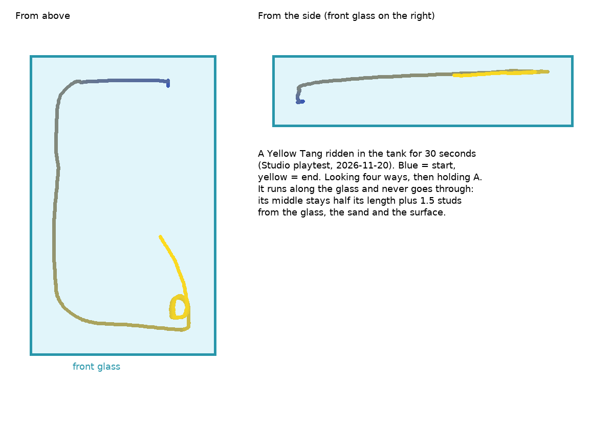

# The aquarium: where a catch goes, and what it earns

> **Studies, 2026-11-16.** Three numbers here were read wrong from the reference: what a size earns, what a colour earns, and income against what a fish needs (theirs rises about as the square). And every trending game shows what a player owns in the open, not behind glass. [Findings](../Findings.md), "What we had wrong" and rank 1, point 7.

Up: [core loop](core-loop.md), [the dock](the-dock.md). Why it came first: [the loop review](loop-review.md).
Built 2026-11-16 on the user's word: "catches are for depositing in your aquarium, in which they then earn money".
The code: `src/server/Services/AquariumService.luau`, `src/client/Controllers/AquariumController.luau`. The numbers:
`Config.Aquarium`. **For the session only: nothing is saved yet.**

## What happens
1. **A tank each.** A player takes the first free plot on the dock as they join, the nearest to the dock's spawn
   first, and gives it up as they leave. Its sign shows their name and what the tank earns.
2. **The catch comes home in your hands.** What you tamed on a dive is still carried at the dock (it was only
   counted before), a failed dive's too. The seven slots stay filled until you put the fish in, and they stay with
   you through the next dive if you don't (you can carry seven).
3. **You wake at your own tank.** With fish in hand, a dive that ends puts you on the floor just in front of your
   tank's glass, facing it, not at the dock's spawn. (Until 2026-11-20 there was a green pad there; Hugo had it
   taken out, task k1.)
4. **You put them in, in the tank's popup** (Hugo, 2026-11-18: "make the player actually be able to place down
   fishes in aquarium once back"; since 2026-11-20, task c1: "make sure that it just outlines the full tank whenever
   you hover over it, remove the click to add and just open the gui when player clicks on it"). Point at your own
   tank from within its reach (36 studs) and the **whole tank** is outlined white (base, glass, frame, sign; outline
   only, no fill); a click (a tap on a phone, which has no hover) opens the popup below, where PUT IN puts one carried
   fish in and PUT ALL IN all of them. There is no control on the glass and no sign over the tank any more, and a
   click on the tank never puts a fish in by itself. A click or number key on a caught slot *holds* that fish (it
   shows on top under IN YOUR HANDS). With fish in the tank the popup's RIDE A FISH (blue, in the left column) gets
   you on the one nearest you (it was the glass control's empty-handed mode). Other players' tanks are neither
   outlined nor clickable. The view turns to the tank and a line rises over it: the fish's name and what it adds a
   second. The server checks it (Action `"Tank"`): on the dock, near your own tank, that fish still in your hands.
   (Before c1: a CLICK / PUT IN TANK control on the glass, task e2, and before that an E prompt and a green pad.)
5. **They swim there and earn.** Up to seven are *equipped*: they earn coins every second and swim in the tank.
   The coin row on the HUD shows itself. A new fish takes a free place; with seven equipped it is *stored* (up to
   60 in all) and earns nothing until you equip it (since 2026-11-19, the popup below; before that the best seven
   always earned by themselves).
6. **The tank's popup** (Hugo, 2026-11-19: "you should be able to click on the plot from nearby, then get a little
   popup where you can equip the best fish instantly, unequip certain fishes and see how much money they produce
   and their rarities and special traits"). See below.
7. **You can ride them, in the tank** (Hugo, 2026-11-20: "make fishes in the tank rideable (in the tank)"). See
   "Riding in the tank" below.

## Riding in the tank
Practice, nothing at stake (task k1, `Config.TankRide`, `TankRideService`, `TankRideController`).
- **Getting on:** with empty hands, the prompt on your tank's glass says "Ride a fish" and names the fish nearest you.
  E puts you on it, inside the tank. Only **your own** tank's fish (owner-only: the server checks the plot is yours).
- **Riding:** the dive's steering: always forward, A and D turn (the view turns with you), and the fish comes round to
  where the camera looks, up and down too. 16 studs a second. Against the glass it slides along it; it can't leave
  the water, through the glass, the sand or the surface: its middle stays half its length plus 1.5 studs inside.
  The rider's machine moves it, and every player sees it (the server gives the rider its physics). The server pulls
  it back if it is ever more than 6 studs out.
- **Safe:** you stay on the dock as far as the game knows (state `Dock`): no Oxygen used, no fail or throw-off, no
  taming, no catch, no coins. The fish stays in the tank and keeps earning.
- **The fish while ridden:** out of its lap, and drawn at least 9 and at most 18 studs long (so there is a back to sit
  on and it can still turn). Getting off puts it back in its lap at its own size.
- **Getting off:** SPACE (a pad's A, the button on a phone; "SPACE TO GET OFF" shows at the bottom). You land on the
  floor in front of the glass. A change to the tank while you ride (the popup's equip) also puts you off.
- **Checked in a Studio playtest by script** (2026-11-20): a Yellow Tang put in by the prompt, then ridden 30 seconds
  (looking four ways, holding A): it stayed inside every wall, the state stayed `Dock`, Oxygen 100, off in front of
  the tank. The path: 
  **Not seen:** Studio's window is off-screen and its pictures are frozen, so no gif yet; the feel, the rider's pose
  and the view are unplayed.

| Number (`Config.TankRide`) | Now | What |
|---|---|---|
| `On` | 1 | 0: tank fish can't be ridden |
| `Speed` | 16 | Studs a second, forward |
| `Turn` | 110 | Degrees a second A and D turn |
| `Follow` | 4 | How quickly the fish comes round to the camera's look |
| `Level` | 14 | Degrees: the camera's usual look down counts as level |
| `Climb` | 40 | Steepest climb or dive, degrees |
| `Margin` | 1.5 | Studs kept from the glass, sand and surface |
| `Least`, `Most` | 9, 18 | How long a ridden fish is drawn |
| `Slack` | 6 | Studs out before the server pulls it back |

## The tank's popup
Built 2026-11-19 (task p1). The code: `src/client/UI/TankPanel.luau`, the server's half in `AquariumService`.
Pictures: [desktop](../attachments/tank-popup-desktop.png), [desktop, scrolled, EQUIP BEST lit](../attachments/tank-popup-desktop-2.png),
[phone](../attachments/tank-popup-phone.png).
- **Opening it:** click (or tap) your own tank (its glass, water, rim or sign) from within 36 studs of the water
  (`PANEL_REACH` in AquariumService, written on each plot as `PanelReach`). Near enough, the whole tank is outlined
  white under the mouse (task c1: a SelectionBox, its edges as white lines 0.3 studs thick, on a clear client-side
  box the size of the plot's parts that stand within the tank's footprint, so the trainer, the upgrade sign, the pad
  and the swimming fish are left out; the box is made again when the tank's parts change. Not a Highlight: a Highlight
  only outlines opaque parts, so round a glass tank it draws nothing useful; tried in Studio, 2026-11-22). No sign over the tank (the old CLICK YOUR TANK / WALK CLOSER!
  went with c1); from further away nothing outlines and a click does nothing. It shuts with its X, a second click on
  the tank, walking 8 studs past the reach, or leaving the dock.
  (The click is tested against the tank's box, not a raycast: the map's glass, water and sign are CanQuery off.)
- **What it shows:** the title, what the tank earns a second, and a card for every fish: IN YOUR HANDS (what you
  carry), EARNING n/7, STORED n. A card has the fish's picture (the partner's renders), its size word (Tiny to
  Colossal, in the tags' size colours), a SILVER, GOLD or RAINBOW chip (and the picture's backdrop in that colour),
  its archetype icons, its name, its rarity in the rarity's colour (the card's edge too), and its coins a second.
- **What it does:** EQUIP BEST (gold while it would change something, else grey BEST EQUIPPED) equips the seven
  best earners and stores the rest; each card's EQUIP or UNEQUIP; PUT IN on a carried fish and PUT ALL IN; RIDE A
  FISH (task c1, shown while fish swim in the tank: Action `"TankRide", "On"`, the one nearest you; the popup shuts).
  Equipping with seven already equipped is refused ("THE TANK IS FULL: UNEQUIP ONE FIRST").
- **Coins a second** on a card are `Config.incomeOf(kind, size, colour)`, the same function the server pays by;
  the server works every fish's number out again on every change, so new numbers (the economy draft) reach fish
  already in a tank.
- **The server decides** (Action `"Tank"`): only on the dock, near your own tank (the reach plus 12 studs of
  slack); refused with Ride `"TankDenied"`, reason `"Far"`, `"Full"` or `"Gone"`.
- **Phones:** the same popup with bigger points (the screen's height over 470 instead of 700) and fewer columns.
- **Checked by script** (`python tools/studio/tank_panel_check.py install`, Play, `... run`): a click from the pad
  opens it; EQUIP BEST took the income from 22.6 to 1,131.7 a second (7 poor fish swapped for the 7 best); unequip
  and equip work; an eighth is refused as Full; PUT IN takes a carried fish; from 70 studs away the popup shuts, a
  click does not open it and an ask is refused as Far. **Not played by hand,** no real mouse or finger: the click
  goes through `TankPanel.click`, the same path a real click takes after the press.
- **Not done:** the archetype icons are blank in Studio on this PC (they are not uploaded and this PC's Studio
  doesn't have the local copies); the phone still is the phone's screen laid out inside Studio's window
  (`PanelPhone`), not a device.

## What a fish earns
**Since task e1 (2026-11-20):** coins a second = what that fish needs (its own whole number: kind, rarity, size and
colour, never a land; `Config.requiredOf`) x 0.025 (`Aquarium.PerRequired`), nothing more for size or colour on top
(the plan's option C default). A Normal plain Clownfish 2 a second, a Colossal Rainbow one 12, a Normal plain Kraken
1,125. The colour's own 1.5 / 3 / 10 are gone (a Rainbow earns twice a plain one, as it needs twice). Fish already in
a tank are counted again by the same rule (`AquariumService`'s `count`). Details: [progression](progression.md),
"What a fish needs is its own".

*Until then (the record):* coins a second = what it takes to hold at home (its land and rarity: the number on its tag
there) x 0.025 x its size's worth x its colour's.

| | Times |
|---|---|
| Tiny, Normal, Big, Giant, Huge, Colossal | 0.8, 1, 1.2, 1.5, 2, 3 (`Config.SizeWorth`: the reference's first four) |
| Normal, Silver, Gold, Rainbow | 1, 1.5, 3, 10 |

- A Shallows Common earns 2 a second, as the reference's first dino does. An Uncommon 2.5.
- **This is what size and colour are for now.** A Giant Gold Common earns 9 a second where a Normal one earns 2.
- The numbers are Claude's first go. Nothing is bought with coins yet, so there is no price to set them against.

## Measured
In the user's Studio on grey-box 15, by script.
- **A whole dive, ended the way a player's does** (the sandbox's safeties off, the Oxygen ran out): Riding →
  Drowning → Dock in 7 to 8 seconds; the player woke on their own plot's pad; three fish went in at once; the tank
  earned 5.6 to 7.75 a second; the coins rose every second.
- **Seen in two pictures:** the view on the tank with three fish swimming in it, the coin row at the lower left,
  the seven slots empty.
- **The sign:** the player's name and "$7.2 a second".
- No errors.
- **Putting in by hand (2026-11-18, task a1, by script):** two fish caught, the dive failed, woke at the tank
  carrying both with the prompt up; a try from 96 studs away refused; the prompt put each in, both swam in the tank,
  the income went 0, 3, 8, the slots emptied and the prompt went away. Pictures: `../attachments/a1-*.png`.
- **Not checked:** two players and two tanks; a full tank of 60; a phone; the line over the tank by eye (it had
  gone by the time the picture was taken).

## What it is not yet
- **Not saved.** Leave and it is gone. Saving is next ([the loop review](loop-review.md), change 1).
- **Nothing to spend coins on.** Oxygen bought with coins (the machine, auras) is change 4. Each plot already has
  a `TrainerSpot` and a `TrainerRide` from the map chat; the training stand-in still uses its own pad.
- **No summary of the dive.** The existing "great dive" banner still shows; it does not list values.
- **The tank's fish don't beat their tails.** They move round their laps as they are. The swim animation only
  runs on fish in the sea.
- **No earning while away,** no selling, no choosing which fish to keep, no fusing.
- **The walk.** From your tank to the gate is 150 to 330 studs: 5 to 12 seconds at the dock's 28 studs a second,
  after every dive. The reference's is 4 seconds. That is the hub's size, for the map chat and the user.
- **More players than plots** (eight): the rest have no tank, and their catch is only counted, as before.

## The numbers
`Config.Aquarium`.

| Number | Now | What |
|---|---|---|
| `On` | 1 | 0: no aquariums, a catch is only counted |
| `Earning` | 7 | How many of a tank's fish earn at once (the reference's pen: 7) |
| `Hold` | 60 | The most a tank keeps; past it the poorest are let go |
| `PerRequired` | 0.025 | Coins a second for each Oxygen the fish needs at home |
| `Silver`, `Gold`, `Rainbow` | 1.5, 3, 10 | A colour's worth |
| `Every` | 1 | Seconds between payments |
| `HomeAtTank` | 1 | Wake at your tank when carrying fish (0: at the dock's spawn) |
| `Show`, `ShowShare`, `ShowLeast`, `ShowMost` | 7, 0.7, 7, 28 | The fish shown in the tank, and how long each is drawn |
| `SwimPace`, `SeeFrom` | 5, 450 | How fast they lap, and from how far a client moves them |

## For the other chats
- **Player attributes, new:** `Coins` (whole coins; the HUD's coin row was waiting for it), `Income` (coins a
  second), `TankFish` (how many the tank holds), `Plot` (the plot's name). `Owned` now counts at the deposit.
- **Action "Place", index, id:** put the index-th carried fish (oldest first) in, if it is still that kind. Refused
  with Ride "Denied", "Place", "Far" off the dock or away from your tank.
- **Ride "Deposited", count, gained, income, id:** sent to the player as a fish goes in (count 1; id its kind).
- **The popup (2026-11-19):** Action `"Tank"`, verb: `"Best"`, `"Equip"` key, `"Unequip"` key, `"PutIn"` index id,
  `"PutAll"`; Ride `"TankDenied"`, reason. Player attributes `TankList` (JSON rows: key, id, size, variant, 1 if
  equipped), `TankEarning` (the most equipped), `Hands` (JSON rows: id, size, variant, as carried). `Tank` (the best
  12, for the sub's "Ride with") is as before. `AquariumService.tankOf` entries gained `Key` and `On`.
- **The map's names it leans on:** `Dock.Plots.PlotN` with `TankWater`, `Pad`, `SignBoard` (`CollectPad` went on
  2026-11-20: the plot's front is the way from `TankWater` to `Pad`, `AquariumService.frontOf`). A plot
  gets an `Owner` attribute (the user id) and a `TankFish` folder while it is someone's.
- **Tank fish** carry the tag `TankFish`. They are not in `Workspace.Fish`, so tags, the lock and the dive's ride never
  see them. A tank ride (2026-11-20): Action `"TankRide"`, `"On"`, fish | `"Off"`; Ride `"TankMounted"`, fish, box
  CFrame, half size | `"TankDismounted"` | `"Denied"`, `"TankRide"`, `"Far"`/`"Empty"`. The rider's player attribute
  `TankRide` is true (AnimController poses them astride); the ridden fish loses its `TankFish` tag and carries
  `TankRider` (the user id).
