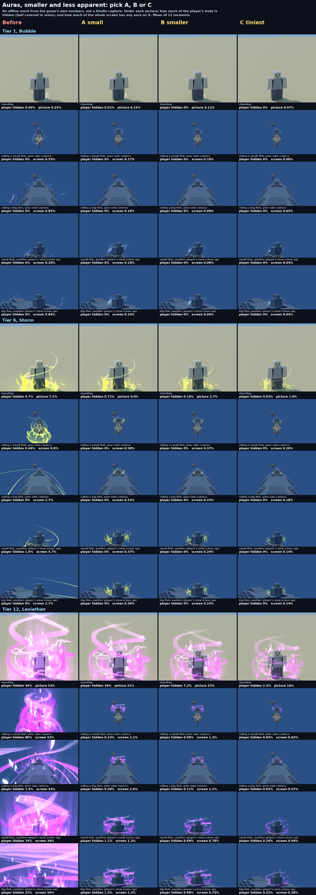
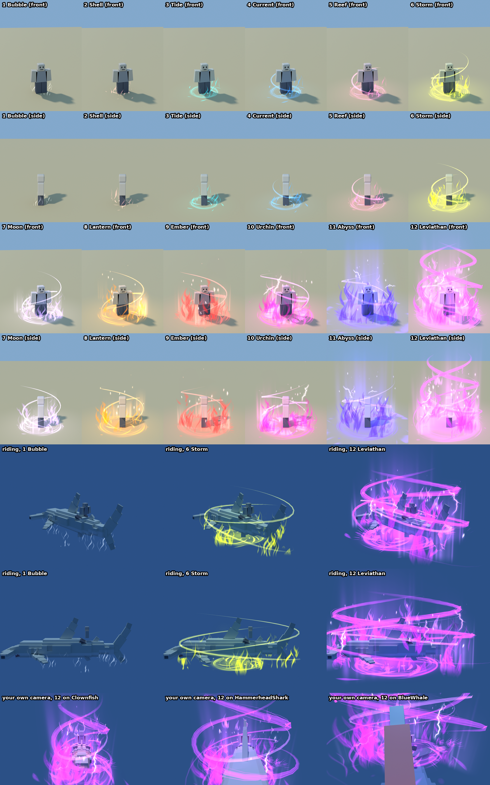
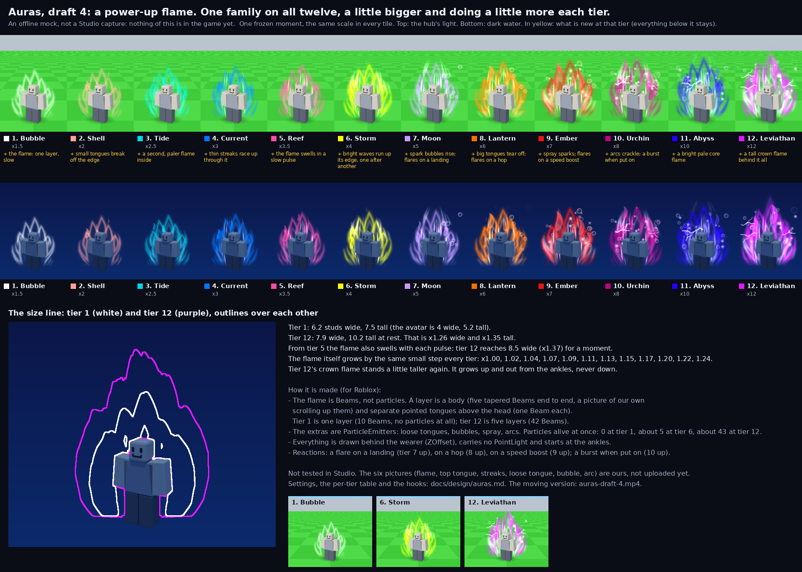

# Auras

Back to [progression](progression.md) (the multipliers and prices) and [UI](ui.md) (the aura shop).

Hugo's words, in order:

- 2026-11-23: "show me auras and implement if approved with their own icons for each generated with chatgpt, make
  sure its one slightly visible aura consistent just changing colours across different auras. Make sure that the ui
  is updated for this too."
- 2026-11-23, on draft 3's sheet: "yes this is way better use this".
- 2026-11-23, late, on seeing draft 3 put together with the icons (a sheet on the branch `auras-draft-3`): "dont allow the aura and
  icons yet make sure the auras get cooler also in how they work as you go along, make sure its more of a dragon
  ball type aura when they turn sayajin, make auras get slightly bigger over upgrades. Icons should be worked upon,
  by sheet i meant sheet of different options by the way but only use this for icons".

- 2026-11-24: "can you make sure that we implement auras, in the ui u didnt remove the placeholder bubbles in the back
  and make sure you can buy them. Prices should be consistent across different parts like the seahorses, make sure the
  scaling is cohesive."
- 2026-11-25: "Make auras surround the player, not be a constant silhouette following the players camera view, but actually
  surrounding the player, it should also fade out when moving and fade in when standing still, this shouldnt apply to riding,
  always seeing the aura."
- 2026-11-25: "Make auras cooler and bigger through progression, should start off less noticeable and the particle effects
  look bad ngl, make them actually fully animated and feel integrated like in the screenshots i sent(especially ref image 4.
  two players riding on dinos with auras)". (The screenshots are read for their feel only.)
- 2026-11-25, 18:18, on the sheet below: "make auras less apparent and especially not as big( cover player especially ) when riding on
  fish, should be way smaller in general when riding a fish."

**State (2026-11-25, later): the 3D look ("Around the body", the next section) is built and on, on the branch `aura-3d`: not
pushed, not seen in Studio, nothing uploaded.** Draft 4's flame is kept behind `Config.Aura.Look` 1 and draft 2 behind 0. What
follows the next section is the flame's own note, and true of `Look` 1.

**Waiting on Hugo: A, B or C** ("Smaller, and less apparent", the next section). Until then `Config.Aura.Small` is 0: as built.

## Smaller, and less apparent: pick A, B or C (2026-11-25, evening; `Config.Aura.Small`)

Offline mock from the game's own numbers, not Studio. [Riding, moving](../attachments/auras-3d-2.mp4): the rows are tiers 1, 6 and 12 from your
own camera on a big fish, and tier 12 on a small one as another player sees it.

`Config.Aura.Small`, read live: **0** as it was built (off, what is in the file), **1** A small, **2** B smaller, **3** C tiniest (`Config.Aura.Smalls`).
**B is the one recommended:** A's tier 12 still lies over some of the fish ahead (10 % of it has some aura on it, 1 % is hidden), B's hardly
(1 %, none hidden), C's not at all, but C drops a ribbon and a serpent, so the top tiers show off least.

- **Riding it is round the rider only,** whatever the fish is: 2.4 to 3.5 studs out from the rider (the arms end at 2) and 2.4 to 4.2 tall, where it was as long and wide as the
  fish and up to 20. The same from your own camera and for everyone else.
- **It never covers the rider:** every piece is drawn behind their body (the engine's ZOffset), but the thin low ribbon, which really goes round them
  at the hips. **What that gives up:** riding, the aura no longer passes in front of the body; standing it still does.
- **Gone while riding, in all three:** the haze, the pillar, the ground ring, the glow, the sweeps, the shock rings, the light. B and C also leave out the
  shafts and the spray, C the second ribbon and one of the two serpents.
- **Still there:** always seen while riding, one design, no tier smaller than the one below, the pieces named above apart each with what it adds (at 12 the crown and the two serpents, one in C).
- **Standing, a bit less:** weaker and smaller (A 0.8, B 0.66, C 0.55 of its strength; the haze, pillar, ring, glow and light cut most), the crown kept over the head. The fades are unchanged.

| Tier 12 | before | A | B | C |
|---|---|---|---|---|
| rider hidden, own camera, small / big fish | 80 % / 1.4 % | 0.23 / 0.30 | 0.09 / 0.11 | 0.04 / 0.05 |
| rider hidden, another player, small / big fish | 74 % / 23 % | 1.1 / 1.5 | 0.69 / 0.88 | 0.26 / 0.42 |
| rider with any aura over them, own camera, small / big | 100 % / 38 % | 0.79 / 1.0 | 0.54 / 0.67 | 0.38 / 0.46 |
| screen with any aura on it, own camera, small / big | 52 % / 43 % | 2.1 / 2.0 | 1.3 / 1.2 | 0.62 / 0.57 |
| standing: player hidden (mean of 12 moments) | 34 % | 19 % | 7 % | 2 % |
| **Tier 6**: rider hidden, every view; screen, own camera, small / big | 0 to 1 %; 9.8 / 2.7 | 0; 0.58 / 0.53 | 0; 0.37 / 0.33 | 0; 0.20 / 0.18 |
| **Tier 1**: rider hidden; screen, own camera, small / big | 0; 0.55 / 0.85 | 0; 0.17 / 0.16 | 0; 0.10 / 0.09 | 0; 0.06 / 0.05 |
| draw calls riding, tiers 1 / 6 / 12 | 1 / 10 / 23 | 1 / 6 / 17 | 1 / 6 / 15 | 1 / 4 / 10 |

Hidden = half covered or more. Two things to know: **A standing at tier 12 still hides 19 %** of the player (40 % at its worst moment); **tier 1 riding is very
faint in all three** (`Wisp`'s first number and `Ride.Wisps` make it stronger).

- **In the code:** `AuraVolume.small`, `hug`, `there`, `part`, `behind`, and guarded lines in `AuraAround`; the controller makes the auras again when the switch is turned.
- **Switch 0 is as it was, proven:** the old and the new `AuraAround` run offline through the same 36 scenes (`tools/auras/volume_same.luau`) write the
  same file, byte for byte; the sums too (20,685 numbers). The old `volume_test` unchanged: 77 of its 78; the 78th read the source for the word ZOffset and now checks the push is 0 at switch 0.
  `volume_test` is now 111 checks, all passing; `aura_test` 61 of 61.
- **Pictures:** no new ones. A, B and C each need the same twelve sheets in `art/ui/aura_volume` (standing uses all twelve). Riding alone uses seven in A (wisp, flame,
  mote, arc, ribbon, jet, shaft) and five in B and C (wisp, flame, mote, arc, ribbon). The shop's card icons (`art/ui/auras/aura_icons.png`) are untouched.
- **The first sheet ([auras-3d](../attachments/auras-3d.png)) had its fish facing backwards** (the mock's fault, not the game's): its riding pictures are of the tail end. Fixed in `volume_scene.py`.
- **To see in Studio:** ZOffset hides the pieces behind the rider (its sign was seen there for the flame), and how much of them a wide fish's back hides with
  it; a phone; the change of shape getting on and off; tier 1 riding is seen at all in murky water; with the stand-in pictures (no uploads yet) the mock's shapes are rougher.
- **Made with** `tools/auras/volume_small.py` (`measure`, `sheet`, `frames`).

## Around the body (2026-11-25, task a1; `Config.Aura.Look` 2)

**The picture is an offline mock:** drawn by our own script from the game's own numbers (`tools/auras/volume_shots.py`), not a
Studio capture. [Moving](../attachments/auras-3d.gif) (2.6 seconds, over and over: the jump is the loop's end, not the aura's).

An aura is a round volume that stands in the world: a circle on the ground as big as its tier, things that rise from that circle
on every side, and ribbons that wind round the body in front and behind. No piece of it is a card placed to face the camera. Its
numbers are plain sums in `src/shared/AuraVolume.luau`, drawn by `src/client/Lib/AuraAround.luau`, worn by `AuraController`. Only
emitters and Beams on unseen parts that stand still under `workspace.AuraFx`, all moved in one go a frame, on each player's own machine.

### What each tier adds

No tier loses anything a lower one had. Sizes are on foot, in studs. A draw call is a Beam or an emitter; "far" is a far player,
"mid" a nearer one or a phone's own, "near" is all of it.

| Tier | Radius, height | New at this tier | Draw calls far / mid / near | Particles alive far / mid / near |
|---|---|---|---|---|
| 1 Bubble | 1.9, 3 | faint wisps rise round your feet | 1 / 1 / 1 | 4 / 5 / 8 |
| 2 Shell | 2.1, 3.7 | thin strokes whip out over the ground | 1 / 2 / 2 | 4 / 7 / 11 |
| 3 Tide | 2.3, 4.5 | a turning ring of light on the ground | 2 / 3 / 3 | 6 / 10 / 15 |
| 4 Current | 2.6, 5.3 | a ribbon winds up round you | 4 / 5 / 5 | 6 / 10 / 15 |
| 5 Reef | 2.8, 6.1 | an inner glow that breathes | 4 / 6 / 7 | 6 / 12 / 22 |
| 6 Storm | 3, 7 | a ring of flames, and a second ribbon | 5 / 9 / 10 | 11 / 18 / 33 |
| 7 Moon | 3.2, 7.9 | tall shafts of light; flares on a landing | 5 / 10 / 11 | 11 / 21 / 38 |
| 8 Lantern | 3.4, 8.8 | embers spiral up; flares on a hop | 5 / 10 / 12 | 11 / 22 / 53 |
| 9 Ember | 3.6, 9.7 | spray bursts out at the foot; flares on a boost | 5 / 11 / 13 | 11 / 27 / 64 |
| 10 Urchin | 3.9, 10.6 | arcs crackle, shock rings; a burst when put on | 5 / 12 / 15 | 11 / 29 / 71 |
| 11 Abyss | 4.1, 11.6 | a towering pillar of light | 6 / 13 / 16 | 14 / 33 / 81 |
| 12 Leviathan | 4.3, 12.5 | two great serpents and a crown of flames | 6 / 16 / 23 | 14 / 35 / 95 |

The flame it replaces was 47 draw calls at tier 12 (measured in Studio); this is 23, and tier 1 is 1.

### When it is seen

- **On foot:** standing still it fades in over `FadeIn` 0.5 s, moving it fades out over `FadeOut` 0.25 s. Moving is faster than
  `MoveAt` 2 studs a second; still is under `StillAt` 0.8 for `StillFor` 0.12 s (between the two it stays as it was). The speed
  is measured from the body's own place on each machine, so **other players' auras follow the same rules**. Swimming and
  drowning are always moving, also when treading water.
- **Riding: always seen,** round the rider and the fish as one: the circle takes the fish's own length and width (`RideWide`,
  `RideLong`, `RideDeep` cap it), the column stands up past the rider, and it goes over smoothly to the next fish.
  **Counted as riding:** a fish in the sea or on land, the trainer, the submarine, a tank ride, and the hop from fish to fish (`Hop` 1).
- **Your own, while riding, is the same one everyone sees:** whole, the fish's size, always ("always seeing the aura"). The lowest tiers ride at
  the fish's back, so a big fish does not hide them in its body. `Config.Aura.EyeCalm` 1 is a calmer one, off: smaller, no haze
  and no pillar, tier 12 at 0.6 of its strength and tier 1 whole, should a high tier prove too much to steer through (the mock's last row).

### Cost

- Whole within `WholeTo` 70 studs, the middle to `FewFrom` 130, few beyond. The three nearest others may have all of it (`Full`), the next
  four the middle (`Half`), the rest few. A phone: the middle for its own (`PhoneOwn`), few for others (`PhoneMost`).
- At most `Lights` 4 soft lights (no shadows): your own, then the nearest; 0 is none, not your own either. Faded out, an aura draws nothing and has no particles.

### Dials

`Config.Aura`: `Look` 2 (this), 1 (the flame), 0 (draft 2), read live; the fade, the riding and the detail numbers above. `Config.Aura.On` is
still only the buying.

### The pictures

Twelve sheets of our own, drawn by sums (`tools/auras/volume_sheets.py`) in `art/ui/aura_volume/`, white, tinted by the tier.
**To upload (Hugo's yes): those twelve files**; the ids go in `Auras.Sheets` ([which is which](../../art/ui/aura_volume/README.md)).
**Until then a live game draws the same volume with the engine's own soft pictures** for six of them (wisp, flame, ring, haze,
mote, glow), leaves the others out (the shock rings among them) and draws the ribbons as plain bands: it is there and it moves, but it is the rougher version.
Studio reads local copies: `python tools/auras/volume_sheets.py --local`, then reopen Studio.

### Checked offline

`tools/auras/volume_test.luau` (78 checks: the ladder grows and loses nothing, the caps, the fade to the hundredth, each way of riding
by the names the server uses, the size on small and giant fish, the detail by distance and phone), `aura_test.luau` (61, the
shop, the server and the flame, unchanged), StyLua, selene, the type checker, a Rojo build. Eight of nine faults put in on purpose were caught
(the ninth, `SpeedOver` next to nothing, is hidden by `StillFor`).

### To see in Studio (nothing of this has been)

`python tools/studio/aura_check.py run` (counts, the fade), then by eye:

1. The spray bursts outward, and the wisps and flames rise from the rim (Roblox's Cylinder and Disc directions are from the manual).
2. What lies flat (the ring, the sweeps, the shock rings) lies on the ground, and stays with the fish when it pitches.
3. Ribbons wind round both sides, with no seam where two Beams meet. In a live game, with no picture: a plain band.
4. Nothing turns with the camera; no light's edge on the ground; several tier 12s side by side; a phone; a second player's aura does not flicker
   as they walk and stop (its fade is worked out from the positions the network sends).
5. Your own tier 12 on a whale or a kraken: nothing is kept away from your camera now (it reaches up to 20 studs, the camera is some 17
   back). Do sprites fill the screen, are the fish ahead readable? `EyeCalm` 1 is the answer if not.
6. With the stand-ins: the ring is `forcefield_vortex_main`, a thin circle with a few bright points, flat on the ground. (Not the old look's
   bubble picture, `explosion01_shockwave_main`, which an earlier version used.) Is it a ring of light to the eye, or is it better left out?

### Three older rules this goes against, for Hugo to say no to

- 2026-11-19: "particles round the body only, nothing on the ground". The new words ask for an aura that surrounds the player, so
  there are strokes, a ring and a glow on the ground (tier 2 up).
- The flame's note says no light. There is a soft one now (`Config.Aura.Lights` 0 takes it out).
- 2026-11-23: "one slightly visible aura consistent just changing colours". The auras now differ by what each adds, as the new words ask.
- **Also readings:** the hop between fish and every kind of seat count as riding; your own is as strong as everyone sees it, also from
  your own camera at tier 12 (`EyeCalm`).

**State before that (2026-11-25): draft 4 is built, the auras can be bought, and it is on main. Checked by script and stills in Studio, not
played by hand.** The last
quote is read as the go for the flame below (**a reading, not confirmed by Hugo**); the old look (draft 2) is kept behind
`Config.Aura.Look` 0. Draft 3 (the soft mist) is not used: Hugo took the yes back (the third quote). What was built and
checked: "Built", below. From there on this note is the mock's, as it was drawn offline.

## Built (2026-11-24; seen in Studio and pushed to main 2026-11-25): the flame, now `Look` 1

- **The flame:** its numbers are `src/shared/AuraFlame.luau` (plain sums, the tables below), drawn by
  `src/client/Lib/AuraBeams.luau`, worn by `AuraController`. It flares on a landing, a hop and a boost, burns faster riding,
  sits at the hips on a fish (a quarter of a second to and from: `Aura.SeatEase`), and is put on with a burst (tier 10 up)
  or a rise: only when the attribute changes on a character already seen, never on a respawn or for players you join.
- **The old look** (draft 2, twelve different effects) is all still there: `Config.Aura.Look` 0, read live. Only the names
  and the shop's tints are the new ones either way (Foam is Shell, Phantom is Urchin). **The old look keeps draft 2's own
  colours** (`Build[1..12]` in `AuraController` has them written in), so worn it does not match its card: Shell (coral) is drawn
  as white foam, Urchin (magenta) as mint and violet, and the others differ too. A live game shows that until the pictures are uploaded.
- **The pictures** are `art/ui/aura_flame/` (white, not uploaded). Studio reads a local copy
  (`python tools/auras/flame_pics.py`, once a PC and again after Studio updates itself). Ids go in `Auras.Pictures`. **Until
  all six have an id, a live game draws the old look;** so does a Studio without the copy. **To upload (Hugo's yes): the six files in
  `art/ui/aura_flame/upload/`** (`aura_flame_f1_t2`, `aura_tip_f1_t2`, `aura_streaks_f1_t2`, turned 180 degrees; `aura_lick_f1`,
  `aura_bubble_f1`, `aura_arc_f1`), not the plain ones beside it: once the ids are set `Aura.Turn` does nothing, and the plain
  three would be upside down and broken at the joints.
- **Three dials, read live, set by what Studio showed (2026-11-25):** `Config.Aura.Turn` 2 (quarter turns of the Beams'
  pictures), `Scroll` -1 (with 0 and 1, the first guess, the flame was upside down and broken at every joint), `Behind` 1
  (the push was right; -1 turns it round).
- **Two changes from the mock, against lines at the body's joints (much thinner, not gone: "Known", below):** every body Beam has one push, -1.1
  (`AuraFlame.Behind`; was -1.5, with -0.8 for the lowest: two pushes part the Beams at the joint), and each Beam leaves its
  joints straight up (a curve of a third of its length, 20 segments).
- **Buying:** `AuraService` (server). A press on a card sends Action "AuraBuy", tier; the server checks that it is the next
  one, that the player is alive, on the dock and within `Aura.Near` of the stall's ring, one ask each half second, and takes
  `Config.Aura.Prices` once. A bought aura is worn at once and replaces the one before. It multiplies **what the seahorse
  gives** (`TrainService.gain`) and nothing else: not the Index, not a pack. The upgrade sign shows the multiplied number.
  Refusals are said on the window ("Not enough coins!", "Buy the Tide Aura first!") with the shops' own sounds. Saved as the
  part "Aura" in `SaveParts` (saving itself is still off). `Config.Aura.On` 0 turns buying off.
- **The stall's cards:** the bubbles and the bubble sign behind the pictures are gone. A plain glow of the aura's colour is
  drawn only where there is no picture (a live game before the upload), never behind one.
- **Prices:** [progression](progression.md), "The aura prices".
- **Checked offline:** `tools/auras/aura_test.luau` (61 checks: the ladder, every tier's Beams and particles against the
  tables below, every moment's numbers, the server's rules, saving), StyLua, selene, the type checker, a Rojo build.
- **Checked in Studio (2026-11-25):** `python tools/studio/aura_check.py run`: 0 faults (buying through the real remote, the
  refusals, the coins to the unit, the cards' prices, what is drawn for all twelve). By eye: tiers 1, 6 and 12 in the hub
  (cameras 14 to 38 degrees down: no floor line through the foot seen) and riding a small and a big fish; the rider, the fish and the
  hook stay readable; a name over a head is readable, weakest over tier 6's yellow. Tier 1 is faint on bright sand.
  [The stills](../attachments/auras-in-game.png).
- **Known, left as they are (2026-11-25), seen in the stills:**
  - **Faint level hairlines** across the flame at regular heights, at tiers 1 and 12 close up (14 and 30 degrees): probably the
    joints, where two Beams bend a little apart.
  - **The flame can be drawn over the wearer.** At tier 12 from a steep camera (30 degrees) a magenta tongue shape lies over an arm,
    and the far side of a hat's brim is tinted (also at 14 degrees, slightly). The arm's is probably a loose tongue particle; the brim's
    probably the flame itself, now only 1.1 studs behind (1.5 in the mock). Not traced.
  - A spark bubble near the feet can be cut by the floor for a moment (tier 12).
- **What it costs:** tier 1, 6 and 12 add 10, 26 and 47 draw calls (one a Beam, one an emitter) and 280, 730 and 1,415
  triangles to the hub's 105 and 54,907; a frame stayed at 16.7 ms on Hugo's PC with one and with two tier 12s (it holds 60).
  That is the Beams and emitters the table says. **Eight tier 12s near each other are about 376 draw calls: a phone has not been
  tried,** and this PC's 60 fps says nothing about one ("Cost", below, has the cheap cuts).
- **Owed:** a real click on a card with the sounds, the flares (landing, hop, boost) and the put-on burst by eye, two players, a phone.
  Not looked at: list items 7, 8 (deep water, other avatars), 9 and 10.

The moving version, 12 seconds, is `docs/attachments/auras-draft-4.mp4` on the branch `auras-draft-3` (5.8 MB, not brought
over). It shows the twelve side by
side in the hub's light and in dark water, tiers 1, 6 and 12 close up, the burst and the flares, and tier 12 ridden
from behind with the game's camera.

## Decided

- **Twelve tiers, x1.5 to x12** (Hugo, 2026-11-19).
- **Round the player in 3D, gone while moving on foot, always there riding, cooler and bigger by tier** (Hugo, 2026-11-25, the last two
  quotes; what was made of it: "Around the body").
- *(Goes against the line above: its ring and glow on the ground)* **Particles round the body only, nothing on the ground** (Hugo, 2026-11-19, draft 2).
- *(Changed 2026-11-25)* **One consistent aura on every tier, slightly visible** (Hugo, 2026-11-23, the first quote).
- **Not the mist. A power-up flame, cooler in how it works as the tiers go up, slightly bigger over upgrades**
  (Hugo, 2026-11-23, the third quote). Draft 3 was approved and then withdrawn; its sheet stays
  on the branch `auras-draft-3` for the record only.
- **Options are for the icons only** (the same quote). So this note holds one aura design, not a choice.

## The look (draft 4)

A flame round the whole body, the kind a character in an anime gets when they power up: it starts at the ankles, is
widest at the thighs, stays broad past the head and ends above it in several separate pointed tongues, the tallest
in the middle. The tongues flicker and sway, and smaller ones stream up its edge. The edge is the bright part and
the middle is see-through, so the avatar, the face and the fish stay readable. The
shapes and pictures are our own, and the sparks are bubbles and spray, because this is the sea. Nothing is taken
from any series or game: no frames, textures, hair, characters or sounds.

It is one family. Every tier wears the same flame in its own colour. Each tier is a little bigger than the one
before and does one more thing, and no tier loses anything a lower tier had.

### The twelve tiers

| Tier | Name | Multiplier | Colour | Flame size | New at this tier | Flame layers (Beams) | Particles alive |
|---|---|---|---|---|---|---|---|
| 1 | Bubble | x1.5 | `#FFFFFF` | x1.00 | The flame: one layer, slow | 1 (10) | 0 |
| 2 | Shell | x2 | `#FFA399` | x1.02 | Small tongues break off the edge and rise | 1 (10) | 5 |
| 3 | Tide | x2.5 | `#00D6E6` | x1.04 | A second, paler flame inside the first | 2 (18) | 5 |
| 4 | Current | x3 | `#0077FF` | x1.07 | Thin bright streaks race up through it | 3 (23) | 5 |
| 5 | Reef | x3.5 | `#FF4DA6` | x1.09 | The flame swells in a slow pulse | 3 (23) | 5 |
| 6 | Storm | x4 | `#F7FF00` | x1.11 | Bright waves run up its edge, one after another, and the streaks rush with each pulse | 3 (25) | 5 |
| 7 | Moon | x5 | `#C999FF` | x1.13 | Spark bubbles rise. **Flares on a landing** | 3 (25) | 16 |
| 8 | Lantern | x6 | `#FF6E00` | x1.15 | Big tongues tear off the top. **Flares on a hop** | 3 (25) | 19 |
| 9 | Ember | x7 | `#E61717` | x1.17 | Fast spray sparks. **Flares on a speed boost**, burns faster while riding | 3 (25) | 33 |
| 10 | Urchin | x8 | `#BF0086` | x1.20 | Arcs crackle round it. **A burst when it is put on** | 3 (25) | 38 |
| 11 | Abyss | x10 | `#2200FF` | x1.22 | A bright pale core flame | 4 (32) | 40 |
| 12 | Leviathan | x12 | `#E019FF` | x1.24 | A tall crown flame behind it all | 5 (42) | 43 |

The names, colours and multipliers are draft 3's, unchanged. No colour was retuned. On the hub's green grass the
pale and warm ones are the weakest, as in draft 3: Shell reads fainter and tanner than its swatch, and tiers 11 and
12 turn pale where the white core sits. On dark water all twelve read as their own colour.

"Particles alive" is the steady number, standing still. A flare lets out up to 39 more for half a second and the
burst up to 70 more for under a second. Draft 3's mist was about 180 a player all the time.

### How big

The flame's own size grows by the same small step each tier, from x1.00 to x1.24. Tier 12 adds the crown, which
stands a little taller again. From tier 5 the flame also swells 9% wider for a moment with each pulse. Measured in
the mock as the outline where the flame covers 0.08 of a pixel or more, over 36 moments:

| | Wide, at rest | Wide, in a pulse | Tall | Against tier 1 |
|---|---|---|---|---|
| The avatar | 4 studs | | 5.2 studs | |
| Tier 1 | 6.2 | (no pulse) | 7.5 | |
| Tier 6 | 6.9 | 7.5 | 8.5 | x1.11 wide (x1.21 in a pulse), x1.13 tall |
| Tier 12 | 7.9 | 8.5 | 10.2 | x1.26 wide (x1.37 in a pulse), x1.35 tall |

At rest every tier is 0.1 to 0.2 stud wider and 0.2 stud taller than the one before; only tier 12 steps more in
height (0.7 stud, the crown). It grows up and out from the ankles, never down: the outline starts 0.3 to 0.4 stud
above the feet on every tier.

### Where "slightly visible" and "cooler" meet

The two pull apart, so this is where the line was drawn:

- **Tier 1 is modest.** One see-through layer, no particles, slow. Its edge covers about half a pixel (0.57) and its
  middle 0.22.
- **Tier 12 is clearly the strongest.** Five layers, bubbles, spray, arcs, a pulse. Its edge covers 0.91 and its
  middle 0.54. That is more than "slightly": it is the reward for the top tier. Tier 6 sits between (0.79 and 0.38).
- These middles are higher than in the first render of this draft (0.12, 0.28 and 0.44). The separate tongues put
  more bright edges inside the outline, so less of it is empty. The fill between the edges was thinned in return:
  in the hub the floor's squares can be read through the flame beside the body on every tier.
- **On every tier the flame is drawn behind the wearer,** so in the mock it never covers the avatar or the face, however strong
  (in the game it can, a little: "Built", Known).
- **No light and no glow.** No PointLight. The colours are only a little brightened (LightEmission 0.2 to 0.3 on the
  Flame, Inner and Crown layers; more only on tier 11's pale Core, 0.6, and on the thin streaks, waves, sparks and
  arcs).
- If tier 12 is too much, the first thing to lower is the Flame layer's strength at the top (Transparency 0.32 at
  tier 12), then the crown.

## How it is drawn

**The flame is Beams, not particles.** The extras are ParticleEmitters. Why Beams:

- A Beam draws a picture with a clean edge, so the flame has a shape. Particles gave mist (draft 3) or a cloud.
- Tier 1 costs no particles at all.
- Roblox draws fewer particles at low graphics quality. A flame made of particles would thin out on phones. A Beam
  should not (believed, not checked: see the Studio list).

### One flame layer

A layer has two parts, all on one unseen, anchored part that the controller moves with the wearer (as
`AuraController` already does in `workspace.AuraFx`). Every Beam faces the camera (`FaceCamera = true`).

**The body: five Beams end to end** between six Attachments, up a smooth outline. All five carry the same picture,
running up through the joints unbroken and scrolling upward.

| Joint | Height above the base, share of the layer's height | Width, share of the layer's width |
|---|---|---|
| Foot | 0 | 0.80 |
| Shins | 0.14 | 0.944 |
| Thighs (widest) | 0.30 | 1.00 |
| Chest | 0.44 | 0.961 |
| Head | 0.58 | 0.843 |
| Top of the body | 0.70 | 0.68 |

**The top: separate pointed tongues, one Beam each.** Each tongue carries a picture of one blade, stretched once
along it (not repeated, not scrolled). Its foot stands inside the body and its point is well above it. The middle
tongue is the tallest and its tip is the layer's full height. Because the tongues overlap at their feet and the
body runs up between them, the middle of the top is closed: there is no gap between the points.

| The Flame layer's five tongues, left to right | 1 | 2 | 3 | 4 | 5 |
|---|---|---|---|---|---|
| Middle, across (share of the width; 0 is the centre) | -0.25 | -0.13 | 0.01 | 0.14 | 0.26 |
| Foot, share of the height | 0.36 | 0.42 | 0.46 | 0.42 | 0.36 |
| Tip, share of the height | 0.70 | 0.88 | 1.00 | 0.80 | 0.64 |
| Width, share of the width | 0.26 | 0.27 | 0.31 | 0.27 | 0.25 |
| Tip leans across by (share of the width) | -0.035 | -0.02 | 0.01 | 0.03 | 0.04 |

The Crown has the same five, mirrored left to right. The Inner layer has three (across -0.15, 0.02, 0.16; foot
0.40, 0.46, 0.40; tip 0.82, 1.00, 0.86; width 0.30, 0.33, 0.30) and the Core two (across -0.07, 0.06; foot 0.42,
0.46; tip 0.88, 1.00; width 0.40, 0.42). The Streaks layer has a body only.

For the Flame layer at size x1.00: the base is 0.25 stud above the feet (the ankles), the height 7.45 studs and the
width 6.6 studs. The body picture's solid band is 0.62 of the Beam's width and its side tongues reach about 0.9, so
the flame you see is narrower than the Beam. Every length is multiplied by the tier's size.

| Property | Value |
|---|---|
| Texture | our own pictures (below), white: `Color` tints them |
| Color | the layer's colour, flat |
| TextureLength (body) | 3.7 studs x the tier's size x the layer's height share: one repeat of the picture |
| Texture scroll (body) | upward, the layer's repeats a second (table below) |
| Transparency along the body | clear at the base, full strength 0.9 stud x size up, full to half the layer's height, then fading out to the body's top (0.70), where the tongues have taken over |
| Transparency of a tongue | the layer's, times the tongue share in the table below; the blade picture fades out toward its own foot |
| LightInfluence | 0 (the same colour in the hub and in the deep) |
| ZOffset | (the mock; built as -1.1 for every one, "Built") -1.5: drawn 1.5 studs further from the camera, so the wearer's own body hides it. The lowest Beam of each body (foot to shins) has -0.8, so the hub's floor does not cut a line through the flame's foot |
| Segments | high (10 or more) on the tongues, which taper to a point |

The five layers. "White" is how far the colour is mixed toward white. Transparency is at the layer's strongest
point; where two numbers are given, the first is at the tier the layer appears and the second at tier 12. "Tongue
share" is how strong the top tongues are against the body (1 is the same).

| Layer | From tier | Picture | Width x | Height x | Tongues | Colour | Transparency | Tongue share | LightEmission | Repeats a second |
|---|---|---|---|---|---|---|---|---|---|---|
| Flame | 1 | flame | 1.00 | 1.00 | 5 | the tier's | 0.42 to 0.32 | 1.0 | 0.2 | 0.62 to 1.0 |
| Inner | 3 | flame | 0.78 | 0.88 | 3 | 40% white | 0.62 to 0.55 | 0.7 | 0.3 | 0.85 to 1.3 |
| Streaks | 4 | streaks | 0.85 | 1.30 | none | 65% white | 0.15 to 0.05 | | 0.5 | 2.2 to 3.0 |
| Core | 11 | flame | 0.60 | 0.76 | 2 | 80% white | 0.55 to 0.50 | 0.7 | 0.6 | 1.7 |
| Crown | 12 | flame | 1.00 | 1.04 | 5, mirrored | 15% white | 0.66 | 0.8 | 0.3 | 1.5 |

Each layer starts its picture at a different point, so the layers never line up. The Streaks body is taller than
the others' (its height share is of the same six joints) and fades out from 0.45 of its height, so the streaks race
on up between the tongues before they go.

**The movement the controller adds, every frame:**

- **The tongues flicker.** Each top tongue's length changes by up to 13% a few times a second, on its own, and its
  tip wanders sideways: 0.16 stud at tier 1 to 0.37 at tier 12.
- **The body bends.** Its joints lean the same way, the higher the further: the body's top moves 0.6 of what a tip
  does. The height bobs by 3.5%.
- **Pulse (tier 5 up).** Every 1.7 s (1.25 s at tier 12) the flame gets 9% wider and stronger (Transparency 0.25
  lower) over 0.14 s, then eases back over 0.6 s.
- **Waves (tier 6 up).** Two short pale Beams run up the Flame layer from the foot to the tips, one starting with
  each pulse and one half-way between. Each takes 0.62 of the pulse's period to get up (1.0 s at tier 6, 0.8 s at
  tier 12), so one is always in sight. A wave is 0.4 of the layer's height long, as wide as the flame where it is
  (its two ends read their widths from the joint table), carries the flame picture, is 75% white, Transparency 0.15
  at its middle fading to clear at both ends, LightEmission 0.6, and thins out above 0.72 of the height.
- **Streak rush (tier 6 up).** With each pulse the Streaks layer goes to full strength (Transparency 0, from about
  0.12) and its picture jumps ahead by about half a repeat.

### The extras (ParticleEmitters)

Each is a Cylinder round the body that lets its particles out upward. All have LightInfluence 0, are locked to
their part (no trail at riding speed) and have ZOffset = -(the cylinder's radius + 1.6), which puts every particle
behind the wearer's body, so none is drawn over the avatar or the face. Sizes marked "x size" grow with the tier.
The first rate is at the tier it appears, the second at tier 12.

| Emitter | From tier | Picture | Rate a second | Lifetime (s) | Speed | Spread | Cylinder: radius, height, centre above the feet (all x size) | Size over its life | Colour | LightEmission |
|---|---|---|---|---|---|---|---|---|---|---|
| Small tongues | 2 | tongue | 7 to 10 | 0.5 to 0.8 | 4 to 6 | 12 | 1.9, 2.4, 3.6 | 1.9 to 0.4, x size | the tier's | 0.2 |
| Bubbles | 7 | bubble | 11 to 15 | 0.7 to 1.15 | 1.5 to 3 | 25 | 2.6, 3.6, 3.9 | 0.42, 0.72, then 1.05 as it pops | 70% white | 0.3 |
| Big tongues | 8 | tongue | 4 to 5 | 0.5 to 0.65 | 3 to 4.5 | 8 | 1.6, 1.6, 5.0 | 3.0 to 0.6, x size | 25% white | 0.25 |
| Spray | 9 | Roblox's soft glow (`explosion01_implosion_main.dds`) | 24 to 30 | 0.4 to 0.7 | 8 to 12.5, Drag 3 | 26 | 2.3, 3.0, 3.5 | 1.1 to 0.45 | 75% white | 0.6 |
| Arcs | 10 | arc | 12 to 15 | 0.14 to 0.24 | 0 | 0 | 2.2, 2.6, 4.1 | 1.5 to 2.2, x size, each 35% bigger or smaller, turned at random | 85% white | 0.8 |

The tongues stand upright (`Orientation = FacingCameraWorldUp`). Bubbles also have Acceleration 2 upward and Drag 1.
The lowest any particle is let out is 2.3 studs above the feet (knee height or higher), so none is at the ground.

### The reactions

| Reaction | From tier | What happens |
|---|---|---|
| Flare on a landing | 7 | In 0.08 s the flame gets 28% wider, 22% taller and stronger (Transparency 0.2 lower), then eases back over 0.5 s. A puff is let out: 14 bubbles and 5 small tongues, and from tier 9 also 20 spray. |
| Flare on a hop | 8 | The same flare as the hop starts. The clip shows it on the seated pose; the hop itself was not mocked. |
| Flare on a speed boost | 9 | The same flare when the fish eats or smashes for a boost. |
| Burns faster while riding | 9 | Every layer scrolls 1.4 times as fast while the wearer rides. The shape does not change. |
| Burst when put on | 10 | In 0.14 s the flame shoots from 0.3 to 1.42 of its height and from 0.5 to 1.5 of its width, then settles over 0.7 s. Let out at once: 20 bubbles, 30 spray, 10 small tongues, 6 arcs, 4 big tongues (those the tier has). Below tier 10 the flame simply rises in 0.3 s. |

"Leans back at speed" was tried and dropped: seen from behind, a flame leaning back stands taller on the screen,
which is the one place it must not grow.

### Sat on a fish

Seated, the flame starts at the hips (1.9 studs above where the feet would be), not at the ankles, and is 0.65 of
its standing height. Otherwise it would start inside the fish and tower over the camera. The emitters' cylinders
are lifted and shortened the same way (centre and height x 0.65, from the hips). The width stays.

**Other poses.** Only two were mocked: standing and seated. Proposed for the rest: the seated flame only while
`State` is "Riding"; the standing flame in every other state (on the dock, swimming free, in the hop, drowning,
carried), always pointing straight up in the world whatever way the body is turned. A hop flare therefore plays on
the standing flame as the rider leaves the fish. How that looks on a body that is lying flat or tumbling is not
known (the Studio list).

**The riding camera** (`Config.Camera`: 17 studs back, 5 up, 70 degrees), a whole 1920 x 1080 screen, measured in
the mock over 12 moments:

| Tier | Screen with any flame on it | Solid enough to hide things (0.5 or more) | The flame's box on the screen | Rider and fish covered |
|---|---|---|---|---|
| 1 | 0.9% | 0.2% | 14% wide, 20% tall | none |
| 6 | 1.6% | 0.7% | 17% wide, 28% tall | none |
| 12 | 2.7% | 1.6% | 20% wide, 29% tall | none |

So at tier 12 it does not block the view, but it is in it: the flame stands round and above the rider's upper
body, in the middle of the screen. What is straight ahead of the rider is seen through the see-through middle, not
past it. A flare makes it about a quarter bigger for half a second. Whether a fish to hop to is easy to pick out
through a tier 12 flame was not tested.

### The pictures

Six small pictures of our own, white with a see-through background, drawn by the mock's script. Each is clear at
its borders (the flame and streaks pictures at their sides only: they repeat top to bottom), so no card shows an
edge.

- `aura_flame.png` (512 x 512, repeats top to bottom): a band with one long and one short tongue to each side, a
  bright rim and a faint fill. The body's picture.
- `aura_tip.png` (192 x 384, used once along a Beam): one pointed blade, widest a third of the way up, with the
  same rim and fill, fading out toward its foot. A top tongue's picture.
- `aura_streaks.png` (512 x 512, repeats): eleven thin upward dashes.
- `aura_lick.png`: one curved sliver, the loose tongue.
- `aura_bubble.png`: a thin ring with a highlight.
- `aura_arc.png`: a jagged line with one branch.

**In the repo since 2026-11-24 ([art/ui/aura_flame](../../art/ui/aura_flame/README.md)), not uploaded:** that needs Hugo's
yes. The files to upload are the six in its `upload/` folder (Flame, Tip and Streaks turned 180 degrees: `..._f1_t2`), because
`Config.Aura.Turn` does nothing once the ids are set.

### Cost, low graphics and phones

- **Tier 1:** 10 Beams, 0 particles. **Tier 12:** 42 Beams, 5 emitters, about 43 particles alive (about 110 for a
  moment in a burst).
- The smooth outline and the separate tongues cost Beams: a layer was 3 and is now 5 to 10 (Flame and Crown 10,
  Inner 8, Core 7, Streaks 5), so a player's aura went from 3 to 15 Beams to 10 to 42. The controller also moves
  every Attachment every frame, because the body's joints bend and the tongues' feet ride on the body: 16 on the
  Flame layer (6 joints, 10 tongue ends), about 64 for a whole tier 12 aura with its waves. If that is too much with
  many auras in view, the cheap cuts are: only the Flame layer's tongues flicker, the Streaks body becomes two
  Beams, and far auras keep only the Flame layer (Ideas, below).
- The flame is Beams, so cutting particles at low quality should only thin the extras (bubbles, spray, tongues,
  arcs), not the flame.
- The other cost is see-through pixels drawn over each other: five layers at tier 12. One aura fills under
  3% of the screen while riding, but several players standing near the camera in the hub fill more. Auras past
  `Auras.DrawRange` (220 studs) are already not drawn.
- None of this was measured on a phone.

## Hooks: what the game sends today

Read from `AuraController`, `Net.luau`, `RideService`, `JumpController`, `RideController` and `Lib/State.luau`.
`AuraController` listened to none of these when this was written; it does now ("Built", above).

| Reaction | The event today | Who gets it | What is missing |
|---|---|---|---|
| Pulse, waves, streak rush (5, 6) | None needed: a clock in the controller | | Nothing |
| Flare on a landing (7) | `Net.Fx` "Land", player, fish, count (`RideService`) | Every client | Nothing new. The controller has to listen. |
| Flare on a hop (8) | The player's `State` attribute turning "Jumping" (`RideService` sets it, it replicates) | Every client | No new remote. The controller has to watch the attribute on every player it draws. |
| Flare on a speed boost (9) | `Net.Fx` "Eat" and "Smash", player, fish, where, count | Every client | Nothing new. A Fast fish's take-off (`State.Launched`) and a Leaper's big hop (`State.Leapt`) are known on the rider's own machine only: other players would see no flare for those without a new `Fx`. |
| Burns faster while riding (9) | `State` is "Riding"; the character's speed can be read on every client | Every client | Nothing new. |
| Burst when put on (10) | The player's `Aura` attribute (1 to 12); the controller rebuilds when it changes | Every client | **A new hook.** `wear()` rebuilds an aura in two cases: the tier changed, or the character is new to this client (`reconcile()`: a respawn gives a new character, and so does every player already wearing one when you join). Coming back into draw range does not run it: `frame()` only puts the aura's folder back. A burst belongs to the first case only, so it must not sit in `wear()` unguarded: fire it only when the attribute changes on a character that already has an aura drawn or was seen without one (a check in the controller), or on a new `Fx` "AuraOn" from the server. Also, nothing on the server sets `Aura` yet and nothing listens for the shop's "AuraBuy" (`Net.luau` says so). |

## For the build (as written before it)

- **One builder in place of twelve.** It takes the tier and adds layers and emitters by the tables above.
  `AuraController`'s twelve tier builders, carriers and ribbons go.
- **The kit's defaults are wrong for this.** Its `emit` sets LightEmission 1 and Brightness 2.5. Set every property
  from the tables.
- **The base.** `baseOf(model)` gives the feet below the root, which is inside the fish when seated. Seated, use
  the hips and the 0.65 height.
- **`Auras.Tiers`:** `Main` is the tier's colour. `Second` and `Blurb` describe draft 2 and are read by the shop
  (`UI/AuraShop.luau`), so the shop changes with this.
- **The landing ring.** `Fx.landing` already draws a flat ring and bubbles at the saddle on every landing. That is
  not the aura and was left alone; look at the two together.

**Check in Studio first** (the list as written; 1 to 5 were looked at on 2026-11-25, "Built"). None of this could be checked from here: the Roblox pages could not be opened, so only
the property names were confirmed (from the local type definitions), not how they behave.

1. **How a picture maps on a Beam that tapers to a point** (the top tongues). It may skew toward the point. If it
   does, more Segments, or a tongue of two Beams.
2. **Which way the picture runs along a Beam.** It may need a quarter turn.
3. **Keeping the picture unbroken through the body's four joints,** and scrolling all five Beams as one
   (`TextureMode`, `TextureLength`, `TextureSpeed`, or setting the offset each frame). If it will not join, make
   each Beam's length a whole number of repeats. And that a picture can be stretched exactly once along a tongue
   whose length changes every frame.
4. **`ZOffset`'s sign** on Beams and particles (negative should push away from the camera), and whether the hub's
   floor cuts a hard line through the flame's foot when the camera looks steeply down. In the mock, at 14 degrees
   down, it does not, with the lowest Beam at -0.8 and the rest at -1.5. The price of -0.8 is that the flame's
   foot may show over the edge of a leg turned toward the camera. With -1.5 a few pixels of a far arm's edge can
   catch a little flame when the avatar is turned; -2 cures that but needs the floor line looked at again.
5. **`FaceCamera` seen from above** (the hub camera can look down steeply): the flame may flatten.
6. **`LightEmission`'s mixing.** The mock takes it as a mix between plain see-through (0) and adding light (1). If
   Roblox differs, the strengths need a retune, most in the bright hub.
7. **Low graphics quality:** that Beams are not thinned, and what the extras look like when particles are.
8. **Fog in the deep,** the flame at full riding speed, other avatar shapes (tall, wide, with big accessories) and
   other fish (a giant's back is far wider than the hammerhead's).
9. **The poses that were not mocked:** the hop, swimming free, carried. And the change from the seated flame to
   the standing one at the moment of a hop: it should grow over a few frames, not jump.
10. **Hop targets seen through a tier 12 flame** with the riding camera.
11. **Several auras near the camera on a phone.**

## How the mock was made, and what it does not show

- The avatar and the fish (the hammerhead) are rendered in Blender, with a depth picture for each view. The flame
  is drawn by a script that plays the Beams and emitters above with their own numbers: the same pictures, sizes,
  rates, lifetimes, transparency and the `ZOffset` test against the body, the fish and the floor.
- It is not a Studio capture. The game's fog, its real light and its ground are not in it: the hub and the water
  are plain stand-ins in the game's colours.
- One blocky avatar, one fish. No sound.
- The scripts are in `work/auras4/` in the worktree `sharedDH-auras` (ignored by git): `avatar4.py` makes the
  Blender passes; `flame.py` holds every number and draws the aura; `show.py video`, `show.py sheet` and
  `show.py measure` make the clip, the still and the numbers in this note. They need Python with numpy and Pillow.

## Ideas, not agreed

- **Past some distance, draw only the Flame layer** (drop the inner layers and the extras), to save phones in a
  full hub.
- **A sound** for the burst and the flares.
- **Leviathan in more than one colour** (a second colour in the crown). It would mark the top tier, but it bends
  "one family".
- **A flare for other players on a Fast fish's take-off and a Leaper's big hop** (needs a new `Fx`, above).

## Open, for Hugo

*(2026-11-25: 1 to 6 are about the flame, `Look` 1. For the 3D look: the ring and light on the ground, the seats and the hop
as riding, and uploading its twelve pictures.)*

1. Is this the flame? (The shape, the tongues, how see-through the middle is.)
2. Is tier 1 modest enough and tier 12 strong enough, or too strong?
3. Is "slightly bigger" right at about x1.26 wide and x1.35 tall for tier 12, or should it be more or less?
4. The order of the twelve "new at this tier" steps: anything to move earlier or later?
5. The burst only from tier 10: should lower tiers get a small one too?
6. On the hub's grass Shell is faint and tan, and tiers 11 and 12 go pale in the middle. Retune those, or leave them?
