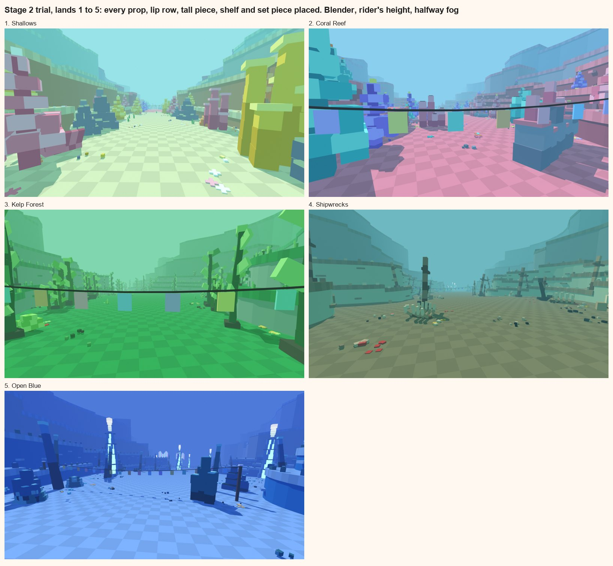
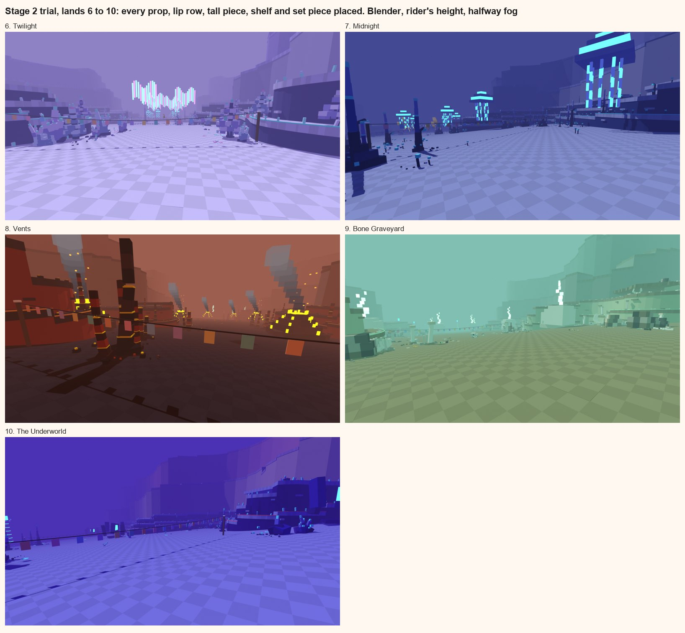
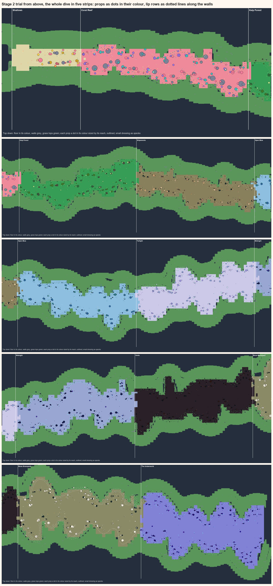
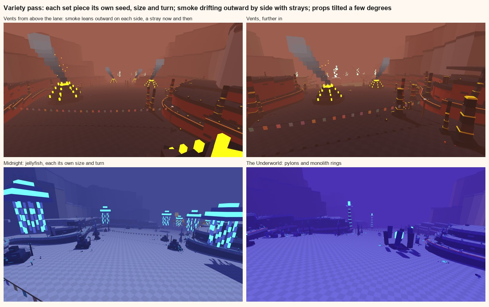

# The map before the big push: what's left, and the order

Up: [Home](../../Home.md). Written 2026-11-19 by the map chat. **A plan for the user to change and agree. Nothing is
built from it yet.**

## What the user asked
"well we have new lands look from spawn, new assets and water. Id rather map out some more stuff before we do a large
push. There are more things to do, like the asset placement, the hils on ride a rido are two layered like ours/the
walls. On the first layer they put rocks or small trees. Its little stuff like this that id like you to research and
replicate. And larger things we're missing. Given all the research we've done + more research"

## Where things stand
Drafted and agreed, none of it in the game yet:
- **The far view from the spawn:** valley, the black hole in cosmic purple, our walls tapering on
  ([props and landmarks](props-and-landmarks.md), 4b).
- **Breakable props close to option B,** simplified into chunks when broken. Lands 1 and 2 are rebuilt; the staghorn
  and the anemone are gone ([props and landmarks](props-and-landmarks.md), 6).
- **A cluster spread** for lands 1 and 2, as a trial build.
- **Colours:** every land's floor and walls copy their nearest reference land's values, the water fog goes halfway, and
  the Underworld becomes cosmic indigo ([colour](colour.md)).

## The new study: the details
From the user's recordings and frames already on this PC (nothing new was fetched). The notes are private, in
`research/ride-a-dino/details/notes.md`, with 31 evidence crops and an overview sheet (`overview.jpg`). The rules, read
for the sea, and who would build each:

| Detail | Their rule | Ours today | For the sea | Who | How noticeable |
|---|---|---|---|---|---|
| **Lip rows** | every terrace lip and wall top: the land's smallest prop in an even row, 1 or 2 studs back, every 12 to 25 studs (grass and pale rocks in Plains, bushes in Forest, pines in Snow, glowing crystals in Cosmic) | random props on some terraces | each land's smallest thing in a row along every lip: sea-grass tufts, small corals, shells, glowing crystals deep down | map | high |
| **Trees on the first layer** | the lowest ledge gets the tall things (leafy trees 2 or 3 players tall), the higher ledges smaller ones, the treads between bare | none by layer | the tall ones on the low terrace (pagoda corals, kelp), the small ones above | map | high |
| **Shelves on wall faces** | 2 or 3 short shelves a stretch in the cap's colour, 6 to 15 studs long, staggered, never in line; their shadows do half the work | none on the faces | the same, in the cap colour; small sponges or shells on some | map | high |
| **Floor clusters** | 3 to 5 mixed props within 20 studs, flowers and a stone at their feet, then open floor | single things, even | done in the trial (groups with a ring of dressing) | map | high |
| **Wall-foot band** | props favour the 10 studs beside the walls | in the outer third | a band of dressing and small props hugging every wall foot | map | medium |
| **Flower clumps** | 3 to 8 flowers together, never one, by trees, rocks and walls | five-tile patches here and there | clumps of sea flowers (tiles, small anemone tufts), never single | map | medium |
| **Crumbs** | tiny cubes everywhere, about one per 10 to 15 studs, in the land's colours | none | in the trial; spread wider and evenly | map | medium |
| **Neck bunting** | a dark rope on two posts, sagging, 2 or 3 players high, 6 to 10 pastel flags | a straight white bar 34 up, no posts | a rope with a sag on two posts (a mast, a coral pillar), our pastel flags | map | high |
| **Soft land borders** | the floor's colour changes along a wavy line in the neck | a straight cut | the tiles' colour blended along a wavy line through the neck | map | medium |
| **Room-mouth markers** | one tall prop on one side of each room's mouth | none | one tall prop of the land at each mouth, sides alternating | map | medium |
| **Giant far silhouettes** | the land's own motif blown up about ten times, in flat fog colour, in the far ring | plain cliffs behind | each land's motif (giant corals, kelp, a ship's ribs, crystals) huge and flat in that land's fog beyond its walls | map | high |
| **Puffs behind runners** | big slow clouds tinted by the land behind every running dino; with the herds, the world's main motion | none | sand puffs and bubbles behind every swimming fish, in the land's colour | game code | high |
| **Land banner with a mood face** | an emoji face and the land's name; the face worries in harder lands | the land's name | add the face, worried from the hard lands on | UI | high |
| **Glow bits** | floating glowing cubes and crystals, only from the Ocean on | glowing ledges deep down | glowing specks and crystals from Open Blue on | map and water | medium |
| **Start strip** | painted outlined words, two cyan pads, a white lip | DIVE IN on the strip | two pads and a white lip | map | low |

**The larger things** (the game's, not the map's, except where noted):
1. **Day and night with a herd reset at dawn:** a 5-minute day, a short night (sleeping dinos show Z's), "ALL HERDS
   RESET!" at dawn. For us: the sea goes dark blue at night, fish sleep, and the herds reset at dawn.
2. **A world event:** their Meteor Shower runs about 4 minutes. The sky turns red, meteors fall, rare variants spawn
   and players pick up shards for the shop. For us it could be a black-hole storm or a falling-star shower. It would
   tie to the Cosmic rarity ([cosmic](cosmic.md)) and to the far view's black hole.
3. **Server-wide spawn calls** that name the land ("A Mythic spawned in the Vents"): each land gets a pull.
4. **Fast travel to unlocked lands:** we have the submarine ("skip to a deeper land"); theirs announces "NOW ARRIVING"
   and drops you onto a dino.
5. **Event dressing in the hub:** a portal arch, seasonal props on the pens.

Not seen in theirs: birds or ambient animals, a sun or moon disc, distance markers in the world, collectibles placed in
the world.

## The order (each stage drafted and checked before the next; then one push into the game)
1. **The kit for every land** (drafted 2026-11-19: [props and landmarks](props-and-landmarks.md), "Every land's kit"). The breakable props in option B for lands 3 to 10, as for 1 and 2, in the new
   palettes. Each land also gets its small things: the lip-row piece, the first-layer tall piece, its crumbs and
   flower clumps, its glow bits from Open Blue on. Checked with a kit sheet per land.
1b. **Set pieces for the later lands** (drafted 2026-11-19): a gate per land and big lit room pieces, Open Blue to
   the Underworld ([props and landmarks](props-and-landmarks.md), "Set pieces for the later lands").
2. **Placing, everywhere** (the set pieces included; a trial built 2026-11-19, see "Stage 2" below). Floor clusters, the wall-foot band, room-mouth markers, lip rows on every terrace lip and
   wall top, tall pieces on the first layer, shelves on the wall faces, soft borders, neck bunting with posts. Checked
   with the top-down maps and rider-height views of every land, plus a count of parts.
3. **Colours and water.** The palette's floors and walls, and the halfway fog with its tint, lit ceiling and specks,
   into `tools/map/water_zones.py`. Checked with the land views.
4. **The far.** The vista from the spawn, and each land's giant silhouettes in its far ring. Phones get the band of
   painted shapes. Checked from the spawn and from inside each land.
5. **The push.**
   - Read the hub's hand placing from the place first.
   - One reload of the whole map.
   - Ride every land.
   - Check what a phone pays at the lowest graphics level.
   - The user saves the place.

**Running alongside, for the other chats** (each on the user's word): the puffs behind swimmers and the chunk break
(game code), the banner's mood face (UI), and later day and night and an event.

**The lands' sizes** come after the push, as the user said ("leave land sizes for now ... after we do assets and test
this look and disperse assets differently").

## Stage 2: placing everything (a trial, 2026-11-19)
The user: "get rid of the curved arch for now and go ahead with the next stage". The Underworld's gate is now two lit
pylons; the portal ring is kept in the file as an option.

`PALETTE=art/map/palettes/proposal.json PROPS2=1 GREYBOX_OUT=art/map/stage2 python tools/map/greybox.py` builds the
whole map with stage 2; without `PROPS2` nothing changes. What it lays:
- **Props in clusters through all ten lands:** a big prop, one or two smaller ones beside it and a ring of dressing,
  along the sides with sides alternating, and the middle kept open. Each land uses its own kit and colourways.
- **Lip rows:** the land's smallest piece every 22 studs along every terrace lip, every 36 on the high tops: 5,764.
- **Tall pieces on the first layer,** smaller ones higher up: 606.
- **Shelves on the wall faces:** short slabs in the cap's colour, staggered, wherever a face is three squares or more:
  1,817.
- **A tall piece at each room's mouth,** sides alternating: 44.
- **Set pieces in lands 5 to 10:** each land's gate at its first neck and the lit room pieces at the sides: 62. They
  are placed before the props, so they get their room.
- **Bunting:** a dark rope sagging between two posts, with pastel flags.
- **Wavy land borders** on the floor.

**Cost: 107,600 parts in the whole map, against 59,000 today.**
- Props make 58,000 of them: 30,000 of those are small dressing and lip pieces, and 28,000 are breakable props.
- The set pieces add 2,350.
- A first try made 159,000; most of that was flower clumps (32,000) and pagoda corals as tall pieces. Each flower is
  now two tiles, the tall pieces stand further apart and the pagoda is lighter.
- A phone draws only what is near, so what matters is a room: about 2,000 to 3,000 parts in view. To measure in
  Studio at the lowest graphics level before the push.
- If it needs cutting:
  1. drop the lip rows on the high tops (about a third of the lips);
  2. merge each prop's small dressing into one mesh per room (the small things never break);
  3. fewer crumbs.

**Seen in the renders, to fix:**
- The bunting rope is a heavy dark line close up; it wants to be thinner.
- The wavy borders barely show from above, because the floor's tiles are big; they need finer tiles at the borders.
- The Underworld reads emptier than the others: its pylons stand back at the sides.
- The Bone Graveyard's floor and fog are close in value.
- Not yet looked at: rider views inside every room (one view per land so far), and the far view from the spawn with
  all of this in.

### Variety: order with hints of chaos (2026-11-19)
The user: "what could we do to make these objects look varied and less repeated. For one, the smoke coming from the
volcanos all goes the same direction and looks a bit wrong. maybe on the right side it goes right and on the left side
it goes left, with a random stray going a diff direction sometimes. Order with hints of chaos"

Done in the trial:
- **Smoke drifts outward,** toward the wall on its side, and about one column in six strays the other way. Each
  column bends a little as it rises, and its puffs vary in size.
- **No two set pieces alike.** Every copy had been built from the same seed, so all the jellyfish, mounds and towers
  were identical. Each copy now has its own seed, its own size (0.8 to 1.2 times) and its own turn (up to 35 degrees
  either way).
- **Props tilt a few degrees** (up to 4) each way, so a row of them never stands quite straight.
- **Lip rows, even with hints of chaos:** the spacing varies by 30% either way, one in twelve is missing, and one in
  eight is another small thing of the land.

Then (2026-11-19, the user: "lets do both towards the desired outcome"), built in the trial:
- **Shapes:** each placed prop is stretched taller and thinner or shorter and wider (0.75 to 1.3), so one kind comes
  in several shapes.
- **Colour runs:** neighbours share a colourway in patches about 150 studs long, one side at a time; one in four picks
  its own.
- **One big one a room:** the room's first group's main prop at 1.7 times, small ones round it.
- **Some already broken:** one group in seven has a prop lying as its chunks beside it.

Still not done:
1. **A second build per kind** (besides the stretching), for the most common ones.
2. **Lean by place:** props on a slope or by a wall lean away from it, as if the current pushed them.

## Questions for the user
1. This order, or something first?
2. Which larger things do you want, and when: day and night, an event, the spawn calls?
3. Should I hand the puffs and the banner face to the game-code and UI chats now?
