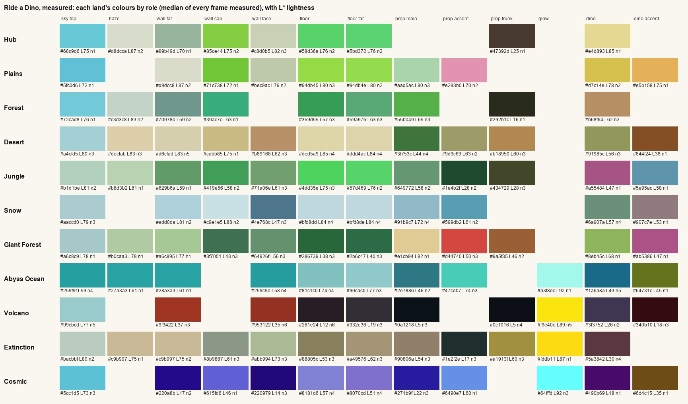
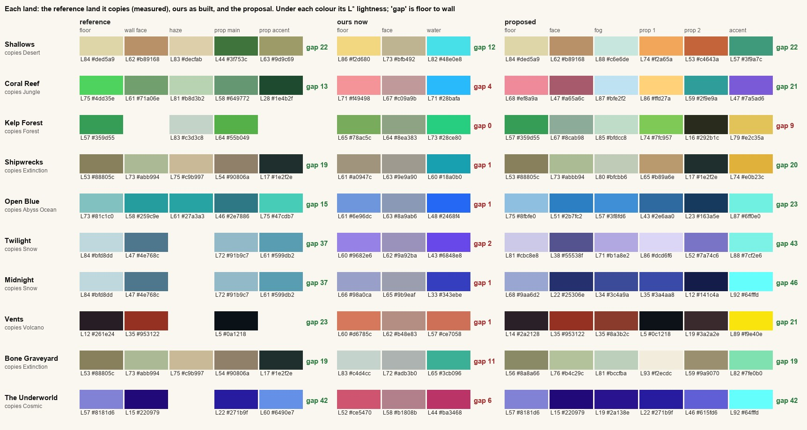
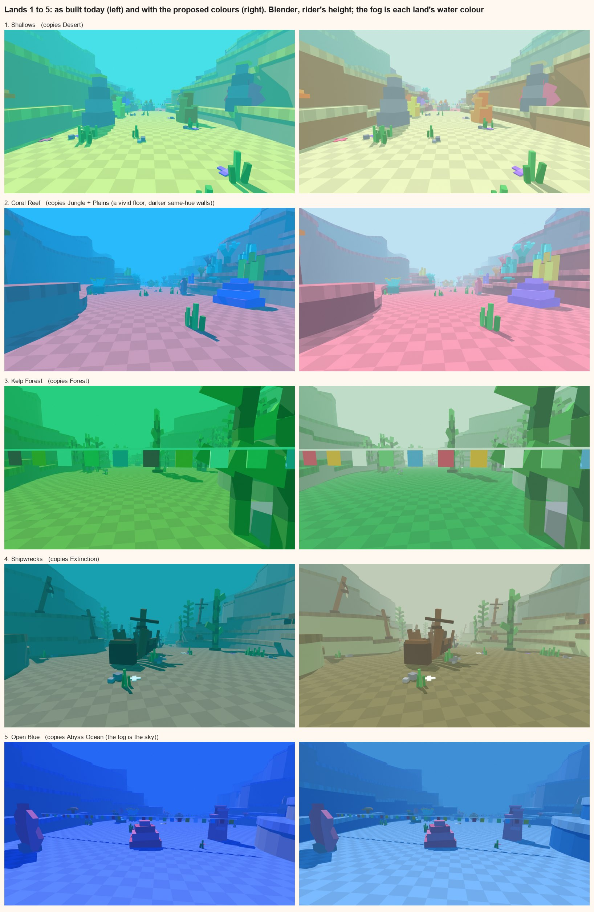
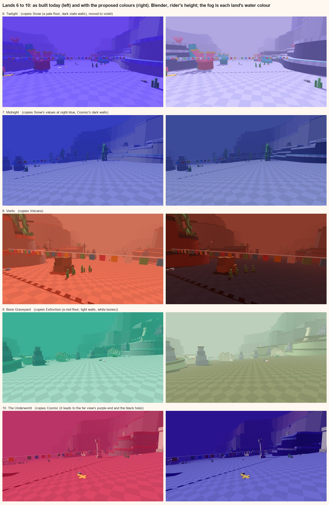
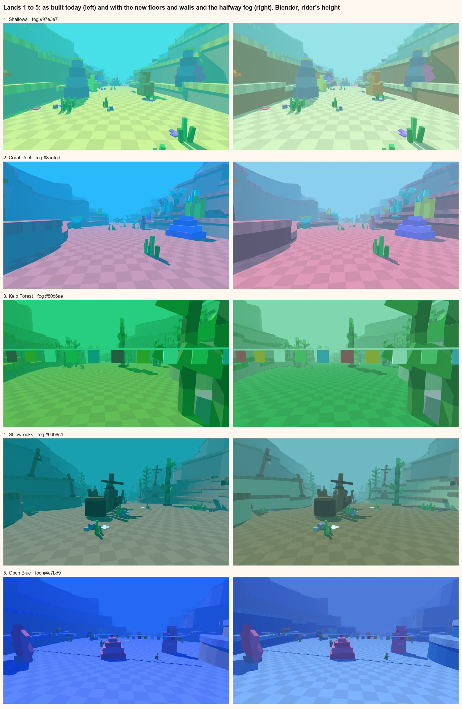
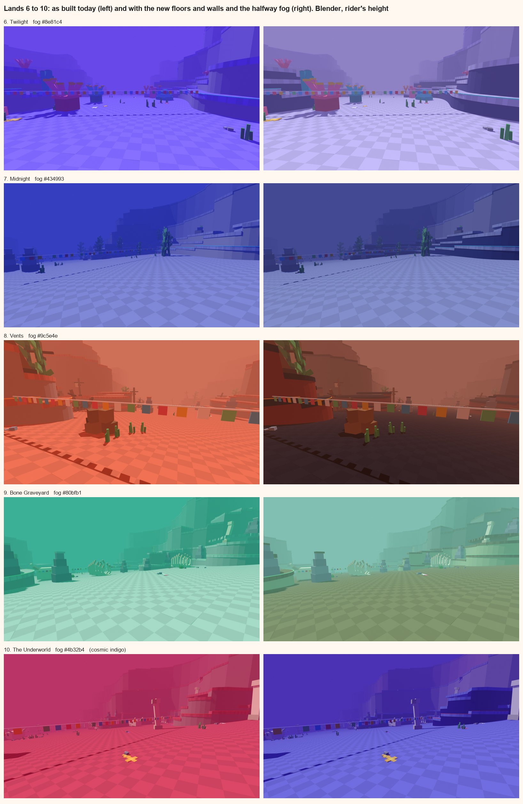
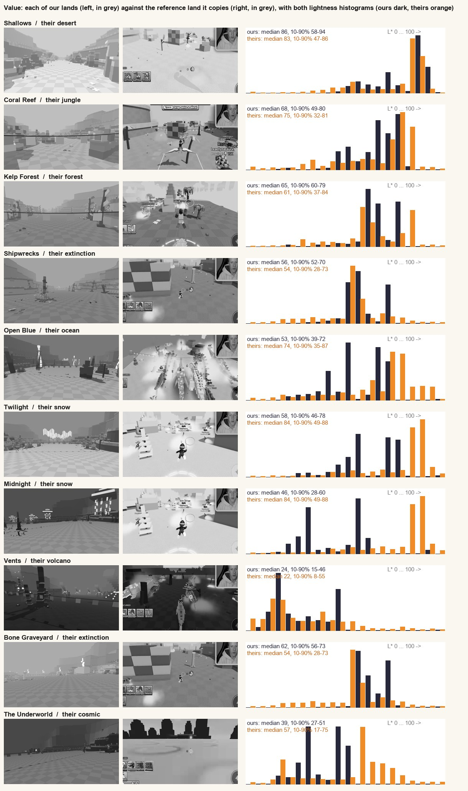
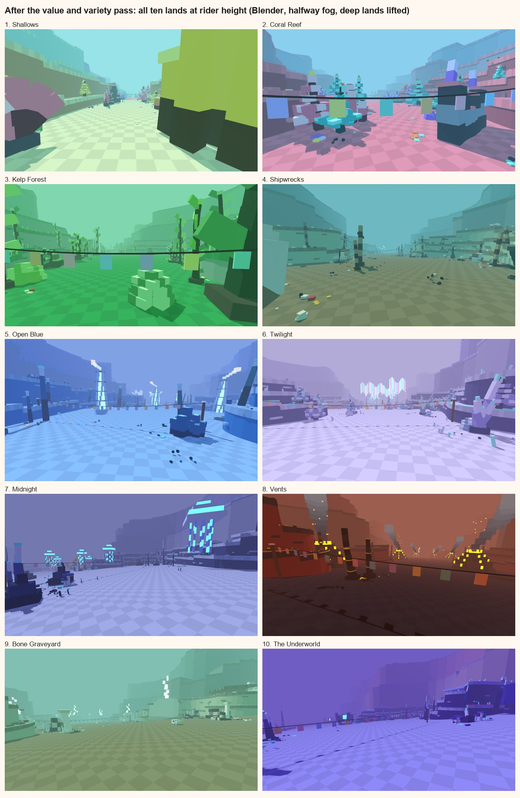
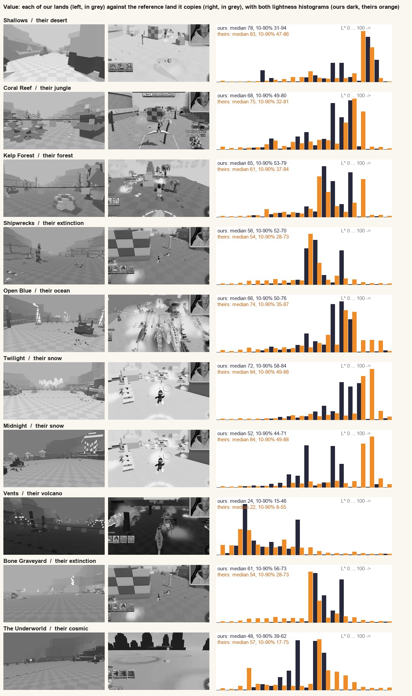

# Colour: how Ride a Dino colours its lands, and a palette for ours

Up: [Home](../../Home.md). Written 2026-11-19 by the map chat. **A study and a proposal. Nothing in the game or the
place has changed.** Renders are Blender, not Roblox.

## What the user asked
"do a large-scale review using all resources possible to look at how Radiodyno uses its color dispersion for all the
lands that it has. By this I mean how the lands are colored, the contrasting color they use between the objects and
the lands themselves. And we need to copy at least the values or a lot of the colors, and then also look at how they
contrast the dynos with the lands ... mainly just looking at how they use the colors and disperse the colors, and
counting the fact that we have like a different color fog. And I just need to build a similar ambience and how they use
color and how they sort the color."

## How it was measured
Every land and the hub, in daylight, from the user's own recordings (hub, Plains, Forest, Desert) and from full-size
frames of four YouTube videos (Jungle, Snow, Giant Forest, Abyss Ocean, Volcano, Extinction, Cosmic). 45 frames in all.
Each surface was boxed by eye and measured by one tool (`research/ride-a-dino/colour/measure.py`: the median colour of
the box, so studs and edges don't skew it, with its CIE L* lightness from 0 to 100). There are 13 roles per land: sky,
haze, far wall, wall top, wall face, floor near and far, prop main, accent and trunk, glow, dino and dino accent. The
frames, boxed sheets, numbers and notes are private, in `research/ride-a-dino/colour/` (`notes_local.md`, `notes_yt.md`,
`summary.csv`). We take the method and the values, never the models.

## What they do
1. **The floor carries the land's colour.** Floors are the most saturated big surface (0.6 to 0.7). In the early
   lands the wall faces are near neutral (0.12 to 0.15); the wall tops repeat the floor's colour family at full
   strength. A land changes its floor's hue and lightness, not its style: Plains to Forest is about 50 degrees of hue
   and 22 L* darker.
2. **Floor and walls are always far apart in lightness: 14 to 43 L*,** and either can be the light one. Light floor
   and dark walls: Snow 85 against 47, Ocean 74 against 58, Jungle 75 against 61, Cosmic 57 against 15. Dark floor and
   light walls: Giant Forest 38 against 56, Volcano 12 against 35, Extinction 53 against 73. The one exception is the
   Desert (85 against 62 to 80), which separates its walls by saturation.
3. **Floor lightness swings from land to land:** 85, 57, 85, 75, 84, 38, 74, 12, 53, 57 for Plains to Cosmic. So
   arriving in a land reads at once, even in grey.
4. **The checker is faint:** two tones of one hue only 1.5 to 3 L* apart, in big squares. The strong two-tone contrast
   goes on the props instead: Jungle's cubes L63 and L28; Extinction's boulders in four tones, L67, 55, 34 and 17;
   Forest's leaves L65 on trunks L16.
5. **Props carry one accent of another hue at high saturation (0.7 to 0.95):** red mushrooms in a green land, yellow
   lava on charcoal, cyan glow on indigo, pink flowers on lime.
6. **One fog colour per land does the whole far view.** Far walls and the horizon converge to one value, the same
   across frames and even across videos. In most lands it is a pale, soft version of the land's own hue (Jungle
   #b6d2ac, Giant Forest #a6c895, Extinction #c9b997, Desert #decdaa, Forest #c3d3c8: L* 75 to 87, saturation 0.15 to
   0.25). In the Abyss Ocean the fog is a strong teal (#27a3a3, L61) and is the whole sky. In Cosmic it is a deep
   indigo (#22098b, L17). The floor barely changes near to far; the walls are what fade.
7. **The sky hardly changes:** about the same pale cyan (#a8d0d0, L78 to 84) in nearly every land. The land's look
   comes from its ground and its fog.
8. **Shadows are deep and turn teal,** about half the lit lightness and more saturated: a shaded wall face moves from
   about 80 degrees of hue to 160. In the Desert they go olive.
9. **Glow comes late and is the lightest thing on screen (L89 to 94):** none before the Ocean, then cyan cubes, lava,
   and in Cosmic cyan everywhere.
10. **Dinos stand out by lightness, not by the land's colour:** dark dinos on light floors (a mammoth L13 on Snow's
    L85), white skeletons (L92) on Extinction's L53, and on Volcano's L12 floor the dinos read by L89 lava stripes. On
    green floors, yellow and tan dinos stand out by hue at about the floor's own lightness. White mist or grey smoke
    puffs follow running dinos.

## Ours, measured the same way
| Land | Floor L*, saturation | Wall L* | Floor to wall gap | Water (our fog) L*, saturation |
|---|---|---|---|---|
| Shallows | 86, 0.47 | 73 | 13 | 82, 0.69 |
| Coral Reef | 71, 0.39 | 67 | **4** | 71, 0.84 |
| Kelp Forest | 65, 0.47 | 65 | **1** | 74, 0.81 |
| Shipwrecks | 62, 0.23 | 64 | **2** | 60, 0.86 |
| Open Blue | 62, 0.50 | 63 | **1** | 48, 0.85 |
| Twilight | 60, 0.43 | 62 | **2** | 43, 0.69 |
| Midnight | 67, 0.25 | 65 | **1** | 34, 0.73 |
| Vents | 60, 0.57 | 62 | **2** | 57, 0.57 |
| Bone Graveyard | 84, 0.08 | 72 | 11 | 65, 0.66 |
| The Underworld | 53, 0.59 | 59 | 6 | 44, 0.72 |

**What that says:**
- **Our walls melt into our floors.** The face is made from the floor's own colour pulled 60% toward a mid grey
  (`face_of` in `tools/map/greybox.py`), so it keeps the floor's lightness. The gap is 1 to 13, against their 14 to 43.
- **Our floors are all middling** (53 to 86) and weaker than theirs (0.23 to 0.59).
- **Our fog is the strongest colour on screen,** at 0.57 to 0.86 in every land, where theirs is soft (0.15 to 0.25)
  in all but two. So our water fights the ground for the eye, and the land's colour reads as tinted water.

## The proposal: their values, our lands
Each of our lands copies the reference land it is nearest to, kept in our own hue where ours has one. The file is
[proposal.json](../../art/map/palettes/proposal.json).

| Ours | Copies | Floor | Wall face | Fog (water) | Props: main pair, accent | Glow |
|---|---|---|---|---|---|---|
| Shallows | Desert | #ded5a9 L84 | #b89168 L62 | #c6e6de L88 | #f2a65a, #c4643a, #3f9a7c | |
| Coral Reef | Jungle and Plains: a vivid floor, darker walls of its own hue | #ef8a9a L68 | #a65a6c L47 | #bfe2f2 L87 | #ffd27a, #2f9e9a, #7a5ad6 | |
| Kelp Forest | Forest | #359d55 L57 | #b2cbb8 L79 | #bfdcc8 L85 | #7fc957, #292b1c, #e2c35a | |
| Shipwrecks | Extinction | #88805c L53 | #abbb94 L73 | #bfcbb6 L80 | #b89a6e, #1e2f2e, #e0b23c | |
| Open Blue | Abyss Ocean: the fog is the sky | #8fbfe0 L75 | #2b7fc2 L51 | #3f8fd6 L57 | #2e6aa0, #163a5e, #6ff0e0 | #a3f8ec |
| Twilight | Snow (a pale floor, dark slate walls), moved to violet | #cbc8e8 L81 | #55538f L38 | #b1a8e2 L71 | #dcd6f6, #7a74c6, #7cf2e6 | #a3f8ec |
| Midnight | Snow's values in night blue, Cosmic's dark walls | #9aa6d2 L68 | #25306e L22 | #3c4a9a L34 | #3a4aa8, #141c4a, #64fffd | #64fffd |
| Vents | Volcano | #2a2128 L14 | #953122 L35 | #8a3b2c L35 | #0c1218, #3a2a2e, #f9e40e | #f9e40e |
| Bone Graveyard | Extinction: a mid floor, light walls, white bones | #8a8a66 L56 | #b4c29c L76 | #bccfba L81 | #f2ecdc, #9a9070, #7fe0b0 | #c8ffd8 |
| The Underworld | Cosmic | #8181d6 L57 | #220979 L15 | #2a138e L19 | #271b9f, #615fd6, #64fffd | #64fffd |

What it follows:
- **A floor-to-wall gap of 19 to 46 in every land,** with the light one alternating as theirs does: light floors
  with dark walls in the Reef, Open Blue, Twilight, Midnight and the Underworld; dark floors with light walls in Kelp,
  Shipwrecks, Vents and the Bones.
- **Floor lightness swings** 84, 68, 57, 53, 75, 81, 68, 14, 56, 57.
- **The fog** is pale and soft in the lands their fog is pale (Shallows, Reef, Kelp, Wrecks, Twilight, Bones). It is
  a strong colour that is the whole sky in Open Blue, their Ocean's way, and goes deep and dark in Midnight, Vents and
  the Underworld, their Volcano's and Cosmic's way.
- **Props:** one main pair far apart in lightness, and one accent in another hue at high saturation.
- **Glow from Open Blue on,** the lightest thing on screen.
- **The Underworld becomes cosmic indigo** (it was crimson), so the last land leads into the far view's purple end and
  the black hole ([props and landmarks](props-and-landmarks.md), 4b).

### As built today and with the proposal (Blender)

The renders change only the floors, walls and fog. Lands 3 to 10 still show the first-pass props in their old colours,
and nothing was changed for the creatures yet.

- **Better:** in every land the walls stand off the floor, the floor carries the land's colour, and the far view
  falls back.
- **The trade-off:** the pale fogs (Shallows, Reef, Twilight, Bones) make those lands look less like being under
  water. That was a rule of the user's (2026-11-12 and 13, [water](water.md)): "vibrant and bright, never murky", each
  land told apart by the water's hue. A middle way: keep each water's hue at about half today's strength (0.35 to 0.45),
  lighter than today, so the floor still wins.

### The user's pick: halfway (2026-11-19)
"Halfway": each land's water keeps today's hue at about half its strength (saturation at least 0.3), and its lightness
sits half way between today's and the pale proposal's. The dark waters (under L* 55: Open Blue, Midnight, Vents, the
Underworld) keep three quarters of their strength (at least 0.5), because halved they went grey and murky, against the
"never murky" rule. The floors and walls are the proposal's. Values: `fog_halfway` in
[proposal.json](../../art/map/palettes/proposal.json).

| Land | Water today | Halfway |
|---|---|---|
| Shallows | #48e0e8 L82, 0.69 | #97e3e7 L86, 0.34 |
| Coral Reef | #28bafa L71, 0.84 | #8acfed L80, 0.42 |
| Kelp Forest | #28ce80 L74, 0.81 | #80d6ae L79, 0.40 |
| Shipwrecks | #18a0b0 L60, 0.86 | #6db8c1 L70, 0.43 |
| Open Blue | #2468f4 L48, 0.85 | #4e7bd9 L53, 0.64 |
| Twilight | #6848e8 L43, 0.69 | #8e81c4 L57, 0.34 |
| Midnight | #343ebe L34, 0.73 | #434993 L34, 0.54 |
| Vents | #ce7058 L57, 0.57 | #9c5e4e L46, 0.50 |
| Bone Graveyard | #3cb096 L65, 0.66 | #80bfb1 L73, 0.33 |
| The Underworld | #ba3468 L44, 0.72 | #4b32b4 L32, 0.72: cosmic indigo (the user, 2026-11-19: "yes cosmic indigo") |

Not yet in the game: the water's other numbers (its tint, the lit ceiling, the specks) still follow today's colours in
`tools/map/water_zones.py`, and the game's water script is built from that file.

## Value: ours against theirs (2026-11-19)
The user: "how does our value distribution compare to ride a dinos". Measured by
[value_compare.py](../../tools/art/value_compare.py): every pixel's L* in the middle of the frame (their UI cropped
off). Ours are the stage 2 trial's rider views, theirs the colour study's frames of the land each copies.

| Ours / theirs | Median L* | 10 to 90% | Dark (under 35) / mid / light (over 70) |
|---|---|---|---|
| Shallows / Desert | 86 / 83 | 58-94 / 47-86 | 0 / 23 / 77% against 4 / 23 / 73% |
| Coral Reef / Jungle | 68 / 75 | 49-80 / 32-81 | 1 / 55 / 44% against 12 / 25 / 63% |
| Kelp Forest / Forest | 65 / 61 | 60-79 / 37-84 | 1 / 68 / 31% against 9 / 56 / 35% |
| Shipwrecks / Extinction | 56 / 54 | 52-70 / 28-73 | 1 / 74 / 25% against 15 / 73 / 12% |
| Open Blue / Ocean | 53 / 74 | 39-72 / 35-87 | 7 / 74 / 19% against 10 / 28 / 62% |
| Twilight / Snow | 58 / 84 | 46-78 / 49-88 | 5 / 49 / 47% against 4 / 19 / 77% |
| Midnight / Snow | 46 / 84 | 28-60 / 49-88 | 44 / 53 / 2% against 4 / 19 / 77% |
| Vents / Volcano | 24 / 22 | 15-46 / 8-55 | 66 / 34 / 0% against 64 / 30 / 6% |
| Bone Graveyard / Extinction | 62 / 54 | 56-73 / 28-73 | 0 / 68 / 32% against 15 / 73 / 12% |
| The Underworld / Cosmic | 39 / 57 | 27-51 / 17-75 | 46 / 54 / 0% against 24 / 59 / 17% |

**What it says:**
1. **Our range is narrow.** Their middle 80% spans 35 to 55 L*; ours spans 15 to 30. A view of theirs always holds
   some near-black (a trunk at L16, a dark cube, a dark dino, a deep shadow) and some near-white (mist puffs, white
   caps, glow). Ours sits in the middle.
2. **We have almost no darks** in the lands that copy their mid lands: 0 to 1% under L*35, where they have 9 to 15%.
3. **The fog fills our frame at a middle value.** Our rider looks along the lane, so the far third of the picture is
   water. Their camera stands higher and looks down at the floor. Part of the difference is the camera.
4. **Our deep lands are much darker than the lands they copy:** Open Blue, Twilight, Midnight and the Underworld have
   a median 18 to 38 L* below theirs. The halfway fog is darker than their pale fog, and so are some of our floors.
   Only the Vents match, and the Shallows are close.

**What would bring it nearer** (proposals, not done):
- **Every prop's darkest tone near L*15 to 25** (a foot, a trunk, a dark seam) and its tips near L*85, so each prop
  carries its own black and white, as theirs do.
- **Pale things over the floor:** the puffs behind swimming fish (the game-code chat's) and pale caps on the lip rows.
- **Deeper shadows** in the game's lighting (Studio's ambient and shadow numbers), which a Blender render can't
  settle.
- **The deep lands lighter,** with their darkness kept in the props, not in everything: Twilight's and Midnight's
  floors and fog up toward Snow's, and the Underworld's floor up toward Cosmic's.

### Widened (2026-11-19)
The user: "lets do both towards the desired outcome, widening and variety in whatever order is best". Values went
first, because they change how everything else reads.
- **Every prop carries its own black and white.** In each palette ([props2.py](../../tools/map/props2.py), "values")
  the dark tone is pushed to about L*26 and the light tone to about L*87, each keeping its hue; the dark stone too.
  The darkest tone is only an accent: a foot, a trunk, a seam. A first try darkened the pillar coral's whole lower
  half and it read as a heavy black block.
- **The deep lands lighter,** with their darkness kept in the props. The fog is lifted by mixing toward white, so it
  keeps its hue and gets a little softer: Open Blue to L*66, Twilight 72, Midnight 52, the Underworld 46. Midnight's
  and the Underworld's floors are a little lighter. (Raising brightness at the same strength made them vivid instead;
  that was undone.) Before and after: `fog_halfway_before_lift` and `floor_before_lift` in
  [proposal.json](../../art/map/palettes/proposal.json).

| Ours / theirs, median L* | Before | After | Theirs |
|---|---|---|---|
| Open Blue / Ocean | 53 | 66 | 74 |
| Twilight / Snow | 58 | 72 | 84 |
| Midnight / Snow | 46 | 52 | 84 |
| The Underworld / Cosmic | 39 | 48 | 57 |

- **Darks now show** in the Shallows (11% of the frame, theirs 4%), the Reef (7%, theirs 12%) and Kelp (2%, theirs 9%).
- **Still narrow** in the Shipwrecks and the Bone Graveyard (no darks), and in the deep lands. The floor and the fog
  fill most of a rider's view, and props are a small share of it.
- **The rest is lighting's work,** in Studio: deeper shadows and the puffs behind swimming fish.
- **Midnight** stays darker than the Snow it copies on purpose: it is the "midnight" land.

## A bit less random: the early lands' props (2026-11-23)
The user: "some of the misc objects especially in the earlier biomes have some colours placed in ways which dont feel
right ... counter in the old map chats research of values and colours to not stray too far from what we wanted but still
change it to look a bit less random."

**What was wrong (measured on the loaded map's props, lands 1 to 4):**
1. **The colour of each small thing was a dice roll.** Big corals, and the stones, shells, starfish and crumbs at their
   feet, each rolled their own of the land's colourways. Of the litter lying beside a big prop, only 43% in the
   Shallows, 21% in the Reef and 48% in Kelp wore that prop's colour, and 4 to 6 different hues met within 90 studs.
2. **The darkest and the lightest tone were used as body colours.** They are for accents (a stem, a seam, a tip). They
   covered 35% dark and 44% light of the prop area in the Shallows, 21/32 in the Reef, 42/22 in Kelp and 45/24 in the
   Wrecks. So one prop read as three unrelated colours. Our water darkens the darks further: the
   reference's dark was measured on screen, after its own light, and ours was written in as that number.
3. **Some colours belonged to no family.** One blue-grey stone in every land; a pink coral on the Reef's pink floor; a
   second, red accent in Kelp and the Wrecks.

**The rules now** (no new hues; the deep lands 5 to 10 are unchanged):
- **Colour by place, not by dice** (`tint_at`, `greybox.py`): each room has a leading colourway. About one patch in
  five, some 150 studs long on one side, is a guest; everything in a patch wears the patch's colour, and one
  big prop in ten strays. The Shallows lead with orange and have gold as the guest (pink only in the last two rooms, on
  the way to the Reef); the Reef's rooms take turns, teal, violet, raspberry.
- **Tone by form** (`props2.py`): bodies wear the main colour, one step up (`Soft`, 8 L*) and one step down (`Deep`,
  13 L*). Dark is for stems, seams and bands only, light for tips and tops only. In lands 1 to 4 the dark is L* 34 and
  the light L* 84 (the others keep 26 and 87).
- **Stone comes from the land's wall face:** sand in the Shallows, rose in the Reef, pale green-grey in Kelp, olive-grey
  in the Wrecks, and it isn't pushed dark.
- **One accent per land:** gold-cream in the Reef, yellow in Kelp, brass in the Wrecks; anchors and bands are iron.
- **The Reef's pink is raspberry**, at least 20 L* off its floor; its teal is the proposal's.

| | Shallows | Reef | Kelp | Wrecks |
|---|---|---|---|---|
| dark / light share of the props, before | 35 / 44 | 21 / 32 | 42 / 22 | 45 / 24 |
| after | 4 / 17 | 9 / 6 | 20 / 17 | 24 / 4 |
| litter in the colour of the prop beside it, before | 43% | 21% | 48% | 88% |
| after | 99% | 47% | 66% | 99% |
| hues within 90 studs, before | 4.5 | 5.8 | 4.1 | 2.8 |
| after | 3.4 | 3.8 | 3.4 | 2.4 |

Nothing moved: 0 of 104,211 boxes differ in shape or place, and the paths are the same; 21,879 bricks in 3,788 models
changed colour. It goes on the loaded place without a reload, so hand placing is kept:
`tools/map/prop_recolour_luau.py <old parts.json> <new parts.json>` writes `tools/studio/prop_recolour/`, and the same with
the two files the other way round puts the old colours back. A model somebody painted by hand is left alone and named.

**Offered, not done:** taking the proposal's own prop colours whole (`proposal.json`, the props pair). It is a bigger change of look.

## For the creatures later
Their rule is lightness first: a creature reads when it is at least about 20 L* off the floor, or when it is a
different hue on a green floor. With floors that swing from land to land, a land's creatures should lean the other way
from its floor: dark or strongly coloured fish on the pale floors (Shallows, Twilight), pale or glowing fish on the dark
ones (Vents, the Underworld). Their running dinos also kick up pale puffs, which lift them off the ground.

## How to try it
`PALETTE=art/map/palettes/proposal.json GREYBOX_OUT=<folder> python tools/map/greybox.py` builds the map with the
proposal's floors and walls; without it nothing changes. The viewer takes each land's fog by `FOGS='[[r,g,b], ...]'`.
`python tools/art/palette_sheet.py` draws the comparison chart.

## Open questions for the user
1. ~~The fog~~: halfway (the user, 2026-11-19).
2. ~~The Underworld as cosmic indigo~~: yes (the user, 2026-11-19).
3. Change the wall faces in the game to the proposal's (a reload of the map, after reading the hub's hand placing)?
