# Cosmic: a rarity above Mythic, and a book of effect ideas

Up: [Home](../../Home.md). Written 2026-11-17. **A draft of ideas for the user to pick from. Nothing is built and
nothing in the game has changed.** It follows the rarity ladder of [workout 5](../style/05-rarity-look.md) and the
[roster](roster.md).

## What the user asked
A Cosmic rarity above Mythic, and many ideas for it: VFX, lighting, VFX animations, cool gimmicks. Their examples: a
hole in the stomach with a black hole in it and a cool chamber round it; a mutant skeleton cyborg.

## What makes a Cosmic (proposed)
A Mythic is a creature of myth. **A Cosmic is not from this sea at all:** it came from the sky, or from outside, or
something rebuilt it. Three things set it apart, and every Cosmic has all three.

1. **A set piece.** One thing you would describe to a friend in a sentence: "the whale with a black hole in its
   belly". It is a place or a machine built into the body: a chamber, a window, a tank, a cage, an engine.
2. **A cycle.** The set piece does something on a loop, by itself: it feeds, it winds up, it erupts, it opens. A
   Mythic glows and pulses; a Cosmic has a show.
3. **It changes the water round it.** Its light falls on the rider, the floor and the fish nearby, and its arrival is
   an event for the whole server.

The next rung of the ladder, beside Mythic:

| | Mythic | Cosmic |
|---|---|---|
| **Kind** | not real: myth | not of this sea: from the sky, from outside, or remade |
| **Length (studs)** | 30 and up | 30 and up, with room for one small joke (a star the size of a pufferfish) |
| **Silhouette** | parts no animal has | the outline has a hole or a break: something missing, floating or orbiting |
| **Colours** | a dark body and two glowing colours | a calm body, one impossible material, one or two lights |
| **Pattern** | pattern that glows and moves | a picture of somewhere else: stars, a circuit, a map, a dial |
| **Glow** | whole ribbons, pulsing, casting light | light with a cycle: it builds, peaks and rests |
| **Movement** | floating parts, a trail, an aura | a part with a life of its own: it orbits, turns, opens, feeds |
| **New** | | the set piece, and an arrival the whole server sees |

**The rule that keeps it clean.** Workout 5 found that more features make a mess, not a rarer creature. So a Cosmic
spends nearly everything on the set piece, and **the rest of its body is the calmest in the game**: big plain blocks,
one colour, no stripes. Louder is not rarer; contrast is. One set piece, at most three things that support it.

**Its colour in the menus (proposed):** a slow gradient from cyan through violet to magenta, where the other rarities
have one flat colour. A flat fallback of pale cyan-white.

## The toolbox: what Roblox can do
No custom shaders, so every effect is made from these. "Cost" is for a low-end phone. Anything marked *test* I have
not seen work in Studio for this use.

### Light
| Tool | What it gives | Cost |
|---|---|---|
| Neon parts with bloom | the glow itself; what our glow faces already are | cheap |
| PointLight, SpotLight, SurfaceLight on a part | light that really falls on the rider, the floor, other fish | dear: two a creature at most, shadows off |
| A light whose brightness and colour are animated | a heartbeat, a flicker, a slow swell, a flash | cheap once the light exists |
| A SpotLight on a turning joint, with a Beam for the visible cone | a lighthouse sweep, a searchlight, a scanner | fair |
| A big see-through dark sphere, and the rider's own fog and tint shifted while near | "it brings its own night": Roblox has no dark light, so darkness is faked | fair; rider-only parts are cheap |
| Highlight | an outline or a flat tint over the whole creature, seen through walls if wanted | cheap, but only about 30 at once in view |

### Surfaces
| Tool | What it gives | Cost |
|---|---|---|
| A texture that scrolls over a part | flowing lava, drifting stars, static, falling sand, running water | cheap |
| Several see-through layers at different depths, each scrolling at its own speed | false depth: a star field or a tunnel that seems far deeper than the chamber is | fair; *test* how see-through layers sort |
| ForceField material | a moving shimmer over a shape: a shield, a gas, a ghost | cheap |
| Glass, metal with reflectance | a tank wall, chrome, mercury | cheap; *test* what shows through glass under water |
| A screen on a surface (SurfaceGui) | readouts, a radar, a blinking eye, a countdown; it can glow whatever the light | cheap; never animated text size |
| Parts that fade in and out | flicker, phasing, a glitch | cheap |

### Things that move
| Tool | What it gives | Cost |
|---|---|---|
| ParticleEmitter | bubbles, embers, sparks, dust, stars, smoke; with a pull toward a point they spiral inward | fair: cap the rate |
| Beam | lightning between two points, tethers, aurora ribbons, the lines of a constellation, light shafts | fair |
| Trail | a ribbon left behind a fin or a tail: ink, light, afterimage | cheap |
| Parts on their own joints (what our swim already uses) | rings and moons that orbit, gears, pistons, doors, floating shards, a jaw on rails | cheap |
| Ghost copies of the body, fading | echoes that follow half a second behind | fair: a few copies only |

### For the rider and the world
- **The rider's screen while riding one:** a tint, a wider view at speed, a shake on the cycle's peak, a ring at the
  edge of the screen.
- **Sound:** a hum that rises with the cycle; a sting at its peak; the sea going quiet when it arrives.
- **The sea reacts:** small fish scatter or are drawn in; bubbles bend toward it; the floor under it lights up.
- **The arrival:** the zone dims for everyone, a mark appears where it will come, then it comes.

### A budget (proposed), so it runs on a phone
At most 2 lights, 6 emitters (60 particles a second between them), 8 beams and 6,000 triangles a Cosmic. Everything
at full only within 150 studs, a quarter to 300, off beyond: the same distances the swim animation already uses. One
Cosmic alive in a server at a time. A "fewer effects" setting that keeps the set piece and drops the rest.

## Gimmicks by family
Ideas to mix. The creature concepts below each take one of these as their set piece.

### Chambers and windows (a place inside the body)
- **A black hole in the belly.** A hole right through the body; in it a matte black ball with a bright tilted ring.
- **A window to the stars.** The flank or the open mouth shows a star field far deeper than the body is thick.
- **An aquarium.** A glass belly with a small reef and tiny fish swimming in it.
- **A caged star.** A ribcage with a small sun held in it, beating.
- **A reactor tank.** A glass cylinder of green liquid that sloshes as the creature turns.
- **A storm in a bottle.** A glass dome with a thundercloud in it, lit by its own lightning.
- **An hourglass.** Glowing sand falls through a glass waist; when it runs out the glass turns over.
- **A furnace.** A door in the chest that opens on the cycle and lights everything orange.
- **A doorway.** A ring set through the body, and what you see through it is not the sea behind.

### Remade (something rebuilt it)
- **Mutant skeleton cyborg.** Bone, steel and raw growth in thirds: one side machine, one side mutation.
- **Clockwork.** Brass plates with cut-outs, gears turning inside, a key in its back.
- **A wreck made to swim.** A submarine or a satellite grown into the animal, still blinking.
- **Stitched.** Parts of several creatures bolted together, each a different colour, with cables between.
- **Armour with nothing in it.** Plates in the shape of a creature, empty, a light where the heart was.

### Broken and floating
- **Shattered.** The body in nine shards hanging apart round a bright core; they close up when it surges.
- **Cut by portals.** The front half leaves one ring while the tail is still entering another, with nothing between.
- **A constellation.** No body: stars joined by thin lines in the shape of the animal.
- **A head that leads.** The head floats a little ahead of the neck, joined by a thread of light.
- **Orbiting fins.** Fins not joined on: they circle the body slowly and snap into place to turn.

### Made of something else
- **Gas.** A cloud in the animal's shape with dark bones showing inside it and stars in it.
- **Liquid metal.** A chrome skin that sheds drops, and the drops drift back.
- **Stained glass.** Leaded panels lit from inside, throwing coloured light on the floor.
- **Ink.** Matte black with a white rim, leaving brush strokes in the water that fade.
- **A hologram.** Scan lines, a flicker, a projector unit somewhere on it that is the only solid part.
- **Crystal.** A prism that splits one white beam into a fan of colours.

### Carrying a place
- **A ringed planet for a shell,** with two moons going round at different speeds.
- **An island on its back:** a tree, a hut with a lit window, a waterfall that never runs dry.
- **A lighthouse for a lure,** its beam sweeping the sea floor.
- **An observatory:** a dome on its back that opens, and a telescope that tracks the rider.

### Tricks with time and space
- **Echoes.** Faint copies of itself follow half a second behind.
- **A glitch.** Parts jump out of place and back; squares of the wrong colour; a doubled outline.
- **Falling upward.** Its bubbles and its sparks fall toward it, not away.
- **A pull.** Small fish near it circle it like moons until it has passed.

## Lighting ideas
1. **The eclipse rim:** a black disc with a blazing edge; the light falls in a ring round it, dark in the middle.
2. **The heartbeat:** one light at the core; each beat sends a pulse of glow along lines to the fins and the tail.
3. **The lighthouse sweep:** a narrow beam that turns, crossing the rider every few seconds.
4. **Its own daylight:** a warm light on a cold deep zone, so the floor under it looks like the Shallows.
5. **Its own night:** the water goes dark round it and only its lights show.
6. **Stained light:** three small lights of different colours, so the rider is lit in moving patches.
7. **Lightning from inside:** a body that is dark until a flash shows its skeleton for a moment.
8. **The scanner:** a thin red line of light that runs down the rider and the floor.
9. **The nova:** a slow swell over half a minute, a white flash, then dark, then again.
10. **A light that travels:** glow that moves from nose to tail in a wave, in time with the swim.
11. **Under-light:** a soft glow on the sea floor beneath it that follows it, like a ship's shadow turned to light.
12. **Embers:** no lamp at all; the light is hundreds of small sparks, so it flickers.

## Animations for the set piece
1. **Feed:** the black hole flares, the plates round it bend inward, bubbles from all round rush in.
2. **Wind up:** gears race, a spring tightens, a chime, and it surges.
3. **Vent:** hatches open along the spine in order, nose to tail, and steam pours out.
4. **Open:** a dome, a ribcage or a jaw unfolds to show the thing inside, then shuts.
5. **Turn over:** the hourglass flips; the creature rolls once with it.
6. **Scatter and draw:** the constellation's stars fly apart and are drawn again, line by line.
7. **Close up:** floating shards slam together into a whole body for a few seconds.
8. **Blink:** it vanishes into one ring and comes out of another a few studs on (seen only; the ride does not move).
9. **Boot:** eyes flicker on one at a time, a readout scrolls, pistons test.
10. **Totality:** the eclipse's rim narrows to one bright bead, then spreads again.
11. **Slosh:** liquid in a tank leans the wrong way on a turn, then settles.
12. **Orbit swap:** two moons change places, or a ring tilts flat and back.

**When they play.** Each Cosmic has its own, in the places the game already has moments: on the cycle while it
swims; when a rider lands (in place of the common landing reactions); when it surges; when it is tamed; and when it
arrives.

## Creature concepts
Twenty-four, to pick from. Working names. Each is one body, one set piece, its light, and its show. Most would sit
on the bodies the roster keeps for the top rarities (shark, sea lizard, serpent, giant).

| # | Working name | The body | The set piece | Light | The show |
|---|---|---|---|---|---|
| 1 | **The Hollow** | a huge plain whale, slate blue | a round hole through its belly, lined with dark ribs like a hall; in it a black ball with a tilted ring of white-orange | the ring lights the hall's walls and the floor below | Feed: the ring flares, the belly plates bend in, bubbles from 30 studs round spiral into it |
| 2 | **The Rebuilt** | a giant shark's skeleton | steel over half the skull with a red lens for an eye; a jaw on pistons; a green tank in the ribcage; on the other side raw growth, a cluster of eyes, a third fin | red from the lens, green from the tank | Boot, then Vent: the jaw's pistons fire, hatches open down the spine |
| 3 | **Star Chart** | a serpent with no body | stars joined by thin lines; a faint mist where the flesh would be | each star a small glow; no lamp | Scatter and draw; the lines stretch when it speeds up |
| 4 | **Totality** | a manta ray | a flat black disc with a blazing edge, a dark moon on its back | the eclipse rim | Totality: the rim narrows to one bead, then spreads |
| 5 | **The Keeper** | a broad slow leviathan | a glass belly: a reef inside, a dozen tiny fish swimming round | warm, from inside the tank | the little fish all turn and follow the rider's side |
| 6 | **Ringbearer** | a turtle | a banded planet for a shell, a ring of ice shards round it, two moons | the ring glitters; one moon glows | Orbit swap; the ring tilts flat when it dives |
| 7 | **The Orrery** | an old armoured fish in brass | gears seen through cut-outs; a small model of planets turning over its back | brass glints; one lamp at the middle | Wind up; it swims in ticks, not smoothly |
| 8 | **Shardback** | a sea lizard in crystal | nine shards floating apart round a white core | the core, split into a fan of colours | Close up on the surge, then drift apart again |
| 9 | **The Crossing** | a long shark | two rings: the front half comes out of one, the tail goes into the other, a gap between | the rings' edges | Blink: the rings jump ahead and the shark follows through them |
| 10 | **Bottled Storm** | a jellyfish | a glass bell with a thundercloud in it; its arms are lightning | lightning from inside | a strike runs down one arm to the floor every few seconds |
| 11 | **Little Sun** | a pufferfish, small | it is a star: a burning ball with spikes of flame | the nova | swells for half a minute, flashes, shrinks; the flash whites out the rider's screen for a moment |
| 12 | **Dead Signal** | a whale | a wrecked satellite grown into its back: panels for fins, a dish, a blinking beacon, a cable trailing | the beacon, slow and red | the dish turns to face the nearest player; static |
| 13 | **Error** | an eel | squares of the wrong colour, parts out of place, a doubled outline | flat and harsh, like a screen | it jumps a few studs and leaves a copy that fades |
| 14 | **Brushstroke** | a koi or a dragon | matte black with a white rim, drawn rather than built | none of its own: it is the dark thing in a lit sea | its trail stays as ink strokes that fade |
| 15 | **Keeper of the Light** | an anglerfish | its lure is a lighthouse lamp on a stalk | the lighthouse sweep | the beam stops on the rider for a second, then moves on |
| 16 | **Last Hour** | a nautilus | its shell is an hourglass of glowing sand | the sand | Turn over; echoes of itself trail behind it |
| 17 | **Nebula** | a whale made of gas | a violet-pink cloud with dark bones inside it and stars | soft, from all of it | pieces drift off its tail and catch up again |
| 18 | **Falling Star** | a marlin crusted in rock | a bill that burns as if entering the air; cracks that glow | embers | a ring of white bursts off it on the surge; a boiling wake |
| 19 | **Quicksilver** | a shark in liquid metal | a chrome skin that sheds drops which float back | reflections only | it parts into blobs round an obstacle and joins again |
| 20 | **Heartstar** | a ribbed leviathan | a small sun caged in its ribs for a heart | the heartbeat | every tenth beat is a big one: the ribs open a little |
| 21 | **The Visitor** | a ray shaped like a saucer | a ring of lamps chasing round its edge; a cone of light underneath | the cone, on the floor | small fish drift up into the cone and are let go |
| 22 | **Cathedral** | a ray in stained glass | leaded panels lit from inside | stained light | the colours turn slowly, like a window at sunset |
| 23 | **The Gate** | a giant with its mouth open | the mouth is a doorway: a tunnel of stars far deeper than the head | cold, from the mouth | Falling upward: everything near drifts toward the mouth |
| 24 | **World-Carrier** | a vast turtle | an island on its back: a tree, a hut with a lit window, a waterfall off the edge | the window; fireflies | at the cycle's peak it is night on the island and day in the sea, then they swap |

**Ones that sit close to creatures we have,** and how they differ: the Rebuilt beside the Bone Leviathan and the
Halfbone Megalodon (those are bone; this is machine and mutation); the Hollow and Nebula beside the Void Whale and the
Phantom Whale; Bottled Storm beside the Aurora Jelly; Keeper of the Light beside the three anglers. If one of these
is picked, its neighbour should be looked at again.

## The first two, built as trial models (2026-11-17)
The user: build them, reuse good models we already have, keep the token spend down. So each is an existing model with
its set piece built in, in a new folder; the old models are not changed. Both pass the gate. Not exported, not in
the game. Light, particles and the cycle are not made yet: these are the shapes and the glow.

| Trial | Built on | What was added | Sheet |
|---|---|---|---|
| **The Hollow** `art/creatures/TrialHollow/` | the Phantom Whale (its ribbed chest window) | the body made plain and blue; the window widened into an eight-sided hall with an iron frame, arches, rafters and an axis; a black ball on the axis with a tilted glowing disc, on its own joint ("Core"), turning once a swim beat so the disc wobbles and its edge shows past the flanks | 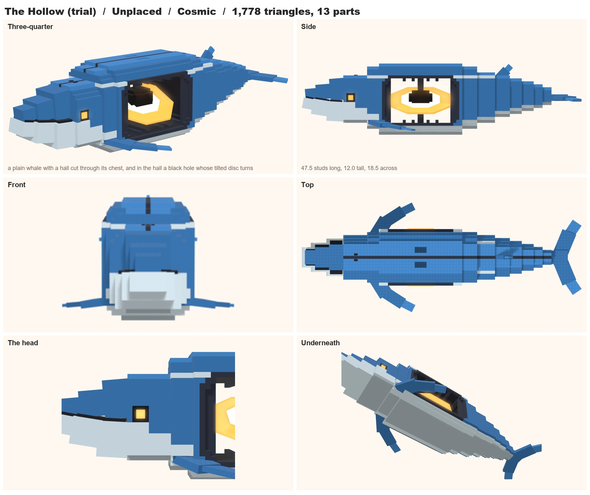 |
| **The Rebuilt** `art/creatures/TrialRebuilt/` | the Halfbone Megalodon | a steel lower jaw and skull cap, a piston each side of the jaw, the right eye a red lens, the right fin in steel, a green tank in steel hoops in the ribs with a pipe and two stacks, and on the left a lump of raw flesh with three yellow eyes and a third fin | 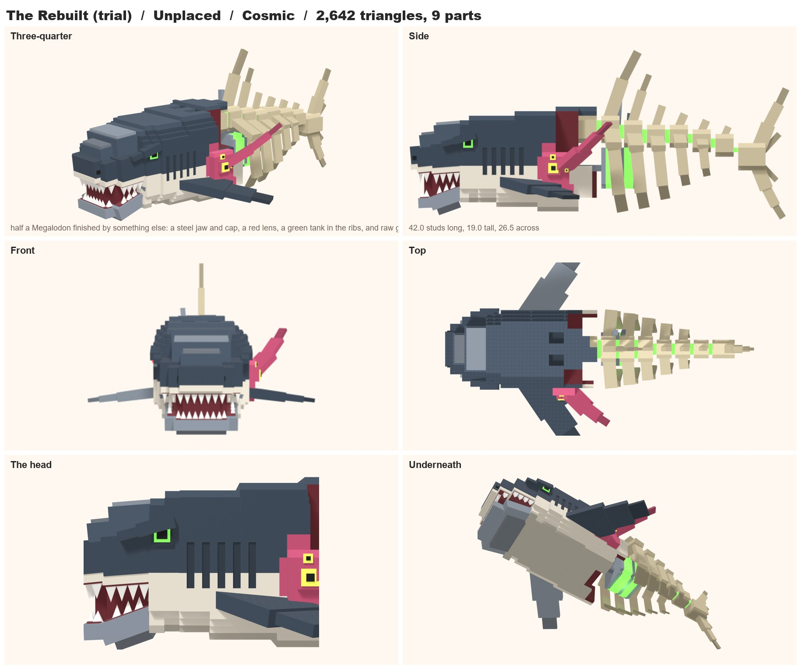 |

What I see: the Hollow reads at once and its set piece leads. The Rebuilt is busier and weaker: the red lens and the
steel fin are on the side the main view doesn't show, the growth is still a boxy lump, and the stacks are hidden by
the back fin's bones.

### The black hole by itself (2026-11-17)
The user asked for the black hole to be made separately and harder: voxel as a style, glowing, somewhat true to how a
black hole looks, and **usable in the Roblox game**. A live study was made first as a web page (cubes with real light
bending; not published, kept at
`C:\Users\blast\AppData\Local\Temp\claude\163ba57b6ab1ca1f\69be3b7e-157e-415c-bdc3-dda93fd83e1c\scratchpad\blackhole\voxel-black-hole.html`).
The user stopped that: it has to be something the game can use. So its look was rebuilt as a kit model.

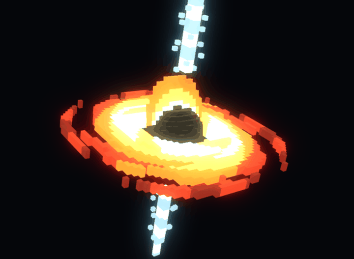

`art/creatures/TrialBlackHole/`: 6 parts, 3,876 triangles, cubes of 0.25 studs (half a creature's, so the ball is
round), 12.5 studs across, 19 tall with the jets. It passes the gate. Its game files are in its `game/` folder (mesh,
parts, glow parts, the loop's keys), the same layout as a creature's. **Not uploaded and not in the game.**

| Part | What it is | Moves |
|---|---|---|
| Core | the black ball; a thin white ring hugging it; two arcs of light over the top and under the bottom (the far side of the disc, bent round by gravity; the upper one bigger) | no |
| DiscA | the hot inner ring, thick and white with yellow streaks | 3 turns a loop |
| DiscB | the wide outer ring, thin, cooling from yellow to red, with gaps along its spiral streaks and a ragged edge | 2 turns a loop |
| Rim | loose red clumps beyond the disc | 1 turn a loop |
| JetUp, JetDown | twisted blue-white columns up the disc's axis | 2 turns a loop, opposite ways |

The disc and jets lean 14 degrees; the lean is in the keys, so the mesh at rest is flat. The inner ring turning faster
than the outer is how orbits go, and the spiral streaks make the matter seem to wind inward as the rings turn.

**The picture above is not the game.** It is the kit's render on a dark ground with a glow added afterwards, and it
turns slower than the keys (1, a half and a half turn, because a picture loop has only 24 frames).

**For whoever puts it in the game:**
- Everything but the ball is Neon. The ball wants plain black with no shine.
- The keys are one loop. Play it on its own clock, about 10 seconds a loop, not on a swim beat.
- The ring and arcs are a picture of bent light, so turn the Core about the upright axis to face the camera. Inside the
  Hollow's hall they already face the two openings.
- For the hall, build it with `black_hole(m, parent, cx, cz, jet=0, rim=False)` and the upper arc a little smaller
  (`ARC = (6.0, 3.4)`): the hall is 12 studs long and 7 tall, and the disc's edge then shows past both flanks.
- What Roblox adds that a mesh can't: bloom on the Neon, one warm light at the middle (no shadows), sparks leaving the
  inner ring and spiralling into the ball, and the feed: a clump pulled into a stream that winds in, then a flash.

### The black hole in Roblox, with light that bends (2026-11-17)
The user's main complaint about the model above: the ring doesn't curve round the ball by where the viewer is or how
far away. They asked for that, smaller voxels, pieces that match up and more detail, built in full.

**What was built:** `src/client/Lib/BlackHole.luau`, a module that makes the whole thing from small Neon cubes on the
player's own machine. No meshes and no uploads. Nothing in the game requires it yet.

**Run in Studio on 2026-11-17** (in a live Play session, on the client, held in front of the game's camera):
no errors. Black Neon does read as black. It looks as intended:

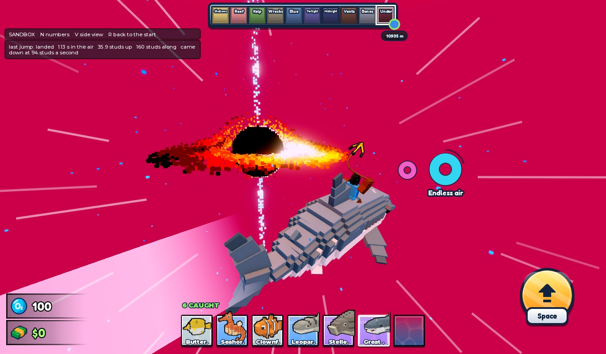
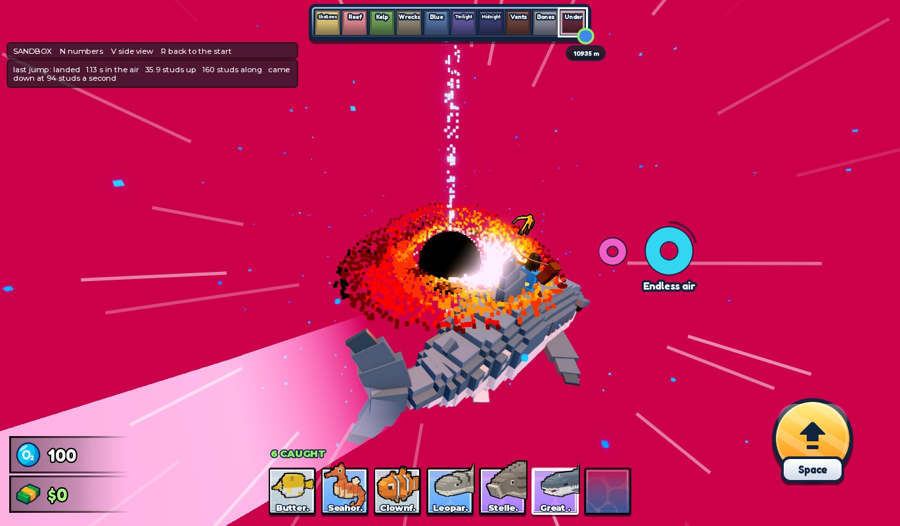

What it costs, measured there (Studio, a Scale 1.5 hole, the game running):

| Quality | Cubes | A hole that stays put | A hole that travels |
|---|---|---|---|
| Tiny | 720 + 108 ball boxes | 0.4 ms a frame | about 3 ms (not measured: 830 parts at 3.6 millionths of a second each) |
| Low | 1,864 + 312 | 1.5 ms | about 8 ms (the same sum) |
| Medium | 3,640 + 312 | 3.3 ms | 12 ms measured; 19 ms during a feed |

**Why travelling is dear.** Placing one part costs about 3.6 millionths of a second, and that is the same by
BulkMoveTo, by moving the whole Model, or by welding everything to one root (welds are far worse to change: one
change re-solves the whole assembly). A hole that stays put only places the cubes that change cell. A hole that
moves must place every showing cube every frame. So: **Medium or High for a set piece that stays where it is; Tiny
with a bigger Voxel for one that rides a creature**, or the plain mesh model above for the creature and this one for
a still set piece. Making a travelling one cheap would take one bending mesh on bones, which the kit can't export yet.

Not checked: a phone; the bloom the game's own lighting gives (the test was in the Underworld's red water); the
module's `Start`, `Follow` and `Destroy` (the test drove `Step` by hand, from a pasted copy of the module with its
type lines taken out).

**How the bending works.** Roblox cannot bend light, so the cubes are moved to where bent light would show them. Each
frame, every cube that lies behind the hole as this camera sees it is placed by the point-lens equation: pushed
outward round the hole, and some of them given a second, fainter image flipped to the other side. That lifts the far
side of the disc into an arc over the ball and tucks a thin arc under it, and it changes with the viewer's angle and
distance. There is no separate arc piece any more: the arc is the disc's own far side, so it joins the disc.

| Piece | What it does |
|---|---|
| The ball | black cubes joined into a few hundred boxes, on the same grid as everything else |
| The disc | 500, 1,200, 2,400 or 4,000 cubes (Tiny, Low, Medium, High), each on its own orbit, the inside faster; spiral streaks; a brighter, whiter side where it turns toward the viewer |
| The photon ring | a thin bright ring hugging the ball, always face on to the viewer |
| Motes | loose specks round the hole, each with two images, so space seems to warp as the viewer moves |
| Jets | two streams of blue-white cubes up the axis |
| Sparks | cubes that leave the inner edge and fall in, reddening |
| The feed | a clump drawn into a stream, wound in; the disc flares and a bright ring runs outward |
| A light | warm, at the middle, brighter during the flare |

Every cube sits on one grid (0.15 studs by default, against the model's 0.25), so the pieces line up. A cube is only
moved on the frames it changes cell, in one BulkMoveTo a frame; its colour comes from a table made once.

**To try it:** `tools/studio/black_hole_demo.luau`, run on the client while playing.

**To hang it in the Hollow's hall:** `BlackHole.new(cframe, { Quality = "Tiny", Voxel = 0.25, Jets = false })` then
`hole:Follow(part)` and `hole:Start()`. The default size fits the hall (a ball 3.3 studs across, a disc 11.5).

**What it cannot do:** bend the game's own scenery behind it. Only the cubes it makes are bent.

**Still to judge by eye, in motion:** whether cubes hopping from cell to cell read as flow or as flicker (the test
looked at still frames), and the frame cost on a phone.

### Where it goes on a big fish, from the riding camera (Studio test, 2026-11-17)

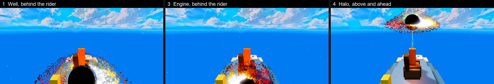

The live module on a Blue Whale scaled to 2x (92 studs long; the coral segment behind the seat swapped for a plain
one), a stand-in rider at the seat, seen from exactly where the riding camera sits (17 studs back, 12 degrees down,
`Config.Camera`). Nothing was left in the place.
- **The camera does not grow with the fish.** At 17 studs it sees only about 4 studs of back behind the rider; the rest
  is under the bottom of the frame. So anything set into the back behind the rider (1, the well; 3, the engine) shows
  as a glow cut off by the bottom edge, however big the fish.
- **4, the halo, works:** about 10 studs ahead of the rider and 16 above the back, the disc leaning 20 degrees toward
  the camera. It sits in the upper middle of the screen, the rider below it, the far side of the disc bends into an arc
  over the ball, the side turning toward us is white-hot, and the lower jet comes down like a tether into the back.
  Settings: `Scale = 1.2, Voxel = 0.15`, Medium.
- **So the fish that harbors it:** its set piece goes ahead of the seat, not behind it: a socket on the back between
  the rider and the head that the lower jet runs into, with the hole floating over it. A well or slot only reads if
  the seat is moved back behind it, so the camera looks past the rider into it.
- **Still to do:** the cost while it rides along (a moving hole places every cube each frame: Medium was 12 ms in the
  earlier test, so a riding halo wants Tiny or Low, or the mesh disc plus a few hundred live arc cubes).

### The Hollow, Cosmic: the fish that harbors it (second design, 2026-11-18)

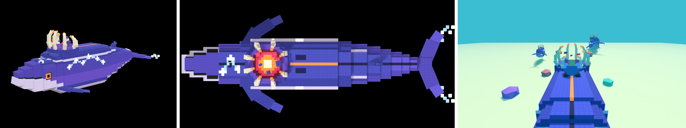

The first design (a plain whale with an iron socket bolted on; 2026-11-17) was judged far too weak by the user. The
second is built round the hole. `art/creatures/CosmicHollow` (Id `CosmicHollow`, named The Hollow):
- **The crater:** a bowl torn in the back ahead of the seat, white-hot at the bottom, ember and raw magenta up its
  walls, a swollen violet rim round it. The hole floats over it and its lower jet runs into the floor.
- **The cradle:** eight bone ribs rise from the rim, leaning out and curling in at the tips like fingers holding a star,
  an ember tip on each. Tall at the front and sides, low at the back, so the rider looks into the bowl.
- **The pull:** five chunks of hide, torn loose, orbit over the crater (the `Drift` part turns once a swim).
- **The eyes** are small black holes: a void pupil in an ember ring.
- **The hide:** indigo over violet with a lavender belly; constellations on both flanks and on the head (white
  plus-shaped stars, pale blue lines); a hot seam along the spine from the crater back under the rider; the fluke's
  tips dissolve into loose stars (the `Dust` part).
- 51.5 studs long in the kit, 2,896 triangles, 14 parts. Passes the gate.

**In Studio, not uploaded:** the template `ReplicatedStorage.FishModels.CosmicHollow` shows mesh files written into
Studio's own folder on this PC (`tools/creatures/install.py <studio> --local CosmicHollow`; the second design's files
are under `ridefish/CosmicHollow_v2`, because Studio keeps a mesh file it has loaded until it restarts). It shows on this
PC only and is not in the fish table, so it does not spawn. An upload (permanent) is the user's call.

**The display:** `Workspace.CosmicHollowDisplay`, on a baseplate on the grass terrace just east of the hub (x 3355,
z -160, height 105): the whale at 1.9x (98 studs), a stand-in rider on the seat, `RideCamera` (where the riding camera
would be) and `BlackHoleAnchor`, an invisible part tagged `BlackHole` whose attributes set the hole (Scale 1.2, Voxel
0.15, Quality Medium, Jets, AutoFeed 25). The hole is 6 studs ahead of the rider and 13 above the seat, its axis leaning
20 degrees toward the camera and running down into the crater.
- **In Play:** `Controllers/BlackHoleDisplayController` makes a live hole at every part tagged `BlackHole` (tested on the
  first design: it shows, no errors).
- **In Edit:** paste `tools/studio/black_hole_edit_preview.luau` into the command bar (again to take it away); its cubes
  are not saved with the place. The riding view:
  `workspace.CurrentCamera.CFrame = workspace.CosmicHollowDisplay.RideCamera.CFrame`.
- **Not yet:** the hole riding along on a swimming Hollow (`Follow` the crater, Quality Tiny or Low), an upload.

### Six more, built (2026-11-18)
The six proposed here, each built round its set piece on the body of a model we have, which is not changed. All pass
the gate. Not exported, not uploaded, not in the game. Each sheet shows the hero view, the top, and the riding camera.
The set piece is ahead of the seat in every one, because the riding camera sees only about 4 studs behind the rider.

| Cosmic | Folder | Built on | Size (studs) | Triangles | The set piece | What moves | Weak spots |
|---|---|---|---|---|---|---|---|
| **Totality** | `CosmicTotality` | Manta Ray | 31 × 35 × 20 | 3,184 | a black moon with a white-hot ring and a ragged corona (gold to orange), a diamond-ring bead; held up ahead of the rider by the two horns curling over its rim | the corona turns behind the moon; the moon rocks; wings flap | the moon is a little egg-shaped; the horns are plain columns; edge-on from above |
| **Ringbearer** | `CosmicRingbearer` | Archelon | 36 × 44 × 27 | 5,789 | the shell is a banded planet (cream, ochre, rust, a storm spot, a hexagon at the pole round the seat); a tilted ring of ice plates and shards | the ring turns; a glowing moon (the light) and a dark moon orbit, once and twice a cycle | the hero view sees the ring nearly edge-on; the shards are small; the turtle's head is small; the dark moon may brush a wing |
| **Keeper of the Light** | `CosmicLightkeeper` | Anglerfish | 51 × 20 × 39 (body about 33) | 3,426 | the lure is a lighthouse on a barnacled rock at the end of a crane-like boom: red and white bands, a gallery, a blazing lantern, a door with a porch lamp | two beams sweep once a swim; the boom nods, the tower stays upright; the jaw gulps | the body is the plain Anglerfish scaled up; the solid beams may cover the view up close; the tower's upper bands sit in shadow from the seat |
| **Heartstar** | `CosmicHeartstar` | Bone Leviathan's plan | 53 × 18 × 20 | 3,196 | a sun with flame tongues caged by four pairs of bone ribs over a burnt, glowing pit; warm veins run from the cage along the flanks, fins and tail | the sun turns; the flares orbit the other way; the ribs open up to 7 degrees each beat | the near ribs hide part of the sun from the side; the head is boxy, more tuna than leviathan; the beat is smooth, not a double pulse |
| **Bottled Storm** | `CosmicBottledStorm` | Aurora Jelly | 22 × 21 × 38 (tall) | 5,632 | a corked glass bottle in brass ribs, a storm bulging out of the shoulder in wedges with bolts and sparks; six lightning arms hang from a dark cloud under the base | the cloud underneath churns; the arms swing out of step; the cork rattles | **the weakest:** it reads as a squat jar or lantern, not a bottle; from the seat the storm barely shows and the rider hides the neck |
| **Star Chart** | `CosmicStarChart` | Storm Serpent | 52 × 11 × 14 | 5,936 | a serpent drawn as a constellation: lines of stars along the spine and keel, star fins, an open jaw of stars, a white crown star with the light, deep indigo mist inside; a gold star at the seat | swims side to side; the lines stretch at the joints; loose stars turn behind the tail | from the seat the rearing head is seen end-on as a stack of stars; the mist reads as segments; no triangles to spare |

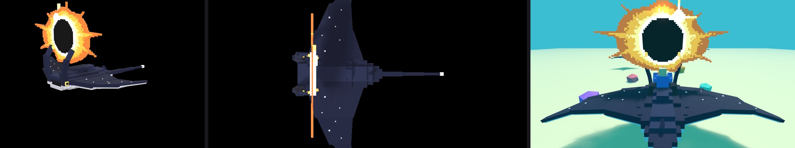
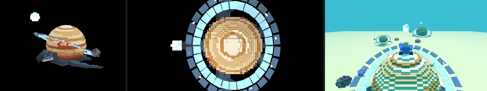
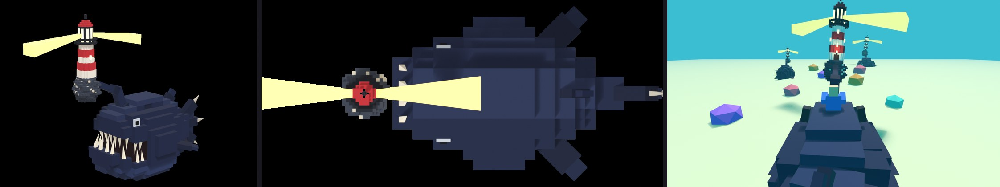
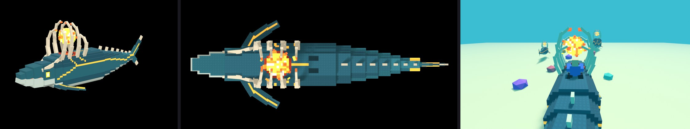
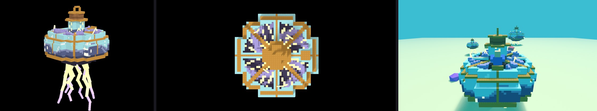
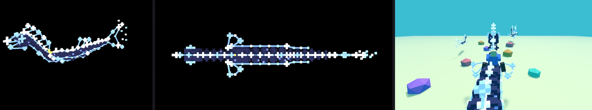

**My read:** Totality, Heartstar and Ringbearer are the strongest from the seat. Keeper of the Light is charming but
its body is plain. Bottled Storm wants a second pass: a tall, thin bottle with the rider behind the neck. Star Chart
reads best from the side; from the seat it needs the head turned so its profile shows.

## What it would take
- **The models:** the voxel kit can already make all of the bodies, the chambers, glowing faces and parts on joints.
  New for the kit: named points on the model where the game hangs lights, emitters and beams; and a second loop of
  keys for the set piece, apart from the swim, so a ring can orbit at its own speed.
- **The game:** a table of effects for each Cosmic (what hangs on which point), the cycle and its show, the arrival,
  the budget above; and Cosmic added wherever the rarities are listed (the order, the menu colour, the stamina, the
  spawn odds, the wildness). That code belongs to the game chat.
- **Judging them:** light and particles can only be judged in Studio. A model's shape and glow can be judged from the
  kit's renders first.

## Open, for the user
1. **Cosmic and Secret.** Secret is now the top of the order. Does Cosmic go above it, or between Mythic and Secret?
2. **How many, and where.** I'd start with four to six. One a zone from the Open Blue down, or events that can come
   anywhere?
3. **Tone.** Are the jokes welcome (Little Sun, the Visitor, Error), or should every Cosmic be grand?
4. **Which to try first.** I'd build the user's two, the Hollow and the Rebuilt, as models, then one in Studio with
   its effects.
