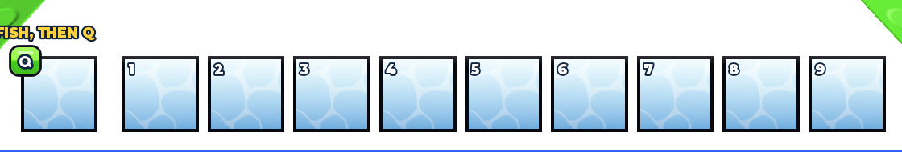
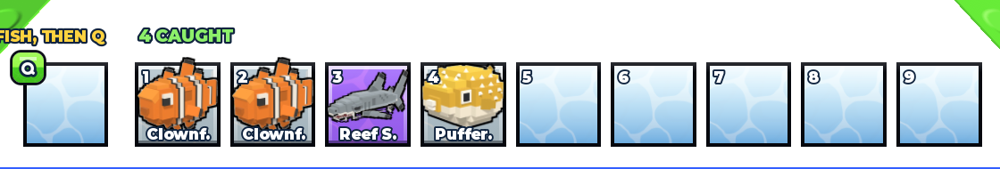
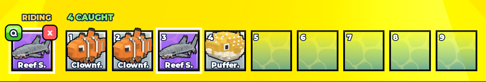
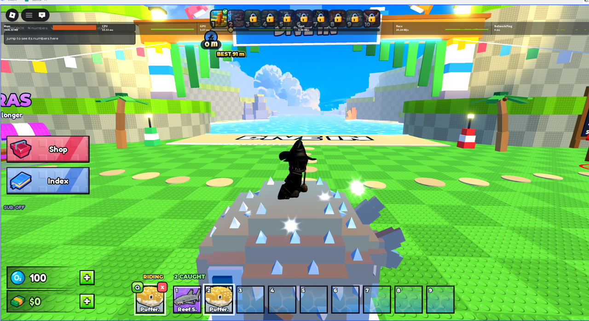
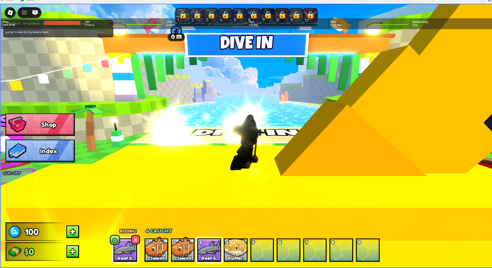

# The ride fish: number keys, Q and the equipped slot

Hugo, 2026-11-20: "not holding 1 and pressing q at the same time, 1 should be first inventory slot while q should be a
completely seperate slot." Built by NULLROOM task e3, from the plan's E3
([plan](../plans/2026-11-20-oxygen-equip-landride.md)), on top of [holding](holding.md) (task f1) and the sub ride
(task f2). The plan's option defaults are in use (D: carry 7, nine numbered slots; F: true size; G: Q equips and
mounts, a click toggles, a cross unequips, a respawn clears).

## Decided (built)
- **Number keys 1 to 9** (and the keypad's) press the numbered slot: the same path as a click or tap. A caught slot
  holds that fish over the head; the held one's slot again, or an empty slot, puts it away. Only on the dock; not
  while typing in a box, not when the game took the key. 1 is always the first catch. Nothing goes into the tank from
  a number key.
- **Q** is a press of its own, never a chord. With a fish held: that fish becomes the **ride fish** (equipped), its
  overhead copy goes and you ride it on land. With nothing held: Q gets you back on the equipped fish. With nothing
  equipped either: nothing (refused, "None").
- **The equipped slot**, at the far left of the row, a double gap from slot 1: the ride fish's tile (rarity colours,
  picture, name), a small green **Q key cap** (the shop's button look) over its top left corner and, when filled, a
  red **X** over its top right. Above it: HOLD A FISH, THEN Q (empty; THEN TAP on a phone), CLICK TO RIDE (equipped,
  on foot), RIDING (on it: the white ring too). A click or tap on it equips the held fish if one is held, else gets
  on or off; the X unequips. It is not a numbered slot and no number reaches it.
- **One fish, not two:** the ride fish is a reference to one entry of the hands, never a copy and never extra room.
  It stays in its numbered slot too. Put it in the tank (or lose it any way) and it is unequipped and its land fish
  goes at once; another fish leaving the hands keeps it, at its new place (two identical catches are told apart).
- **On land in the hub:** the fish is built at its own size and colour under you, you sit on it (the avatar's own sit
  animation), and you walk at `Equip.LandSpeed` (32; on foot 28). The humanoid does the walking; the fish is
  weightless, touches nothing and is welded to you by its saddle, so everyone sees it. Holding another fish gets you
  off it (one pose at a time); the equipped choice stays until Q picks the held one. Seated on the seahorse trainer or
  in a tank ride: off it, and no getting on (refused, "Busy").
- **The dive:** the land fish goes before the water has you. The **equipped** fish is the one you ride after the dive
  in and after the sub (a copy made as you go in); a fish only held no longer counts. No ride fish: the dive in is the
  ordinary one, and the sub falls back to the tank fish picked at its stand, then the fling. The ride fish stays
  equipped through the dive, a ride, a fail and the trip home.
- **A new body** (respawn, reset) unequips, as it puts the held fish away. For the session only: no saves yet.

## How it works
- **Server** (`RideService`): `Rider.Equipped` (the very entry of `Carried`), `Rider.Land` (the land fish).
  Actions `"RideEquip"` (Q), `"RideMount"` (the slot), `"RideUnequip"` (the X), one each per `Equip.Again` s; refused
  with Ride `"Denied", "Equip", reason` ("Dock", "Busy", "None", "Gone"). Q reads the held fish from the server
  (`RideService.HeldOf`, set by `AquariumService`): nothing the client says chooses the fish. `RideService.equippedOf`
  is what `SubService` rides; `RideService.landOff` is AquariumService's when a fish is held. Every change to the hands
  re-checks the ride fish (`sendCaught`). The land fish is in `Workspace.LandFish` (attributes `LandRider`, `FishType`,
  `SizeTier`, `Variant`); not in `Workspace.Fish`, so nothing locks on to it, tags it or tames it.
- **Player attributes:** `EquippedFish`, `EquippedSize`, `EquippedVariant`, `EquippedIndex` (its place in the hands
  now), `LandMounted`.
- **Client:** `EquipController` (new): the keys, the slot's asks, the equipped slot from the attributes, the sit pose.
  `UI/Slots`: nine numbered slots with their keys, the equipped slot, `Slots.pick(n)` (a key's press = a click),
  `Slots.equipped(item, mounted)`, `Slots.Ride` ("Ride", "Unequip").
- **Numbers:** `Config.Equip`: `On`, `LandSpeed`, `LandMost` (a cap on the land fish's length, 0 = none), `Again`.

## Checked
`python tools/studio/e3_equip_check.py install`, `studio-run.mjs play`, `... run`, `... remove` (2026-11-20, scripted
Studio playtest, Hugo's avatar): **41 of 41 pass**, log `work/e3/check.log`. The keys go through
`EquipController.press` (the game's own path after the key's gate), the slot's asks are fired as its buttons fire them.
- Keys 1, 1 again, 4, 8 (empty), keypad 3; holding alone equips nothing.
- Q equips the held Colossal Gold Reef Shark and rides it: one land fish, no overhead copy, the hands unchanged, walk
  speed 32, the slot says RIDING with its X. Holding another fish keeps the equipment and gets off; Q on it replaces.
- Two identical Clownfish: the second equipped; the first taken out, it stays equipped at 1; it taken out, equipment
  and land fish clear and the humanoid is as before.
- Refused: Q with nothing; a hold of a stale index or a wrong id; RideEquip with made-up arguments; getting on while
  seated on the trainer. Off/on by the slot, Q while riding changes nothing, the X unequips, a respawn clears all.
- The dive in rides the equipped Colossal Gold Reef Shark while a Pufferfish is held; hands unchanged; still equipped
  back on the dock. Unequipped with a fish only held: the dive in rides nothing. The sub to land 2 drops the rider on
  the equipped Colossal Gold Reef Shark.
- The land fish's belly against the floor: 0.0 studs (Clownfish, Big Pufferfish), 1.0 (Colossal Reef Shark).
- Shots:  
   
   (the camera inside a Colossal shark: see Open).

## Open
- **A giant fills the hub:** at its true size (option F's default) a Colossal Reef Shark stands the rider 27 studs up
  and the camera ends inside the fish. `Equip.LandMost` caps the land fish's length (looks only; what it needs and is
  worth don't change) if Hugo wants that.
- Not played by hand; no two-player test (studio-runner starts one player). Not tested: a real key press through
  Roblox's input (the test calls the same function after the gate), a phone layout of the ten slots, walking the fish
  over steps and the dock's edge. The land fish passes through walls (it touches nothing); the humanoid does not.
- The land fish doesn't move its body yet: land movement by body type is plan E4. The sit animation is Roblox's own
  (the avatar's Animate script's).
- TankPanel's EQUIP / EQUIP BEST is still the tank's earning choice, a different thing from the ride fish; its words
  are unchanged.
