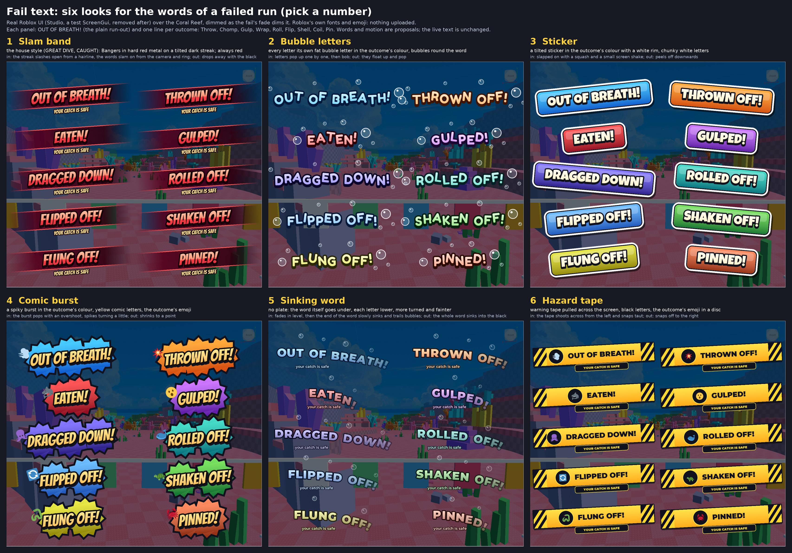
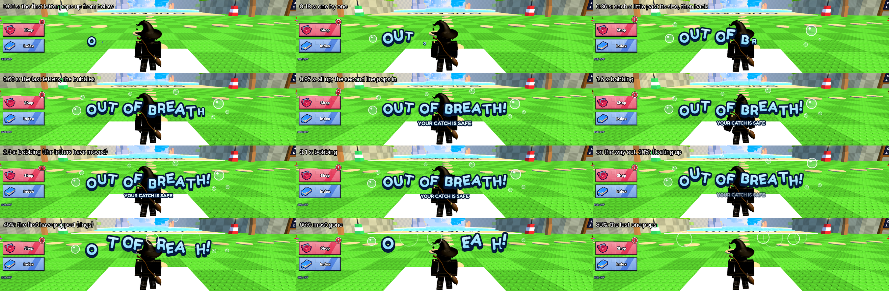
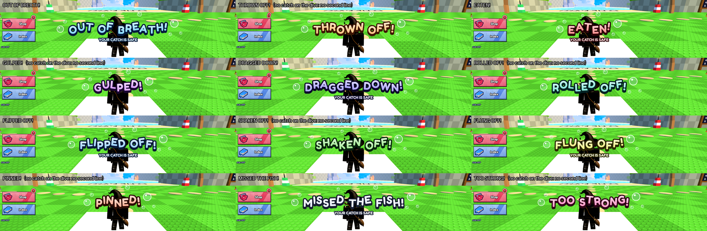
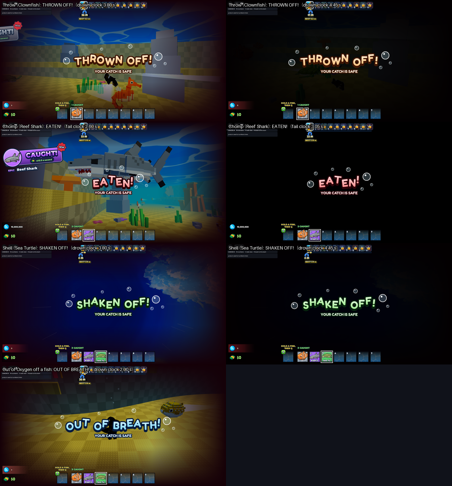
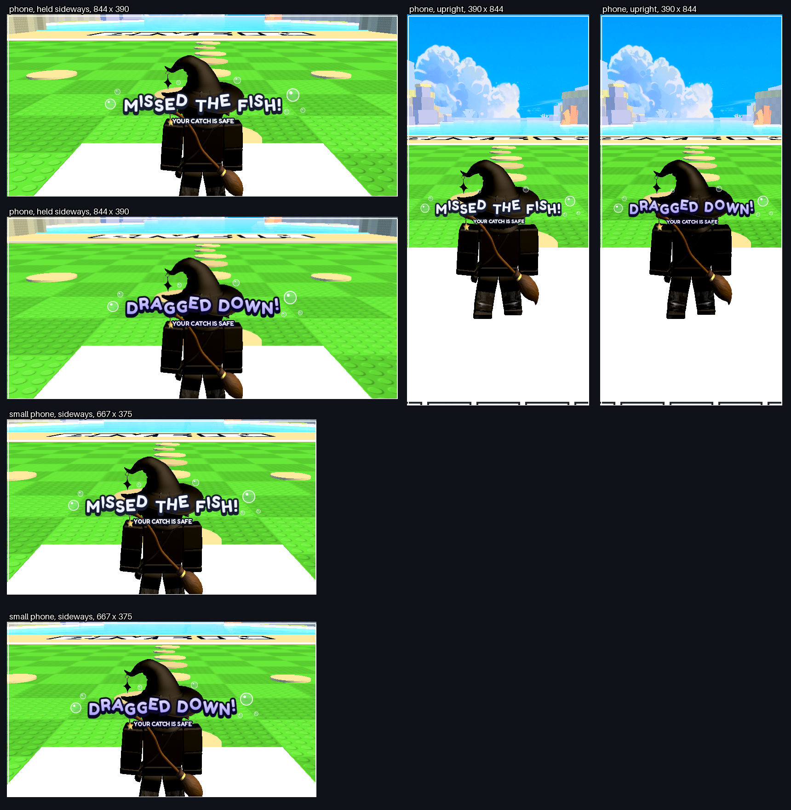

# Fail text

The words on screen when a run fails. Hugo, 2026-11-22: "make text better and more stylised when failing a run. Out of
breath type text needs a rework, send me a sheet." This note is the sheet and what each option is.

**Picked and built: option 2, the Bubble letters.** Hugo, 2026-11-22, of this sheet: "Use the bubble text option".
Built 2026-11-23. Task b5 had built option 1, the Slam band, the day before, because the pick had not reached it
(it built Claude's own recommendation); the Bubble letters took its place and the Slam band is gone from the game.
See "What is built".

## What is built

- **Look:** `Kit.failWords` (`src/client/UI/Kit.luau`), numbers in `Kit.FailLook`. Every letter is its own fat
  FredokaOne letter: white at the top going to the line's colour, with an outline and a shadow in that colour's dark,
  each letter a little up or down of the next and a little turned. Seven bubbles sit round the word. No plate behind
  it. It sizes itself to the words and to the screen (never wider than 94% of it; full size at 640 high, at most 1.5
  times).
- **Colours:** one per line, the sheet's own, in `Config.Fail.Colours`: OUT OF BREATH! blue, THROWN OFF! orange,
  EATEN! red, GULPED! purple, DRAGGED DOWN! indigo, ROLLED OFF! teal, FLIPPED OFF! light blue, SHAKEN OFF! green,
  FLUNG OFF! yellow, PINNED! coral. The two lines that were not on the sheet got Claude's: MISSED THE FISH! silver,
  TOO STRONG! pink (`Config.Fail.WordColours`). `Config.failColours` gives a line's pair by its words.
- **Motion:** the letters pop up one by one from below (one every 0.055 s, the last within 0.6 s, each a little past
  its size and back), with three soft pops heard; the bubbles blow up round them; the second line pops in 0.2 s
  after the last letter. From then on every letter bobs and sways on its own beat and the bubbles drift. As the black
  lifts at the dock the letters float up, swell and pop one after another, each leaving a ring for a moment, all gone
  before the black is; two quieter pops. No camera shake and no thud (the Slam band's are gone with it).
- **When:** unchanged. The deaths still decide what and when (`State.FadeText`, `State.Fade`); `Banners.miss` hands
  them over through `Kit.FailShow` to `FailController` ("The words of a failed run"). The words come up the moment the
  black starts, whatever the black's own pace, stay as they came up, and go as it lifts. `Banners.miss`'s old plain
  streak is only a fallback.
- **Words:** unchanged from b5. `Config.Fail.Breath` "OUT OF BREATH!", and each outcome's `Text` in
  `Config.Fail.Outcomes`, with the five throw-offs: THROWN OFF!, ROLLED OFF!, FLIPPED OFF!, SHAKEN OFF!, FLUNG OFF!.
  A fish that throws you shows its own words in place of OUT OF BREATH!; running out off a fish shows OUT OF BREATH!.
  "MISSED THE FISH!" and "TOO STRONG!" take the same look.
- **Second line:** `Config.Fail.Safe` "YOUR CATCH IS SAFE", small, in the same letters, shown only when you carry a
  catch on that dive. Panel 2 of the sheet did not draw it; it is kept from b5 and is easy to drop (say so).
- **Studio switches** (to look at a line without failing): workspace `FailWords` (the words), `FailWordsSub` (false:
  no second line), `FailWordsAge` (seconds in, held), `FailWordsOut` (0 to 1 of the way out), and new
  `FailWordsScreen` (a Vector2: the words drawn as on a screen of that size, in a white outline, for a phone's).
- **Checked** in a Studio playtest with `python tools/studio/fail_bubble_check.py probe | motion | lines | phone |
  fails`: all twelve lines on five screen sizes stay inside the screen (the longest, MISSED THE FISH!, on a phone held
  sideways, 844 x 390, is drawn at 0.61 of full size, letters about 43 points); the phone is a pretended screen of
  its size in Studio, not a real phone. The game is played sideways, so the upright phone is only a worst case.

### Before it: the Slam band (b5, 2026-11-22, replaced)
Bangers in red metal on a tilted dark streak, always red, slammed on from the camera with a thud and a shake.
Pictures: [motion](../attachments/b5-fail-text-motion.png), [fails](../attachments/b5-fail-text-fails.png),
[lines](../attachments/b5-fail-text-lines.png). Its check, `tools/studio/b5_fail_text_check.py`, still runs, but its
`motion` labels describe the Slam band.

## What was there before
`Banners.miss` showed `State.FadeText` as pale red FredokaOne words on a dark red streak, fading in with the black. It
never moved. The words then: "OUT OF AIR!", "MISSED THE FISH!", "TOO STRONG!", and from `Config.Fail.Outcomes` only
the four outcomes that take you: "EATEN!", "GULPED!", "DRAGGED DOWN!", "PINNED!". The five outcomes that throw you off
have no words of their own and end in "OUT OF AIR!".

## The options
Each panel shows the plain run-out and one line per outcome. All six are real Roblox UI, shot in Studio over the Coral
Reef with the screen dimmed as the fail's fade dims it. They use only Roblox's own fonts and emoji, so nothing needs
uploading. The motion is described, not built.

| # | Name | Look | In | Out |
|---|---|---|---|---|
| 1 | Slam band | The house style of GREAT DIVE and CAUGHT: Bangers in hard red metal on a tilted dark streak with red edges. Always red, whatever the outcome | The streak slashes open from a hairline, the words slam on from the camera and ring | Drops away with the black |
| 2 | Bubble letters | Every letter is its own fat FredokaOne letter in the outcome's colour, bobbing, with bubbles round the word | Letters pop up one by one, then bob | They float up and pop |
| 3 | Sticker | A tilted sticker in the outcome's colour with a white rim and chunky white Luckiest Guy letters | Slapped on with a squash and a small screen shake | Peels off downwards |
| 4 | Comic burst | A spiky burst in the outcome's colour, yellow Bangers letters across it, the outcome's emoji on its corner | The burst pops with an overshoot, its spikes turning a little | Shrinks to a point |
| 5 | Sinking word | No plate: the word itself goes under, each letter lower, more turned and fainter than the last, with small bubbles | Fades in level, then the end of the word slowly sinks | The whole word sinks into the black |
| 6 | Hazard tape | Yellow warning tape with striped ends pulled across the screen, black letters, the outcome's emoji in a black disc | The tape shoots across from the left and snaps taut | Snaps off to the right |

Options 1, 5 and 6 carry a small second line, "YOUR CATCH IS SAFE", because a fail keeps the dive's catch and the screen
never says so. It can be added to or dropped from any option.

## Claude's read (before the pick; Hugo chose 2)
- **1** fits the game best: it is the same family as GREAT DIVE and CAUGHT, so a fail reads as the opposite of a win.
- **4** is the loudest and the closest to the genre's cheap, bright flavour, and the colour and emoji tell the outcomes
  apart at a glance.
- **5** is the only one that says "drowning" by its shape, but it is the quietest and the hardest to read on a phone.
- 2 reads friendly rather than as a fail; 3 and 6 are clear but look like buttons or signs more than an event.

## The words (proposed with the looks)
| Outcome (`Config.Fail.Outcomes`) | Now | Proposed |
|---|---|---|
| Out of Oxygen, not on a fish | OUT OF AIR! | OUT OF BREATH! |
| Throw | (OUT OF AIR!) | THROWN OFF! |
| Chomp | EATEN! | EATEN! |
| Gulp | GULPED! | GULPED! |
| Wrap | DRAGGED DOWN! | DRAGGED DOWN! |
| Roll | (OUT OF AIR!) | ROLLED OFF! |
| Flip | (OUT OF AIR!) | FLIPPED OFF! |
| Shell | (OUT OF AIR!) | SHAKEN OFF! |
| Coil | (OUT OF AIR!) | FLUNG OFF! |
| Pin | PINNED! | PINNED! |

"MISSED THE FISH!" and "TOO STRONG!" are not on the sheet; they would take the picked look as they are.

## Settled, and what is still Hugo's to say
1. Which number: **2, the Bubble letters** (Hugo, 2026-11-22: "Use the bubble text option").
2. One colour or a colour per outcome: a colour per outcome, as panel 2 shows.
3. The five throw outcomes keep their own words (b5's, not changed by the pick).
4. "YOUR CATCH IS SAFE" stays for now (b5's; not on panel 2). Still Hugo's to keep or drop.
5. Emoji: none. Panel 2 has no icons.
6. New, for Hugo: the colours of MISSED THE FISH! (silver) and TOO STRONG! (pink) are Claude's, since the sheet did
   not show those two lines.

## How the sheet was made
`tools/ui/fail_text/options.luau` builds one option as a ScreenGui in Studio's CoreGui (Edit mode, never in the game);
`python tools/ui/fail_text/capture.py shoot` shoots all six and removes it, `... sheet` lays out the picture. The live
`FailController` and `Banners.miss` are untouched.
