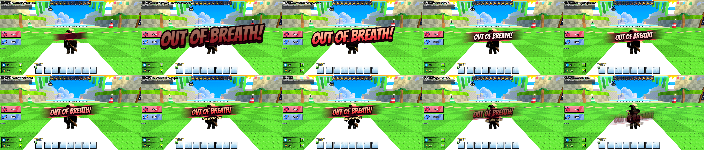
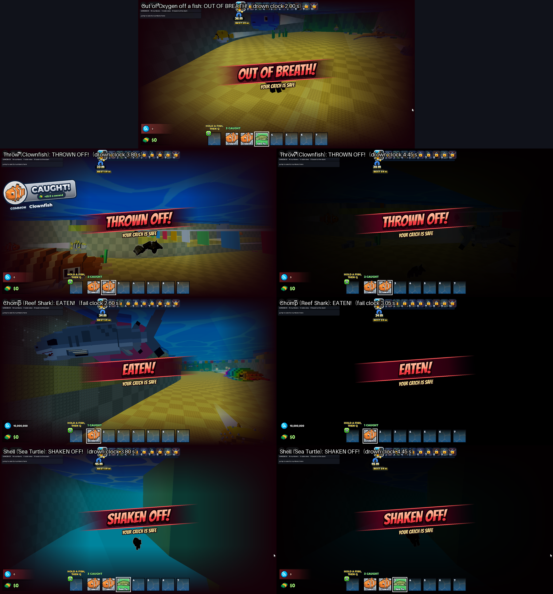
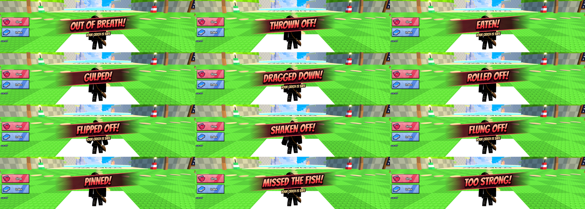

# Fail text

The words on screen when a run fails. Hugo, 2026-11-22: "make text better and more stylised when failing a run. Out of
breath type text needs a rework, send me a sheet." This note is the sheet and what each option is.

**Built (task b5, 2026-11-22): option 1, the Slam band.** Hugo cleared the build without naming a number, so Claude
built its own recommendation; the open questions below took Claude's proposals (always red, own words for the five
throw-offs, the second line kept). See "What is built".

## What is built

- **Look:** `Kit.failWords` (`src/client/UI/Kit.luau`), numbers in `Kit.FailLook`: Bangers in red metal with a dark
  outline and shadow on a dark streak tilted 4 degrees, a red line along each edge, always red. It sizes itself to
  the words and to the screen (never wider than 94% of it; full size at 640 high, at most 1.5 times).
- **Motion:** the streak slashes open from a hairline (0.16 s); the words come from the camera at 2.6 times their size
  and land at 0.28 s with a white flash, a squash and bounce and a judder of the band, a low thud and a small camera
  shake; the second line pops in at 0.5 s. It comes up the moment the black starts, whatever the black's own pace, and
  as the black lifts at the dock it drops away, turning and fading.
- **Who shows it:** `FailController` ("The words of a failed run"). The deaths still decide what and when
  (`State.FadeText`, `State.Fade`); `Banners.miss` hands them over through `Kit.FailShow` (its old plain streak is
  only a fallback now).
- **Words:** `Config.Fail.Breath` "OUT OF BREATH!" (was "OUT OF AIR!"), and each outcome's `Text` in
  `Config.Fail.Outcomes`, now with the five throw-offs: THROWN OFF!, ROLLED OFF!, FLIPPED OFF!, SHAKEN OFF!, FLUNG
  OFF!. A fish that throws you shows its own words in place of OUT OF BREATH!; running out off a fish shows OUT OF
  BREATH!. "MISSED THE FISH!" and "TOO STRONG!" take the same look, unchanged.
- **Second line:** `Config.Fail.Safe` "YOUR CATCH IS SAFE", shown only when you carry a catch on that dive.
- **Studio switches** (to look at a line without failing): workspace `FailWords` (the words), `FailWordsSub` (false:
  no second line), `FailWordsAge` (seconds in, held), `FailWordsOut` (0 to 1 of the way out). Stills:
  `python tools/studio/b5_fail_text_check.py motion | lines | fails` in a playtest.

## What was there before
`Banners.miss` showed `State.FadeText` as pale red FredokaOne words on a dark red streak, fading in with the black. It
never moved. The words then: "OUT OF AIR!", "MISSED THE FISH!", "TOO STRONG!", and from `Config.Fail.Outcomes` only
the four outcomes that take you: "EATEN!", "GULPED!", "DRAGGED DOWN!", "PINNED!". The five outcomes that throw you off
have no words of their own and end in "OUT OF AIR!".

## The options
Each panel shows the plain run-out and one line per outcome. All six are real Roblox UI, shot in Studio over the Coral
Reef with the screen dimmed as the fail's fade dims it. They use only Roblox's own fonts and emoji, so nothing needs
uploading. The motion is described, not built.

| # | Name | Look | In | Out |
|---|---|---|---|---|
| 1 | Slam band | The house style of GREAT DIVE and CAUGHT: Bangers in hard red metal on a tilted dark streak with red edges. Always red, whatever the outcome | The streak slashes open from a hairline, the words slam on from the camera and ring | Drops away with the black |
| 2 | Bubble letters | Every letter is its own fat FredokaOne letter in the outcome's colour, bobbing, with bubbles round the word | Letters pop up one by one, then bob | They float up and pop |
| 3 | Sticker | A tilted sticker in the outcome's colour with a white rim and chunky white Luckiest Guy letters | Slapped on with a squash and a small screen shake | Peels off downwards |
| 4 | Comic burst | A spiky burst in the outcome's colour, yellow Bangers letters across it, the outcome's emoji on its corner | The burst pops with an overshoot, its spikes turning a little | Shrinks to a point |
| 5 | Sinking word | No plate: the word itself goes under, each letter lower, more turned and fainter than the last, with small bubbles | Fades in level, then the end of the word slowly sinks | The whole word sinks into the black |
| 6 | Hazard tape | Yellow warning tape with striped ends pulled across the screen, black letters, the outcome's emoji in a black disc | The tape shoots across from the left and snaps taut | Snaps off to the right |

Options 1, 5 and 6 carry a small second line, "YOUR CATCH IS SAFE", because a fail keeps the dive's catch and the screen
never says so. It can be added to or dropped from any option.

## Claude's read
- **1** fits the game best: it is the same family as GREAT DIVE and CAUGHT, so a fail reads as the opposite of a win.
- **4** is the loudest and the closest to the genre's cheap, bright flavour, and the colour and emoji tell the outcomes
  apart at a glance.
- **5** is the only one that says "drowning" by its shape, but it is the quietest and the hardest to read on a phone.
- 2 reads friendly rather than as a fail; 3 and 6 are clear but look like buttons or signs more than an event.

## The words (proposed with the looks)
| Outcome (`Config.Fail.Outcomes`) | Now | Proposed |
|---|---|---|
| Out of Oxygen, not on a fish | OUT OF AIR! | OUT OF BREATH! |
| Throw | (OUT OF AIR!) | THROWN OFF! |
| Chomp | EATEN! | EATEN! |
| Gulp | GULPED! | GULPED! |
| Wrap | DRAGGED DOWN! | DRAGGED DOWN! |
| Roll | (OUT OF AIR!) | ROLLED OFF! |
| Flip | (OUT OF AIR!) | FLIPPED OFF! |
| Shell | (OUT OF AIR!) | SHAKEN OFF! |
| Coil | (OUT OF AIR!) | FLUNG OFF! |
| Pin | PINNED! | PINNED! |

"MISSED THE FISH!" and "TOO STRONG!" are not on the sheet; they would take the picked look as they are.

## Open, for Hugo
1. Which number (or a mix: one look's letters on another's plate).
2. One colour for every fail (as 1 and 6) or a colour per outcome (as 2 to 5).
3. Whether the five throw outcomes get their own words, or stay "OUT OF BREATH!".
4. Whether "YOUR CATCH IS SAFE" stays.
5. Emoji as icons (4 and 6): fine as a stand-in, or drawn icons later.

## How the sheet was made
`tools/ui/fail_text/options.luau` builds one option as a ScreenGui in Studio's CoreGui (Edit mode, never in the game);
`python tools/ui/fail_text/capture.py shoot` shoots all six and removes it, `... sheet` lays out the picture. The live
`FailController` and `Banners.miss` are untouched.
