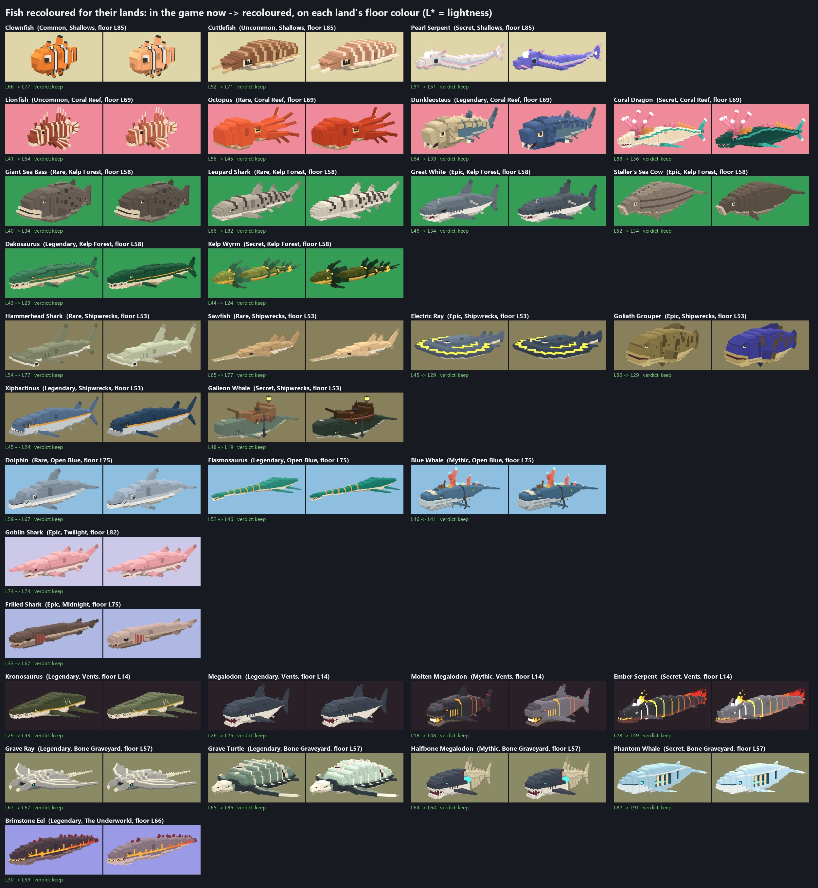

# The fish recolour list (for the creature chat)

Up: [Fish against their lands](fish-values.md). Written 2026-11-19 by the map chat. The user makes these changes
through the creature chat ("The colour changes ill do thru the other chat myself if you explain them and give me a
list"). The four Shallows cuts went to the game-code chat.

## How to read it
- **Lightness** is CIE L*: 0 is black and 100 white, as the eye sees it. A fish's value is its body's median as a
  rider sees it, from behind and above.
- **The goal** is the reference's rule:
  - the bottom tiers (Common, Uncommon) wear their land: close to the floor's lightness, in its colour family;
  - from Rare up a fish stands off its floor by 20 or more, or wears an opposite hue;
  - a Legendary is 25 or more off the floor, and a Mythic or Secret 30 or more, toward the far end;
  - in each land at least one fish wears it.
- **"Toward N"** is the lightness to bring the body to. The suggested main colour is today's main colour moved by the
  same amount, in its own hue: it is a starting point.
- **Move the big parts, not the details.** What a rider sees is the body and the top (back, shell, mantle). Keep the
  eyes, the patterns and the accents; they are what make each fish itself. To make a fish darker, darken the body
  and the top. To make it lighter, lighten them toward a pale tint of the same colour, not toward grey.
- **"Or an opposite hue"** means the fish can keep its lightness and change colour family instead, to the opposite
  side of the colour wheel from its floor. This is the reference's mid-tier tool (a magenta raptor on green). It suits
  Rares and Epics.
- **Glow:** leave it on the fish that have it. Whether to take it off the Legendaries and Rares, to match the
  reference's "Mythic and up only", is the user's call, open in [the note](fish-values.md).
- After a recolour, `python tools/art/fish_values.py` then `python tools/art/fish_verdict.py` re-measure it.

## In short, land by land
- **Shallows** (pale sand, L*85): the **Clownfish** a lighter orange, the **Cuttlefish** a lighter sandy brown (both
  too loud for their tier); the **Pearl Serpent** (Secret) from near-white to a dark pearl, so it stands out against
  the sand, glow kept.
- **Coral Reef** (pink, L*69): the **Lionfish** lighter, toward coral; the **Octopus** darker or a teal/green; the
  **Dunkleosteus** and the **Coral Dragon** dark.
- **Kelp Forest** (green, L*58): most of it blends. The **Giant Sea Bass**, **Great White** and **Steller's Sea Cow**
  darker or a warm opposite hue (orange, red, magenta on the green); the **Leopard Shark** pale; the **Dakosaurus**
  and the **Kelp Wyrm** dark (the Wyrm is green on green today).
- **Shipwrecks** (khaki, L*53): the **Hammerhead** and the **Sawfish** pale; the **Electric Ray** and the **Goliath
  Grouper** dark or blue/violet; the **Xiphactinus** and the **Galleon Whale** dark.
- **Open Blue** (pale blue, L*75): the **Dolphin** lighter, as the land's one fish that wears it; the **Elasmosaurus**
  and the **Blue Whale** a little darker.
- **Twilight** (lavender, L*82): the **Goblin Shark** darker or a strong opposite hue (it is pale pink on lavender).
- **Midnight** (L*75): the **Frilled Shark** much lighter, as the land's one fish that wears it.
- **Vents** (near-black, L*14): the **Kronosaurus**, **Megalodon**, **Molten Megalodon** and **Ember Serpent**
  lighter: grey-pale bodies, so they stand off the black floor. The Molten Megalodon's lava glow keeps it the top fish.
- **Bone Graveyard** (khaki, L*57): the **Grave Ray**, **Grave Turtle**, **Halfbone Megalodon** and **Phantom Whale**
  near-white, as the reference's white skeletons on khaki.
- **The Underworld** (lilac, L*66): the **Brimstone Eel** lighter, toward lilac, as the land's one fish that wears it.

## Every recolour
| Land | Fish | Rarity | Now (main colour, lightness) | Change | Suggested main colour |
|---|---|---|---|---|---|
| Shallows | Clownfish | Common | #f5822a, L66 | lightness toward 77 (now 66), in the land's family | #f8ae74 (L77) |
| Shallows | Cuttlefish | Uncommon | #8e5b3c, L52 | lightness toward 70 (now 52), in the land's family | #b18f79 (L62) |
| Shallows | Pearl Serpent | Secret | #e9e4e1, L91 | darker, toward 51 | #7b7977 (L51) |
| Coral Reef | Lionfish | Uncommon | #a2452f, L41 | lightness toward 54 (now 41), in the land's family | #b66e5d (L54) |
| Coral Reef | Octopus | Rare | #e4572e, L56 | darker, toward 45, or an opposite hue | #b74525 (L45); or opposite hue #2ebbe4 |
| Coral Reef | Dunkleosteus | Legendary | #c9b994, L64 | darker, toward 40 | #867b62 (L52) |
| Coral Reef | Coral Dragon | Secret | #f2e2c4, L88 | darker, toward 35 | #5d564b (L37) |
| Kelp Forest | Giant Sea Bass | Rare | #655c54, L40 | darker, toward 34, or an opposite hue | #564e48 (L34); or opposite hue #2d4a65 |
| Kelp Forest | Leopard Shark | Rare | #a5a091, L66 | lighter, toward 82, or an opposite hue | #ceccc4 (L82); or opposite hue #4a60a5 |
| Kelp Forest | Great White | Epic | #62707c, L46 | darker, toward 34, or an opposite hue | #47525a (L34); or opposite hue #7c5737 |
| Kelp Forest | Steller's Sea Cow | Epic | #877b6e, L52 | darker, toward 34, or an opposite hue | #564f46 (L34); or opposite hue #3c6087 |
| Kelp Forest | Dakosaurus | Legendary | #2e7350, L43 | darker, toward 29 | #1e4c35 (L29) |
| Kelp Forest | Kelp Wyrm | Secret | #2c5f3f, L44 | darker, toward 24 | #152d1e (L16) |
| Shipwrecks | Hammerhead Shark | Rare | #7d8468, L54 | lighter, toward 77, or an opposite hue | #bcbfb1 (L77); or opposite hue #4d3b84 |
| Shipwrecks | Sawfish | Rare | #b8996a, L65 | lighter, toward 77, or an opposite hue | #d0bb9d (L77); or opposite hue #527bb8 |
| Shipwrecks | Electric Ray | Epic | #5a6b82, L45 | darker, toward 29, or an opposite hue | #3a4655 (L29); or opposite hue #82633a |
| Shipwrecks | Goliath Grouper | Epic | #857643, L50 | darker, toward 29, or an opposite hue | #4c4426 (L29); or opposite hue #3b4c85 |
| Shipwrecks | Xiphactinus | Legendary | #4f6c8c, L45 | darker, toward 24 | #2b3a4c (L24) |
| Shipwrecks | Galleon Whale | Secret | #5f7669, L48 | darker, toward 19 | #27312b (L19) |
| Open Blue | Dolphin | Rare | #7e8fa0, L59 | lightness toward 67 (now 59), in the land's family | #97a5b2 (L67) |
| Open Blue | Elasmosaurus | Legendary | #1f8a7a, L52 | darker, toward 46 | #1b7b6c (L46) |
| Open Blue | Blue Whale | Mythic | #47708f, L46 | darker, toward 41 | #406480 (L41) |
| Twilight | Goblin Shark | Epic | #e9a3aa, L74 | darker, toward 58, or an opposite hue | #b37d83 (L58); or opposite hue #68e9dc |
| Midnight | Frilled Shark | Epic | #5e4a43, L33 | lightness toward 67 (now 33), in the land's family | #aca19e (L67) |
| Vents | Kronosaurus | Legendary | #3f482b, L29 | lighter, toward 43 | #616951 (L43) |
| Vents | Megalodon | Legendary | #343f4d, L26 | lighter, toward 43 | #5e6672 (L43) |
| Vents | Molten Megalodon | Mythic | #2d2b35, L18 | lighter, toward 48 | #727178 (L48) |
| Vents | Ember Serpent | Secret | #33343e, L28 | lighter, toward 48 | #616169 (L41) |
| Bone Graveyard | Grave Ray | Legendary | #a3a59f, L67 | lighter, toward 86 | #d7d8d5 (L86) |
| Bone Graveyard | Grave Turtle | Legendary | #eee6cc, L65 | lighter, toward 86 | #f9f7ee (L97) |
| Bone Graveyard | Halfbone Megalodon | Mythic | #343f4d, L64 | lighter, toward 91 | #787f88 (L53) |
| Bone Graveyard | Phantom Whale | Secret | #a6d2e8, L82 | lighter, toward 91 | #d3e9f3 (L91) |
| The Underworld | Brimstone Eel | Legendary | #44333f, L30 | lightness toward 58 (now 30), in the land's family | #83777f (L51) |

The 45 fish not listed stay as they are.

## As done (2026-11-19, the creature chat)

- **All 33 are recoloured.** Each started from its committed colours (git HEAD), as the user asked. Only the palette
  changed: the meshes and every other export field are byte-identical to the game's.
- **The user's approved recolours are kept.** For the five on this list that had them (Cuttlefish, Giant Sea Bass,
  Leopard Shark, Octopus, Sawfish), the approved version is saved beside the model as
  `art/creatures/<Id>/voxel_recolour_2026-11-18.py`.
- **Method:** the colours making the biggest 60% of what a rider sees moved in lightness within their own hue, toward
  each row's target. Glow and small colours (eyes, patterns, accents) were not touched. The new colours are in each
  `voxel.py`; the log is `work/voxel/value_recolour.json`.
- **The exports are rebuilt, not uploaded.** `art/creatures/<Id>/game/` is the new export. Nothing reaches the game
  until the meshes are uploaded.
- **The verdict now** (fish_values then fish_verdict): 72 keep, 6 recolour. All six come from the rule, not the
  colours:
  - Dolphin, Frilled Shark and Brimstone Eel did as this list says (each becomes "the land's one fish that wears it").
    But `fish_verdict.judge` still holds a Rare, an Epic or a Legendary to standing out, so they read "blends".
  - Three lands lost the fish that used to blend in:
    - Twilight: the Goblin Shark, now darker.
    - Vents: the Kronosaurus and Megalodon, now lighter.
    - Bone Graveyard: the Grave Ray, now lighter.
  - So the per-land check now flags their lowest tier instead: Viperfish, Sea Scorpion, Skull Angler.
  - Either the verdict exempts each land's named wearer, or those lands need another fish to wear them. That is a
    decision for the map chat and the user.
- **Weak, by eye:**
  - Darkening pale fish within their own hue turned some muddy: the Pearl Serpent (grey), the Coral Dragon and the
    Dunkleosteus (brown-olive). The list's "opposite hue" option might suit them better.
  - The Halfbone Megalodon's dark half is now pale, so its half-dark, half-bone idea is gone.

### Opposite hues and the Halfbone (2026-11-19, the map chat's answer for the user)
- **Deep opposite hues, at the list's target lightness:**

  | Fish | Main colour | Colour now | Saturation |
  |---|---|---|---|
  | Pearl Serpent | pearl | indigo #6F6CD9 (L51 is mid, not dark) | 0.50 |
  | Coral Dragon | cream and belly | deep teal #00453E and #006053 | 1.0 |
  | Dunkleosteus | bone armour | slate blue #3E5C8A (its blue-grey body unchanged) | 0.55 |
  | Goliath Grouper | olive | blue-violet #373897 | 0.64 |

  The accents and the glow are kept on all four.
- **Halfbone Megalodon:** with the dark half kept and the bone near-white, the median reaches only L76 (target 91).
  As agreed, it is back at its game colours, to be judged by eye.
- **The verdict now:** 74 keep, 4 recolour.
  - Goblin Shark, Megalodon and Grave Ray: their lands' wearers, waiting on the user's word to go back to their game
    colours.
  - Halfbone Megalodon: kept at its game colours, as above.

### The three blending fish back (2026-11-19)
Goblin Shark, Megalodon and Grave Ray are back at their game colours (git HEAD, voxel.py and export). Each is the one
fish that blends into its land (Twilight, Vents, Bone Graveyard). The map chat recommended it, and the user agreed.
The checker now reads 78 keep. 30 fish are recoloured in all: 26 in their own hue, 4 in deep opposite hues.
