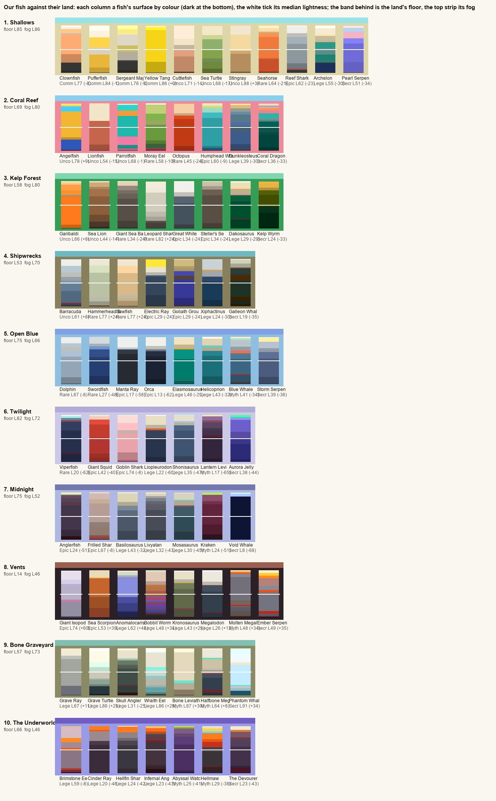
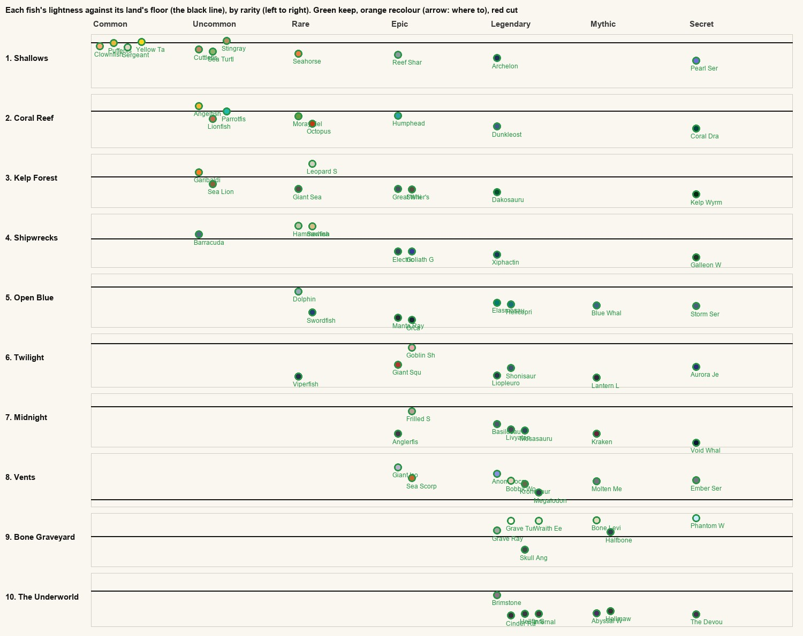

# Fish against their lands: value, and which to keep, recolour or cut

Up: [Home](../../Home.md). Written 2026-11-19 by the map chat. **A proposal. No fish has changed.** The models are the
creature chat's ([creatures](creatures.md)); the recolours would be made there.

## What the user asked
"analyse how fish values are dispersed in accordance to the land, and then thiink about ways we can align our fish
selection to theirs in terms of their vlaues and how they align with the chosen lands. Ive noticed a pattern of a few
that blend in almost in value then some that really contrast, which usually align with being better / at a higher rate
than normal. Maybe theres other stuff but id like to use that information to develop a list of fish that we should keep
the same, some will have to change in colour, some will have to go entirely due to too much fish (mainly and namely in
the first zone, make sure you keep the turtle, but could be the case to a lesser extent for some other zones)."

The list used is the 82 fish in the game: the committed models in `src/shared/Creatures`. The user's unpublished colour
variants (uncommitted changes to some `voxel.py` files) and the new Cosmic and Trial creatures are left out.

## How Ride a Dino does it (measured)
62 dinos with readable rarity tags, in all ten lands, from frames already on this PC (`research/ride-a-dino/dinos/`,
private). The gap is how far a dino's body is from its floor in lightness (L*, 0 to 100).

| Rarity | Dinos | Median gap | Glowing |
|---|---|---|---|
| Common | 4 | 6 (1.5 without mutations) | 0 |
| Uncommon | 4 | 17 | 0 |
| Rare | 7 | 41 | 0 |
| Epic | 7 | 26 | 0 |
| Legendary | 20 | 26 | 0 |
| Mythic | 10 | 30 (lighter than the floor) | 4 |
| Cosmic | 9 | 31 | 4 |

- **The bottom tiers wear the land:** Plains Commons 1 or 2 off the floor, in its colour family. The user's pattern
  holds.
- **From Rare up they stand out, but in different ways:** lightness, an opposite hue (a magenta raptor on green, a
  yellow tiger on cold snow), size and pattern. That is why lightness alone rises only weakly with rarity.
- **Mythics go to the lightness extreme opposite their floor** (a black mammoth on snow, white skeletons on khaki), and
  they are the least saturated.
- **Glow only from Mythic up:** none of 42 lower-tier dinos glowed.
- **Mutations (Golden, Silver, Rainbow) are the loudest break,** against any land.
- Not seen: any Secret.

## Ours, measured the same way

Each fish's surface from its model and palette ([fish_values.py](../../tools/art/fish_values.py)), weighted as a rider
behind and above sees it, against its land's floor in the proposed palette ([colour](colour.md)). What stands out:
- **The Shallows have 15 kinds,** about twice any other land, and four of them are yellow Commons the sand's own
  lightness.
- **Rare ones that blend:** the Pearl Serpent (a Secret, near-white on near-white sand); the Coral Reef's Dunkleosteus;
  the Kelp Forest's whole upper half; nearly all of the Shipwrecks; the Vents' and Bones' Megalodons.
- **The deep lands have the opposite fault:** every fish is dark on a light floor, so nothing wears the land and the
  rare ones don't stand out from the rest.
- **Glow:** ours glow from Legendary down to some Rares (Viperfish). Theirs glow only from Mythic.

## The rule, for ours
[fish_verdict.py](../../tools/art/fish_verdict.py) judges every fish by its tier:
- **Common:** within 10 of the floor and in its colour family.
- **Uncommon:** within 20.
- **Rare and Epic:** 20 or more off, or an opposite hue (90 degrees or more at saturation 0.4 or more).
- **Legendary:** 25 or more off.
- **Mythic and Secret:** 30 or more off, toward the far end, glowing.
- **Every land has at least one fish that wears it.** Where no Common or Uncommon does, the land names one, its
  wearer, judged as a blender whatever its rarity: Dolphin (Open Blue), Goblin Shark (Twilight), Frilled Shark
  (Midnight), Megalodon (the Vents), Grave Ray (the Bone Graveyard) and Brimstone Eel (the Underworld). (2026-11-19,
  after the recolours: the first rule judged the named wearers by their rarity, and recoloured the one fish that
  already blended in Twilight, the Vents and the Bones.)

**45 keep, 33 recolour, 4 cut.**

The list for the creature chat, fish by fish with suggested colours: [the fish recolour list](fish-recolour-list.md).

**After the recolours** (the creature chat, 2026-11-19): 75 keep and 3 to recolour, all three back to their colours in
the game (git HEAD), where they blended: Goblin Shark, Megalodon and Grave Ray, the wearers of their lands.

**The cuts, all in the Shallows** (the user, 2026-11-19: "cut what needs to be cut"; handed to the game-code chat, which owns `src/`; done there the same day) (it keeps 11 kinds, the Sea Turtle among them):
- **Boxfish and Butterflyfish:** the third and fourth of four yellow Commons at the sand's lightness. Yellow Tang and
  Pufferfish keep that role.
- **Blue Chromis:** a Common that breaks the land instead of wearing it.
- **Flying Fish:** a second strong blue in the first land, as an Uncommon.

No other land is over 8 kinds, so none needs a cut. If the user wants fewer there too, the first to go would be one of
each land's near twins: the Kelp Forest's Great White and Giant Sea Bass are both grey and blend; so are the Shipwrecks'
Hammerhead and Sawfish.

**Recolours, by kind:**
- **Bottom tiers too loud** (move toward the floor, in its family): Clownfish (a lighter orange), Cuttlefish, Lionfish;
  Open Blue's Dolphin, Midnight's Frilled Shark and the Underworld's Brimstone Eel, as each land's one fish that wears
  it.
- **Rares that blend** (darker or lighter as marked, or an opposite hue): the Reef's Octopus; most of the Kelp Forest;
  most of the Shipwrecks; Twilight's Goblin Shark.
- **Top tiers that blend** (to the far end): Pearl Serpent, Coral Dragon, Dunkleosteus, Dakosaurus, Kelp Wyrm,
  Xiphactinus, Galleon Whale, Elasmosaurus, Blue Whale, the Vents' four dark top fish (lighter), and the Bones' four
  (lighter still, toward white).
- **Glow** stays on everything that has it today. Taking it off the Legendaries and Rares, to match the reference's
  "Mythic and up only", would be a bigger change; it is the user's call.

## Every fish

### 1. Shallows (floor L*85)

| Rarity | Fish | Now L* (gap) | Verdict | Why | Change |
|---|---|---|---|---|---|
| Common | Blue Chromis | 56 (-28) | **cut** | a Common that contrasts strongly (blue on sand): the bottom tier should wear the land |  |
| Common | Boxfish | 82 (-3) | **cut** | the third and fourth of four yellow commons the sand's own lightness; Yellow Tang and Pufferfish keep the role |  |
| Common | Butterflyfish | 83 (-2) | **cut** | the same as the Boxfish |  |
| Common | Clownfish | 66 (-19) | **recolour** | too loud for a Common: 19 off the floor | lightness toward 77 (now 66), in the land's family |
| Common | Pufferfish | 84 (-1) | **keep** | wears the land |  |
| Common | Sergeant Major | 76 (-9) | **keep** | wears the land |  |
| Common | Yellow Tang | 86 (+0) | **keep** | wears the land |  |
| Uncommon | Cuttlefish | 52 (-33) | **recolour** | too loud for a Uncommon: 33 off the floor | lightness toward 70 (now 52), in the land's family |
| Uncommon | Flying Fish | 62 (-23) | **cut** | a second strong blue in the first land, as an Uncommon; the Shallows keep ten kinds |  |
| Uncommon | Sea Turtle | 68 (-17) | **keep** | close to the land |  |
| Uncommon | Stingray | 88 (+3) | **keep** | wears the land |  |
| Rare | Seahorse | 64 (-21) | **keep** | stands out by lightness |  |
| Epic | Reef Shark | 62 (-23) | **keep** | stands out by lightness |  |
| Legendary | Archelon | 55 (-30) | **keep** | 30 off the floor, glowing |  |
| Secret | Pearl Serpent | 91 (+6) | **recolour** | blends for a Secret: 6 off the floor | darker, toward 51 |

### 2. Coral Reef (floor L*69)

| Rarity | Fish | Now L* (gap) | Verdict | Why | Change |
|---|---|---|---|---|---|
| Uncommon | Angelfish | 78 (+9) | **keep** | wears the land |  |
| Uncommon | Lionfish | 41 (-27) | **recolour** | too loud for a Uncommon: 27 off the floor | lightness toward 54 (now 41), in the land's family |
| Uncommon | Parrotfish | 68 (-1) | **keep** | wears the land |  |
| Rare | Moray Eel | 58 (-10) | **keep** | stands out by an opposite hue |  |
| Rare | Octopus | 56 (-13) | **recolour** | blends: 13 off the floor, hue 23 degrees off | darker, toward 45, or an opposite hue |
| Epic | Humphead Wrasse | 60 (-9) | **keep** | stands out by an opposite hue |  |
| Legendary | Dunkleosteus | 64 (-5) | **recolour** | blends for a Legendary: 5 off the floor | darker, toward 40 |
| Secret | Coral Dragon | 88 (+20) | **recolour** | blends for a Secret: 20 off the floor | darker, toward 35 |

### 3. Kelp Forest (floor L*58)

| Rarity | Fish | Now L* (gap) | Verdict | Why | Change |
|---|---|---|---|---|---|
| Uncommon | Garibaldi | 66 (+8) | **keep** | wears the land |  |
| Uncommon | Sea Lion | 44 (-14) | **keep** | close to the land |  |
| Rare | Giant Sea Bass | 40 (-18) | **recolour** | blends: 18 off the floor, hue 110 degrees off | darker, toward 34, or an opposite hue |
| Rare | Leopard Shark | 66 (+8) | **recolour** | blends: 8 off the floor, hue 0 degrees off | lighter, toward 82, or an opposite hue |
| Epic | Great White | 46 (-11) | **recolour** | blends: 11 off the floor, hue 69 degrees off | darker, toward 34, or an opposite hue |
| Epic | Steller's Sea Cow | 52 (-5) | **recolour** | blends: 5 off the floor, hue 107 degrees off | darker, toward 34, or an opposite hue |
| Legendary | Dakosaurus | 43 (-14) | **recolour** | blends for a Legendary: 14 off the floor | darker, toward 29 |
| Secret | Kelp Wyrm | 44 (-14) | **recolour** | blends for a Secret: 14 off the floor | darker, toward 24 |

### 4. Shipwrecks (floor L*53)

| Rarity | Fish | Now L* (gap) | Verdict | Why | Change |
|---|---|---|---|---|---|
| Uncommon | Barracuda | 61 (+8) | **keep** | wears the land |  |
| Rare | Hammerhead Shark | 54 (+0) | **recolour** | blends: 0 off the floor, hue 26 degrees off | lighter, toward 77, or an opposite hue |
| Rare | Sawfish | 65 (+12) | **recolour** | blends: 12 off the floor, hue 13 degrees off | lighter, toward 77, or an opposite hue |
| Epic | Electric Ray | 45 (-9) | **recolour** | blends: 9 off the floor, hue 165 degrees off | darker, toward 29, or an opposite hue |
| Epic | Goliath Grouper | 50 (-4) | **recolour** | blends: 4 off the floor, hue 3 degrees off | darker, toward 29, or an opposite hue |
| Legendary | Xiphactinus | 45 (-9) | **recolour** | blends for a Legendary: 9 off the floor | darker, toward 24 |
| Secret | Galleon Whale | 48 (-6) | **recolour** | blends for a Secret: 6 off the floor | darker, toward 19 |

### 5. Open Blue (floor L*75)

| Rarity | Fish | Now L* (gap) | Verdict | Why | Change |
|---|---|---|---|---|---|
| Rare | Dolphin | 59 (-16) | **recolour** | no fish in this land wears it: the lowest tier should blend | lightness toward 67 (now 59), in the land's family |
| Rare | Swordfish | 27 (-48) | **keep** | stands out by lightness |  |
| Epic | Manta Ray | 17 (-58) | **keep** | stands out by lightness |  |
| Epic | Orca | 13 (-62) | **keep** | stands out by lightness |  |
| Legendary | Elasmosaurus | 52 (-23) | **recolour** | blends for a Legendary: 23 off the floor | darker, toward 46 |
| Legendary | Helicoprion | 43 (-32) | **keep** | 32 off the floor, glowing |  |
| Mythic | Blue Whale | 46 (-30) | **recolour** | blends for a Mythic: 30 off the floor | darker, toward 41 |
| Secret | Storm Serpent | 39 (-36) | **keep** | 36 off the floor, glowing |  |

### 6. Twilight (floor L*82)

| Rarity | Fish | Now L* (gap) | Verdict | Why | Change |
|---|---|---|---|---|---|
| Rare | Viperfish | 20 (-62) | **keep** | stands out by lightness |  |
| Epic | Giant Squid | 42 (-40) | **keep** | stands out by lightness |  |
| Epic | Goblin Shark | 74 (-8) | **recolour** | blends: 8 off the floor, hue 0 degrees off | darker, toward 58, or an opposite hue |
| Legendary | Liopleurodon | 22 (-60) | **keep** | 60 off the floor, glowing |  |
| Legendary | Shonisaurus | 35 (-47) | **keep** | 47 off the floor, glowing |  |
| Mythic | Lantern Leviathan | 17 (-65) | **keep** | 65 off the floor, glowing |  |
| Secret | Aurora Jelly | 38 (-44) | **keep** | 44 off the floor, glowing |  |

### 7. Midnight (floor L*75)

| Rarity | Fish | Now L* (gap) | Verdict | Why | Change |
|---|---|---|---|---|---|
| Epic | Anglerfish | 24 (-51) | **keep** | stands out by lightness |  |
| Epic | Frilled Shark | 33 (-42) | **recolour** | no fish in this land wears it: the lowest tier should blend | lightness toward 67 (now 33), in the land's family |
| Legendary | Basilosaurus | 43 (-32) | **keep** | 32 off the floor, glowing |  |
| Legendary | Livyatan | 32 (-43) | **keep** | 43 off the floor, glowing |  |
| Legendary | Mosasaurus | 30 (-45) | **keep** | 45 off the floor, glowing |  |
| Mythic | Kraken | 24 (-51) | **keep** | 51 off the floor, glowing |  |
| Secret | Void Whale | 8 (-68) | **keep** | 68 off the floor, glowing |  |

### 8. Vents (floor L*14)

| Rarity | Fish | Now L* (gap) | Verdict | Why | Change |
|---|---|---|---|---|---|
| Epic | Giant Isopod | 74 (+60) | **keep** | stands out by lightness |  |
| Epic | Sea Scorpion | 53 (+39) | **keep** | stands out by lightness |  |
| Legendary | Anomalocaris | 62 (+48) | **keep** | 48 off the floor, glowing |  |
| Legendary | Bobbit Worm | 48 (+34) | **keep** | 34 off the floor, glowing |  |
| Legendary | Kronosaurus | 29 (+15) | **recolour** | blends for a Legendary: 15 off the floor | lighter, toward 43 |
| Legendary | Megalodon | 26 (+12) | **recolour** | blends for a Legendary: 12 off the floor | lighter, toward 43 |
| Mythic | Molten Megalodon | 18 (+4) | **recolour** | blends for a Mythic: 4 off the floor | lighter, toward 48 |
| Secret | Ember Serpent | 28 (+14) | **recolour** | blends for a Secret: 14 off the floor | lighter, toward 48 |

### 9. Bone Graveyard (floor L*57)

| Rarity | Fish | Now L* (gap) | Verdict | Why | Change |
|---|---|---|---|---|---|
| Legendary | Grave Ray | 67 (+11) | **recolour** | blends for a Legendary: 11 off the floor | lighter, toward 86 |
| Legendary | Grave Turtle | 65 (+8) | **recolour** | blends for a Legendary: 8 off the floor | lighter, toward 86 |
| Legendary | Skull Angler | 31 (-25) | **keep** | 25 off the floor, glowing |  |
| Legendary | Wraith Eel | 86 (+29) | **keep** | 29 off the floor, glowing |  |
| Mythic | Bone Leviathan | 87 (+30) | **keep** | 30 off the floor, glowing |  |
| Mythic | Halfbone Megalodon | 64 (+8) | **recolour** | blends for a Mythic: 8 off the floor | lighter, toward 91 |
| Secret | Phantom Whale | 82 (+25) | **recolour** | blends for a Secret: 25 off the floor | lighter, toward 91 |

### 10. The Underworld (floor L*66)

| Rarity | Fish | Now L* (gap) | Verdict | Why | Change |
|---|---|---|---|---|---|
| Legendary | Brimstone Eel | 30 (-36) | **recolour** | no fish in this land wears it: the lowest tier should blend | lightness toward 58 (now 30), in the land's family |
| Legendary | Cinder Ray | 20 (-46) | **keep** | 46 off the floor, glowing |  |
| Legendary | Hellfin Shark | 24 (-42) | **keep** | 42 off the floor, glowing |  |
| Legendary | Infernal Angler | 23 (-43) | **keep** | 43 off the floor, glowing |  |
| Mythic | Abyssal Watcher | 25 (-41) | **keep** | 41 off the floor, glowing |  |
| Mythic | Hellmaw | 29 (-38) | **keep** | 38 off the floor, glowing |  |
| Secret | The Devourer | 23 (-43) | **keep** | 43 off the floor, glowing |  |

## Notes
- The gaps are against the proposed palette's floors (the deep lands lifted, 2026-11-19). If the floors change, rerun
  `python tools/art/fish_values.py` and `python tools/art/fish_verdict.py`.
- A model's median can hide a strong pattern. The Stingray reads light because of its pale top; the recolour list is a
  first cut to look over, fish by fish.
- Mutations, size and pattern are the reference's other markers of rarity. Our colour variants (the user's
  unpublished work) and sizes can carry those.
