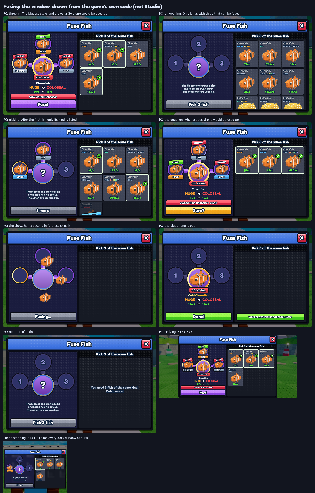

# Fusing

Back to [the aquarium](aquarium.md) (where the fish are), [sizes](sizes.md) (the six sizes and four colours) and [UI](ui.md).

Hugo, 2026-11-25: "Add fusing, this should usually remove special traits like rainbow or gold, unless thats the biggest
dino. The biggest dino grows in size and doesnt inherit traits, but it keeps its own traits when fused, add integration
to the fuse machine as well, same standing on circle mechanic." (with a picture of the reference's fuse window: function
and flow taken, not its look)

**State (2026-11-25, NULLROOM u1): built, merged on the branch `merge-finished-2026-11-25`, checked offline (261 checks). Not seen
in Studio, not played.** Off switch: `Config.Fuse.On` 0 (read live: the ring opens nothing, the stall says COMING SOON, the server refuses).

## The rules
- **Three fish of one kind become one.** The biggest of the three stays and grows **one** size (Tiny, Normal, Big, Giant, Huge,
  Colossal). It is the same fish: its colour, its key, its place in the tank or the hands. The other two are used up with their
  colours; nothing is inherited.
- Biggest is by size alone, never by colour or worth.
- **Claude's readings, not confirmed by Hugo:**
  - Equally big: the one put in first stays. The window shows which before the press (STAYS, USED UP).
  - A Colossal can't grow, so nothing can be fused with one (refused).
  - What may go in: carried fish, and fish stored in the tank. **A fish earning in the tank must be unequipped first**, as for
    selling ("not the equipped ride fish": read as both the ride fish and the earning ones; `Fuse.Earning` 1 lets earning fish in).
    Never the fish you ride with.
  - It costs nothing (`Fuse.Price` 0; any price is taken in the same step).
  - Sizes may be mixed, as in the reference (`Fuse.SameSize` 0). 1: all three must be the same size too.
  - "Sure?" is asked when a fish that would be used up has a colour or is a Giant or bigger (`Fuse.SureSize`).

## What it does to the economy
Income and the Oxygen a fish needs both follow its size and colour, so a size up moves both by the same share: x1.25 (Tiny to
Normal), x1.2, x1.25, x1.33, x1.5 (Huge to Colossal). A plain Normal one earns 1 here.

| Put in | Earned by the three | Earned after | |
|---|---|---|---|
| 3 plain Normal | 3.0 | 1.2 | -60% |
| 3 plain Huge | 6.0 | 3.0 | -50% |
| plain Giant + 2 plain Tiny | 3.1 | 2.0 | -35% |
| plain Huge + 2 plain Tiny | 3.6 | 3.0 | -17% |
| Gold Huge + 2 plain Tiny | 7.6 | 9.0 | +18% |
| Rainbow Giant + 2 plain Tiny | 19.6 | 24.0 | +22% |
| Rainbow Huge + 2 plain Tiny | 25.6 | 36.0 | **+41%** |
| Rainbow Tiny + 10 plain Tiny, all the way to Colossal | 17.6 | 36.0 | **+105%** |

- Plain fish always lose in sum. But earning places are limited (7 to 17) and stored fish earn nothing, so the real gain is per
  place: the one that stays earns +20% to +50% a step.
- **Is the free mix a loophole? Yes, for Colossals.** One Normal and 8 more of its kind, any size, give a Colossal (x3 income, x3
  Oxygen need). By the plain odds a wild one is 1 in 250 and a Rainbow Colossal 1 in 150,000 (`SizeChance` and 1 in 600 multiplied;
  rarity, `SizeLarge` and `Grand` move it, not measured); with the mix it is a Rainbow Normal and 8 of the cheapest. It is bounded (x3.75 from a Tiny, x3 from a Normal, the top size stops it) and needs the same kind.
- **With `Fuse.SameSize` 1** that Colossal takes 81 Normals (from a Tiny: 243 Tinies). Closed, but close to never reached.
- Selling: a plain Huge and two Tinies sell for more than the Colossal (x0.83); a Rainbow Huge's set sells for less (x1.41 after).
- `lune run tools/fuse/fuse_test.luau <place> economy` prints all of it again.
- **The numbers are the tuning chat's and Hugo's to pick.** A middle way that is not built: the two used up must be at most one
  size smaller.

## How it is built
- `src/shared/Fuse.luau`: the rules as plain sums, the same for the server and the window.
- `Services/FuseService`: the ask (Action "Fuse", three names), who and where: alive, on the dock, on neither the seahorse nor a
  tank fish, within `Fuse.Near` of the ring; one ask at a time.
- `AquariumService.fuse`: **one step that never waits**: everything checked first, then the hands' part all or nothing
  (`RideService.fuseCarried`), then the tank's, which can't fail, then the price; only then is anyone told, each telling guarded.
  So a second press, a sale, an equip, a take-out or leaving at the same moment finds either all three fish or the one. (There is
  no trading in the game yet; a trade must take fish through the same lists.)
- Saved as any fish: the tank's and the hands' parts of the save, in one snapshot. Nothing new in the save. A grown look counts
  in the Index as one more look of its kind, through the Index's own watch.
- `UI/FusePanel`: the window, and the show (the three swirl into the core, the bigger one comes out, bubbles at the machine;
  `Fuse.SwirlTime`, `HoldTime`; a press skips it). The fusing is done before the show begins.
- `StallController`: the ring. **New for every stall: a ring the player is put down on (a spawn, the way back from a dive) opens
  nothing until they step off and on again**, because the hub kit's Fuse ring lies on the spawn.
- `HubSigns`: the stall's line says "three fish into one".

## What the place must hold
`Workspace.ClaudeBlockout.Dock.Stations.Fuse`, a Model (as `hub_kit.py` makes it), with:
- **a part named `Ring`** on the floor (or the Model's PrimaryPart): its X size is how wide the circle is. **No ring: no window, and
  the server refuses.** In the user's open place the stall was moved 18 studs back by hand; that is fine, the ring only has to have
  moved with it.
- a part named `Core`: the bubbles and the ring of light (else they come at the floor ring). The keeper uses it too.
- the sign's `Sub` label (the line under FUSE), optional.

## Checks
`tools/fuse/fuse_test.luau` (the rules, the one step, the races, 3,000 asks at random: 164) and `tools/fuse/panel_test.luau` (the
window, the ring and the show against the real server code: 97); `python tools/fuse/picture.py` draws the window. Their heads say how.
Twenty faults put in by hand were each caught by one of the two.

## Open
- Hugo: the readings above; `SameSize`; a price.
- The window in Studio, on a phone, by hand. On a phone held upright it is small, as every dock window of ours.
- A pick in the submarine's window ("ride with") names a fish by kind, size and colour, so it is lost when that fish grows or is
  used up, as it is after a sale.
- After a skipped show the sound still comes at its own time.
