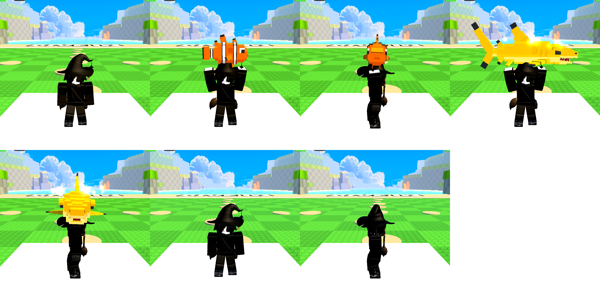

# Holding a fish over your head

Hugo, 2026-11-20: "make the player be able to hold fishes over the head, when in the hub and only fish that are
currently in inventory." Built by NULLROOM task f1. The next task (riding it after the sub) reads which fish is held.

## Decided (built)
- **What can be held:** only a fish in your hands (the slots at the bottom: what the dive caught and you haven't put in
  your tank yet). Not tank fish, not wild fish.
- **Where:** on the dock only (State "Dock"). Not in the water, not riding.
- **How:** click (or tap) a caught slot anywhere on the dock except at your own tank: you hold that fish over your head.
  The same slot again, or an empty slot, puts it away. At your tank a click still puts the fish in the tank, as before.
- **The look:** both arms up, out a little to the sides, forearms bent in; the fish lies across the top of the head
  (head to your right), scaled down to a carryable size, its colour (Gold, Rainbow...) kept. Everyone sees it.
- **When it goes away:** at once when that fish leaves your hands (put in the tank, or any other way); on a new body
  (respawn, reset, death). A dive keeps it **held but unseen**: the fish model goes while you're not on the dock, and
  comes back over your head if you're back on the dock with the same body and still have it.

## How it works
- **Server** (`AquariumService`): Action `"Hold", index, id` (the index-th fish in the hands, oldest first, which must
  still be `id`; index 0 puts it away). Refused with Ride `"Denied", "Hold", "Gone"` / `"Far"`. The server remembers the
  very entry of the hands (`RideService.carried`), so it knows when that one fish leaves; it looks 8 times a second and
  at once when a fish goes in the tank. It builds the fish (`FishModel`, `Variants.apply`), weightless and touching
  nothing, welded over the head, in `Workspace.HeldFish`: so every player sees it with no extra traffic.
  `AquariumService.heldOf(player)` gives the held fish (`{Id, Size, Variant}`) for the dive.
- **Player attributes:** `HeldFish` (id), `HeldSize`, `HeldVariant`, `HeldIndex` (its place in the hands now).
- **Client:** `AquariumController` sends the ask on a slot click (`Slots.Picked`, fired for every slot click, empty
  ones too). `HoldController` lifts the arms of every player holding a fish, on every machine, after the Animator
  (PreSimulation), blended in and out; only shoulders and elbows, so the legs keep walking. R15 and R6.
- **Numbers:** `Config.Hold`: `Share`, `Least`, `Most` (the fish's length over the head: a share of its own, kept
  between 3.5 and 8 studs), `Above`, `Turn`, `Lift`, `Out`, `Elbow`, `Blend`, and `On`.

## Checked
`tools/studio/hold_check.py` (install, play, run, remove), 2026-11-20, in a Studio playtest by script, on Hugo's own
avatar (R15, a tall witch hat):
- hold a Tiny Clownfish (3.5 studs long over the head), switch to a Colossal gold Reef Shark (8 studs), a wrong id is
  refused, 0 puts it away, taking another fish out of the hands keeps it held at its new place, taking the held one
  out puts it away, a respawn puts it away;
- the hands, against the head's middle, as the player's own machine poses them: hanging 2.1 below; holding 0.6 above,
  either side of the head (this avatar's arms reach no higher); put away, 2.1 below again (the arms come all the way
  down);
- pictures:  (empty hands; small fish front and side; big fish front and side; put
  away front and side), each also on its own: `docs/attachments/hold-*.png`.
- **Tuned from them:** `Lift` 175, `Out` 12, `Elbow` 5 (nearly straight arms: bent more, the hands only reach the
  ears), and the fish lies on whatever sits on the head (a hat or hair, `HatMost` 2.5 above the head at most): on
  the head alone it went through Hugo's hat.
- **Not tested:** two players at once (studio-runner starts only a one-player playtest). The fish is the server's,
  welded to the body, so it reaches every player as any part does; the pose is read from the player's attributes on
  every machine, for every player.

## Open
- A two-player playtest (Studio's Test tab, 2 players) to see the fish and the arms on the other player's screen.
- Number keys for the slots (a hotbar's 1 to 7) are not wired.
