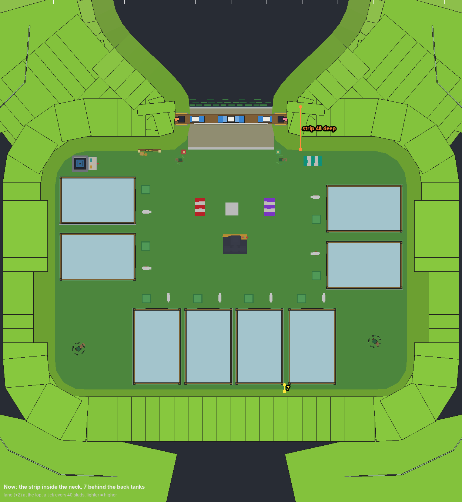
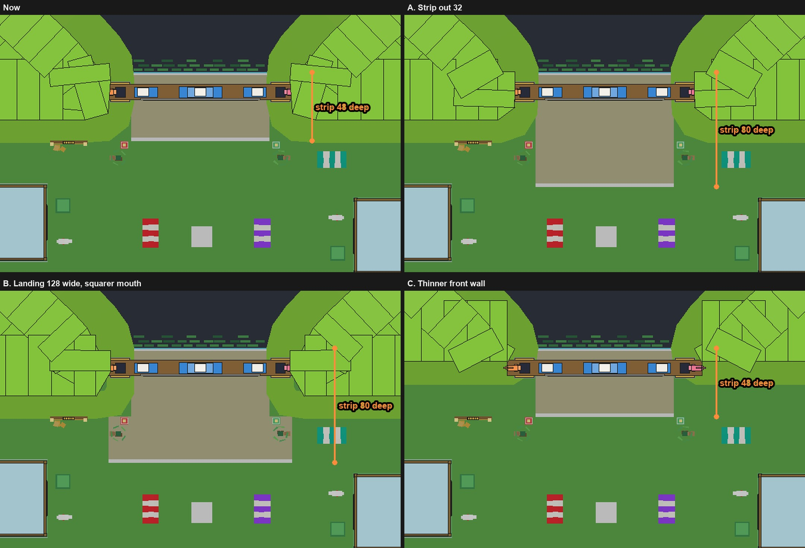
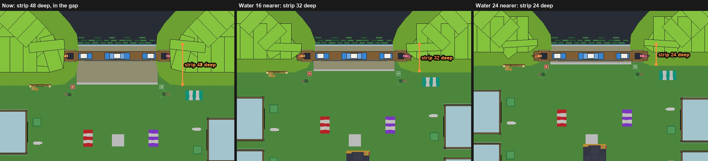
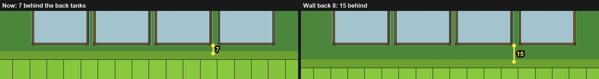

# The hub's layout: the dive-in strip, the walls round it, the space behind the tanks

Up: [the dock](the-dock.md), [the hub's models](hub-models.md).
Written 2026-11-20 by the map chat. The user: "need to focus on making the hub more accurate now. need to do a full
study of how we can make the dive in platform on the floor better placed and subsequently the walls around it.
Additionally, we will need more space between the back aquariums and the walls behind it. not too much".

> **The hub described here was replaced on 2026-11-23** by S ([hub-review-2](hub-review-2.md), "Live"): 344 x 212, open pens.

**A study. Nothing in the place has changed.** Options A to C are trial builds only.

## How it was studied
- **Our hub:** measured from the place itself, including the user's hand placing. 1,657 parts were read from Studio
  into `art/map/hub_study/dump.csv`, and [hub_plan.py](../../tools/map/hub_plan.py) draws the plan from above.
- **The options:** real builds of the map generator with trial numbers (`HUB_TRY` in
  [greybox.py](../../tools/map/greybox.py); unset, the build is unchanged, checked against the live map).
  [hub_options.py](../../tools/map/hub_options.py) draws each with the hub's models where they stand now.
- **The reference:** our own frames of Ride a Dino's hub (research/ride-a-dino, private: `details/crops/start_strip.jpg`,
  `hub_walls_towers.jpg`, `map/H1` to `H5`). Read for rules, not copied.

## What the reference does at its start
- **The strip lies on the hub's floor and in the gap, flush.** It is a tan studded slab as wide as the gap, with a white lip
  along both long edges and big painted words. From anywhere in the hub you see it as a broad band across the way out.
- **The gap is a plain cut in the hub's wall.** The tall wall ends square either side; the Top Earners board is set into the
  wall face right beside the gap, with lamps. Nothing narrows toward the gap inside the hub, and nothing stands over the strip.
- **Stalls stand near the strip** (the airline stall beside it), so the way out and the shops share one area.

## What ours does, measured
| | Now |
|---|---|
| The strip | 96 wide, 48 deep (z -48 to 0) |
| Where it lies | Entirely inside the gap: its inner edge is exactly the front wall's line (z -48), so none of it is on the open floor |
| The gap | The low terrace's walls narrow in from the hub's front (corners of 24) to 98 apart; the tall walls are 130 apart behind them |
| Over the strip | The DIVE IN arch, its beam at the water's edge (z -6) |
| Behind the back tanks | **7 studs** to the low wall's face (5 to the terrace's grass edge) |
| Beside the side tanks | 7 to the side walls |

So from the hub you see the strip end-on, as a slot between two walls, and from the spawn's camera mostly as a thin band
under the arch. In the reference, the strip is the first thing on the floor you walk onto.

## The options

| | The strip | The walls round it | What changes in the place |
|---|---|---|---|
| **Now** | in the gap only, 48 deep | the neck as built | nothing |
| **A. Out onto the floor** | carried on 32 onto the floor: 80 deep in all, 96 wide (the gap's width, as the reference's) | as now | one part added and one white line moved. It can be tried in Studio in a minute, before any rebuild |
| **B. A landing** | as A, but the floor part is 128 wide: a landing in front of the gap | the mouth's corners squarer (24 to 17) | the strip's parts, and the walls by the gate rebuilt. The two palm-and-lamp pairs by the gap would stand on the landing's corners (like the reference's two cyan pads), or move out |
| **C. A thinner front wall** | 48 deep, half in the gap and half on the floor | the whole front wall comes 24 nearer the water, so the cut is only 24 deep; the arch stands right at the hub's edge | the whole front of the hub rebuilt; the hub gets 24 deeper. The stalls by the front wall would stand 24 off it unless moved |

**Set aside (the strip too long, the user, below).** It was my first pick, with two small follow-ons:
- The **DIVE IN words** move onto the floor part of the strip, where you read them from the hub. Today they lie at the
  water's edge, under the arch.
- The **Top Earners board** stands free beside the gap now. It could be set into the front wall's face beside it, the way
  the reference's is. That is the "walls round it" part, and it costs no rebuild.

Why A over B and C:
- **It answers the problem directly.** The strip is the first thing on the floor, as wide as the gap, so it reads as the
  way out from the spawn.
- **It keeps what you chose on 2026-11-17:** the gate's width and its gentler cliffs. B's squarer corners barely show
  from above. C undoes part of the hub's shrink.

## The water nearer (2026-11-20, after the options above)
The user: "nah the strip is too long, we might need to move the water foward even to make it more accurate". So A to C
are set aside. Now the strip stays short and the water's edge comes in toward the hub. The cut through the front wall is
shorter, and the strip fills it, so you step off the strip straight into the water, as in the reference.

The whole hub moves toward the water by the same amount, with everything in it as you placed it. The floor keeps its
size and every walk keeps its length; the lane doesn't move. The arch stays over the gate at the water's edge.

| | The cut / the strip | The arch | The hub moves |
|---|---|---|---|
| Now | 48 deep, as a slot between walls | over the strip's far end | |
| **W32: the water 16 nearer** | **32 deep** | over its far half; the near 14 studs are open to the sky | 16 toward the water |
| W24: the water 24 nearer | 24 deep | covers almost all of it: from the hub you see the strip under the beam | 24 toward the water |

**My pick: W32.** The strip is two-thirds as long as now and reads as a band in front of the water. W24 puts almost all
of it under the arch.

**Picked: W32** (the user, 2026-11-22: "Do the old chat's pick"), with the 15 behind the back tanks. In the generator:
`FRONT` -32, `HUB_BACK` -312, `PLOT_GAP` 15 for the back row only (`SIDE_GAP` 7 keeps the side tanks where they were),
and `HUB_SHIFT` 16 added to every number the user placed by hand (the side tanks, SELL, AURAS, FUSE, the spawn, the
back palms; what stands by the front wall follows `FRONT` by itself). The place had nothing moved or added by hand
since the last build (read 2026-11-22 before the reload; the Dock backed up as `ServerStorage.DockBackup_2026-11-22`).
- **A side effect:** the walls' pieces are marched from the middle of the hub's back, so the longer ring slides every
  lane wall piece a few studs along the same line, and about 40% of the lane's props come out re-scattered by the same
  rules. The lane's shape, floors and set pieces are unchanged; the far view is its own parts and unaffected.

**What it means in the place:**
- The hub's walls and floor are rebuilt (the map reload).
- Every hub model you placed moves by the same amount toward the water: one move of the whole Dock, with nothing
  between them changing.
- The back wall's 15 (below) comes in the same rebuild.

## The space behind the back tanks

**Pick: 15 studs (7 now), one checker square more.** It's about three players' width, room to walk behind a tank
without it feeling like a corridor ("not too much").
- **Done by moving the back wall back 8** (`HUB_BACK` -320 to -328), not the tanks forward. Your placing stays exactly
  where it is, and the open middle of the hub keeps its size. The hub becomes 8 studs deeper, 3%.
- **Alternative:** 11 (half a square more), or the tanks forward instead of the wall back.
- **Open:** the side tanks are also 7 from their walls. They're unchanged unless you want them to match.

## Building it
- **A's strip:** a part in Studio, then the same numbers in the generator (`STRIP_IN`), so a rebuild keeps it.
- **The back wall:** the hub's walls come from the generator, so it means a map reload (about 40 minutes). The hub's
  hand placing is read from the place first and kept, as every reload does.
- **Nothing is built until the user picks.**

## Not done
- **Not seen at eye level:** the options are plans only. A can be seen in Play within a minute of a yes.
- The arch's banner hides the far view's black hole from the spawn's camera
  ([props and landmarks](props-and-landmarks.md), "The far view in the game"). A higher banner, or none, would show it.
  That's a separate question.
