# The hub's models

The first pass of [the refinement](../Refinement.md)'s stream 1, by the map chat, 2026-11-16. The user's words:
"I'd like the hub to reflect quality and not just a block out anymore. So quality models in our style with creativity
across the hub where needed." **Three passes. The third (simple, the tank in levels) is the user's direction; see below.**

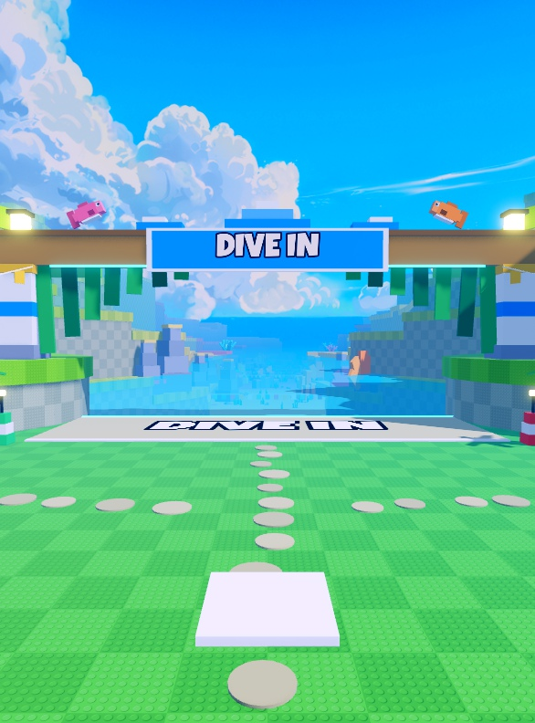
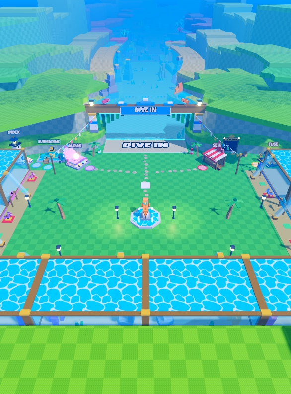

## What is there
| Piece | What it is now |
|---|---|
| The gate | Two white piers with a blue band, a great beam across, DIVE IN facing the hub, a wave and two leaping fish on top, lanterns, a lit lip under the beam and along the water's edge. Kelp hangs from the beam, long by the piers and short in the middle, so the square opening reads as an arch |
| Under the gate, in the water | A curtain of kelp down the wall below the lip, from the surface to 40 studs down and 9 studs out. Fish made at the lane's start come out from under it |
| Sell | A fishmonger's stall: striped awning, two ice crates with the catch on them, a hanging brass scale, a red fish for a sign |
| Auras | A giant open clam with a glowing pearl. Three small pearls in front, in three colours, show what an aura is |
| Fuse | A machine: three glass pods with a fish in each, pipes into one big pod with a glowing core, a desk with two buttons and a lever, a cog |
| Index | A small lighthouse, white and blue, with a great open book on a stand at its foot |
| The sub | A submarine in a basin of moving water: hatch open, periscope, portholes, a gangway |
| Top earners | A framed slate on the wall with a brass header and a crown. Five empty lines for the game to write on |
| Each tank | The same frame with brass caps, the moving water on top, a band and a numbered sign in the plot's colour, and a glass pipe from a hopper up over the rim (the "ramp": the catch goes in by it). Inside, each one different: along the back glass a row of rock piles, tall kelp, a fan coral and tube corals; a low rock pile at each end; on the sand a starfish, a shell, a pale drift, a pebble, and in some a chest |
| Each trainer | A coin-operated toy seahorse in the plot's colour, on a spring, with a coin box. About 14 tall and 17 long; its saddle is 4.5 studs over the floor |
| The middle | A fish and its rider leaping from a plinth in a round pool, four jets of water |
| Everywhere | Six lamps, two buoys at the start (red left, green right), two lines of flags from the piers, six palms, stepping stones from the landmark to the start and off to the two stalls, crates and barrels |

Every station has its name floating over it and a coloured ring on the floor in front.

## How it is made
- `tools/map/hub_kit.py` draws everything from boxes (and a few balls and flat round slabs), the way the creatures
  and the lane's assets are drawn. No meshes, no uploads, nothing that costs credits.
- `tools/map/greybox.py` no longer makes the stalls, the tanks or the flag line. It gives the kit the hub's numbers
  (`art/map/greybox/hub_in.json`) and the kit writes `hub.json`.
- `tools/map/hub_luau.py` turns that into `tools/studio/greybox/94_hub.luau` to `97_hub.luau`. They run after the
  map's parts and before the water in a whole-map load, or by themselves to change only the hub:

```bash
python tools/map/hub_kit.py && python tools/map/hub_luau.py
```

  then all four files in order with `run_luau.js`. The first clears what the last run made, so run all four, never
  one. It takes a few seconds.
- **To move a station:** one line in `spots`, in `build` at the bottom of `hub_kit.py`. Everything stands on the
  hub's own numbers, so it follows when the hub's size changes.

## The names the game reads
| Where | What |
|---|---|
| `Dock.Plots.PlotN` | `TankWater`, `Pad`, `CollectPad`, `SignBoard`, `TrainerSpot` are parts, as before. Checked in Play: a tank is taken and its sign written |
| `Dock.Plots.PlotN.TrainerRide` | **Now a Model** (the seahorse, 16 parts, all anchored). Its PrimaryPart is the part named `TrainerRide`: the body, under the saddle. Move the Model to bob it. The base, spring and coin box (`TrainerBase`, `TrainerSpring`, `CoinBox`) stay still |
| `Dock.Plots.PlotN.Chute`, `ChuteHopper`, `ChuteMouth` | Only on the old tanks (plots 5 to 8). The new tank has no pipe |
| `Dock.Stations.<Sell, Auras, Fuse, Index, Sub>` | A Model each. PrimaryPart is `Ring`, the ring on the floor: where a player stands to use it. `Title` carries the floating name |
| `Dock.Stations.Earners.Board` | A SurfaceGui named `Rows` with `Row1` to `Row5` (TextLabels) |
| `Dock.Gate`, `Dock.Landmark`, `Dock.Dressing` | Nothing the game needs |
| `Dock.HubLife` | A small client script: slides every picture tagged `HubRipple` (the tanks' tops, the basin, the pool) |
| `DockSpawn`, `StartStrip` | Unchanged |

## The count
1,106 parts for the hub's models, where the blockout's stalls, tanks and flags were 174. 228 of them are solid;
the rest can't be bumped, touched or hit by a ray. Seven lights, none casting shadows. By piece: the eight plots
606 (about 76 each: about 27 of them inside the tank, 16 the seahorse), the gate 104 (53 of them the kelp), the small things
161, the six stations 200, the landmark 35. The first pass was 930; the second added the tanks' insides and the
bigger seahorse. This is over the "hundreds" asked for: the tanks are where it could come down again.

## The second pass (2026-11-16)
Asked for by the game-code chat after its look at the first:
- **The pearl** was a Neon ball and bloomed into a white blob. It is a plain pale ball now, with a small shine and
  a softer light. The clam's shells step out as they rise, and its lid is a fan.

  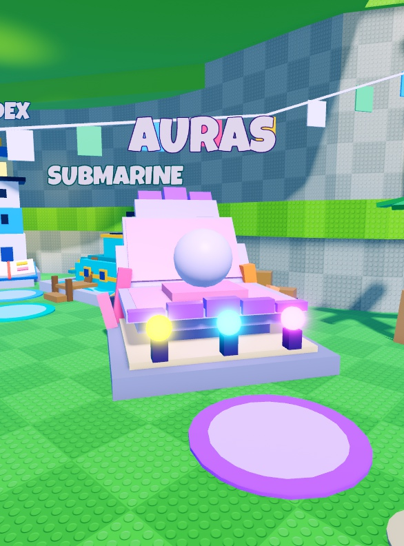
- **The tanks' insides.** The display fish lap the middle of the water: never nearer the glass than 4 studs, never
  lower than 3 over the sand. So everything tall stands in a 5-stud band along the back glass or at the two ends,
  and everything else on the sand is under 2.5 tall. Each tank is laid out from its own number, so no two match.
- **The tank's water is clearer:** 0.7 see-through, where it was 0.55. At 0.55 everything inside was the water's own
  blue. The display fish show better for it too.
- **The seahorse** is about one and a half times the size, on a lower machine, so the saddle is 4.5 studs over the
  floor (3.9 over the pad). Its nose and tail reach a little past the pad.

  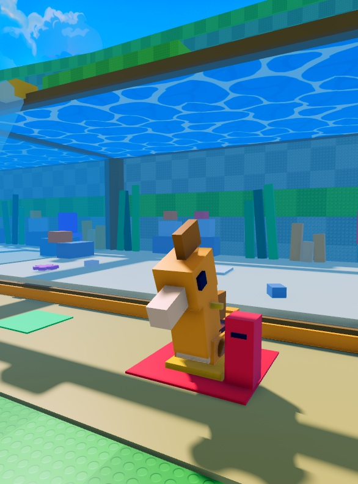
- **The words on the start strip** were reported upside down from the hub. Looked at again from the hub side, they
  read the right way up (rotation -90), so nothing was changed:

  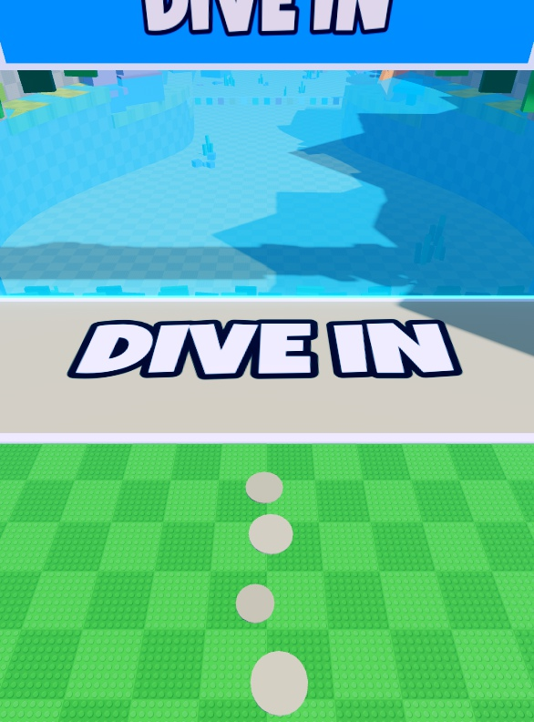

## The third pass: simple, and the tank in levels (2026-11-16)
The user stopped a rebuild that added things (lamps, a crest, a hopper and pipe, a great coin, a hung fish) and asked
for the opposite: "more simple ... corners that are aesthetic and carefully crafted, simplistic, but every step done
well and quality. Overlapping colors." And for the aquarium as "a progression of levels": taller, borders "cooler, but
only slightly", "maybe a cooler sheen on the glass", room for more fish. Their words are in [Decisions](../Decisions.md).

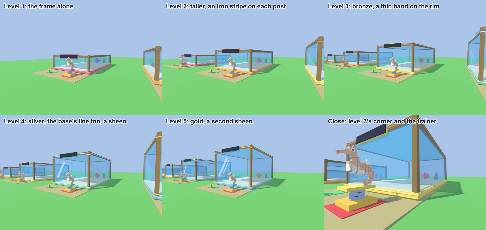

(Blender's pictures: no studs, a stand-in light. Studio's view was not drawing when this was built.)

**The tank** changed once more the same day, on the user's word: deep instead of wide ("like how in ride a dino the
pens are much deeper"), its borders "much skinnier and minimalistic whilst keeping minor intentional details in colour
and framing", and the boxes round the corners gone. It is mostly glass now, and always the same few pieces:
- **The base:** one low course of the plot's colour on a dark toe set half a stud in, a thin lighter line round it,
  and one row of studs on the ledge the glass stands back from.
- **The frame:** posts 2 studs square, half a stud in from the base's edge; a rim a quarter of a stud back from the
  posts' faces; the posts end half a stud over the rim. No shoes, no caps, no collars.
- **The sign:** the owner's board with a border of the plot's colour, lying over the front rim.
- **Inside:** three of the lane's own props along the back glass. The rest is for the fish.

| Level | Water, tall | What the border gains |
|---|---|---|
| 1 | 14 | nothing: the frame alone |
| 2 | 20 | a thin iron stripe round each post, under the rim |
| 3 | 26 | bronze, and a thin band along the rim |
| 4 | 32 | silver, the base's line in silver too, a pale streak on the front glass |
| 5 | 38 | gold, a stripe at each post's foot, and a second streak |

A plot is 56 wide and 88 deep (it was 88 by 56); the water is 52 by 84. The plot's back is where it was, and the
extra depth comes forward into the hub. **In the place** (the user: "port these into Roblox for now"): every plot has this tank. Plots 1 to 5 show levels 1 to
5 and plots 6 to 8 level 1, until the game sets a tank's level. The back row is closed up, 56 apart, side by side
(at 88 apart the deep tanks at its ends ran into the side plots' tanks); the side plots have not moved. Lighting
and polish come later, once the game-code chat's research is done.

**The trainer** is a pad, a small base, a spring, and the game's own Seahorse (cloned from
`ReplicatedStorage.FishModels` when the hub is built, at 0.85 of its size) on a plate. The plate is the part
`TrainerRide`.

**The sell stall** is four leaning posts, an awning of red and white bricks in three rows that curves down to a deep
front edge, a counter with a studded top and the station's red across its front, and two of the game's fish on ice.
Nothing on the roof.

**Made of the map's stuff:** the map's stud picture lies on the tops that are seen from above (the plot's pad, the
sill, the counter, the awning, the pads). Three tones of a colour by one rule (lighter facing up, darker underneath).

**The kit now checks before it writes** (as the creature kit does): a piece that floats, and two faces of different
colours in one plane, stop the build. `python tools/map/hub_kit.py --levels` writes the five levels in a row
(`hub_levels.json`); `tools/blender/hub_view.py` draws any model in colour, grey or as a black shape.

**The count:** 860 parts for the hub's models (it was 1,106). A plot is 42 to 58 by level; the stall 41.

**Not done, or not sure**
- Seen in Studio 2026-11-16 (the look pass's pictures); not played. Level 1's water is only 14 tall: the display fish may want different numbers.
- The upgrade itself is the game code's. It will need the five tanks as something to swap in: not made yet.
- The other stations, the gate and the landmark are still the first two passes' models.
- The first rebuild's pieces (the crest, the hopper, the coin) are gone from the kit; `--old` still builds the first
  two passes' tank and stall, for a before picture.

## The look pass: the bench (2026-11-16)
**For the user to pick from. Nothing on the plots or the stations is changed.** Four of
[the buildings study](../reference/look-assets.md)'s tests (3, 1, 15, 13) and its measurement (2), built as test
pieces on a floor of their own 730 studs behind the hub (`Workspace.ClaudeHubBench`; taken down again once the picks
were built, see below). Seen in Studio this time, under today's light, under
light A of [the lighting tests](lighting.md), and at quality level 1. Most promising first.

### Built into the hub (2026-11-16, the same evening)
The user: "Just build the assets. Sure." ([Decisions](../Decisions.md)). Under light A, which the user also picked.
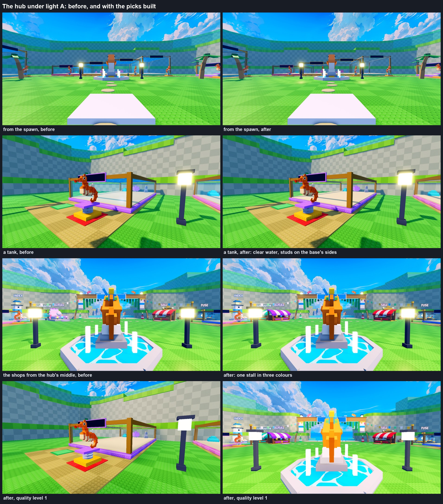
- **Every tank has clear water** (`TankWater` is the same size, now 0.9 see-through and pale). The moving picture
  is a band round the water's edge, four thin strips named `TankSurface`. The base and its toe are studded on
  their sides too, and so is the trainer's base.
- **SELL, AURAS and SUBMARINE are one stall** (`stall` in `tools/map/hub_kit.py`) in red, purple and teal: deep
  brown timber, a gold base plate, posts 2 studs, the base and the counter studded on every showing face, the
  awning on top. On the counters: the catch on ice, three plain orbs, a toy submarine. Each is still
  `Stations.<Name>` with its `Ring`. The clam and the moored submarine are gone from the hub (their code is kept).
- Fuse, the Index, the board, the gate and the landmark are untouched. Studs are Textures, as before: no upload.
- **Checked:** every plot has one each of `TankWater`, `Pad`, `CollectPad`, `SignBoard`, `TrainerSpot` and its
  `TrainerRide`; 892 parts (it was 860); the kit's own check found no fault; it holds at quality level 1.
- **Not done:** not played, not on a phone, the place not saved. The bench and the scale figures are deleted from
  the place (`hub_bench.py` builds the bench again; it needs two figures put back in `Workspace.ClaudeScaleFigure`).

**The stations' names, style C (later the same evening).** The user: "for stations, C" ([Decisions](../Decisions.md)).
SELL, AURAS, SUBMARINE, INDEX and FUSE are bare words in the station's colour with a dark edge and one small line
under each, as the UI chat's option C (`../attachments/ui7-signs-c-stations.jpg`). **Not seen by me:** Studio's view
was not drawing when they went in, so they are checked by numbers only. AURAS, the submarine and the Index still
stand in a line from the spawn; moving one is a line in `hub_kit.py` and waits for the user's word.

### 1. One plot five ways (test 3)
The same five fish in each (the Seahorse is the Rare), a name over each as a stand-in for the game's labels.
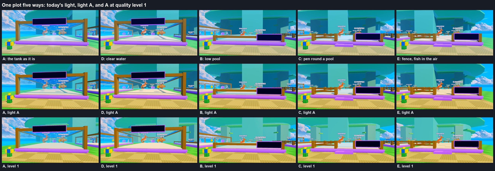
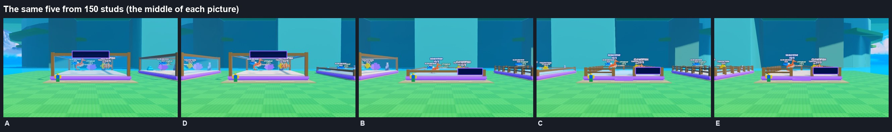

| | What it is | How the fish read |
|---|---|---|
| A | The deep slim tank as it stands in the hub | Dimmed and blued by the tinted water; the moving picture on top is the loudest thing |
| **D** | **The same tank, the water nearly clear, the moving picture only as a band round the edge** | **As bright as in the open, and still a tank** |
| B | A low pool, no glass, the fish at the water's top | Bright, but the fish sit low: the rim hides them from far off |
| C | A fence of posts and two rails round a shallow pool, a step up to a gap, the fish in the air | Bright, and the fence is seen over |
| E | The same fence, sand and no water | As C |

- **My pick is D.** It keeps what the user chose this morning (the deep tank, taller by level, the slim frame, the
  sheen) and gets nearly all of what the open pens get. C and E show the fish no better up close, and a pen has no
  "taller for more fish" to upgrade.
- **The honest answer to the study's question:** from the middle of the hub a Rare cannot be told from a Common in
  any of the five. A fish is 7 to 16 studs long there. What tells is the name over it, so the label's size and
  colour matter more than the glass.
- All five hold at quality level 1.

### 2. Where the draw calls go (test 2, a measurement)
Read from Studio's own counters, in Edit mode. The budget the study gives is 500 draw calls and 500,000 triangles.
- **The whole hub in view: 62 draw calls, 46,000 triangles.** From the spawn looking in: 41. It is cheap today.
- **The tanks' water and glass are 25 of the 62.** The stud pictures and the moving water: 25 (they overlap the
  tanks). The names: 13 of 65 when looking at the stations. The lights: none.
- **A plot with five fish and five names costs about 40; the same tank empty costs 4.** The way of showing the fish
  changes it by a few (A 42, D 48, B 39, C 39, E 38). **The fish are the cost:** a fish is one draw call for each
  piece of its model (the Yellow Tang 3, the Clownfish 6, the Seahorse 9), and a name about one.
- **Copies are free:** five Clownfish cost the same 6 as one. So it is the number of different kinds in view that
  counts, not the number of fish. Eight full tanks of seven different fish could be 300 and more: a thing for the
  game-code and creature chats to know before the hub fills up.
- Not measured: shadows (the counter reads 0 in Edit mode), and anything on a phone.

### 3. Studs (test 1)
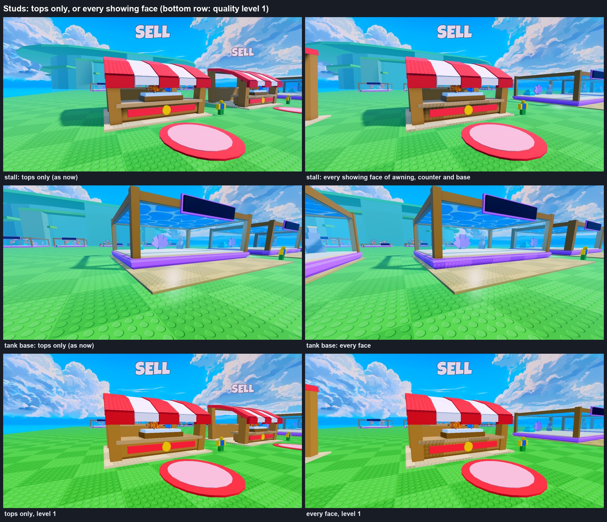
- **Tops only** (as now) against **every showing face** of the awning, the counter and the base; the posts, rails
  and signs plain in both. Every face reads a little more "made of the floor's stuff", most on the tank's base; on
  the counter's front it is busier. It costs 3 more draw calls a piece (stall 9 to 12, tank 4 to 7) and five
  pictures a block instead of one.
- **The third way, a stud material, could not be shown.** The map's stud picture is see-through shading made to lie
  over a colour, and a material shows it as black. A material needs a new, solid picture, and that is an upload,
  which waits for the user's yes. It is the way that would make studs catch the light.
- My pick: every face on bases and counters, tops only on awnings. A small thing either way.

### 4. The palette (test 15)
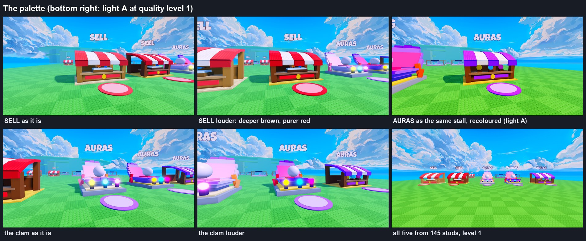
- **The stall louder** (a deeper brown, a purer red, a gold base plate) sits better on the loud floor than today's.
- **AURAS as the same stall, recoloured** (purple and white, three plain orbs on the counter) reads from 145 studs
  as a shop, in the same family as SELL. **The clam** reads as a pale shape; louder colours help it less than a
  new shape did. This is also the study's "one stall, recoloured" for shops.
- My pick: the louder stall, and the shops (sell, auras, the sub's shop) as that one stall in their own colours.
  The machines (fuse, the board, the trainer) keep shapes of their own.

### 5. How thick (test 13)
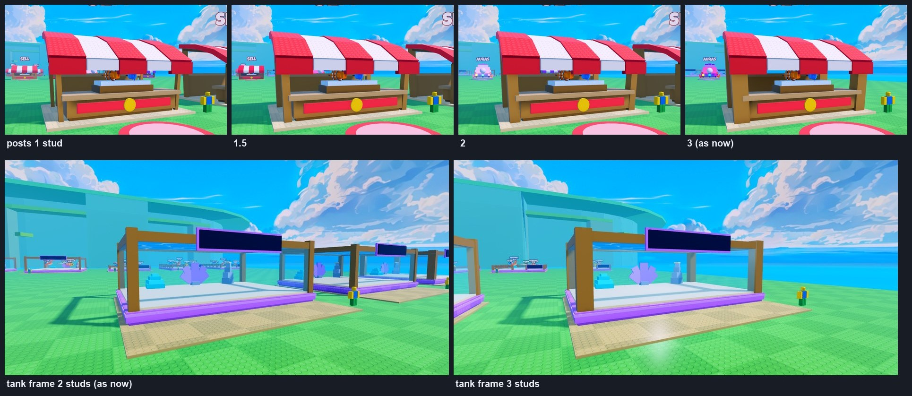
- The stall's posts at 1, 1.5, 2 and 3 studs (3 is what stands in the hub). 1 is spindly, 3 is heavy for a stall two
  players tall. **My pick is 2.**
- The tank's frame at 2 and 3. The user asked for skinnier this morning; 2 stays.

### To build it again
`python tools/map/hub_bench.py`, then `HUB_BENCH=1 python tools/map/hub_luau.py`, then run each file of
`tools/studio/hub_bench/` in order with `tools/studio/run_luau.js`. The pieces are `tank_v` and `stall` in
`hub_bench.py`, each with the test's dials. The scale figures are copies of `Workspace.ClaudeScaleFigure`.

### Not done
- Nothing is on a phone. Nothing was played.
- The trail to the plot, the stall three times against three one-offs, the labels' cut-off, the flicker board
  (tests 4 to 7) and the rest of the study's list.
- Building what is picked onto the plots and stations: after the user picks.

## The hub, smaller (2026-11-17)
The user placed the tanks and stalls by hand in Studio, changed the tank, and asked for four things
([Decisions](../Decisions.md), top row): close the gap behind the back row, push the low terrace in against the
tall wall "in most places but not all", a narrower gate whose cliffs "curve in less and be more blocked off but not
entirely", and the hub 15 to 20% smaller, with the walks checked in play.

| | Before | Now |
|---|---|---|
| The hub | 480 wide, 320 from the back wall to the front wall | **400 by 272** (17% narrower, 15% shallower) |
| Behind the back row | 55 studs | **7** (and 7 behind the side rows) |
| The low terrace | 24 deep (three squares) all round | **8** (one square) along most of the ring; 16 round the gate and the front wall, for the arch's piers; 24 on one stretch of each side |
| The gate | 144 wide, corners of 48, front corners of 80 (a funnel) | **96 wide**, corners of 24, front corners of 40 (straight across) |

- **The space shrank; the buildings kept their size** (Claude's reading of "base scale"). Shrinking them too is one
  number in the kit.
- **The user's placing is the kit's now** (`plots` in `tools/map/greybox.py`, `spots` in `tools/map/hub_kit.py`):
  the back row, SELL and AURAS facing each other either side of the spawn, FUSE behind the spawn facing the start,
  the spawn between the stalls. The side rows moved in with the walls (left 14, right 23). The INDEX moved to the
  left front corner, facing the gate: its old place was outside the new wall.
- **The user's tank:** no pad under it and sunk 1.6 into the floor; all eight green and at level 4, as the user's
  copies of Plot 4 were. The game still needs a part named `Pad` on every plot, so it is there, unseen; the collect
  pad and the trainer stay on the floor (sinking the whole model had buried them). Names `Plot1` to `Plot8` again.
- **Gone:** the fountain (the user deleted it), its lamps and stepping stones, the flag poles and the two far lamps
  (they would have stood in the tanks). The start strip is the gate's width again (the user had widened it).

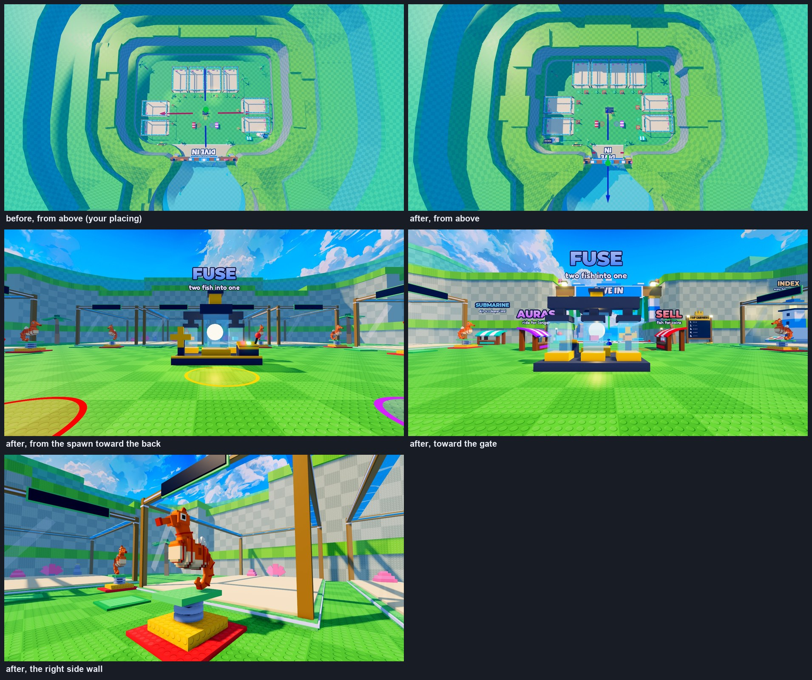

**The walks, timed in play** (2026-11-17, `tools/studio/hub_walk.luau` and the pathfinding version run from the
chat: the player walked along Roblox's own path round the stalls and tanks, at the hub's walk speed; the measured
running speed matched it, 27.5 to 27.8 and 31.5 to 31.8). The reference, measured: own pen to the start, 4 seconds.

| Walk | Path | At 28 (now) | At 32 |
|---|---|---|---|
| Spawn to the start strip | 69 | 2.9 s | 2.4 s |
| Spawn to the INDEX | 166 | 6.8 s | 5.8 s |
| Nearest tank (Plot 6) to the start | 107 | 4.4 s | 3.8 s |
| Side tanks (Plots 5, 7, 8) to the start | 125 to 176 | 5.2 to 7.2 s | 4.4 to 6.2 s |
| Back row (Plots 1 to 4) to the start | 172 to 197 | 7.1 to 8.1 s | 6.0 to 6.9 s |

- **What the smaller hub changed:** the walls, not the walks. The walks are set by where the tanks stand, and the
  user's placing already had them nearer than the old layout (about 8 seconds on average from a tank to the
  start). The new walls only take away space no one walked.
- **Speed:** 32 (one step up from 28, 14%) makes every walk 15% shorter and brings the nearest tank under the
  reference's 4 seconds. It is `Config.Dock.WalkSpeed`, the game-code chat's number: not changed.
- **The back row stays the long walk** (6 to 7 seconds even at 32), because its tanks are 88 deep and stand behind
  the side rows. Speed alone would need about 45 to make it 4 seconds; the layout is what would.


## The stall, simpler (2026-11-17)
The user: "change the stalls so they are more simplistic, more alike to ride a dino", and of the mark on the floor:
"ride a dino is just a circle with a transluscent thing inside which gains opacity when you step on it"
([Decisions](../Decisions.md)). In the place, seen and run.

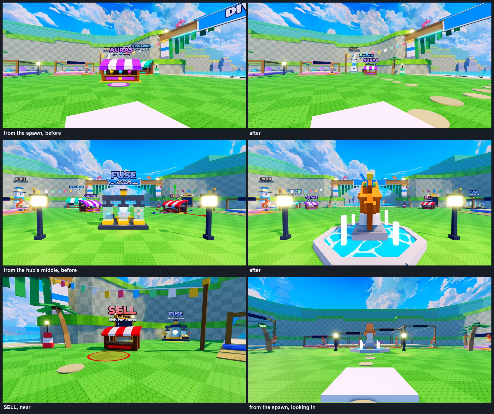

- **The stall** is the form the buildings study read off the reference, in our colours and sizes: four plain posts
  2 studs square, a counter of three blocks between the front two, a curved awning of three rows of five bricks in
  the shop's colour and white. 20 wide and 12.6 tall, about two and a half players (it was 36 by 22). 24 pieces
  with its name and mark. Nothing on the counter, no base plate, no back wall, nothing glows.
- **The mark** at every station is a circle's line in the station's colour with a see-through middle; the middle
  goes more solid while you stand on it. One unseen part, `Ring`, with the circle drawn on its top.
- **With it:** the mark is nearer the stall, the stepping stones end at it, the two piles of crates are gone, the
  names stand lower over the lower roof. 826 parts (it was 892).
- **Run:** standing on SELL's circle its middle went from 0.8 see-through to 0.35, and back on stepping off.
- **Not done:** not on a phone; the place not saved.

## The keepers behind the stands (2026-11-23)
The user: "Add specialised characters behind every stand ... a looping idle animation where they stand while bobbing
up and down a little smoothly then doing something for a second, they should also follow the player when the player
gets close ... add small same styled fitting props around the stands". Built in code, **not run in Studio yet**: the
pictures are Blender views of the same numbers the game reads.

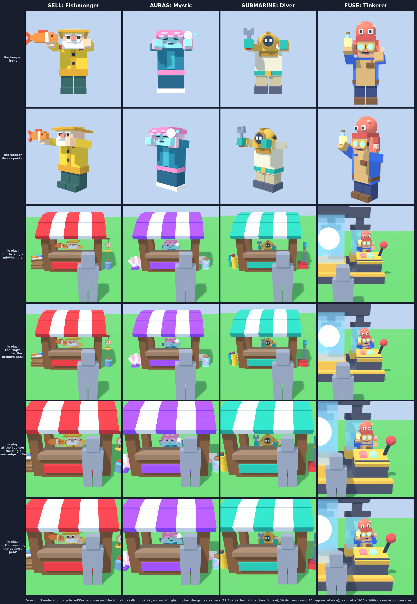

- **Who:** Sell has a fishmonger (low sou'wester, beard, red neckerchief, the catch on his palm; he flaps its tail).
  Auras has a mystic (a jellyfish bell for a hat, a glowing pearl that lifts and turns). The sub has a diver (brass
  helmet and collar, a chest gauge, a wrench; he knocks on his helmet). Fuse has a tinkerer (goggles, an octopus on
  the head, a glowing flask) who stands on the machine's base. Ours, not the reference game's pilot, wizard or cowboy.
- **What a player can see of a stall keeper is a low window.** The awning's lip hides everything above about 4.5
  studs over the floor from the play camera (12.5 studs back, 20 degrees down): 4.77 from the ring's far edge, 4.65
  from its middle, 4.44 at the counter. The counter top is at 2.93. So the three stall keepers are short and their
  hat, face, held thing and action all sit between 2.95 and 4.45. `tools/keepers/check.py` fails if any of it goes
  above the sightline, at rest or anywhere in the action. Rows 3 to 6 of the picture are drawn from those cameras.
- **How:** `src/shared/Keepers.luau` holds the tables (parts, joints, the bob, the sway, the action, the props) and
  the sums; `src/client/Controllers/KeeperController.luau` builds them on each player's own machine from plain parts
  and moves them. Nothing is in the place, nothing is uploaded, nothing can be bumped, touched or hit by a ray. A
  keeper is placed by measuring its stand as it is in the place (the ring and the counter top, or the Fuse machine's
  core), so a stand moved by hand takes its keeper with it.
- **The look:** head and upper body turn to the nearest player's head inside 20 studs (kept to 25), eased by a
  spring, held to 70 degrees to a side (14 the body, 56 the head), 22 up and 16 down; back to the idle when the
  player leaves or goes round behind.
- **Cost:** 230 plain parts for all four stands (keepers 153, props 77), 139 of them moving. One small light. Draw
  calls are an estimate, not measured: about 15 to 25 with all four in view. Left still past 150 studs from the
  camera, taken out past 420.
- **To check and draw it again:** `python3 tools/keepers/check.py` (clearances, the sightline, the props against
  the hub kit), `python3 tools/keepers/sheet.py` (the picture), `python3 tools/keepers/sums_check.py` (the Luau
  sums against the Python ones; needs lune, which is not in `rokit.toml`).
- **Not done:** never run in Studio. To check there: the Fuse keeper first (it is measured from a machine that was
  moved by hand), the props against anything placed by hand near the stands (the check only knows the hub kit),
  whether the bob reads at play distance, the real draw calls, and the stands streaming in late.

## What moved, and why
The hub's size, layout and colours are questions waiting for the user, so nothing of those changed. Three things
shifted a little so the bigger models fit:
- Sell and Auras: 4 studs out and back, to (±108, -84).
- Fuse and Index: from (±186, -84) to (±196, -80), into the corners. The Index and the sub stood 15 studs apart
  in the blockout, on top of each other.
- The trainer on each plot: 11 studs to the side, clear of the collect pad and the new pipe.

The line of flags over the start strip is gone: the gate has its arch.

## Not done, or not sure
- **Seen only in Studio's Edit mode and one short Play**, in a tall narrow window. Not seen by the user.
- The models are a first pass. Weakest, by my eye: the Fuse machine (reads as a machine, not as "fuse"), the
  stalls are still small on a floor this big, and the bunting is faint.
- The floor is still mostly empty green. The palms and stepping stones help; the real answer is the hub's size.
- Nothing sways or bobs yet: the kelp, the buoys and the seahorse stand still.
- The Blender views (`tools/blender/map_greybox_view.py`) read `parts.json`, so they no longer show the tanks.
  The plan picture does.
- "DIVE IN" on the floor was upside down from inside the hub. It is the right way up now.
