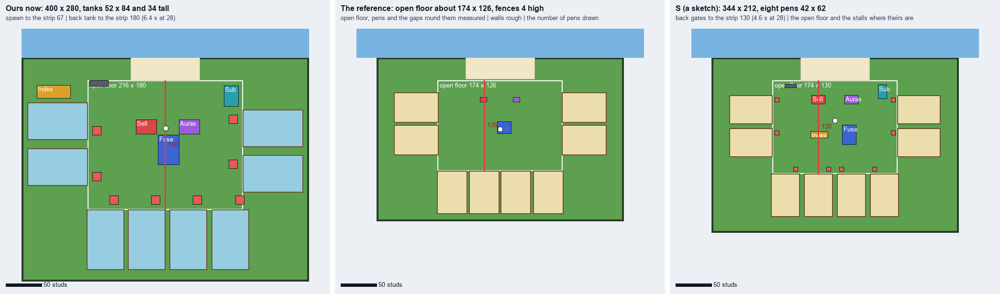
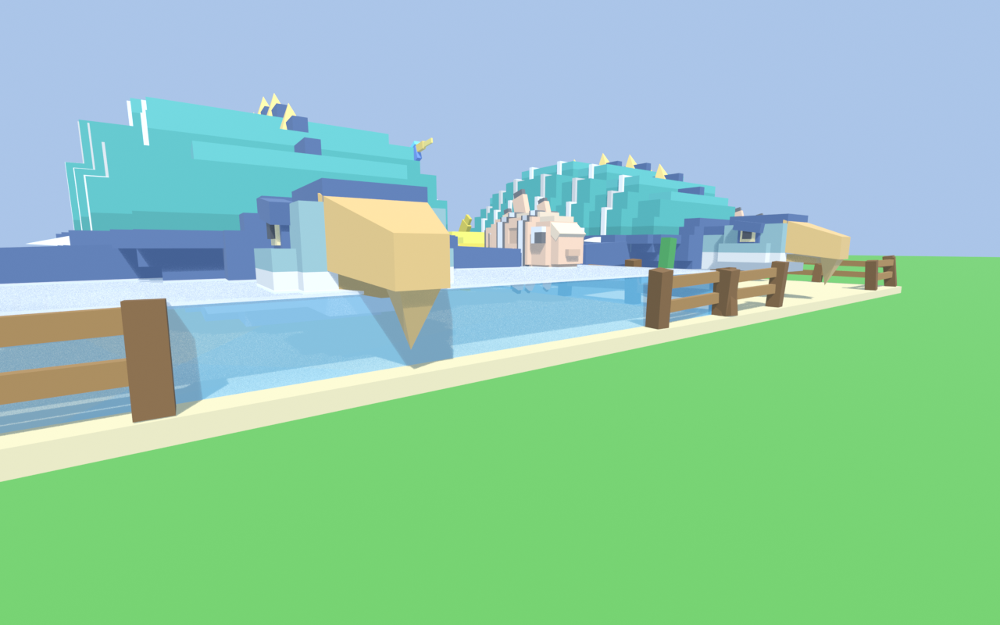
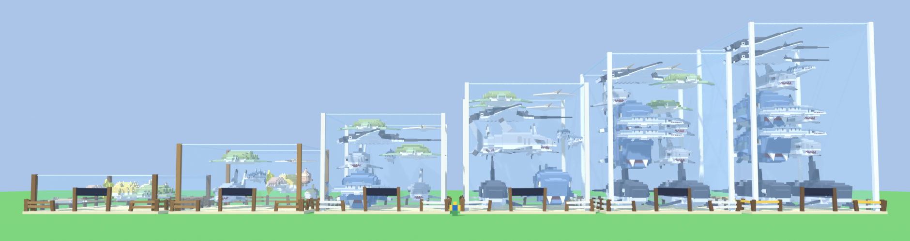
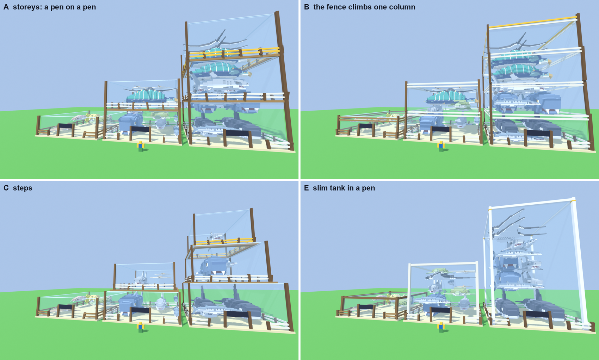
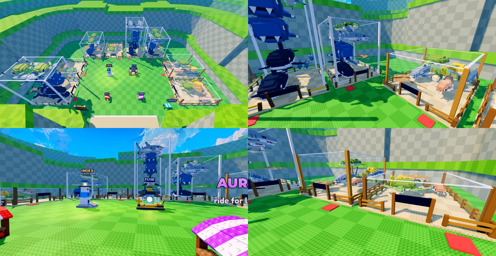
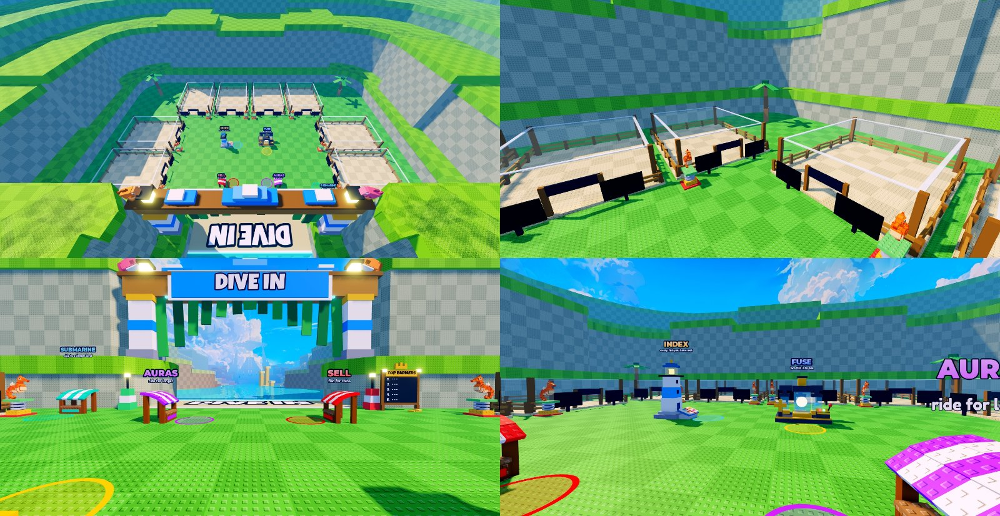
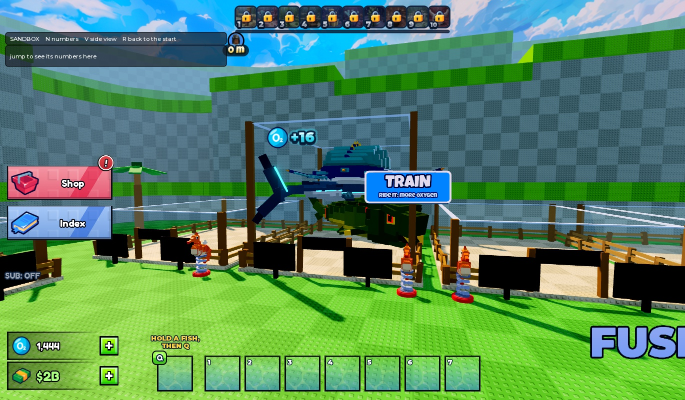
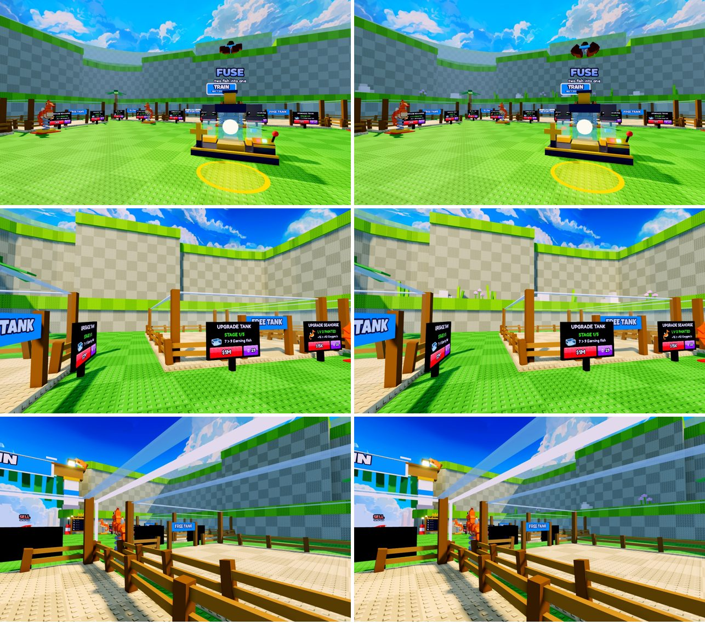

# Hub review 2: scale, open pens, layout, the water

Up: [the hub's layout](hub-layout.md), [the hub's models](hub-models.md), [the aquarium](aquarium.md), [water](water.md).
Written 2026-11-22 by the map chat. The user: "the scale feels wrong, whether it's in the actual scale of the hub or the
texture, or it's just the walk speed", "I don't like the look of the aquarium ... it diverges from the simplistic fence
feel that is a staple of the genre", "analyze my current hub ... see how we can place things to be as close to
one-to-one and to maximize player attention", and "experiment with a few variants of the water in its transparency ...
tell me other things we could do for the water".

**A study, then built: S with the pens that grow is the live hub since 2026-11-23 ("Live", under 3).**

## What was read
- **The hub as it stands:** every part in its box was read from the place on 2026-11-22
  (`art/map/hub_study/dump_2026-11-22.csv`, by `tools/studio/hub_dump.luau`). Compared part by part with the W32
  build, **no hand moves were found** in the hub: the changes are from code (the collect pads gone, upgrade signs on
  the tanks). If something was changed by hand, it is outside the hub's box or was put back; the user to say what.
- **Also found** (read while Play was running; to confirm in Edit): `Workspace.FarView` is gone, which `LookController` looks for by name; its parts now sit in folders `Part1` to `Part4` (z 1295 to 10022).
  `CosmicHollowDisplay` stands just outside the hub's right wall (x 3355, z -166).
- **The reference:** our measured reading ([ride-a-dino-map](../reference/ride-a-dino-map.md), "The hub, measured",
  good to about 15%) and the frame of its pens (`research/ride-a-dino/map/H1.jpg`, private).

## 1. Scale: four things, one at a time

| | Ours | The reference | So |
|---|---|---|---|
| **Walk speed** | 28 (`Config.Dock.WalkSpeed`) | 28, measured | **Not the cause** |
| **The hub** | 400 x 280 wall to wall (the floor part is 400 x 312, under the strip too); the open floor between the tank fronts alone is **216 x 180** | about **350 x 195** wall to wall, the grass behind the pens included (measured again 2026-11-23; first read as 230 x 180, then 275 x 186); open floor **174 x 126** | **The main cause.** Our open floor is 1.8 times theirs. Every walk is long: back tank to the strip 180 studs (6.4 s) against their 110 (4 s) |
| **The pens** | 52 x 84 of water, **34 tall** (posts 34) | about 41 x 57 to 60 (measured 2026-11-23), 2 to 3 of grass between, **fence 4 high** | Theirs are narrower and shallower, and the height is far off. Eight 34-stud boxes make the hub read as a room of buildings |
| **The studs** | one every **1.0** stud, on an 8-stud checker | one every **0.64**, no checker on the hub floor | Ours are 1.56 times bigger. At the same speed the ground slides past 1.56 times slower in studs, so running *looks* slower and the world bigger |
| **What stands on the floor** (2026-11-23) | stalls 18 x 9 (posts) and 12.6 high, rings 16, the fuse machine 28.6 wide, trainer pads 12, floating names 30 wide | stalls **8.5 x 6.3** (posts) and about 9 high, rings **11.5**, fuse **19**, pads **5**, names about a stall wide (run 6.0, 21 and 39 s, `ground.py`, good to about 15%) | **Ours are 1.4 to 2.4 times theirs.** The first S try had the walls at their size with our stations at full size, proposed, in the try only; what the user meant by "the hub size still aint matched up" was the pens' places: section 3 |
| Camera | not measured | not measured | One capture framed like H1 would settle it |

**Reading:** the size of the hub and the height of the tanks are most of it, and the big studs add to it.

**The studs:** rescaling our picture would also shrink the squares toward the 5 studs the user turned down ("5 read too
small"). The reference's hub floor has studs and no squares, though, so the hub floor alone could take a stud-only picture
at 0.64 without touching the lane. That needs a new picture uploaded, and uploads wait for the user's word.

## 2. Open pens instead of tanks
The genre's plot (Findings, point 7; four trending games): a low fence of posts and two rails round a plate, a gap for a
gate, no roof, no glass. The user: posts "slightly offset with each other, slightly off kilter with a base plate".

Drawn by `tools/map/pen_bench.py` and `tools/blender/hub_view.py` (Blender: no studs, a stand-in light; its see-through
water is far more solid than Roblox's). Each pen is 50 x 60, the fence 4.4 high, posts 10 apart, each leaning up to 8
degrees, off height by up to 0.35 and off the line by up to 0.45 in or out; the rails run between the posts' own
points, so they tilt with them. The pens share fences.

The fence close up: every post leans its own way, stands a little in or out of the line, and the rails follow them.

**The fish at their real size** (`BaseScale` times each model's true box; a Normal one, no bigger size roll), resting
just over the floor, none overlapping, by a simple packing (`pen_bench.py` prints it):

| Seven fish (a plot's first stage) | In a 50 x 60 pen | In today's 52 x 84 tank |
|---|---|---|
| the Shallows' seven (11 to 27 long) | **7** | 7 |
| a middle seven (Archelon 51 long and 56 across, Manta 46 and 50, Dunkleosteus 52, Orca 56) | **2** | 3 |
| a late seven (Blue Whale 101, Kraken 91, Megalodon 80) | **1** | 1 |

So a pen at the reference's size holds a starter's fish easily, and later ones go over the fence, about as they go through
the glass today. **Real size is Hugo's choice** (task b4, 2026-11-22: "make sure they retain their original size even if
they clip through"), so showing them smaller would undo that: not proposed here. A fully upgraded plot shows 17.

*(Corrected 2026-11-23. The earlier figure, "four of seven fit", was wrong: the models were measured without their nodes'
moves, the Archelon came out about 1.4 times too big, one length was typed in by hand, and the Boxfish is no longer in the
game.)*

| | What it is | For | Against |
|---|---|---|---|
| **P1 a pool** (left) | a sand frame round a pool sunk to its brim; fish swim in it and just over it | Reads as water and as a pen. The fish are in the open, seen from anywhere | Big fish sit mostly above the pool |
| **P2 water to the rail** (middle) | the fence holds a block of clear water up to the top rail, with a foam line | The closest to "a tank" | The fish are behind water again, the thing Findings point 7 warns about. Needs a Roblox look before judging |
| **P3 a sand pen** (right) | sand, one small pool in a corner; the fish swim in the air over the sand | The reference's own idea: creatures stand in their pen. Every fish reads | A fish out of water. Fine in this genre's look, but the user's call |

### Pens that grow: the fence and the aquarium merged (2026-11-23)
**Picked: E without the rim** (the user, 2026-11-23: "lets go for E but without the barrier on the top, similar to to the top
of C. E progression with the lacking geomtry on the top of C"). The low crooked fence stays; the slim tank inside it grows;
on top nothing but the four post ends, 0.3 over the water, and the thin pale line at the water's edge. All six stages (water
14, 26, 38, 50, 62, 74 high; 7, 9, 10, 12, 14 and 12 fish in the picture). The glass stands inside the fence, so its floor is
46.8 x 56.8 and the Archelon no longer lies inside it (one is left out at stages 2, 3 and 4, two at 5; the three giants fit no
pen). Stages 2 to 5 are squeezed: their layers need 50, 55, 89 and 92 high against 37, 49, 61 and 73. **Still proposals:** the
heights, and the colours by stage (posts wood, wood, cream, cream, white, white; the fence's rails wood, then cream; its
upper rail gold at the last):

The four it was picked from:

The user: "we need a way to like merge these with like an aquarium style and the fence style, so that I want the player to
be able to upgrade their aquarium so it gets taller, like much taller, so it can house more fish and so it isn't as
crowded". Four ways, each on the 50 x 60 plate with the low crooked fence, at stage 0, 2 and 5 (water 14, 38 and 74 high;
the fish at their real size; `tools/map/pen_levels.py`):

| | What it is | For | Against |
|---|---|---|---|
| **A storeys** | a pen on a pen: each storey a deck with its own crooked fence. The decks are frames, open in the middle | The most fence feel, and an upgrade plainly adds a floor. The water works as one column, so nothing has to fit between floors | Needs new code: a storey has to appear, not stretch |
| **B the fence climbs** | one column of water; crooked posts and rails climb it | The fewest new parts for that look | The rails cross the fish. Partly new code (rails have to be added as it grows) |
| **C steps** | storeys that step in | The strongest shape | Holds the fewest: 7 of 11 and 7 of 14 in the picture. New code |
| **E tank in a pen** (the pick, less its rim) | today's slim tank inside the low fence; only the tank grows | The least new code: posts and water stretch already, and there is no rim | The least fence feel once it is tall |

A fifth (D, a sand yard in front and a tower behind) is cut: at 38 deep the tower holds none of the big fish at any height.

**How high it has to be** (`tools/map/pen_crowd.py`). The place's tanks all have water 32 high at stage 0 (the user's
copies of Plot 4: the dump of 2026-11-22; `Config`'s comment says 14 to 20), so today is 32, 38 and 47 high at stages 0, 2
and 5, on 52 x 84. How many others each fish is inside, on average, by the game's own laps (`AquariumService.show`), and
the height it takes to lie them all clear in layers:

| | Lies clear at | Today | Drawn (14 + 12 a stage) | 104 high |
|---|---|---|---|---|
| stage 0, the Shallows' seven | 12 | 1.3 (32 high) | **3.8** (14 high) | |
| stage 2, eleven middle fish | 63 | 6.0 to 4.8 (32 to 38) | 5.1 (38 high) | 1.3 |
| stage 5, fourteen late (no giants) | 105 | 7.1 (47 high) | 4.9 (74 high) | 2.7 |
| stage 5, seventeen late, with the giants | never | 10.9 | 7.6 | 4.7 |

So against today the drawn heights are **worse at stage 0, level at 2, and about a third better at 5**. The pens are smaller on the
ground, so height first has to make up for that. A low start gives the fence feel; a tall start gives room: the user's
call. **The bigger lever is the laps:** every fish circles the middle (a lap's reach is cut by the fish's length, and only
its height differs), so even the Shallows' seven, who lie clear in 12 studs, meet 3.8 others at 14 high. If each fish kept
to its own layer and its own part of the floor, the drawn heights would nearly do. That is game code, proposed to that
chat with the heights. Two things height can't fix: the Blue Whale (101 long), the Kraken (91) and the Megalodon (80) are
longer than a 50 x 60 pen. `Taller` (3) and `Slots` (2) are Hugo's numbers: **12 is a proposal**. All sizes are Normal.

The pictures show the **layered best case**, squeezed where the height doesn't reach, not the game's laps.

**Against it, honestly:** the 34-high tanks were the second cause of the hub feeling like a room of buildings, and a stage-5
pen is 74. In S they stand at the back and sides, so nothing tall is on the line from the spawn to the strip. **Since the
same day the try's stations and pads are at the reference's measured size too** (`hub_scale_plan.FIT`; the lighthouse, half, and
the earners board, 0.6, are guesses: theirs are a button and a wall board). Not scaled: the gate boards (ours 12.8 wide,
theirs about 4), the floor's studs, the fish. S from
inside, with mixed stages (Studio, from the strip to
the pens), with E:

**In Studio:** `tools/map/hub_try.py` writes the try (`Workspace.HubTryS` and `HubTryPens`, at x 14000, with E's
six stages in a row beside it, at x 14900). It touches nothing under `ClaudeBlockout` and refuses to run in Play. **Loaded 2026-11-23**, and again that day, wider and with the smaller stations (803 shell parts, 1,359 pieces; not
saved; nothing tagged). In Studio the water at 0.9 all but vanishes and the posts and edge lines carry the tank. **To judge there:** whether the
water, at Roblox's 0.9, still reads as a tank with no rim round it. It has no spawn: in Play a one-off move of the character
there comes first, then a check that the game leaves them there at 28.

**To confirm with the game-code chat** before any of it: E needs a bigger
`Taller`; `Post` and `TankWater` stretch already, and the water's edge line is named `TankSurface`, so it lifts already; no rims are
needed (check nothing expects `RimSide` / `RimEnd`). The gate's `SignBoard` would rise with the tank (`LIFTED`), so it needs
another name there; the colours by stage are new code. `TankWater` stays one box. (The styles not picked needed more: a storey
added per stage in A and C, the rails in B.)

**What the game code leans on** (`AquariumService`, `TankRideService`, `AquariumController`, `TankPanel`):
To confirm with the game-code chat before any of it goes in; as far as the map chat can see:
- `TankWater` is the space the fish swim in and you ride in. It could stay as an unseen box over the pen, so the swim
  and the ride would not change.
- The pens as drawn have no `SignBoard`, `TrainerSpot` or `TankSurface`/rims, which the code looks for (`LIFTED`), and
  the panel draws the whole tank's outline. Those parts need a place in a pen, or the code a way round them.
- How many fish a pen shows, and at what share of their size (above).
- `Post` and `TankWater` are stretched by the tank's level (`STRETCHED`). The fence posts are named `FencePost` so a level
  doesn't grow them. (Taller after all, the user, 2026-11-23: above.)

## 3. Layout, and where the eye goes
**S, third drawing** (2026-11-23; right in the plans; **the live hub, below**): **344 x 212**, open floor **174 x 130**.
The user's three corrections, each right and each a misreading of mine:
- **The second drawing had no grass behind the pens** ("it doesnt have any space between aquariums and the walls behind"):
  3 studs. Theirs, from above a back pen (full 12 s, `ground.py`): the wall 7 to 12 behind the back pens, 19 to 26 behind the
  side ones, and beside the last back pen an open corner 65 to 86 wide, the most of it. Ours: 21, 25, and corners 71 wide. (Their back wall is rough: one frame, and that it is a back pen is read, not proved.)
  The back one is more than theirs because a tank hides what is behind it and a fence does not.
- **The pens touched, and were too wide** ("theres space between the pens, they might be slightly to wide"). Theirs, from the
  frames under 25 studs away: 41 wide (gate 11, a 14.5 fence each side), and 2.3 to 3.2 of grass between, each pen with its
  own fence. The 50 was read off a pen 70 studs away. Ours: 47 x 62 over the plate (45 x 60 inside it), 4 of grass between plates.
- **The first drawing's side pens stood 65 from the middle** ("the placement of the aquariums looks like the hub too small"):
  theirs stand 85 to 92, as ours since (87).

Theirs is then about **350 x 195** wall to wall (good to 15%; the walls rough, and how many pens they have is drawn). Back gates
to the strip 130 to 133 (4.6 s at 28; ours now 180), side gates 98 and 55. Checked by `hub_scale_plan.py` (nothing overlaps, 8
clear studs before each gate) and `hub_s.py` (clears all 324 wall pieces). Loaded in Studio at x 14000, not saved. **The pens
are 47 wide: the user's pick** ("In between, 47"), between their 41 and the 50 before. The tank inside is 41.8 wide, so at
stage 5 the fish need 101 of height to lie with none touching (92 at the 46.8 it was drawn at, 118 at 42 wide; the water is
73), and the manta joins the Archelon as too wide for the floor (they swim, and tails pass through the glass); "Pens that
grow" above was worked out at 50 wide. Every gate's
sign board and the floor's studs are still ours, and where side pens stand along the wall is a middle way: one frame puts them
nearer the strip, one nearer the back pens.

### Live (2026-11-23)

**Saved since (version 402).** The trainers stand 9 ahead of the fence, Hugo's level models are in
([picture](../attachments/hub-seahorses-2026-11-23.jpg); the rest in [Handoff](../Handoff.md)).
"thats good, add the map back in now", "w the new hub": the user. The whole map was generated again at S's numbers and loaded
in place of the old one at x 3000, about 25 minutes. The try at x 14000 is taken away.

- **Where it lives:** `greybox.py` (`HUB_HALF` 172, `HUB_BACK` -244, `CORNER` 32, `FRONT` -32, `GATE_TURN` 17,
  `FRONT_TURN` 8; pens and gates from `hub_scale_plan.py` `s_pens`, `s_gates`), `hub_kit.py` (`build`, `pen`, `placed`: stations
  at `s_things`, sized by `FIT`, rings 11.5) and `pen_levels.py` (`pen_e` at stage 0, no fish). To move a thing: `hub_scale_plan.py`.
- **Run the generator with `PROPS2=1`**; without it the map comes out with 58,972 parts instead of about 104,000.
- **Checked:** loader 181 files, 0 problems, nothing moved by hand before it; `tools/studio/hub_contract.luau` (everything the
  game reads on the dock): all good, sealed all round but the gate; the herd's stream finds its way (5 of 4,895 places have no
  floor under them, at two lane sets far out; those sets are the same pieces as before by the offline comparison, but the old map's
  figure was not kept; the game's own survey found the floor at all 2,941 places). In Play: spawn, a plot handed out,
  trainers built, five fish put in the tank, a stage bought (the water rose 3), a walk from the spawn out of the gate
  (3.4 s) into a dive and a hooked fish, no errors. **By script, not played by hand.** Then, in a second Play: the Sell and Auras rings open and
  close their windows, the sub's ring shows its prompt and counts as near, the seahorse seats you, gives Oxygen and lets you off.
- **What moved in the lane:** its walls by 0.04 in the middle and under 4.4 for nine in ten, floors the same, about 40% of the props.
- **Gone:** the gate's two palms (the earners board and the sub stand are there now). The back two stand in the open corners.
- **Way back:** close without saving; or git `f135a1a`'s `tools/studio/greybox/` loaded again; the old dock is
  `ServerStorage.DockBackup_2026-11-23` (scripts off, tags off; delete it when the hub is settled).
- **The game code, done the same day** ("Yes, make them": the user): `Config.PlotUpgrades.Taller` 3 to 12; the gate's `SignBoard` stays
  on its posts (`AquariumService.remember` leaves it out where a plot has no `SignBack`); the TRAIN sign at 22 in place of 30.5
  (21 was planned: the tallest seahorse, level 12, stands 17.9 and the sign's foot is 3.2 under its middle). In Play: stage 2 is 37.9 of
  water, its edge line and posts with it, the board still at 9, five fish spread from 9 to 30 up.
   (The blank boards are the capture's: they are drawn once the player's own
  camera has looked at them, seen in a later capture.)
- **The user's hand placing after the load (2026-11-23):** Fuse moved by (-19.4, 0, 11.8), the Index station deleted. Kept; don't reset.
  **Since replaced for the Index (2026-11-25, Hugo: "add the same circle integration as before for the index lighthouse
  stand"):** it stays. Hugo's saved place has it, and the Fuse, where the map files put them ([UI](ui.md)).
  **Open (2026-11-24, seen by the first-minutes chat):** there the Fuse stands at z -108.9 to -94.4, straight behind the
  spawn (z -88), so the first camera (about z -100) is inside its big pod: the glowing core and the dark lid fill the new
  player's first view, and its ring (z -87) lies on the spawn. Proposed: 18 studs straight back (clear to z -145). The user's call.

*(Earlier corrections, all of the first drawing. R, 290 x 196, is dropped: it was said that 230 x 180 does not fit eight pens, without
drawing it; R's "side pens 5 to 60" was the distance straight down the hub, not the walk, which was 57 and 104; and a
trainer pad stood in front of every one of its gates. Then S at 230 x 180 exactly was said to pass, but that check took
the hub for a rectangle: in the generator's round corners the pens ran up to 15 studs into the walls. 236 x 193 is the
smallest of the sizes tried that clears them: 238 x 184, 236 x 188 and 236 x 191 did not.)*

For attention, following the reference:
- **The spawn on the line from the pens to the strip**, facing the strip. The strip, the gap and the herd beyond it are
  straight ahead and fill the middle of the first view.
- **Sell and Auras flank that line**, 27 off the strip and 46 apart (theirs about 27 to 30, and 44 to 50). Every walk out passes them.
- **Nothing tall between the spawn and the gap.** The tanks' 34-stud height is what blocks the view today. Low pens give
  the whole hub one sightline, and from every pen front the herd shows through the gap.
- The Fuse machine and the Index a little further back, the Earners board and the Submarine at the strip's two ends.

**Cost (paid 2026-11-23):** the hub's walls come from the generator, so S is one full map reload, which also re-scatters some lane props.
Before that, a hub-only try build (the generator's hub options) would show the walls at S's size without the reload.
Pens, layout and size should be picked together and built in that one reload. The hand placing is read first and kept.

**Answered (2026-11-22):** the old rule "never its look, models or layout" was not meant for the layout ("didnt mean to
say never its layout": the user). The hub may follow the reference's sizes and U one to one, with our own models and look.

## 4. The water's see-through
The surface is four layers (`tools/map/water_look.luau`): white Glass on top (0.35 see-through), then Neon blue (0.76), a
dark layer (0.78) and a deep blue (0.85). Together they let through about **18%**. The glass on top blocks the most.

`tools/studio/water_see_buttons.luau` puts a row of buttons on the screen in Play (run it on the Client). Each button sets
the four layers live, so you can switch between them while looking at the herd. Nothing is saved. **Not run yet:** it
needs the user in Play and Studio handed to the map chat (the UI chat has it now).

| | Foam, Water, Dark, Deep | Lets through |
|---|---|---|
| Now | 0.35, 0.76, 0.78, 0.85 | 18% |
| A | 0.55, 0.82, 0.86, 0.88 | 35% |
| B | 0.70, 0.88, 0.90, 0.90 | 50% |
| C | 0.82, 0.92, 0.93, 0.93 | 65% |
| D, no glass | off, 0.70, 0.85, 0.85 | 50% |

**To check in Roblox:** parts with any see-through on them (halo eyes, glows) may not draw behind a Glass part at all.
If so, the glass hides those parts of a fish whatever the numbers are, and D fixes it.

## 5. More for the water, from the surface
Ranked by what they add for what they cost:
1. **Caustics:** moving light patterns on the floor under the shallow water by the hub. A Texture sliding on the floor
   near the surface, two layers drifting against each other. It is the strongest cue for "clear water". Cheap.
2. **Shallows:** the floor at the strip slopes off under clear water. You see the bottom go from sand to deep, so the
   water reads as see-through even where it isn't.
3. **Fish shadows:** a soft dark shape on the floor under each herd fish. It reads from above through any tint.
4. **A wake and a splash:** a foam ring where a fish breaks the surface, and a burst when a player dives in off the
   strip.
5. **Sun glints:** a few twinkles drifting on the surface (one emitter). Cheap.
6. **Colour by depth:** turquoise over the shallows to deep blue over the drop. It is the genre's most common water look.
7. **Rarity glow under water:** a Rare or better fish shows a soft coloured light through the surface, so you spot it
   from the hub.
8. **Our own surface picture** (`tools/art/water_texture.py`) in place of the tutorial pack's. It needs an upload.
9. **A shoreline:** foam lapping at the strip's edge and along the walls' feet.
- Not advised: Roblox's own terrain water. It refracts and has waves, but it can't take our layered look and costs more on
  phones.

## The first ledge's litter (2026-11-23)
The user: "id like for you to add some of the littered objects on the first inset of the wall/cliff in the hub. Like in
ride a dino." Theirs: lime blades one or two at a time and big pale cubes piled off centre, with most of the ledge empty.
Ours (`ledge_litter` in `tools/map/hub_kit.py`): tall sea grass, piles of pale stone with a pebble or two, and a few sea
pinks on stalks (our own shapes), at uneven gaps of about 25 studs, 2 to 7 studs behind the lip. 136 bricks, one model
(`Dock/Dressing/Ledge`), none solid. The first try was too small and even from the hub's middle, and its stones too near
the wall's colour: now a third bigger, warmer and paler. Every piece stands on the ledge (ray, y 24) and touches nothing;
the Fuse's move and the Index's deletion were kept, because only this model was added:
`HUB_ONLY=Dressing/Ledge python tools/map/hub_luau.py`, then run `tools/studio/hub_only.luau`.

## Also open
- **The map's material:** the user found SmoothPlastic better than Plastic in play ("Feels better, is better ... we'll
  touch more on that later"). The saved place is still Plastic. Switching it back is `tools/studio/matte_map.luau` with
  `FROM="Plastic"`, `TO="SmoothPlastic"`, plus the loaders' two lines. Waiting on the user's word.
