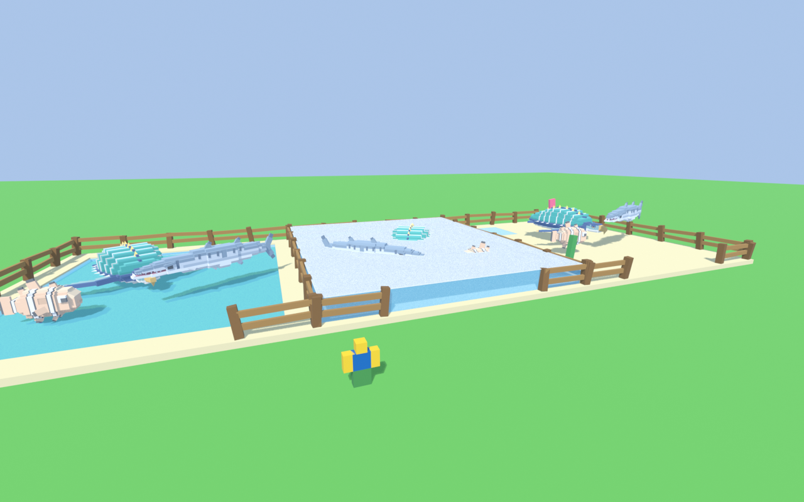
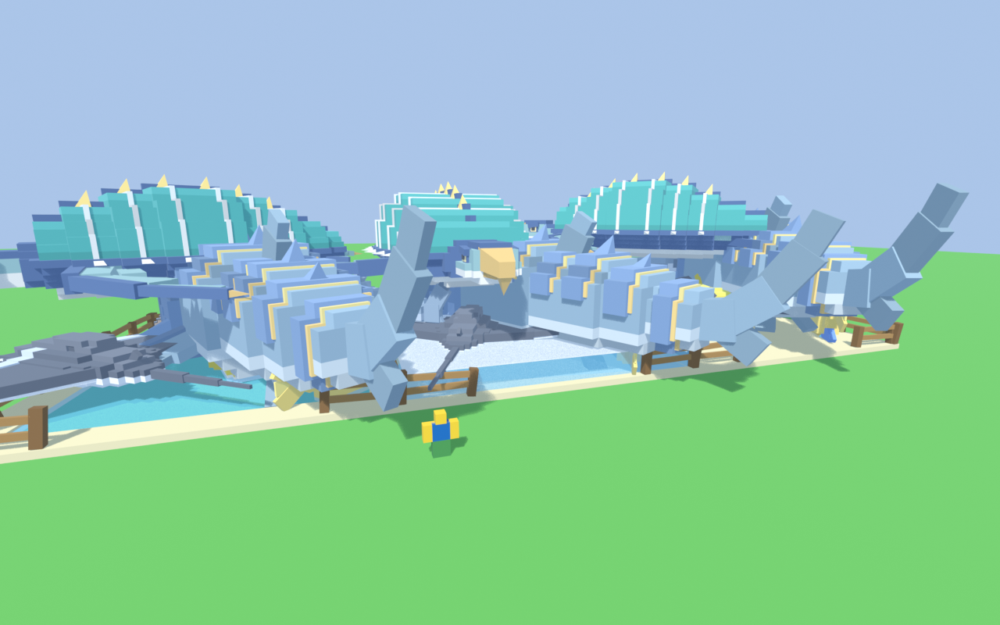

# Hub review 2: scale, open pens, layout, the water

Up: [the hub's layout](hub-layout.md), [the hub's models](hub-models.md), [the aquarium](aquarium.md), [water](water.md).
Written 2026-11-22 by the map chat. The user: "the scale feels wrong, whether it's in the actual scale of the hub or the
texture, or it's just the walk speed", "I don't like the look of the aquarium ... it diverges from the simplistic fence
feel that is a staple of the genre", "analyze my current hub ... see how we can place things to be as close to
one-to-one and to maximize player attention", and "experiment with a few variants of the water in its transparency ...
tell me other things we could do for the water".

**A study. Nothing in the place has changed.**

## What was read
- **The hub as it stands:** every part in its box was read from the place on 2026-11-22
  (`art/map/hub_study/dump_2026-11-22.csv`, by `tools/studio/hub_dump.luau`). Compared part by part with the W32
  build, **no hand moves were found** in the hub: the changes are from code (the collect pads gone, upgrade signs on
  the tanks). If something was changed by hand, it is outside the hub's box or was put back; the user to say what.
- **Also found** (read while Play was running; to confirm in Edit): `Workspace.FarView` is gone, which `LookController` looks for by name; its parts now sit in folders `Part1` to `Part4` (z 1295 to 10022).
  `CosmicHollowDisplay` stands just outside the hub's right wall (x 3355, z -166).
- **The reference:** our measured reading ([ride-a-dino-map](../reference/ride-a-dino-map.md), "The hub, measured",
  good to about 15%) and the frame of its pens (`research/ride-a-dino/map/H1.jpg`, private).

## 1. Scale: four things, one at a time

| | Ours | The reference | So |
|---|---|---|---|
| **Walk speed** | 28 (`Config.Dock.WalkSpeed`) | 28, measured | **Not the cause** |
| **The hub** | 400 x 280 wall to wall (the floor part is 400 x 312, under the strip too); the open floor between the tank fronts alone is **216 x 180** | about **230 x 180** wall to wall, pens included | **The main cause.** Our open floor is the size of their whole hub. Every walk is long: back tank to the strip 180 studs (6.4 s) against their 110 (4 s) |
| **The pens** | 52 x 84 of water, **34 tall** (posts 34) | about 50 x 60 (drawn from frames, not measured), **fence 4 high** | The footprint is close; the height is not. Eight 34-stud boxes make the hub read as a room of buildings |
| **The studs** | one every **1.0** stud, on an 8-stud checker | one every **0.64**, no checker on the hub floor | Ours are 1.56 times bigger. At the same speed the ground slides past 1.56 times slower in studs, so running *looks* slower and the world bigger |
| Camera | not measured | not measured | One capture framed like H1 would settle it |

**Reading:** the size of the hub and the height of the tanks are most of it, and the big studs add to it.

**The studs:** rescaling our picture would also shrink the squares toward the 5 studs the user turned down ("5 read too
small"). The reference's hub floor has studs and no squares, though, so the hub floor alone could take a stud-only picture
at 0.64 without touching the lane. That needs a new picture uploaded, and uploads wait for the user's word.

## 2. Open pens instead of tanks
The genre's plot (Findings, point 7; four trending games): a low fence of posts and two rails round a plate, a gap for a
gate, no roof, no glass. The user: posts "slightly offset with each other, slightly off kilter with a base plate".

Drawn by `tools/map/pen_bench.py` and `tools/blender/hub_view.py` (Blender: no studs, a stand-in light; its see-through
water is far more solid than Roblox's). Each pen is 50 x 60, the fence 4.4 high, posts 10 apart, each leaning up to 8
degrees, off height by up to 0.35 and off the line by up to 0.45 in or out; the rails run between the posts' own
points, so they tilt with them. The pens share fences.

The fence close up: every post leans its own way, stands a little in or out of the line, and the rails follow them.

**The fish at their real size** (`BaseScale` times each model's true box; a Normal one, no bigger size roll), resting
just over the floor, none overlapping, by a simple packing (`pen_bench.py` prints it):

| Seven fish (a plot's first stage) | In a 50 x 60 pen | In today's 52 x 84 tank |
|---|---|---|
| the Shallows' seven (11 to 27 long) | **7** | 7 |
| a middle seven (Archelon 51 long and 56 across, Manta 46 and 50, Dunkleosteus 52, Orca 56) | **2** | 3 |
| a late seven (Blue Whale 101, Kraken 91, Megalodon 80) | **1** | 1 |

So a pen at the reference's size holds a starter's fish easily, and later ones go over the fence, about as they go through
the glass today. **Real size is Hugo's choice** (task b4, 2026-11-22: "make sure they retain their original size even if
they clip through"), so showing them smaller would undo that: not proposed here. A fully upgraded plot shows 17.

*(Corrected 2026-11-23. The earlier figure, "four of seven fit", was wrong: the models were measured without their nodes'
moves, the Archelon came out about 1.4 times too big, one length was typed in by hand, and the Boxfish is no longer in the
game.)*

| | What it is | For | Against |
|---|---|---|---|
| **P1 a pool** (left) | a sand frame round a pool sunk to its brim; fish swim in it and just over it | Reads as water and as a pen. The fish are in the open, seen from anywhere | Big fish sit mostly above the pool |
| **P2 water to the rail** (middle) | the fence holds a block of clear water up to the top rail, with a foam line | The closest to "a tank" | The fish are behind water again, the thing Findings point 7 warns about. Needs a Roblox look before judging |
| **P3 a sand pen** (right) | sand, one small pool in a corner; the fish swim in the air over the sand | The reference's own idea: creatures stand in their pen. Every fish reads | A fish out of water. Fine in this genre's look, but the user's call |

**What the game code leans on** (`AquariumService`, `TankRideService`, `AquariumController`, `TankPanel`):
To confirm with the game-code chat before any of it goes in; as far as the map chat can see:
- `TankWater` is the space the fish swim in and you ride in. It could stay as an unseen box over the pen, so the swim
  and the ride would not change.
- The pens as drawn have no `SignBoard`, `TrainerSpot` or `TankSurface`/rims, which the code looks for (`LIFTED`), and
  the panel draws the whole tank's outline. Those parts need a place in a pen, or the code a way round them.
- How many fish a pen shows, and at what share of their size (above).
- `Post` and `TankWater` are stretched by the tank's level (`STRETCHED`). The fence posts are named `FencePost` so a level
  doesn't grow them. **Levels** become richer rather than taller: the fence wood, then painted, then stone; a gate arch;
  more inside.

## 3. Layout, and where the eye goes
**S** (right in the plans, **a sketch**): the reference's own size, 230 x 180. Eight pens of 50 x 60 sharing fences: four
along the back, two down each side. The side pens run 50 into the hub and 60 along the wall, so 15 studs of each back
corner pen's front stay open and its gate goes there. Open floor 130 x 120 (ours now 216 x 180). The back gates to the
strip are 120 (4.3 s at 28; theirs about 110, ours now 180), the side gates 92 and 43, in straight lines.
`tools/map/hub_scale_plan.py` checks it and stops if it fails: nothing overlaps, all inside the hub and off the strip,
8 clear studs in front of every gate. Every station is drawn at its present footprint. **Not drawn:** the plots' sign
boards and upgrade signs, and the arch. It is full: the Submarine, Index and Fuse would be the first to shrink.

*(Corrected 2026-11-23: R, 290 x 196, is dropped. It was said that 230 x 180 does not fit eight pens, without drawing it;
it does. R's "side pens 5 to 60" was the distance straight down the hub, not the walk, which was 57 and 104; and a
trainer pad stood in front of every one of its gates.)*

For attention, following the reference:
- **The spawn on the line from the pens to the strip**, facing the strip. The strip, the gap and the herd beyond it are
  straight ahead and fill the middle of the first view.
- **Sell and Auras flank that line**, 18 from the strip (theirs 17 to 25); our stalls are 29 wide, so their middles are 52 apart (theirs 30). Every walk out passes them.
- **Nothing tall between the spawn and the gap.** The tanks' 34-stud height is what blocks the view today. Low pens give
  the whole hub one sightline, and from every pen front the herd shows through the gap.
- The Fuse machine and the Index a little further back, the Earners board and the Submarine at the strip's two ends.

**Cost:** the hub's walls come from the generator, so S is one full map reload, which also re-scatters some lane props.
Before that, a hub-only try build (the generator's hub options) would show the walls at S's size without the reload.
Pens, layout and size should be picked together and built in that one reload. The hand placing is read first and kept.

**Answered (2026-11-22):** the old rule "never its look, models or layout" was not meant for the layout ("didnt mean to
say never its layout": the user). The hub may follow the reference's sizes and U one to one, with our own models and look.

## 4. The water's see-through
The surface is four layers (`tools/map/water_look.luau`): white Glass on top (0.35 see-through), then Neon blue (0.76), a
dark layer (0.78) and a deep blue (0.85). Together they let through about **18%**. The glass on top blocks the most.

`tools/studio/water_see_buttons.luau` puts a row of buttons on the screen in Play (run it on the Client). Each button sets
the four layers live, so you can switch between them while looking at the herd. Nothing is saved. **Not run yet:** it
needs the user in Play and Studio handed to the map chat (the UI chat has it now).

| | Foam, Water, Dark, Deep | Lets through |
|---|---|---|
| Now | 0.35, 0.76, 0.78, 0.85 | 18% |
| A | 0.55, 0.82, 0.86, 0.88 | 35% |
| B | 0.70, 0.88, 0.90, 0.90 | 50% |
| C | 0.82, 0.92, 0.93, 0.93 | 65% |
| D, no glass | off, 0.70, 0.85, 0.85 | 50% |

**To check in Roblox:** parts with any see-through on them (halo eyes, glows) may not draw behind a Glass part at all.
If so, the glass hides those parts of a fish whatever the numbers are, and D fixes it.

## 5. More for the water, from the surface
Ranked by what they add for what they cost:
1. **Caustics:** moving light patterns on the floor under the shallow water by the hub. A Texture sliding on the floor
   near the surface, two layers drifting against each other. It is the strongest cue for "clear water". Cheap.
2. **Shallows:** the floor at the strip slopes off under clear water. You see the bottom go from sand to deep, so the
   water reads as see-through even where it isn't.
3. **Fish shadows:** a soft dark shape on the floor under each herd fish. It reads from above through any tint.
4. **A wake and a splash:** a foam ring where a fish breaks the surface, and a burst when a player dives in off the
   strip.
5. **Sun glints:** a few twinkles drifting on the surface (one emitter). Cheap.
6. **Colour by depth:** turquoise over the shallows to deep blue over the drop. It is the genre's most common water look.
7. **Rarity glow under water:** a Rare or better fish shows a soft coloured light through the surface, so you spot it
   from the hub.
8. **Our own surface picture** (`tools/art/water_texture.py`) in place of the tutorial pack's. It needs an upload.
9. **A shoreline:** foam lapping at the strip's edge and along the walls' feet.
- Not advised: Roblox's own terrain water. It refracts and has waves, but it can't take our layered look and costs more on
  phones.

## Also open
- **The map's material:** the user found SmoothPlastic better than Plastic in play ("Feels better, is better ... we'll
  touch more on that later"). The saved place is still Plastic. Switching it back is `tools/studio/matte_map.luau` with
  `FROM="Plastic"`, `TO="SmoothPlastic"`, plus the loaders' two lines. Waiting on the user's word.
