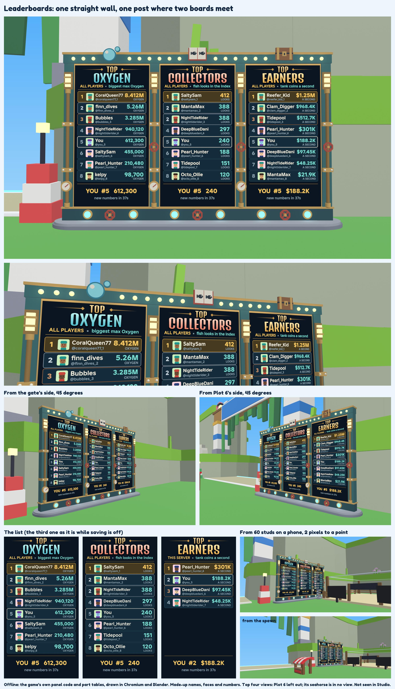

# The leaderboards

Three boards in the hub: **TOP OXYGEN**, **TOP COLLECTORS**, **TOP EARNERS**. Hugo, 2026-11-25 (NULLROOM task l1):
"Make stylised leaderboards in this style, but fitting the aquatic theme", with a picture of three tall boards on a
plinth. Taken from it: the function, the layout, the readability. The look is ours.

**State: built on branch `leaderboards`, the second and third round of changes on `leaderboards-2` (from it); checked offline
only. Not seen in Studio, not merged.**

## One straight wall (Hugo, 2026-11-25 18:18, of [the round before](../attachments/leaderboards-3.jpg))
"re-angle the scoreboards to be straight and continuous with each other without seeing any edges in between."
- **No board is turned or stands on its own.** The three are one wall: one plane, one line, one height. A board has no sides of
  its own any more; `Boards.frame` draws what they share, `Boards.board` only what is inside one.
- **Right through, end to end:** the stone kerb, one foot bar with a brass ledge, one head bar with its brass edge, a back plate (no
  daylight anywhere). The small lamps on the head bar are 1.5 studs apart across the joints too.
- **Where two boards meet: one post**, with one pipe, one lamp, two straps, one valve, one gauge. The end posts are the same, but the
  one by the gate has only its gauge and the one by Plot 6 only its valve, as on each board before (3 and 3). The posts' own
  feet are gone: the foot bar passes in front of them.
- **The post valves are a little smaller and flatter (1.7 to 1.4 studs)** and they and the straps sit between two rows of the list:
  on a shared post, at 45 degrees, the old ones hid the neighbour's numbers. Now every place and number reads from both sides.
- **The row stands square to the hub and the wall behind it** (`Face` 180, was 172). Turned to 172 it is 89 pixels
  wide from the spawn on a phone's screen of 844 instead of 76, but it looks skewed against the straight wall and leaves 1.0
  studs to Plot 6 instead of 3.7. Every second degree from 172 to 180 was checked and is clear; 170 is too near Plot 6 (0.3), 168 is in its plate.

## The look (Hugo, 2026-11-25)
Hugo picked frame 3 of [three](../attachments/leaderboards-options-1.png) (sunken brass), then: "make models on top of the
leaderboard simpler and easier on the eye, placed right on the top/front of the leaderboard like a sign hanging these
should be somewhat flat. remove a little more visual clutter on them [...] Dont overdo it. Fit the reference better in
terms of how the leaderboard is structured from the inside, make it more stylised and simplistic. Dont make everything
look too "childish"".

Then, the same day, of [that](../attachments/leaderboards-2.png): "add valves and some lights and details back around the
border, make each "TOP" text stylised, make icons a little smaller remove the border around them and make sure that the top
shrinks to a way smaller bar". So now:
- **The top:** a bar 1.6 studs high with a brass edge and six small lamps (was 7 studs of board and beam). "The top" is read as
  the frame's head; the panel's heading is as tall as it was (156 of its 848 pixels, was 154).
- **The icons:** the bare shape on the front of the bar, no roundel, no straps; about 2 studs high (Oxygen a bubble, Collectors the
  Index open with a fish on each page, Earners a shut chest; an anchor for the fourth). They do not move.
- **The border:** up each post a pipe in collars and bolted straps to a barred ship's lamp; red valves and gauges on the pipes
  (above); in the foot of each board a valve between two lit portholes. Still out: weed, caged lanterns on top.
  212 parts for the whole row (256 with six pillars). The four posts' lamps are real lights (six before), the rest only glow.
- **The title:** its first word (TOP) small in brass between two fading lines, the rest big under it in Denk One, shaded in the
  board's own colour (sea, coral, gold), on a dark edge and drop. Who it lists and what it counts share one line under it (who was above the title before).
- **The list**, laid out as the reference's is: one dark face; rows of place, face, name over user name, number over its unit; only
  first place is gold; your own line edged in white; a centred foot. The colours and words are ours. No outlines on
  letters but the title's; the rest is Builder Sans.

The two frames not picked, and the signs before, are in git (`35a8781`; the roundels `d469a7f`).

## Where they stand
Along the front wall, **right of the dive gate as you face the sea**, in place of the blank "Earners" slate, facing into
the hub. Left to right: Oxygen (by the gate), Collectors, Earners; feet at (2934.9, -39), (2922, -39), (2909.1, -39).
All in `Config.Boards`: `X`, `Z`, `Face` (the whole row), `Pitch`, `Scale`. `Pitch` 12.9 is the least there can be
(`Boards.least`: two brass edges in behind one post); more only makes the posts wider, so there is never a gap. `Turn` is gone.

Found in the saved place (2026-11-25 00:11) and Studio's autosave of 18:26, read offline: the row touches nothing, is 49 studs
from the spawn, 34 from the Sell ring, 59 or more from the other rings, 22 or more from the keepers and their props, and
3.7 from a fence post of Plot 6. The old slate is moved out of the
**running game** only (`Replaces`); the place is not changed.

**Plot 6 stands partly in front.** From the spawn and the gate all three boards show. From 60 studs straight across, its
coil and seahorse cover the foot of Earners and part of its edge. The seahorse is a mesh, so it is in no picture here.

## Who is on them
- **Oxygen:** the max Oxygen. **Collectors:** fish looks found in the Index (a kind in one size and one colour is one look, as the
  Index records them). **Earners:** the tank's coins a second. A fourth, **DEEPEST DIVERS**, is in the list with `On` 0:
  a client moves its own character, so that number is the easiest to cheat.
- **Everyone, or this server.** A board lists every player only while its number is really saved between visits and
  Roblox's store answers. Otherwise it lists this server's players under a **THIS SERVER** label (the other label is ALL
  PLAYERS). Saving is on for Oxygen, Index and Tank. All three boards can write live ordered stores once each player’s
  corresponding part has loaded. Studio defaults to local boards unless `SaveReal` is set.
- **Places:** biggest first; equal numbers share a place (1, 2, 2, 4), the lower user id first. 50 kept, 8 seen, the rest
  scrolled to from within 24 studs. Your own place and number are at the foot, with the seconds to the next look.
- **Names and faces:** Roblox's own display and user names (filtered by Roblox) and headshots; the store holds a user id and a
  number, nothing else. `HideUsers` (empty) leaves ids out of the store and the lists.
- Everything is the server's own number. The client sends only "send me the lists", no oftener than every 2 s.

## How a number is kept
Roblox's sorted store takes whole numbers only, and past 2^53 a number loses its units. `Lib/BoardSums`:
- **up to 1e15 steps: exactly**, rounded **down** to a step. A step is 1, or a tenth for Earners (`Scale` 10), so nobody
  is shown more than they have: 12.39 a second is kept as 123 and shown as 12.3. Your own number at the foot is cut the
  same way (`BoardPanel.number`), so it reads as your row does. The rest of the game's signs round to the nearest tenth
  (`Config.rate`: 12.4).
- **past that: by its logarithm**, `1e15 + round((log10(n) - 15) x 1e13)`, always under 2^53. Read back it is off by less
  than one part in 1e12, far finer than the four figures shown. Order is kept, across the join too. Two numbers
  closer together than that count as a tie.

## What it costs Roblox's store
One list asked for per board per minute (`Refresh` 60). A player's number is written when it has changed, at most every
120 s and as they leave; one write per 0.5 s per server; nothing while the game's own budget has 5 or fewer left.
A server that closes spends up to 20 s on what is left: the writes still queued, those Roblox has not answered yet, and
a failed one again after 2 s. After an error a board waits 30 s, doubling to 600 s, with **one** line in the output. A list older than 600 s gives way
to this server's players and comes back by itself. Nothing is written before a player's save has loaded, so a joining
player never overwrites their own number with a fresh one.

## Where it is
`LeaderboardService` (who is on them), `Lib/BoardSums` (the sums), `Shared/Boards` (the frame and signs, plain parts),
`BoardController` (builds them on each player's own machine, in `workspace.Boards`), `UI/BoardPanel` (the list),
`SaveService.keeps`, remote `Boards`, player attributes `Board` + Id. Off: `Config.Boards.On` 0 (the old slate comes back).

## Checks (lune, offline)
`rojo build default.project.json -o /tmp/p.rbxl`, then `lune run tools/boards/...`:
- `board_test.luau /tmp/p.rbxl`: order, ties, rounding, past 2^53, the store off, down and back, budget, hidden ids, closing (89).
  Sixteen rules broken on purpose, one at a time: each made this or the next one fail.
- `panel_test.luau /tmp/p.rbxl [dump folder]`: the list as drawn, that row and foot read the same, and the straight wall (98): no board
  turned, the glasses in one plane, one post, pipe and lamp at each end and joint, the bars in one piece, no slit (a
  line through it every 0.03 studs, at 17 heights), no two seen faces of two colours in one plane.
- `place_test.luau /tmp/p.rbxl <saved place>`: every part against the hub, and how far the keepers are (13). `slim.luau` leaves out
  the properties it does not need, so it takes about 0.85 GB; it says nothing and ends with 137 if the PC kills it (under about 1.8 GB free).
- The picture: `panel_test` with a folder, `picture.py <folder> panels`, `view.py` in Blender, `picture.py <folder> sheet <png>`.

## Not done, not sure
- **Not run in Studio:** scrolling by finger and mouse, the real headshots, the real letters and lamps, the store itself.
- **The title's size in Roblox:** a font's size there can come out smaller than Chromium draws it; it is fitted to its box both ways.
- Titles and values read at 60 studs; long names shrink and read only from nearer.
- The row has no shadows and four small lights. Not measured on a phone.
- **From sharper than 45 degrees** the valves, straps and lamps stand out far enough to hide the ends of a neighbour's rows.
