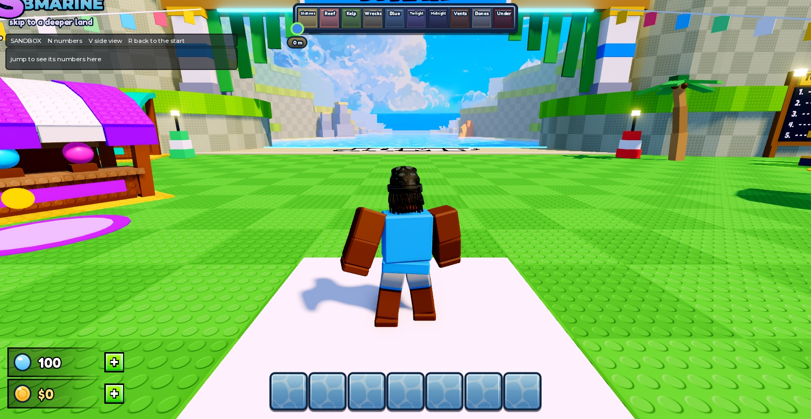
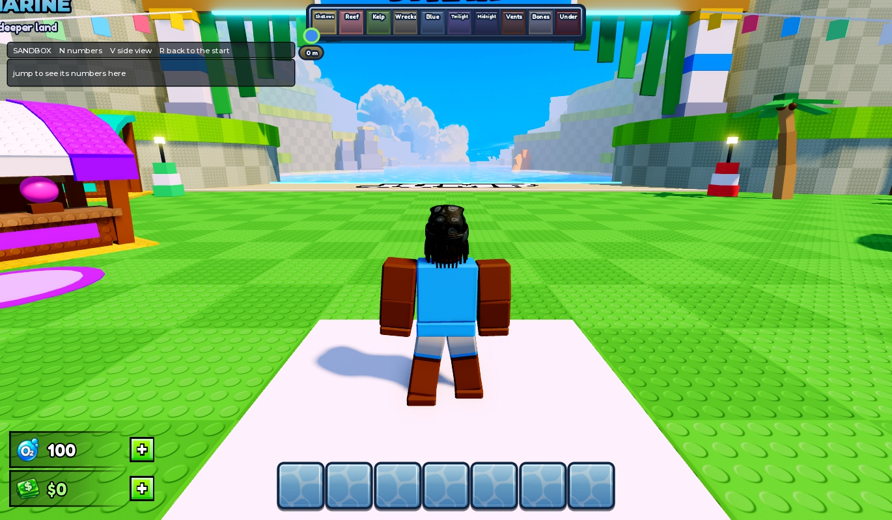
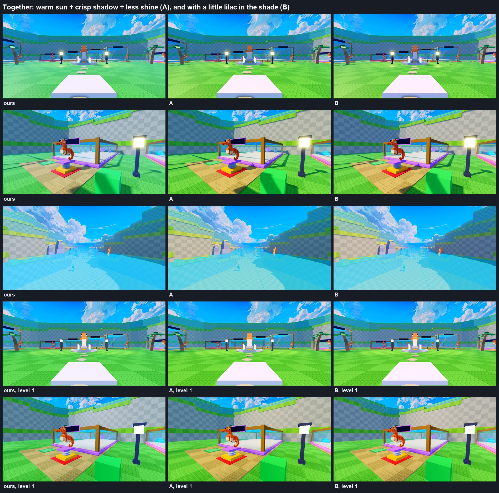
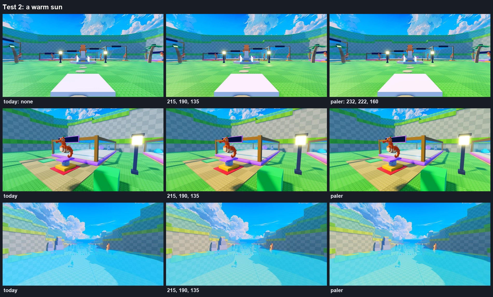
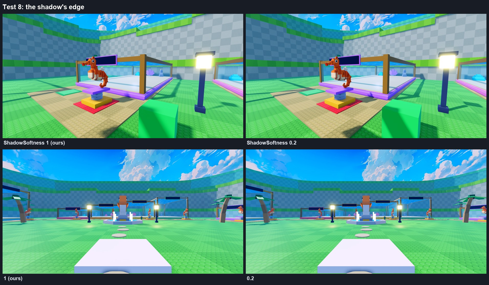
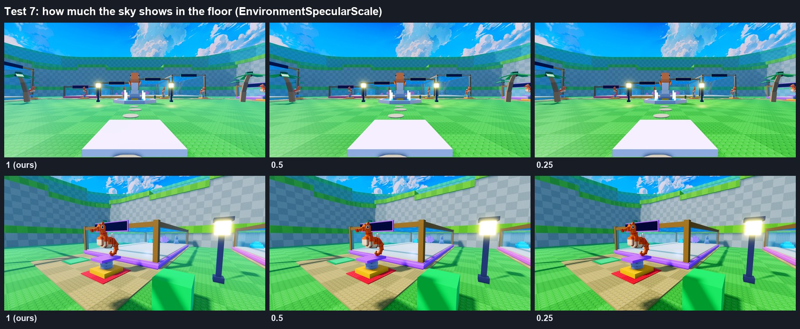
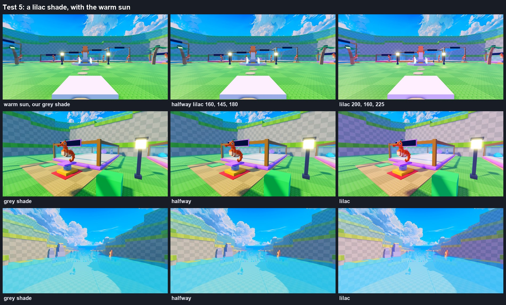
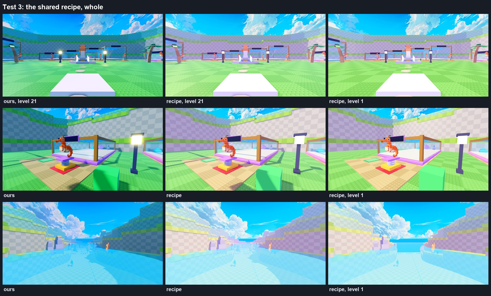
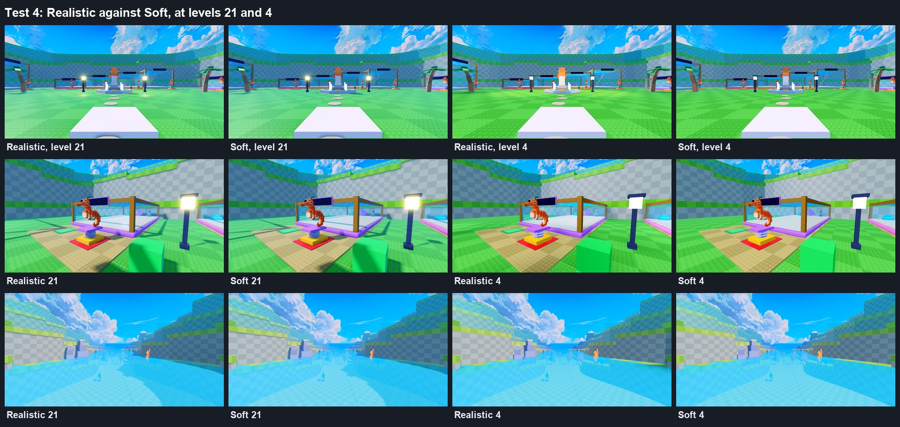
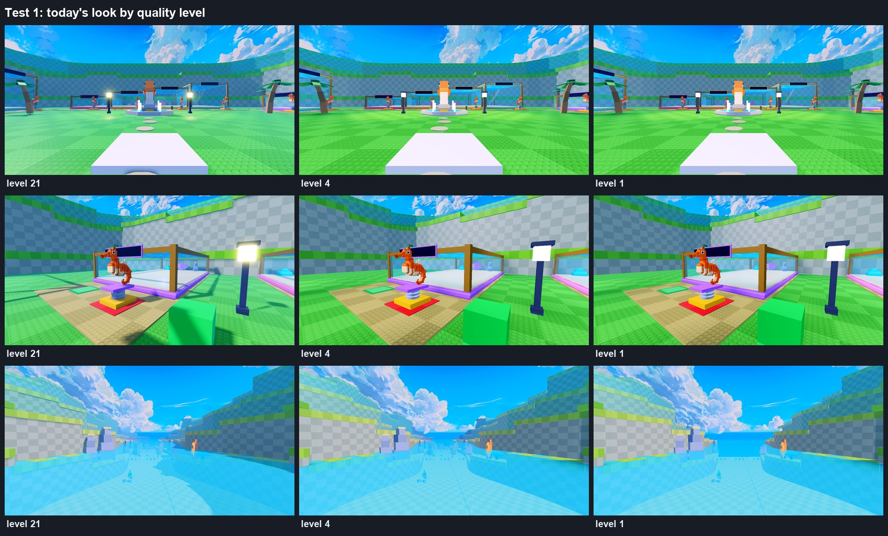

# Lighting

> **Studies, 2026-11-16.** This look has only been judged at the top quality level, and a warm sun colour (`ColorShift_Top`) has never been tried. One recipe runs through five tutorials. The tests, in order: [the lighting study](../reference/look-lighting.md), section 5. The short of it: [findings](../Findings.md), rank 3.

The look of the light, from the tutorial video the user sent on 2026-11-11 (a 50-second TikTok by kh_studios). The user
likes its vibrant look. Built the same day by the game-code chat ([Sessions](../Sessions.md)). **Not seen by anyone
yet:** Studio's window wasn't being drawn when it went in, so it was checked by its numbers in play, not by eye.

## The air above the water (2026-11-17)
The user: "could we add the fog from ride a dino to an extent. The one that appears from the hub, ours will be
different for in hub and in water cuz we have water fog now we need like base fog as to obscure the far
surroundings."

- **A plain fog while the camera is above the surface.** Under it the water's own fog takes over, as before.
- **Its numbers are in `Config.Look`,** live in the N panel: `AirFog` 1 (0: off), `AirFogStart` 220 studs,
  `AirFogEnd` 1,500, and its colour `AirFogR`, `G`, `B` 205, 232, 255, a pale sky blue. The hub is about 480
  studs across, so it stays clear and what is far fades out.
- **How it is built.** The water's script (`tools/map/water_look.luau`) is the one thing that owns Lighting's fog,
  so it puts this fog on too, reading the numbers from attributes the game's look writes on Lighting
  (`Shared/Look.luau`). Roblox's fog only works with the Atmosphere taken out, so the Atmosphere now stays out
  above the water as well while the fog is on. `AirFog` 0 puts the Atmosphere back.
- **It needs two things put into Studio:** the game code (`sync_src.py`) and the water's script
  (`python tools/map/water_luau.py`, then `tools/studio/greybox/98_water.luau` run in Edit).
- **Why a plain fog and not the Atmosphere:** the lighting study found the Atmosphere is not drawn at the lowest
  quality level, and a plain fog is. This is the study's test 13, taken as the user's pick without the side by
  side.
- **In Studio and run once (the same day).** In the hub the client reads the fog as 205, 232, 255 from 220 to
  1,500 with the Atmosphere out; on a fish under water it reads the water's own (72, 224, 232 from 80 to 1,550).
  The numbers are a first go; the user has not judged it. The place needs saving: the water's script changed.

### Thicker, and the sky brought down (the same day)
The user, on seeing it: "slightly thicker fog. And is there a way to get that skybox to not look like it cuts off
in a weird way in the distance, anyway to bring that cloud down so to speak".

- **Thicker:** `AirFogStart` 180 and `AirFogEnd` 1,100, were 220 and 1,500.
- **Why the sky cut off.** The sky's clouds stop well above its own horizon, with a plain blue band under them. A
  plain fog fades the far land but leaves the sky alone, so the faded land sat under that empty band.
- **The fix: the sky is tipped 14 degrees toward the lane** (`Config.Look.SkyTilt`, new; the sky's own
  `SkyboxOrientation`). Looking out of the hub the clouds now sit down on the far land. Behind you they rise by as
  much, where the hub's wall hides it. To the sides the sky's horizon is slanted; not looked at from there.
- **Tried first and dropped: an Atmosphere** (`AirFog` 2, kept as an option). It hazes the sky's horizon as well as
  the land, which is what was wanted. But at a haze of 2.4 it wiped the clouds out to one flat blue, at 0.6 it
  left a dark blue band on the horizon, and its colour can't be made pale. `AirFog` is 1, the plain fog, which
  the lowest quality level also draws.

Before (the first fog, the sky level) and after (thicker, the sky tipped):

## The look pass: seven tests in Studio (2026-11-16)
**The user picked A the same day** ("Choose A for the lighting id say"). The game-code chat wrote its three numbers
into `Config.Look` and put the look on the place in Edit: the sun 215, 190, 135, `ShadowSoftness` 0.2,
`EnvSpecular` 0.25. Not yet seen by the user in Play. What follows is the pass as it was written before the pick.

**For the user to pick from. Nothing is changed:** `Config.Look` is as it was, and the place has our own look back
on it. By the map chat, on the user's word ("make sure the main assets and the UI all looks really good in like the
lighting and stuff"). The tests are [the lighting study](../reference/look-lighting.md)'s first six (1, 2, 3, 4, 5
and 8) and one more it led to (7). Each is one change against today's look, pictured from the same three spots: the
hub from the spawn, down the lane over the water, one tank close up. A block painted one green (83, 214, 100) stands
by the tank as a measure: its colour is read off the picture. Most promising first.

### What I would pick: A

- **A is three numbers:** the sun's colour 215, 190, 135 (`SunR`, `SunG`, `SunB`), `ShadowSoftness` 0.2 (it is 1),
  `EnvSpecular` 0.25 (it is 1).
- **B is A with a little lilac in the shade:** `AmbientR`, `G`, `B` 160, 145, 180 (they are 118, 128, 138).
- **Why A.** Today the floor's green reads as mint at the top quality level, and as a truer green on a weak phone:
  the picture changes with the device. A makes the two nearly the same, and nearer the paint:

| The green block's top, in the sun | Red | Green | Blue |
|---|---|---|---|
| Its paint | 83 | 214 | 100 |
| Today, top level | 82 | 240 | 167 |
| Today, level 1 | 60 | 235 | 119 |
| **A, top level** | 99 | 242 | 113 |
| **A, level 1** | 77 | 236 | 90 |
| B, top level | 100 | 242 | 116 |

  Blue is the one to watch: 167 is what makes green look washed. This may be the "washed out" the user has
  reported (a guess, as the study's was).
- **B against A** is a small matter of taste: the shaded walls go faintly violet. I would take A and leave the
  shade grey until the deep lands are lit, since the lilac was the tutorial's and we took it out once already.

### The tests, one by one
**2. A warm sun.** The biggest single change. Sunlit faces go warm, the floor goes from mint to green, the lit wall
of the lane parts from the shaded one in colour and not only in brightness. 215, 190, 135 is a little stronger
than the paler 232, 222, 160; on the block the two measure the same. It survives level 1.

**8. The shadow's edge.** At 0.2 the tank's frame draws clean lines on the pad and the palm's shadow has a shape. At
our 1 they are smudges. Nothing looked harsh.

**7. Less sky in the floor** (not one of the six: test 1 pointed at it). The floor is greener at level 4 than at
level 21, in Soft and in Realistic alike, so the difference is the sky's reflection, which only the high levels
draw. Turning `EnvSpecular` down takes the block's blue from 167 to 150 (at 0.5), 140 (at 0.25) and 129 (at 0).
By eye it is a nudge; with the warm sun it is what closes the gap between a PC and a phone.

**5. A lilac shade** (with the warm sun). The recipe's full lilac turns every shaded wall purple and lifts the shade
a long way. Halfway is a faint violet. Neither brought the mint back.

**3. The shared recipe, whole.** Pale and pastel: lilac walls, a soft yellow-green floor, a lavender haze over the
lane. It is the same picture at level 21 and at level 1, which is its strength. It is also the least vivid of
everything tried, and the user's word for the look was "vibrant". A yardstick, not a proposal.

**4. Soft against Realistic.** Almost no difference in the hub: Soft's shadows are a little fainter. It was not
steadier between levels here (both change the same way from 21 to 4). No reason found to change.

**1. Today's look by quality level.** Levels 4 and 1 look the same from all three spots:
- **Gone:** every shadow, the glow round the lamps (they are flat white boxes), the sky's shine on the floor.
- **Still there:** the colour effect (the tint and the vividness), the difference between a lit wall and a shaded
  one, the water's blue in the lane, the sky.
- So the hub stands without shadows. What it loses most is the lamps, which is one more reason not to lean on glow.

### Not done, or not sure
- **Not on a phone, and not in Play.** Everything is Studio's Edit mode with the editor's quality level set by
  script. Under water was not in this pass's three spots.
- **The sun's angle, the tone mapper, the bloom, the tint and air for the hub** (tests 6 and 9 to 13) are not done.
- **How it was done, to do it again:** `python tools/studio/look_tests.py <plan.json> <look>[@level] ...` writes a
  plan, `python tools/studio/look_shots.py <studio_id> <plan.json>` runs it and saves the pictures, and
  `tools/studio/look_swatch.py` reads the block. The looks are a table at the top of `look_tests.py`. `--restore`
  puts ours back.
- **For the game-code chat, if the user picks A:** `SunR = 215, SunG = 190, SunB = 135, ShadowSoftness = 0.2,
  EnvSpecular = 0.25`. For B also `AmbientR = 160, AmbientG = 145, AmbientB = 180`.

## What the tutorial does
Read from its frames and its voice.

| Step | Where | From | To |
|---|---|---|---|
| 1 | Lighting, Ambient | 70, 70, 70 | 124, 155, 184 |
| 2 | Lighting, Brightness | 3 | 4 |
| 3 | Lighting, LightingStyle | Soft | Realistic |
| 4 | Lighting, OutdoorAmbient | 70, 70, 70 | 157, 178, 255 |
| 5 | Lighting, ShadowSoftness | 0.2 | 1 |
| 6 | Bloom, Size | 24 | 56 |
| 7 | A new ColorCorrection: Contrast and Saturation | 0 | 0.5 each |
| 8 | ColorCorrection, TintColor | 255, 255, 255 | 245, 234, 255 |
| 9 | A sky from the Toolbox ("choose one that you like") | | the video picks "Anime Sky" by Aschorking |
| 10 | A LocalScript in StarterPlayerScripts | | left out, on the user's word |

Our place's lighting was Roblox's plain start, the same as the tutorial's "before", so the steps apply as they are.

## Toned down
The user, the same day, through the map chat: "a bit too blinded by light so textures are harder to see, maybe tune
that area of the system down artistically". At the tutorial's values the sand floor clipped to white and the studs and
squares vanished on floor and walls (the map chat, from one capture of the hub in Edit mode). The values it tried there,
which keep the vivid sky and bring the textures back, are `Config.Look` now:

| Number | The tutorial | Now |
|---|---|---|
| Brightness | 4 | 2.4 |
| Exposure | 0 | -0.25 |
| Ambient | 124, 155, 184 | 104, 128, 152 |
| OutdoorAmbient | 157, 178, 255 | 128, 146, 200 |
| Bloom: intensity, size, threshold | 1, 56, 2 | 0.5, 40, 2.4 |
| Contrast | 0.5 | 0.2 |
| Saturation | 0.5 | 0.35 |

The tint, the soft shadows, the Realistic style and the sky are unchanged. Judged from one capture of the hub only;
under water it has not been seen.

## Part of the way back
The user, later the same day, through the map chat: the toned-down light is a bit washed out; bring it part of the way
back toward the bright one (its blues and pushed light, without the blinding). `Config.Look` now, a reasoned halfway
point that **nobody has judged by eye** (Studio's window wasn't being drawn for either chat):

| Number | The tutorial | Toned down | Now |
|---|---|---|---|
| Brightness | 4 | 2.4 | 3 |
| Exposure | 0 | -0.25 | -0.2 |
| Ambient | 124, 155, 184 | 104, 128, 152 | 112, 140, 170 |
| OutdoorAmbient | 157, 178, 255 | 128, 146, 200 | 140, 162, 240 |
| Bloom: intensity, size, threshold | 1, 56, 2 | 0.5, 40, 2.4 | 0.7, 48, 2.2 |
| Contrast | 0.5 | 0.2 | 0.35 |
| Saturation | 0.5 | 0.35 | 0.5 |

## A touch down
The user, the same day, to the map chat (which holds these numbers now): "ever so slightly less bright and drowning,
ever so slightly, just a touch". Three numbers moved; the rest are as in the table above.

| Number | Part of the way back | Now |
|---|---|---|
| Brightness | 3 | 2.8 |
| Exposure | -0.2 | -0.25 |
| Bloom intensity | 0.7 | 0.6 |

Pushed to the place and installed in Edit mode. Still not judged by eye by either chat: the user's eye is the test.

## The blue taken out (2026-11-12)
The user, playing: washed out too much; "feel the green more", "see the tone changes more". Measured with swatches in
Studio: a pure green part (83, 214, 100) showed on screen as mint (7, 255, 161). The shade light (OutdoorAmbient)
was nearly as blue as the sky, and the sky tinted every surface at full strength (EnvDiffuse 1), with saturation
on top. Changed, by the map chat (which holds these numbers):

| Number | Before | Now |
|---|---|---|
| Ambient | 112, 140, 170 | 118, 128, 138 |
| OutdoorAmbient | 140, 162, 240 | 150, 158, 170 |
| EnvDiffuse | 1 | 0.35 |
| Contrast | 0.35 | 0.25 |
| Saturation | 0.5 | 0.3 |

Brightness 2.8, exposure -0.25, the bloom, the tint and the sky are as they were. After it the same green shows as
(38, 236, 125), and the hub's part colours were then set so they land on the reference's on-screen colours
([the map's structure](map-structure.md), "The hub's colours"). **What this gives up:** the walls no longer read
blue, and the picture as a whole is a little less vivid. The sky itself is unchanged.

## The script we left out
It runs when your character appears and puts a Roblox `Highlight` on it: a black outline round the whole character, and
a black wash over the body at 20% (FillTransparency 0.8), hidden where something stands in front (DepthMode Occluded).
It is not a pixel effect. A Highlight's outline is about a pixel or two wide and has no smoothing of its own, so it
looks jagged on a low graphics setting, which is likely what read as pixelated. It only ever marks your own character.

## How it is built here
- **The numbers are `Config.Look`** in `src/shared/Config.luau`: every value in the table above, plus the hour, the
  exposure and how much the sky tints things. Colours are three numbers each.
- **While playing, `LookController`** (`src/client/Controllers/LookController.luau`) keeps Lighting, a bloom and a
  colour effect of our own (`LookBloom`, `LookColour`) and the sky at those numbers. It checks four times a second, so
  a change shows at once. The place's own Bloom is switched off while ours is on.
- **In Studio's Edit mode,** `tools/studio/look_install.luau` puts the same numbers on the place, and sets
  LightingStyle to Realistic, which a game script isn't allowed to set. Run it again after changing a number for good:
  `node tools/studio/run_luau.js <studio_id> tools/studio/look_install.luau`. Another place (Hugo's) needs it run once.
- **Skies** are in `ReplicatedStorage.Skies` (Studio-owned), picked by `Look.Sky` in name order: `1 Place` is the sky
  the place had, `2 Anime Sky` is the tutorial's (Creator Store asset 72835926026092: only its Sky was kept; it had
  no scripts). To try another, put a Sky in that folder with a name that sorts where you want it.

## Tweaking it
In Play, press N and find the **Look** rows. Each changes the light at once.

| Row | What it does |
|---|---|
| `On` | 0 shows Roblox's plain lighting and the plain sky, to compare; 1 is the look |
| `Sky` | which sky of the folder: 1 the place's first, 2 the Anime Sky |
| `Brightness`, `Exposure` | the sun's strength; the whole picture lighter or darker |
| `Contrast`, `Saturation`, `ColourBrightness` | the vibrant part: both start at 0.5, which is strong |
| `BloomIntensity`, `BloomSize`, `BloomThreshold` | the glow round bright things |
| `ShadowSoftness`, `ClockTime`, `Latitude` | the shadows' edge, and where the sun stands |
| `EnvDiffuse`, `EnvSpecular` | how much the sky colours everything |
| `AmbientR/G/B`, `OutdoorR/G/B`, `TintR/G/B` | the three colours |

"Copy changes" on the panel lists what you changed; tell a chat the numbers and they go into `Config.Look`.

## Open
- **Nobody has looked at it.** To judge: the hub, the wall faces (the map chat found them blue with a hard shadow at
  the foot under the old light), and under water in the Shallows and a deep land.
- **Under water** the same light is used at every depth for now. The plan for darker, foggier water by land
  ([workout 1](../style/01-going-down.md)) would sit on top of this; Contrast and Saturation at 0.5 may be too much
  down there.
- **Creatures glow:** Neon parts and anything very bright bloom wider now (size 56).
- The map chat and this chat agreed earlier that the game code never sets Lighting. This replaces that: the numbers
  are the game's, and the place is set from them.
