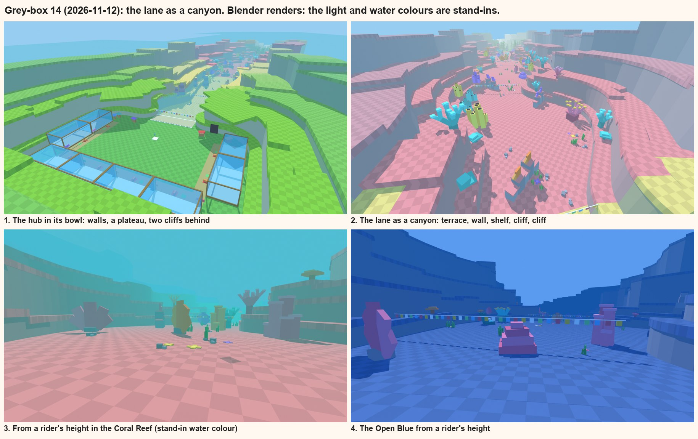
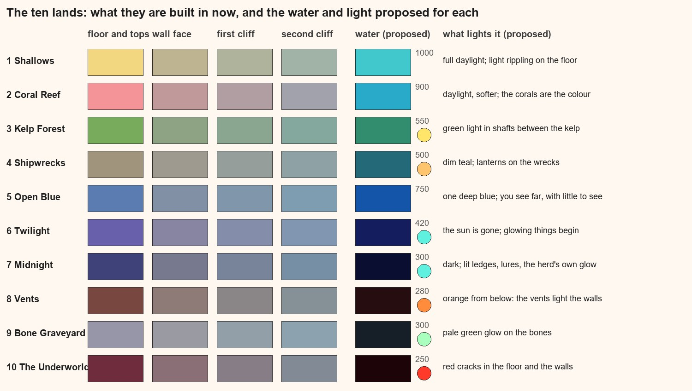

# The map's feel: an ocean you are inside

Up: [the map's structure](map-structure.md). Written 2026-11-12 by the map chat, on the user's word: the map should
look better and more cohesive, "so that it actually looks like you're in the environment", while the water's own
effects aren't built yet. The walls may not be high enough and there may not be enough layers of landscape. Keep
the interactable assets as they are, but take most of them out of the middle of the lane, especially at the start.
Think of a look for each zone. Later the deep zones go dark, and they will need lighting creatively: "not pitch
black, but it looks dark, but you can still see around".

## Where our game differs from Ride a Dino, and what that asks of the map
Ride a Dino is a run along the ground. Ours is a swim down through water. The loop is the same (ride, hop to a
better creature, get further, bring one home), but the player's eye is somewhere else.

| | Ride a Dino | Ride a Fish | So our map needs |
|---|---|---|---|
| Where you are | on the ground, looking along it | off the floor, anywhere up to the surface | to look right from above and from the side, not only from the floor |
| What walls do | fence a walker in; you never see over | a swimmer rises over any wall | something solid behind every wall: no empty water |
| The sky | open, bright, the same all the way | the surface overhead at first, then nothing | the canyon's own walls to close the view where the sky did |
| Going further | along | down | each land to look deeper than the last: taller walls, darker water |
| Obstacles | you steer round them at a run | you and a herd of fish pass at speed, in three dimensions | a clear road down the middle; big things at the sides |
| What you read at a glance | a green valley | a place under the sea | layers going off into the water: near, middle, far |

**The one idea: the lane is a canyon cut in the sea's floor.** You swim down a canyon whose sides step up and back in
layers. That gives the enclosure a valley gives a walker, it gives the eye near, middle and far, and it means that
wherever a swimmer looks, over a wall or up it, there is more landscape and never the map's edge.

## What is built: grey-box 14

From the lane outward, on both sides, the whole way:
1. **The low terrace and the wall** (as before, the wall two squares taller: 9 squares, 72 studs under its grass).
2. **A shelf:** the wall's top carries on back, level, to the first cliff. Behind a wall there is now ground.
3. **The first cliff,** 96 behind the wall's face, about 15 squares (120 studs) over the floor, stepping two squares
   up or down every 256 studs.
4. **Its top carries on back to the second cliff,** 192 behind, about 27 squares (216 studs), stepping three.
5. **Both cliffs grow with the lane:** by the last land they are about twice as tall, as the lane is three times
   as wide. Each is drawn a step further toward the water's haze than the one in front of it, so they sit back.
6. **Round the hub the same:** behind its wall a plateau, then the two cliffs, standing 112 and 184 over the water.
   The hub sits in a bowl, and the cliffs carry on out of it down both sides of the lane.

The cliffs are built coarse (a piece is 64 long, four tiles), so the two layers and the shelves cost about 4,500
parts; the old pale backdrop slabs and the slopes behind the rims, about 2,500, are gone. A rim is now a low shelf
with the cliffs behind it: still a view out, never a way out.

**The assets, thinned and moved:** 243 big things (302 before). None in the first 420 studs. None in the middle of
the first land. After it, at most one to a room in the middle third, and the rest in the outer third of the lane,
on one side or the other. The things themselves are untouched.

**Not seen in Studio yet.** Studio's window wasn't drawing when this was ready, so it is judged from the renders
above; the grid on the cliffs and shelves follows the same rules as the walls but hasn't been looked at there.

## A look for each zone

The first four columns are what the map is built in now. The water's colour, how far you see and what lights each
land are **proposed**, from [workout 1](../style/01-going-down.md)'s numbers; none of it is built.

- **One thing wrong in what is built:** every land's cliffs fade toward the same pale teal. Right for the first
  lands; in the deep ones they should fade toward that land's own dark water. To change with the fog.
- Lands 5 to 10 still borrow the first lands' assets, and their floor colours are first guesses.

## Lighting the dark lands: dark, but you can see
The trap is to turn the light down and add a few glows: then it is black with dots. What reads as "dark, yet I can
see" is **dark shapes against water that is a little lighter than they are**, plus light that comes from the place
itself. In the order they'd pay off:
1. **The water glows, the land doesn't.** Fog close in (250 to 400 studs) but in a deep, full colour (indigo,
   then near-black red), never black. Walls and cliffs go darker than the fog. Every layer of the canyon then shows
   as a silhouette, each paler than the one in front: the layers built today are what this needs.
2. **Flat, tinted light instead of sun.** The sun's strength to nothing, the shade light kept fairly high but
   blue-violet and low in colour. Everything is visible and nothing is lit from anywhere: that is what deep water
   looks like.
3. **The canyon outlines itself.** A thin glowing edge on every ledge and on the lane's rim: lines of light running
   off into the dark, showing the shape of the place and which way it goes. Cheap: one thin part to a piece, or a
   glowing copy of the grid's lines on the floor.
4. **Each land has its own lamps, and they are landmarks.** Vents throwing orange up the walls; wreck lanterns;
   bones with a pale green glow; cracks of red in the Underworld. A few real lights each, placed where the eye
   should go: at the necks, and on the big things at the sides.
5. **The creatures carry light.** The fish you ride lights the water round it. Rare fish glow in their rarity's
   colour, so the herd ahead is a drift of small lights and the one worth hopping to stands out.
6. **Things drifting in the water** (specks catching the light) give depth where there is nothing else to see.

## What comes next on the map
- Look at grey-box 14 in Studio and tune: wall and cliff heights, how far apart the layers stand.
- The floor: its tiles still show where it tilts (each is flat and lit by its own slope).
- Each zone's colours chosen for good, with the water's colour: the sheet above, land by land.
- The [parked steps](map-structure.md#what-makes-their-map-read-and-where-ours-should-go) this now covers in part:
  the backdrop (done as cliffs), the assets' placing (done; a set for each land is not).
