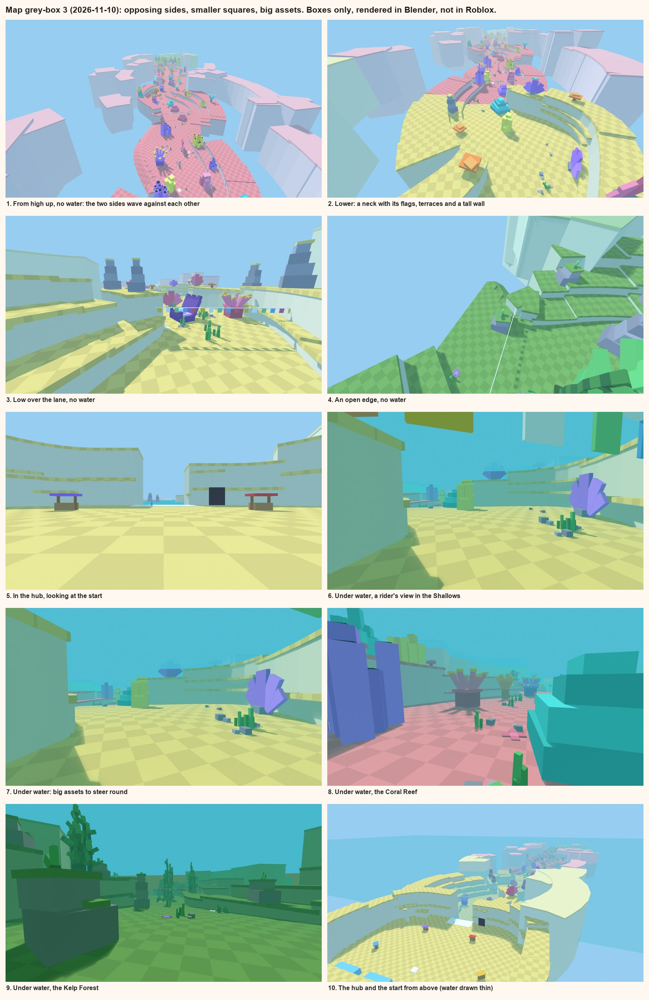
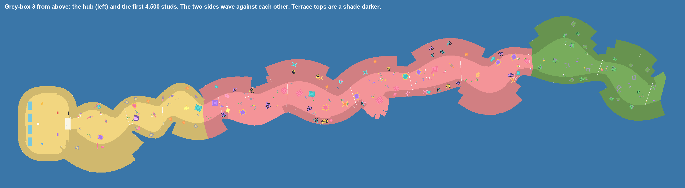
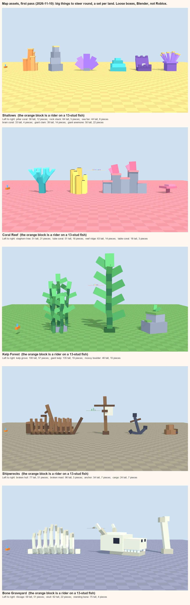

# The map: how we build it

Up: [Home](../../Home.md). The study it rests on: [how Ride a Dino's map is built](../reference/ride-a-dino-map.md).
Written 2026-11-10 by the map chat. It replaces blockout v4 ([Blockout](../blockout.md)), which the user set aside the
same day: it looked nothing like the way the reference builds its world.

## Decided (the user, 2026-11-10)
- **Start again.** The v4 hub and most of the v4 map are abandoned.
- **Build it the way Ride a Dino builds its map,** then improve on it, as we did with the creatures.
- **Wavy steps means the walls and the track.** The walls follow the track smoothly and sit flush on its edge. In
  some stretches the walls disappear.
- **The track goes narrow, then big, then narrow, then big, in a pattern,** as the reference's does.
- **The two sides don't mirror each other:** one goes in when the other goes out, and one bleeds into the other. That
  is what gives variety and a sense of space.
- **The floor's squares are small** (grey-box 2's were too big).
- **Assets are rethought from nothing:** large and tall enough that the fish have to manoeuvre round them. Large
  corals, a shipwreck, bones, sea plants; varied by land.
- **How a player leaves the open map** is for later.
- **Props are made to break:** a big enough creature swimming into one makes it collapse. Breaking gives nothing.
  It isn't coded yet: for now the props are only modelled so that they can break.
- **The descent:**
  - it starts at a gentle slope;
  - after one or two lands it gets a bit steeper, and then a little steeper each land;
  - every land border has a small step down;
  - every few lands there is a big change in elevation. It is a slope, clearly steeper than the lands round it, not
    a sheer drop.
  - It all has to link and match.
- **The hub is closed in,** like theirs: visual blocks all round, not a platform with open ocean to look at.
- **The start:** you dive in from the start zone. No diving board. Where the reference has ground beyond its start
  zone, we have the top of the water, level with the hub's floor.
- **Once you are in the dive it should feel expansive.**
- **The diving spot is marked** with light and other means. Later; easy.

## What was wrong with grey-box 1 (the user: "you are misunderstanding how their wavy pattern is formed")
Grey-box 1 was a road of one width with fences. Set against the reference:
1. **One width.** Theirs goes narrow, wide, narrow, wide: rooms and necks. This was the biggest miss.
2. **Walls as a separate thing.** Thin rock steps with a contrasting cap, stuck on the lane's edge. Theirs are the
   ground itself stepping up, in the ground's own colour.
3. **Terraces far too small and even:** 14 studs deep, 16 high, like stadium seats. Theirs are broad and uneven.
4. **A dead flat floor.** Theirs rolls.
5. **Open edges cut square,** like the end of a table. Theirs roll off over a shoulder.
6. **Two colours per land** (sand floor, green or pink caps). Theirs is one colour and a pale wall face.
7. **Flags only at land borders.** Theirs hang at every neck.
8. **Props small and thin,** only along the sides, none on the terraces.
9. **No checker,** so no scale and no sense of speed.
10. **Nothing far off,** so an open edge showed empty blue.

## Grey-box 3 (2026-11-10)
After the user's read of grey-box 2: the squares were too big, and the two sides swelled and pinched together, where
each should go out as the other comes in. The hub, the first two lands and the start of the third: about 4,900 boxes,
made offline by `tools/map/greybox.py` and drawn in Blender. Not in Studio.

What changed from grey-box 2:
- **The sides wave against each other.** Each side pinches in at its own places, a quarter to two fifths of a room
  away from the other side's, and the fat stretches take turns. So one side is going out while the other comes in,
  and the lane bleeds from side to side. It still goes narrow and wide: 88 studs at its narrowest, 298 at its widest.
- **A line of flags hangs at each narrowest place.**
- **Squares of 10 studs** (two players wide), where they were 36.
- **Risers taller and paler,** so a terrace reads as a step, not a ridge.
- **The backdrop further off and paler.**
- **Big assets** in place of the small props (below).

Still rough: the backdrop is big plain slabs, the wall faces take the stand-in light's blue, and the lane's width and
bends are first numbers.

### Putting it into Studio
The user asked for it in Studio (2026-11-10). The map chat doesn't hold Studio, so it is handed over as scripts:
- `python tools/map/greybox_luau.py` writes `tools/studio/greybox/`: `00_start.luau`, nine parts files and
  `99_check.luau` (471 KB in all, 4,902 parts; each file parses as Luau; never run yet).
- Run in order, in Edit mode, by the chat that has Studio:
  `for f in tools/studio/greybox/*.luau; do node tools/studio/run_luau.js <studio_id> "$f"; done`
- `00_start` deletes `Workspace.ClaudeBlockout` (blockout v4) and nothing else, sets
  `Workspace.FallenPartsDestroyHeight` to -20,000, and writes the path and the markers for the three lands that are
  built. v4 can be put back at any time by running its own script.
- Same names as v4: `ClaudeBlockout`, `Surface`, `Dive` (`Path`, `Looks`, a `Floor` per land), `Dock`, `DockSpawn`.
  New: `Lane/Seabed` (the floor), `Lane/Props/<asset>` (a Model per asset, its bricks loose inside), and
  `Dive.BigAssets` (every big thing's world x, z and radius, for the herd).
- **Run 2026-11-10 by the riding chat: it is in Studio and the game runs on it.** The loader ran clean first time
  (4,905 parts). Working unchanged: the floor survey, fish spawning, running off the hub floor into the water, a
  jump landing. The herd now steers round the big assets (0 fish inside one in 1,432 close passes). Blockout v4 is
  gone from the place until its script is run again.
- **Seen in that run, for the user's play test:**
  - **The lane rides a third longer than planned.** Because the two sides wave against each other, the lane's true
    middle swings from side to side: the Shallows, planned at 1,000 studs, is 1,334 to ride. Either the lands are
    planned shorter, or this is the length we want.
  - **The start:** fish swim away from the start at the flight's own pace, so a diver's first jump can find nothing
    in reach. The first 150 studs want fish that can be caught from rest (the riding chat's to build, once the user
    says how the start should feel).
  - **Hands off, a ridden fish meets a wall or an obstacle within about 10 seconds and stops,** because the lane
    winds and the fish only turns with the camera. That may be exactly the steering the user wants.
- **Not in it:** the floor's checker and studs. Roblox needs an uploaded picture for those, and uploads are
  permanent, so that waits for a yes.

## The assets (first pass, 2026-11-10)
The user: think again, from nothing. Assets large and tall enough that the fish have to manoeuvre round them: large
corals, a shipwreck, bones, sea plants, varied by land.

- **Sized by the ride.** A fish swims 5 to 16 studs over the floor and a jump rises 21 more. So an obstacle is 30 to
  135 tall and 35 to 110 across: you cannot go over it, you go round.
- **Nothing wide hangs over the water where fish swim.** Fans, blades and ribs lean out and up, they don't roof.
- **Built the creature way,** from few big boxes, each a part of the thing, leaning where it leans, nothing fused,
  listed foot first. Every one can come apart piece by piece when breaking is coded.
- **A set per land:**

| Land | Big things |
|---|---|
| Shallows | pillar coral, rock stack, sea fan, brain coral, giant clam, giant anemone |
| Coral Reef | staghorn tree, tube coral, a reef ridge 87 wide; table coral on the terraces |
| Kelp Forest | kelp grove (100 tall), giant kelp (135), mossy boulder |
| Shipwrecks | a broken hull 155 long with ribs and a leaning mast, a broken mast, an anchor, cargo |
| Bone Graveyard | a ribcage 106 long, a skull, a standing bone |

- **Placing:** about one big thing per 70 studs of lane, anywhere across it, the middle included; never in a neck;
  always at least 42 studs of clear water between two. Small dressing (sea grass, stones, flat patches) in loose
  groups. Smaller things stand on the terraces.
- **The rock stack and the reef ridge wear the land's own colour on top,** as the walls do.
- Made by `tools/map/props.py` (20 assets, 4 to 57 pieces each). Open Blue, Twilight, Midnight, Vents and the
  Underworld have no set yet.

**With the riding chat (2026-11-10):**
- **The herd will steer round them,** from the list of obstacles the map gives (its change, when there is a Studio
  build to test on). 28 of the 44 stand within 30 studs of a wall, where a fish can only pass on the other
  side; that is fine as long as the other side is open, which the 42-stud rule keeps.
- **A ridden fish** is stopped by them: it slides along one met at an angle and stops dead when steered straight in.
- **The jump is the open question, and it is the user's call.** A flight glides about 100 studs at 20 to 30 above
  the floor, so with an obstacle every 70 studs most flights will meet one, and a jump can be pushed off its line
  through no fault of the player. Three ways: a flight passes over or through obstacles (they only matter while
  riding); obstacles stay out of the middle band where jumps happen; or it is left as a hazard. It wants a play test.

## The method
### 1. Four kinds of piece, all plain boxes
| Piece | What it is |
|---|---|
| Ground | the floor and the top of every terrace, wall and shelf: one colour per land, a faint checker, later studs |
| Wall face | the side of a terrace or wall: the land's colour greyed, plain |
| Prop | a coral, a rock pile, a kelp stalk, a crate: 3 to 12 loose bricks |
| Trim | the flags at a border, the start strip, a station |

Nothing roofs the lane. That is the reference's way, and it keeps every jump clear.

### 2. The descent
The user's rule with first numbers on it:

| Land | Slope | At its end |
|---|---|---|
| 1 Shallows | 2° | a step of 8 studs |
| 2 Coral Reef | 2° | a step of 10 |
| 3 Kelp Forest | 3° | a step of 12 |
| 4 Shipwrecks | 4° | **the first big slope: 150 studs down at 18°, 460 studs long** |
| 5 Open Blue | 4° | a step of 14 |
| 6 Twilight | 5° | a step of 16 |
| 7 Midnight | 6° | **the second big slope: 250 down at 18°, 770 long** |
| 8 Vents | 6° | a step of 18 |
| 9 Bone Graveyard | 7° | a step of 20 |
| 10 The Underworld | 8° | the end |

- About 2,430 studs deep in all (v4: 1,622). The first four lands end 510 down, at the top of the first big slope.
- **The first big slope is where the first version's four lands end:** players arrive at its top and look down it.
- 18° is well inside what the herd can follow (about 27°).
- The floor and both walls step down together at a border.

### 3. Props that break (modelled now, coded later)
- **Built the creature way:** a few big boxes, each a part of the thing (a stalk, a cap, a branch), turned where it
  leans. Nothing fused.
- **One list per prop:** its bricks, bottom to top. Built by code from that list, like the creatures.
- When it is coded: still until hit; the bricks come loose on the player's own screen only, drift, sink and fade;
  the prop comes back after a while.

### 4. The hub
- **A closed bowl,** as the reference has it: an open floor ringed by the tall wavy wall, stations standing loose on
  the floor, one gap that is the start. Our own stations and arrangement, not theirs copied piece for piece.
- **The gap is the water's edge.** The hub's floor stops there and the water is 38 studs deep at once: you run off
  the start strip and you are diving.

### 5. What the riding code needs (the riding chat, 2026-11-10)
- Anything a fish must not pass through can be collided with (floor, walls, rocks). Light, glow, markers and the
  water's surface cannot.
- The path has a sample at the top and at the foot of every step and slope, and one every 25 to 50 studs in bends.
- The names the code looks up stay: `Workspace.ClaudeBlockout`, its `Surface` folder, the hub's spawn.
- The first land stays at least 38 studs deep.
- The lane's floor parts are named `Seabed`: the server reads the floor's height off them.
- Studio's `Workspace.FallenPartsDestroyHeight` has to sit well below the deepest floor (it is -20,000 in the open
  place, set by hand). The script that puts the new map into Studio must set it, because the game's own code can't.
- Walking off the start into the water works with no code change. The herd glides off a step or a slope's top and
  sinks; a jump over a big slope is theirs to test once it is in Studio.

- **The path is the lane's true middle,** half way between its two edges, and its width changes all the way along
  (88 at a neck, up to about 300). The herd uses the middle 70% of it, so it bunches through a neck and spreads out.
- **Big assets now stand in the lane.** A ridden fish is stopped by them (they collide); the herd is not.
- **Open edges need no invisible wall.** The riding code already holds a ridden fish to the lane's width plus 20
  studs, at its height over the lane's floor: the rider can lean out over the drop and look down, but not leave.
  The herd keeps to the middle 70%. So the path's `w` must be the true wall-to-wall width everywhere. Letting fish
  swim right out over the blue would be one number on the riding side: the user's call.
- A jump on an 18° slope is close to its limit (the herd ends about 42 studs below the rider; a jump counts fish
  up to 45 below). The riding chat tests it on the first Studio build.

Grey-box 3's `art/map/greybox/path.json` follows these rules.

## Where we can do better than the reference
1. **One brick size for everything.** Theirs are any size. Ours stack on a grid, so walls, caps and props line up
   and a break looks like bricks, not rubble.
2. **Open edges that show something.** Theirs open onto empty haze. Ours open onto the next lands: far walls, the
   lane's own next bend lower down, big shapes in the blue.
3. **The caps carry the land.** The rock stays one family; the cap's colour, the prop set and the fog are the land.
   In the deep lands the caps glow, and that is the lighting.
4. **The descent gives us views they can't have.** Their track is level. From the top of every step and slope the
   lane ahead lies below you.
5. **Waves by rule.** The walls' terraces follow two waves that never line up, so they look meant; and the whole
   lane can be redone in seconds when a number changes.
6. **Life on the terraces.** Their terraces are mostly bare. Ours can hold coral, kelp and the odd treasure, out of
   the rider's way.
7. **Breaking under water,** when it is coded: slow tumbling pieces and bubbles.

## What happens to the earlier work
- **Blockout v4:** set aside. It stays in Studio and in its script until the new map can take its place, because the
  riding sandbox runs on it.
- **The prop kit's faceted meshes:** not used on the lane. They can't break into bricks.
- **The stud look** ([map state](../map-state.md)): the tiles still apply. The reference also studs its wall faces,
  not only the tops; to be looked at again on the first new wall in Studio.

## Open, for the user
- Do the sides oppose each other the right amount now, or should the lane swing further?
- The assets: right size and kinds? Which lands' sets first, and what is missing?
- How a player leaves the open map (the user: later).
- Who shapes the hub from here: the user by hand in Studio, or more passes by script?
