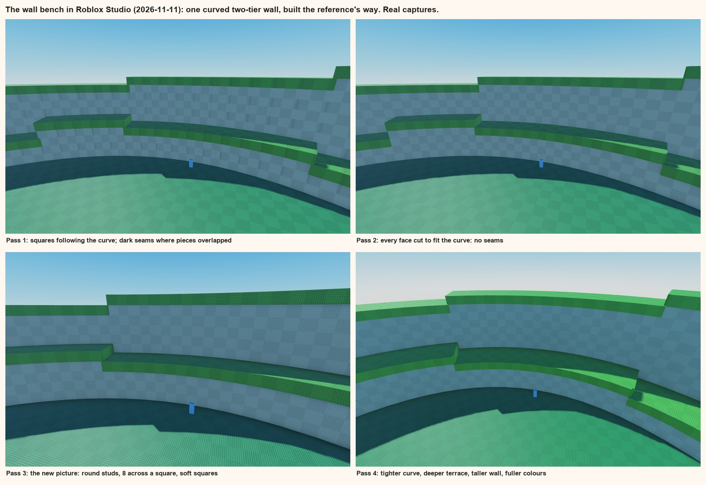
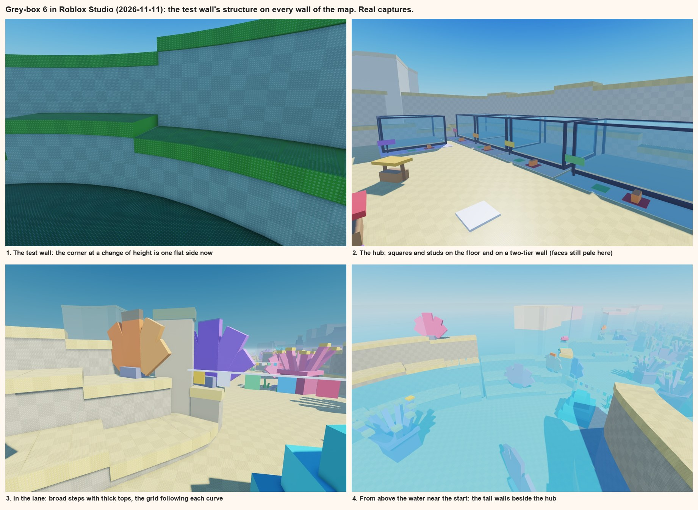
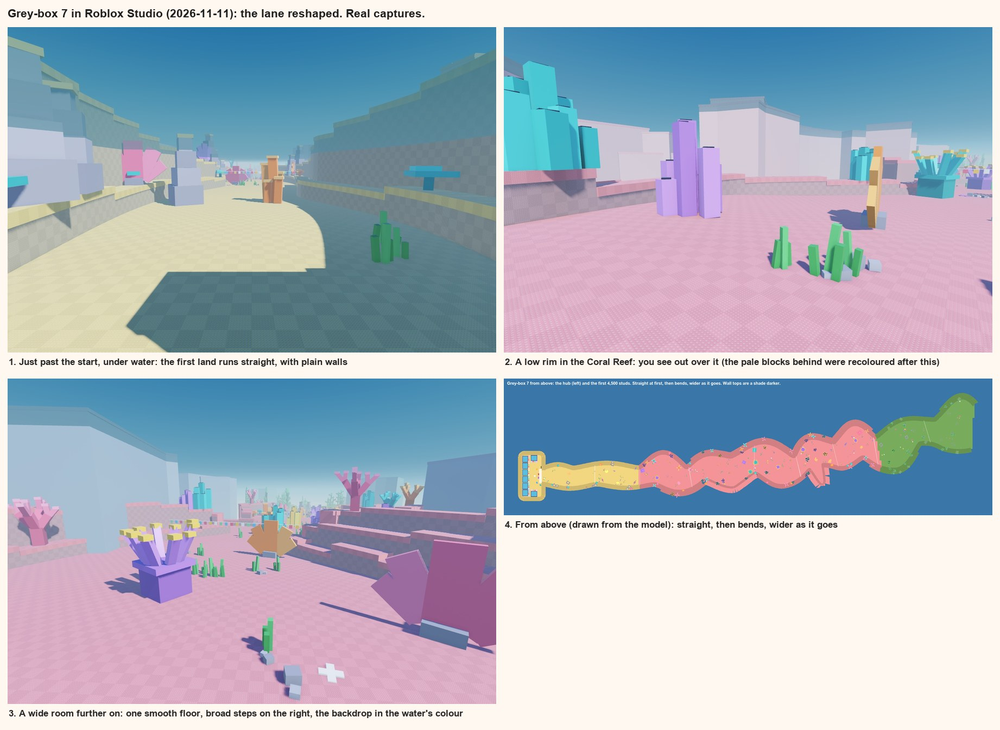
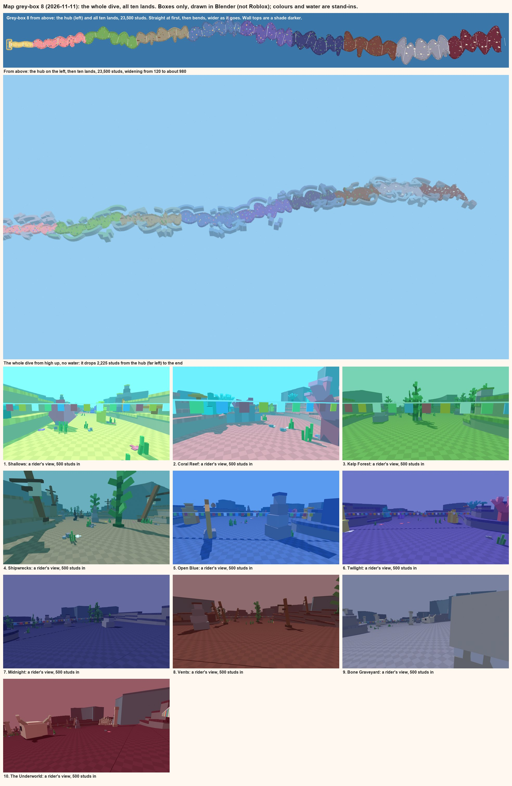

# The map's structure: matching how the reference is built, pass by pass

Up: [the map: how we build it](map-method.md). Started 2026-11-11 by the map chat, on the user's word: the terrain's
structure and the texture's structure don't match the reference yet (its squares and studs follow the curve of a wall,
ours didn't; the step size, how far the grass stands out, and the grass's size against the wall are all different),
so go over structure, texture and art style in several passes until it is like the game, then a little better. The
map's layout comes after ([what comes next](#what-comes-next)).

## The way of working
1. **A bench, not the whole map.** One small piece (a curved wall and a patch of floor) is built in Studio in its own
   folder, `Workspace.MapBench`, by `tools/studio/map_bench.luau`. Every number is a line at the top of that file and
   can be changed from the command line. A pass takes a minute, where rebuilding the map takes ten.
2. **Judged in Roblox, beside the reference.** Each pass ends with a capture from a camera like the reference
   frame's, laid beside that frame (the pairs stay private, in `research/ride-a-dino/map/`).
3. **The reference is measured in squares and player heights,** not in studs: its floor and walls carry their own
   ruler.
4. **Differences are listed before anything is changed,** in the order they change the read: outline and
   proportion, then how pieces meet, then the pattern's scale, then colour and light, then small detail. The top few
   are fixed, and the next pass starts.
5. **A subject is done** when what is left on its list is small detail, or something we changed on purpose.
6. **Then the numbers go into the generator** (`tools/map/greybox.py`), the map is rebuilt, and the same comparison
   is made in the map itself.

Subjects, in order: **the wall** (started), the floor and its edge, a step between lands, an open edge, the hub's
bowl, the big assets.

## What the reference's wall is (read from the user's screenshot, 2026-11-11)
The screenshot is private: `research/ride-a-dino/ref_hub_wall_checker.webp`.

| What | Measured | For us |
|---|---|---|
| A square | about as tall as a player | 5 studs |
| Studs across a square | about 8, round | a stud every 0.625 studs |
| Squares on | the wall's face, the grass's top and front, the floor | the same: everything |
| The two shades of a square | 5 to 7% apart | 6% |
| A piece of wall | short and straight, a whole number of squares long, so the squares follow the curve | 2 squares (10 studs) |
| The grass | a slab a whole square thick, a little proud of the face | 1 square, 1 stud proud |
| A change of height along a wall | whole squares, most often one | 1 square |
| The low terrace | a short wall about 3 squares high, a few squares deep, its own grass | 3 high, 3 deep |
| The tall wall behind it | about 9 to 10 squares to its grass | 9 |
| The floor's squares | on the world's grid, not following the wall | the same |

**What we had wrong, and why the squares didn't follow the curve.** Our walls were pieces 24 studs long with one
picture laid on a world grid, 10-stud squares, and a cap 4 thick: thin against walls 40 to 58 high. A picture on a
Roblox part runs along that part. So for squares to follow a curve, each piece has to be a whole number of squares
long, and the pieces have to meet exactly.

## The passes so far

- **Pass 0, the shapes.** A two-tier wall of 28 pieces round a curve: low wall, terrace, tall wall, grass a square
  thick, heights changing by one square every five pieces.
- **Pass 1, the squares.** With a squares picture on each face, running along its piece: the squares follow the
  curve, on the face, on the grass's top and on its front. Dark seams showed at every joint, because the pieces
  were as wide as the back of the wall needed and so overlapped at the front.
- **Pass 2, the joints.** A flat piece on a curve can only meet its neighbours along one line. So each face is now
  exactly as wide as the curve needs at that face, and each grass slab as wide as its own front edge needs; behind
  them a plain core, a hair lower and a little wider, fills the thin wedges that open toward the back. No seams.
- **Roblox's own studs** (the user asked for them): they still draw, but in this place they are **square, one to a
  stud**. The reference's are round and smaller (about 8 across a square of 5 studs). So Roblox's own don't give
  the reference's look.
- **Pass 3, the picture.** One new picture for every surface, uploaded on the user's word (2026-11-11; id in
  `art/map/textures.json` as `tile`): two squares by two, 8 round studs across a square, the studs clearly darker
  and lighter than the surface, the squares soft (6%). It replaces the two earlier pictures. On the bench the studs
  read at the reference's size and the squares sit back.
- **Pass 4, proportions and colour.** A tighter curve (radius 115), the terrace 4 squares deep, the tall wall 10
  squares, fuller colours. Beside the reference the build now reads the same: two tiers, thick grass, the grid
  following the arc on the face, the grass and its front edge.

## Still different (the list for the next passes)
1. **Light.** Our wall face comes out blue and the wall's foot sits in a hard shadow; the reference is evenly lit
   and its face is a grey-green. This is the place's lighting, not the wall: Ambient and OutdoorAmbient are a dark
   grey (70 of 255), Brightness 3, the sky tints everything (EnvironmentDiffuseScale 1), and there are Atmosphere,
   Bloom, SunRays and DepthOfField effects. A lighting pass is its own subject, and it touches the whole place, so
   it is agreed with the riding chat first.
   **Agreed 2026-11-11:** the game code never sets the place's Lighting, so the map chat sets it in Edit mode. What
   is set now is the look above water and in the hub; a depth controller, when built, will take over fog, ambient
   and brightness under water. Two conditions: the values live in a script beside the loader, not only in the
   place (the map is going into the friend's file, and a place's Lighting doesn't travel); and the Atmosphere is
   left out or kept thin, since [workout 1](../style/01-going-down.md) plans classic fog under water.
2. **Grass front against grass top.** Theirs is brighter on the front than on the top; ours the other way round.
   Light again.
3. **Part count.** 8 parts a piece (4 seen, 4 cores). The cores are never seen whole and can be few long pieces.
   To be thinned as it goes into the map.
4. **Not looked at yet:** the floor's edge, a step between lands, an open edge, the hub's bowl, the big assets.

## Into the map: grey-box 6 (2026-11-11)
The user: put it into the map; one corner on the bench looked stepped or bevelled, fix that and use it everywhere.

- **The corner.** Where a wall changes height, the taller piece's end shows. Its hidden core was wider than the
  piece in front of it, and a hair lower, so a small step showed at the corner. Now a piece whose end shows is a
  whole block, and the core stops inside it: one flat side.
- **Every wall in the map is built this way** (`build_wall` in `tools/map/greybox.py`): the lane's sides and the
  hub's ring. Each tier of a wall is marched along its own face in pieces exactly 10 studs long, so the squares
  follow the curve whichever way it bends and meet at every joint. A piece is a face, a grass slab a square thick
  and a stud proud, and, on a hollow curve, a core behind.
- **Two kinds of side,** from the reference: a low terrace (3 squares high, 3 deep) under a tall wall (10 squares);
  and broad steps climbing away (2, 6 and 10 squares high; 5 and 6 squares deep). Heights change by one square
  every five pieces. Tops sit on whole squares of height, so the rows of squares line up along a wall.
- **One picture on everything:** the floor's tiles, the bands, the hub's floor, every face, every grass top and
  front edge. Squares of 5 studs.
- **Wall faces** are the land's colour pulled toward a mid grey (the first try was nearly white in Studio).
- **In Studio:** 12,933 parts and 10,168 pictures (grey-box 5: 7,198 and 3,818). The lane's line, `Path`, the big
  assets, the hub's size and its spawn are unchanged.

**Seen in Studio, still to fix:**
1. **Part and picture counts are too high** for phones. Faces and grass can be longer where the wall runs straight,
   and cores can be few.
2. **The far backdrop** is plain pale slabs; from above the water one reads as a floating white block.
3. **Walls end square** where a side opens or a land changes: a blunt block. The reference steps a wall down as it ends.
4. **The hub's wall faces** were captured before the colour change; the lane's are right.
5. **Light:** still the place's own. Next subject, with its values kept in a script beside the loader.
6. **The floor's edge** under a wall, a step between lands, and an open edge have not had their own pass.
7. **The walls are hollow,** and that caught the riding code: a ridden fish was allowed 20 studs past the lane's
   edge, got behind a 1-stud face and ended up boxed in under the grass. The riding chat now keeps fish 3 studs
   inside the edge, so the path's width must stay exactly face to face. The better fix is on the map's side: fill
   the hollows, with few long pieces. To do with the thinning.
8. **The big assets moved in grey-box 6 by accident** (46 of them now, in new places): the terraces' new placing
   drew from the same run of random numbers. Fixed in the generator for the next build: each room and each kind of
   thing draws its own.

**In play (the riding chat, 2026-11-11):** the game runs on it; 59 frames a second on this PC with about 100
creatures, worst frame 133 ms. A phone is another matter.

## Grey-box 7: the lane's shape (2026-11-11)
The user's list: the first land straighter, more intuitive and less blocky; then the bends; wider and wider as you
go, and all of it wider; think about areas without walls, since walls may be needed to keep people from swimming off
(we fly in water, they walk on land); no faces that aren't flush, no cracks, nothing unwanted showing; no drops, the
steepness right, no steep changes in the floor, one smooth flush floor.

In Studio 2026-11-11: 14,535 parts, 11,293 pictures, check clean.

| | Grey-box 6 | Grey-box 7 |
|---|---|---|
| The first land | bends from 140 studs in; walls of changing height; things in the middle | straight; walls of one height; a gentle swell either side; few big things, kept to the sides, none in the first 250 studs |
| Bends | everywhere | from the second land on |
| Width, narrowest to widest built | 88 to 298 | 120 to 515 |
| Wider as you go | no | yes: half as wide again by the end of land 3, three times by the end of the dive |
| Steps at land borders | 8 to 20 studs | none |
| Big drops | 150 and 250, as 18-degree slopes | none: a longer stretch easing up to 12 and 14 degrees and back, at the start of lands 5 and 8 |
| A change of slope | at a corner | spread over 300 studs |
| Steepest floor in what is built | 3 degrees, with steps | 3 degrees, smooth |
| Open edges | a square drop with nothing to stop you | a low rim, the ground falling away behind it, an unseen barrier over it |
| A wall along a side | broken where its kind or the land changed | one unbroken run of pieces per tier from the hub to the end |
| The floor | tiles, with turned bands at edges and steps | tiles only, each fitted to its four corners |

**Ride-tested by the riding chat (2026-11-11), with no code change:**
- The floor its code reads is within 0.1 stud of the built floor at all 985 places checked (8.7 at worst before).
- Four jumps in a row landed, out to s = 821, each with its full rise. A fish's nearest neighbour is 40 to 49 studs
  away, about the same in narrow and wide rooms, well inside a jump's reach of 85.
- A ridden fish steered at a wall stops 8 studs short of the face and never reaches the barrier. Not tested: a
  swimmer without a fish going over a wall.
- Frame rate read 15 a second, against 59 on grey-box 6. The riding chat doubts the number (it has seen it before
  when Studio's window wasn't being drawn). **Unsettled: to be measured properly, with the user watching.**

**Areas without walls.** A walker stops at an edge; a swimmer doesn't. So nothing in the lane relies on a wall being
tall:
- **An unseen solid barrier runs along both sides the whole way,** a stud and a half behind the wall's face, from
  under the floor to above the surface. It also closes the hollow behind a thin wall face.
- **The look of an open edge is kept** where a side is a rim: a wall only two squares high, grass on it, the ground
  rolling away behind, big shapes far off. You see out over it; you can't swim out over it.
- Still to settle with the riding chat and the user: what a player sees and feels when they touch the barrier (a
  current pushing back, as workout 1 proposed, rather than a dead stop).

**Flush, checked by the generator on every build:**
- Floor: neighbouring tiles' tops are at most 0.07 studs apart anywhere along the edge they share. (A tile tilted
  only by the slope at its own middle stood up to 0.6 off its neighbour on a bend; now each is fitted to the
  floor's height at its four corners.)
- Walls: every face meets the next exactly at a corner, by construction. 24 ends stand clear of a neighbour (where
  a tier begins or stops), each a whole block.
- A wall climbs to a taller neighbour in whole squares over about 160 studs, where it used to end in a blunt block.
- Not yet clean: where a rim meets a sharp pinch, the slabs behind it fan and overlap (one place in what is built).

## Grey-box 8: the whole dive (2026-11-11)
The user: build out the whole map, as it is built now, to get the general feel of all of it. (It stopped at the
start of the third land.)

- **All ten lands:** 23,500 studs of lane, 2,225 studs deep at the end, 46 necks, the lane widening from 120 to
  about 980. About 56,900 boxes.
- **The first 4,500 studs** are built as in grey-box 7. **Past that,** to keep it loadable: wall pieces 20 studs
  long (two tiles of the picture), and big floor tiles (40 studs) wherever the floor lies within a tenth of a stud
  of flat, small ones (20) elsewhere. Neighbouring floor tiles are at most 0.11 studs apart.
- **The two long steeper stretches** are in: easing up to 12 degrees at the start of land 5 (Open Blue) and 14 at
  the start of land 8 (Vents), each over 700 to 900 studs, then back.
- **A bend is spread over more lane where the lane is wider.** At one fixed length the inside of a bend folded in
  the wide deep lands and the floor tore there.
- **Stand-ins, plainly:** lands 5 to 10 have no assets of their own and borrow the first four lands' sets (corals
  in the Twilight, kelp in the Midnight); their ground colours are first guesses; there is no fog, so the deep lands
  look as bright as the shallows. The pictures above are drawn in Blender with a flat water colour per land.
- **What to judge from it:** the length of each land, how the widening feels, the rhythm of rooms and necks, where
  the steep stretches fall. Not the colours, the assets or the light.

## What makes their map read, and where ours should go
**What their structure does** (from the recordings and the screenshots):
1. **One rule, used everywhere.** Floor, wall face, grass: three surfaces, one pattern, one colour per land. Nothing
   on the map is built another way, so it reads as one made thing.
2. **Big shapes, few of them.** A room, a neck, a wall, a terrace. The eye takes in the whole room at once.
3. **The pattern is the scale.** A square is a player. Everything else is a whole number of squares: a wall's
   height, a step, the grass. That is why it reads as built from bricks even though the pieces are huge.
4. **Soft over hard.** The squares are faint, the studs fine, the colours few and full. Detail never competes with
   the creatures.
5. **Rooms and necks give rhythm:** open, squeeze, open. A line of flags at each squeeze says "next".

**What is different for us, because you fly through water:**
- **The walls are seen from below and from the middle of the water,** not from the ground. Their grass tops will
  often be above the rider. So the faces matter more than the tops: the low terrace is the part a rider is level
  with, and it is where things should stand.
- **There is a ceiling.** The surface is the roof of the first lands; lower down the fog is. Tall walls vanish
  upward into it, which makes a land feel deep for free.
- **Going down is the journey.** Each neck should show the next room lower than this one. The smooth floor does
  that; the fog and the colour change have to say it.
- **Nothing overhead, and room to steer:** the lane is now wide enough for a herd and a rider to pass an obstacle on
  either side, and it grows with the creatures' size.

**Parked 2026-11-11, to remind the user of:** the seven steps below wait until two things are done first, in the
user's order: the whole map blocked out (all ten lands, to get the feel of the whole), and moving water with water
animations, recreated from a video tutorial the user will show.

**Artistic steps, in the order they pay off:**
1. **Light and fog by depth** (the next pass). The single biggest change to how every wall reads; kept in a script
   beside the loader so it travels with the map.
2. **A colour pair per land:** the ground colour and its face colour, chosen together with the fog. Three lands
   have guesses; all ten need a strip of swatches side by side.
3. **The backdrop.** Pale slabs don't do it. Wanted: a second, far wall line in the fog, and a few big landmark
   shapes per land (a wreck's ribs, a kelp tower) that you see two rooms before you reach them.
4. **Life on the low terrace and at the necks:** the necks are the map's gates and should each be marked (flags
   now; later an arch of coral, a mast across, a jaw).
5. **The big assets by land,** rebuilt at the lane's new width, so a room never feels empty or plugged.
6. **The hub's edge:** the moment of the dive. Light, a clear lip, the first room visible below.
7. **Thinning,** so all of this runs on a phone: longer pieces where a wall runs straight, fewer cores, one picture
   per face only where it is seen.

## What comes next
The user's list for the map's layout, after the structure is right (2026-11-11):
- widen areas, and make some stretches straighter;
- make the lane wider as you go, and the end lands much wider;
- remove the large drops and replace them with a steeper slope;
- then everything else the map needs.
- And a slight rework of the hub first (its sizes still read wrong to the user).
