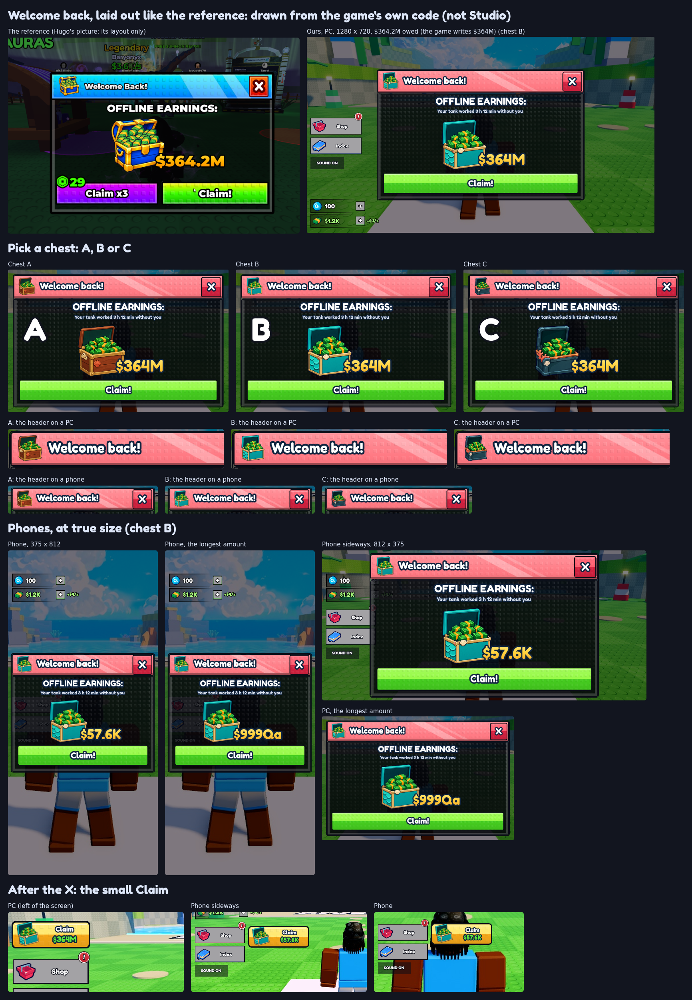

# Offline rewards: what the tank earns while you are away

Hugo, 2026-11-25: "Add offline rewards and use image gen to get something similar to ref image 1." The picture is a "Welcome
Back!" window: a header with a picture and an X, "OFFLINE EARNINGS", a big chest, the amount in gold, Claim. Its function and
its order are taken; the look is our dock windows' own, the chest is ours (`art/ui/offline`, NULLROOM g1).

**State (2026-11-25, NULLROOM o1): built on the branch `offline-rewards`, checked offline only.** Not seen in Studio, not on a
real phone, nothing uploaded. **In the live game it does nothing yet, because saving is off:** nothing says when a player left.
To turn it off for good: `Config.Offline.On` 0 (what is owed already stays in the save).

**The layout (2026-11-25, NULLROOM o2):** Hugo, on the first window ([its picture](../attachments/offline-window.png)): "fix
the chest to fit the original reference image i pasted better layout and ui wise". Now it is laid out as the reference. Wide
(1.6 : 1); chest, title, X along a header with the sheen; "OFFLINE EARNINGS:"; no well, the dock shows faintly through the
body; a big chest left of the middle with the gold amount over its lower right; the buttons in one row. On a screen less
than 550 px wide (a phone upright) it is a second shape, 1.2 : 1, the same places in bigger points. The hours line stays, small, under the
heading (a refusal is said there). The X and Claim are 44 px or more from 360 px wide up. Our own colours, font, studs, buttons, chest.

**Open, Hugo's: which chest** (A, B or C, `art/ui/offline/options`; `chest.png` is still the first one).

## What it does
- **On joining**, after at least 5 minutes away: coins = what the equipped fish earned a second when the player left, x the
  seconds away (8 hours at most), x 0.5. Whole coins, rounded down. Fish stored in the tank earn nothing, as at home.
- **The window** comes up by itself once a visit, when the player has spawned, stands on the dock and nothing else is open for
  0.8 s. CLAIM pays, plays the claim sound and says "+$57.6K". Nothing is paid without it.
- **The X keeps it.** A small gold Claim with the amount stays by the dock's buttons (over them on a PC, beside Shop on a
  phone), and opens the window again. Not claimed at all: it is saved, the next absence is added to it, and the window comes
  up again at the next join. It is never lost, and never runs out.
- **Claim x3 for Robux** is in the reference and is not built: it would be a paid product and nobody has asked for it. There
  is no second button, but the row has room: a second one in it and `OfflinePanel.share(row)` make two of equal width
  (checked). **Open, Hugo's: Claim x3 for Robux, yes or no.**

## The numbers: all DRAFTS, for the tuning chat (`Config.Offline`)
| Number | Draft | What it is |
|---|---|---|
| `Least` | 300 s | away less than this pays nothing |
| `Share` | 0.5 | of what the tank would have earned |
| `Most` | 28,800 s (8 h) | the longest absence paid for |
| `AskGap` | 0.3 s | the least time between two asks from one player |
| `Settle` | 0.8 s | the dock must be clear this long before the window shows |

- What that is worth: 1 h away is 30 minutes of the tank's income; a night (8 h or more) is **4 hours of it, 14,400 s**. Beside it,
  from this vault: an Index land's set is 600 s of a land's coins, a sold fish 60 s of its own, and the reference pays
  half an hour a day. **So these drafts are far more generous than the reference.** Not run through `rad_economy.py`.
- The income counted is the tank's own (`AquariumService`'s, by fish, size and colour).

## How it is kept safe
- **The save's part "Offline"** (`Lib/SaveParts`, joined right after the Tank's): `Left` (the server's clock at the last snapshot),
  `Rate`, `Owed`, `Secs`. The last snapshot of a visit is taken as they leave. A server that crashes leaves the last autosave's
  time instead, some minutes earlier at most.
- **The client decides nothing.** It sends "Claim" with no amount. The amount is the server's.
- **The claim and the coins are one moment, and one snapshot:** SaveService writes every part or none. So a lost connection, a lost
  answer, a crash or a second server leaves both as before the claim, or both as after it. A claim is refused while the player's
  save isn't in, or is another server's (the attributes `SavedTank` and `SavedOffline`).
- **Two servers:** ProfileStore lets one hold a profile. If its message to the old server is lost, the new one starts from the
  last save; a claim made on the old one is then in no save, so it is owed again, once.
- **A clock running backwards** pays nothing. **A tank with no fish** pays nothing. **No tank** (more players than plots): nothing
  is shown, paid or lost until they have one.

## What must be on for it to work live
1. `Lib/SaveParts`: `ON = true`, with every function its `NEEDS` lists (they are all there). That switch is for the whole save
   and is the partner's and Hugo's to throw ([Money](money.md), "Selling"); it was not touched.
2. `Config.Offline.On` 1 (it is).
3. The chest uploaded (`art/ui/offline/chest.png`, on Hugo's yes) and its id in `OfflinePanel.Chest`. Until then a live game draws
   the cash picture in its place. The rest works without it.
4. A first visit with saving on, to record a leave time. So nobody gets a window the first time after the switch.

## Testing it in Studio (not done)
- With no save: workspace attribute `OfflineAway` = seconds away (say 11520), before Play or changed while it runs. `OfflineRate` =
  the coins a second to pretend (without it the tank's own, or 100 for a tank that earns nothing). It works only in Studio,
  and not with `SaveReal`. The chest: `python tools/offline/picture.py studio` first (copies it into Studio's own content).
- With the save: `SaveOn` before Play (ProfileStore's pretend store, which ends with the session).

## Checks (offline)
- `rojo build -o /tmp/place.rbxl && lune run tools/offline/offline_test.luau /tmp/place.rbxl`: 123 checks, on numbers of their own (a tuned Config.Offline fails nothing). The game's own
  SaveService, SaveParts, ProfileStore, OfflineService and Config on several pretend servers that share one pretend DataStore
  (`tools/offline/servers.luau`): the cap, time backwards, no fish, stored fish, double claims, the X and adding up, a lost answer,
  leaving in the moment of a claim, a crash, the store down, two servers with and without messages, odd and old saves, the switch, saving
  off. The tank, the other services and the players are stand-ins. Five breaks put in on purpose are each caught.
- `lune run tools/offline/panel_test.luau /tmp/place.rbxl`: 184 checks, the real window and controller with the real service.
- `python tools/offline/picture.py`: those trees as the picture above.

## Open
- The numbers (the tuning chat). Whether the window should also say the cap ("8 h at most").
- The Index keeps no save part of its own (as on main): with saving on, its rewards could be claimed again each session.
