# Breakable props and the later lands' skyline: a study and drafts

Up: [Home](../../Home.md). Written 2026-11-18 by the map chat. **Drafts for the user to pick from. Nothing in the game or
the place has changed.** Renders are Blender, not Roblox.

## What the user asked
"could we draft up a few ways to make these collidable models better. do a full study of ride a dinos assets. We need
studs, we probably need different colourways and stuff just watch how they construct models and apply colour, it also
matters for how they fall apart on collision in terms of how many objects in one asset and how theyre stacked"

"after that id like to think about the best way to enhance the later lands and make the sillhouette of them from the
spawn look imposing, ice crystals slanted, cool galactic rubble or large spiky things and structures that have a
visible silhouette."

**Sources.** The user's own recordings (`D:\program files for me\videos\`, the 35-second ride and the 5-minute run),
and eight stretches of four YouTube videos covering Desert to Cosmic (Hahn, Koopekool, BemmyBlox, Blake; ids and times
in the private notes). Frames and notes are private, in `research/ride-a-dino/props/` and
`research/ride-a-dino/lands/` (`notes.md` there tags every claim with its video and time). **We take how it is built,
never its look, models or layout.**

## 1. How Ride a Dino builds a prop
Seen close up in the ride clip (17.5 to 29.5 s) and the run (100 to 167 s).

| Prop | Bricks, about | How it is stacked | Colour |
|---|---|---|---|
| **Pine** | 15 to 25 | 5 or 6 tiers, each smaller and a little offset or turned; each tier is itself 2 to 4 cubes side by side; a dark trunk block with a flared foot | one green, every face studded; the trunk dark brown, plain |
| **Leafy tree** | 20 to 30 | a trunk of two browns that tapers and forks into angled limbs; roots splayed as tilted boxes; a canopy of flat slabs with **slabs hanging down at the edges** (a drooping fringe) | two greens (light tips); trunk plain |
| **Rock pile** | 2 to 4 | big boxes stacked off centre, the top one a shade lighter | pale blue-grey, studded; in the desert tan with an **olive cap in the land's colour** |
| **Birch log** (a felled trunk) | 5 or 6 | a row of white segments with dark seams; the end face tan with a darker square inside (tree rings) | white, studded |
| **Stump** | 4 to 6 | a tan top with a stepped ring on a brown base of tilted wedges | two browns, tan |
| **Desert dead tree** | 2 or 3 | one leaning trunk and one branch box | khaki |
| **Dressing** | 1 to 5 | flowers as a cross of five small tiles (yellow, pink, purple); grass as three thin boxes; small grey stones; **tiny brown cubes scattered all over the floor** | |

What that adds up to:
- **Bricks are small against the creature.** A leaf brick is about 3 studs; a dino is 10 to 20 long. A brick is a fifth
  to a third of what hits it. That is why a hit looks like crumbling, not like two slabs falling over.
- **Tiers of small blocks, not one block a tier.** A tier is 2 to 4 cubes, so a hit takes a bite out of it.
- **Two tones per material** and a lighter top: the light is painted into the colours as well as lit.
- **Studs by material:** leaves, rock, the birch log and the floor are studded on every face; trunks, stems and
  wood are plain. One small stud size everywhere.
- **One palette per land does everything.** Floor, walls and props share 3 or 4 tones; the props add one accent (the
  flowers, a cap). Later lands (seen in the videos): Snow is white, pale blue and slate; Giant Forest dark green,
  orange-brown and red; Ocean teal; Volcano charcoal with neon lava; Cosmic lilac and indigo with cyan glow. **Glow
  appears only late:** none until the Ocean, then lava, then cyan everywhere in Cosmic.
- **The same build, recoloured.** Snow's pine is the Forest's pine in white.

**How it falls apart** (the run, 147 to 148.5 s; Giant Forest in Hahn's video):
- Leaf cubes fly up, turn over, and land scattered round the prop at odd angles, 10 to 15 of them in view at once.
- A box bursts into 4 to 6 pieces; the pieces still tumble 2 s later.
- A segmented trunk falls over as its row of blocks; a pine can tip over whole and fade.
- The floor keeps a sprinkle of tiny brown and grey cubes everywhere, so it always looks as if things have broken there.
- Props near the camera turn see-through, as ours do.
- Not seen: how long the pieces lie, or what brings a prop back.

## 2. Ours against theirs
Our props ([props.py](../../tools/map/props.py), sheet `attachments/map-props-kit.jpg`) are built the same way in
principle (loose boxes, nothing fused). They differ in four ways:

| | Ride a Dino | Ours now |
|---|---|---|
| Brick size against what hits it | a fifth to a third | about the same size as the fish: bricks 10 to 50 studs, fish 13 to 30 |
| A tier | 2 to 4 blocks | one block |
| Colour | 2 or 3 tones a material, light tops, the land's colour as a cap | one colour a prop, a lighter tip on some |
| Studs | on leaves, rock and logs | none on props |

So a hit throws a few huge slabs. The fix is the brick size, not the number of props.

## 3. Three ways to make them better
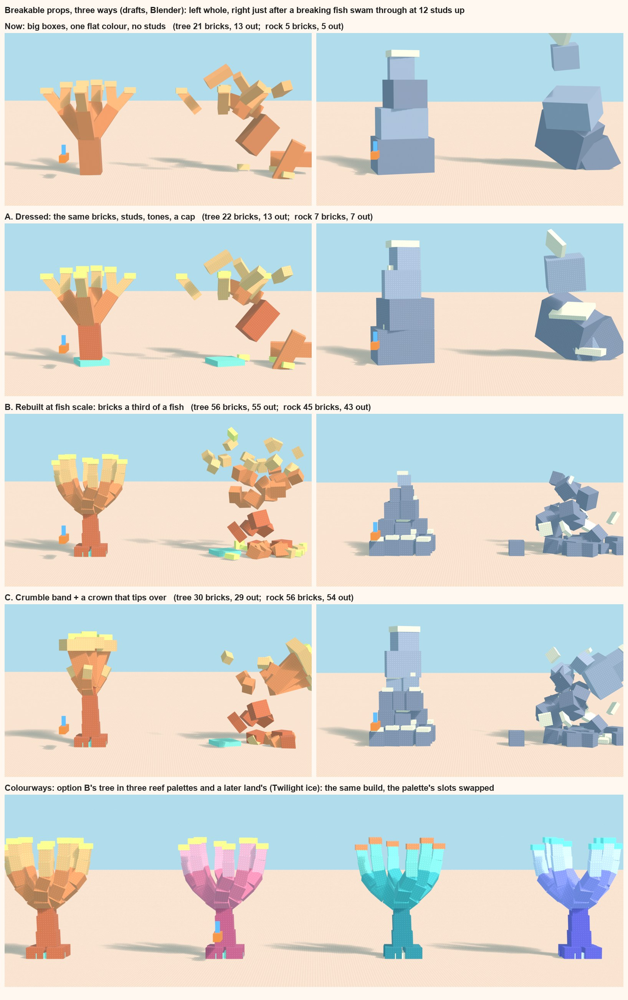

The same two props each way (a staghorn coral tree, a rock stack), whole on the left and on the right just after a
breaking fish swam through 12 studs up, using the server's own rule (what it touches is out, what stood on that falls).
The orange block is a rider on a 13-stud fish. Code: [prop_drafts.py](../../tools/map/prop_drafts.py),
[prop_drafts_view.py](../../tools/blender/prop_drafts_view.py).

| | What changes | Bricks (tree, rock) | Parts in the map, about | Feel of a hit |
|---|---|---|---|---|
| **A. Dressed** | same bricks; studs on coral and rock, plain trunks; three tones by height; the land's colour as a cap and a patch at the foot | 22, 7 | 14,000, as now | the same few slabs, but they look like ours |
| **B. Rebuilt at fish scale** | bricks about a third of a breaking fish (6 to 8 studs); tiers of blocks; branches as rows of segments; stumps of four splayed blocks | 56, 45 | 30,000 to 35,000 | crumbles: a cloud of bricks, what stood on them falls |
| **C. Crumble band + crown** | small bricks only where fish swim (the floor to about 40 studs up); the part above is a few big pieces that **tip over whole** when the band under them goes | 30, 56 | 20,000 | a crunch at your height, then the top keels over |

**Recommended: B for small and middling props, C for the tall ones (over about 60 studs).** B is the reference's
look of a hit. C keeps the tall props cheap and gives the reference's "pine tips over whole" moment. A is worth doing
either way, because studs, tones and caps cost nothing extra.

The rules, for any option:
1. **A brick is a fifth to a third of the fish that breaks it.** Our breakers are 20 to 40 long, so 5 to 10 studs.
2. **A tier is several blocks,** each turned or offset a few degrees, each a little smaller going up.
3. **Long things are rows of segments** (branches, kelp, masts, ribs), so they fall as a row.
4. **Three tones by height:** dark at the foot, the main tone, light at the tips. Neighbouring bricks differ by one
   step, so the bricks read as bricks before they break.
5. **The land's ground colour as a cap or a patch at the foot,** as the reference's desert rocks wear the land's
   olive. It ties the prop to the floor.
6. **Studs by material:** coral, rock, sponge, ice and bone studded; stems, trunks, wood and iron plain.
7. **Leave crumbs.** A sprinkle of tiny loose cubes round each prop, in its colours, so the floor shows where things
   have broken.

**Colourways.** A prop is built from palette slots, not colours: Main (three tones), Stone (two), Cap (the land's
ground), Pop (one accent). One build then takes any palette: the bottom row of the sheet is option B's tree in three
reef palettes and in Twilight ice. Each land would get 3 or 4 palettes, each prop picks one per copy, and the same
builds serve every land.

**Studs, how.** One custom stud material (a MaterialVariant) on the studded bricks. It takes each part's own colour,
so every colourway comes free, and it adds no extra objects. Our floor's way, a picture on each face, would add up to
six pictures per brick: at B's count, about 180,000. **The material needs one solid stud picture uploaded.** That is
permanent and needs the user's yes; it is the same upload the hub's studs were waiting on.

**How the pieces behave once broken** (small changes to `PropService` and `PropController`, the game-code chat's files):
- Pieces should **land and lie on the floor** for a second or two, then fade, rather than fade in mid-water.
- Pieces from a C crown **keel over as one,** then come apart when they land.
- With B's bricks a hit throws 30 to 55 pieces, close to today's limit of 60 (`Props.MaxLoose`). Keep that limit;
  the copies come from a pool, so nothing is made per hit.

**Cost, plainly.** Today the map's props are about 14,000 parts, of 59,000 in all. B everywhere roughly doubles the
props; B plus C about 1.5 times. Parts far off aren't drawn, so what the phone pays is what is near: one room's props.
A first test would build one land's set both ways and count what a phone draws in a room.

### 3b. Second draft: B standing, simplified when broken (2026-11-18, after the user's word)
The user: "something close to B more like. Just study them better and watch how they fall apart too, they get
simplified. The code changes for the fall apart ill do in the other chat".

**Looked at again, ten frames a second** (the 5-minute run, 146.0 to 148.9 s, a herd going through a pine and a
leafy tree; frames private in `research/ride-a-dino/props/brk_run_*.jpg`):
- Standing, the pine is tiers of **many small studded cubes**. The leafy tree's trunk is studded brown bricks too.
- In the frame the herd reaches it, **the whole prop is gone** and **about eight big chunks** fly in its place. They
  are plain boxes much bigger than the cubes the pine was made of, roughly **one per tier**, in the pine's two greens.
- **Some chunks are cubes and some are flat plates. Some carry big studs on one face, some are plain.**
- They fly up and out, turn over, land at angles and lie scattered for a second or more, then fade.
- So the detail is only in the standing prop. A break hands over to a handful of simple pieces, which is also what
  keeps it cheap: 6 to 10 loose pieces a hit, not 50.

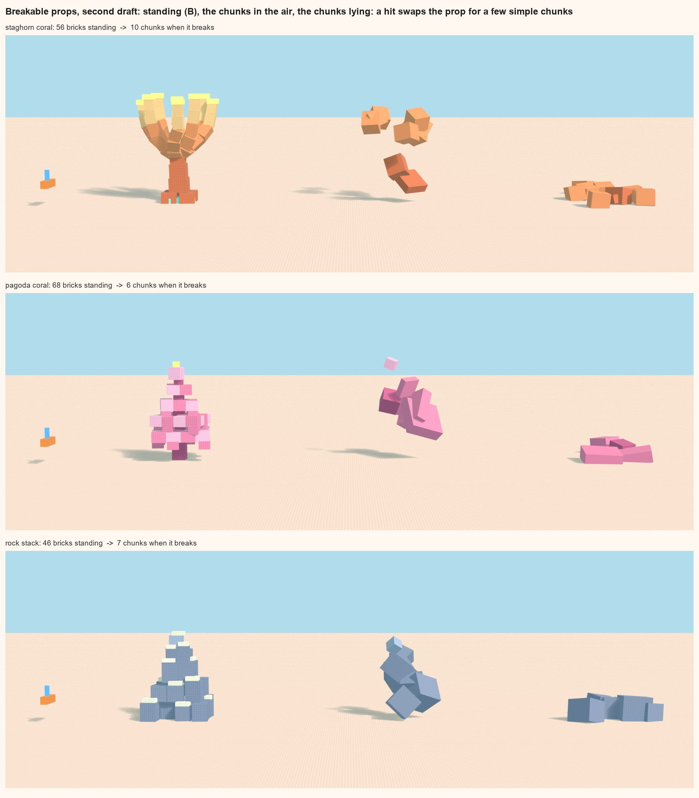

Each prop standing (option B), its chunks in the air, its chunks lying. Code: [prop_drafts2.py](../../tools/map/prop_drafts2.py).

| Prop | Standing | Chunks when broken |
|---|---|---|
| Staghorn coral | 56 bricks: a stump of four blocks, a trunk of three segments, eight branches of segments | 10: the stump, the trunk, one per branch |
| Pagoda coral (the reference's pine, read for the sea) | 68 bricks: a stem through five tiers of small studded blocks, each tier smaller, offset and turned, the big tiers with a drooping fringe | 6: one per tier, the wide ones as plates |
| Rock stack | 46 bricks: tiers of 4x4, 3x3, 2x2 blocks, capped in the land's colour here and there | 7: one per tier, the wide tiers in two |

**How a break would work** (for the game-code chat, on the user's word that they'll do it there):
- Each prop's bricks carry a **group** (a tier, a branch, the trunk). The map writes that as an attribute on each brick.
- **On a hit the whole prop hides** and one pooled chunk per group appears where that group stood. A chunk takes the
  group's bulk as a cube, or a plate when the group is flat, and its main colour. About half get the stud material.
- The chunks fly along the fish's way and outward, turning, land, lie for a second or two and fade. The prop comes
  back as today (`RegenDelay`).
- Nothing is made per hit: the chunks come from a pool. Size and colour are set when the chunk is taken.
- A hit then costs 6 to 10 moving pieces, a fifth of what B costs with today's rule.

## 4. The later lands' skyline from the spawn
**What the reference does: almost nothing.** Its far shapes are flat stair-stepped blocks in one layer, upright, read
only by colour against the sky (Volcano's orange cliffs, Cosmic's indigo spires). From its hub, the high walls hide
every later land; you only see a land coming as a patch of new colour ahead. No planets, moons, floating rocks or
volcano cones in anything seen. **So this is where we can beat it.**

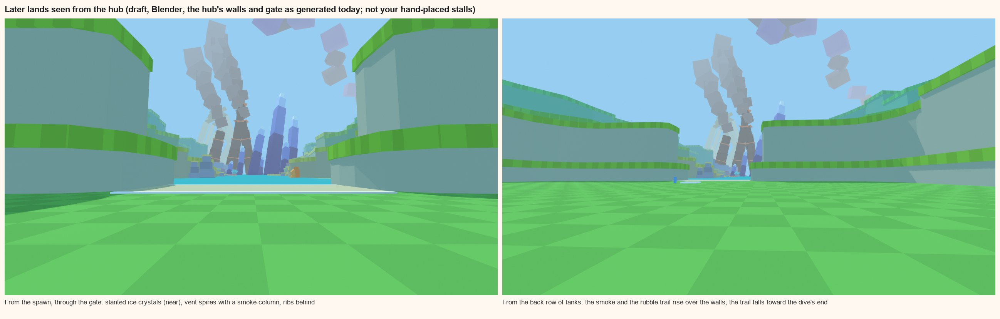

A first draft, from the spawn (left) and from the back row of tanks (right). Our lands are under the sea, so a land's
landmark has to rise out of the water far off, or hang in the sky, to be seen from the hub. Code:
[landmarks.py](../../tools/map/landmarks.py). In the draft:
- **Slanted ice crystals:** one hero crystal and a skirt of smaller ones, all leaning the same way, with a dark root
  and light, glowing tips. Seen through the gate.
- **Vent spires:** three leaning black chimneys of stacked blocks with glowing seams and a column of smoke. **The
  smoke column is what shows over the walls from anywhere in the hub.**
- **Giant ribs** arching out of the sea, behind.
- **Galactic rubble:** a cracked star-rock high in the sky, its broken pieces strung out in a falling line toward the
  dive's end. It arcs over the right-hand wall from the back row.

What makes a far silhouette read as imposing (the rules I'd build to):
1. **One clear outline per land,** recognisable as a black shape alone: a lean, a spike, an arch, a hole. The Cosmic
   rarity's rule fits here too: "the outline has a hole or a break: something missing, floating or orbiting"
   ([Cosmic](cosmic.md)).
2. **Lean with a grain.** Slanted shapes read as power. In a cluster they all lean the same way, give or take 10
   degrees; mixed leans read as noise.
3. **A hero and its seconds:** one tall piece, two or three at about two thirds of its height, a skirt of small ones.
4. **Taller the further off,** so each land's landmark shows over the one before it, like pearls on a string, and
   all of them point the way down the dive.
5. **Two tones and a light:** dark at the foot, pale and hazed at the top, a glowing tip or seam. Later lands glow
   more, as the reference's do.
6. **Something that rises over the hub's walls** (smoke, a crystal's tip, the rubble in the sky), so a player sees
   the promise from the stalls and the tanks, not only through the gate.
7. **Each land's props echo its landmark,** smaller (the crystals in its floor props, the vent chimneys as rock
   stacks), so arriving there feels like arriving at the shape seen from home.

**Which land gets which** (a proposal; the land names are today's):

| Land | Landmark | Seen from the hub as |
|---|---|---|
| Open Blue (5) | a sunken tower or a leaning gold-foil pillar breaking the surface | a pale shaft through the gate |
| Twilight / Midnight (6, 7) | **slanted ice crystals**, the deep polar sea | blue crystal tips in the gate |
| Vents (8) | **leaning chimneys, a smoke column** | the smoke over the walls |
| Bone Graveyard (9) | **giant ribs and a spine arching out of the sea** | white arches far off |
| The Underworld (10) | **galactic rubble:** the fallen star the deep's strangeness came from | the rubble trail across the sky |

**The catch: Roblox doesn't draw far things on weak devices.** Measured here 2026-11-13: at the lowest graphics level
nothing past about 500 studs is drawn, about 1,600 at middle levels, and only top levels reach 6,000 or more. The
landmarks stand 1,400 to 3,600 out. So:
- **The real shapes in the world** for middle and top devices, a few big pieces each, placed nearer than the land
  itself and scaled to look far. Cheap: under 200 pieces for all four in the draft.
- **The same shapes painted into a horizon band** for the lowest level: a picture on the inside of a mesh round the
  camera, the trick that already works for the fog shell. It is drawn at every level, so phones see the skyline too.
- **Underwater,** each land's own landmark looms in that land's fog as you enter: dark against water a little lighter
  than it ([map feel](map-feel.md), "dark shapes against lighter water").

### 4b. Second draft: a layered vista (2026-11-18, after the user's word)
The user, on the first draft: it "almost stops, doesnt connote distance and looks more like a factory than an
enticing layer of mystical lands", and study how Steal an Egg lays out its distance view (their screenshot: from the
start, a long straight run between tall walls, each land a band of its own colours, and at the vanishing point a
small cluster of dark slanted spires round a glowing, colourful middle).

What was wrong with the first draft, in those terms:
- **Too near and too big.** The crystals and chimneys filled the gate, so the view ended there. Small reads far.
- **No bands.** Nothing showed the lands in between, so there was no sense of a way to travel.
- **Smoke and chimneys read as industry.** Mystical comes from glow, crystal, floating things and light, not smoke.

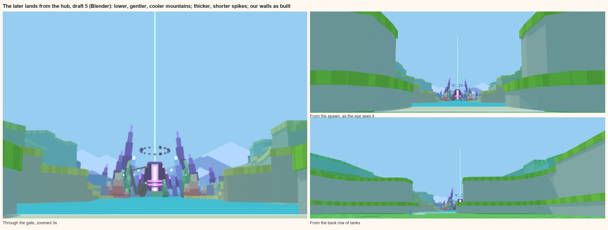

**Steal an Egg, studied** (three videos, frames private in `research/steal-an-egg/`, `notes.md` there): one dead
straight lane through 12 lands keeps the far end in view from the start; 3 or 4 lands read one by one and the rest
merge into a cluster at the vanishing point, about 8% of the screen wide, which barely grows over the first lands;
**only things taller than the walls read from far** (palms, ice crystals, a ringed planet, gates, spires, a beam);
props lean in from the sides, a V pointing at the vanishing point; glow is kept for the far, fantasy lands; the end
is a symmetric gate on the axis between ranks of spires, with a glowing middle and a thin beam seen from the start;
a far land can have **its own sky** that starts at its border; and it uses almost no haze, so the far colours stay
strong. Its walls are its own style, not ours.

**The user, on this draft:** "dont change the walls, go back to the old walls they were correct we spent a while
laying them out. dont copy their style we have our own and its carefully planned", and "doesnt have to match 1:1 just
inspired by". So the draft keeps **our walls exactly as built** (a try with striped corridor walls was taken out) and
takes only the composition from Steal an Egg.

The draft now ([vista.py](../../tools/map/vista.py)):
- **One sight line from the spawn through the gate,** with the later lands' tall shapes on it in order, rising out of
  the sea beyond our walls: coral stacks, kelp spires, a wreck's mast, then ice crystals leaning in to frame the end.
- **Plain and daylit near, glowing far.** Only the ice tips and the end glow.
- **The end is a small crown on the vanishing point:** a symmetric gate with a glowing rift, ranks of dark spires
  stepping down either side, smaller gates in front of it shrinking toward it (repeats read as distance), a ring of
  floating rubble, one thin beam you can see from anywhere in the hub.
- **Spikes and mountains fill the sky either side** (the user, with a sketch: "widen the silhouette so theres like
  more background objects like those spiky things but maybe more like hills and mountains that litter themselves to
  fill a bit of negative space somewhat symetrically but still following the countor of how it frames it"). Low hills
  nearest the line, peaked mountains taller the further out, a paler range behind, and three dark spikes a side
  leaning in. So the outline rises from the crown out to the walls and funnels the eye back to it. Mirrored with a
  little jitter, in flat cool colours, paler further off.
- **Then, on the user's word** ("those distant mouintains are too much and too slanted and taking too much space and
  should be coloured cooler. Also the tall spikes are too thin and too tall"): the mountains fewer (three a side and two
  far), lower, with gentle slopes (squashed peaks, not 45 degrees) and in cool blues; the spikes about twice as thick
  and a quarter shorter.
- **Then, on the user's word** ("the far mountains should be more like the walls, squarer in shape maybe framed with
  some slanted shapes. Could you also think of some ways to make the focus of it, like the middle of the furthest part
  look more intentionally designed like it follows the countor better and visually digests infomration better for
  the eyes"): the mountains are now **square stepped mesas built like our walls** (blocks stepping up away from the
  middle, each with a lighter cap), each with a slanted shard leaning on its inner edge.

**Making the far middle read as designed.** Why it was muddled: the end sat low, behind the near lands' coral and kelp;
the ice crystals, spires and spikes were all the same violet; and the rubble was a random scatter. The fixes, in all
three variants:
1. **A stage.** The crown stands on a stepped plateau, three of our wall steps high, so it rises clear of everything
   in front of it.
2. **A clear outline.** The mesas step up from the plateau out to our walls, and the spikes lean in. So the skyline
   climbs in steps from the middle to the walls and leads back in.
3. **Nothing in front of the focus.** The near lands' shapes sit out to the sides; the middle of the view is clear.
4. **Values in layers.** The crown is the darkest and the brightest thing; the framing is mid; the mesas are light
   and cool. Each layer reads on its own.
5. **One clean shape in place of a scatter:** an even ring, not loose rubble.

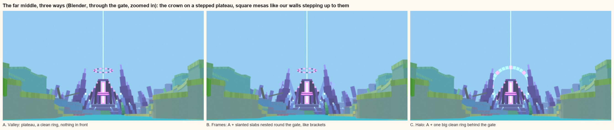

- **A. Valley:** the plateau, the clean ring, nothing else. The calmest.
- **B. Frames:** A plus two pairs of big slanted slabs nested round the gate, lighter than the spires, so the outline
  closes round it like brackets.
- **C. Halo:** A plus one big clean ring of blocks behind the gate, centred on the beam. The strongest single read.

**The user's pick: A valley, with the game's black hole** ("could you do A valley but replace the halo with the black
hole that was coded for the game. replacing the beam with the black hole beam thats very similar").

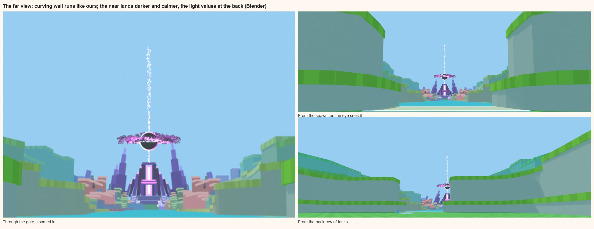

- **The hole over the gate** in place of the ring: the game's own voxel black hole
  ([Lib/BlackHole](../../src/client/Lib/BlackHole.luau)), scaled up. One horizon radius is 72 studs here (the game's
  default is 1.2), so the ball is about 375 across and the disc about 1,350, wider than the gate.
- **Its jets are the beam:** the upper one rises about 1,900 studs, the lower one drops into the gate's lintel, so the
  gate looks fed by the hole.
- The mock is a still frame worked out in Python with the game's colour ramp, Doppler side and bent arc
  (`black_hole` in [vista.py](../../tools/map/vista.py)); in the game the real module would run it live.
- **Cosmic colours and dark spots** (the user: "make the black hole look better frm a far, it lacks its variety of
  colour an ddarker spots in the ring, additionally, the colours should be shifted to match the purple stuff over
  there, so more cosmic purple like stuff instead of the orange red"): the disc's ramp runs near-black violet,
  purple, magenta, pink-white, then cyan-white on the side turning toward the viewer. A dozen clouds of darker, cooler
  gas lie across the disc as dark lanes and break its outline from far off, and each cube varies a little in colour.
  The jets are white, lavender and cyan.
- **For the game this needs two small additions to Lib/BlackHole** (the game-code chat's file, not changed): a
  palette option (the cosmic ramp beside today's orange one) and the dark clumps in the disc's brightness.
- **The lands' colours, back in order** (the user: "what happened to the layering of like orange and different
  coloured stuff which built throughout the lands, now it all looks purple really for the most part"). The focus pass
  had moved the nearer lands' shapes out to the sides, where our walls hid them, and everything added for the end was
  purple. Now each land stands in a stepped V, a step further in and a step higher than the one before, on both
  sides. In order: coral stacks, kelp, the wreck's mast, ice crystals, rust Vents stacks with glowing orange tops,
  pale Bones ribs, then the purple end. So the colour builds from warm to cosmic.
- **Each land one clear shape** (the user: "looks a bit chaotic, the far segments need to be more clear individually
  somehow, maybe making them less split up in how they present themselves individually"). Each land is now one block
  of its own colour with a lighter cap, laid lengthwise along the view, so in perspective each is one panel in a
  stepped row that rises and steps in toward the end. Its few shapes stand together on top of it. The order on both
  sides: coral, kelp, wreck, ice, Vents, Bones, then the purple end.
- **Then as walls, not blocks** (the user: "those far lands look like blocks on mountains and it doesnt follow the
  curvy wall taper, also the one thats bright orange and closer than the far far ones is too brihgt and vibrant too
  quickly"). Each land is a wall run built like ours:
  - short pieces on a gently swaying line, with whole steps up and down and a taller tier set back behind;
  - all at one height (70 studs), so in perspective their tops carry on the taper of our near walls to the vanishing
    point;
  - a gap (a neck) before the next land;
  - its few shapes small on the top tier.

  The colours are muted toward the far sky's colour nearest (half the land's own colour on the reef) and build to
  almost full on the last lands.
- **Light values at the back** (the user: "The bright white land should be further back. It being so far forward is
  too overpowering"). Muting the near land toward the pale sky had made it near-white. Now the near lands are muted
  toward a calm mid-dark blue, and each land further on toward the sky's pale colour. So the nearest land is a dusty
  rose at a mid value, and the light values sit at the back.
- **Not changed, on the user's word:** the lands' sizes ("leave land sizes for now because im meaning to make you do a
  change of that later, but after we do assets and test this look and disperse assets differently").
- **In the game:** one part tagged `BlackHole` at the vista's end, with attributes Scale and Voxel set large (about
  70 and 17), and Quality "Low" or "Medium". `BlackHoleDisplayController` already builds a live hole at any such part.
  It stands still, so it places only the cubes that change cell, about 2 ms a frame at Medium (measured at the game's
  size; to check at this size). Past the draw distance it won't show, so phones need the horizon band picture
  (section 4, "The catch").

- **No sky of its own yet** ("get rid of the darkening sky for now, that will be a seperate thing and might not be as
  simple"): a separate step.
- **Almost no haze,** so the far colours stay strong.
- About 270 pieces.

Still to do (not built): the real lane is straight for its first stretch, then bends. For the in-game version,
**the first stretch would stay straight and in line with the gate**, and the vista would continue that line on the
sea beyond the bend. Phones would get the horizon-band picture (section 4, "The catch").

## 6. The props rebuilt, lands 1 and 2 (2026-11-18, the user: "Yes, assets next")
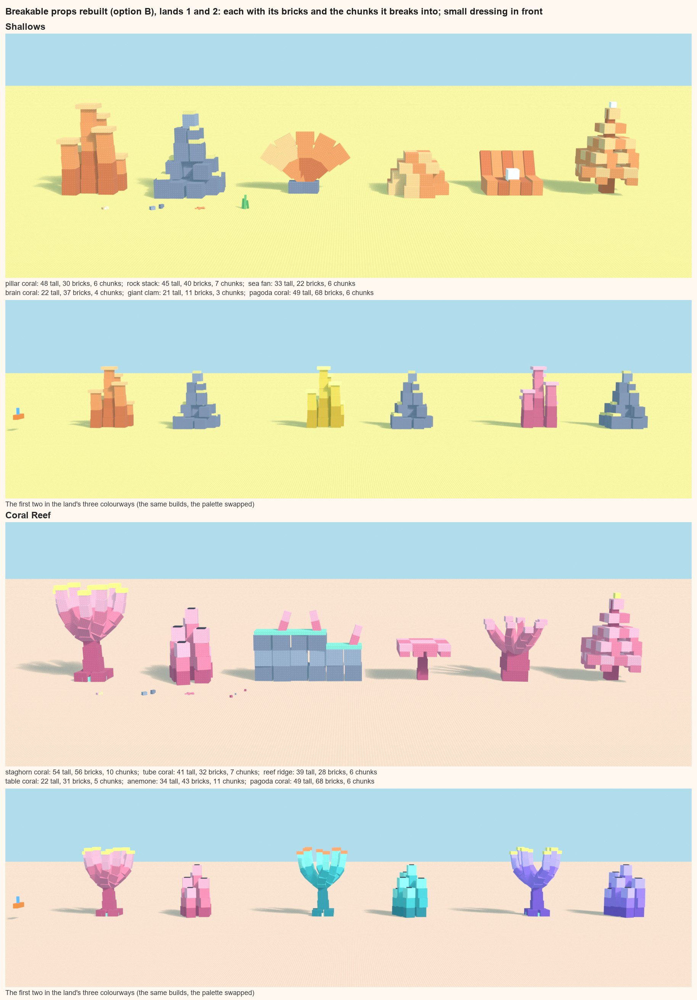

[props2.py](../../tools/map/props2.py) holds the kit, built to the rules of 3b. Every brick carries its break group and
whether it is studded.

| Land | Props (tall, bricks, chunks when broken) |
|---|---|
| Shallows | pillar coral (48, 30, 6); rock stack (45, 40, 7); sea fan (33, 22, 6); brain coral (22, 37, 4); giant clam (21, 11, 3); pagoda coral (49, 68, 6) |
| Coral Reef | tube coral (41, 32, 7); reef ridge (39, 28, 6); table coral (22, 31, 5); pagoda coral; brain coral. The staghorn and the anemone were taken out on the user's word (2026-11-19: "Both") |
| Small dressing (never breaks, never collides) | shells, pebbles, starfish, sea-grass tufts, crumbs (the reference's tiny cubes left where things broke) |

**Three colourways a land,** from palette slots. Shallows: orange, yellow and pink corals on sand. Reef: pink, teal and
violet. Each copy picks one.

### How they spread (a trial build, not loaded)
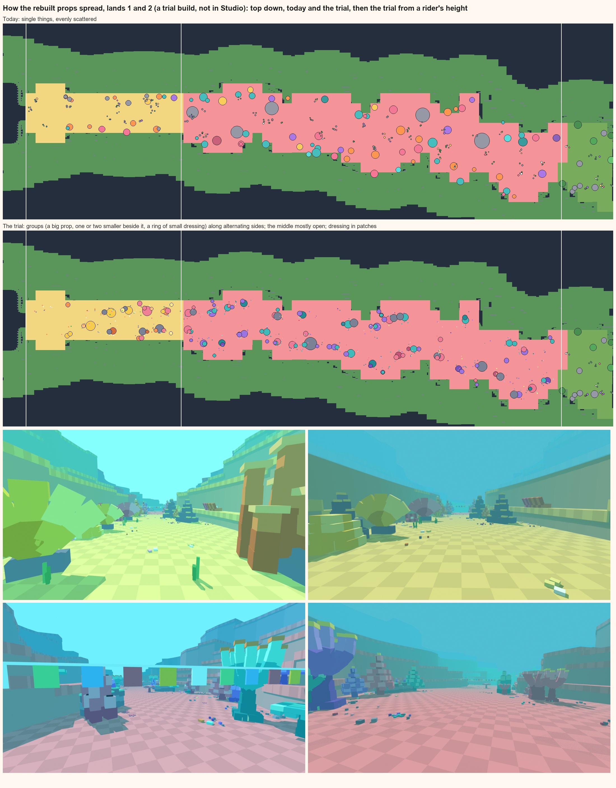

`PROPS2=1 GREYBOX_OUT=art/map/spread_trial python tools/map/greybox.py` builds lands 1 and 2 with the new kit, spread
the way the reference spreads its own; the other lands keep today's kit. Without the switch nothing changes. The
top-down maps come from [spread_map.py](../../tools/map/spread_map.py).
- **Groups, not singles:** a big prop, one or two smaller ones nestled beside it, and a ring of four to seven pieces
  of dressing. About one group per 9,000 square studs of floor in the Shallows and per 7,000 in the Reef.
- **Along the sides, mostly alternating left and right,** filling the bays where a wall bows out. None in the first
  420 studs, as before.
- **The middle stays the herd's road:** nothing in the first land, and now and then one small prop after it.
- **Dressing in patches everywhere,** thicker toward the walls.
- **A few short rows on the terrace lips,** two or three alike. A first try put 269 table corals on two lands'
  terraces; now it is one row per 250 studs of room.

**Cost:** lands 1 and 2 go from about 1,800 prop bricks to 6,400 (4,800 breakable, 1,600 dressing). The whole map
would go from 59,000 parts to about 64,000 with only these two lands rebuilt. If every land were rebuilt the same way,
about 50,000 prop bricks in all. Far parts aren't drawn, so a phone pays for one room's props at a time: about 30 to 60
props, a few thousand bricks. To measure in Studio.

**Not done:** the other eight lands' sets; the stud material (one upload, the user's yes); the break into chunks in the
game (the game-code chat's, on the user's word); loading the trial into Studio (the user's hand placing in the hub has
to be read from the place first).

### Every land's kit (2026-11-19, stage 1 of [the map before the big push](before-the-push.md))
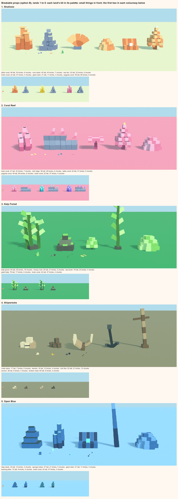
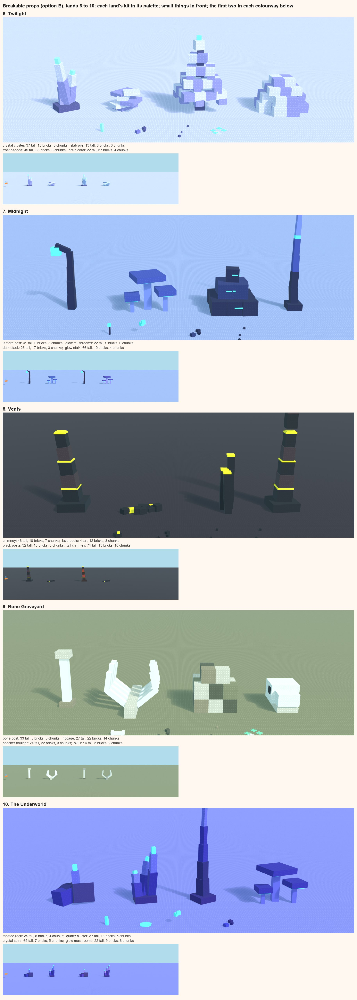

Each land's kit is in its palette from [colour](colour.md): one main pair far apart in lightness, one accent, and the
land's floor colour as the cap. Glow comes from Open Blue on. All of it is in [props2.py](../../tools/map/props2.py).
Each land also has its two placing pieces for stage 2:
- **The lip-row piece** (`LIP`): the smallest, in an even row along every lip and wall top.
- **The first-layer tall piece** (`TALL`).

| Land | Props | Lip-row piece | First-layer tall piece | Small things |
|---|---|---|---|---|
| Shallows | pillar coral, rock stack, sea fan, brain coral, giant clam, pagoda coral | shells | pagoda coral | pebbles, starfish, sea grass, crumbs, flower clumps |
| Coral Reef | tube coral, reef ridge, table coral, pagoda coral, brain coral | a flower clump | pagoda coral | shells, pebbles, starfish, crumbs |
| Kelp Forest | kelp grove, mossy rock, sea bush, giant kelp, brain coral | a sea-grass tuft | giant kelp | pebbles, crumbs, flower clumps, shells |
| Shipwrecks | crate stack, barrels, hull ribs, anchor, broken mast | a small crate or a coil of rope | broken mast | gold coins, pebbles, crumbs, shells |
| Open Blue | step stack (the reference's Ocean blocks), sponge tubes with glowing mouths, giant clam, leaning pillar, brain coral | a small sponge with a glowing tip | leaning pillar | glow cubes, shells, crumbs, clumps |
| Twilight | crystal cluster, slab pile (the reference's Snow heap), frost pagoda, brain coral | small crystals | frost pagoda (the reference's Snow pines) | pebbles, crumbs, clumps |
| Midnight | lantern post (an angler's lure as a lamp), glow mushrooms, dark stack with cracks of light, glow stalk | a glow bulb | glow stalk | glow cubes, pebbles, crumbs |
| Vents | chimney with glowing seams, lava pools (the reference's Volcano), black posts, tall chimney | an ember stone | tall chimney | pebbles, crumbs |
| Bone Graveyard | bone post (the reference's Extinction posts), ribcage, checker boulder in four tones, skull | a bone | bone post | pebbles, crumbs, clumps |
| The Underworld | faceted rock with a crystal (the reference's Cosmic), quartz cluster, crystal spire, glow mushrooms | small crystals | crystal spire | hex pads, glow cubes, pebbles, crumbs |

- **Glow bricks** are named "Glow", so the game can make them Neon.
- **Every land except Midnight and the Bones has two or three colourways.**
- **Weak spots to fix in stage 2's views:**
  - the Shipwrecks crate stack's pale crates merge together;
  - Open Blue's props sit close to its floor and fog in colour;
  - some deep-land props are few bricks (a bone post is 5, a chimney 10), which is fine for their simple shapes but
    gives fewer chunks.

### Set pieces for the later lands (2026-11-19)
The user: "id like to frame this as the main props but we need some stuff to light up the later lands to make them
really look cool, maybe some lava mounds with smoke coming out or something, or later as you go there is like super
natural stuff that looks sci fi esque and frames the lands nicely to add some real wow factor."

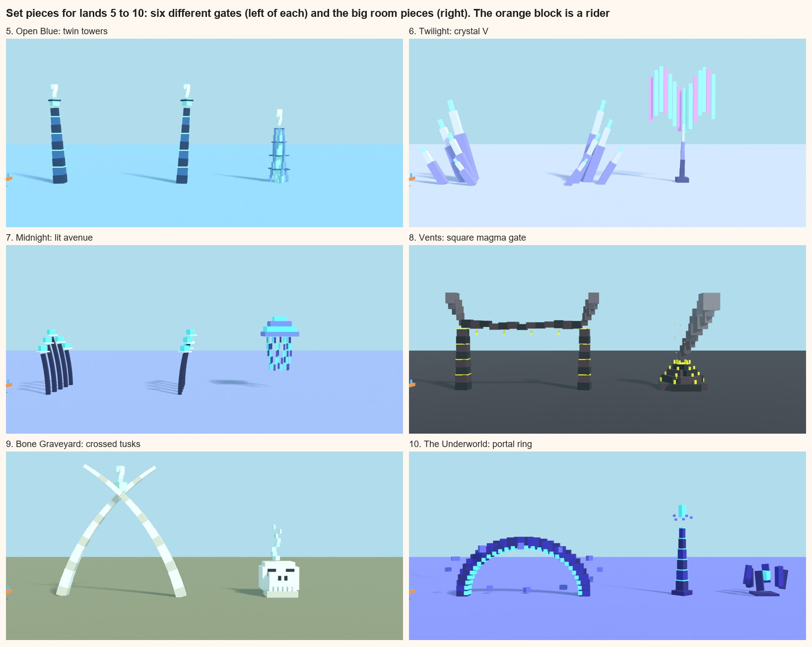

Beside the breakable props, each land from Open Blue on gets:
- **a gate:** something framing the neck where you enter, so you swim through it into the land. Each land's has its own
  shape (the user, 2026-11-19: "we shouldnt have 5 arches with a similar shape, i like the square one and maybe another
  arch but we need some more differentials from arches"). Only the Underworld keeps an arch (the portal ring), and
  the Vents keep the square gate; the four arches dropped are still in the file as options;
- **big lit pieces in its rooms:** two a room, at the sides, sides alternating.

They don't break; they are landmarks. All of it is in [setpieces.py](../../tools/map/setpieces.py).

The feel climbs land by land, from natural to supernatural:

| Land | Feel | Gate | Room pieces |
|---|---|---|---|
| Open Blue | natural light | twin towers either side of the neck, leaning out a little, lit rings up them and a lamp on each top | a glass-sponge tower with a lit core, rising bubbles |
| Twilight | crystal | a crystal V: two huge crystal clusters at the neck's sides leaning outward, so the neck opens into the land | an aurora: a curtain of light ribbons on a tall stalk |
| Midnight | living light | a lit avenue: two rows of tall dark stalks along the neck, a glowing bulb on each | a giant jellyfish: a glowing bell and lit tentacles |
| Vents | fire | basalt columns with glowing seams and a jagged lintel dripping lava, smoke from the tops | **a lava mound: dark stepped blocks, lava cracks down its sides, a lava pool in its crater, a smoke column and rising embers** |
| Bone Graveyard | spectral | crossed tusks: two giant tusks rising from either side and crossing high over the neck in an X, a ghost light where they cross | a giant skull half sunk in the floor, ghost fire in its eyes and rising from its crown |
| The Underworld | sci-fi cosmic | a portal ring with a glowing inner edge, rubble orbiting it, a beam rising | an obelisk with glowing bands and a crystal floating over it, and a ring of floating monoliths round a glowing core |

**In the game:**
- Bricks named "Glow" become Neon, and the biggest get a light.
- Bricks named "Smoke" stand for a particle emitter: smoke, bubbles, embers, ghost fire.
- About 2,400 bricks in all for lands 5 to 10, none of them moving, so cheap.

**Not done:**
- The in-lane trial (`python tools/map/setpieces.py <trial> <out>`) places them, but its camera views missed the
  pieces, and some room pieces landed on the terraces. Placing is stage 2's job anyway: the gates on each land's first
  neck, the room pieces clear of the walls.

### The far view in the game: real models at their real place, a silhouette through the fog (2026-11-19, in use)
The user: "could we just add it in so the player sees the silhouette and it matches up as an actual model".
`TRUE=1 python tools/map/farview.py` -> `Workspace.FarView` (3,334 parts, Persistent so streaming always sends it, not
solid or touchable, no shadows): the far view at its real place and size, 1,300 to 10,000 studs down the lane, above
the water over the later lands. Past the hub fog's end (1,100) Roblox draws each part flat in the fog's pale blue
against the sky, which isn't fogged, so from the hub it is a silhouette: the black hole's ring and beam, the towers,
the bands. Checked in Play at the gate. Up close it is the real model.

- The painted sky face is off again (both skies back to the original; the painted id is kept on each Sky as the
  attribute `SkyboxBkVista`).
- Low graphics: the lowest levels draw only about 500 studs, so those players would see no far view at all. **Built
  2026-11-19 by the game-code chat** (the user: "Yes, ask them"): `LookController` puts the sky's `SkyboxBkVista` on
  its back face and hides `FarView`'s parts on that player's machine (so the two never show at once) when the player
  set graphics 1 to `Config.Look.VistaLowest` (3), or is on Automatic on a phone or tablet (`Look.VistaTouch`: the
  level Roblox picks on Automatic can't be read by a game). A desktop on Automatic keeps the models. It follows a
  quality change mid-game. In Studio the workspace's `LookVista` (true or false) forces it; checked in Play both ways.
- Reload: `TRUE=1 python tools/map/farview.py`, then run `tools/studio/farview/NN.luau` in order (01 rebuilds it).

### The far view in the game: real models, shrunk inside the fog (2026-11-19, TRIED AND REMOVED the same day)
**Removed:** the user: "youve made a grave miscalculation". The shrunken copy sat in the first lagoon past the gate,
a small city and a floating black hole in the play space, seen from everywhere but the spawn. Forced perspective only
works where the ground between the eye and the copy is never seen from elsewhere. The painted sky face (below) is
back on both skies. What follows is kept as a record; `Workspace.FarView` is deleted.

The user: "could we find a way to use the models whilst the fog doesnt fully obscure the cool stuff especailly the
black hole". Forced perspective, [farview.py](../../tools/map/farview.py) -> `Workspace.FarView` (Studio-owned, 3,334
parts; a map reload leaves it alone):

- Each part of the far view slides along its line from the spawn's eye and shrinks by as much, so from the spawn it
  covers exactly the piece of the view it did at its real distance. The depth is squeezed into 300 to 470 studs (front
  to back order kept): inside the fog (180 to 1,100), and inside the ~500 studs the lowest graphics level draws.
- The black hole, its jets and the beam go nearer still, 200 to 216 studs, where the fog is about 3%: farther out the
  fog turned its black middle grey, and no colour can be darker than black to make up for it. All of it is Neon
  (unlit): as plastic, the sun lit its black bars grey.
- Every colour is brightened ahead of the fog it gets at its new distance, so it reads as drawn.
- Not solid, not touchable, no shadows. Away from the spawn the far view shifts a little more than a real one would
  (parallax at 300 studs, not 5,000); from the spawn's camera the gate's banner hides the black hole until you walk up.
- The painted sky face (104255330374077) is set back to the original on both skies; each Sky keeps it as the
  attribute `SkyboxBkVista` in case it's wanted back.
- To change it: edit the far view (tools/map/vista.py, `SKY=1 ... blackhole`), then `python tools/map/farview.py` and run
  `tools/studio/farview/NN.luau` in order (01 rebuilds `FarView`).

### The far view in the game: painted into the sky (2026-11-19, replaced the same day by the real models above)
The user: "just make it so it looks like the screenshots kinda". The far view can't go in as parts, for two reasons.
The hub's air fog hides everything past about 1,100 studs (`Config.Look.AirFogEnd`), and the far view stands 1,200 to
10,000 out. Nearer, it would stand inside the lane, which runs out of the gate along the same line. The sky is never
fogged and is seen only above the water, so the far view is painted into it.

- [sky_vista.py](../../tools/art/sky_vista.py) lays the far view, rendered alone from the spawn, level, over the sky's
  face down the lane: `SkyboxBk`, the face toward +Z by Roblox's face names. Studio wasn't drawing, so this wasn't
  checked by eye.
- It is raised 14 degrees, because the game tips the sky that much toward the lane (`Config.Look.SkyTilt`).
- The result is `art/style/sky_vista/Bk_vista.png`, beside the original face `Bk_original.png` (asset
  18351376859).
- **In Studio** (2026-11-19, on the user's go-ahead): uploaded as `rbxassetid://104255330374077`. The game's sky is
  a copy of `ReplicatedStorage.Skies["2 Anime Sky"]` (LookController, `Config.Look.Sky = 2`), so the face is set there
  (and on `Lighting.Sky` for Edit). Each keeps the old id as the attribute `SkyboxBkBeforeVista`. Checked in Play: it
  shows at the end of the lane, on the horizon, through the gate. The last change (on the Skies copy) is not saved.
- To undo: `SkyboxBk` back to `rbxassetid://18351376859`.
- If it shows behind the hub instead of out of the gate, the face is the other one: paint `SkyboxFt` instead.

## 5. Open questions for the user
1. Props: **B with C for the tall ones,** or only A for now?
2. May I upload one stud picture for the stud material? (Permanent, about 1 MB.)
3. The land themes: ice for Twilight or Midnight, galactic rubble for the Underworld, or new land names?
4. Should the hub's skyline show every later land at once, or only the next one or two, so the rest stay a surprise?

These two tasks are parked map steps 3 (backdrop and landmarks) and 5 (a prop set for every land) from
[map structure](map-structure.md#what-makes-their-map-read-and-where-ours-should-go).
