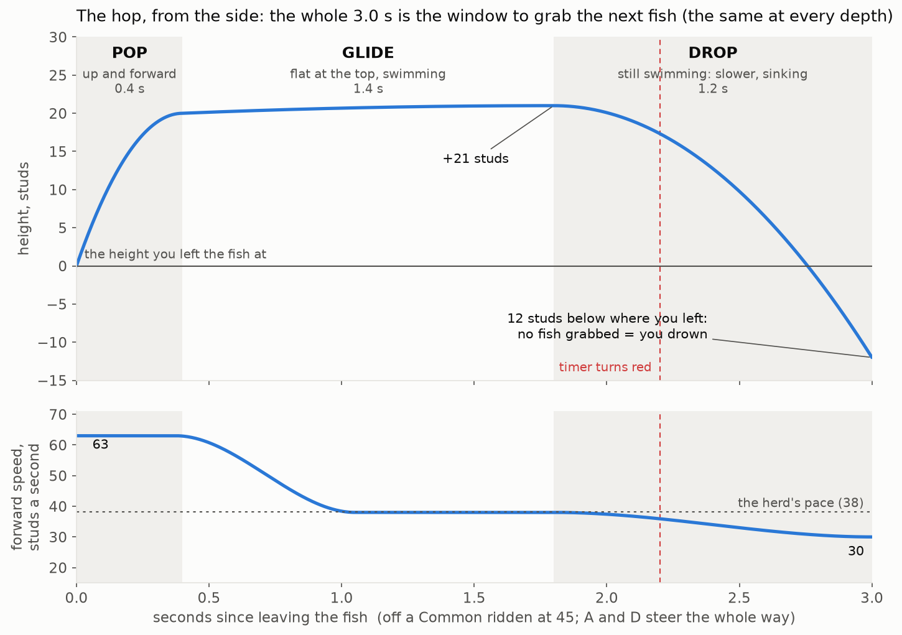
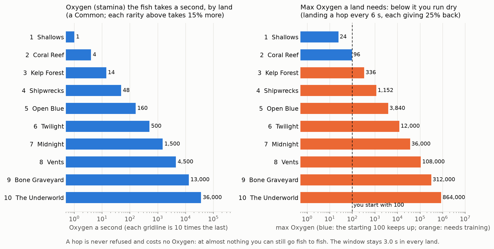

# Riding feel

How riding, the Oxygen meter and the hop from fish to fish feel, with starting numbers to tune in play. The run around it
is in [the dive](the-dive.md). The hop follows the reference's, read from the user's recordings
([the reference's jump](../reference/ride-a-dino.md)).

**Oxygen** is the riding resource, and it is what the design notes call stamina ([Decisions](../Decisions.md),
2026-11-09 and 2026-11-11). The meter is Oxygen, and the stat you train is your max Oxygen. A creature's tag shows the
max Oxygen that keeps up with it in its home land ("Required").

## Movement v3.1

**The current model, 2026-11-11.** Hugo's answers of 2026-11-11 ([Decisions](../Decisions.md)): the hop and glide of
2026-11-10 stay, with Movement v3's lock-on, steering, camera and window on top. Movement v3's own "no hop, slow down
and sink" is gone. Where the sections further down ("The jump, as built") say otherwise, this section is right.
**Nobody has played it yet:** see "Checked, and what to play" below.

**Changed later on 2026-11-11** (the user, after playing it; [Handoff](../Handoff.md)), so read the rest of this
section with these in mind: the way you go follows the camera (`Ride.CameraSteer`); the pull-in starts by itself when
the glide ends, 1.7 s after the press (`Jump.AutoGrab` 2, `FloatTime` 1.3); the glide is at 0.85 of the ridden speed
(`Jump.AirShare`), not 54; the view tilts down in the hop (`Camera.AirRest` 1); and the lock is steadier
(`Lock.EdgeAim`, `SwitchTime`).

### The hop
One button. Space throws you off the fish at once (from floating too).

| Part | Time | What happens |
|---|---|---|
| The pop | 0.4 s | Up 20 studs above where you left (above the locked fish, if that is higher), and forward at 1.4 times the speed you rode at. Arms out ahead, legs trailing. Never out of the water: it stops 3 studs under the surface. |
| The glide | 1.4 s | Flat at the top, lying face down, swimming (arms sweeping, legs kicking). The pop's extra speed runs out by about 1 s, down to 38 studs a second: the herd's pace. |
| The drop | 1.2 s | Still swimming, with longer strokes and a harder kick, nosing down. You slow to 30 and sink, slowly at first, to 12 studs below where you left. |

- **The whole hop is the window: 3.0 s** (`Jump.Window`), the same in every land. The drop is whatever the pop and the
  glide leave of it. A bar and the seconds under the reticle show it; red and pulsing for the last 0.8 s.
- **You always go forward. Only A and D steer,** at one rate (95 degrees a second) on a fish, in the hop and floating.
  W, S and the mouse never steer or change speed; a ridden fish keeps the herd's height by itself.
- **The lock-on** (`Lib/Lock`, `Config.Lock`): the fish you look at glows yellow and gets a bracket on the screen. It is
  a cone along where the camera looks, wider for near fish, nothing past 85 studs, sticky so it doesn't flicker; the
  fish you just left comes last. It shows faintly while you still ride. In the hop the mouse aims with no button held,
  and the view rests looking down on the herd (30 degrees) until you move it.
- **Space again, a left click, E or gamepad X grabs the locked fish:** the pull-in, on the reference's curve (a creep,
  then faster and faster, easing onto the saddle; 0.14 s plus a second for every 55 studs, never over 0.8 s), coming
  down later than it comes across (a swoop), the view narrowing, yellow dots behind you. At the landing the view snaps
  12 degrees wider and settles, the camera is knocked and springs back, the fish flashes, the bubbles burst. Oxygen
  refills by a quarter (not for landing back on the fish you left).
- **A press with nothing locked** flashes the reticle red and the window runs on. Nothing grabs a fish for you
  (`Jump.AutoGrab` 1 puts the hands-off landing back, for a locked fish at the window's end).
- **The window gone with no fish: the short drown** (2.8 s), then the dock. In the sandbox with No fail on, you float.
- **A grab the server refuses** (the fish taken, gone, out of range, behind something solid) puts you back in the hop
  where you are, with what is left of the same window.
- **The camera** (`Lib/Spring`): where it looks from, its turn, its zoom and its field of view each go through a
  critically damped spring, so riding, the hop, the pull-in and the landing run into each other with no snap.

### Oxygen by land (the progression)

- **The deeper you are, the more Oxygen the fish under you takes a second.** One number a land, for a Common
  (`Config.ZoneDrain`): 1, 4, 14, 48, 160, 500, 1,500, 4,500, 13,000, 36,000. It goes by the land you are **in**, not
  the fish's home. Each rarity above Common takes 15% more (`Oxygen.TierDrain`; a Mythic 1.75 times).
- **What a land needs:** a rider who lands a hop every 6 seconds (`Oxygen.KeepUp`) gets a quarter of their max back
  each time (`Oxygen.Refill`), so they hold level with a max of drain x 6 / 0.25, 24 times the land's number: 24, 96,
  336, 1,152, 3,840... Below that you run dry however well you hop. The starting 100 rides the Shallows for ever and
  just keeps up in the Coral Reef; the Kelp Forest needs training (which isn't built: `TestMaxOxygen` on Workspace sets
  everyone's max in Studio).
- **A hop is never refused for Oxygen and costs none.** The window doesn't drain. At almost nothing you can still go
  fish to fish, and every landing on another fish gives a quarter back.
- **At nothing while riding,** the fish throws you off and you drown, as before. Floating off a fish drains 4 a second.
- **On the HUD:** beside the meter, what the fish takes a second, red when your max is under what the land needs; and
  the land's name says "needs N OXYGEN" while it is.
- All of it is the server's (`RideService`): the client only shows it.

### Crashes and props
- **Running a ridden fish into something solid never kills.** Square on enough (not sliding along it), your speed
  drops to 0.45 of what it was and comes back over 1.4 s, the camera is jolted, and it costs a tenth of your max Oxygen;
  never the last of it. Once for each time the nose comes up against the thing, and at most every 1.5 s. The server sees
  it (a ray along the fish's nose), takes the Oxygen and tells your client to slow. `Config.Crash`.
- **Props break** (`PropService`, `Config.Props`): a fish that swims into one of the map's props knocks loose the boxes
  it touches, and the boxes of that prop resting above them. They are thrown along its way, turn, sink a little and
  hang in the water; 8 seconds after the prop was last hit they fly home and it is solid again. The server moves the
  real boxes, so everyone sees the same prop. The rider goes through, for a small crash: speed to 0.8, 3% of max Oxygen.
  Breaking gives nothing.
- **Every fish breaks props for now** (`Props.MinLength` 0). Set it to a length in studs and only fish that long do;
  shorter ones crash into props like into a wall. This is where "a big enough creature" (2026-11-10) can come back.
- **Wild fish** steer round the big things, so they are rarely in one; one that is, breaks what it touches.
- **In the hop** you are stopped by props, as by walls: it costs nothing.
- Players' bodies no longer collide with props (so a rider isn't knocked about in the moment before the boxes go).

### Who decides what
The client moves its own fish and its own hop and picks the lock (the camera's aim is its own). The server decides: the
hop's start and its clock (the window plus 0.6 s for lag), each grab (the fish free, within 85 studs times 1.1, nothing
solid between; it then keeps that fish for you), each landing (the fish it granted, you at it), Oxygen, crashes, props
and every death.

### Every number
All in [Config](../../src/shared/Config.luau), each with a comment, and all on the sandbox panel (N): `Jump`, `Lock`,
`ZoneDrain` (one row a land), `Oxygen`, `Crash`, `Props`, `Herd`, `Ride`, `Camera`, `AimHud`, `Net`, `Switch`, `Burst`,
`Spawn`. Not on the panel: `Jump.TrailDots` (made once at the start), `Oxygen.StartMax` (use `TestMaxOxygen`) and the
lists that aren't single numbers (the rarities, the fish, the mix by land, the drowning's timings). They are starting
values, **not tuned in play**.

| What | Keys | Starting values |
|---|---|---|
| The window | `Jump.Window`, `Warn` | 3.0 s, 0.8 s |
| The pop | `Jump.LaunchTime`, `Apex`, `Launch`, `BoostTime`, `FreeLaunch` | 0.4 s, 20 studs, 1.4 times, 0.75 s, 55 |
| The glide | `Jump.FloatTime`, `FloatRise`, `AirSpeed` | 1.4 s, 1 stud, 38 |
| The drop | `Jump.Drop`, `DropCurve`, `DropSpeed`, `DropTilt` | 12 studs, 2, 30, 12 degrees |
| The body | `Jump.Tilt`, `Bank` | 78, 18 degrees |
| The reach and the pull-in | `Jump.GrabRange`, `ReelTime`, `GrabSpeed`, `ReelMax`, `ReelCurve`, `ReelSwoop` | 85 studs, 0.14 s, 55, 0.8 s, 2.3, 0.9 (since 2026-11-12 the reach is 180 studs: see "The movement pass" below) |
| The landing's camera | `Jump.ReelFov`, `LandFov`, `LandFovTime`, `LandKick` | -10, +12 degrees, 0.35 s, 0.45 studs |
| The hop's camera | `Jump.CameraPitch`, `CameraZoom` | -30 degrees, 1.2 times |
| The lock | `Lock.Cone`, `AimRadius`, `DistanceWeight`, `LeftPenalty`, `Sticky`, `MinHold` | 40 degrees, 8 studs, 0.35, 0.5, 0.2, 0.3 s |
| Steering | `Ride.YawRate`, `TurnEase`, `Bank` | 95 degrees a second, 10, 28 degrees |
| Oxygen | `ZoneDrain`, `Oxygen.Refill`, `KeepUp`, `TierDrain`, `FreeDrain` | above; 0.25, 6 s, 0.15, 4 |
| A crash | `Crash.Slow`, `Recover`, `Cost`, `Cooldown`, `HeadOn` | 0.45, 1.4 s, 0.1, 1.5 s, 0.35 |
| Props | `Props.MinLength`, `Rebuild`, `Push`, `Topple`, `Slow`, `Cost` | 0, 8 s, 16 studs, 22 studs, 0.8, 0.03 |
| The camera's springs | `Camera.FocusTime`, `TurnTime`, `ZoomTime`, `FovTime` | 0.12, 0.07, 0.3, 0.2 s |

### How the lock scores
A fish must be free, in sight (nothing solid between) and within `Jump.GrabRange` of you. Its allowance is half the
cone plus the angle that `AimRadius` and half its own length cover at its distance from the camera, capped at
`MaxAngle`: a near fish is a much bigger target. Inside its allowance the lowest score wins:
`AngleWeight x (angle / allowance) + DistanceWeight x (distance / GrabRange)`, plus `LeftPenalty` for the fish you just
left. The locked fish keeps the lock for `MinHold`, then until another scores `Sticky` better, and may drift `KeepCone`
times further off the aim.

### Checked, and what to play
**Not played (2026-11-11):** Studio's connector was being replaced during this work. Checked offline: StyLua, selene
and `rojo build` pass, and luau-lsp's type check finds nothing new in the changed files. The hop's arc and the drain
were drawn from Config's own numbers (the two pictures above). So the feel, and anything that needs the map (crashes,
props), is unseen.

Play in Studio; N opens the panel. For the real rules turn **No fail** and **Endless air** off.
1. **The hop:** V for the side view. Does the pop, glide and drop read as before, and is the drop swimming rather
   than falling? (`Jump.Drop`, `DropCurve`, `DropSpeed`.) Is 3.0 s right?
2. **The lock in the hop:** from 20 studs up, do you get the fish you look at? Is the resting view right?
   (`Jump.CameraPitch`, `Lock.Cone`, `AimRadius`.)
3. **Oxygen by land** (Endless air off): the number beside the meter should be about 1 in the Shallows and 4 in the
   Coral Reef. On 100 the Shallows are easy, the Reef only just, the Kelp Forest runs you dry. At nearly nothing, a hop
   must still work and refill.
4. **A crash:** steer into a wall square on, then slide along one. The first slows you and costs a tenth; the second
   costs nothing. Does it ever charge you without a touch, or miss a clear crash? (`Crash.HeadOn`, `Reach`.)
5. **Props:** swim through a coral and a wreck. Boxes fly, you go through a little slower, it rebuilds after 8 s. Is
   too much or too little of a big prop coming down? (`Props.Topple`, `MaxLoose`.) Try `Props.MinLength` 12.
6. **Co-op and lag:** two players for one fish; a prop one breaks, seen by the other.

## Decided
- **Going fish to fish works exactly like the reference's jump** (the user, 2026-11-10), changing only what our game
  forces. It replaces void's corkscrew dash, the hook window with its slow motion, reticle and rope, and the eaten death.
- **Any fish you are on, you steer, tamed or not** (the user, 2026-11-10). Taming doesn't change the riding.
- **Wild fish all swim the same way, straight down the lane** (the user, 2026-11-10).
- **The jump has a long air time: you float up, swimming, then you drop** (the user, 2026-11-10). A drop that finds no
  fish is the drowning. No hopping for ever.
- **Hands off, a jump brings you to a fish by itself** (the user, 2026-11-10, from playing the reference). *Replaced
  2026-11-11: you grab the fish you look at, by a press.*
- **A ridden fish turns with the camera** (the user, 2026-11-10): like shift lock, but not locked. *Replaced
  2026-11-11: only A and D steer.*
- **Jumping to a fish near by is easy,** and you can grab the fish you just left; far fish stay out of reach (the user,
  2026-11-10). Later the same day: the reach is further still, and you don't need to be looking at the fish.
- **The pull onto the fish follows the reference's:** slow at first, then accelerating hard (the user, 2026-11-10).
- **The camera's shakes and the zoom at a landing matter, and are measured from the reference;** the air time and the
  reach are tuned round them. It has to look great, immersive and of a piece (the user, 2026-11-10).
- **The movement has to feel really good, as close to the reference's as a port can be** (the user, 2026-11-10): its own
  piece of work, in a sandbox.
- **An Oxygen meter that drains while you ride.** Higher tiers drain it faster, and deeper lands much faster
  (2026-11-11).
- **The window is the same at every depth; missing every fish is the drown; crashing never kills; fish break props;
  you can always hop, even at almost no Oxygen** (Hugo, 2026-11-11).
- **Out of Oxygen while riding, the fish throws you off and you drown,** then wake at the dock.
- **A bubble burst on every landing** on a fish.

## The jump, as built (2026-11-10, third pass after the user played the second)
*History: the hop's shape, the pull-in, the landing and the herd are still this. The steering, the ring, how a fish is
picked and the landing without a press were replaced on 2026-11-11 (Movement v3.1, above).*

One button, as in the reference. The numbers are in `src/shared/Config.luau` under `Jump` and `Herd`.

1. **Space** throws you off the fish at once. From floating (after diving in off the
   board) Space does the same, so that is how a dive starts for now.
2. **The pop, 0.4 s:** up to 20 studs above the highest fish in front of you (or above where you left, if that is
   higher), so you are always over them; and forward at 1.4 times the speed you rode at for about 0.75 s. If the fish
   you are making for turns out to be higher, you keep rising through the glide. **The flight never leaves the water**
   (the user, 2026-11-10): it stops 3 studs under the surface line. The rise is counted from the rider's seat, about 5
   studs above the fish's middle (`Jump.SeatRoom`). Measured in Studio: 21 studs in deep water, and 21.8 in the
   Shallows since the lagoon was deepened from 30 to 39 studs (it was 13 before, with the water only 26 studs deep).
3. **The glide, 1.4 s:** flat at the top, lying face down in a swimming pose, at the herd's pace (38 studs a second).
4. **The drop, 1.3 s:** only if no fish was in reach: you sink, faster and faster, head first.
5. **You steer all of it:** you are going one way, and A and D steer that (170 degrees a second); the camera turns by
   as much, and a drag only looks round without turning you (the user, 2026-11-10; `Jump.CameraSteer` 1 is the earlier
   way, the flight turning to where the camera looks). W and S speed it up and slow it by half. The camera lifts and
   pulls back to look down.
6. **The fish you are making for glows yellow with an outline** from the moment it is picked: the nearest fish in front
   of you (within 70 degrees either side of where the flight is headed, or right under you) and within 85 studs, never
   the fish you just left. It keeps the glow unless it falls well behind or another fish in front is clearly nearer
   (0.7 of the distance). With no turn held, the flight makes for it; once you are over it, you are held there. A
   dashed yellow ring (a radius of 20 studs) lies flat in the water under you.
7. **The pull-in:** you are pulled onto the fish on a line from your hand, on the reference's measured curve: the gap
   closes as time to the power 2.3, so it creeps, then accelerates all the way in and arrives at its fastest. It takes
   0.14 s plus a second for every 55 studs (18 studs: 0.47 s, as measured). The gap is kept from the fish as it swims,
   so you never hang still, and it never takes longer than 0.8 s however far the fish. The view narrows as it speeds
   up and yellow dots are left behind you. It happens when the glide ends, or at once on a second Space. **At the
   landing the view snaps 12 degrees wider in one frame and settles over 0.35 s, and the camera is knocked down
   and springs back** (both measured from the reference); the fish flashes white, then yellow. Then the bubble burst, the ring, the squash, and the glow fades off the fish. Oxygen refills by a quarter.
8. **The pull-in comes down later than it comes across** (a swoop): you hold your height, then dive onto the fish.
   **With no fish in front** when the glide ends or on a second Space, it takes the nearest fish any way round within 50
   studs, and only with none of those the fish you just left. With nothing at all, the drop.
9. **A drop that ends with no fish in the ring has sunk:** a short drown (about 2.8 s), then the dock. This is the same
   from a fish or from floating, so there is no hopping for ever. The reference offers a revive here; we have none yet.

The server decides: the client says which fish it came down on, and the server checks the fish is free and the player is
over it, give or take lag.

### The herd
- **All wild fish swim straight down the lane,** each at its own place across it.
- **At 0.85 of the speed they are ridden at** (a Common: 38 wild, 45 ridden). Measured from the reference: riding about
  55 m a second, the herd about 46. Before, wild fish idled at 14, a third of riding speed, so a jump flew past them.
- **In one layer, 8 to 16 studs above the floor** (it was 10 to 60, then 16 to 30: lowered so there is water above the
  herd to jump up into). **Where the water is too shallow for a whole jump above that, the herd is pressed lower,**
  down to 5 to 6 studs above the floor (`Config.herdTop`, `Spawn.HeightFloor`); a ridden fish follows. The reference's dinos are all on the ground; with
  fish spread over 50 studs of depth, a jump had nothing at its own depth.
- **The fish you ride and the flight are kept in open water** (`src/client/Lib/Course.luau`). Fish don't collide with
  the map, so before this a fish steered into a bank or the floor went through it and carried you under the map (the
  user, 2026-11-10). Now it slides along walls, is held off the floor and under the surface, and can go 20 studs past
  the lane's edge and no further (`Ride.LaneMargin`). Steered straight at a wall it stops until you turn.
- **A ridden fish with W and S let go follows the lane down at the herd's height.** W and S still dive and climb.
- **A ridden fish turns to where the camera looks.** A and D turn the camera, and so does a right-mouse drag or a touch
  drag. Just after you land, the camera comes round behind the new fish first.
- The herd drains downstream, so new fish keep being put in behind it. They can pop in near you: not fixed.

### What differs from the reference, and why
- **The ring is in the water, not on the ground.** Their dinos stand on the ground, so their ring lies on it. Ours lies
  flat at the depth of the fish under you. A first answer, not a chosen one.
- **The flight makes for the nearest fish** when no turn is held and nothing is in the ring: it takes on the fish's speed
  and closes the gap. The reference pulls you onto a dino at the end (measured), but how it picks one isn't known.
  `Jump.Assist = false` turns ours off.
- **The flight's shape now follows the side-on recording** (a pop, a flat glide, the pull-in). Its height and the
  length of the glide are by eye and to tune in the sandbox.
- **Not built yet:** the yellow fan behind the fish on landing, the row of yellow dots behind you, the lasso in the
  rider's hand, the revive, and the green and pink rings (time left on this fish, taming).

### Tested in Studio (2026-11-10, by Claude, pressing keys through the connector)
Off the board onto a fish with no help; riding; holding A turns the camera and the fish follows it; a jump with a second
press grabbing a fish that was not in the ring; the pull-in at about 100 studs a second. No script errors. The user
played the second pass and called it almost right; nobody has played this third pass.

**A bug the user found, fixed:** A and D did nothing on a fish. The player module gave no move vector while we hold the
character still, so the game now reads the keys itself as well.

### To measure in the reference, before more is built on guesses
The user answered some of these from playing it (2026-11-10): hands off, a jump does bring you to a dino by itself (1);
a dino turns with the camera (8); the longest gap is fine for now (4). The arc (5), the herd's overtaking (6) and the
feel as a whole go to the movement sandbox. Still open: 2, 3 and 7.
1. **Hands off:** jump and press nothing, several times. Does it bring you to a dino by itself? Answered: yes.
2. **Steering only:** jump and hold A or D the whole way. How far does the flight turn? Can you leave the dino it had?
3. **The second press:** jump, then press Space again at once; and jump and never press again. This settles what the
   down arrow does and when the pull-in starts.
4. **The longest gap:** jump at a dino as far ahead as you can make. And one jump with no dino anywhere near.
5. **From the side:** a few jumps with the camera turned side-on, the whole arc in frame, for the height and the shape.
6. **The herd:** ride straight for 20 s without jumping, looking ahead. For how fast you overtake the herd, how many
   dinos are on screen, how far apart, and whether any go another way.
7. **One dino to the end:** stay on one until its green ring runs out, for what happens and how long it is.
8. **Steering a dino:** hold A, then D, on a tame one and on a wild one.

## Starting numbers (ideas not agreed, to tune in play)
Speeds in studs a second. The reference rides at about 55 ([blockout](../blockout.md)).

| Tier | Ridden speed | Oxygen a second, times a Common's |
|---|---|---|
| Common | 45 | 1 |
| Uncommon | 52 | 1.15 |
| Rare | 60 | 1.3 |
| Epic | 68 | 1.45 |
| Legendary | 78 | 1.6 |
| Mythic | 90 | 1.75 |
| Secret | 100 | 1.9 |

- **Drain = the land's number times the rarity's** ("Oxygen by land", above). It was the creature's Required divided
  by a number of seconds for its rarity, until 2026-11-11.
- **Speed-up on mount:** idle to ridden speed over 1.2 s, easing out, plus a 1.25x surge for the first 0.5 s. Back to idle
  over 2 s after you leave.
- **Out of Oxygen while riding, 5.5 s, no input:** a 0.8 s throw-off (the fish bucks and flings you up and back about 8
  studs), then a 4.5 s drown: struggling with a stream of bubbles, weaker, still and sinking, the fade, the dock.
- **The bubble burst:** 30 bubbles from the saddle over 0.6 s, a soft pop, and a small camera kick for you.
- **Fish spread:** along the lane in 120-stud slices, every slice keeping at least one fish. **24 per 1,000 studs**
  (doubled from 12 on 2026-11-10 by Claude, because a jump needs a fish within its flight; to tune), 110 a zone at most,
  480 in all. Fish further than 700 studs from every player are parked. The table's idle speeds are no longer used: a
  wild fish swims at 0.85 of its ridden speed.
- **Co-op:** Oxygen, landings and refills are the server's; the client steers and animates.

## The rest of the code (void's first draft, 2026-11-09)
- **Fish** (`FishService`, `Lib/FishModel`): 17 placeholder fish for the first four zones, spawned per zone by the
  [roster](roster.md)'s rarity mix, swimming waypoint to waypoint along the lane. A model in
  `ReplicatedStorage.FishModels.<Id>` takes over from the placeholder.
- **Riding** (`RideService`, `RideController`): the server welds you to the saddle and hands the fish to your client,
  which steers it. A/D turn, W dives and S climbs. The camera chases smoothly and widens with speed.
- **Jump** (`JumpController`): the flight, the ring and the glow.
- **HUD** (`HudController`): the Oxygen meter, speed, the depth gauge with the zone's name.
- **Animation** (`AnimController`): all procedural. Fish beat their tails; rider poses for riding, the flight, floating
  and drowning. R15 characters only.
- **Taming** (2026-11-12, `Config.Tame`): 2 seconds on a fish you can hold makes it yours, one fish once a dive, up to 7
  carried; the dive's catch is counted at the dock, death or not. Session only: no saves, tank or income yet.
- **A fish too strong** (2026-11-12, `Oxygen.StrainTime`): the landing is never refused. A fish that needs more than
  your max Oxygen empties the whole meter in a quarter of a second and throws you off. It is never tamed.
- **Not in yet:** money, your own creature to start the dive on, sounds beyond placeholders. (Training max Oxygen is a
  stand-in pad in the hub, `Config.Train`.)

## The movement sandbox (built 2026-11-10)
In Studio the game starts as a sandbox for play-testing movement and camera: no fail, endless air, R onto a fish in deep
water, V for a side view, a trace of the arc, each jump's numbers, and N for a panel where every number here can be
changed while playing. How to use it: [the movement sandbox](../sandbox.md). The movement work itself (the arc, the
animations, the shakes, the changes of speed) is still to do, in there.

## Seen in the test, not fixed
- **New fish can pop in beside you,** because the herd swims on and its place is filled behind it.
- **Nothing keeps a ridden fish in the lane** if you steer out of it.

## Open
- Where the ring and the landing effects sit for a floating fish (the user: several ways, not chosen).
- The glow and the outline: the look and the timing, to tune against the reference.
- A revive after a miss, as in the reference.
- Zones 7 to 10 have no fish types yet, so no fish.
- Training max Oxygen (the other half of the progression) isn't built: every land past the second needs it.
- Whether only big creatures break props (`Props.MinLength`), and whether breaking should ever give anything.
- The hands-off landing (2026-11-10) against the grab by a press (2026-11-11): `Jump.AutoGrab` holds both.

## The movement pass (Hugo, 2026-11-12)
Built and run in Hugo's Studio; the numbers are `Config.Ride.Startle...`, `Config.Pose`, `Config.Feel`, `Config.Lock`
and `Config.Jump`, all on the N panel. What each push changed is in [Handoff](../Handoff.md).

- **The hook and the lock.** `Jump.GrabRange` is 180 studs (the server allows 180 x `Net.RangeSlack`). The lock's
  score is still "how far off the aim" plus "how far away", but being far counts a third of what it did
  (`Lock.DistanceWeight` 0.07: a degree and a half of aim over the whole range), and `Lock.FarAim` (5 degrees at the
  full range, in proportion nearer) is a margin round a far fish that counts as aimed at it. The ring round a far
  fish is up to 1.5 times wider (`Jump.RingFar`), its dashes thicker (`RingGrow` 40) and it is turned to the camera
  (`RingFarFace` 0.8).
- **The startle** (changed the same day, Hugo: the fish must not stop). A fish you LAND on (not the sandbox's reset)
  comes down to `Ride.StartleSlow` (0.6) of its ridden speed in `StartleBrake` (0.12 s), stays there for
  `StartleHold` (0.4 s), then eases back to full over `StartleRecover` (0.8 s). No stall, no bolt. Measured on a Blue
  Chromis (ridden 47.3): 28.3 through the hold, 47.3 again 1.2 s after the touch. **The rearing and the "!" were taken
  out 2026-11-12 on the user's word:** they played on every landing in place of the landing reactions worked out in
  the Swim Lab (`Animation.LandingMix`: the body type's own, its second, now and then any of the seven), which play
  again. Only this slow-down is left of the startle.
- **The rider's animation** (`Config.Pose`): a front crawl in the glide and the drop, a breaststroke lying
  `FloatTilt` degrees forward while floating, a crouch (`PopTuck`) and a streamlined push off the fish, streamlined
  through the pull-in, a tuck and a forward flip from `FlipStart` of the way into the seat, and astride the fish:
  leaning forward with speed (`RideCrouch`), into turns (`RideLean`), curled against a rearing fish (`BraceLean`).
- **The juice** (`Config.Feel`): the view's kick at the pop (`PopFov`) and at the bolt (`BoltFov`); speed lines on
  the screen (`PopLines`, `ReelLines`, `BoltLines`); a bubble trail (`Trail`); the swish, whoosh and splash; a
  burst of bubbles off the fish at the pop and round it at the landing; the "!" (`Mark`).
- **Found on the way:** Hugo's avatar has Roblox's newer joints (`AnimationConstraint`, not `Motor6D`), and no rider
  pose at all had ever shown on it: `AnimController` looked for Motor6Ds only. It takes both now.
- **Open, to judge by hand:** how long the stall may be before it annoys (it costs about a sixth of a second of
  travel a landing, when a new player has 2.5 s on a fish); whether the flip reads at a short pull-in; the sounds
  (placeholders from Roblox's own character sounds; nobody has heard them, the checks were by script and picture).

## Speed by fish, by area, variants (Hugo, 2026-11-12)
Every fish has its own speed, worked out by one function on the server and on every client (`Config.speedOf`):

**speed = `Speed.Base` (45) x the species' base x the rarity's (`TierMult`) x the area's (the fish's home land)
x the variant's (`Speed.Gold` 1.2, `Speed.Rainbow` 1.5)**

- **Rarity** (`Config.TierMult`): Common 1, Uncommon 1.16, Rare 1.33, Epic 1.51, Legendary 1.73, Mythic 2, Secret
  2.22. A step is about 15%, wider than the spread of species inside a rarity, and it lands on the speeds measured
  before (45, 52, 60, 68, 78, 90, 100 for a species of base 1 in land 1).
- **Area** (`Config.areaSpeed`, Hugo, 2026-11-12: "the further you go the faster the fish get, even if theyre
  legendary it should still get faster by more per area"). Before this a fish's land did not count: a Legendary did
  78 wherever it lived, and a land was only faster through its mix of rarities. Now every fish is faster by its
  **home** land n: x(1 + `Speed.AreaStep` x (n - 1) + `Speed.AreaGrow` x (n - 1)(n - 2) / 2). The first step is
  `AreaStep` (0.06) and each step after is `AreaGrow` (0.01) bigger, so the step grows a land. Land 1 is always x1.
  The two numbers are Claude's, to tune (the N panel).

  | Land | 1 | 2 | 3 | 4 | 5 | 6 | 7 | 8 | 9 | 10 |
  |---|---|---|---|---|---|---|---|---|---|---|
  | Area | x1 | x1.06 | x1.13 | x1.21 | x1.30 | x1.40 | x1.51 | x1.63 | x1.76 | x1.90 |
  | Step | | +0.06 | +0.07 | +0.08 | +0.09 | +0.10 | +0.11 | +0.12 | +0.13 | +0.14 |
  | Common (base 1) | 45 | 48 | 51 | 54 | 58 | 63 | 68 | 73 | 79 | 86 |
  | Epic | 68 | 72 | 77 | 82 | 88 | 95 | 103 | 111 | 120 | 129 |
  | Legendary | 78 | 83 | 88 | 94 | 101 | 109 | 118 | 127 | 137 | 148 |
  | Secret | 100 | 106 | 113 | 121 | 130 | 140 | 151 | 163 | 176 | 190 |

  The factor follows the fish, not the water: a land 8 Megalodon met in land 10 still swims at its land 8 speed. The
  fastest plain fish is The Devourer (land 10), 205; as a Rainbow 307. A fish given a speed of its own in Config's
  hand-written table would keep it (none has one today).
- **What the area's speed does to the hop** (worked out, not played): the pop, the glide and the drop are shares of
  the speed of the fish you left, and the herd swims at a share of each fish's own, so a hop between fish of one land
  is the same hop, only faster over the ground. What does not scale, for the tuning chat and a played check in the
  deep lands: `Jump.GrabRange` 180 and the server's allowance on it (`Net.RangeSlack` 1.2, 36 studs: a glide at 150
  studs a second uses that up at about a quarter of a second of lag, where land 1 had a second); `Jump.FreeAirSpeed`
  38 and `FreeLaunch` 78 for a rider floating with no fish (a land 10 herd passes at 120 to 175); the herd's
  `ObstacleLook` 150 and `ObstacleShift` 45 (a second's warning at land 10 speeds, four in land 1); the camera's
  `SpeedFovTo` 100 (full from about land 5 on). Oxygen and the too-strong rule go by land and rarity, never by speed,
  so they are untouched; a land is only crossed sooner on the same Oxygen.
- **Size: none for now** (Hugo, 2026-11-12: "dont do the sizing yet remove it but keep rainbow and gold for now").
  The size roll of the same morning is out: `Config.Size`, `rollSize`, `sizeSpeed`, `Speed.SizeBonus`, the scaling in
  `FishService`, the "x1.23" on the tag and the Studio `TestSize` attribute. Every fish is its species' size.
  `Config.sizeOf` and `Config.bodyOf` stay (they give 1 and the species' own body), so sizing can come back without
  touching their readers.
- **Variants** (`Config.Variant`): Gold 3%, Rainbow 0.8% of spawns; the `Variant` attribute; the look is
  `Shared/Variants`. In Studio the workspace's `TestVariant` attribute forces one on new fish.
- **The herd** swims at `Herd.SpeedShare` (0.85) of each fish's own speed; the glide at `Jump.AirShare` of the fish
  you left; the server's speed check allows each fish's own speed x `Surge` x `SpeedSlack`.
- The picture of all 82, land by land, with the speed before the area's factor: `python tools/balance/speed_table.py <out.png>`.

**The species' bases** (`Config.SpeciesSpeed`, Claude's, to tune; 0.92 to 1.08):

| Creature | Rarity | Base | Why |
|---|---|---|---|
| Blue Chromis | Common | 1.05 | A small darting schooling fish: the quick Common |
| Boxfish | Common | 0.92 | A rigid box that paddles with tiny fins |
| Butterflyfish | Common | 1.00 | An ordinary reef fish |
| Clownfish | Common | 0.97 | Stays by its anemone, a wobbly swimmer |
| Pufferfish | Common | 0.92 | Round and slow, the slowest thing in the sea |
| Sergeant Major | Common | 1.03 | A bold, busy damselfish |
| Yellow Tang | Common | 1.02 | A steady cruiser |
| Cuttlefish | Uncommon | 0.96 | Hovers on its skirt |
| Flying Fish | Uncommon | 1.08 | Built to burst out of the water |
| Sea Turtle | Uncommon | 0.95 | An unhurried glider |
| Stingray | Uncommon | 0.98 | Glides low over the sand |
| Angelfish | Uncommon | 0.97 | Tall and showy, not quick |
| Lionfish | Uncommon | 0.93 | Drifts with its fins spread |
| Parrotfish | Uncommon | 1.00 | An ordinary grazer |
| Garibaldi | Uncommon | 1.00 | An ordinary kelp fish |
| Sea Lion | Uncommon | 1.05 | Agile and playful |
| Barracuda | Uncommon | 1.08 | A torpedo: the fastest Uncommon |
| Seahorse | Rare | 0.92 | The slowest swimmer there is |
| Moray Eel | Rare | 0.96 | A lurker in holes |
| Octopus | Rare | 0.95 | Jets in pulses |
| Giant Sea Bass | Rare | 0.95 | A heavy, slow giant |
| Leopard Shark | Rare | 1.00 | A small, ordinary shark |
| Hammerhead Shark | Rare | 1.04 | A strong schooling shark |
| Sawfish | Rare | 0.99 | Big, but a bottom cruiser |
| Dolphin | Rare | 1.06 | Fast and loved |
| Swordfish | Rare | 1.08 | One of the fastest fish alive |
| Viperfish | Rare | 1.00 | A deep ambusher: average |
| Reef Shark | Epic | 1.02 | A sleek hunter |
| Humphead Wrasse | Epic | 0.94 | A bulky grazer |
| Great White | Epic | 1.07 | The shark |
| Steller's Sea Cow | Epic | 0.92 | A gentle floating giant |
| Electric Ray | Epic | 0.95 | A sluggish disc |
| Goliath Grouper | Epic | 0.93 | A heavy lump of a fish |
| Manta Ray | Epic | 1.03 | A graceful flier |
| Orca | Epic | 1.08 | The top hunter, and fast |
| Giant Squid | Epic | 1.02 | Jet powered |
| Goblin Shark | Epic | 0.97 | Slow and odd |
| Anglerfish | Epic | 0.93 | A floating lure |
| Frilled Shark | Epic | 0.98 | An eel of a shark |
| Giant Isopod | Epic | 0.92 | An armoured crawler |
| Sea Scorpion | Epic | 1.00 | A paddling hunter: average |
| Archelon | Legendary | 0.93 | A giant turtle |
| Dunkleosteus | Legendary | 0.98 | Armour is heavy |
| Dakosaurus | Legendary | 1.04 | A sea crocodile built for the chase |
| Xiphactinus | Legendary | 1.06 | The fast "bulldog fish" |
| Elasmosaurus | Legendary | 0.97 | A long-necked paddler |
| Helicoprion | Legendary | 1.02 | The buzz-saw shark |
| Liopleurodon | Legendary | 1.04 | A big four-flippered hunter |
| Shonisaurus | Legendary | 1.00 | A whale-sized ichthyosaur: average |
| Basilosaurus | Legendary | 1.02 | A serpent whale |
| Livyatan | Legendary | 1.05 | The killer sperm whale |
| Mosasaurus | Legendary | 1.08 | The star of the deep |
| Anomalocaris | Legendary | 0.95 | An ancient paddler |
| Bobbit Worm | Legendary | 0.92 | A worm |
| Kronosaurus | Legendary | 1.05 | Huge jaws, strong flippers |
| Megalodon | Legendary | 1.07 | The biggest shark that ever was |
| Grave Ray | Legendary | 0.98 | A ghostly glider |
| Grave Turtle | Legendary | 0.93 | A turtle, still |
| Skull Angler | Legendary | 0.94 | An angler, still |
| Wraith Eel | Legendary | 1.02 | A quick ghost |
| Brimstone Eel | Legendary | 1.03 | An eel of fire |
| Cinder Ray | Legendary | 1.00 | A burning glider: average |
| Hellfin Shark | Legendary | 1.07 | A shark from the Underworld |
| Infernal Angler | Legendary | 0.95 | An angler, still |
| Blue Whale | Mythic | 0.94 | The biggest and the calmest |
| Lantern Leviathan | Mythic | 1.00 | A long lit serpent: average |
| Kraken | Mythic | 0.97 | A mass of arms |
| Molten Megalodon | Mythic | 1.06 | A Megalodon on fire |
| Bone Leviathan | Mythic | 1.02 | A racing skeleton |
| Halfbone Megalodon | Mythic | 1.04 | Half a Megalodon is still a Megalodon |
| Abyssal Watcher | Mythic | 0.96 | It watches; it doesn't hurry |
| Hellmaw | Mythic | 1.08 | The last land's monster |
| Pearl Serpent | Secret | 1.00 | The first Secret: average |
| Coral Dragon | Secret | 1.03 | A dragon |
| Kelp Wyrm | Secret | 0.98 | Winds through the kelp |
| Galleon Whale | Secret | 0.93 | A whale carrying a ship |
| Storm Serpent | Secret | 1.08 | Lightning |
| Aurora Jelly | Secret | 0.92 | A drifting jelly |
| Void Whale | Secret | 0.97 | A whale, dark and slow |
| Ember Serpent | Secret | 1.05 | A serpent of fire |
| Phantom Whale | Secret | 1.00 | A ghost whale: average |
| The Devourer | Secret | 1.08 | The end of the list |

## The camera stays underwater (Hugo, 2026-11-12)
Once you have dived, the camera is kept `Camera.SurfaceMargin` (3 studs) under the water's surface (`WaterTop`, 0)
until you are back on the dock or respawn (the sandbox's R counts). Near the surface the camera's arm swings down
behind you instead of rising, and the view gives up `SurfaceTilt` (half) of the tilt that costs, so you stay in the
picture; the landing's jolt and shake and the drowning's shot are held under too. `Camera.Submerge` 0 turns it off.
Measured in the first land, one hop looking 40 degrees down: 94 frames above the surface with it off (up to 2.4
studs above), none with it on.
