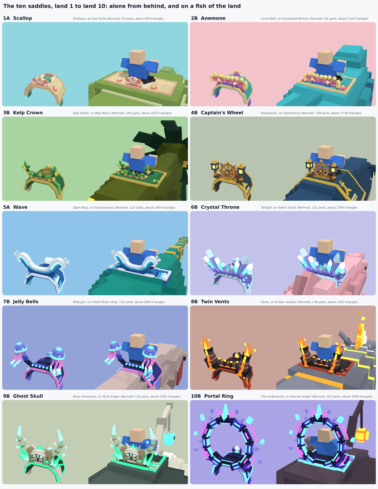
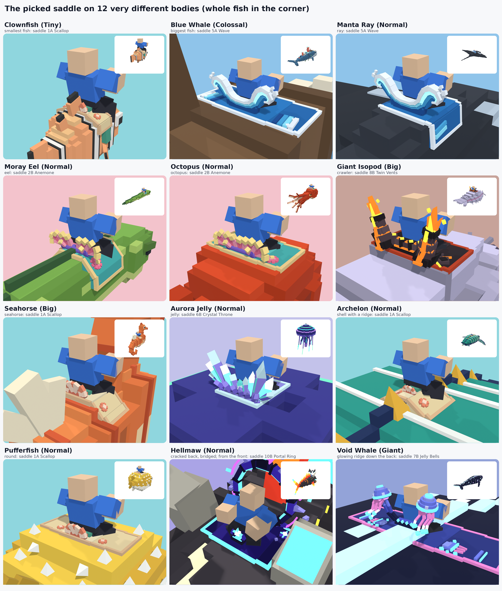
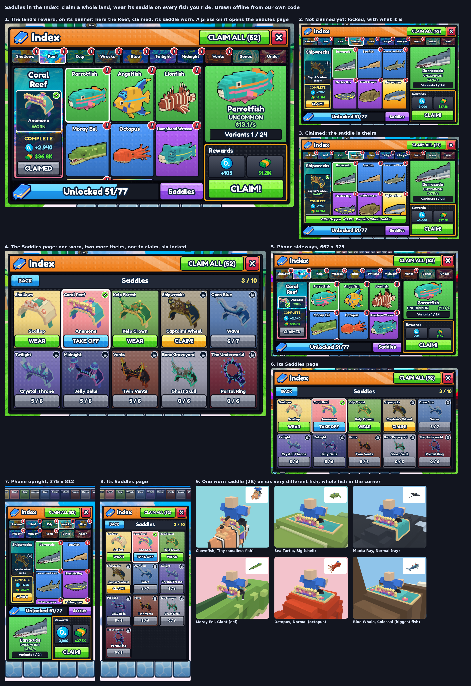

# Saddles: one for every land, as an Index reward

Hugo: "also add saddles as a reward in index, ... and give me a sheet of saddles for all the lands, make sure they
actually work on fishes." Task s1 made the designs and the proof that they fit (from "The ten" on); task s2 built
them into the game (the next section). **Nothing has been seen in Studio.** Hugo said yes to the ten redrawn saddles on
2026-11-25 ("saddles are good"); they are in the game's data since the same evening (d1, branch `saddles-merge`).

- **The ten, land 1 to land 10** (Hugo's picks, redrawn): `docs/attachments/saddles-ladder-1.png`
- **The fit** (the picked one on 12 very different bodies): `docs/attachments/saddles-fit-1.png`
- The first round, two for each land (the ten picks are drawn there as they were before): `docs/attachments/saddles-options-1.png`

## Merged and waiting for Studio (2026-11-25, NULLROOM d1; branch `saddles-merge`)

`saddles-2` merged onto `merge-finished-2026-11-25` (the second merge's base); not on main, nothing uploaded, Studio not touched.

- **Conflicts:** `IndexWindow` (the CLAIM ALL arrow and the saddles page both painted), `IndexService` (the attributes
  `IndexPaid` and `Saddle` both set), `Net` and the game-code skill (both sides' lines). `IndexPanel` and `IndexBook` merged by
  themselves. The partner's Index rules stay: the arrow until the first claim only, no callout, no Index Oxygen, no goal line for claims.
- **The ten are in:** `Shared/Saddles/Fits` and `Designs` written again by `to_luau.py`, `Config.Saddles.Land` = 1A 2B 3B 4B 5A 6B 7B 8B 9B 10B.
  `Spare` is 360 (was 240): at 240 a hop with land 10's saddle (up to 258 parts on at once in the test) made about 30 new parts every
  hop, at 300 and up none after the first. `PartsAFrame` stays 24, so the biggest saddle (165 parts) takes 7 frames.
- **Nothing the fits were measured on changed** on either base (creatures, sizes, seat height): the numbers below still hold.
- **Checked offline:** saddles 101; parity 9,380 saddles and 726,580 parts, 0 wrong; Index 73, 190 and 95 (old look); ring 128; fusing 164 and 97;
  offline 123 and 67; auras 61; texts 33: none failed. StyLua, selene (0 errors, the 3 old warnings), a Rojo build, no type
  error in a saddle or Index file. `full_check.py` has no offline part (every step asks Studio): **not run**.
  **Not run:** the ring test against the saved place (this PC ran out of memory; the same without the saddles), the checks in Studio.
- **With main** (`f3a42c5`, hop and texts): only notes conflict (the skill, Handoff, Sessions, `ui.md`), no code; the same checks pass on the two together.

### What only Studio can prove

1. The ten look right on live fish: one ride each on a small fish, an eel, a ray, a turtle and a Colossal whale, and that the rider
   sits in the same place with the saddle on and off.
2. A hop from fish to fish: no hitch and no blink, at 60 fps and on a phone (30 fps). On land 10's 165 parts too: if pieces
   are still popping in as you land, raise `PartsAFrame` (24) to 40.
3. A fail and an eat: the saddle goes with the fish and goes when it goes.
4. The ride fish on land, a tank fish ridden in the pen, riding out through the gate, and the sub's fish.
5. **New since the saddles were built:** the mid-air hop onto the sub (main, `Config.Sub.AirHop`): the rider leaves the leaping fish in the air;
   by the code the saddle goes with the land fish, which the server takes away as it carries the rider off
   (`RideService.carryOff`), so on the rider's own screen it stays on the empty fish for about one round trip (0.1 s). See whether
   that shows, whether the fish that then swims beside the sub visibly loses its saddle, and that no part is left in the air.
6. A second player's saddle on their fish, and a saddle put on, changed and taken off while they ride.
7. The Index: the pictures' light (ViewportFrames), the arrow at CLAIM ALL with the Saddles button there (phone held upright too), the toast
   over the Saddles page, the claim of a whole land giving its saddle, and the same saddle equipped after rejoining.
8. Six riders with saddles at once: frame time, and that no part is left behind when they leave.

### Questions for Hugo (each with what we do if you say nothing)

| Question | What you see today | If you say nothing (recommended) |
|---|---|---|
| **Tank seat** | A rider on a fish in the tank floats: up to 2.8 studs over a Colossal, 0.42 too low on a Tiny. On 34 of 468 fish and sizes the rider also follows the wrong part of the fish. The saddle itself sits on the back. | **The seat stays as it is:** the saddle is on the fish's back, the rider floats as today. **Recommended: say yes** to the fix, as a small change of its own after this merge (one line in `AquariumService`, then a check of the tank ride); it moves the seat, so it needs your yes. |
| **Dunkleosteus** | Its seat is at the edge of its head plate, which stands 0.76 (Tiny) to 3.24 (Colossal) studs over it: the rider is partly sunk in the plate, with a saddle or without. | **Leave the seat.** The pad starts behind the plate. Look at it in Studio at Big and Colossal; if it looks bad, move the seat back behind the plate. |
| **Void Whale** | Its back ridge comes up to 0.9 studs into the rider (big sizes). | **Leave the seat.** The pad is split beside the ridge. Worst of these three, so look at it first, at Huge. |
| **Lantern Leviathan** | Its ridge comes up to 0.58 studs into the rider (big sizes). | **Leave the seat**, same split pad. |
| **Moray Eel** | Its ridge comes up to 0.45 studs into the rider (big sizes). | **Leave the seat**, same split pad. |
| **Seahorse** | The rider hovers 0.46 (Huge) and 0.59 (Colossal) studs over its back. | **Leave the seat**: the pad is a thick block that fills the gap. |

## In the game (2026-11-25, NULLROOM task s2; branch `saddles`, with `index-look` merged into it)

- **How you get one:** claiming a land's whole set in the Index gives that land's saddle. The land's Oxygen and coins
  are as they were. Owning is not a second list: whoever has claimed the land owns its saddle, so lands claimed
  before saddles came have theirs, and it can't be given twice.
- **Wearing:** one at a time, on every fish you ride, or none. It is not put on by itself after a claim. Put on or taken
  off on the Saddles page, also on a dive. The server decides (`IndexService`, remote `Net.Index`, ask "Saddle" with a
  land, 0 = off; the Index's own rate limit). What is worn is the player's attribute `Saddle`, the only thing sent.
- **On the fish** (`Controllers/SaddleController`, on each player's own machine): wild fish, the ride fish on land, a ridden
  tank fish, a submarine's fish; everybody's. Its parts are made a few a frame (`PartsAFrame`), hidden, from the moment the
  fish is granted, shown as the rider lands, off as they leave. They hang on the fish's own part (`Fits`' joint) at its
  back, so they go with its swimming, angry mode and the fails; size and variant change nothing. A faded or hidden fish
  hides its saddle. They are in `workspace.Saddles`, not in the fish: no weight, no touch, no hits, no shadow. Parts are
  kept for the next one (`Spare`); six riders at once are 536 parts (lands 1 to 6's).
- **In the Index** (today's window only, `Config.Index.Look` 1): the land's banner shows the saddle's picture and name with a
  padlock, OWNED or WORN; a press on it, or the **Saddles** button beside the Unlocked bar, opens the Saddles page: WEAR, TAKE OFF,
  CLAIM! (the set is whole), or how far the set is (a press goes to that land). `UI/SaddlePage` with `UI/SaddlePicture`
  (the game's own parts in a ViewportFrame; nothing to upload); `IndexWindow` only has the hooks.
- **The numbers:** `Config.Saddles`. `On` 0 takes all of it out. **Each land's design is one entry in `Land`** ("1A" or "1B" ...;
  "" = that land gives none): a change there changes it for everyone who owns it.
- **The data:** `Shared/Saddles` (`Fits` and `Designs` are written by `python tools/saddles/to_luau.py` from `art/saddles/*.json` and
  `saddles.py`; `check` says whether they are up to date; never edit them by hand).
- **Saving is on.** A claimed land in the existing Index grants its saddle, including claims made before this feature.
  The optional `Parts.Index.Saddle` is the worn land. Absent means nothing worn. Older servers can forget that
  preference when rewriting the Index. The land claims and other Index fields keep their existing format.
- **Not changed:** the seat, the rider, the hit boxes. On big tank fish the rider still hovers over the saddle until the seat
  fix below gets its yes (the saddle is on the back either way). All 83 modeled kinds have a fit, including the remodeled Great White and the five new fish; block stand-ins and the trainer's
  seahorse have none and show no saddle.
- **Checked offline:** `tools/saddles/saddle_parity.luau` (every kind, size and design: 9,380 saddles, 726,580 parts, the same as
  the Python's that the proof below is about), `saddle_test.luau` (101: the rules, leaving and coming back, where it sits, when it shows,
  pooling), `tools/index/panel_test.luau` (the window against the real server, sizes on four phones), `tools/saddles/index_sheet.py` (the picture).
- **To see in Studio:** a ride each on a small fish, an eel, a ray, a turtle and a Colossal whale; a hop fish to fish (no hitch, no blink); a fail
  and an eat; the ride fish on land and in the tank; the submarine hop; a second player's saddle; the pictures' light
  in the Index (ViewportFrames); that the rider sits where they did without it.

## The ten (picked 2026-11-25, redrawn the same day; Hugo's yes the same evening)

Hugo: "1a 2b 3b 4b 5a(make a little better and especially more cohesive) 6b 7b 8b 9b 10b, make all of them better and make
sure theres an actual "coolness" progression in these saddles, nerf start slightly and make them cooler towards end, add detail".

The ladder: each land's saddle stands higher behind the rider than the one before, glows at least as much, and has more parts.
`ladder()` in `saddles.py` counts that from the designs, and the build stops if a later land falls under an earlier one.

| Land | Saddle | What it is now | Top over the back, studs | Glow, square studs | Parts |
|---|---|---|---|---|---|
| 1 Shallows | 1A Scallop | the plain one: a low shell, flat colours, small shells on the sides | 1.14 | 0 | 50 |
| 2 Coral Reef | 2B Anemone | a row of pink arms with pale tips, small anemones on the sides | 1.45 | 0 | 82 |
| 3 Kelp Forest | 3B Kelp Crown | two leafy kelp stalks with floats, a fan of leaves on a tied log | 2.2 | 0 | 104 |
| 4 Shipwrecks | 4B Captain's Wheel | a spoked wheel between two lit lamps, anchors and planks on the sides | 2.3 | 1.8 | 109 |
| 5 Open Blue | 5A Wave | one wave from side to side: four bands under one crest, curling over at both ends (it was two waves and loose pieces) | 2.5 | 10.4 | 122 |
| 6 Twilight | 6B Crystal Throne | a fan of crystals, tallest at the sides so the rider's back shows | 2.89 | 23.2 | 131 |
| 7 Midnight | 7B Jelly Bells | two lit jellyfish on curved arms, their tentacles trailing | 2.99 | 24.2 | 132 |
| 8 Vents | 8B Twin Vents | two lava-cracked chimneys with fire, lava running down | 3.56 | 40.2 | 138 |
| 9 Bone Graveyard | 9B Ghost Skull | a horned skull that faces the camera, ghost fire, lit horn tips | 4.19 | 52.5 | 152 |
| 10 The Underworld | 10B Portal Ring | a whole gate round the rider: lit segments, a crown, a broken outer ring, floating shards | 6.12 | 58.3 | 165 |

The price of cool: the chase camera sees 97 % of the rider on 1A, 83 to 90 % on 2B to 5A, 86 % on 7B, 84 % on 10B, 81 % on 8B, 76 % on 6B
and 70 % on 9B (means over all kinds). Least: 33 % (9B on a Colossal Void Whale, where the ridge lifts the skull).
The ten not picked stay in the data and can be had by their key.

**Own art:** every shape is made here out of blocks; nothing is taken from any game.

## Parts, triangles, uploads

- **Built from parts** (box, cylinder, wedge, a few balls; SmoothPlastic, Neon for the glowing bits): the picks are 19 to 165 parts a saddle,
  228 to 2,664 triangles. **Nothing has to be uploaded.**
- A later option, if many riders on screen cost too many parts: bake each saddle's trimmings to one mesh (the blanket
  stays parts, since it is fitted to each fish). That would be up to 20 small mesh uploads and **needs Hugo's yes first**.
  Not needed now.
- The data for the game is in `art/saddles/`: `saddles.json` (the 20 designs: pieces, colours) and `fit.json` (how it
  sits on each kind at each size), `adjust.json` (where a design's pieces are changed on a fish). All are written by the tools below;
  don't edit by hand.

## Why it can't move the seat

- The rider is welded to the fish's `Root.Saddle` point and locked to the joint under it (`AnimController.seatOf`). On a
  **wild fish** (`FishService`) and on **land** (`RideService`, Q) that point is 1.4 studs over the back at every size: both take
  the scaled part of the 1.4 off again (`saddle.Position -= SeatHeight * (scale - 1)`). The saddle changes neither. It is
  hung on the **same joint**, at the same point less 1.4.
- **A tank fish is different today:** `AquariumService` scales the model without that step, so its point is 1.4 x scale over
  the back. The saddle must not be hung at 1.4 under it there; see "For s2", step 3, and "Found on the way".
- Every part: Massless, CanCollide, CanTouch and CanQuery off, welded to that joint's part. So no hit box, catch, hook
  or camera ray sees it.
- **The rider never grows**, so the pocket (0.95 ahead, 0.72 behind, cushion top at 0.38; the hips are at 0.4) is the
  same size on every fish. Only the trimmings and the mat grow, by `clamp((length / 16) ^ 0.4, 0.85, 2)`.
- The tilting joint carries the saddle and the rider together, so the gap between them never changes while the fish
  bends. What can change is the gap to the *other* joints' backs: that is what the moving checks below measure.

## How it fits a body

The blanket is a pad as wide as the back is level, then up to two panels a side and a strap end, each swung down until it
lies on the fish, cut to the largest rectangle that lies well, and sunk a little (at most 0.35 to 0.55 studs, times the root of `grow`) so no gap shows. A
panel that would stand in a fin, hang in the air or be poked through is shrunk or left out. Each result is checked;
if it fails it is shrunk and deepened until it passes.

| Body | Rule (`style`) | Where |
|---|---|---|
| ordinary fish, eels, serpents | **drape**: pad, panels down both sides, strap | most kinds |
| rays, shells, jellies, octopus, pufferfish, crawlers with flat backs, giants | **flat**: a wide mat lying on top, hem all round, no strap | Manta Ray, Sea Turtle, jellies, Octopus, Giant Isopod, all the giants |
| a ridge runs under the rider | **slot**: the pad in two halves beside the ridge, no cushion | Void Whale (Normal up), Lantern Leviathan (Giant up), Moray Eel (Huge up) |
| a hard plate stands ahead of the seat | **step**: the pad starts behind it, a roll lies on the plate (up to Big), no pommel from Giant up | Dunkleosteus |
| the back lies under the seat point (the model's, growing with size) | the pad becomes a thick block down to it | Seahorse (Huge, Colossal) |
| almost no room ahead | **ledge**: short front, no pommel | Clownfish, Seahorse (Tiny) |
| walls or horns beside the seat | **tray**: the mat stops short of them | Hellmaw (Tiny) |
| a crack in a flat back | **bridged**: the mat lies straight across, like a board over a gap | Hellmaw (`CRACKS` in `fit.py`) |
| a thin fin right behind the rider | **split cantle**: the fin stands in the middle, the two ends stay | table below |
| the fish's head or fin is where the pommel would be | no pommel | table below |

## Results

Offline, from the creature models, by `python tools/saddles/fit.py` (about a minute), `clash.py` (about 4) and `rider.py` (about 8), in that order. The
468 fits are checked at rest, through the whole swim, at 2.3 times the swing and in a turn.

<!-- results -->

### Every kind

78 kinds x 6 sizes = 468 fits, **0 outside the limits**. Sizes: T Tiny, N Normal, B Big, G Giant, H Huge, C Colossal. Width: the pad's, in studs, at Tiny / Normal / Colossal. Worst: over all six sizes; still = not moving, moving = through the swim at 2.3 times its swing and a 5 degree turn. gap: the 95th share of the gaps under a panel's edge, studs. off: the share of the edge with no fish under it. in: how far the back comes up through a panel, studs (limits .05 still, .12 moving; over them is let through where under .05 of the panel, .08 moving, is poked: one thin point). fin: the share of the saddle a fin or limb stands in (limits .06, .1).

| Kind | Land | Joint | Style | Width | Panels a side | Pommel | Cantle | Still: gap / off / in / fin | Moving: gap / off / in / fin |
|---|---|---|---|---|---|---|---|---|---|
| Archelon | 1 | Shell | drape | 0.8 / 0.8 / 1.4 | T-N 2, B-C 1 | T no, N-C yes | T split, N-C full | .30 / .10 / .01 / .00 | .30 / .10 / .01 / .00 |
| Clownfish | 1 | S1 | T-H ledge, C flat | 1.5 / 2.0 / 2.7 | T 3, N-C 1 | no | T-G split, H-C full | .24 / .00 / .01 / .02 | .40 / .11 / .05 / .04 |
| Cuttlefish | 1 | Body | flat | 2.0 / 2.6 / 3.5 | T 1, N 0, B-C 2 | yes | full | .29 / .13 / .00 / .00 | .29 / .13 / .00 / .00 |
| Pearl Serpent | 1 | S7 | T-N drape, B-C flat | 2.8 / 4.0 / 4.8 | T-N 1, B 0, G-H 1, C 2 | yes | full | .00 / .00 / .00 / .00 | .49 / .25 / .00 / .00 |
| Pufferfish | 1 | Body | flat | 2.0 / 2.3 / 3.1 | T 0, N-C 2 | yes | full | .00 / .00 / .00 / .00 | .00 / .00 / .00 / .00 |
| Reef Shark | 1 | S1 | flat | 2.9 / 3.3 / 4.8 | T-B 1, G 3, H-C 2 | yes | T none, N-C full | .14 / .14 / .00 / .04 | .26 / .24 / .00 / .07 |
| Sea Turtle | 1 | Shell | flat | 2.5 / 2.9 / 3.9 | 2 | yes | full | .00 / .00 / .00 / .00 | .00 / .00 / .00 / .00 |
| Seahorse | 1 | Body | T ledge, N-C flat | 1.8 / 2.4 / 3.5 | T 3, N 0, B-C 2 | T-B no, G-C yes | T split, N-C full | .02 / .00 / .00 / .00 | .02 / .00 / .00 / .00 |
| Sergeant Major | 1 | S1 | flat | 2.0 / 2.2 / 2.9 | T 0, N-G 2, H 1, C 2 | T-G yes, H-C no | T-B split, G-C full | .18 / .00 / .00 / .02 | .34 / .15 / .10 / .04 |
| Stingray | 1 | Body | T-G drape, H-C flat | 1.6 / 2.3 / 4.1 | T-N 0, B-C 1 | yes | full | .00 / .00 / .00 / .00 | .00 / .00 / .00 / .10 |
| Yellow Tang | 1 | Body | T-H drape, C flat | 1.2 / 1.5 / 3.0 | T 3, N-C 1 | T-N no, B-C yes | full | .19 / .10 / .00 / .00 | .19 / .10 / .00 / .00 |
| Angelfish | 2 | Body | drape | 1.0 / 1.3 / 2.9 | T 3, N-C 1 | yes | full | .30 / .03 / .00 / .00 | .30 / .03 / .00 / .00 |
| Coral Dragon | 2 | S6 | flat | 3.8 / 4.3 / 4.8 | T-B 1, G-C 2 | yes | full | .29 / .00 / .00 / .00 | .29 / .00 / .00 / .01 |
| Dunkleosteus | 2 | Head | step | 3.3 / 3.9 / 4.8 | 0 | T-B yes, G-C no | T-N none, B-C full | .00 / .00 / .00 / .00 | .00 / .00 / .00 / .00 |
| Humphead Wrasse | 2 | B1 | flat | 3.0 / 3.5 / 4.8 | T 2, N 1, B-C 2 | yes | full | .00 / .13 / .00 / .00 | .00 / .13 / .00 / .00 |
| Lionfish | 2 | S1 | T-H drape, C flat | 1.1 / 1.6 / 3.3 | T-G 1, H-C 0 | T no, N-C yes | T-B split, G-C full | .29 / .00 / .00 / .01 | .29 / .11 / .01 / .01 |
| Moray Eel | 2 | S2 | T-G drape, H-C slot | 1.2 / 1.8 / 4.2 | T 1, N-B 2, G 0, H 2, C 1 | yes | T-G split, H-C full | .05 / .00 / .00 / .00 | .38 / .14 / .01 / .00 |
| Octopus | 2 | Mantle | flat | 2.5 / 2.9 / 4.2 | T 3, N-C 2 | yes | full | .00 / .00 / .00 / .00 | .00 / .00 / .00 / .00 |
| Parrotfish | 2 | S2 | T drape, N-C flat | 2.1 / 2.5 / 3.5 | T-B 1, G 0, H 1, C 3 | yes | full | .05 / .00 / .00 / .00 | .05 / .11 / .00 / .00 |
| Dakosaurus | 3 | S4 | flat | 3.5 / 4.0 / 4.8 | T 0, N 1, B-C 2 | yes | T split, N-C full | .00 / .04 / .01 / .00 | .00 / .11 / .01 / .00 |
| Garibaldi | 3 | S2 | drape | 1.0 / 1.3 / 2.9 | 1 | yes | full | .00 / .00 / .00 / .00 | .46 / .15 / .00 / .00 |
| Giant Sea Bass | 3 | S1 | flat | 2.8 / 3.2 / 4.6 | T 3, N 1, B-C 2 | yes | full | .00 / .00 / .00 / .00 | .00 / .13 / .00 / .00 |
| Great White | 3 | S1 | flat | 3.3 / 3.9 / 4.8 | T-N 1, B-C 2 | yes | full | .00 / .00 / .00 / .00 | .00 / .29 / .00 / .06 |
| Kelp Wyrm | 3 | S7 | flat | 3.8 / 4.4 / 4.8 | T-B 1, G-C 2 | yes | full | .00 / .00 / .00 / .00 | .00 / .11 / .00 / .00 |
| Leopard Shark | 3 | S1 | T drape, N-C flat | 2.0 / 3.0 / 4.3 | T 1, N 2, B-H 1, C 2 | yes | T split, N-C full | .00 / .00 / .00 / .00 | .00 / .13 / .01 / .00 |
| Sea Lion | 3 | S4 | T drape, N-C flat | 2.1 / 2.8 / 3.9 | 1 | T yes, N no, B-C yes | full | .25 / .11 / .00 / .00 | .25 / .11 / .15 / .00 |
| Steller's Sea Cow | 3 | S5 | flat | 3.5 / 4.0 / 4.8 | 2 | yes | full | .32 / .13 / .00 / .00 | .32 / .13 / .00 / .00 |
| Barracuda | 4 | S3 | T-N drape, B-C flat | 2.0 / 2.8 / 4.1 | T 1, N 2, B-C 1 | T no, N-C yes | full | .31 / .00 / .00 / .00 | .35 / .13 / .00 / .00 |
| Electric Ray | 4 | Body | T drape, N-C flat | 2.2 / 3.0 / 4.6 | T 2, N 0, B-C 1 | yes | full | .00 / .00 / .00 / .00 | .00 / .00 / .00 / .00 |
| Galleon Whale | 4 | Hull | T-B drape, G-C flat | 2.0 / 2.9 / 4.8 | T-N 2, B-G 3, H 1, C 3 | yes | full | .00 / .06 / .00 / .00 | .00 / .06 / .00 / .00 |
| Goliath Grouper | 4 | B1 | flat | 3.2 / 3.7 / 4.8 | 2 | yes | full | .00 / .06 / .00 / .00 | .00 / .13 / .00 / .00 |
| Hammerhead Shark | 4 | S2 | T drape, N-C flat | 2.5 / 3.3 / 4.8 | T-N 1, B-G 0, H 1, C 2 | yes | full | .17 / .00 / .00 / .00 | .17 / .05 / .00 / .00 |
| Sawfish | 4 | S2 | T-N drape, B-C flat | 2.4 / 3.4 / 4.8 | T 3, N-B 2, G 1, H 0, C 2 | yes | full | .27 / .13 / .00 / .00 | .27 / .13 / .00 / .00 |
| Xiphactinus | 4 | B3 | T-N drape, B-C flat | 2.6 / 3.9 / 4.8 | T-N 2, B-G 1, H-C 2 | yes | full | .00 / .00 / .00 / .00 | .00 / .00 / .00 / .00 |
| Blue Whale | 5 | S1 | T-N drape, B-C flat | 3.2 / 4.6 / 4.8 | T-N 2, B 1, G 3, H-C 2 | T no, N-C yes | full | .00 / .09 / .00 / .00 | .00 / .09 / .00 / .00 |
| Dolphin | 5 | S2 | T-G drape, H-C flat | 1.5 / 2.0 / 4.3 | T 1, N-B 2, G 1, H 2, C 1 | T-N no, B-C yes | T split, N-C full | .25 / .05 / .00 / .00 | .29 / .15 / .03 / .02 |
| Elasmosaurus | 5 | Body | flat | 3.5 / 4.3 / 4.8 | T 0, N 1, B-C 2 | T yes, N no, B-C yes | full | .00 / .00 / .00 / .00 | .00 / .00 / .00 / .00 |
| Helicoprion | 5 | S3 | flat | 3.4 / 3.9 / 4.8 | T 3, N-C 2 | T no, N-C yes | full | .00 / .00 / .00 / .00 | .00 / .00 / .00 / .01 |
| Manta Ray | 5 | Body | T drape, N-C flat | 2.9 / 3.6 / 4.7 | T 1, N 2, B-G 1, H-C 0 | yes | full | .15 / .00 / .00 / .00 | .15 / .00 / .00 / .00 |
| Orca | 5 | S3 | flat | 3.4 / 3.9 / 4.8 | T-N 1, B-C 2 | yes | full | .00 / .00 / .00 / .00 | .44 / .11 / .02 / .02 |
| Storm Serpent | 5 | S5 | T-N drape, B-C flat | 2.9 / 4.1 / 4.8 | T-N 3, B 0, G-H 1, C 2 | yes | full | .00 / .13 / .00 / .00 | .38 / .13 / .00 / .00 |
| Swordfish | 5 | S2 | T-N drape, B-C flat | 2.2 / 3.1 / 4.8 | T-N 2, B-C 1 | T no, N-C yes | full | .08 / .00 / .00 / .00 | .14 / .00 / .00 / .00 |
| Aurora Jelly | 6 | Bell | flat | 2.6 / 3.5 / 4.8 | T-N 0, B-G 1, H-C 2 | yes | full | .00 / .00 / .00 / .00 | .00 / .00 / .00 / .00 |
| Giant Squid | 6 | Mantle | T-N drape, B-C flat | 2.5 / 3.5 / 4.8 | T 2, N 1, B 2, G 1, H-C 2 | yes | full | .10 / .00 / .00 / .00 | .10 / .00 / .00 / .00 |
| Goblin Shark | 6 | S2 | T drape, N-C flat | 2.4 / 3.4 / 4.8 | T-N 1, B 0, G-H 1, C 2 | T no, N-C yes | T split, N-C full | .00 / .00 / .00 / .00 | .45 / .14 / .02 / .00 |
| Lantern Leviathan | 6 | S3 | T-N drape, B flat, G-C slot | 2.7 / 3.8 / 4.7 | T-N 2, B 3, G 0, H-C 2 | yes | full | .13 / .06 / .00 / .00 | .13 / .17 / .00 / .00 |
| Liopleurodon | 6 | Body | flat | 3.6 / 4.1 / 4.8 | 2 | yes | full | .00 / .00 / .00 / .00 | .00 / .00 / .00 / .00 |
| Shonisaurus | 6 | S2 | flat | 3.8 / 4.4 / 4.8 | 2 | yes | full | .00 / .13 / .00 / .00 | .00 / .13 / .00 / .00 |
| Viperfish | 6 | S2 | T-H drape, C flat | 1.1 / 1.5 / 3.8 | T 3, N 1, B-G 0, H 1, C 2 | T-N no, B-C yes | full | .00 / .00 / .00 / .00 | .00 / .14 / .00 / .00 |
| Anglerfish | 7 | Body | flat | 2.6 / 3.0 / 4.5 | T-N 1, B 3, G-C 2 | yes | full | .24 / .13 / .00 / .00 | .24 / .13 / .00 / .00 |
| Basilosaurus | 7 | S5 | T drape, N-C flat | 3.7 / 4.5 / 4.8 | T-N 2, B 1, G-C 2 | yes | full | .00 / .00 / .00 / .00 | .00 / .13 / .00 / .00 |
| Frilled Shark | 7 | S2 | drape | 1.1 / 1.6 / 4.7 | T-N 1, B 3, G 2, H-C 1 | yes | full | .00 / .00 / .00 / .00 | .02 / .07 / .01 / .00 |
| Kraken | 7 | Mantle | flat | 4.2 / 4.8 / 4.8 | T 1, N-C 2 | yes | full | .00 / .13 / .00 / .00 | .00 / .13 / .00 / .00 |
| Livyatan | 7 | S4 | T-N flat, B drape, G-C flat | 1.8 / 2.2 / 4.8 | T-N 0, B-G 2, H-C 1 | yes | full | .00 / .10 / .00 / .00 | .00 / .16 / .00 / .01 |
| Mosasaurus | 7 | S3 | flat | 3.9 / 4.5 / 4.8 | T 3, N-C 2 | yes | full | .00 / .13 / .00 / .00 | .00 / .21 / .00 / .00 |
| Void Whale | 7 | S1 | T flat, N-C slot | 4.1 / 4.4 / 5.6 | 2 | yes | full | .12 / .00 / .00 / .00 | .12 / .00 / .00 / .00 |
| Anomalocaris | 8 | B1 | flat | 3.3 / 3.8 / 4.8 | T-N 1, B-C 2 | yes | full | .00 / .00 / .00 / .00 | .00 / .00 / .00 / .00 |
| Bobbit Worm | 8 | S2 | flat | 3.4 / 3.9 / 4.8 | T 1, N 3, B-C 2 | yes | full | .00 / .00 / .00 / .00 | .36 / .10 / .00 / .00 |
| Ember Serpent | 8 | S8 | T drape, N-C flat | 4.0 / 4.6 / 4.8 | T 2, N-B 1, G-C 2 | yes | full | .17 / .00 / .00 / .00 | .17 / .00 / .00 / .00 |
| Giant Isopod | 8 | Body | flat | 2.3 / 2.7 / 4.1 | T 1, N-C 2 | yes | full | .00 / .00 / .00 / .00 | .00 / .02 / .00 / .00 |
| Kronosaurus | 8 | Body | T-B flat, G drape, H-C flat | 1.8 / 2.6 / 4.8 | T-B 0, G-C 2 | T no, N-C yes | full | .00 / .10 / .00 / .00 | .00 / .10 / .00 / .00 |
| Megalodon | 8 | S2 | flat | 4.0 / 4.6 / 4.8 | 2 | yes | full | .00 / .00 / .00 / .00 | .00 / .00 / .00 / .00 |
| Molten Megalodon | 8 | S2 | T drape, N-C flat | 3.2 / 4.5 / 4.8 | T 2, N 0, B-C 1 | yes | full | .31 / .03 / .00 / .00 | .31 / .03 / .00 / .00 |
| Sea Scorpion | 8 | S3 | T-N drape, B-C flat | 2.2 / 3.2 / 4.8 | T 1, N 2, B-H 1, C 2 | yes | full | .05 / .00 / .00 / .00 | .46 / .11 / .00 / .00 |
| Bone Leviathan | 9 | V5 | T-G drape, H-C flat | 1.6 / 2.4 / 4.8 | T 1, N 3, B 2, G-C 1 | yes | full | .20 / .11 / .00 / .00 | .20 / .11 / .00 / .00 |
| Grave Ray | 9 | Body | T drape, N-C flat | 2.8 / 3.6 / 4.7 | T 1, N 2, B-G 1, H-C 0 | yes | full | .00 / .00 / .00 / .00 | .00 / .00 / .00 / .00 |
| Grave Turtle | 9 | Shell | drape | 0.8 / 0.8 / 1.4 | T-B 2, G-C 1 | yes | T split, N-C full | .34 / .00 / .00 / .00 | .34 / .00 / .00 / .00 |
| Halfbone Megalodon | 9 | S1 | T flat, N-B drape, G-C flat | 2.0 / 3.0 / 4.8 | T 0, N 1, B-C 0 | yes | full | .00 / .00 / .00 / .00 | .38 / .21 / .09 / .05 |
| Phantom Whale | 9 | Chest | T flat, N-B drape, G-C flat | 1.7 / 3.0 / 4.8 | T 0, N 2, B 3, G 1, H-C 3 | yes | full | .00 / .00 / .00 / .00 | .00 / .00 / .00 / .00 |
| Skull Angler | 9 | Body | flat | 3.1 / 3.5 / 4.8 | T 2, N-B 1, G-C 2 | yes | full | .00 / .00 / .00 / .00 | .00 / .00 / .00 / .00 |
| Wraith Eel | 9 | S5 | T-G drape, H-C flat | 1.6 / 2.3 / 4.8 | T 3, N-G 1, H 2, C 1 | yes | full | .16 / .00 / .00 / .00 | .16 / .05 / .00 / .00 |
| Abyssal Watcher | 10 | Body | T drape, N-C flat | 3.4 / 4.4 / 4.8 | T-N 2, B 1, G 3, H-C 2 | yes | full | .00 / .13 / .00 / .00 | .00 / .13 / .00 / .00 |
| Brimstone Eel | 10 | S4 | T-N drape, B-C flat | 2.7 / 3.8 / 4.8 | T-N 2, B-G 1, H-C 2 | yes | full | .31 / .06 / .00 / .00 | .31 / .17 / .00 / .00 |
| Cinder Ray | 10 | Body | T drape, N-C flat | 2.3 / 3.6 / 4.7 | T 0, N 2, B-C 1 | yes | full | .00 / .00 / .00 / .00 | .00 / .00 / .00 / .00 |
| Hellfin Shark | 10 | S1 | flat | 3.5 / 4.0 / 4.8 | T 1, N 2, B 1, G-C 2 | yes | full | .00 / .00 / .00 / .00 | .03 / .19 / .02 / .06 |
| Hellmaw | 10 | Head | T tray, N-C flat | 3.5 / 4.0 / 4.8 | T-B 1, G-C 2 | yes | full | .00 / .02 / .00 / .00 | .00 / .02 / .00 / .06 |
| Infernal Angler | 10 | Body | flat | 3.2 / 3.7 / 4.8 | T-N 1, B-C 2 | yes | full | .25 / .13 / .00 / .00 | .25 / .13 / .00 / .00 |
| The Devourer | 10 | Head | T drape, N-C flat | 3.6 / 4.8 / 4.8 | T-N 2, B 1, G-C 2 | yes | full | .30 / .00 / .00 / .00 | .30 / .00 / .00 / .00 |

Joint the same at all six sizes: every kind.

### Every design, on all kinds and sizes

Rider, riding pose and leaning 20 degrees further: how deep the saddle goes into torso, arms or head (studs). Seen: the share of the rider the chase camera still sees past it, least / mean. Overhang: the furthest a pommel or cantle stands out past a narrow pad with nothing within a stud under it (studs), and on how many of the 468.

Hidden: of the 234 at Tiny, Normal and Colossal, on how many the fish itself hides half or more of the cantle's pieces from the game's camera / zoomed out to 27 studs. Changed: on how many of the 468 a piece stood in the fish, so the design is changed there (cantle smaller or split / cantle none / pommel / trimmings).

| Design | Parts | Triangles | Riding | Leaning 20 | Worst on | Seen | Overhang | on | Hidden | Changed |
|---|---|---|---|---|---|---|---|---|---|---|
| 1A Scallop **picked** | 19 to 50 | 228 to 600 | 0.00 | 0.13 | Void Whale Huge | 0.87 / 0.97 | 0.00 | 0 | 44 / 48 | 1 / 0 / 0 / 0 |
| 1B Giant Clam | 20 to 58 | 240 to 908 | 0.01 | 0.42 | Void Whale Huge | 0.72 / 0.90 | 0.00 | 0 | 25 / 23 | 0 / 0 / 1 / 1 |
| 2A Coral Twigs | 20 to 56 | 240 to 672 | 0.00 | 0.42 | Void Whale Huge | 0.73 / 0.93 | 0.25 | 10 | 25 / 23 | 0 / 0 / 1 / 0 |
| 2B Anemone **picked** | 30 to 82 | 420 to 1224 | 0.00 | 0.15 | Void Whale Huge | 0.76 / 0.87 | 0.21 | 8 | 33 / 38 | 0 / 0 / 0 / 0 |
| 3A Kelp Wrap | 20 to 58 | 320 to 880 | 0.00 | 0.17 | Void Whale Huge | 0.74 / 0.87 | 0.00 | 0 | 31 / 34 | 1 / 0 / 0 / 24 |
| 3B Kelp Crown **picked** | 27 to 104 | 572 to 1812 | 0.00 | 0.32 | Void Whale Huge | 0.69 / 0.90 | 0.35 | 17 | 28 / 27 | 0 / 0 / 4 / 6 |
| 4A Crate | 19 to 50 | 228 to 840 | 0.00 | 0.30 | Void Whale Big | 0.77 / 0.87 | 0.25 | 11 | 31 / 29 | 2 / 0 / 1 / 11 |
| 4B Captain's Wheel **picked** | 28 to 109 | 480 to 1728 | 0.00 | 0.55 | Void Whale Huge | 0.62 / 0.88 | 0.25 | 12 | 32 / 36 | 1 / 0 / 1 / 0 |
| 5A Wave **picked** | 31 to 122 | 372 to 1464 | 0.00 | 0.48 | Void Whale Huge | 0.57 / 0.83 | 0.00 | 0 | 23 / 19 | 0 / 0 / 0 / 2 |
| 5B Splash Wings | 14 to 54 | 168 to 648 | 0.00 | 0.13 | Void Whale Huge | 0.70 / 0.91 | 0.00 | 0 | 26 / 26 | 5 / 4 / 0 / 0 |
| 6A Frost | 24 to 55 | 288 to 644 | 0.09 | 0.29 | Void Whale Huge | 0.75 / 0.87 | 0.21 | 8 | 31 / 35 | 1 / 0 / 0 / 74 |
| 6B Crystal Throne **picked** | 52 to 131 | 584 to 1396 | 0.01 | 0.45 | Void Whale Giant | 0.43 / 0.76 | 0.25 | 13 | 30 / 33 | 5 / 0 / 4 / 0 |
| 7A Lantern | 18 to 44 | 216 to 740 | 0.00 | 0.46 | Void Whale Giant | 0.73 / 0.90 | 0.00 | 0 | 32 / 33 | 1 / 0 / 1 / 0 |
| 7B Jelly Bells **picked** | 43 to 132 | 756 to 2664 | 0.00 | 0.49 | Moray Eel Colossal | 0.54 / 0.86 | 0.25 | 13 | 20 / 18 | 5 / 0 / 1 / 0 |
| 8A Ember | 19 to 53 | 228 to 636 | 0.00 | 0.37 | Void Whale Giant | 0.72 / 0.88 | 0.31 | 14 | 32 / 34 | 1 / 0 / 0 / 1 |
| 8B Twin Vents **picked** | 38 to 138 | 432 to 1552 | 0.00 | 0.40 | Void Whale Giant | 0.59 / 0.81 | 0.31 | 16 | 22 / 18 | 5 / 0 / 3 / 0 |
| 9A Rib | 24 to 62 | 288 to 744 | 0.10 | 0.28 | Void Whale Huge | 0.78 / 0.90 | 0.00 | 0 | 30 / 29 | 1 / 0 / 0 / 13 |
| 9B Ghost Skull **picked** | 40 to 152 | 448 to 1592 | 0.12 | 0.58 | Lantern Leviathan Colossal | 0.33 / 0.70 | 0.31 | 15 | 27 / 26 | 10 / 0 / 1 / 10 |
| 10A Star Rock | 20 to 51 | 240 to 612 | 0.01 | 0.46 | Void Whale Giant | 0.68 / 0.86 | 0.21 | 8 | 30 / 31 | 2 / 0 / 0 / 0 |
| 10B Portal Ring **picked** | 48 to 165 | 528 to 1844 | 0.00 | 0.59 | Giant Sea Bass Tiny | 0.66 / 0.84 | 0.31 | 17 | 22 / 20 | 10 / 1 / 1 / 0 |

### Where the fish hides the raised back (its own land's picked saddle)

**30 of 231** (78 kinds at Tiny, Normal and Colossal, less those with no cantle) from the game's camera (17 studs). The number is the share of the cantle's pieces hidden:

Clownfish 1A (C 0.58); Reef Shark 1A (N 0.89, C all); Seahorse 1A (C all); Sergeant Major 1A (C all); Giant Sea Bass 3B (C 0.56); Great White 3B (C all); Leopard Shark 3B (C 0.65); Galleon Whale 4B (T all, N all, C all); Hammerhead Shark 4B (C all); Sawfish 4B (C all); Blue Whale 5A (T all, N all); Dolphin 5A (C 0.57); Helicoprion 5A (C all); Orca 5A (C all); Storm Serpent 5A (C all); Megalodon 8B (N all, C all); Molten Megalodon 8B (N all, C all); Bone Leviathan 9B (C all); Halfbone Megalodon 9B (T all); Hellfin Shark 10B (T 0.51, N 0.88, C all); Hellmaw 10B (N 0.92, C all).

**27 of 231** (78 kinds at Tiny, Normal and Colossal, less those with no cantle) zoomed out to 27 studs. The number is the share of the cantle's pieces hidden:

Reef Shark 1A (N 0.79, C all); Seahorse 1A (C all); Sergeant Major 1A (C 0.79); Coral Dragon 2B (C 0.82); Giant Sea Bass 3B (C 0.52); Great White 3B (C all); Leopard Shark 3B (C 0.51); Galleon Whale 4B (T all, N all, C all); Hammerhead Shark 4B (C all); Sawfish 4B (C 0.63); Blue Whale 5A (T 0.84, N all, C all); Helicoprion 5A (C all); Orca 5A (C all); Storm Serpent 5A (C 0.89); Megalodon 8B (C all); Molten Megalodon 8B (C all); Bone Leviathan 9B (C all); Halfbone Megalodon 9B (T 0.74, N 0.79); Hellfin Shark 10B (N 0.59, C all); Hellmaw 10B (C all).

### Pieces standing in the fish

`clash.py`, all 20 designs on all 468 (9360 cases): the cantle, pommel and trimmings against the fish, at rest and at four moments of the swim at 2.3 times its swing. A piece counts when a quarter of it stands more than 0.1 studs inside the fish; a group fails on more than one such piece, or more than a tenth of it, at rest (more than two, or a quarter, moving). Failing as designed: 56 cantles, 19 pommels, 142 sets of trimmings. **217 cases are changed** (`art/saddles/adjust.json`: a smaller cantle, one without its middle, none; a smaller pommel; the trimmings of a panel left off), after which 0 fail. Of the picked saddles on their own land's fish, 6 are changed:

Garibaldi Giant 3B: no flap trimmings; Garibaldi Colossal 3B: no flap trimmings; Halfbone Megalodon Tiny 9B: cantle x0.55; Hellfin Shark Tiny 10B: cantle x0.55; Hellfin Shark Normal 10B: cantle x0.7; Hellmaw Tiny 10B: cantle x0.7.

<!-- /results -->

### Read with care
- **Riding pose:** of the picks only 9B touches the rider (0.12 studs on a Tiny Grave Turtle, 0.10 on a Tiny Archelon) and 6B (0.01); of the rest 9A (0.10), 6A (0.09), 1B and 10A (0.01). Leaning 20 degrees further than the riding pose (thrown, whipped) any raised back can go
  up to 0.6 studs into the rider for a moment.
- **Narrow ridges** (Archelon, Grave Turtle, small eels): the raised back is wider than the ridge it stands on, so its
  ends reach out over the side panels; see "Overhang". It reads as wings (looked at on seven of them), but it does hang free there.
- **The fish often hides the raised back from the camera:** on 30 of 231 of the picked saddles on their own land's fish (27 zoomed out to 27 studs), half of the cantle or more; the list is in "Where the fish hides the raised back". It is the fish's
  own form (a back fin, a hump, a hull, a tail), not the saddle's fit, so a saddle cannot mend it; on those fish the player sees the mat, the pommel and
  the parts beside the rider.
- **Seen** is how much the saddle hides of the rider; **Hidden** is how much the fish hides of the saddle. Both from the level game camera,
  which is 17 studs back whatever the fish's size. (An earlier version of the check had that camera 2.5 studs too low; from there the fish hides more: reviewer counted 41 of 231, in the first round.)

## Found on the way (the game, not changed)
- **Dunkleosteus:** its seat is at the edge of its own head plate. The plate stands 0.76 (Tiny) to 3.24 (Colossal) studs over
  the seat, so today the rider is partly sunk in it, saddle or not.
- **Void Whale, Lantern Leviathan, Moray Eel:** their back ridge stands under the rider and, since the seat point's 1.4 does not
  grow, comes up into the rider at the big sizes (up to 0.9, 0.58 and 0.45 studs).
- **Tank riders hover or sink:** the missing step in `AquariumService` (above) leaves a tank rider's seat 1.4 x scale over the back, not 1.4:
  0.42 studs lower than it should be on a Tiny, up to 2.8 higher on a Colossal (scale 3). On 34 of 468 the rider is also locked to the wrong joint.
- **Seahorse:** its seat point is 0.46 (Huge) and 0.59 (Colossal) studs over its back, so today the rider hovers a little; the pad fills it.
- Moving those seats would fix all of it. That is a ride-feel change, so it is Hugo's call, not part of this.

## For s2 (building it in): done, step 5 is left
Steps 1 to 4 are built (4 without the seat fix); step 6 is answered above.
1. Put `art/saddles/*.json` under `src/shared` (Rojo reads JSON as a module), or turn them into Luau tables.
2. Port `frames` and `build` (`tools/saddles/fit.py`, `saddles.py`; the Python is the reference; a few pieces are wedges), with
   `adjust.json`'s row for that kind, size and design (`build`'s third argument): without it pieces stand in the fish on 217 of 9,360 cases.
   One build gives a list of parts with CFrames from the seat point. Make them once per kind, size and saddle and keep
   a clone; a colour tint per part is enough.
3. Where: `AnimController.seatOf`'s part, offset `saddle attachment CFrame * (0, -1.4, 0)` (wild fish and land fish only; tank fish: step 4). Do it on each player's own
   machine for every ridden fish that has a saddle, from one attribute the server sets.
4. **Tank fish** (step 3 is wrong for them as the game is now, see above): hung at 1.4 under the point the saddle would
   float 2.8 studs over the back on a scale-3 Colossal and sink 0.42 into it on a Tiny. Two ways:
   - **Better: mend the seat.** In `AquariumService` (after the `ScaleTo` that sets the tank size, where `root` is had) add the line
     `FishService` has: `saddle.Position -= Vector3.new(0, Config.Ride.SeatHeight * (scale - 1), 0)`, with `scale = shown / kind.Size.Z`.
     Then step 3 holds for tank fish too. It moves the tank rider down by 1.4 x (scale - 1) (up by 0.42 on a Tiny), so it is a
     seat change and needs Hugo's yes; check the tank ride after it (`TankRideService` keeps the rider inside the tank by this point).
   - **Without it:** hang the saddle at `1.4 x scale` under the point on a tank fish (scale as above; 1.4 on every other fish). The saddle then
     fits the fish and the rider still hovers over it as today.
   - Either way take the joint from `fit.json` (`joint`), not from `seatOf`, on a tank fish: `seatOf` looks 0.3 under a point that is too
     high, and on 34 of the 468 it finds another joint than the saddle's (Reef Shark, Great White, Hellfin Shark, Dolphin and
     others; the rider is locked to the wrong one there now). With the seat mended the two agree again.
   - A tank fish is its real size (`ShowShare` 1), so its size's row in `fit.json` is the right one. Land rides use the same
     size too (`Equip.LandMost` is 0); if that is ever set, a clamped fish has no row and needs its own fit.
5. Check in Studio: one ride on each body in the fit sheet; that the rider's position is the same with the saddle on
   and off (it must be, to the thousandth); Seen from the chase camera; parts on screen with six riders.
6. Not decided: which Index step gives which saddle, and whether a player picks a saddle or it is worn by land.

## Tools
`to_luau.py` writes the game's data, `saddle_parity.luau` and `saddle_test.luau` check the game's code (lune, on a built place), `index_sheet.py` draws
the Index picture. The rest is s1's:

All in `tools/saddles/`, run with the project's Python, no Studio: `fish.py` (loads the models), `fit.py` (fit and
check), `saddles.py` (`build`, the designs not picked, the ladder check), `picked.py` (the ten picks), `clash.py` (pieces standing in the fish, about 4 minutes; writes `adjust.json`), `rider.py` (rider clearance, camera), `table.py` (the tables here),
`sheet.py ladder`, `fit` and `options` (the pictures, in Blender through `view.py` and `draw.py`; on a machine short of memory set
`SADDLE_BLENDERS=1`: four at once can be killed by the kernel, which shows as "Blender failed" and no message).
`SADDLE_KEYS=picks` makes `clash.py` and `rider.py` run the ten picks only and keep the others' results.
