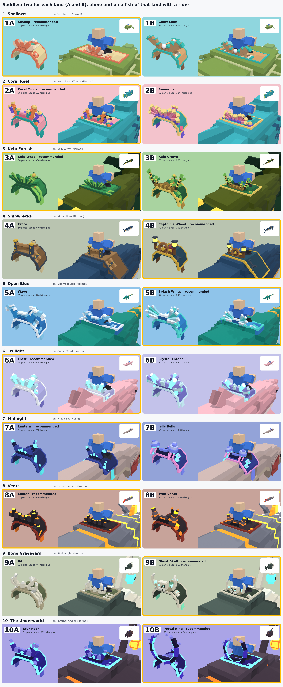

# Saddles: one for every land, as an Index reward

Hugo: "also add saddles as a reward in index, ... and give me a sheet of saddles for all the lands, make sure they
actually work on fishes." This note is task s1: the designs, and the proof that they fit. Task s2 builds them into the
game. Nothing in `src/` is changed yet and nothing has been seen in Studio.

- **The sheet** (two for each land, numbered land + A or B): `docs/attachments/saddles-options-1.png`
- **The fit** (the recommended one on 12 very different bodies): `docs/attachments/saddles-fit-1.png`

## The options (nothing picked yet)

A is the safe one, B the bolder one. **Bold** is the one Claude recommends.

| Land | A | B | Why that one |
|---|---|---|---|
| 1 Shallows | **1A Scallop**: sand mat, coral-red fan shell behind, a pearl in front | 1B Giant Clam: two open shell halves, a pearl between | reads as a shell at once, and lowest behind the rider |
| 2 Coral Reef | **2A Coral Twigs**: pink mat, orange and violet branches | 2B Anemone: a row of pink arms with pale tips | the branches look like coral; the arms can read as flowers |
| 3 Kelp Forest | **3A Kelp Wrap**: green mat, a fan of kelp leaves, a float in front | 3B Kelp Crown: a log with kelp stalks | the calmer outline, and fewer parts |
| 4 Shipwrecks | 4A Crate: planks with iron corners | **4B Captain's Wheel**: a ship's wheel between two lamps | the wheel says "ship" from far off |
| 5 Open Blue | 5A Wave: two curling waves | **5B Splash Wings**: water thrown up both sides | leaves the rider's back the clearest, and looks fast |
| 6 Twilight | **6A Frost**: a pale mat, a row of ice crystals | 6B Crystal Throne: taller crystals, ice arms | ice in one look, not as tall |
| 7 Midnight | **7A Lantern**: dark blue, glowing dots, a small lure in front | 7B Jelly Bells: two glowing jellies | 740 triangles against 1,368, and it stays off the rider |
| 8 Vents | **8A Ember**: cracked black stone with hot tops | 8B Twin Vents: two smoking chimneys | 636 triangles against 1,200 |
| 9 Bone Graveyard | 9A Rib: ribs round the seat | **9B Ghost Skull**: a small skull with glowing eyes behind | the ribs are a paler shape on a pale fish; the skull is seen |
| 10 The Underworld | 10A Star Rock: dark rock, cyan edges | **10B Portal Ring**: a broken ring of rock floating behind the rider | the last land's reward should be the biggest look |

10B hides the most of the rider (the chase camera still sees 80 % of them on average; every other design 83 % or more). If
that is too much, 10A is the fallback.

**Own art:** every shape is made here out of blocks; nothing is taken from any game.

## Parts, triangles, uploads

- **Built from parts** (box, cylinder, a few balls; SmoothPlastic, Neon for the glowing bits): 18 to 70 parts a saddle,
  216 to 1,368 triangles. **Nothing has to be uploaded.**
- A later option, if many riders on screen cost too many parts: bake each saddle's trimmings to one mesh (the blanket
  stays parts, since it is fitted to each fish). That would be up to 20 small mesh uploads and **needs Hugo's yes first**.
  Not needed now.
- The data for the game is in `art/saddles/`: `saddles.json` (the 20 designs: pieces, colours) and `fit.json` (how it
  sits on each kind at each size). Both are written by the tools below; don't edit by hand.

## Why it can't move the seat

- The rider is welded to the fish's `Root.Saddle` point, 1.4 studs over the back at every size, and locked to the joint
  under it (`AnimController.seatOf`). The saddle changes neither. It is hung on the **same joint**, at the same point less the 1.4.
- Every part: Massless, CanCollide, CanTouch and CanQuery off, welded to that joint's part. So no hit box, catch, hook
  or camera ray sees it.
- **The rider never grows**, so the pocket (0.95 ahead, 0.72 behind, cushion top at 0.38; the hips are at 0.4) is the
  same size on every fish. Only the trimmings and the mat grow, by `clamp((length / 16) ^ 0.4, 0.85, 2)`.
- The tilting joint carries the saddle and the rider together, so the gap between them never changes while the fish
  bends. What can change is the gap to the *other* joints' backs: that is what the moving checks below measure.

## How it fits a body

The blanket is a pad as wide as the back is level, then up to two panels a side and a strap end, each swung down until it
lies on the fish, cut to the largest rectangle that lies well, and sunk a little (at most 0.35 to 0.55 studs, times the root of `grow`) so no gap shows. A
panel that would stand in a fin, hang in the air or be poked through is shrunk or left out. Each result is checked;
if it fails it is shrunk and deepened until it passes.

| Body | Rule (`style`) | Where |
|---|---|---|
| ordinary fish, eels, serpents | **drape**: pad, panels down both sides, strap | most kinds |
| rays, shells, jellies, octopus, pufferfish, crawlers with flat backs, giants | **flat**: a wide mat lying on top, hem all round, no strap | Manta Ray, Sea Turtle, jellies, Octopus, Giant Isopod, all the giants |
| a ridge runs under the rider | **slot**: the pad in two halves beside the ridge, no cushion | Void Whale (Normal up), Lantern Leviathan (Giant up), Moray Eel (Huge up) |
| a hard plate stands ahead of the seat | **step**: the pad starts behind it, a roll lies on the plate (up to Big), no pommel from Giant up | Dunkleosteus |
| the back lies under the seat point (the model's, growing with size) | the pad becomes a thick block down to it | Seahorse (Huge, Colossal) |
| almost no room ahead | **ledge**: short front, no pommel | Clownfish, Seahorse (Tiny) |
| walls or horns beside the seat | **tray**: the mat stops short of them | Hellmaw (Tiny) |
| a crack in a flat back | **bridged**: the mat lies straight across, like a board over a gap | Hellmaw (`CRACKS` in `fit.py`) |
| a thin fin right behind the rider | **split cantle**: the fin stands in the middle, the two ends stay | table below |
| the fish's head or fin is where the pommel would be | no pommel | table below |

## Results

Offline, from the creature models, by `python tools/saddles/fit.py` (about a minute) and `rider.py` (about 8 minutes). The
468 fits are checked at rest, through the whole swim, at 2.3 times the swing and in a turn.

<!-- results -->

### Every kind

78 kinds x 6 sizes = 468 fits, **0 outside the limits**. Sizes: T Tiny, N Normal, B Big, G Giant, H Huge, C Colossal. Width: the pad's, in studs, at Tiny / Normal / Colossal. Worst: over all six sizes; still = not moving, moving = through the swim at 2.3 times its swing and a 5 degree turn. gap: the 95th share of the gaps under a panel's edge, studs. off: the share of the edge with no fish under it. in: how far the back comes up through a panel, studs (limits .05 still, .12 moving). fin: the share of the saddle a fin or limb stands in (limits .06, .1).

| Kind | Land | Joint | Style | Width | Panels a side | Pommel | Cantle | Still: gap / off / in / fin | Moving: gap / off / in / fin |
|---|---|---|---|---|---|---|---|---|---|
| Archelon | 1 | Shell | drape | 0.8 / 0.8 / 1.4 | T-N 2, B-C 1 | T no, N-C yes | T split, N-C full | .30 / .10 / .01 / .00 | .30 / .10 / .01 / .00 |
| Clownfish | 1 | S1 | T-H ledge, C flat | 1.5 / 2.0 / 2.7 | T 3, N-C 1 | no | T-G split, H-C full | .24 / .00 / .01 / .02 | .40 / .11 / .05 / .04 |
| Cuttlefish | 1 | Body | flat | 2.0 / 2.6 / 3.5 | T 1, N 0, B-C 2 | yes | full | .29 / .13 / .00 / .00 | .29 / .13 / .00 / .00 |
| Pearl Serpent | 1 | S7 | T-N drape, B-C flat | 2.8 / 4.0 / 4.8 | T-N 1, B 0, G-H 1, C 2 | yes | full | .00 / .00 / .00 / .00 | .49 / .25 / .00 / .00 |
| Pufferfish | 1 | Body | flat | 2.0 / 2.3 / 3.1 | T 0, N-C 2 | yes | full | .00 / .00 / .00 / .00 | .00 / .00 / .00 / .00 |
| Reef Shark | 1 | S1 | flat | 2.9 / 3.3 / 4.8 | T-B 1, G 3, H-C 2 | yes | T none, N-C full | .14 / .14 / .00 / .04 | .26 / .24 / .00 / .07 |
| Sea Turtle | 1 | Shell | flat | 2.5 / 2.9 / 3.9 | 2 | yes | full | .00 / .00 / .00 / .00 | .00 / .00 / .00 / .00 |
| Seahorse | 1 | Body | T ledge, N-C flat | 1.8 / 2.4 / 3.5 | T 3, N 0, B-C 2 | T-B no, G-C yes | T split, N-C full | .02 / .00 / .00 / .00 | .02 / .00 / .00 / .00 |
| Sergeant Major | 1 | S1 | flat | 2.0 / 2.2 / 2.9 | T 0, N-G 2, H 1, C 2 | T-G yes, H-C no | T-B split, G-C full | .18 / .00 / .00 / .02 | .34 / .15 / .10 / .04 |
| Stingray | 1 | Body | T-G drape, H-C flat | 1.6 / 2.3 / 4.1 | T-N 0, B-C 1 | yes | full | .00 / .00 / .00 / .00 | .00 / .00 / .00 / .10 |
| Yellow Tang | 1 | Body | T-H drape, C flat | 1.2 / 1.5 / 3.0 | T 3, N-C 1 | T-N no, B-C yes | full | .19 / .10 / .00 / .00 | .19 / .10 / .00 / .00 |
| Angelfish | 2 | Body | drape | 1.0 / 1.3 / 2.9 | T 3, N-C 1 | yes | full | .30 / .03 / .00 / .00 | .30 / .03 / .00 / .00 |
| Coral Dragon | 2 | S6 | flat | 3.8 / 4.3 / 4.8 | T-B 1, G-C 2 | yes | full | .29 / .00 / .00 / .00 | .29 / .00 / .00 / .01 |
| Dunkleosteus | 2 | Head | step | 3.3 / 3.9 / 4.8 | 0 | T-B yes, G-C no | T-N none, B-C full | .00 / .00 / .00 / .00 | .00 / .00 / .00 / .00 |
| Humphead Wrasse | 2 | B1 | flat | 3.0 / 3.5 / 4.8 | T 2, N 1, B-C 2 | yes | full | .00 / .13 / .00 / .00 | .00 / .13 / .00 / .00 |
| Lionfish | 2 | S1 | T-H drape, C flat | 1.1 / 1.6 / 3.3 | T-G 1, H-C 0 | T no, N-C yes | T-B split, G-C full | .29 / .00 / .00 / .01 | .29 / .11 / .01 / .01 |
| Moray Eel | 2 | S2 | T-G drape, H-C slot | 1.2 / 1.8 / 4.2 | T 1, N-B 2, G 0, H 2, C 1 | yes | T-G split, H-C full | .05 / .00 / .00 / .00 | .38 / .14 / .01 / .00 |
| Octopus | 2 | Mantle | flat | 2.5 / 2.9 / 4.2 | T 3, N-C 2 | yes | full | .00 / .00 / .00 / .00 | .00 / .00 / .00 / .00 |
| Parrotfish | 2 | S2 | T drape, N-C flat | 2.1 / 2.5 / 3.5 | T-B 1, G 0, H 1, C 3 | yes | full | .05 / .00 / .00 / .00 | .05 / .11 / .00 / .00 |
| Dakosaurus | 3 | S4 | flat | 3.5 / 4.0 / 4.8 | T 0, N 1, B-C 2 | yes | T split, N-C full | .00 / .04 / .01 / .00 | .00 / .11 / .01 / .00 |
| Garibaldi | 3 | S2 | drape | 1.0 / 1.3 / 2.9 | 1 | yes | full | .00 / .00 / .00 / .00 | .46 / .15 / .00 / .00 |
| Giant Sea Bass | 3 | S1 | flat | 2.8 / 3.2 / 4.6 | T 3, N 1, B-C 2 | yes | full | .00 / .00 / .00 / .00 | .00 / .13 / .00 / .00 |
| Great White | 3 | S1 | flat | 3.3 / 3.9 / 4.8 | T-N 1, B-C 2 | yes | full | .00 / .00 / .00 / .00 | .00 / .29 / .00 / .06 |
| Kelp Wyrm | 3 | S7 | flat | 3.8 / 4.4 / 4.8 | T-B 1, G-C 2 | yes | full | .00 / .00 / .00 / .00 | .00 / .11 / .00 / .00 |
| Leopard Shark | 3 | S1 | T drape, N-C flat | 2.0 / 3.0 / 4.3 | T 1, N 2, B-H 1, C 2 | yes | T split, N-C full | .00 / .00 / .00 / .00 | .00 / .13 / .01 / .00 |
| Sea Lion | 3 | S4 | T drape, N-C flat | 2.1 / 2.8 / 3.9 | 1 | T yes, N no, B-C yes | full | .25 / .11 / .00 / .00 | .25 / .11 / .15 / .00 |
| Steller's Sea Cow | 3 | S5 | flat | 3.5 / 4.0 / 4.8 | 2 | yes | full | .32 / .13 / .00 / .00 | .32 / .13 / .00 / .00 |
| Barracuda | 4 | S3 | T-N drape, B-C flat | 2.0 / 2.8 / 4.1 | T 1, N 2, B-C 1 | T no, N-C yes | full | .31 / .00 / .00 / .00 | .35 / .13 / .00 / .00 |
| Electric Ray | 4 | Body | T drape, N-C flat | 2.2 / 3.0 / 4.6 | T 2, N 0, B-C 1 | yes | full | .00 / .00 / .00 / .00 | .00 / .00 / .00 / .00 |
| Galleon Whale | 4 | Hull | T-B drape, G-C flat | 2.0 / 2.9 / 4.8 | T-N 2, B-G 3, H 1, C 3 | yes | full | .00 / .06 / .00 / .00 | .00 / .06 / .00 / .00 |
| Goliath Grouper | 4 | B1 | flat | 3.2 / 3.7 / 4.8 | 2 | yes | full | .00 / .06 / .00 / .00 | .00 / .13 / .00 / .00 |
| Hammerhead Shark | 4 | S2 | T drape, N-C flat | 2.5 / 3.3 / 4.8 | T-N 1, B-G 0, H 1, C 2 | yes | full | .17 / .00 / .00 / .00 | .17 / .05 / .00 / .00 |
| Sawfish | 4 | S2 | T-N drape, B-C flat | 2.4 / 3.4 / 4.8 | T 3, N-B 2, G 1, H 0, C 2 | yes | full | .27 / .13 / .00 / .00 | .27 / .13 / .00 / .00 |
| Xiphactinus | 4 | B3 | T-N drape, B-C flat | 2.6 / 3.9 / 4.8 | T-N 2, B-G 1, H-C 2 | yes | full | .00 / .00 / .00 / .00 | .00 / .00 / .00 / .00 |
| Blue Whale | 5 | S1 | T-N drape, B-C flat | 3.2 / 4.6 / 4.8 | T-N 2, B 1, G 3, H-C 2 | T no, N-C yes | full | .00 / .09 / .00 / .00 | .00 / .09 / .00 / .00 |
| Dolphin | 5 | S2 | T-G drape, H-C flat | 1.5 / 2.0 / 4.3 | T 1, N-B 2, G 1, H 2, C 1 | T-N no, B-C yes | T split, N-C full | .25 / .05 / .00 / .00 | .29 / .15 / .03 / .02 |
| Elasmosaurus | 5 | Body | flat | 3.5 / 4.3 / 4.8 | T 0, N 1, B-C 2 | T yes, N no, B-C yes | full | .00 / .00 / .00 / .00 | .00 / .00 / .00 / .00 |
| Helicoprion | 5 | S3 | flat | 3.4 / 3.9 / 4.8 | T 3, N-C 2 | T no, N-C yes | full | .00 / .00 / .00 / .00 | .00 / .00 / .00 / .01 |
| Manta Ray | 5 | Body | T drape, N-C flat | 2.9 / 3.6 / 4.7 | T 1, N 2, B-G 1, H-C 0 | yes | full | .15 / .00 / .00 / .00 | .15 / .00 / .00 / .00 |
| Orca | 5 | S3 | flat | 3.4 / 3.9 / 4.8 | T-N 1, B-C 2 | yes | full | .00 / .00 / .00 / .00 | .44 / .11 / .02 / .02 |
| Storm Serpent | 5 | S5 | T-N drape, B-C flat | 2.9 / 4.1 / 4.8 | T-N 3, B 0, G-H 1, C 2 | yes | full | .00 / .13 / .00 / .00 | .38 / .13 / .00 / .00 |
| Swordfish | 5 | S2 | T-N drape, B-C flat | 2.2 / 3.1 / 4.8 | T-N 2, B-C 1 | T no, N-C yes | full | .08 / .00 / .00 / .00 | .14 / .00 / .00 / .00 |
| Aurora Jelly | 6 | Bell | flat | 2.6 / 3.5 / 4.8 | T-N 0, B-G 1, H-C 2 | yes | full | .00 / .00 / .00 / .00 | .00 / .00 / .00 / .00 |
| Giant Squid | 6 | Mantle | T-N drape, B-C flat | 2.5 / 3.5 / 4.8 | T 2, N 1, B 2, G 1, H-C 2 | yes | full | .10 / .00 / .00 / .00 | .10 / .00 / .00 / .00 |
| Goblin Shark | 6 | S2 | T drape, N-C flat | 2.4 / 3.4 / 4.8 | T-N 1, B 0, G-H 1, C 2 | T no, N-C yes | T split, N-C full | .00 / .00 / .00 / .00 | .45 / .14 / .02 / .00 |
| Lantern Leviathan | 6 | S3 | T-N drape, B flat, G-C slot | 2.7 / 3.8 / 4.7 | T-N 2, B 3, G 0, H-C 2 | yes | full | .13 / .06 / .00 / .00 | .13 / .17 / .00 / .00 |
| Liopleurodon | 6 | Body | flat | 3.6 / 4.1 / 4.8 | 2 | yes | full | .00 / .00 / .00 / .00 | .00 / .00 / .00 / .00 |
| Shonisaurus | 6 | S2 | flat | 3.8 / 4.4 / 4.8 | 2 | yes | full | .00 / .13 / .00 / .00 | .00 / .13 / .00 / .00 |
| Viperfish | 6 | S2 | T-H drape, C flat | 1.1 / 1.5 / 3.8 | T 3, N 1, B-G 0, H 1, C 2 | T-N no, B-C yes | full | .00 / .00 / .00 / .00 | .00 / .14 / .00 / .00 |
| Anglerfish | 7 | Body | flat | 2.6 / 3.0 / 4.5 | T-N 1, B 3, G-C 2 | yes | full | .24 / .13 / .00 / .00 | .24 / .13 / .00 / .00 |
| Basilosaurus | 7 | S5 | T drape, N-C flat | 3.7 / 4.5 / 4.8 | T-N 2, B 1, G-C 2 | yes | full | .00 / .00 / .00 / .00 | .00 / .13 / .00 / .00 |
| Frilled Shark | 7 | S2 | drape | 1.1 / 1.6 / 4.7 | T-N 1, B 3, G 2, H-C 1 | yes | full | .00 / .00 / .00 / .00 | .02 / .07 / .01 / .00 |
| Kraken | 7 | Mantle | flat | 4.2 / 4.8 / 4.8 | T 1, N-C 2 | yes | full | .00 / .13 / .00 / .00 | .00 / .13 / .00 / .00 |
| Livyatan | 7 | S4 | T-N flat, B drape, G-C flat | 1.8 / 2.2 / 4.8 | T-N 0, B-G 2, H-C 1 | yes | full | .00 / .10 / .00 / .00 | .00 / .16 / .00 / .01 |
| Mosasaurus | 7 | S3 | flat | 3.9 / 4.5 / 4.8 | T 3, N-C 2 | yes | full | .00 / .13 / .00 / .00 | .00 / .21 / .00 / .00 |
| Void Whale | 7 | S1 | T flat, N-C slot | 4.1 / 4.4 / 5.6 | 2 | yes | full | .12 / .00 / .00 / .00 | .12 / .00 / .00 / .00 |
| Anomalocaris | 8 | B1 | flat | 3.3 / 3.8 / 4.8 | T-N 1, B-C 2 | yes | full | .00 / .00 / .00 / .00 | .00 / .00 / .00 / .00 |
| Bobbit Worm | 8 | S2 | flat | 3.4 / 3.9 / 4.8 | T 1, N 3, B-C 2 | yes | full | .00 / .00 / .00 / .00 | .36 / .10 / .00 / .00 |
| Ember Serpent | 8 | S8 | T drape, N-C flat | 4.0 / 4.6 / 4.8 | T 2, N-B 1, G-C 2 | yes | full | .17 / .00 / .00 / .00 | .17 / .00 / .00 / .00 |
| Giant Isopod | 8 | Body | flat | 2.3 / 2.7 / 4.1 | T 1, N-C 2 | yes | full | .00 / .00 / .00 / .00 | .00 / .02 / .00 / .00 |
| Kronosaurus | 8 | Body | T-B flat, G drape, H-C flat | 1.8 / 2.6 / 4.8 | T-B 0, G-C 2 | T no, N-C yes | full | .00 / .10 / .00 / .00 | .00 / .10 / .00 / .00 |
| Megalodon | 8 | S2 | flat | 4.0 / 4.6 / 4.8 | 2 | yes | full | .00 / .00 / .00 / .00 | .00 / .00 / .00 / .00 |
| Molten Megalodon | 8 | S2 | T drape, N-C flat | 3.2 / 4.5 / 4.8 | T 2, N 0, B-C 1 | yes | full | .31 / .03 / .00 / .00 | .31 / .03 / .00 / .00 |
| Sea Scorpion | 8 | S3 | T-N drape, B-C flat | 2.2 / 3.2 / 4.8 | T 1, N 2, B-H 1, C 2 | yes | full | .05 / .00 / .00 / .00 | .46 / .11 / .00 / .00 |
| Bone Leviathan | 9 | V5 | T-G drape, H-C flat | 1.6 / 2.4 / 4.8 | T 1, N 3, B 2, G-C 1 | yes | full | .20 / .11 / .00 / .00 | .20 / .11 / .00 / .00 |
| Grave Ray | 9 | Body | T drape, N-C flat | 2.8 / 3.6 / 4.7 | T 1, N 2, B-G 1, H-C 0 | yes | full | .00 / .00 / .00 / .00 | .00 / .00 / .00 / .00 |
| Grave Turtle | 9 | Shell | drape | 0.8 / 0.8 / 1.4 | T-B 2, G-C 1 | yes | T split, N-C full | .34 / .00 / .00 / .00 | .34 / .00 / .00 / .00 |
| Halfbone Megalodon | 9 | S1 | T flat, N-B drape, G-C flat | 2.0 / 3.0 / 4.8 | T 0, N 1, B-C 0 | yes | full | .00 / .00 / .00 / .00 | .38 / .21 / .09 / .05 |
| Phantom Whale | 9 | Chest | T flat, N-B drape, G-C flat | 1.7 / 3.0 / 4.8 | T 0, N 2, B 3, G 1, H-C 3 | yes | full | .00 / .00 / .00 / .00 | .00 / .00 / .00 / .00 |
| Skull Angler | 9 | Body | flat | 3.1 / 3.5 / 4.8 | T 2, N-B 1, G-C 2 | yes | full | .00 / .00 / .00 / .00 | .00 / .00 / .00 / .00 |
| Wraith Eel | 9 | S5 | T-G drape, H-C flat | 1.6 / 2.3 / 4.8 | T 3, N-G 1, H 2, C 1 | yes | full | .16 / .00 / .00 / .00 | .16 / .05 / .00 / .00 |
| Abyssal Watcher | 10 | Body | T drape, N-C flat | 3.4 / 4.4 / 4.8 | T-N 2, B 1, G 3, H-C 2 | yes | full | .00 / .13 / .00 / .00 | .00 / .13 / .00 / .00 |
| Brimstone Eel | 10 | S4 | T-N drape, B-C flat | 2.7 / 3.8 / 4.8 | T-N 2, B-G 1, H-C 2 | yes | full | .31 / .06 / .00 / .00 | .31 / .17 / .00 / .00 |
| Cinder Ray | 10 | Body | T drape, N-C flat | 2.3 / 3.6 / 4.7 | T 0, N 2, B-C 1 | yes | full | .00 / .00 / .00 / .00 | .00 / .00 / .00 / .00 |
| Hellfin Shark | 10 | S1 | flat | 3.5 / 4.0 / 4.8 | T 1, N 2, B 1, G-C 2 | yes | full | .00 / .00 / .00 / .00 | .03 / .19 / .02 / .06 |
| Hellmaw | 10 | Head | T tray, N-C flat | 3.5 / 4.0 / 4.8 | T-B 1, G-C 2 | yes | full | .00 / .02 / .00 / .00 | .00 / .02 / .00 / .06 |
| Infernal Angler | 10 | Body | flat | 3.2 / 3.7 / 4.8 | T-N 1, B-C 2 | yes | full | .25 / .13 / .00 / .00 | .25 / .13 / .00 / .00 |
| The Devourer | 10 | Head | T drape, N-C flat | 3.6 / 4.8 / 4.8 | T-N 2, B 1, G-C 2 | yes | full | .30 / .00 / .00 / .00 | .30 / .00 / .00 / .00 |

Joint the same at all six sizes: every kind.

### Every design, on all kinds and sizes

Rider, riding pose and leaning 20 degrees further: how deep the saddle goes into torso, arms or head (studs). Seen: the share of the rider the chase camera still sees past it, least / mean. Overhang: the furthest a pommel or cantle stands out past a narrow pad with nothing within a stud under it (studs), and on how many of the 468.

| Design | Parts | Triangles | Riding | Leaning 20 | Worst on | Seen | Overhang | on |
|---|---|---|---|---|---|---|---|---|
| 1A Scallop **recommended** | 20 to 55 | 360 to 868 | 0.00 | 0.22 | Void Whale Huge | 0.79 / 0.86 | 0.22 | 9 |
| 1B Giant Clam | 20 to 58 | 240 to 908 | 0.01 | 0.42 | Void Whale Huge | 0.72 / 0.88 | 0.00 | 0 |
| 2A Coral Twigs **recommended** | 20 to 56 | 240 to 672 | 0.00 | 0.42 | Void Whale Huge | 0.72 / 0.90 | 0.25 | 10 |
| 2B Anemone | 20 to 57 | 420 to 1044 | 0.00 | 0.22 | Void Whale Huge | 0.66 / 0.85 | 0.21 | 8 |
| 3A Kelp Wrap **recommended** | 20 to 58 | 320 to 880 | 0.00 | 0.17 | Void Whale Huge | 0.71 / 0.85 | 0.00 | 0 |
| 3B Kelp Crown | 20 to 70 | 300 to 960 | 0.00 | 0.38 | Void Whale Huge | 0.69 / 0.91 | 0.36 | 17 |
| 4A Crate | 19 to 50 | 228 to 840 | 0.00 | 0.30 | Void Whale Big | 0.78 / 0.86 | 0.25 | 11 |
| 4B Captain's Wheel **recommended** | 20 to 59 | 240 to 768 | 0.10 | 0.49 | Moray Eel Colossal | 0.74 / 0.91 | 0.47 | 5 |
| 5A Wave | 18 to 52 | 216 to 624 | 0.00 | 0.38 | Void Whale Huge | 0.69 / 0.87 | 0.21 | 8 |
| 5B Splash Wings **recommended** | 22 to 54 | 264 to 648 | 0.00 | 0.13 | Void Whale Huge | 0.67 / 0.89 | 0.00 | 0 |
| 6A Frost **recommended** | 24 to 55 | 288 to 644 | 0.09 | 0.29 | Void Whale Huge | 0.70 / 0.85 | 0.21 | 8 |
| 6B Crystal Throne | 26 to 57 | 288 to 660 | 0.00 | 0.24 | Void Whale Huge | 0.69 / 0.86 | 0.00 | 0 |
| 7A Lantern **recommended** | 18 to 44 | 216 to 740 | 0.00 | 0.46 | Void Whale Giant | 0.74 / 0.88 | 0.00 | 0 |
| 7B Jelly Bells | 23 to 54 | 552 to 1368 | 0.17 | 0.43 | Lantern Leviathan Colossal | 0.63 / 0.86 | 0.21 | 8 |
| 8A Ember **recommended** | 19 to 53 | 228 to 636 | 0.00 | 0.37 | Void Whale Giant | 0.69 / 0.86 | 0.31 | 14 |
| 8B Twin Vents | 21 to 50 | 252 to 1200 | 0.00 | 0.42 | Void Whale Huge | 0.71 / 0.90 | 0.54 | 6 |
| 9A Rib | 24 to 62 | 288 to 744 | 0.10 | 0.28 | Void Whale Huge | 0.79 / 0.87 | 0.00 | 0 |
| 9B Ghost Skull **recommended** | 22 to 55 | 264 to 660 | 0.00 | 0.33 | Void Whale Huge | 0.81 / 0.90 | 0.00 | 0 |
| 10A Star Rock | 20 to 51 | 240 to 612 | 0.01 | 0.46 | Void Whale Giant | 0.66 / 0.83 | 0.21 | 8 |
| 10B Portal Ring **recommended** | 20 to 57 | 240 to 684 | 0.00 | 0.43 | Moray Eel Big | 0.62 / 0.80 | 0.00 | 0 |

<!-- /results -->

### Read with care
- **Riding pose:** the only designs that touch the rider are 7B (0.17 studs at worst), 4B and 9A (0.10), 6A (0.09). Leaning 20 degrees further than the riding pose (thrown, whipped) any raised back can go
  up to half a stud into the rider for a moment.
- **Narrow ridges** (Archelon, Grave Turtle, small eels): the raised back is wider than the ridge it stands on, so its
  ends reach out over the side panels; see "Overhang". It reads as wings (looked at on seven of them), but it does hang free there.
- **Seahorse, Clownfish:** a fin of the fish stands between the chase camera and the saddle. The saddle is clear of it.

## Found on the way (the game, not changed)
- **Dunkleosteus:** its seat is at the edge of its own head plate. The plate stands 0.76 (Tiny) to 3.24 (Colossal) studs over
  the seat, so today the rider is partly sunk in it, saddle or not.
- **Void Whale, Lantern Leviathan, Moray Eel:** their back ridge stands under the rider and, since the seat point's 1.4 does not
  grow, comes up into the rider at the big sizes (up to 0.9, 0.58 and 0.45 studs).
- **Seahorse:** its seat point is 0.46 (Huge) and 0.59 (Colossal) studs over its back, so today the rider hovers a little; the pad fills it.
- Moving those seats would fix all of it. That is a ride-feel change, so it is Hugo's call, not part of this.

## For s2 (building it in)
1. Put `art/saddles/*.json` under `src/shared` (Rojo reads JSON as a module), or turn them into Luau tables.
2. Port `frames` and `build` (`tools/saddles/fit.py`, `saddles.py`; the Python is the reference; a wedge is not used).
   One build gives a list of parts with CFrames from the seat point. Make them once per kind, size and saddle and keep
   a clone; a colour tint per part is enough.
3. Where: `AnimController.seatOf`'s part, offset `saddle attachment CFrame * (0, -1.4, 0)`. Do it on each player's own
   machine for every ridden fish that has a saddle, from one attribute the server sets.
4. Land rides (Q) and tank rides use the same model, so the same code covers them.
5. Check in Studio: one ride on each body in the fit sheet; that the rider's position is the same with the saddle on
   and off (it must be, to the thousandth); Seen from the chase camera; parts on screen with six riders.
6. Not decided: which Index step gives which saddle, and whether a player picks a saddle or it is worn by land.

## Tools
All in `tools/saddles/`, run with the project's Python, no Studio: `fish.py` (loads the models), `fit.py` (fit and
check), `saddles.py` (the designs and `build`), `rider.py` (rider clearance, camera), `table.py` (the tables here),
`sheet.py options` and `sheet.py fit` (the pictures, in Blender through `view.py` and `draw.py`).
