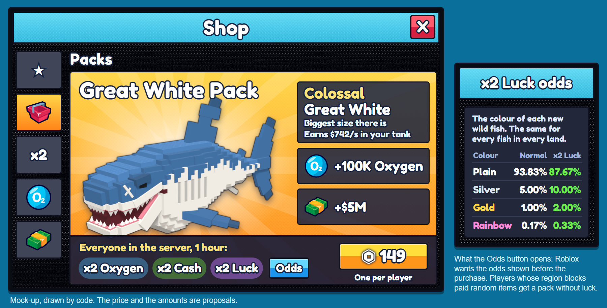

# Starter packs
Up: [Home](../../Home.md). Goes with [money](money.md) ("Selling") and [progression](progression.md). Drafted 2026-11-25.

The user: "get a chat to draft up some starter pack deals, id like there to be a great white remodel starter pack which shows
that. Then give them a lumpsum of cash, oxygen and a 1 hour x2 oxygen, cash and luck for the whole server."

**Decided (the user):** a starter pack with the Great White remodel as its hero; it holds a lump of cash, a lump of Oxygen, and
one hour of x2 Oxygen, cash and luck for the whole server. This reopens, for starter packs only, "Robux prices and the Shop are
left alone for now" (2026-11-24).
**Proposed (Claude):** every price and amount below, the other three deals, and how the hour works. Nothing is built.

*Mock-up, drawn by `tools/ui/starter_pack_card.py` from the model's own render.*

## The four deals
| | Reef Shark Pack | **Great White Pack** | Helicoprion Pack | Server Rush |
|---|---|---|---|---|
| Price, Robux | 49 | **149** | 399 | 99 |
| Shark, biggest size | Colossal Reef Shark | **Colossal Great White** | Colossal Helicoprion | none |
| It needs / earns | 1,620 / $40/s | **29,700 / $742/s** | 2.43M / $60.8K/s | |
| Oxygen | 50K | **100K** | 5M | |
| Cash | $1M | **$5M** | $1B | |
| Server boost | none | **x2 Oxygen, cash, luck, 1 h** | the same, 1 h | the same, 30 min |
| The lumps at the Shop's own prices | 108 | 108 to 248 (below) | 548 | |
| Shown | until land 4 is held | **until land 6 is held** | from land 5 until land 7 is held | always |
| Bought | once | **once** | once | again and again |

"Held" is the land's commonest fish's need. One pack's card at the top of Packs, the others under it.
The rule behind the two bigger packs: **the Oxygen holds the next land and not the one after**, so the shark is still worth riding. 100K holds land 4
(35K) and not land 5 (about 230K). (The Reef Shark is a first ride; its Oxygen passes it at once.)

## The Great White Pack
**149 Robux.** Roblox keeps about 30%, so about 104 reach us, roughly $0.40 a sale by [money](money.md)'s rate (a 199 sale: $0.53).

**What it holds**
- A **Colossal Great White**, plain colours (a Rainbow would hide the remodel). Same model as everyone's since 2026-11-25; what is
  rare about it is the size: a Great White comes Colossal in about 0.3% of spawns. It is **not** exclusive, and the card must not
  say it is.
- **+100K Oxygen**, for good. **+$5M.**
- **x2 Oxygen, x2 cash and x2 luck for everyone in the server, 1 hour.**

**Which Great White.** `GreatWhite`: the remodel (from `TrialGreatWhite`) replaces the old one for everyone, uploaded 2026-11-25
([six creatures added](added-2026-11-25.md)). Land 3, Epic, needs 9,900 Normal, 52 studs; Colossal is x2.8 long, about 146 studs.
The creatures chat confirms the folder and that it replaces the plain one (same name and id: every player can tame this model); the old creature chat installed it and waits for the user's word on saving the place.

**What it's worth against playing free** (the tuning model in `tools/balance/`, run unedited; five seeds, the middle one; today's
five new kinds are left out because the model has no base numbers for them yet):

| | land 4 | land 5 | land 6 | land 7 | land 8 |
|---|---|---|---|---|---|
| Free | 16 min | 29 min | 74 min | 2.5 h | 4.1 h |
| Bought at 3 min | 3 | 6 | 33 | 78 min | 3.2 h |
| Bought at 10 min | 10 | 13 | 37 | 86 min | 3.2 h |
| Bought at 20 min | (16) | 21 | 48 | 94 min | 3.2 to 3.6 h |
| Bought at 60 min | | | 69 | 111 min | 3.2 h |
| Bought at 3 min, no boost | 3 | 8 | 51 | 2.1 h | 3.9 h |

- **A new player's first land:** land 4, at once. **About 40 minutes of the first 74 saved.** After the hour it fades: a buyer at
  60 minutes saves 5 minutes to land 6 and 39 to land 7, almost all of it the boost.
- **Most of the value is the boost**, not the lumps; the shark's own $742/s matters only in the first 15 minutes.
- **x2 luck saves no time.** It is for hunting colours and being thanked; don't sell it as progress.
- **Does it break the early game?** It skips lands 1 to 3 for a buyer at 3 minutes, and the "typical" player sees only about an
  hour, so it is a real skip. But the Shop's 59-Robux pack (50K Oxygen) already holds land 4 on its own, so the
  pack skips nothing the Shop doesn't. $5M buys the seahorse's levels 2 to 4 and most of the first four auras, so cash jobs remain after it.
  A bigger pack (500K Oxygen + $25M) puts a 3-minute buyer in land 5 at once and land 6 at 21 minutes: we left it out because the
  shark would be behind them at once.
- On the shark at 100K Oxygen: about 8 seconds a full meter. It is a ride, not a long one.

**Is it good value?** Yes, at 149. Beside the Shop's own 149 pack (500K Oxygen, nothing else), both bought at 3 minutes:

| 149 Robux buys | land 5 | land 6 | land 7 | land 8 |
|---|---|---|---|---|
| 500K Oxygen (the Shop's) | 3 min | 37 min | 2.0 h | 3.9 h |
| The Great White Pack | 6 min | 33 min | 78 min | 3.2 h |

The pack's lumps sit between the rungs that cost 108 (50K + $1M) and 248 (500K + $25M). The hour alone is 198 at Server Rush's
proposed price; the reference's server luck alone is 99 for 15 minutes. The weak spot a buyer will see first is the Oxygen number:
100K against 500K for the same 149. Bought after an hour of play the 500K pack is the better one for land 6 (62 minutes against 69), the pack still for land 7 (111 minutes against 2.4 h).

**Limits:** a **developer product**, not a pass (`Products.luau`'s Starter row is a Pass today: change it), once per account, for good; a saved flag checks it. **No clock and no struck-out price**: the project's own rule
([menus](../reference/fast-food-menus.md), "never: timers, struck-out prices"), and children buy here. It is hidden once land 6 is
held, so it never shows to a player it does little for. If the flag and Roblox's receipt disagree, the pack is still given: the player
has paid.

**The moment they buy**
1. The Shop closes. On the dock the Great White is shown at full size with the catch show's look ("Great White, Colossal"); the
   Oxygen and cash meters count up.
2. Two buttons: **RIDE IT** (the shark goes to the ride slot) and **TO THE TANK** (it earns there). It is in the tank until they
   choose.
3. The banner for the whole server: "NAME turned on x2 OXYGEN, x2 CASH and x2 LUCK for everyone, 1 hour!" A small chip with the
   clock and NAME stays for everyone.
4. Bought in a dive: the boost starts at once for everyone; the Oxygen, cash and shark come at the dock, as bought Oxygen does.

## The other deals
- **Reef Shark Pack, 49.** The first purchase: 108 of Shop rungs for 49, and a shark to ride from the first dive. No boost, so no
  random-item rules at all. The weak shark is honest: "Colossal" is its real size, land 1. Breaks the early game no more than the
  59 pack does.
- **Helicoprion Pack, 399.** 5M Oxygen and $1B are 548 of rungs; the boost and a Legendary on top. Bought at 29 minutes it puts a player
  in land 6 at once and land 7 at 48 minutes (free: 2.5 h). Too much for a new player (land 7 at 20 minutes if bought at 3), so
  it is hidden until land 5 is held (about 29 minutes free; a Great White buyer gets there at 6, and it is then the next thing to buy).
- **Server Rush, 99, 30 minutes.** The same boost without a shark, bought again and again: the packs sell once an account, and this is
  what sells after them. Needs nothing the Great White pack's boost did not already build. Same random-item rules.

## The server hour, exactly
- **x2 Oxygen** doubles what the seahorse trains, after the aura. Not the refill on landing (that is already the whole meter), not
  Index claims, not bought Oxygen and **not the pack's own lump**.
- **x2 cash** doubles the tank's income each tick. Not selling, Index cash, bought cash or the pack's own lump.
- **x2 luck** doubles the odds of Silver, Gold and Rainbow on each **new** wild fish; fish already swimming keep theirs.

| Colour | Now | x2 luck |
|---|---|---|
| Plain | 93.83% | 87.67% |
| Silver | 5% (1 in 20) | 10% |
| Gold | 1% (1 in 100) | 2% |
| Rainbow | 0.17% (1 in 600) | 0.33% |

  Colours only, the same in every land: a table of four rows that adds to 100% and one function to change (`Config.rollVariant`).
  Rarer fish and bigger sizes are left out because they raise what a fish needs, which would fill a new player's sea with fish too
  strong to ride. How long until the sea has turned over is not measured: if it takes most of the hour, re-roll fish out of sight.
- **Two bought:** the clock adds an hour each time. It never multiplies: x2 stays x2. Cap the clock at 6 hours.
- **The buyer leaves:** the hour carries on for the server that has it. The buyer's own end time is saved, so a server they join
  within the hour turns on until then (and a closed server doesn't eat what they paid for). Rejoining never adds time.
- **Who is named:** the buyer, by display name, on the banner and the chip. Extending: "NAME added 1 hour".
- **Own passes:** a future Double Oxygen pass would multiply with it (x4 for that one player); two server boosts never do.

## Roblox's rules on this
From Roblox's own pages, read 2026-11-25 ([paid random items](https://create.roblox.com/docs/production/monetization/paid-random-items),
[Community Standards](https://about.roblox.com/community-standards),
[PolicyService](https://create.roblox.com/docs/reference/engine/classes/PolicyService)):
- "Luck boosts" are named as a probability modifier, a paid random item. **A pack holding one is a paid random item whole**, and so are
  the Great White Pack, the Helicoprion Pack and Server Rush (not the Reef Shark Pack).
- Before the purchase the player must be able to see every outcome's odds as numbers adding to 100%, what the boost changes, and
  (while it runs) odds that match. A bare "i" isn't enough: the card has an **Odds** button.
- Where `PolicyService` says paid random items are restricted for a player, they must not be sold one: **a second product at the same
  price without luck** (x2 Oxygen and cash for 90 minutes), sharing the once-only flag. Three packs hold luck, so that is **three more products** and three more cards.
- The game's content questionnaire asks about paid random items: the user answers it again.
- **Not confirmed, ask Roblox before launch:** whether a restricted player may be in a server where another's luck runs; whether a
  free wild catch under paid luck counts; which countries are restricted; whether the odds must list kinds and sizes too. Whether a
  countdown on an offer is banned we did not find; we use none.

## Recommended order
**Build the pack with Oxygen and cash only, put luck in second.** Oxygen and cash are where the time saved is; luck is the costly
part (odds screen, live odds, the policy check, three more products, the questionnaire) and it makes the whole pack a random item.
Ship x2 Oxygen and x2 cash for the whole server with the shark at launch, then add luck. The user asked for luck, so the mock-up
has it and it is one question below.

## What would have to be built
| Part | Who |
|---|---|
| Robux products (four developer products; seven once luck is in, a no-luck twin for three), the content questionnaire, asking Roblox the open points | The user |
| **Saving switched on** (a once-only pack needs it), a grant of several things in one receipt, the once-only flag, the boost's saved end times | Game code |
| The server boost (clock, extend, banner text, the three multipliers), `FishService` rolling with luck, the policy check | Game code |
| The pack's card (a new tall kind: 424 high against the Shop's 128 and 168), the odds window, the banner and clock chip, the purchase moment, the old Starter pass row replaced | UI |
| The Great White: save the place (templates are in the open Studio only), a slot picture for the new model, check a 146-stud shark on the dock, ridden on land and in a tank (none checked) | Creatures, then map |
| Amounts and prices, the boost's numbers in the balance model, the model's base numbers for the five new kinds | Tuning |

## Questions only the user can answer
1. **Prices:** 149 (recommended) or 199 for the Great White pack, and 49 / 399 / 99 for the others? The facts: the reference's starter
   pack was 99 with a 24-hour clock and is now 39 / 149 / 279; of players who pay, most spend 1 to 800 Robux in all; prices
   of 250 to 400 beat 650; a poor-value starter pack cut spending across the whole game ([videos](../reference/roblox-videos.md)).
   A 199 sale leaves about $0.53 and a 149 sale about $0.40, so 199 is only better if it sells at least three for every four.
2. **Luck now or after launch?** (Recommended: after.)
3. **How big:** 100K + $5M (the shark stays useful) or 500K + $25M (plainly worth more than the Shop's 149 pack, skips to land 5)?
4. **Which Great White:** plain Colossal, or a version no one can catch (a new model or colour, more work, more pull)?
5. **Is the clock-free, once-per-account rule right for you?** The reference runs a 24-hour clock.
