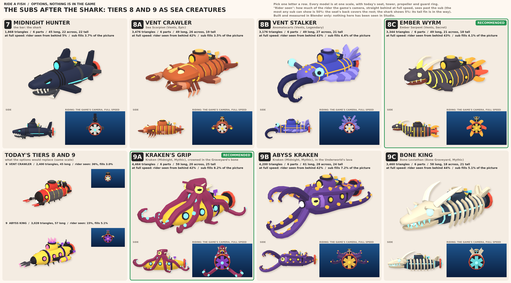
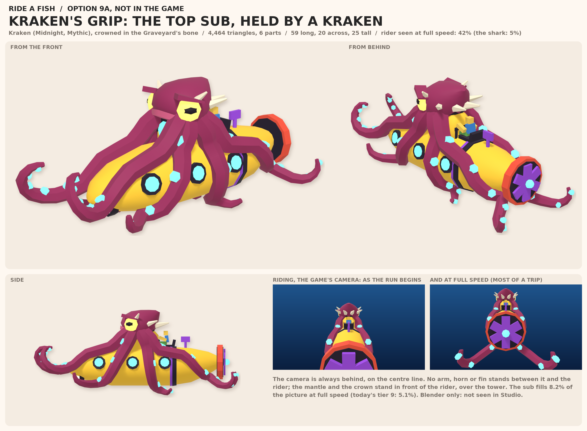

# Sub creature options: tiers 8 and 9 after the shark

Back to [sub models](sub-models.md) and [the submarine](submarine.md). Hugo, 2026-11-23: "after the shark submarine the
submarines kinda fall off in coolness, can you make sure they fit the ocean theme more and are cooler, make sure they
also use some elements or/and inspiration from fishes in that area. The shark is really cool so make more stuff in
shapes like that, i had an idea for a kraken submarine (just a submarine covered by a kraken) this should also be cool
and stylised though."

**State (2026-11-24): Hugo picked 8A and 9A ("use 8a, and 9a"). Both are built as tiers 8 and 9 (task s1, next
section). Not seen in Studio yet: that is task s2.** 8B, 8C, 9B and 9C are not built. Tier 7, the shark, is left as it
is. Tiers 1 to 7 are untouched. Below the next section the note is as it was on 2026-11-23, when all six were options.

## Built: 8A and 9A are tiers 8 and 9 (2026-11-24, task s1)

- **The builders** moved into `tools/blender/sub_stages.py` as `toy8` and `toy9`, with their helpers (`spline`,
  `tube`, `arm`, `on_hull`, `eye`, `segments`) and their colours (`CREATURES`). They make the same pieces as the
  options script, point for point and colour for colour (8A: 76 pieces, 9A: 92), but for the propeller: the option
  sheet showed the old wheel of bars, the built subs carry the screw ([sub props](sub-props.md)).
- **Exported** to `art/subs/VentCrawler` and `art/subs/AbyssKing`, 6 parts each. Builder's gate: 0 faults on both,
  and on tiers 1 to 7, whose exports did not change.
- **The names, prices and speeds in the game are unchanged:** tier 8 is "Vent Crawler", tier 9 is "Abyss King".
  "Kraken's Grip" was the option's name on the sheet, not a rename.
- **`SubModels.List`'s colours** for the two rows follow the models: tier 8 rust (206, 98, 48) with a magma-orange
  light, tier 9 the same gold with the kraken's dark purple trim and a cyan light. The name sign's and the lamp's
  colours come from these.
- **A bubble trail** streams from the screw on all nine subs: [sub props](sub-props.md), "The bubble trail".

| | Triangles | Long | Across | Top over the middle | Rider seen, full speed | Rider seen, run's start |
|---|---|---|---|---|---|---|
| Tier 8, Vent Crawler (8A) | 3,544 | 50 | 26 | 11.2 | 42% | 57% |
| Tier 9, Abyss King (9A) | 4,532 | 60 | 20 | 15.8 | 42% | 57% |

9A is 32 triangles over the 4,500 the options were held to: the screw is 68 more than the old wheel. The rider
numbers are counted again from the exported meshes and are the options' own.

**Still to do, none of it this task's:**

1. **The shop's cards.** `python tools/subs/card_fit.py --check` fails: the two new models are longer and would be
   cut off on their cards. `python tools/subs/card_fit.py --write` puts the new rows in `UI/SubPanel.luau` (tier 8's
   eye at -44.63, 15.87, -45.34; tier 9's at -54.26, 22.32, -53.01).
2. **The name sign over 9A.** `tools/subs/sign_fit.py --check` passes (tier 9: the model's top 15.8, the sign's lower
   edge 17.8, 1.2 studs of room over the horns' tips). The horns behind the sign still need the riding-view look.
3. **In Studio: done 2026-11-25 (c1),** [sub models](sub-models.md), "Checked again after the merge": the glows keep their colours
   (9A's eyes are not seen from the riding view), the gate and the pick-up measured, seen by eye. **Found, not put right:** 9A's head hides
   the rider for about 0.3 s at the pick-up, its nose is in the lane's wall there at the lip's ends, its top breaks the surface.
4. **As a run begins the camera stands close behind tier 9's tail,** so the ring fills the bottom of the picture for that moment:
   measured on 2026-11-25, not caught by eye (the stills come about a second later). 7.7 studs from the hull at the nearest in the first 1.5 s
   (10.6 on tiers 1 and 8). The old tier 9 had the same tail, so this is not new; Hugo's call.

The top sub, Hugo's kraken idea, big: [9A](../attachments/subs-creature-options-1-9A.png).

## The six

Every one keeps style A: fat rounded forms, the wind-up key, the red guard ring, today's seat, tower and propeller
(the script runs `sub_stages.py`'s own code for them, so a change to the propeller there shows here). Shapes, markings
and colours come from our own models in `art/creatures` (pictures: `docs/attachments/voxel-<name>.jpg`), not from
their meshes, and from no other game or film.

| | Name | From which fish | What it takes from it |
|---|---|---|---|
| 8A | Vent Crawler | Sea Scorpion (Vents, Epic) | Our model's rust orange, dark rust and yellow stripe down the back; the low wide shield of a head; two slim arms held forward ending in long dark pincers; plates down the back; the oar-shaped paddles; walking legs. Magma glows in every seam between the plates and in each claw's grip. Its tail spike is split in two beside the ring: one spike on the centre line would stand between the camera and the rider |
| 8B | Vent Stalker | Anomalocaris (Vents, Legendary) | "An alien-looking hunter with two spiny grabbing arms and eyes on stalks" ([roster](roster.md)): eyes on stalks out to the sides, two fat arms curling down under the nose with pale spines inside the curl, a row of six lapping flaps down each flank, a fan of three blades a side for a tail. Magma in the back's seams and as rivets on the head |
| 8C | Ember Wyrm (recommended for tier 8) | Ember Serpent (Vents, Secret) | A sea dragon of cooled lava: the neck rises to a horned head, the lamp is the fire in its open throat, black plates with a ring of fire in every seam, yellow-hot at the head and cooling to red at the tail, a flame crest, tongues of flame streaming back round the guard ring (none on the centre line) |
| 9A | Kraken's Grip (recommended for tier 9) | Kraken (Midnight, Mythic), crowned in the Graveyard's bone | Hugo's idea: today's gold Abyss King hull, held by a kraken. The mantle sits on the tower, swept back by the speed; eight fat arms wrap the hull (two reach past the nose, two cross the bow, two hoop the middle, two run back along the shoulders and trail outside the ring); glowing suckers; six bone horns round the mantle are the Bone Graveyard's touch. The hull, three ports a side, the tower's window, the lamp, the key and the ring all still show, so it reads as a sub being held |
| 9B | Abyss Kraken | Kraken (Midnight, Mythic), in the Underworld's lava | The kraken is the sub: the mantle is the hull, a pale collar, a huge eye each side, bone brow horns, cracks of lava down the back, two fins at the tail. Four arms reach forward and close on the lamp like a hand, four sweep back along the flanks and curl up short of the ring, ember suckers on all eight |
| 9C | Bone King | Bone Leviathan (Bone Graveyard, Mythic) | A sea dragon's skeleton with a cold light inside: a horned skull for a bow, glowing teeth, the lamp in its throat, a dark hull caged in eight ribs a side whose tips stand off it, knuckles of spine down the back (low behind the seat), a tail of two bone blades in a V |

Left out on purpose: Megalodon, Molten Megalodon and Halfbone Megalodon (a second shark), Kronosaurus (a long jawed
head on a sub's hull reads as the shark again), the anglers (a ball of a body does not fit the long hull).

## The recommendation

- **Tier 9: 9A.** It is Hugo's own idea, the only one of the six that reads at once from every side, and the biggest
  thing on the sheet: 59 studs long, the tallest (the mantle's top is 15.8 over the middle, today's crown 14.0).
- **Tier 8: 8C**, the Ember Wyrm: the strongest face of the three and the one that says "Vents" loudest.
- **But 8C and 9C are one family** (a horned skull on a banded body). If Hugo picks 9C for tier 9, take 8A beside it.
- 8B is the odd one out, for someone who wants tier 8 to look alien rather than fierce.

## Numbers

Builder's gate (`toy_check`: open or inside-out pieces, same-facing faces that overlap under 0.05 studs apart): **0
faults on all six**, and on today's 7, 8 and 9 through the same script. Every option is 6 parts (Hull, Hull_Glow,
Seat, Prop, Prop_Glow, Light) with vertex colours.

| | Triangles | Long | Across | Top over the middle | Rider seen, full speed | Rider seen, run's start | Fills the picture, full speed |
|---|---|---|---|---|---|---|---|
| 7 the shark (today) | 1,868 | 44.9 | 22.0 | 14.8 | 5% | 0% | 3.7% |
| 8 today | 2,400 | 44.6 | 17.7 | 11.2 | 36% | 43% | 3.0% |
| 9 today | 3,028 | 56.6 | 27.3 | 14.0 | 15% | 31% | 5.1% |
| 8A | 3,476 | 48.7 | 26.1 | 11.2 | 42% | 57% | 3.5% |
| 8B | 3,176 | 48.9 | 26.9 | 11.2 | 43% | 56% | 4.4% |
| 8C | 3,344 | 49.3 | 21.3 | 12.5 | 43% | 57% | 4.1% |
| 9A | 4,464 | 59.4 | 20.0 | 15.8 | 42% | 57% | 8.2% |
| 9B | 4,200 | 60.9 | 27.7 | 11.2 | 42% | 57% | 7.2% |
| 9C | 3,460 | 57.7 | 18.2 | 13.9 | 44% | 56% | 5.1% |

The limits asked for: 3,000 to 4,500 triangles (all inside; 9A is 36 under the top), size near today's (tier 8 options
are 4 to 5 studs longer than today's tier 8 and shorter, narrower and lower than today's tier 9; tier 9 options up to
61 long: 9B is a stud over the "about 60" asked for).

## The seat and the camera

- The seat is where it is on every tier: its top 5.7 over the middle and 5 behind it, the hull's top near 5 there. The
  script takes the seat, the tower and the rider's place from `sub_stages.py` and changes none of them.
- **How the camera was checked.** The game's riding camera (`SubController.cameraFor`, the Ride branch) stands on the
  centre line behind the sub: 30 studs back and 10 up, looking 25 ahead, 70 degrees tall as the run begins; 38 back
  and 7 up, looking 45 ahead, 88 degrees, at full speed. A run is past `Sub.Speed` from about its first second until
  it slows to let you go, so the full-speed view is the one for most of a trip, and it is the one on the sheet. The script puts a camera at
  both places and shoots rays at the rider: "rider seen" is the share of the rider's picture that nothing of the sub
  covers. The most any sub can show is 50% at full speed (62% as the run begins): the seat's own back rest covers the
  rest on every tier.
- **All six options show 42 to 44% at full speed** (56 to 57% as the run begins). Nothing of the creature stands
  between the camera and the rider. The 6 to 8 points under the most are the kit's wind-up key, which stands behind
  the seat on every toy tier: 8C built without its key shows exactly 50% and 62%. Each design keeps the centre line
  behind the seat clear: 8A's tail spike is split in two, 8C's flames and 9C's tail blades stand to the sides, 9A's
  trailing arms run outside the ring, 9B's swept arms and fins stand wide. In front of the rider, 9A's mantle and
  crown rise over the tower; they do not cover the rider.
- **A finding about today's subs, not changed here: the shark hides its rider.** Tier 7 shows 5% of the rider at full
  speed and 0% as the run begins: the upper lobe of its tail fin stands on the centre line, between the camera and the
  seat. Today's tier 9 shows 15% (its spine fins), today's tier 8 36%. The in-game stills from task m4
  ([m4-subs-ride.jpg](../attachments/m4-subs-ride.jpg)) agree for tier 7: the dark fin stands on the centre line over
  the ring and no rider can be made out. Tier 7 is not this task's to change; if Hugo wants the rider seen on it, its
  tail fin would be split in two or laid over, as on these options.
- **The view ahead.** "Fills the picture" is how much of the game's picture the sub and rider cover at full speed.
  9A covers 8.2% and 9B 7.2%, against 5.1% for today's tier 9: the arms that trail and sweep wide are what adds to
  it, low and to the sides. 9A's top stands 67% of the way up the picture, today's tier 9 65%. Whether that is too
  much sub in the way of the fish ahead is Hugo's call, in the game.
- **These are sums, not sights.** The camera's places come from the code's formula and are set up in Blender. The real
  camera eases, the sub dips and banks, and far lands widen the view by up to 10 degrees more. Nothing here has been
  seen in Studio.

## What a build would need

Picking a letter starts a build task. (2026-11-24: for 8A and 9A, points 1 and 2 are done; 4 does not apply to
them; the rest are in "Still to do" above.)

1. Move the picked builders (and the helpers they use: `spline`, `tube`, `arm`, `on_hull`, `eye`, `segments`,
   `crack`) from `tools/blender/sub_creature_options.py` into `tools/blender/sub_stages.py` as the new `toy8` and
   `toy9`, with their colours, and export as the other tiers are.
2. `SubModels.List`: the rows for tiers 8 and 9 (colours, and the names if Hugo wants the new ones: tier 8 is "Vent
   Crawler" today, tier 9 "Abyss King").
3. Several glow colours in one tier (8C's seams go from yellow to red; 9A has cyan suckers and yellow eyes; 9B has
   ember suckers, lava cracks and yellow eyes). They all sit in the one `Hull_Glow` part, which the game turns to
   Neon with the colours baked in the mesh: check in Studio that each keeps its own colour and none blows out to
   white (in Blender the brightest had to be turned down for that).
4. The lamp. 8C's and 9C's `Light` part is a ball inside the open mouth instead of the kit's headlamp on the nose.
   The game hangs the beam on that part: check it still points ahead and the jaw does not swallow it.
5. The shop's cards (`tools/subs/card_fit.py --write`): the new models are longer and, for 9B, wider.
6. The name sign: `SubModels` lifts it 2 studs over the model's tallest piece, and 9A is 1.8 studs taller than
   today's tier 9. The curled arm tips and horns behind the sign need the same riding-view check as Blue Streak's fin
   got in task m4.
7. Collision and the pick-up: the size changes. 9B's forward arms reach 20 studs past its own hull's nose (to 38
   ahead of the middle; today's tier 9 reaches 33, and 9A the same 33), and the tier 8 options are 8 to 9 studs wider
   than today's tier 8, so the gate's posts and the pick-up at the surface need a look on a trip.
8. See all of it in Studio, on a trip, by eye: the rider, the view ahead, the glow, the size beside the shark.

## Files

- `tools/blender/sub_creature_options.py`: the six builders, the cameras, the rider check, the sheet. **It is on the
  branch `sub-creature-options` only, not on main** (8A's and 9A's builders are in `sub_stages.py` now). It runs
  `sub_stages.py`'s own code, which now gives tiers 8 and 9 the picked colours itself: try it before trusting it for
  the four options not picked.
  `blender --background --python tools/blender/sub_creature_options.py -- <8A|8B|8C|9A|9B|9C|7|8|9> <out folder>`
  for each model, then `python tools/blender/sub_creature_options.py sheet <renders folder> <sheet.png> [<big 9A.png>]`.
- `docs/attachments/subs-creature-options-1.png`: the sheet. `docs/attachments/subs-creature-options-1-9A.png`: 9A big.
