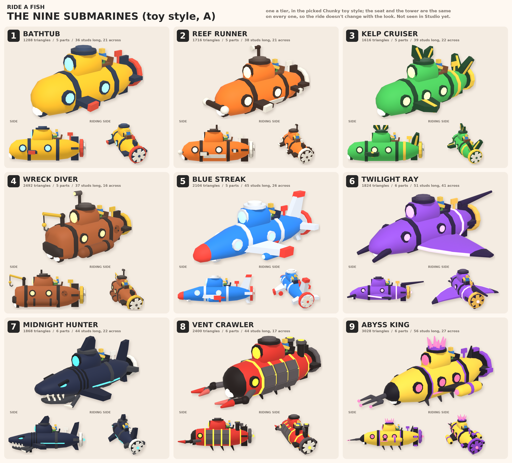
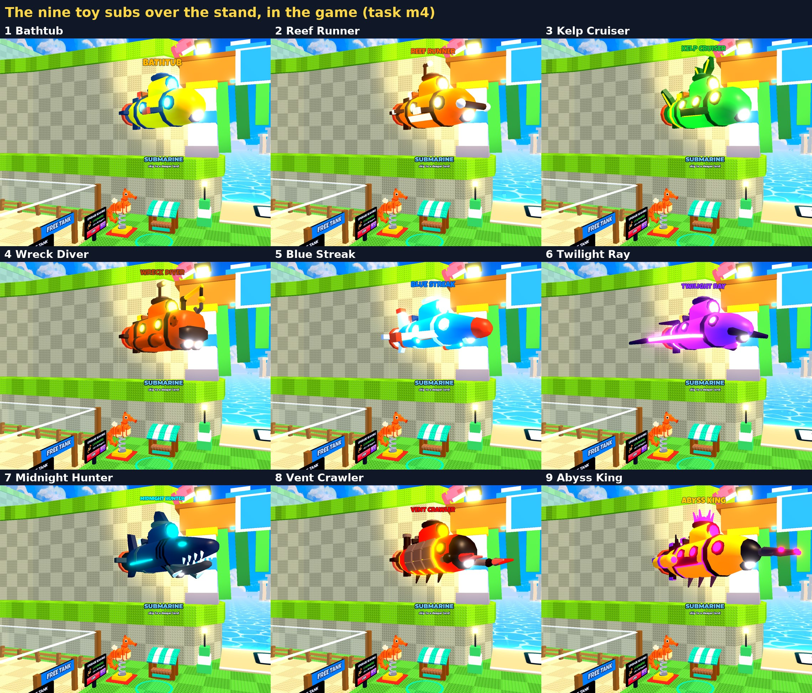
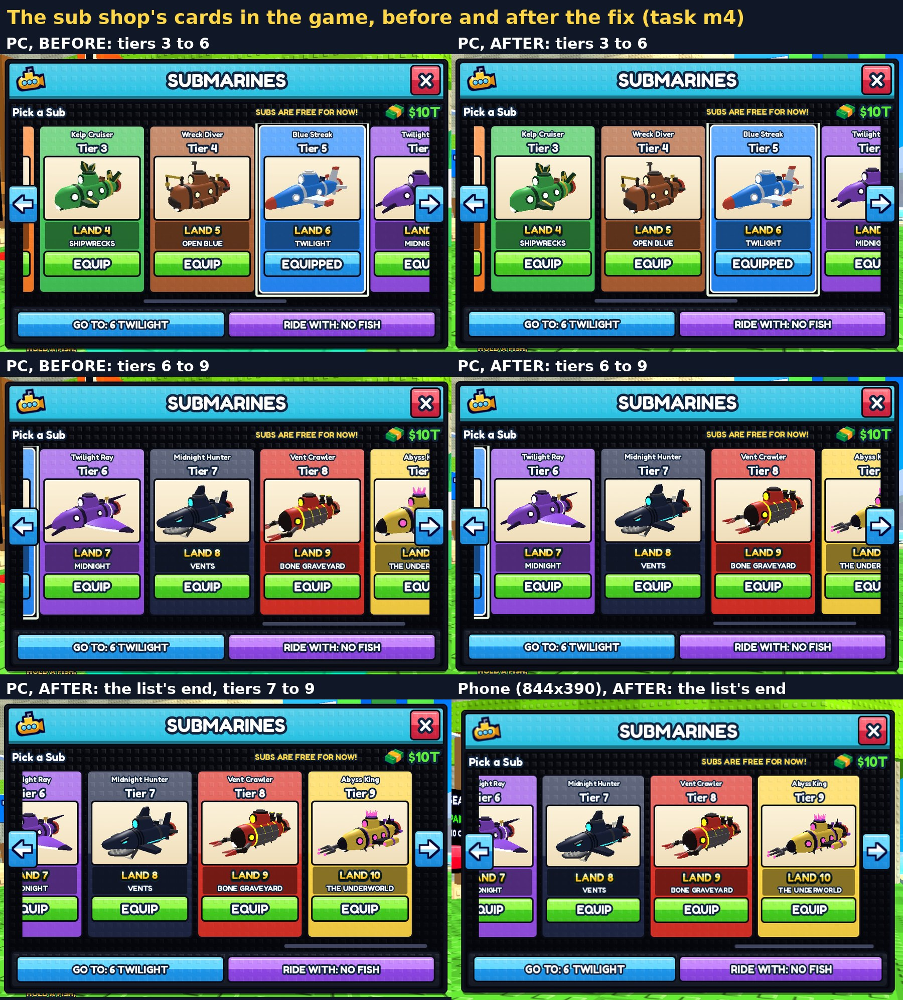
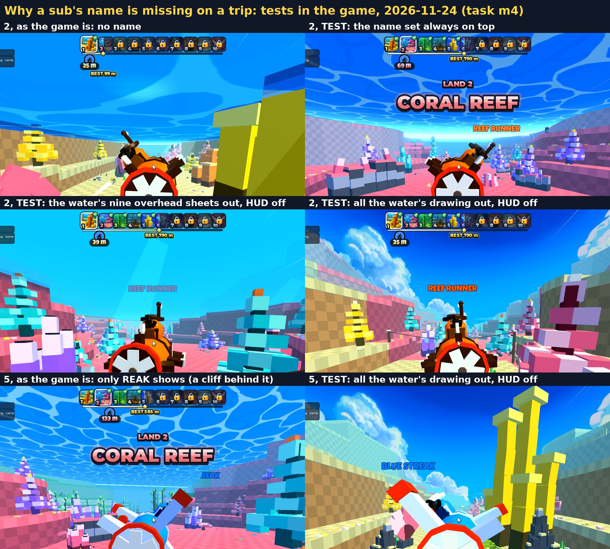

# Sub models

Back to [the submarine](submarine.md). Hugo, 2026-11-22: "give me a selection of a couple of base models in the first
place, all in different styles but showing the same model (sub level), try copying the voxel style in one of them. Once
I approve you can do it for all of the stages."

**State (2026-11-23, tasks t2 and t3): Hugo picked style A, the chunky toy. All nine tiers are built in it and are in
the game on Hugo's PC. Task m4 (same day) saw them in the game for the first time, fixed the shop's cards and the
name sign (tier 5's fin covered its name in the riding view: lifted 5.7 studs, measured on ten trips). On
2026-11-24 it found why most names are missing on a trip: the water's own drawing is drawn over them. That is not
fixed, it is Hugo's call: "Seen in the game" below.** The voxel set (style D) built on 2026-11-22 was a fallback, taken before Hugo had named a
letter; it is kept in `art/subs/voxel/` and is no longer in the game. Nothing is uploaded (see "In the game").

Tiers 1, 6 and 9 beside the approved model: [1](../attachments/subs-toy-1-beside-A.png),
[6](../attachments/subs-toy-6-beside-A.png), [9](../attachments/subs-toy-9-beside-A.png).

## The nine

Every tier keeps the placeholder's seat (its top 5.7 studs over the middle and 5 behind it), the tower in front of it
and the hull's top near 5, so the ride is the same on all of them. The colours are `SubModels.List`'s. Every tier has
the toy's fat rounded forms, thick rims round the glass, a red guard ring round the propeller (a lighter red on tier 8,
whose hull is red) and a wind-up key on the back in the tier's accent colour. The silhouette changes every few tiers.

| Tier | Sub | What sets it apart | Triangles | Across x tall x long |
|---|---|---|---|---|
| 1 | Bathtub | the approved model: the tub, two ports a side, stubby wings | 1,288 | 21.0 x 16.6 x 36.7 |
| 2 | Reef Runner | the tub with a bumper bar, a white band, a snorkel, back wings | 1,716 | 21.0 x 20.2 x 38.5 |
| 3 | Kelp Cruiser | longer, three ports, leaf wings, a V of leaf fins for a tail, kelp on the cap | 1,616 | 22.9 x 21.0 x 39.7 |
| 4 | Wreck Diver | boxy salvage boat: ballast tanks, a periscope, a crane and hook, patches, twin lamps | 2,492 | 16.6 x 21.1 x 37.6 |
| 5 | Blue Streak | a rocket: long and low, a red nose, swept wings, pods, a tall swept fin | 2,104 | 26.4 x 16.8 x 45.0 |
| 6 | Twilight Ray | a manta: wide rounded wings with a line of light, horns, a long tail spike | 1,824 | 41.4 x 16.5 x 51.0 |
| 7 | Midnight Hunter | a shark: a jaw with teeth, slit eyes, gills, a dorsal fin on the cap, claws | 1,868 | 22.0 x 21.8 x 45.0 |
| 8 | Vent Crawler | armour hoops over glowing seams, vent stacks, pincers, belly spikes | 2,400 | 17.7 x 19.2 x 44.6 |
| 9 | Abyss King | the biggest: a glowing crown, a trident ram, pods on wings, a crest, spikes | 3,028 | 27.3 x 23.4 x 56.6 |

The sizes are the models' boxes in studs, as they came into Studio.

Each is 5 or 6 MeshParts: `Hull` (all that is rigid), `Hull_Glow` (glass and lines of light, Neon), `Seat`, `Prop`
(spins; its box is centred on the hub), `Prop_Glow` (tiers 6 to 9: a glowing hub), `Light` (the lamp, Neon, carries the
beam). Colours are vertex colours, no pictures.

The builder has a gate, as the creatures' has: a piece that is open or inside out, and faces of two pieces that face
the same way, overlap and lie under 0.05 studs apart where no third piece covers them (they would flicker in Roblox),
are printed as `  !` lines and stop the build. All nine pass.

## In the game

- `Shared/SubModels.build(n)` clones `ReplicatedStorage.SubMeshes.<Id>` (Bathtub, ReefRunner, KelpCruiser, WreckDiver,
  BlueStreak, TwilightRay, MidnightHunter, VentCrawler, AbyssKing), adds the beam, the glow, the name and the wake,
  and hands back what it always did. A place without a tier's template gets the old placeholder of plain parts, so the
  other PC keeps working until its place has them. The stand's shop (`UI/SubPanel`) and the trip (`SubController`)
  both go through `build`, so both show the models.
- `SubController` places the hull part by its own rest frame (the placeholder's hull was a cylinder turned a quarter;
  a model's isn't) and spins `Prop` and `Prop_Glow`.
- **The name sign clears each model's top (2026-11-23).** The sign is 3 studs tall and used to sit at 12.5 studs over
  the middle on every tier, its lower edge at 11. Every toy tier is taller than that (11.2 to 15.7 studs: the cap, the
  snorkel, the kelp, the periscope, the dorsal fin, the crown). `SubModels` puts the sign's lower edge 2 studs over
  the model's tallest piece (`SIGN_GAP`), never lower than before. It was 0.6 studs until task m4: seen in the game
  from the dock, the snorkel, the kelp, the periscope, the fin and the crown still ran into the letters.
- **Blue Streak's sign stands 5.7 studs higher still (`SignUp` in its row, task m4).** The 2 studs are counted from
  the model's top, but the run's camera looks from behind and above, and Blue Streak's tail fin stands 20 studs
  behind the sign: nearer the camera, so in the riding view it reached 3.7 studs over the sign's lower edge and
  covered the middle of the name (the reviewer saw it on `m4-subs-ride.jpg`; the first report missed it).
  `python tools/subs/sign_fit.py` works out, from the models' own points and the run camera, how high each model
  reaches where the sign is: 4.7 studs of lift leave Blue Streak 1 stud of room with the sub level. On a real trip
  the sub dips and banks, and the fin still reached 0.95 studs into the sign on 2% of the frames, so it has 1 more.
  Measured on ten trips with 5.7 (2026-11-23 and 24): from the first second on, nothing of the model in front of
  the name on any of them. In the first second, while the sub tips over to dive, the fin still crossed the sign on
  five of the ten: 0.05, 0.28, 1.19, 1.53 and 2.14 studs up the 3-stud sign, on 1% of the frames at most (2 or 3
  frames). For comparison, in the same playtest: at its old height (no lift) the fin covered over 0.25 studs of
  the name on 54% of the frames, up to all 3 studs; with 4.7 it was 3 studs once in the first second and 0.2 studs
  after it. The other eight are as they were. **Two side effects of the lift, both measured:** the name now sits
  where the HUD's land title is (its letters over the name on 71 to 78% of the frames; 1% on the one trip at the old height), and
  at the start of a dive it stands a stud above the water's surface while the camera is under it (about a tenth
  of a trip's frames; never at the old height). Seen in a picture
  only as a test, with the water's drawing and the HUD off (the last tile of the test sheet in "Seen in the game"):
  the whole name, over the fin. In the game as it is, only "REAK" shows on the new riding still, for the reason
  below.
- **The sign keeps to the world's up, not the sub's, and that is wanted.** `StudsOffsetWorldSpace` is "relative to
  the global axes" (Roblox's reference), so while the sub dips and banks on a trip the name stays straight over the
  hull's middle and leans off the tower: 5 to 11 studs on most frames, up to 14. Tried the other way (the sign's
  place as an Attachment, turning with the sub): the tail then came in front of the name on up to 39% of a trip's
  frames (tier 9; 24% on tier 8, 16% on tier 2). This way it is 2% at most (tier 6's tail, below, and tier 5's fin
  before its lift). Put back.
- **Twilight Ray's tail still crosses its name for a moment, and is left as it is.** On four of five trips its tail
  (28 studs behind the sign) reached 2.5 to 3.0 studs up the 3-stud sign, on 1 to 2% of the frames: about 6 frames, a
  tenth of a second, in one bend. `sign_fit.py` passes tier 6 with 1.4 studs of room, so its check is a floor for the
  sub level, not a promise for a trip. Not lifted, because the review asked to keep the other eight as they are; a
  `SignUp` of about 3 in its row would do it.
- **Midnight Hunter's name is written in its light's colour (task m4).** Every name is in its hull's colour on a navy
  outline, and tier 7's hull is navy: nobody could read it. A hull darker than `SIGN_DARK` gets its `Light` colour
  instead (only tier 7, cyan).
- **Nothing is uploaded.** Hugo's PC can't upload (no Open Cloud key, Studio's connector hangs under Wine: the same
  as for the creatures), so the templates are local mesh files, as the creatures' `install.py --local`:
  `rbxasset://ridefish/submarines/<Id>/<Part>.mesh` in Studio's content folder. They show only on this PC and are gone
  when Studio updates itself (run the install again). A published game needs the nine GLBs uploaded from the PC that
  can (as `tools/creatures/upload.py` does) and their ids in `tools/subs/assets.json`, which is empty for now.
- **Save the place, or run the install again after Studio next restarts.** The install wrote the toy mesh files over
  the voxel ones, at the same paths, and made the toy templates in the open place. The place was not saved, so what a
  reopened place holds is not known; the install puts it right either way.

## Checked in the game (2026-11-23, task t3)

Three playtests on Hugo's PC, by script (`tools/studio/t3_toy_subs_check.py`, log `work/t3/check.log`): all nine
tiers twice, then tiers 5 to 9 once more for the propeller. **Not played by hand, and not seen by eye:** see
"Pictures" below. The numbers here are the second playtest's, with the third's where it was worse.

- **Every tier builds from its template.** All nine come out as MeshParts (5 parts on tiers 1 to 5, 6 on tiers 6 to
  9), with 2 or 3 Neon parts, the lamp's beam on and the wake's emitter on the propeller.
- **A real trip on every tier,** tier N to land N + 1. The check reads our own sub on every frame of the Ride phase
  that it samples (192 to 369 frames a trip) and keeps the worst value, or counts the frames that were wrong. The
  pick-up, the arrival and the drop are not read. It stops reading about 6 seconds into the Ride: that is the whole
  Ride on the short trips (3.2 seconds on tier 1), but the longest take 7 seconds (`Config.Sub.MaxRide`), so on tiers
  8 and 9, and maybe 6 and 7, up to the last second of the slowing was not read:

| What | Result on all nine |
|---|---|
| The rider | at the seat's place (0, 7.4, 5 from the sub's middle); the furthest off on any frame was 0.00 studs. That is 1.7 studs over the seat's top |
| The seat | where the model has it; the furthest off on any frame was 0.00 studs |
| The propeller's place | its middle stays on the hub (0.005 studs off at most on any frame), and so does the glowing hub of tiers 6 to 9 (0.002); it stays turned about the sub's long axis on every frame |
| The propeller's turn | its angle changed on every frame on tiers 1 to 4 and 8. On tiers 5, 6, 7 and 9 it read the same on a few frames of about 350 (at most 2, 6, 7 and 1): whole turns in one frame wherever the check could tell, see below |
| The wake | its emitter on, on the propeller, on every frame; its rate went from 11 to 260 bubbles a second over a trip (`SubController` sets it from the speed) |
| The lamp | Neon with its beam on, on every frame; the beam points along the nose (1.00 at worst); it sits 10.4 (tier 7) to 20.2 (tier 9) studs ahead of the middle (read at the trip's end) |
| The name sign | on, on every frame; its lower edge 0.6 studs over the model's top (read once, as the model is built) |
| The nose | points the way the sub goes: 0.89 at worst (tier 8), 0.97 to 1.00 on the others |

- **The propeller's same-angle frames are whole turns, not stops (third playtest).** The check compares the angle
  on one frame with the last. `SubController` turns the propeller by 4 + 0.12 x speed radians a second, which at about
  3,100 studs a second is one whole turn a frame at 60 frames a second, and a whole turn reads as no turn. On the
  third playtest the check worked that turn out itself on each same-angle frame, from the rider's speed and the
  frame's length (it is not read from `SubController`), and counted the frames where it came within 0.35 radians of
  a whole number of turns: all 14 did (6 of 6 on tier 6, 7 of 7 on tier 7, 1 of 1 on tier 9). The smallest such
  turn on each tier was 6.23, 6.21 and 6.28 radians, one whole turn (6.28). The second playtest's same-angle frames
  (2, 6 and 4 on tiers 5, 6 and 7) were counted before the check could tell, so those are likely the same, not
  confirmed. Seen by eye, a propeller at those speeds may look still or seem to turn backwards; `SubController`
  turned the placeholder and the voxel set the same way.
- **Top speeds on the trips:** 464 studs a second to land 2, 4,315 to land 10.
- **The shop's cards cut off the big tiers (by the card camera's numbers, not seen). Fixed in task m4, see "Seen in
  the game".** What t3 found: `UI/SubPanel` pictures every
  sub from one fixed spot, in a box 188 wide less its padding and 112 high: 1.5 to 1.7 times as wide as it is tall.
  How wide a box each tier's far end needs, as a multiple of its height: tier 9, 2.41; tier 8, 1.79; tier 5, 1.55;
  tier 6, 1.54; tier 7, 1.49; tiers 1 to 4, 1.10 to 1.36. So tiers 8 and 9 are cut off at one side, and tiers 5, 6
  and 7 are at the edge. Tiers 8 and 9 also fill the box's whole height (1.00 and 1.02 of it). The voxel set was
  cut too (tier 9 needed 2.05), so this is older than the toy set, but worse now.
- **Not checked here:** whether the rider's body passes through the back rest, the wind-up key or a fin, and whether
  the blades cut the guard ring when seen. Task m4 looked: see below.

### Pictures

t3 got none: every still came out as one frozen picture of Studio in Edit. Task m4 found that stills are live while
a playtest runs, even with Studio's window off the screen (about one new picture a second), and took them: below.

## Seen in the game (2026-11-23, task m4)

Stills from playtests on Hugo's PC, taken by script (`tools/studio/m4_subs_shots.py`, log `work/m4/shots.log`) and
looked at one sheet at a time. None is a frozen picture: each stand and shop still had to differ from the one before
it, and each trip still did (0.52 to 0.94 of the view changed). **Not played by hand.** In the log, the last shop
read-outs and stills (21:32) are tagged "before" but are the fixed cards (the switch back to the old camera spot was
not in that playtest's copy of the script); those stills are now `work/m4/shop-after-*.png`. The two "before"
pictures on the shop sheet are cuts kept from the first playtest, on the old code, PC size only.

- **All nine build from their meshes and carry the right name.** Each floats over the sub stand, nose to the camera,
  the screens hidden. This sheet has the sign 2 studs up and tier 7's name in cyan; it was taken before Blue
  Streak's sign got its extra 5.7 studs, so on tier 5 the name now stands higher than the sheet shows.
- **On a trip** (tier N to land N + 1, a still about a second into the run):
  [the game's own view](../attachments/m4-subs-ride.jpg), and
  [a close view from a test camera](../attachments/m4-subs-seat.jpg). On all nine the rider sits on the seat behind
  the tower and the propeller is inside its ring. The rider is small in these views: whether the back rest, the key
  or a fin touches the rider can't be told from them. The
  numbers of the t3 check were read again on the same trips, on the new map: the rider and the seat 0.00 studs off,
  the propeller 0.004 at most, the wake, the beam and the sign on, on every frame (`work/m4/rides-run2.txt`). These
  trips ran before the sign was raised; the close view is still from then.
  **The riding sheet was taken again on 2026-11-24, on the code as it is now** (Studio restarted at 00:03, its window
  redraws; Studio's Edit quality stood at Level04, the playtest's own quality on Automatic, as the Boss left it:
  not the cause of the missing names, which were missing on the stills of 2026-11-23 too, before that setting). It
  shows the game as it is: no name on tiers 1, 2, 3, 4 and 7, the whole name on tiers 6 and 8, "REAK" of "BLUE
  STREAK" on tier 5 and the lower half of "ABYSS KING" on tier 9. Why: "The name on a trip" below. The old stills
  are kept as `work/m4/ride-old-N.png`.
- **The close view is a test camera, never the game's.** It stood to one side of the sub, only while the script's
  own trips ran. Hugo saw it in a playtest and said (2026-11-23): "what is this new camera perspective for the
  submarine? ... make sure it doesnt implement the camera on the side ever". It is in no file under `src/`, it is out
  of the place, and it is taken out of the script.
- **The shop's cards show every sub whole now**, at PC size and at a phone's (844 x 390, by the shop's `PanelPhone`
  test hook, not a real phone):

  - Before, `SubPanel` pictured every sub from one spot. By the models' own points the big tiers reached past the
    picture's edge: tier 5 to 1.01 of its half width, tier 8 to 1.17 (and 1.00 of its height), tier 9 to 1.57. The
    two "before" pictures are the old code in the game: tier 5's nose and tier 8's claws are at the edge or past it.
  - Now each model has its own camera spot (`SubPanel`'s `SHOTS` table). The view's direction is the same for all;
    the camera moves sideways until the model sits in the middle of the picture, and back until the whole of it is
    inside 0.9 of the picture, never nearer than the old camera stood. Seven tiers keep their size and are only
    centred; tier 6 is a little smaller (62 studs off, was 59) and tier 9 smaller (69).
  - Read in the game after the fix, PC and phone alike: every tier inside, the furthest reach 0.66 (tier 1) to 0.90
    (tiers 6 and 9) of the picture's half.
  - **Why a table and not a sum in the game:** the game knows only a mesh part's box, and a box's corners stand well
    outside a rounded hull: framing by them shows the subs 16 to 45% smaller than they need be.
    `python tools/subs/card_fit.py` reads the models' own points from `art/subs/<Id>/<Id>.glb`; `--write` puts the rows
    into `SubPanel.luau`, `--check` fails if they are stale or a model is cut. **Run it after a sub is rebuilt.** A
    place without the meshes (the placeholder) is framed in the game by its boxes (`shotBy`): written, not seen.
- **The name on a trip: the water's drawing hides it (found 2026-11-24, tested in the game).**

  

  - **What hides it.** The sea is drawn by the map's own script (`tools/map/water_look.luau`, in the place as
    `ClaudeBlockout.Surface.WaterLook`): four see-through layers at the surface and, seen from below, nine
    see-through sheets overhead. The engine draws them over the name wherever they are behind it on the screen,
    though the name is nearer the camera. A name shows only where land is behind it: on the new riding stills tier
    6's and tier 8's names lie against a cliff and are whole, tier 5's shows "REAK" where the cliff is and nothing
    where the water is, and tier 9's is cut along the cliff's top edge.
  - **The tests** (tier 2 and tier 5, one trip each, same playtest, `m4_subs_shots.py probes 5 2 sets=...`):
    as the game is, no name, while a ball (a solid part) put 3 studs over the name's place shows; the name set
    always on top: the whole name shows; all the water's drawing taken out for the trip: the whole name shows, at
    full strength; only the nine sheets overhead taken out: the name shows, washed out to a pale blue by the four
    layers left. So it is the water's drawing and nothing else, the sheets most of all. **Why the engine draws
    see-through parts over a nearer sign was not looked into**; the tests only show that it does.
  - **Ruled out, by numbers on every frame of the nine trips:** the sign is on; it is 24 to 48 studs from the
    camera (its limit is 140); its place is on the screen; the camera sits where the sum has it (0, 7, 38 studs from
    the sub's middle in the sub's own frame). The earlier line "no part stands between the camera and it" was wrong
    as a test: that check (`GetPartsObscuringTarget`) never listed the water's layers or sheets, which lay on the
    same line whenever it listed the unseen `SeaTile` beside them. The guess that the sign is drawn a frame behind
    the sub is dropped: the balls sit where the sum has the sign, and the name appears there once the water is out.
  - **The model in front of the name:** nothing on tiers 1 to 4, 8 and 9. Tier 5: see Blue Streak's sign above.
    Tier 6 (Twilight Ray): its tail crosses the sign on 1 to 2% of the frames, one bend (2.56 and 2.49 studs on the
    two trips of 2026-11-24). Tier 7: 0.11 studs at most.
  - **The HUD's land title lies over the name too, and that is a second thing.** The big "CORAL REEF", "KELP
    FOREST" at the top middle is drawn over everything in the world. Its letters (not its box; counted while the
    text is more than half there, and where they cover over a tenth of the name's box) lay over the name on the
    share of frames below. With the water's drawing out of the way the name would still be under the title's
    letters that often. The riding trips of 2026-11-24, one a tier (`work/m4/shots-2026-11-24.log`):

    | Tier | The model up the sign, most (studs) | Frames with over 0.25 covered | The title's letters over the name | On the riding still |
    |---|---|---|---|---|
    | 1 | 0.00 | 0% | 1% | no name; water behind it |
    | 2 | 0.00 | 0% | 26% | no name; water behind it |
    | 3 | 0.00 | 0% | 70% | no name; water behind it, the title over it |
    | 4 | 0.00 | 0% | 66% | no name; water behind it |
    | 5 | 0.00 | 0% | 78% | "REAK": a cliff behind those letters |
    | 6 | 2.56 | 1% | 4% | the whole name; a cliff behind it |
    | 7 | 0.11 | 0% | 16% | no name; water behind it |
    | 8 | 0.00 | 0% | 2% | the whole name; a cliff behind it |
    | 9 | 0.00 | 0% | 4% | the lower half; cut along the cliff's top |

    (The trips of 2026-11-23, 23:10, same code, one a tier: `work/m4/numbers-final.txt`.)
  - **Not fixed, on purpose.** Two ways, each a call on the look and neither only this note's code: set the name
    always on top (one line in `SubModels`; the name then also shows through the sub's own fin, through cliffs and
    through other players' subs up to 140 studs off, and Blue Streak's lift could go), or change how the water is
    drawn (the map's script). And the land title: leave it, or keep titles and names apart while riding a sub.
    See "Open (the user)".
- **Pictures: Studio's window stopped redrawing on 2026-11-23 from about 21:40; Studio was restarted at 00:03 on
  2026-11-24 (by the Boss, at Hugo's word) and it redraws again.** While it was stuck, a bright part put in front of
  the Edit camera never showed in the window's own picture, in Edit or in a playtest, while the game ran on and
  answered. Moving the window on screen, giving it focus, fullscreen and back, and a new playtest did not wake it.
  The engine's own screenshot can't be read back by a script ("cannot currently create editable image from temporary
  texture id"). The script's gate catches it (`FROZEN`), so no stale picture got onto a sheet.
- **Not checked:** a real phone; a trip by hand; the trip's pick-up, arrival and drop by eye; the stills are one
  moment of each trip, so a blade crossing the ring later in a trip would not show.

## Build

- `blender --background --python tools/blender/sub_stages.py -- <tier 1-9> <out folder> [--style toy|voxel]
  [--export art/subs] [--check]` builds one tier (toy unless told otherwise), runs the gate, renders hero, side and
  the riding side, and with `--export` writes `art/subs/<Id>/<Id>.glb` and `<Id>.mesh.json` (Roblox's axes, the nose
  to -Z, 1 unit = 1 stud, the origin at the sub's middle). The voxel set: `--style voxel --export art/subs/voxel`.
- `python tools/blender/sub_stages.py sheet <renders folder> docs/attachments/subs-toy-all-stages.png` lays out the
  sheet, and stops if a view is cut off at its picture's edge.
- `python tools/subs/install.py runner` writes the mesh files and makes the templates in the open place (Edit).
- `python tools/studio/s2_subs_check.py push` puts `SubModels` and `SubController` into the open place (Edit).
- `python tools/studio/t3_toy_subs_check.py install | run | remove` is the playtest check of all nine and the stills
  (`run` in a playtest; `install` and `remove` in Edit).
- `python tools/subs/card_fit.py [--write | --check]` works out the shop cards' camera spots from the GLBs.
- `python tools/subs/sign_fit.py [--check]` works out, a tier, how high the model reaches where the name sign is,
  seen from the run's camera; `--check` fails if a name is covered or has less than a stud of room. **Run it after a
  sub is rebuilt or the run camera moves**, and give a tier that fails `SignUp` in `SubModels.List`.
- `python tools/studio/m4_subs_shots.py install | gate | closes | shop <tag> | rides | probes | numbers | sheets |
  remove` takes the stills and lays out the sheets (its top says how). `rides` and `numbers` read the sign, the
  model and the HUD on every frame of a trip (`numbers` takes no picture; `numbers 5 up=0` runs tier 5 with another
  `SignUp`, on this client only). `probes 5 2 sets=plain,quiet+top,quiet+nowater+notitle` takes test stills: the
  name always on top, the water's drawing out, the HUD off, each for one trip and put back after. `sheets ride`
  lays out the riding sheet and the test sheet. It sends the player on trips and takes the camera: make sure
  nobody is playing in the playtest first.

## Open (the user)

- Notes on single subs, from the sheet above.
- A ride by hand on a few tiers: the rider on the seat, the propeller in its ring, the name over the tall pieces.
- **The sub's name on a trip is hidden by the water's drawing** ("The name on a trip", with the test sheet). Pick:
  set the name always on top (it then shows through fins, cliffs and other subs), change the water's drawing (the
  map's script), or leave the name hidden under water.
- The HUD's land title over the name's place on most of a trip on tiers 3, 4 and 5: leave it, or keep them apart
  while riding a sub (the HUD is not this note's code).
- Twilight Ray's tail crossing its name for a tenth of a second in a bend: leave it, or give tier 6 a `SignUp`.
- Whether the studs go on in the game (with the creatures').
- Uploading the nine models for a published game (permanent: on the user's word, from the PC that can).

## The voxel set (2026-11-22, task s2: the fallback)

Built first, in style D, when Hugo had allowed the build without naming a letter. Kept in `art/subs/voxel/<Id>/`
(sheet: [the nine voxel subs](../attachments/subs-all-stages.png); in-game stills of that day:
`docs/attachments/s2-*.png`). It is out of the game since the toy install.

# The style options (2026-11-22, task o1)

Four options of tier 1, for the pick. Built by headless Blender 5.2, not seen in Studio. **The pick: A, the chunky
toy** (Hugo). What follows is as written before the pick.

## What every option is

Tier 1, "The Bathtub" (`Shared/SubModels`: yellow hull, navy trim, cyan glass), on the placeholder's measures so the
ride doesn't change: about 36 studs long, 10 across, the tower in front of the middle, the seat's top 5.7 studs over
the middle and 5 behind it (`SubController`'s `SEAT`), a bar for the hands, two ports a side, wings by the nose, a
cross of fins, a propeller, a lamp under the nose. One mesh to a part; `Seat`, `Light` and `Prop` keep the names
`SubController` needs, and `Prop` has its pivot on the hub so it can spin. Colours are flat materials, no pictures
(option D's studs are the creatures' stud tile, laid on in the render only).

| | Style | Triangles | Parts | What it is |
|---|---|---|---|---|
| A | Chunky toy | 1,288 | 11 | Fat rounded forms with few sides, smooth shaded, thick rims round the glass, a red guard ring and a wind-up key |
| B | Sleek faceted | 412 | 10 | Flat planes, a pointed nose, a swept canopy and fins: the first creature kit's look |
| C | Retro riveted | 2,356 | 15 | A boiler with brass hoops and rivets, a round turret with a copper dome, a lantern, a rail, a snorkel |
| D | Voxel | 576 | 10 | The creatures' block style: few big boxes, each a part; the nose is two turned blocks; studs on faces that look up; trim is navy, not black; colour touches a third of a cube proud; one flaw (a patch plate) |

All four are far under what Roblox takes for one mesh (the creatures run a few thousand triangles each).

## How each would scale to the nine tiers

The placeholders add one piece a tier (stripe, back wings, periscope, pods, crest, claws, spikes, crown) and change
colour. A real set should also change the silhouette every few tiers. Per style:

- **A, toy:** the same tub grows fatter and longer; add-ons are toy parts (pods, a periscope, a second ring). Cheap to
  vary, friendly, but the deep tiers ("Midnight Hunter", "Abyss King") will struggle to look dangerous.
- **B, faceted:** scales best toward fast and dangerous: longer nose, more and sharper fins, pods as blades. The
  early tiers look less fun, and it matches the old creature look, not the voxel creatures now in the game.
- **C, riveted:** the most character per tier (more pipes, lamps, claws, armour plates), but the most triangles and
  the most work per sub, and small detail is lost at riding distance and speed.
- **D, voxel:** matches the creatures and the map's squares. Tiers scale as the creatures' rarities do: more and
  gentler steps, a second layer of form, glow along seams for the deep ones. Lowest risk of looking out of place.

Claude's recommendation was **D**, with A's friendliness in the early tiers (round-ish proportions, the red accents).
Hugo picked A. The riding view is the one to judge by: the sub is mostly seen from behind and above.

## Build (the options)

- `blender --background --python tools/blender/sub_kit.py -- <A|B|C|D> <out folder> [--export art/subs]` builds one
  option, prints its triangle count, renders hero, side, front, top and the riding view, and with `--export` writes
  `art/subs/Sub_<style>.glb` (Roblox's axes, 1 unit = 1 stud; not checked in Studio).
- `python tools/blender/sub_sheet.py <renders folder> docs/attachments/sub-options-2026-11-22.png` lays out the sheet
  (the renders went to `work/subs/`, which isn't kept in the repo).
