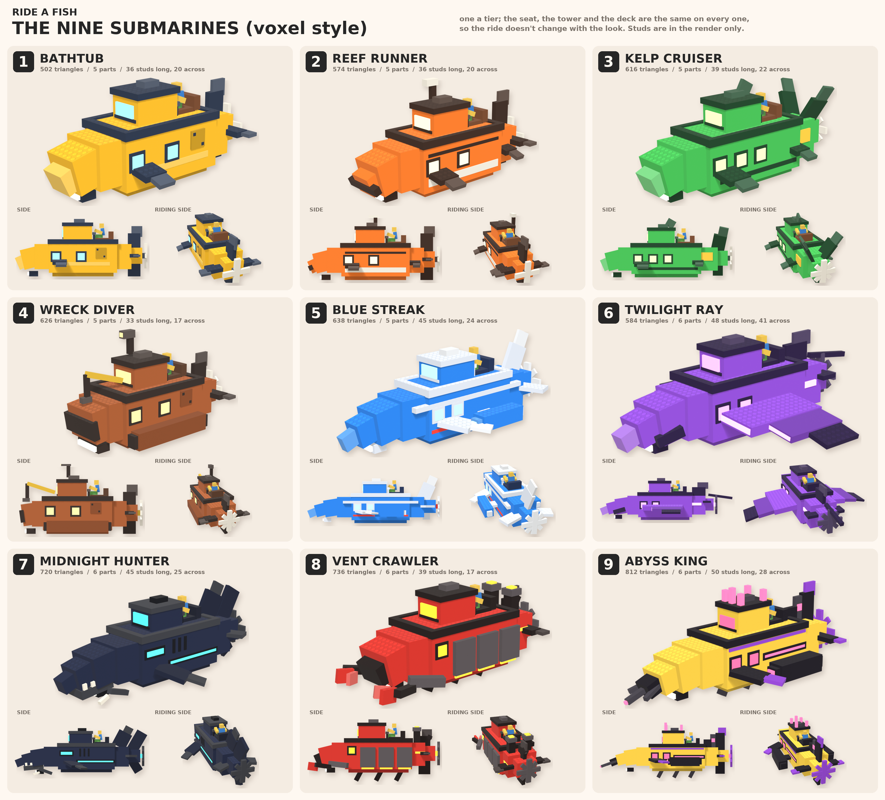
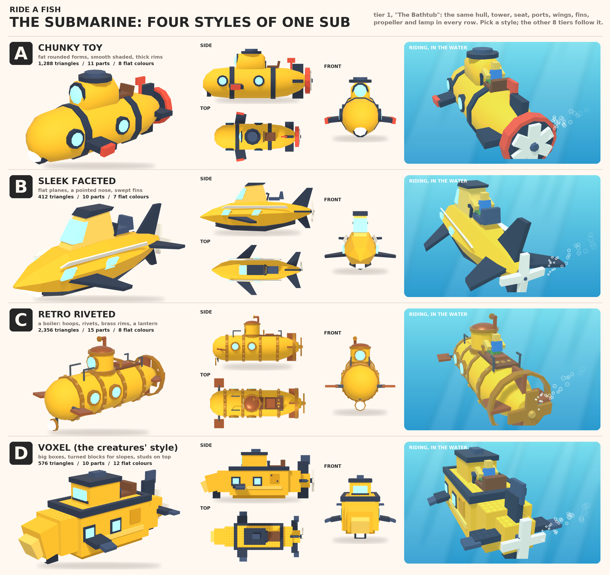

# Sub models

Back to [the submarine](submarine.md). Hugo, 2026-11-22: "give me a selection of a couple of base models in the first
place, all in different styles but showing the same model (sub level), try copying the voxel style in one of them. Once
I approve you can do it for all of the stages."

**State (2026-11-22, task s2): all nine tiers are built in style D (voxel) and are in the game on Hugo's PC.** Hugo
allowed the build without naming a letter, so D was taken: the note's recommendation and the style his ask named. Say
if another style or a mix was meant; the builder takes a tier at a time. Nothing is uploaded (see "In the game").

## The nine

Every tier keeps the placeholder's seat (its top 5.7 studs over the middle and 5 behind it), the tower in front of it
and the deck at 5, so the ride is the same on all of them. The colours are `SubModels.List`'s. The silhouette changes
every few tiers, and the deeper ones carry more pieces and lines of light, as the creatures' rarities do.

| Tier | Sub | What sets it apart | Triangles | Long x across |
|---|---|---|---|---|
| 1 | Bathtub | the tub: a navy lip, two ports, a patch plate | 502 | 36 x 20 |
| 2 | Reef Runner | the tub with a bumper bar, a white band, a snorkel, back wings | 574 | 36 x 20 |
| 3 | Kelp Cruiser | longer, three ports, a V of leaf fins for a tail | 616 | 39 x 22 |
| 4 | Wreck Diver | boxy salvage boat: ballast tanks, a periscope, a crane and hook, patches | 626 | 33 x 17 |
| 5 | Blue Streak | long and low, a three-block nose, swept wings, pods, a tall swept fin | 638 | 45 x 24 |
| 6 | Twilight Ray | a manta: wings in three steps with a line of light, a tail spike | 584 | 48 x 41 |
| 7 | Midnight Hunter | a shark: a jaw with teeth, slit eyes, gill slots, a dorsal fin, claws | 720 | 45 x 25 |
| 8 | Vent Crawler | armour plates over glowing seams, vent stacks, pincers, belly spikes | 736 | 39 x 17 |
| 9 | Abyss King | the biggest: a glowing crown, a trident ram, pods, a crest, spikes | 812 | 50 x 28 |

Each is 5 or 6 MeshParts: `Hull` (all that is rigid), `Hull_Glow` (glass and lines of light, Neon), `Seat`, `Prop`
(spins; its box is centred on the hub), `Prop_Glow` (tiers 6 to 9: a glowing hub), `Light` (the lamp, Neon, carries the
beam). Colours are vertex colours, no pictures. The studs on the sheet are in the render only: studs aren't in the game
yet, for the creatures either.

The builder has a small gate like the creatures': two faces of straight boxes that face the same way, overlap and lie
under 0.05 studs apart are printed as `  !` lines and stop the build (they would flicker in Roblox). All nine pass.
Turned blocks are not checked. Faces buried whole in another box are left out of the mesh.

## In the game

- `Shared/SubModels.build(n)` clones `ReplicatedStorage.SubMeshes.<Id>` (Bathtub, ReefRunner, KelpCruiser, WreckDiver,
  BlueStreak, TwilightRay, MidnightHunter, VentCrawler, AbyssKing), adds the beam, the glow, the name and the wake,
  and hands back what it always did. A place without a tier's template gets the old placeholder of plain parts, so the
  other PC keeps working until its place has them. The stand's shop (`UI/SubPanel`) and the trip (`SubController`)
  both go through `build`, so both show the models.
- `SubController` places the hull part by its own rest frame (the placeholder's hull was a cylinder turned a quarter;
  a model's isn't) and spins `Prop` and `Prop_Glow`.
- **Nothing is uploaded.** Hugo's PC can't upload (no Open Cloud key, Studio's connector hangs under Wine: the same
  as for the creatures), so the templates are local mesh files, as the creatures' `install.py --local`:
  `rbxasset://ridefish/submarines/<Id>/<Part>.mesh` in Studio's content folder. They show only on this PC and are gone
  when Studio updates itself (run the install again). A published game needs the nine GLBs uploaded from the PC that
  can (as `tools/creatures/upload.py` does) and their ids in `tools/subs/assets.json`, which is empty for now.

## Build

- `blender --background --python tools/blender/sub_stages.py -- <tier 1-9> <out folder> [--export art/subs] [--check]`
  builds one tier, runs the gate, renders hero, side and the riding side, and with `--export` writes
  `art/subs/<Id>/<Id>.glb` and `<Id>.mesh.json` (Roblox's axes, the nose to -Z, 1 unit = 1 stud, the origin at the
  sub's middle).
- `python tools/blender/sub_stages_sheet.py work/subs/stages docs/attachments/subs-all-stages.png` lays out the sheet.
- `python tools/subs/install.py runner` writes the mesh files and makes the templates in the open place (Edit).
- `python tools/studio/s2_subs_check.py push | install | run | remove` is the playtest check and the stills.

## Open (the user)

- Whether D was the pick, and any notes on single subs.
- Whether the studs go on in the game (with the creatures').
- Uploading the nine models for a published game (permanent: on the user's word, from the PC that can).

# The style options (2026-11-22, task o1)

Four options of tier 1, for the pick. Built by headless Blender 5.2, not seen in Studio.

## What every option is

Tier 1, "The Bathtub" (`Shared/SubModels`: yellow hull, navy trim, cyan glass), on the placeholder's measures so the
ride doesn't change: about 36 studs long, 10 across, the tower in front of the middle, the seat's top 5.7 studs over
the middle and 5 behind it (`SubController`'s `SEAT`), a bar for the hands, two ports a side, wings by the nose, a
cross of fins, a propeller, a lamp under the nose. One mesh to a part; `Seat`, `Light` and `Prop` keep the names
`SubController` needs, and `Prop` has its pivot on the hub so it can spin. Colours are flat materials, no pictures
(option D's studs are the creatures' stud tile, laid on in the render only).

| | Style | Triangles | Parts | What it is |
|---|---|---|---|---|
| A | Chunky toy | 1,288 | 11 | Fat rounded forms with few sides, smooth shaded, thick rims round the glass, a red guard ring and a wind-up key |
| B | Sleek faceted | 412 | 10 | Flat planes, a pointed nose, a swept canopy and fins: the first creature kit's look |
| C | Retro riveted | 2,356 | 15 | A boiler with brass hoops and rivets, a round turret with a copper dome, a lantern, a rail, a snorkel |
| D | Voxel | 576 | 10 | The creatures' block style: few big boxes, each a part; the nose is two turned blocks; studs on faces that look up; trim is navy, not black; colour touches a third of a cube proud; one flaw (a patch plate) |

All four are far under what Roblox takes for one mesh (the creatures run a few thousand triangles each).

## How each would scale to the nine tiers

The placeholders add one piece a tier (stripe, back wings, periscope, pods, crest, claws, spikes, crown) and change
colour. A real set should also change the silhouette every few tiers. Per style:

- **A, toy:** the same tub grows fatter and longer; add-ons are toy parts (pods, a periscope, a second ring). Cheap to
  vary, friendly, but the deep tiers ("Midnight Hunter", "Abyss King") will struggle to look dangerous.
- **B, faceted:** scales best toward fast and dangerous: longer nose, more and sharper fins, pods as blades. The
  early tiers look less fun, and it matches the old creature look, not the voxel creatures now in the game.
- **C, riveted:** the most character per tier (more pipes, lamps, claws, armour plates), but the most triangles and
  the most work per sub, and small detail is lost at riding distance and speed.
- **D, voxel:** matches the creatures and the map's squares. Tiers scale as the creatures' rarities do: more and
  gentler steps, a second layer of form, glow along seams for the deep ones. Lowest risk of looking out of place.

Claude's recommendation: **D**, with A's friendliness in the early tiers (round-ish proportions, the red accents).
The riding view is the one to judge by: the sub is mostly seen from behind and above.

## Build (the options)

- `blender --background --python tools/blender/sub_kit.py -- <A|B|C|D> <out folder> [--export art/subs]` builds one
  option, prints its triangle count, renders hero, side, front, top and the riding view, and with `--export` writes
  `art/subs/Sub_<style>.glb` (Roblox's axes, 1 unit = 1 stud; not checked in Studio).
- `python tools/blender/sub_sheet.py <renders folder> docs/attachments/sub-options-2026-11-22.png` lays out the sheet
  (the renders went to `work/subs/`, which isn't kept in the repo).
