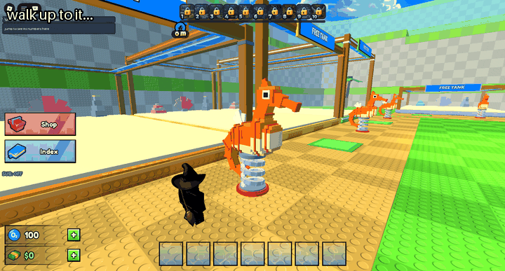
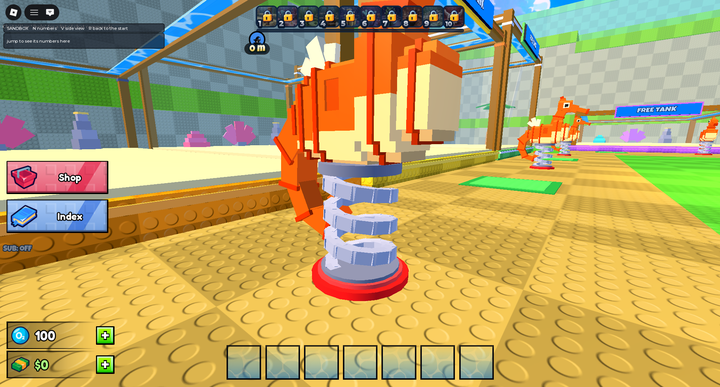

# The trainer: ride the seahorse

Hugo, 2026-11-19 (task h1): "remove the current spring platform; a high-quality, stylised grey spring from the centre of
the bottom of the seahorse's body down to a small circular red platform; the player actually rides it: hop on, rock
with it, hop off; walk up to it or jump on it and you hop on; while riding, a +number with the oxygen icon pops up near
the player about every 0.5 s."

## What it is now
- **The toy:** the game's own Seahorse (the kit's `Toy`, as before) on a short grey coil, 4.2 studs from the pad to its
  body's underside, from the middle of that underside. The coil is 3.5 turns of chunky square wire, half a stud thick (42 straight pieces,
  each a little longer than its gap so the outer corners meet), fixed between two darker round plates. The pad is a
  small round red slab, just wider than the coil (radius 2.05 against the coil's 1.5 outside; 4.5 turns read as a stack of plates in the first still, so 3.5), with a lighter top face.
- **The kit's old machine is gone in the game:** at the server's start `TrainService` takes away the square red pad's
  look (the part stays, unseen: the sign hangs from it), the yellow block, the post, the three coil discs and the plate
  under the seahorse, and sets the seahorse down to the coil's length. **Not yet in the kit:** `tools/map/hub_kit.py`
  still builds the old machine, so in Edit (and after a hub rebuild) it is there until Play. Changing the kit means a
  hub rebuild in the place: left for Hugo's word.
- **Getting on:** walk up to it (within 5.5 studs of the coil, flat) and you are seated; or jump on it (come down within
  3.6 studs of the coil, above the body's underside). After hopping off you must step away before a walk-up seats you
  again (and off its top before coming down on it does), so you don't hop straight back on. Your own plot's toy only; with no plot, the nearest free one.
- **Hop on:** the server welds you to the toy's body at the seat; every machine carries you there from where you stood
  in a 0.42 s hop (an arc 3.2 studs over the straight line, eased into the seat), and the spring gives and bounces back
  as you land.
- **Riding:** the toy rocks nose down and up about the pad (11 degrees each way, 0.95 swings a second, a small dip at
  each end of a swing), the coil bending along a curve between the pad and the body, and you with it: you are welded to
  its body, so your rock is the toy's exactly. The rock grows as you sit and dies away when you leave.
- **Getting off:** jump, or steer (walk) any way, as before. You hop off along a 0.5 s arc, 8 studs the way you steer
  (or off the toy's side), and the spring springs up behind you.
- **Training:** only a seated rider trains (Config.Train's rate and share, unchanged); the server counts it and every
  0.5 s tells the rider what they gained. On screen a "+n" with the HUD's own Oxygen picture (Kit.Textures.Oxygen)
  springs up at a random spot round the player (to either side, from their middle to a little over their head), drifts up 70 px and fades out over
  1.15 s. The number is built like the fish tags' rarity words (Kit.word: glow, a darker copy under it, the metal
  gradient, the ink edge, the shine line), in the HUD's aqua. Under 10 it shows one decimal ("+2.2"), above that the
  HUD's short numbers ("+1.2K").

## The 12 levels (Hugo, 2026-11-19, task sh1: "the seahorse draft is really good implement")
The draft (mission 20e4833b task m1, `art/creatures/Seahorse/tiers/trainer.py`, sheet
[seahorse-tiers-draft-1.png](../attachments/seahorse-tiers-draft-1.png)) is in the game as drafted: Toy, Painted,
Saddled, Racer, Iron, Spiked, Knight, Royal, Golden, Abyssal, Starfire, Prismatic, the stand climbing with it.

- **Each plot shows its owner's level.** The player's `TrainerLevel` (1 to 12, the server's, for the session like
  the coins) picks which seahorse and stand the plot's ride is: `ReplicatedStorage.TrainerModels.T<n>`. A plot with no
  owner shows level 1.
- **Going up a level:** stand by your own seahorse (within `Train.UpgradeNear`, 14 studs, seated or not) and press E
  ("Upgrade", the prompt names the next level and its price). The server checks you are on the dock at your own ride,
  takes the price (free while `Train.Free` is 1, as the subs are), and builds the new level at once. A seated rider
  stays seated, welded to the new seahorse.
- **The upgrade, on every machine:** the new seahorse springs up from the coil (a quarter size to full, with an
  overshoot, 0.45 s), a white flash fades off it (0.7 s), sparks burst from the top of the coil, and the spring bounces.
  The owner also sees "LEVEL n: NAME!" in the middle of the screen. Numbers in `RideStyles.Trainer` (UpIn, UpFlash,
  UpSparks).
- **The sign** (as the mock-up [ui8-trainer-upgrade.jpg](../attachments/ui8-trainer-upgrade.jpg)): under TRAIN and
  "ride it: more Oxygen", the level and what it gives on a white bar, the next level and what it gives, and its price
  on an orange button (FREE for now). There is no Robux button yet (no Robux prices).
- **What a level gives:** riding it gains that level's Oxygen a second (`Config.Train.Levels[n].Oxygen`) in place of
  `Train.Rate`, plus the old share of max (`Train.Share`) until the economy is picked. **The Oxygen and the prices
  are placeholders** (marked so in Config): fixed whole numbers, waiting for Hugo's pick of the economy draft
  (mission 20e4833b task b1, [progression](progression.md) "D4"), whose columns drop straight in; then `Share` goes
  to 0. Level 1 gives 4, today's Rate, so nothing changes until someone upgrades.
- **The stand and the coil, reconciled with the ride:** each level's model has two halves. The **Toy** (the
  seahorse, its saddle, crown, wings, and the plate it stands on) rocks; the **Stand** (pad, base, posts, crystals,
  the orbiting shards) stays on the floor. The draft's own coil is left out of the game's mesh: the game's coil
  (`RideStyles.coil`, bending as it rocks) runs from the stand's top to the plate's underside, in that level's
  colours (`RideStyles.CoilColours`: grey to chrome, gold on 8 and 9, dark with glowing half-turns from level 7). An
  unseen block over the stand's footprint is what you stand on. The tail curl stands on the plate, as in the draft.
- **The seat** is each level's own (`SEAT` in the model: the saddle's top), with the rider's root 1.75 studs over it
  and 0.9 back (`SeatLift`, `SeatBack`: level 1 then seats as h1 did). Hop on, rock, hop off and the Rider weld are
  the same code on every level.
- **Size:** the model at 0.85, as the kit's toy. With the draft's stand the seahorse stands about 3 studs higher
  than the h1 toy did.
- **Glow:** the glowing colours are their own parts in Neon (`_Glow`), level 7 on; small PointLights from the model's
  `LIGHTS` (stand and head). Level 9's gold is in the mesh; level 12's rainbow is put into the mesh by the creatures'
  rainbow rule (as a Rainbow fish), its stand and dark colours left as they are. Level 11 and 12's shards turn round
  the coil.
- **Local only, not uploaded:** the meshes are files in Studio's content folder on Hugo's PC
  (`rbxasset://ridefish/SeahorseTrainer<n>/`), as the creatures' `--local` install. A published game needs them
  uploaded (Hugo's OK first). Without the models the game falls back to the kit's toy at every level (only the
  numbers and the sign change).

### Building them again
1. `python art/creatures/Seahorse/tiers/build_tiers.py --export` (Blender): each level with `GAME = True` (no
   draft coil, the plate a part of its own) through `voxel_kit.py --export` into
   `art/creatures/Seahorse/tiers/game/T<n>/` (`SeahorseTrainer<n>.glb`, `.mesh.json`), and `game/tiers.json`.
2. `python art/creatures/Seahorse/tiers/install_tiers.py runner` (Studio open, Edit): the mesh files and
   `ReplicatedStorage.TrainerModels`. After Studio updates itself: `--files-only` again. Save the place after.
3. Stills: `python art/creatures/Seahorse/tiers/tier_stills.py install`, Play, then `sheet`, `rider`, `upgrade`;
   `remove` after.

## Where it lives
- `src/shared/RideStyles.luau`: `RideStyles.Trainer` (every number above) and `RideStyles.coil` (the coil's pieces
  between a base frame and a top frame; the server builds with it, every machine bends with it).
- `src/server/Services/TrainService.luau`: the makeover, seating and unseating (the weld `TrainerWeld` on the toy's
  `Body`), training, and the `Remotes.Trainer` remote (client "Off"; server "On", "Off", "Gain"). The ride model
  carries `Rider` (the user id on it) and `SpringBase`, `SpringTop`, `Seat` (CFrames at rest); the player carries
  `TrainerRide` (the plot's name) while seated, and `Training` as before.
- `src/client/Controllers/TrainerController.luau`: the rock and the coil, the hop on (the weld's C0, on every machine),
  our own hop off, the pops. In Studio the workspace's `TrainerClock` (a number) holds its clock.
- `tools/studio/trainer_capture.py`: the GIF and the still from a playtest, frame by frame on that clock.
- The levels: `Config.Train.Levels` (names, Oxygen, prices: placeholders), `Train.Free`, `Train.UpgradeNear`;
  `RideStyles.Trainer` Scale, SeatLift, SeatBack, UpIn, UpFlash, UpSparks and `RideStyles.CoilColours`; in
  `TrainService` `build` (a ride at a level), the "Up" request, the sign's level lines, and the Studio hook
  `ServerStorage.TrainerTest`; the ride model also carries Level, Title, Build, PartCount and UpgradeAt. Models:
  `art/creatures/Seahorse/tiers/` (trainer.py, build_tiers.py, install_tiers.py, tier_stills.py, game/).

## Open
- The levels' Oxygen and prices wait for Hugo's pick of the economy draft (b1); the sign has no Robux button yet.
- The level is kept for the session only (no saves yet), like the coins.
- The 12 models are local to Hugo's PC until uploaded (needs Hugo's OK).
- Judged on captures only, not played by hand: the upgrade's look, the seat on each level, the higher stand.
- Judged on captures only, not played by hand: the seat's place on the seahorse (`Seat`), the rock's size and pace,
  and the pop's size are first guesses.
- The kit (`hub_kit.py`) still draws the old machine (above).
- The rider sits with Roblox's own sit pose; a riding pose of our own waits for the partner's animations.
