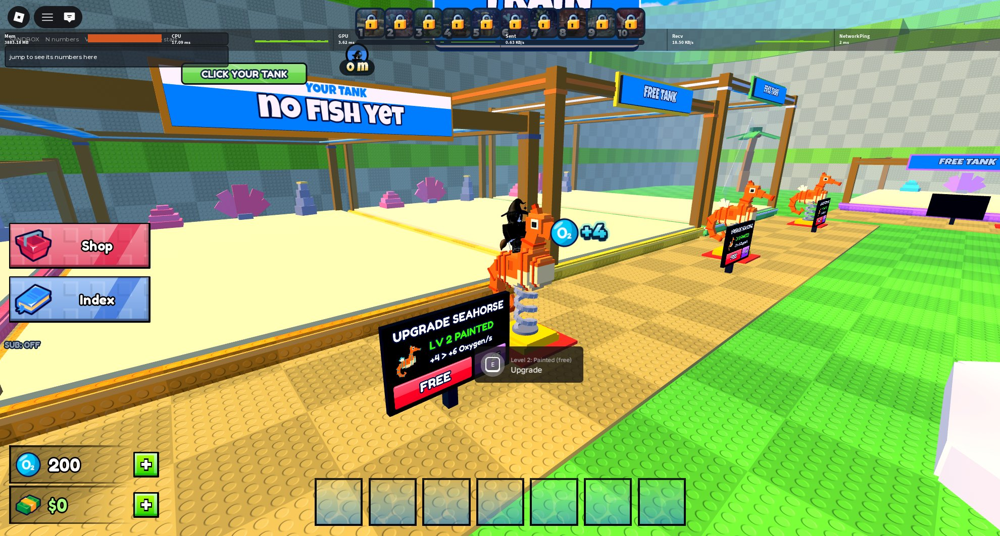
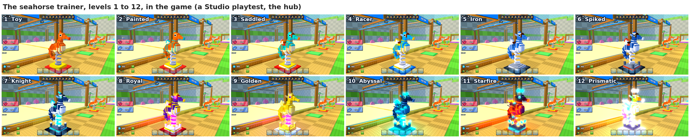
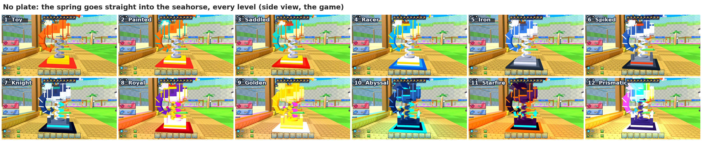
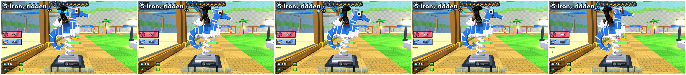
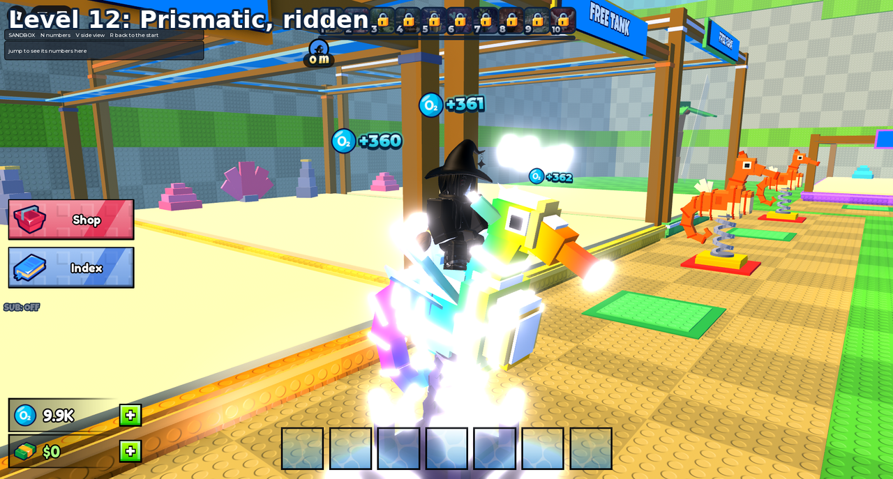
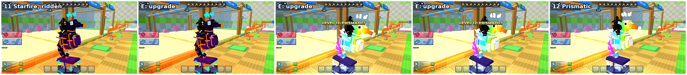
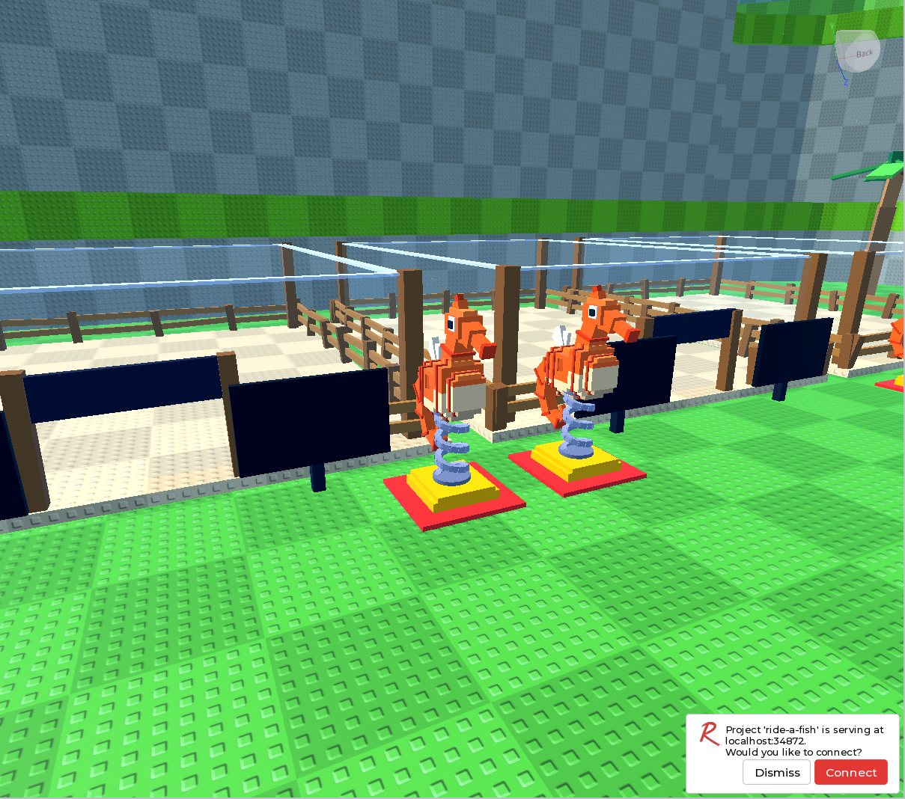
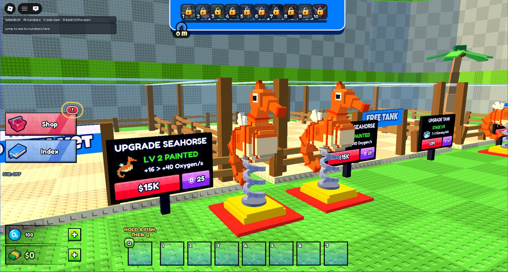
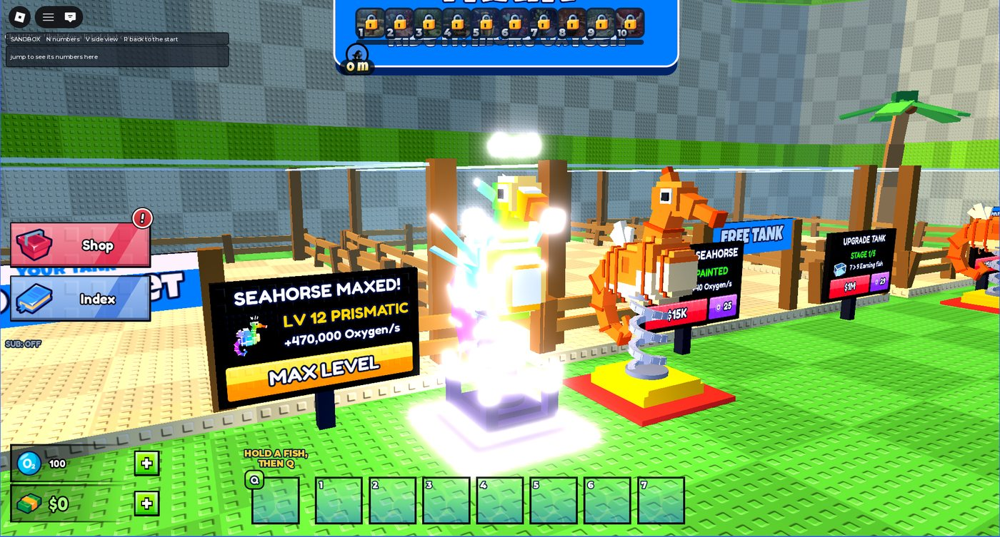

# The trainer: ride the seahorse

Hugo, 2026-11-19 (task h1): "remove the current spring platform; a high-quality, stylised grey spring from the centre of
the bottom of the seahorse's body down to a small circular red platform; the player actually rides it: hop on, rock
with it, hop off; walk up to it or jump on it and you hop on; while riding, a +number with the oxygen icon pops up near
the player about every 0.5 s."

> **2026-11-25 (the user): twice as often, half the value.** The level's Oxygen a second now comes in beats of
> `Train.Every` (0.25 s since 2026-11-25, with a chance of x2 or x4 a beat: `Train.Bonus`; 0.5 s before), whole numbers, a second adding up to exactly the level's (`Config.trainGain`).

> **Task e1 (2026-11-20): whole numbers once a second.** A seated rider gets the level's whole Oxygen
> (`Train.Levels`: 4, 6, 10 ... 600, placeholders) once for every whole second seated (`Config.trainTicks`), never a
> share of max (`Train.Share` is gone) and never a share of a frame. A part of a second is dropped on getting off and
> starts again at the new level on an upgrade. One "+n" pop a second (whole, `Config.wholeNumber`), and the upgrade
> sign's "+4 > +6 Oxygen/s" is whole too. Live in a playtest: level 1, 100 to 160 in 15 s, +4 each second.
> 
>
> **The edges (2026-11-22, grade issue 2):** the seated time is counted from the moment of sitting (never from the look
> before), and settled up to the very moment of an upgrade (at the old level), of asking to get off and of dying
> (TrainService `settle`, `Rider.Since`); only then is the part of a second dropped. Lost to the water or a broken seat,
> it is counted to the last look (0.1 s). The old stand-in pad counts from the first look it sees you on it.

## What it is now
- **The toy:** the game's own Seahorse (the kit's `Toy`, as before) on a short grey coil, 4.2 studs from the pad to its
  body's underside, from the middle of that underside. The coil is 3.5 turns of chunky square wire, half a stud thick (42 straight pieces,
  each a little longer than its gap so the outer corners meet), fixed between two darker round plates. The pad is a
  small round red slab, just wider than the coil (radius 2.05 against the coil's 1.5 outside; 4.5 turns read as a stack of plates in the first still, so 3.5), with a lighter top face.
- **The kit draws nothing of the trainer (2026-11-23, task m2).** `tools/map/hub_kit.py` (`trainer_marks`) puts only
  unseen marks in each plot, where the old machine stood: `TrainerSpot` (the floor and the place), and the model
  `TrainerRide` with its plate and a `Toy` of two boxes, `Body` and `Head` (where the coil stands and which way the
  seahorse faces). The yellow block, the post, the three coil discs, the old kit seahorse and the square red pad are
  out of the map, so nothing of them can show in Edit, at Play or after a hub rebuild. `TrainService` reads the same
  three names as before, so an older map (the old machine still drawn) and the new one give rides in the same place:
  measured, every plot's coil and seat within 0.001 studs of where they stood. More under "Staying in the place".
- **The floor under the ride** is the highest seen surface of the plot under its coil (a plot's Pad can cover the
  trainer's corner, 0.4 studs over the hub's floor, and buried the levels' thin pads), not the kit spot's underside.
- **Getting on:** walk up to it (within 5.5 studs of the coil, flat) and you are seated; or jump on it (come down within
  3.6 studs of the coil, above the body's underside). After hopping off you must step away before a walk-up seats you
  again (and off its top before coming down on it does), so you don't hop straight back on. Your own plot's toy only; with no plot, the nearest free one.
- **Hop on:** the server welds you to the toy's body at the seat; every machine carries you there from where you stood
  in a 0.42 s hop (an arc 3.2 studs over the straight line, eased into the seat), and the spring gives and bounces back
  as you land.
- **Riding:** the toy rocks nose down and up about the pad (11 degrees each way, 0.95 swings a second, a small dip at
  each end of a swing), the coil bending along a curve between the pad and the body, and you with it: you are welded to
  its body, so your rock is the toy's exactly. The rock grows as you sit and dies away when you leave.
- **Getting off:** jump, or steer (walk) any way, as before. You hop off along a 0.5 s arc, 8 studs the way you steer
  (or off the toy's side), and the spring springs up behind you.
- **Training:** only a seated rider trains (Config.Train's rate and share, unchanged); the server counts it and every
  0.5 s tells the rider what they gained. On screen a "+n" with the HUD's own Oxygen picture (Kit.Textures.Oxygen)
  springs up at a random spot round the player (to either side, from their middle to a little over their head), drifts up 70 px and fades out over
  1.15 s. The number is built like the fish tags' rarity words (Kit.word: glow, a darker copy under it, the metal
  gradient, the ink edge, the shine line), in the HUD's aqua. Under 10 it shows one decimal ("+2.2"), above that the
  HUD's short numbers ("+1.2K").

## The 12 levels (Hugo, 2026-11-19, task sh1: "the seahorse draft is really good implement")
The draft (mission 20e4833b task m1, `art/creatures/Seahorse/tiers/trainer.py`, sheet
[seahorse-tiers-draft-1.png](../attachments/seahorse-tiers-draft-1.png)) is in the game as drafted: Toy, Painted,
Saddled, Racer, Iron, Spiked, Knight, Royal, Golden, Abyssal, Starfire, Prismatic, the stand climbing with it.

- **Each plot shows its owner's level.** The player's `TrainerLevel` (1 to 12, the server's, for the session like
  the coins) picks which seahorse and stand the plot's ride is: `ReplicatedStorage.TrainerModels.T<n>`. A plot with no
  owner shows level 1.
- **Going up a level:** click (or tap) the red cash block on your own upgrade sign (task e2, Hugo 2026-11-20: no E
  prompt). You must be within `Train.UpgradeNear` (14 studs) of your seahorse or `Train.SignNear` (12) of the sign,
  else the block says WALK CLOSER! and nothing is sent; it says "..." until the server answers, and a press within
  `Train.UpAgain` (0.5 s) of the last ask is the same click (the server ignores it too). Other players' signs and the
  purple Robux block do nothing when clicked (no product yet). The server checks you are alive, on the dock at your
  own ride, takes the price (free while `Train.Free` is 1, as the subs are), and builds the new level at once. A seated rider
  stays seated, welded to the new seahorse.
- **The upgrade, on every machine:** the new seahorse springs up from the coil (a quarter size to full, with an
  overshoot, 0.45 s), a white flash fades off it (0.7 s), sparks burst from the top of the coil, and the spring bounces.
  The owner also sees "LEVEL n: NAME!" in the middle of the screen. Numbers in `RideStyles.Trainer` (UpIn, UpFlash,
  UpSparks).
- **The upgrade sign** (task s2, 2026-11-20, after Ride a Dino's "Upgrade Machine" board, reference
  `nullroom/data/uploads/2026-11-19/235338-pasted-235338.png`): a board on a post beside each plot's seahorse, toward
  the collect pad and a little toward the hub, facing the hub (parts `UpgradeBoard` and `UpgradePost` in the plot;
  `Config.Train.Sign`). Written on each machine by `Client.UI.UpgradeSign` (a SurfaceGui in the shop kit's look: the
  dark slate with bubbles, the thick dark border, Fredoka with the ink edge, the kit's flat blocks): UPGRADE SEAHORSE;
  the next level's own model in a dark well and "LV n NAME" in the cash green; "+4 > +6 Oxygen/s" (now > next,
  `Levels[n].Oxygen`); a red cash block (FREE while `Train.Free` is 1) and a purple Robux block (`Train.Robux`,
  **placeholders, shown only**: no developer product, `Train.RobuxProduct` 0). At level 12: SEAHORSE MAXED!, the
  level-12 seahorse, its name in gold, "+600 Oxygen/s" and one gold MAX LEVEL block. Each sign shows its plot owner's
  level, so your own is yours; it changes (with a pop) the moment you upgrade. Upgrading is still E by the ride. The
  floating TRAIN sign keeps only its two lines (its level lines are gone: the board says them).
  Board 10.8 by 6.48 studs, its layout 540 by 324 at 50 pixels a stud (title about 1.1 studs tall). Seen in Studio
  beside the reference: [upgrade-sign-vs-ref.jpg](../attachments/upgrade-sign-vs-ref.jpg), MAX and the play camera
  [upgrade-sign-max-play.jpg](../attachments/upgrade-sign-max-play.jpg), the play camera at phone size
  [upgrade-sign-phone.jpg](../attachments/upgrade-sign-phone.jpg) (the title about 18 pt, the stat line about 10 pt).
- **What a level gives:** riding it gains that level's Oxygen a second (`Config.Train.Levels[n].Oxygen`) in place of
  `Train.Rate`, plus the old share of max (`Train.Share`) until the economy is picked. **The Oxygen and the prices
  are placeholders** (marked so in Config): fixed whole numbers, waiting for Hugo's pick of the economy draft
  (mission 20e4833b task b1, [progression](progression.md) "D4"), whose columns drop straight in; then `Share` goes
  to 0. Level 1 gives 4, today's Rate, so nothing changes until someone upgrades.
- **No plate: seahorse, spring, ground** (Hugo, 2026-11-19, a change during sh1: "remove the platform/base plate
  the seahorse stands on ... like a playground spring rider"). Each level's model has two halves: the **Toy** (the
  seahorse, its saddle, crown and wings) rocks; the **Stand** (pad, base, posts, crystals, shards) stays on the floor.
  The draft's coil and the plate on it are left out of the game's mesh. The game's coil (`RideStyles.coil`, bending
  as it rocks) runs from the stand's top straight into the body's underside, `SpringLength` (5.2 studs), in that
  level's colours (`RideStyles.CoilColours`: grey to chrome, gold on 8 and 9, dark with glowing half-turns from level
  7). Where it meets the body (`SpringAt`, worked out by `install_tiers.py` from the mesh): a cube ahead of the
  tail's curl, just under the highest point of the rounded belly within the coil's reach, so the coil's top turn and
  its cap sink into the belly and touch it all round. The coil is a little slimmer than h1's (radius 1.0, wire 0.45,
  was 1.25 and 0.5, on the kit's toy too) so it clears the tail's curl, and the curl clears the stand by about a stud
  even at the bottom of a rock. The rock turns about the coil's foot on the stand's top; the welds, the seat and the
  unseen block you stand on (the stand's footprint) are as before. The shards stand still, as drafted (they would
  cut through the lowered tail if they turned).
- **The seat** is each level's own (`SEAT` in the model: the saddle's top), with the rider's root 1.75 studs over it
  and 0.9 back (`SeatLift`, `SeatBack`: level 1 then seats as h1 did). Hop on, rock, hop off and the Rider weld are
  the same code on every level.
- **Size:** the model at 0.85, as the kit's toy. On the draft's stand and a 5.2-stud coil the seahorse stands about
  2 studs higher than the h1 toy did.
- **Glow:** the glowing colours are their own parts in Neon (`_Glow`), level 7 on; small PointLights from the model's
  `LIGHTS` (stand and head). Level 9's gold is in the mesh; level 12's rainbow is put into the mesh by the creatures'
  rainbow rule (as a Rainbow fish), its stand and dark colours left as they are. Level 11 and 12's shards turn round
  the coil.
- **Local only, not uploaded:** the meshes are files in Studio's content folder, one set per PC and per Studio
  version (`rbxasset://ridefish/Trainer<n>/`), as the creatures' `--local` install; the 12 models are in the place
  file (`ReplicatedStorage.TrainerModels`). A published game needs them uploaded (Hugo's OK first). Without the
  models the game shows a bare coil and pad at every level and says so loudly; without the files the seahorses are
  unseen and the client says so ("Staying in the place").

### Building them again
1. `python art/creatures/Seahorse/tiers/build_tiers.py --export` (Blender): each level with `GAME = True` (no
   draft coil, no plate) through `voxel_kit.py --export` into
   `art/creatures/Seahorse/tiers/game/T<n>/` (`SeahorseTrainer<n>.glb`, `.mesh.json`), and `game/tiers.json`.
2. `python art/creatures/Seahorse/tiers/install_tiers.py runner` (Studio open, Edit): the mesh files and
   `ReplicatedStorage.TrainerModels`, always, from the exports. Save the place after. (To put in only what is
   missing, on any PC: `python tools/studio/trainer_models.py <studio_id>`, below.)
3. Stills: `python art/creatures/Seahorse/tiers/tier_stills.py install`, Play, then `sheet`, `joints`, `rock`,
   `rider`, `upgrade`; `remove` after.

## Staying in the place (2026-11-23, task m2)
Hugo: the old toy machine kept coming back. Read from the code's history since 516b0fe: nothing in the code had
gone back; the old one returned four ways, each closed now.

| How the old one came back | What stops it |
|---|---|
| The kit built the old machine on every hub or map load: there in Edit, swapped only at Play | the kit builds unseen marks only (above) |
| A place without `ReplicatedStorage.TrainerModels` (a fresh place, the partner's, one not saved after the install): the game fell back to the kit's toy and said nothing | every map load checks and installs them; the server warns once at start |
| The mesh files missing (another PC, or Studio updated itself): the seahorse unseen, nothing said | every map load checks and writes them; the client warns once |
| Nothing of the trainer in Edit | the level-1 seahorse is shown on every plot in Edit |

- **One command, any PC:** `python tools/studio/trainer_models.py <studio_id>` (Hugo's PC: `runner`), Studio open in
  Edit. It finds the running Studio's content folder (Windows, macOS, Linux under Vinegar; else the newest installed;
  `STUDIO_CONTENT=<...\Versions\version-xxxx\content>` names it by hand) and prints it; asks the place which of
  T1 to T12 it has and whether each mesh file is on this PC; installs what is missing with `install_tiers.py` (the
  12 models when the place lacks any, only the files when only files are missing); then shows level 1 on every plot.
  `--check` only reports (exit code 1 when something is missing). A content folder it cannot find is a failure too,
  never "all there". Nothing is uploaded. **After an install save the
  place (Ctrl+S); after Studio updates itself run it again.**
- **It runs by itself** at the end of `python tools/studio/load_greybox.py <studio_id>` (a whole load) and of
  `python tools/studio/load_greybox.py <studio_id> greybox hub` (new: the hub's files only, seconds, keeps hand
  placing; then the trainer step and the hub's contract). Both ways were run on Hugo's place, the hub mode twice (the
  second over the preview already there: the place unchanged). When it cannot make the trainer whole it prints a block of
  `!!!` lines saying what to run.
- **In Edit:** `tools/studio/trainer_edit.luau` puts one model, `TrainerStand`, in each plot: the level-1 seahorse, its
  stand and coil, where the game will build them (it copies `TrainService`'s placing; a playtest compares the two:
  0.001 studs). It is marked `EditPreview`, its parts are locked (a click takes the plot), and the game takes it away
  at its start and builds its own. It is a picture: to move a trainer, move its plot or change the kit. It adds 54
  parts a plot (432 in the hub) to the place's part count; `99_check` counts them.
- **In the game, when something is missing:** the server warns once, in capitals, naming the missing levels and the
  command (`TrainService.Start`); the client warns once when a level-1 mesh file does not load
  (`TrainerController.checkMeshes`; level 1's files only: the levels are installed together). Both tried in a playtest: the models taken out (one warning; the stand-in pad
  and coil still seat, train and upgrade), and one mesh file hidden (the client's warning names it).
- **The check:** `python tools/studio/trainer_check.py install`, Play, `run [baseline.json]`, stop, `remove`
  (Hugo's PC: it drives studio-runner; `places > baseline.json` in a playtest writes a baseline of where the rides stand). It checks
  every plot shows Hugo's level 1 from its meshes with nothing of the old machine and no Edit preview left; walking
  up seats; Oxygen comes once a second at the level's number; getting off stops it; an upgrade by the sign's own
  request builds level 2 and takes its price; each of the 12 levels builds and no point of its meshes comes within a
  quarter stud of the fence, a post, the sign or a neighbour, at rest, at both ends of the rock and under a landing;
  no flash is left; level 12 trains; level 1 is measured on all eight pens (they are mirrored and turned), levels 2
  to 12 on the player's own. 2026-11-23: all good. Least gaps: the fence 1.19 studs (level 1, Plot5; 1.19 to 1.87
  over the eight pens), 1.46 to 1.54 for the 12 levels on Plot2; **the upgrade sign's board 0.45 studs from level 11 and 12's wing tips at the back of a rock on a landing**
  (0.78 on a plain rock): clear, but the closest thing on the plot. Measured at the pen's first stage, and without
  the upgrade's spring-up (0.45 s, a small overshoot in size).
- **Fixed on the way:** an upgrade's white flash stayed on the seahorse for good when its level changed again before
  the flash had faded (0.7 s; `Train.UpAgain` lets an upgrade through every 0.5 s). The record that faded it was
  dropped on the rebuild; it now takes its flash with it.

## Where it lives
- Staying in the place: `tools/map/hub_kit.py` `trainer_marks`; `tools/studio/trainer_models.py`,
  `trainer_edit.luau`, `trainer_check.py`; `tools/studio/load_greybox.py` (`trainer()`, the `hub` mode).

- `src/shared/RideStyles.luau`: `RideStyles.Trainer` (every number above) and `RideStyles.coil` (the coil's pieces
  between a base frame and a top frame; the server builds with it, every machine bends with it).
- `src/server/Services/TrainService.luau`: the makeover, seating and unseating (the weld `TrainerWeld` on the toy's
  `Body`), training, and the `Remotes.Trainer` remote (client "Off"; server "On", "Off", "Gain"). The ride model
  carries `Rider` (the user id on it) and `SpringBase`, `SpringTop`, `Seat` (CFrames at rest); the player carries
  `TrainerRide` (the plot's name) while seated, and `Training` as before.
- `src/client/Controllers/TrainerController.luau`: the rock and the coil, the hop on (the weld's C0, on every machine),
  our own hop off, the pops. In Studio the workspace's `TrainerClock` (a number) holds its clock.
- `tools/studio/trainer_capture.py`: the GIF and the still from a playtest, frame by frame on that clock.
- The levels: `Config.Train.Levels` (names, Oxygen, prices: placeholders), `Train.Free`, `Train.UpgradeNear`;
  `RideStyles.Trainer` Scale, SeatLift, SeatBack, UpIn, UpFlash, UpSparks and `RideStyles.CoilColours`; in
  `TrainService` `build` (a ride at a level), the "Up" request, `upgradeSign` (the sign's parts on a map without them), and the Studio hook
  `ServerStorage.TrainerTest`; the ride model also carries Level, Title, Build, PartCount and UpgradeAt. Models:
  `art/creatures/Seahorse/tiers/` (trainer.py, build_tiers.py, install_tiers.py, tier_stills.py, game/).
  `RideStyles.Trainer.SpringLength`; the model's attributes Foot, StandTop, SpringAt, SeatAt.

## Open
- The levels' Oxygen and prices wait for Hugo's pick of the economy draft (b1); the sign's Robux prices are placeholders, with no product behind them.
- The level is kept for the session only (no saves yet), like the coins.
- The 12 models' meshes are local files on each PC until uploaded (needs Hugo's OK): a published game shows no
  seahorse without that. `trainer_models.py`'s folder search is tried on Hugo's PC only (Linux, Vinegar); on Windows
  and macOS it is untried, so the first run there should be read (it prints the folder it uses).
- `hub_kit.py --old` (the before-pictures builder, `plot_old`) still draws the old machine: it is not the map.
- Judged on captures only, not played by hand: the upgrade's look, the seat on each level, the higher stand.
- Judged on captures only, not played by hand: the seat's place on the seahorse (`Seat`), the rock's size and pace,
  and the pop's size are first guesses.
- The rider sits with Roblox's own sit pose; a riding pose of our own waits for the partner's animations.
