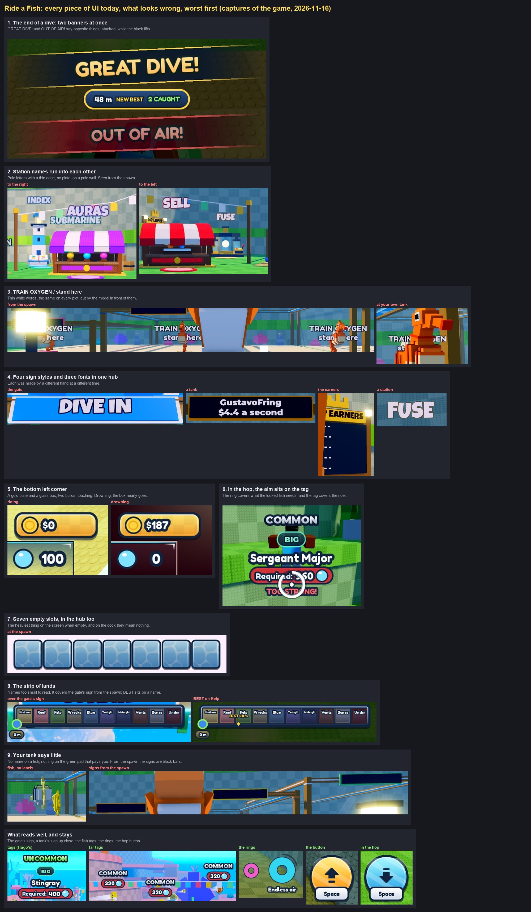

# The UI today: a survey (2026-11-16)

Every piece of UI a player sees in the game as it is now, in the hub and in a dive, with what looks wrong, worst
first. Written by the UI chat on the user's word ("I just want to do the UI", [Decisions](../Decisions.md)) as step 1
of the UI's look. The plan and the history of the HUD are in [UI](ui.md); this note is only what is on screen today.

**How it was looked at:** one playtest in Studio on this PC, at 1370 by 801, under the new light (light A) and with
the rebuilt hub. 18 captures. The sandbox's own panel was hidden for the pictures (a player never sees it). Not on
a phone, not with a second player.

## The short of it
- **The dive's HUD holds up under the new light.** The tags, the rings and the hop button read well over sand, reef
  and kelp. Those were picked by Hugo and the user, and they stay.
- **The hub is where it falls apart.** Its words were made by four hands at four times: three fonts, four kinds of
  sign, and floating words with no plate that run into each other.
- **Two real faults, not matters of taste:** two banners that say opposite things at the end of a dive (1), and the
  aim ring drawn over the tag it is aiming at (6).
- **Nothing in the hub is clickable yet,** so there is no hub screen to judge: no shop, no Index, no buttons.

## What looks wrong, worst first
| # | What | Where | Why it is wrong |
|---|---|---|---|
| 1 | **Two banners at once at the end of a dive** | [picture](../attachments/ui7-dock-two-banners.jpg) | After drowning you wake on the dock with "GREAT DIVE!", its pill, and "OUT OF AIR!" stacked, while the black lifts. They say opposite things. The camera is looking at the floor at that moment too |
| 2 | **The station names run into each other** | [right](../attachments/ui7-hub-right.jpg), [left](../attachments/ui7-hub-left.jpg) | From the spawn AURAS sits on SUBMARINE and INDEX floats behind both. Pale lilac letters with a thin edge and no plate, on a pale wall. They are drawn from 900 studs away, at every size, so far ones are specks |
| 3 | **"TRAIN OXYGEN / stand here"** | [the plots](../attachments/ui7-hub-plots.jpg) | Thin white words with a faint edge. The same words hang over every plot, so three show at once and none says which is yours. The trainer's own model cuts through the letters |
| 4 | **Four sign styles and three fonts in one hub** | [the gate](../attachments/ui7-hub-gate.jpg), [a tank](../attachments/ui7-hub-tank-fish.jpg), [the earners](../attachments/ui7-hub-earners.jpg) | The gate: white Luckiest Guy on a blue board. A tank: white Gotham Black on a navy board with a gold rim. The earners: black Luckiest Guy on yellow over a black board. Stations: bare Luckiest Guy. The trainer: bare Fredoka One. The HUD: Fredoka One and Gotham Black |
| 5 | **The bottom left corner** | [riding](../attachments/ui7-dive-riding.jpg), [drowning](../attachments/ui7-dive-drowning.jpg) | Your coins are a gold studded plate; your Oxygen is a smoked glass box in the corner. Two builds, and they touch. **One remark on the Oxygen box, for the user to judge, nothing changed:** while you drown the glass box all but goes and a white 0 floats on nothing (the meter was red here before, and the 0 was red) |
| 6 | **In the hop the aim sits on the tag** | [the hop](../attachments/ui7-dive-hop.jpg) | The locked fish's tag is put at the fish, the aim ring at the middle of the screen, and in a hop those are the same place: the ring covers "Required" and "TOO STRONG!", and the tag covers the rider |
| 7 | **Seven empty slots** | [the spawn](../attachments/ui7-hub-spawn.jpg) | Empty, they are the heaviest thing on the screen: seven glass tiles with the water's picture. They show on the dock too, where nothing can be caught |
| 8 | **The strip of lands** | [the spawn](../attachments/ui7-hub-spawn.jpg) | The land names are too small to read at this size. From the spawn the strip sits right on the gate's "DIVE IN". "BEST 48 m" is written across a land's name. It shows on the dock, where you are in no land |
| 9 | **Your tank says little** | [with fish](../attachments/ui7-hub-tank-fish.jpg), [from the spawn](../attachments/ui7-hub-plots.jpg) | No fish in a tank has a name, a rarity or what it earns. The green pad that pays you has no word or number on it. From the spawn every tank's sign is a black bar: you can't find your own |
| 10 | **The earners' board** | [picture](../attachments/ui7-hub-earners.jpg) | Five rows of dashes on black. It is meant to show a number absurdly above yours |
| 11 | **"DIVE IN" on the floor** | [the spawn](../attachments/ui7-hub-spawn.jpg) | Unreadable from the spawn (seen edge on). The sign over the gate already says it |

## What reads well, and stays
- **The taming ring and the Oxygen meter stay as they are,** on the user's word of the same day
  ([Decisions](../Decisions.md)): they match the reference now. Other pieces are made to fit them.
- **The gate's sign:** big white letters, a dark edge, a blue board with a white rim. The best sign in the hub.
- **A tank's sign up close:** the owner and "$4.4 a second" read at once.
- **The fish tags** (Hugo's three lines), near and far, and the red plate on a fish too strong.
- **The two rings beside the rider** and the hop button, also turned over in the hop.
- **GREAT DIVE!** by itself, with its pill ("48 m, NEW BEST, 2 CAUGHT").
- **The pictures in the slots** work: a caught fish's own model is drawn in its slot.

## Numbers
- **Fonts in use:** Luckiest Guy (stations, gate, earners, floor), Gotham Black (tank signs, the rarity words, the
  line when a catch goes in), Fredoka One (the HUD, the trainer's words).
- **Floating labels in the hub:** 5 station names (drawn from 900 studs) and 8 trainer signs (160 studs). 13 in all,
  well under the phones' budget of about 150. The fish tags are not floating labels: they are drawn on the screen.
- **Signs on parts:** 16 tank signs (front and back of 8), the gate, the floor, the earners' header and rows.

## Not seen in this run
- **The catch banner:** three tries, never on screen when the capture landed. A slot filled each time, so the tame
  itself works. To check by hand.
- **The line when a catch goes into the tank** ("+2 IN YOUR TANK"), a new land's name, a missed hop's words, a
  Legendary's tag: each is up for two or three seconds and none was caught.
- **A landing on a fish too strong with its own words** ("Too strong!"): the one throw seen said "Out of air",
  but the sandbox's switches were being changed at that moment, so it proves nothing.
- **A phone.** On the user's word that waits until the look is settled.

## What comes next
Step 2 is options to pick from for the worst few, as pictures side by side. Step 3 is the dock's panels (shop,
tank, trainer, Index) as looks. Both are in [UI](ui.md) when they are made.
