# UI: what the player sees on screen

> **Studies, 2026-11-16.** The reference's first minutes are a script of about twenty lines, one on screen at a time. Its night timer is the reset clock, not decoration. A failure names its cure with both numbers. A tag at exactly your number still throws you, so ours can be the honest one. [Findings](../Findings.md), rank 1 point 5 and rank 2; the lesson line by line in [Ride a Dino](../reference/ride-a-dino-deep.md), "The first minutes".

The plan for the dive's HUD and the dock's screens. Written 2026-11-11 by the UI chat ([Sessions](../Sessions.md)).
**Pass 3, the same day, is the current proposal:** the user picked look A for its simple build, with E's pattern, and
asked for it to go nearer still to Ride a Dino's HUD. Pass 2 (five looks) and pass 1 are kept below.

**Pass 4 (2026-11-12, Hugo) is the look in the game now:** bold outlines, gradients and patterns on every plate,
each themed by what it is for. It is the section after the short version. Pass 3 still holds for where things are.

**The dive's HUD is built in code since 2026-11-12 ("Piece 2", below), on the user's word, from pass 3, and has run
once in Studio. Everything else here is proposed.** The pictures are mock-ups drawn by code
(`python tools/ui/render_mockups.py` draws them again); the scene behind the HUD in them is a stand-in, not the game.
What the user decides goes in [Decisions](../Decisions.md).

Most players are on phones, so every picture is drawn for a phone held sideways first (844 by 390), then for a desktop.

## The tank in the shop style (2026-11-20, Hugo; NULLROOM task s3): in the game
Hugo: "make placing down fishes UI cohesive with these styles" (the shop kit, below). Every piece of putting fish in
the tank and choosing which earn is now drawn with `UI/Shop.luau`. **What any of it does is unchanged**: the same
server actions (`Tank` Best / Equip / Unequip / PutIn / PutAll, `Place`, `TankRide`), the same reach, the same
refusals. Run in Studio by script with sample fish on the capturing client only, not played by hand, not seen on a
real phone.
- **The popup (`UI/TankPanel.luau`)**, after the sell list shot: YOUR TANK on the **Kelp** header with the bubble icon
  and what the tank earns ($X/s in green) before the red X. At the left a **Sort by** column: Income, Rarity, Size
  (green = on; only this screen's order, never which fish earn), and a line saying only earning fish make coins, up
  to N at once. The cards in a dark tray, in sections **In your hands** (gold), **Earning n/N** and **Stored**. At the
  foot a bar with **Earning: $X/s**, a pill **Earning 3/4** (red **Tank full 4/4** when full), **PUT ALL IN (n)**
  (gold, only while carrying) and **EQUIP BEST** (green while it would change something, else grey BEST EQUIPPED).
- **A card** (144 x 218 points; four to a row on a PC): tinted in its **rarity's colour** (lit at the top, deepening into the shop's slate;
  the Secret's near-black drawn pink), the scale pattern and gloss, the **name in the rarity's colour**, a small line
  with the rarity word and the size in its own hue, the fish's render in a dark well (gold or rainbow behind a Gold or
  Rainbow fish, the variant chip at its corner, the archetype icons at its foot), the rate **$12/s in the shop's
  green**, and one button: **EQUIP** green, **UNEQUIP** blue (an earning card has the kit's light border), **PUT IN**
  gold, **FULL** grey when every earning place is taken (still pressable: the server answers and the toast says to
  unequip one first).
- **Refusals** come as a red kit bar over the tray's foot for two seconds. **No fish yet** is a line in the empty tray.
- **The prompt on the glass (`UI/TankPrompt.luau`)**: the tank's ProximityPrompt is drawn by us (Style Custom): a pale
  kit key cap (E; TAP on a phone, where pressing it presses the prompt) that fills green while held, beside a Kelp
  plate with "Put in tank" or "Ride a fish" and the fish's name in its rarity's colour. It pops in.
- **A fish goes in (the confirm)**: the line over the tank is a slate plate with a Kelp strip, "**Reef Shark** in your
  tank!" (the name in its rarity's colour) and "+$12/s" in green with the cash sign; it rises and fades as before.
- **The sign over the tank** (CLICK / TAP YOUR TANK, WALK CLOSER!) is a small Kelp plate like the header, and the
  glass under the mouse is outlined in a light green with a faint green fill.
- **A phone:** the window takes the whole height (its points scaled by the screen's height over 430, not 720), so a
  card's name is about 15 pt at 844 x 390; the cards' columns follow the width.
- **Not changed:** the catch slots along the bottom (their white ring still marks which fish the prompt puts in). (Since task c1, 2026-11-20, no prompt: fish go in from the tank's popup; the row is seven numbered slots with the Q slot beside it, [the ride fish](equip.md).)

**Seen** (`tools/ui/shop_kit/s3_capture.py` with the client `tank_client.luau`):
[beside the reference](../attachments/tank-vs-ref.jpg), [sorted by rarity, full, empty](../attachments/tank-states.jpg),
[the prompt and the confirm](../attachments/tank-prompt.jpg), [on a phone](../attachments/tank-phone.jpg).

## Shop style (2026-11-20, Hugo; NULLROOM task s1): the sub stand in the game, the rest ready
Hugo: the buy screens should look like his three shots from another game in the genre (a sell list, an auras shop,
a tier shop), "replicated as well as you can but more stylised and cohesive". We copy the **style** only, never its
art, icons, words or names. Run in Studio by script, captured from the game, not played by hand, not seen on a real
phone.

**The rules, read off the shots, made ours:**
- **The window:** a dark slate body (34,40,54: a little blue, so it sits under water with the HUD's navy) with a fine
  **bubble-dot** pattern (ours, in place of the reference's studs), a thick near-black border (`Shop.Edge`) and a
  drop shadow; it pops in (0.16 s).
- **The header bar:** one colour per shop (`Shop.Heads`: Sea for the sub stand, Lavender for auras, Kelp for selling
  and the tank, Coral, Sand), its top half lit and split hard at the middle, a **fish-scale** pattern, a darker ledge
  along its foot, and two pale **diagonal gloss** streaks. A shop icon at the left (drawn by us, in the icon pack's
  rules: one ink outline, flat lit faces, white glints: a sub, a shell, a seahorse, a bubble), the title in big
  white FredokaOne (the Kit's font) with a heavy ink edge, left after the icon or centred. The **red square X** at the right.
- **Buttons** (`Shop.button`): flat and bright, a lighter top half, a white lip line, the scale pattern, a 3 px dark
  edge, outlined words; a press dips them. **Green = you can pay** (or Equip), **grey = you can't** (or not yet),
  **blue = equipped**, **orange-yellow = Robux** (Roblox's own Robux sign in green), purple and lavender for the rest.
- **Cards** (`Shop.card`): tinted all over in their tier's colour (lit top half), a small name, a big line ("Tier 2 •
  Sub", "Lvl 3"), a **cream picture well** with an ink edge, an optional dark stat strip ("**x2** Oxygen", the
  multiplier in green), buttons at the foot. The chosen one gets a **light border**.
- **List cards** (`Shop.itemCard`): the name in its rarity's colour, the picture, a green rate ("$400/s"), a dark
  price strip with the cash sign. **Sort buttons** (`Shop.sort`): a fat down arrow and a word, green when on.
- **Carousel** (`Shop.carousel`): a sideways row of cards with a big arrow button either side (one card a press) and a
  thin scroll bar; drag or scroll on a phone.
- **Money** (`Shop.money`, `Shop.cash`): green, abbreviated by `Kit.short` ($950, $5K, $31.4K, $1.4B), the cash
  sign before it; the balance sits at the top right under the header.
- **Fitting the screen:** a window is laid out in its own points and scaled to the screen like the tank popup (a
  phone gets bigger points; never past the screen's edges). In Studio the workspace's `PanelPhone` (a Vector2) lays it
  out for that phone and now refits while open.

**The screens:**
- **The sub stand (in the game, `UI/SubPanel.luau`):** rebuilt on the kit after the tier-shop shot: SUBMARINES with
  the sub icon on the Sea header, "Pick a sub, pick a land, jump in!" and your coins in green, a carousel of the ten
  cards (NO SUB and the nine subs, each tinted its hull colour, its model in the cream well, a zone box with LAND n in
  gold and the land's name), and a footer with GO TO and RIDE WITH. The card's button: EQUIPPED (blue, the card
  outlined), EQUIP (green), the next sub's price (green when you can pay, grey when you can't; FREE while
  `Config.Sub.Free` is 1), later subs their price in grey (they used to say LOCKED). "SUBS ARE FREE FOR NOW!" shows
  in gold while they are. Nothing it asks of the server changed; no prices changed.
- **The aura shop (`UI/AuraShop.luau`): ready, not wired.** Auras can't be bought yet (no prices, no stand action), so
  nothing opens it; the aura stand's owner calls `AuraShop.open(true)`. AURAS centred on the Lavender header, the
  twelve auras as cards in their own colour, "x1.5 Oxygen", the cash button grey "SOON" and a Robux button "SOON"
  (visual only: no product ids exist, none were made up). Your `Aura` shows EQUIPPED.
- **The seahorse trainer's upgrade** is a prompt, not a screen (its sign is task s2); **the tank popup** is built on
  this kit since task s3 (the section above).

**Not uploaded.** The pictures are `art/ui/shop/` (`shop_body.png`, `shop_head.png`, `shop_icons.png`), drawn by
`tools/ui/shop_kit/shop_art.py` (`--studio` copies them into Studio's content folder:
`rbxasset://textures/ridefish/shop_*_s1*.png`). A live game uses `Shop.Textures`' ids once they are filled; until
then it falls back to the water picture for both patterns, shows no header icons, and draws its arrows from frames.

**Seen** (Studio captures beside the references; `tools/ui/shop_kit/s1_capture.py` with the client
`shop_client.luau`): [the sub stand](../attachments/shop-sub-vs-ref.jpg),
[on a phone, 844x390](../attachments/shop-sub-phone.jpg), [the aura shop](../attachments/shop-aura-vs-ref.jpg),
[the kit's list pieces](../attachments/shop-kit-vs-ref.jpg) (a "Sell Fish" sample built only in the capture: sort
buttons, list cards, a footer with a total and a Robux and a grey sell button; there is no sell screen in the game).
The shots were taken with `Config.Sub.Free` set to 0 on the capturing client only, to show the price colours.

## The fish pictures are the partner's renders (2026-11-19, Hugo; NULLROOM task r1): in Studio, not uploaded
Hugo: "wasnt there other icons of the fishes that my partner made? check and replace if there is, just the renders
though". Every fish picture that goes through `UI/Portrait.luau` (the inventory slots, the catch screen's tiles, the
catch banner, caught text) now shows the fish's **render**: the Three-quarter panel of the partner's sheet
`docs/attachments/voxel-<fish>.jpg`, cut out of its cream ground. Nothing else from the sheets is used.
- **82 of the 88 fish have one.** SergeantMajor and Clownfish come from the big-blocks sheet
  (`voxel-five-big-blocks.jpg`, its first two panels); Dunkleosteus, Hellmaw and BlueWhale from their only sheets
  (`-legendary`, `-mythic`, `-old-one`). **No render:** the six try-out fish (Fast, Predator, Frenzy, Breaker, Tank,
  Leaper); they keep the live model picture.
- **Not used:** `art/creatures/*/renders/hero.png` (7 fish). Those are the older faceted kit (2026-11-09), not the
  voxel models in the game.
- **May not match the game:** BlueWhale (its sheet is the old Blue Whale; the model was rebuilt 2026-11-12), and
  Dunkleosteus, Hellmaw and SergeantMajor (voxel.py edited an hour or two after their sheet, 2026-11-10). The other
  sheets were drawn after their last model change. Studs and the Gold and Rainbow variants aren't in the renders, and
  the tiles show no variant today either, so nothing changes there.
- **How it's cut** (`tools/ui/fish_icons/cut.py`, run with `work/.venv/bin/python`, which needs numpy, scipy and
  Pillow): the cream is flooded off from the panel's edge (so a cream eye stays), the panel's words are dropped, the
  edge is softened, and colour is bled under the clear pixels. A long creature is cut to its front end, head at the
  left (a bust, as the model pictures did). A flat or short one stays whole, cut to at most 2.6 times as wide as it
  is tall (a ray's tail would leave it tiny). Three 1024 pages of 170-pixel cells,
  `docs/attachments/fish-icons/fish_icons_{1,2,3}.png`; every icon on one sheet, `fish-icons/contact.png`; where
  each one sits, `src/client/UI/FishIcons.luau` (generated).
- **In the game:** the render sits in Portrait's own windows (ImageLabels, `ScaleType` Fit, `RENDER_PLACE`) with
  the same black outline drawn by four black copies, so the tiles' three layers (rarity colour, fish, border) are as
  they were. **Not uploaded:** while `FishIcons.Pages` are "", a live server keeps the model pictures. Studio reads
  `rbxasset://textures/ridefish/fish_icons_<n>.png` (`cut.py --studio` copies them there). In Studio, the workspace
  attribute `FishIcons` = "Model" brings the old pictures back.
- **Captures:** `docs/attachments/fish-icons-old-new.png` (three sets, Common to Secret, before and now, catch tiles
  and slots) and `fish-icons-catch-still.png` (the live end screen); tool `tools/ui/fish_icons/r1_capture.py`.

## GREAT DIVE on caught text 5's banner (2026-11-19, Hugo; NULLROOM task gd1)
Hugo: the GREAT DIVE part of the catch screen needed heavy improvement; reuse caught text option 5's banner and
animation when you respawn, the caught fish plop down one by one with the same animation, a shiny number counts them.
**In the game, the default (`Kit.CatchLook` 5, `UI/DiveScreen.luau`); its variant is `Kit.DiveLook` (1 to 4; in Studio
the workspace's `DiveLook`). Run in Studio by script (the real `Banners.greatDive` on the dock, a stopped clock for the
frames), not played by hand, not seen on a phone.**
- **The banner:** caught text 5's band (a hairline that opens past its height and rings back, light edges, speed lines,
  a white flash, chips, the screen shaking), in the colours of the land reached; GREAT DIVE! slams onto it from the
  camera in gold; BEST! (the red medallion) slams onto the title's end.
- **The count:** a big gold number with FISH CAUGHT! beside it; it ticks up as each fish lands, kicks, and a bright
  strip runs across it (the shimmer), again every 1.6 s once all is in.
- **The fish:** CatchShow's own tiles (the inventory's pictures under the border, task x3), in one row, plopping down in
  turn 0.26 s apart, each with a white flash, a ring and chips, a small shake (bigger on a Legendary or rarer). Never
  turned while landing: a turned frame doesn't clip, so the fish would show past the border.
- **Kept from the catch screen below:** Bangers rarity words, the 35% backdrop fading in and out with it, METERS DEEP
  on the black oval in the land's colours, a click anywhere skips to the end and the next closes (spam-proof, the same
  `CatchShow.play`), the fit between the land strip and the slots on a phone, NO CATCH THIS TIME when empty.
- **The variants** ([sheet](../attachments/great-dive-options-1.png), a GIF each: `great-dive-option-<n>.gif`):
  1 Slam (default): the band slashes open, the fish slam down from the camera, the number shimmers gold.
  2 Drop: the band drops from above and bounces, the fish drop and bounce, the number takes each fish's rarity colours.
  3 Pop: the band unrolls from its left end, the fish pop out of nothing and overshoot, the number bursts (rays, a ring,
  chips) on every count. 4 Stamp: the band and each fish hover big, then stamp down with dust; the number shimmers and
  bursts.
- Seen: [the default](../attachments/great-dive-final.gif). Captures: `tools/ui/catch_show/gd1_capture.py`.

## The catch screen: option 3 in the game, with Hugo's changes (2026-11-19, Hugo; NULLROOM task c1)
Hugo picked option 3 (Big number) of the catch-UI sheet. **In the game, the default (`Kit.CatchLook` 3); run in Studio
by script (the real `Banners.greatDive`, a stopped clock for the frames), not played by hand, not seen on a phone.**
`UI/CatchShow.luau` (the screen), `UI/Kit.luau` (`Kit.word` takes `Edge`), `UI/Portrait.luau` (`Portrait.kindOf`).
- **Words:** every word is a rarity word (`Kit.word`: thick dark edge, split gradient, shine line, glow) in Bangers,
  angular and bold. GREAT DIVE! gold; the number gold and big; FISH CAUGHT! white; CONTINUE white.
- **BEST!** a gold-over-red twelve-point burst right beside the title (the pair centred together), wobbling.
- **The fish:** each on its own square rarity tile (the slots' colours, black outline, light rim, dark lip). A bust
  (Dolphin, the sharks) is bigger than its tile and cut off at the tile's inner edge, so it fills it with no gap; a fish
  shown whole (small, thin, flat: Clownfish, Tang, Lionfish, Manta) is centred with a little room. By
  `Portrait.kindOf` (CatchShow's `FIT`), so it is decided per fish by its picture's kind.
- **The rolling number** sits in a window that fades out at its top and bottom edges.
- **METERS DEEP:** "312 METERS DEEP" on a black oval at 0.3 see-through, no edge, no gradient, in the land strip's
  metres font (Luckiest Guy) in the land's colours.
- **CONTINUE:** a green plate with a filled white arrow at its far right (a plain shape, no trail or shadow copy).
- **A click or tap anywhere** (also Enter, Space, a gamepad's A): while it plays, it jumps to the end; the next closes.
  Each press is taken as it comes, not at the next frame. Tested by script with the real clock: 12 presses in one frame
  = a skip and a close, the other 10 do nothing; 10 presses 30 ms apart, the same; once closing, presses go through to
  the game. With no click it closes 20 s after it settles (`CatchShow.Wait`).
- **Backdrop:** black at 35% over the whole screen while it shows; the backdrop and the screen fade in (0.22 s) and out
  (0.3 s) together.
- **On a phone:** the screen shrinks to fit between the land strip and the slots (it leaves 150 HUD units of height
  and 40 of width round it; `FIT_ROOM`), never grows past its own size. Checked in a playtest at 844x390 and 667x340
  (the HUD's scale 1, the strip's and slots' room marked): [both](../attachments/catch-ui-phone.png). Enter and Space
  close it only when the game hasn't taken the key (typing in the chat box doesn't).
- **The catch goes in at once:** a tame puts the fish in the server's carried list and the slots straight away (as
  before; checked in a playtest: tamed at 3 m, "1 CAUGHT" in the slot while still riding).
- Seen: [the screen](../attachments/catch-ui-final.gif), [clicks while it plays](../attachments/catch-ui-skip.gif),
  [a catch while riding](../attachments/catch-inventory.png). Captures: `tools/ui/catch_show/c1_capture.py` (after
  `install` and `listen` in a playtest); `tools/ui/catch_show/sync_src.py` pushes the repo's code into Studio when its
  Rojo link is down.

## The white piece draws back like a damage trail (2026-11-19, Hugo; NULLROOM task t1)
Hugo: "the white should not just fade out but be drawn back with damage taken". **Built, three versions behind one
switch, `Kit.RingLook.TickTrail`; captured in Studio by script, not played by hand.** `UI/Rings.luau`, `UI/Kit.luau`.
- **How it draws back:** the white piece's end runs back along the ring to what is left, like a health bar's damage
  trail. A tick that comes during a draw-back carries on from where the end is, so it never jumps. One tick's piece takes
  `TrailDraw` 0.22 s, but never more than `TrailShare` 0.7 of the gap between ticks: ticks are 0.35 s apart or more (the
  30-tick floor), and `RedTick` 0.5 s. A bigger piece (the 2/3 break-off) takes longer, growing with the square root of
  its size in ticks, up to `TrailDrawMost` 0.5 s. It works the same on the thin extra ring. A landing's refill clears it.
- **The versions (`TickTrail`):**
  - 0, the old fade (o2): white until the next tick, then it fades out.
  - 1, straight: white until the next tick (as in o2), then the old piece draws back evenly to the new one.
  - 2, hold, then ease in (**the default**): every tick's white piece holds for `TrailHold` 0.08 s, then draws in fast at
    first and slows as it reaches what is left. Every hit reads at once, with no waiting for the next tick.
  - 3, draw and melt: as 2, but the white also turns see-through as it draws in (to `TrailMelt` 0.6).
- Seen, in the game while riding at 4500 max Oxygen (three ticks on the extra ring, three on the big ring, the 2/3
  break-off as one piece, then two red ticks): [a, straight](../attachments/oxygen-trail-a.gif),
  [b, hold then ease in](../attachments/oxygen-trail-b.gif), [c, draw and melt](../attachments/oxygen-trail-c.gif).
  Made by `python tools/ui/oxygen_trail/trail_capture.py install`, then in a playtest on a fish `listen` and
  `live <1|2|3> 0.12 <x0,y0,x1,y1>` (a copy of the ring on a slowed clock; 320 pixels round the ring, saved at 420 px).

## The Oxygen ring in ticks, the red zone and the extra rings (2026-11-18, Hugo; NULLROOM task h1)
Hugo: "add more bars for stamina when you increase it past a set amount (for example 2000, will all be handled in the
progression setup later), the extra bar should grow around the oxygen bar in a outline like shape, it should be way
thinner than the regular oxygen bar, make sure the ticks are also animated showing red and then fading out for each
oxygen tick lost, decrease outline thickness for both capture and oxygen bar."

**Built, run in Hugo's Studio by script at 4500 max Oxygen; not played by hand.** `UI/Rings.luau`, `UI/Kit.luau`
(`Kit.RingLook`, every number), `HudController.luau`, and `Config.Oxygen.BarSize` (2000).
- **Ticks:** the ring no longer counts down between the server's updates; it steps with each tick (`Oxygen.Tick`,
  told as Ride `"OxygenTick"`). The piece lost shows red behind what is left for `TickHold` (0.1 s), then fades out
  over `TickFade` (0.35 s), so one is gone before the next. A crash, the red zone's drop on a fish too strong and any
  other loss show the same way. (Replaces the red that used to trail down after the meter.)
- **The red zone's mark:** a short red line across the band at a third of the meter (`Config.angryAt`: lower on a
  Tank), on whichever ring that falls. At 4500 max it sits on the big ring at 9 o'clock (1500 of 2000).
- **Extra rings:** the big ring holds the first `BarSize` of Oxygen; each further `BarSize` is a thin ring round it
  (`ExtraThick` 2.5 against the big ring's 16, `ExtraGap` 1.5 apart), the last one only as long as what it holds.
  The outermost drains first. At most `ExtraMost` (5); past that each bar holds max / 6, a stop-gap until the
  progression decides. The hop's arc moves out past them.
- **Thinner outlines:** both rings' dark line is `RingLook.Outline` 0.6 (was `Kit.Outline.Hair`, 1.2).
- Seen: [the two thin rings round the big one](../attachments/h1-rings-extra.jpg),
  [16 moments of one ride](../attachments/h1-rings-sheet.jpg) (red pieces on the outer ring, then on the big ring;
  the whole ring red under a third), [as a GIF](../attachments/h1-rings-ticks.gif).

## The land strip's locks in the icons' style (2026-11-19, Hugo; NULLROOM task k1): in Studio, not uploaded
Hugo: "Improve upon the actual locks and make them just as stylised as the text, try to replicate the same style as
the icons we use for index, shop, cash, oxygen etc." The lock is now a picture drawn by the pack's rules: we copied
the Index's book, the Shop's basket and the cash from gvesster's pack (`art/ui/icons/CREDITS.md`). The pack has a lock
of its own, but the pack isn't on Hugo's Linux PC, so this one is drawn by code to match.

- **The look** (read off our three pack icons): one thick ink outline (4,4,53) round the whole silhouette and none inside.
  It's 8% of the icon, heavier than the pack's 6%, so it holds at 20 px. Flat faces in a 3/4 view: a light top, a mid
  front with a pale lip along its top edge, a dark side. White four-point glints on two corners and an ink keyhole.
  The gold is the cash band's and the shackle's steel the basket handle's. On a darkened land it reads as a gold
  padlock at real size.
- **The break, in the same style:** the atlas also holds the shackle, the body's two halves cut along a zigzag crack
  (each with its own ink outline), three gold chips and the white glint. On the break the glint opens and turns over
  the lock as it splits a pixel apart. Then the shackle flies up and turns, the halves tip apart and fall, and the
  chips burst out. Everything fades over the same half second as before (`FLY` in `LandStrip.luau`).
- **Made by** `tools/ui/lock_icon/lock_art.py` (`art/ui/icons/lock.png`, `lock_atlas.png`, `lock_atlas.json`; its
  printout is the `PIECES` table in `LandStrip.luau`); `--studio` puts the atlas in Studio's own content folder.
- **Size:** a 20 px square (the old drawn one was 16), a pixel right of centre and a pixel up, so the land's number
  covers less of it.
- **Not uploaded:** in Studio it reads `rbxasset://textures/ridefish/lock_atlas_k1.png`. A live game keeps the old
  drawn padlock until `LOCK_ATLAS` in `LandStrip.luau` holds the upload's id. In Studio the workspace's `LandLockArt`
  overrides it.
- **Checked in Studio (Edit mode, the repo's code):** every lock shows the picture. A land your best already passed
  has its lock gone at once. A new best into land 3 split that lock and hid it after the break.
- **Seen: a preview, not a capture.** The open Studio draws only white (it started before the graphics card was
  ready, see m1 below). So [the before and after](../attachments/land-strip-locks-2-preview.png) and
  [the break](../attachments/land-strip-locks-2-preview.gif) are drawn offline by `tools/ui/lock_icon/lock_preview.py`,
  with the atlas and the code's own numbers on the grey land pictures. Still to make after a Studio restart:
  `land-strip-locks-2.png` and `.gif`, captured from the game (l1's capture, `l1_capture.py`).

## The land strip, Hugo's fixes (2026-11-19, Hugo; NULLROOM task m1): in the game
[The sheet](../attachments/land-strip-m1-1.png) (six moments at 3x and real size: short and long bests at both ends,
mid-dive, on a new best, and your marker at 5x from 5 m to 99,999 m; Studio captures by
`tools/ui/land_icons/m1_sheets.py` with l1's client). Everything else is as l1 below.
**The sheet is not made yet** (2026-11-19): the open Studio started without the graphics card and draws only white, so
it waits for a Studio restart. Measured instead in Studio from the game's own code (Edit, the strip's laid-out sizes,
ten states from 5 m to 99,999 m): BEST's centre equals the diamond's in every state, including both clamped ends; the
metres are always 10 px or more narrower than the oval (size 13 at 1,290 m in a 60 px oval, 11 at 12,480 m,
10 at 99,999 m in a 56 px oval); the face is 20 px and the metres cover only its lowest 3.5 px.
- **BEST is always centred on its gold diamond**, at every distance. Near an end of the strip the diamond and the
  words stop together (`BEST_SPILL`: the words may stand at most 10 px past the strip's end first, so a short best
  still sits near the start); the bar's gold fill ends at the diamond too. When you are close to your best (closer than
  half the words plus half your oval), the words drop under your marker, still centred on the diamond, so they never
  cover each other.
- **Your marker in layers:** the black oval (0.3 see-through) is drawn under your face and tucked up 5 px behind it; the
  metres are drawn over the face (ZIndex 36 over the disc's 34 and 35; both are the marker's children, since the HUD's
  ZIndexBehavior is Sibling), so they cover only its lower edge. The oval grows with the metres from 26 to 60 px wide;
  past that the metres shrink in half steps from 13 (down to 8) until they fit with 5 px a side, so 99,999 m fits.
- **Your face** is 20 px (was 18).

## The land strip, Hugo's picks (2026-11-18, Hugo; NULLROOM task l1): in the game
Hugo picked from [the mixes](../attachments/land-strip-mixes-1.png) and the option sheets of task s2. Built live (the
option switches of s2, `Kit.LandBestLook`, `LandYouLook`, `LandLockLook`, `LandLineLook` and `LandNumbers`, are gone),
except the land intros, which are five choices. [The strip](../attachments/land-strip-l1-1.png) (four moments of a
dive at 3x, real size, in the game, a phone's size), [the metres' fonts](../attachments/land-strip-l1-fonts-1.png),
[a lock breaking](../attachments/land-strip-l1-locks-1.png) ([GIF](../attachments/land-strip-l1-locks-1.gif)),
[the intros](../attachments/land-strip-l1-intro-1.png) (a GIF each, `land-strip-l1-intro-<n>.gif`). All are Studio
captures of the game's own code (`tools/ui/land_icons/l1_sheets.py`, client `l1_client.luau`).

- **The pictures:** the generated set G4 (`atlas.py --gen 4 --studio`). `--studio` now also copies the atlas under
  the set's own name, `land_atlas_g4.png`, which `Kit.LandAtlasStudio` reads: Studio keeps a picture it has loaded
  until it restarts, so a new name shows a rebuilt atlas without a restart. The upload is still not done.
- **The tiles:** one frame per land the size of its picture, with one 2 px ink stroke round it: no ink frame behind, no
  inset picture, no shine line, no tray (the old build drew a dark frame and a second rounded picture inside it, which
  read as a doubled, soft edge). The land you are in is 32 px instead of 28 (resized, not scaled, so its edge stays
  sharp) with a white border and a thin ink line round that; the tiles either side of it move 6 px away from it
  (`A_ROOM`), so it never covers their numbers or ticks, and the numbers sit just inside each tile's lower left
  corner (Nemu's review, round 1). The tick on a land you have been all through stays.
- **The locks, by your best:** a land you have never reached is its own picture darker and desaturated
  (`Kit.LandLocked`, as s2) with the white padlock. The first time your best (the server's `BestLands`) gets into
  it, the lock cracks: a white burst and a dark crack, then its two halves (each a CanvasGroup, so each fades whole)
  tip apart, fall and fade, 0.5 s in all. It never comes back this session (a table in the module; saving it waits
  for saves). A land already reached when the strip is built loses its lock without the show. Where you are now does
  not break locks; your best does (it follows you within a quarter second when you are on a new best).
- **The colour:** `Kit.LandReveal` is now "Best": a reached land's colour fills from the left as far as your best has
  gone through it and stays, the rest of it darker and grey. The bar shows the dive.
- **The bar:** thinner than Mix 1's (3 px, a 1 px ink edge, was 4.5 and 1.4), on a dark track the strip's width. Its
  fill runs from the left to you in white, then on to your best as a gradient from white to gold, so the stretch left
  to beat reads at a glance. Past your best it is all white.
- **Your best:** Mix 3's gold diamond on the bar at your best, with "BEST 1,300 m" in gold under it. When you are
  within 40 px of it (on your way to a new best) the words hang under your metres instead, so they never cover each
  other. (Since m1, above: always centred on the diamond.)
- **You:** your face (Roblox's headshot) in a pure black 2 px ring, over a flat black oval at 0.3 see-through with no
  border (Mix 2's pill, without its gradient), the metres on it. No notch, no land name. (Since m1, above: layered.)
- **The metres' font:** Luckiest Guy (`Kit.LandMetresFont`; workspace `LandMetresFont`, a font's name, in Studio),
  picked from six on [the font sheet](../attachments/land-strip-l1-fonts-1.png): the chunkiest at real size, its round
  letters keep the thick edge clear.
- **Every word as a rarity word:** `Kit.word` builds a word the way the fish tags' live rarity word is built (Tags.luau
  family 5, `Kit.RarityWords` = 5): a soft glow in its colour where it fits, a darker copy a step down, the word in the
  metal gradient split at the middle (`Kit.wordFill`), a thick ink edge (0.17 of the size), a thin white shine line.
  Its colours are a palette of four tones like Tags' rarities: `Kit.palOf(colour)` makes one from a land's colour
  (brighter and fuller, since the map's colours are muted), `Kit.GoldPal` is Tags' Legendary (your best),
  `Kit.LockedPal` greys a land not reached, `Kit.WhitePal`. Each land's number is in its land's palette and lights
  when its lock breaks; the lands that glow on the map (Midnight, Vents, The Underworld, `Kit.LandGlows`) glow in
  their number too; the metres take the land you are in; BEST is gold with a glow. The intros' plates get the chunky
  plate (a gradient in the land's tones, a lit top, a 3 px ink edge, a dark drop); the black oval stays flat.
  Sizes: the land numbers 13 (10: 11.5), the metres 13, BEST 11. **On a phone** (HUD scale 1) the whole strip is
  drawn 1.25 times bigger (`Kit.LandPhoneScale`), so numbers and words stay readable; the sheet shows both at 1:1.
- **The land intros** (`Kit.LandIntroLook`; workspace `LandIntroLook`): **when:** you enter a land deeper than any yet
  this dive, not the one a dive starts in; going back up and down again does not replay it; every dive plays them
  again. **The first time ever** in a land (its lock breaking) it also says NEW. 1 **Punch** (the default, 46 px): the land's
  name big at the top centre, "LAND 6" over it, NEW LAND! in gold over that the first time, punching in from 1.9 times
  its size with a bounce, held to 1.5 s, then fading. 2 **Banner**: a chunky plate in the land's colours slides in from
  the left with "LAND 6 OF 10" and the name, 1.7 s. 3 **Fly**: the land's tile pops on the strip, flies to the centre
  growing to 96 px with its number, the name under it, then flies back. 4 **Subtitle**: one line under the strip,
  "LAND 6 · TWILIGHT · 759 m" (the land's floor depth where it starts, one metre a stud since 2026-11-19), 2 s. 5 **Flash**: the screen flashes the land's colour and the depth punches in, the
  land under it. 0 is off, and then the old land banner (`Banners.land`) plays as before; with any intro on,
  HudController no longer plays the old banner (one guarded line). Both ask `LandStrip.introLook()` (Kit's, or the
  workspace attribute in Studio), so they never disagree. The intro sheet is shot underwater, on a ridden fish.
- **Captures:** `LandStrip.Slow` slows every break and intro (the capture runs them at a sixth to a sixteenth of speed
  to shoot them frame by frame; the times on the sheets are the game's).

**Not done / open:** the atlas upload; saving the broken locks and the best with the rest of the save; Hugo's pick
of the intro (1 is on).

## The land strip, style A (2026-11-17, Hugo; task l1): built, off until Hugo picks
Hugo, on the options sheet of the land pictures ([land-icons-options-1](../attachments/land-icons-options-1.png)):
"for the map ui, use first style, but remove the inner border, make the numbers more stylised to each map part as
well, can you give me a selection of screenshots from each area to choose, Keep the locked but add a round icon of the
player right below the map ui, moving along the screen with a meter bar right under, this should slowly reveal the
fully color map icon over the locked grey icon in a progressive linear manner, following how far the player has
gotten, add a record system where theres a yellow striped line(- - -) connected to a meter number saying "best", this
should all be somewhat simplistic but still stylised to match the rest of the game and not look like modernised
minimalistic."

**How it was read** (the Boss's reading; Hugo has not confirmed the details):
- "First style" is treatment A: a 28 px rounded square. Its inner band (the ring of the land's colour, white on the
  land you are in) is gone: one ink frame (2.5 px) with the picture straight inside. The land you are in is a size up
  (1.18) with a white rim outside the frame instead.
- The locked look stays: a land not reached is its grey picture with a padlock. A land you have been all through
  gets a small green tick.
- The reveal: the colour picture is uncovered over the grey one from left to right, linearly, by how far you are
  through that land (half way through land 3: land 3 half colour, 1 and 2 whole, 4 to 10 grey). A thin white line
  marks where colour meets grey.
- **What drives the reveal: this dive** (Kit.LandReveal "Dive"), as the Boss read it: your marker and the reveal
  are where you are now; the best line is how far you have ever got. It makes every dive start grey and fill in.
  **The alternative, "Best",** keeps every land you have ever reached in colour; it is one switch, and both are on
  the sheet for Hugo.
- Under the strip: your avatar's face (Roblox's headshot of you, no upload) in a round white-rimmed frame with a
  notch pointing up, sliding left to right with you; under it the metres on a small dark bar in the land's colour
  ("1,240 m"; on a phone it also names the land, as today's pill).
- The best: a yellow dashed line (dashes of 3.5, gaps of 2.5, ink edged) through the strip at your furthest ever,
  with "BEST 1,240 m" on a dark tag edged in yellow hanging from its foot, on the side away from you; when you are at
  the line (on your way to a new best) the tag hangs centred under your metres instead, so the two never cover each
  other. The furthest is the server's (below).
- The numbers in the land's own style, Gotham Black as on the fish tags, ink edged, bottom left of each tile. Three
  versions for Hugo:
  | | Look |
  |---|---|
  | **N1 Metal** | The land's colour as a gradient: pale at the top, the colour, a little darker at the foot |
  | **N2 Material** (the default) | Each land's own stuff: sun on sand, banded coral, kelp ribs, a plank seam, water, dusk, dark letters with a glowing lure edge (Midnight), lava with a glow (Vents), bone, embers (Underworld) |
  | **N3 Badge** | A white number on a small sign of its land made of frames: sun, coral head, kelp leaf, porthole, bubble, star, lure, flame, bone, horns |
  A land not reached has its number in grey (and its badge grey), lit once you get there.

**The pictures** are round one's picks (picks.json) until Hugo chooses again from round two:
[selection 1](../attachments/land-icons-selection-1.jpg) (lands 1 to 5) and
[selection 2](../attachments/land-icons-selection-2.jpg) (6 to 10), six new captures a land (h to m: the first asset
from the other side, the second low, a third, from above, from the floor, across the lane), each with its tile in the
new look at 3x and real size, round one's under them. Answer like "3k, 7h".

**The pictures redrawn as one set** (Hugo, 2026-11-17: "take selected icons and run through chatgpt image generation to
make a visually pretty and cohesive version"): the ten picks, laid out 5 by 2, through OpenAI's gpt-image-2 (one
image edit through the ElevenLabs connector, four variations, about 0.31 dollars; Higgsfield had no credits and
Meshy refuses tasks on its free plan). [The four sets against today's](../attachments/land-icons-gen-1.png): G1 to
G4, each as the strip's tiles at 3x and real size; and [G2 in the game's own strip](../attachments/land-icons-gen-1-ingame.jpg).
The sets keep each land's subject and colour and read far better at 28 px than the captures: one voxel finish, light
from above, bubbles. The generated sheets and the 40 squares: `docs/attachments/land-icons/gen/`
(`tools/ui/land_icons/gen_sheet.py` slices them); `atlas.py --gen 2` builds the atlas from a set.

**How the game gets the pictures:** one atlas image, ten cells of 96 px, colour on the top row and the grey locked
look under it (`tools/ui/land_icons/atlas.py` writes `docs/attachments/land-icons/land_atlas.png`). It is one upload,
**not done**: until it is, `Kit.LandAtlas` is empty and the tiles are plain land colour (grey-blue when locked), which
still works. In Studio, `atlas.py --studio` puts a copy in Studio's own content folder and the workspace's `LandAtlas`
attribute `rbxasset://textures/ridefish/land_atlas.png` shows it without an upload (that path works in Studio only).

**The furthest distance is the server's:** `src/server/Services/BestService.luau`. Every quarter second, for a player
in the water (State Free, Riding or Jumping), it finds their land and how far along it (Zones.locate, as the HUD) and
raises their best. It sets the player attributes `BestMetres` (whole metres) and `BestLands` (2.6 = six tenths
through land 3); the strip reads them. A jump of more than one land in one check is not counted. It lasts the
session: there are no saves yet, and when saves come these two are what to keep. Measured in Studio on a real ride
(sandbox, endless air): 8, 15, 26 m in the first 45 s, then 173, 1,000, 1,414 m (land 6.4) as the fish went down.

**The switches** (Kit.luau; each also a workspace attribute in Studio): `LandStripStyle` 0 (today's strip, the
default) or 1 (this); `LandNumbers` 1, 2 or 3 (2); `LandReveal` "Dive" or "Best" ("Dive"); `LandAtlas` "" (the
upload's id).

**What it looks like:** [the sheet](../attachments/land-strip-A-options-1.png) (the numbers N1 to N3 at 3x and real
size, Dive against Best, three frames of a real ride on a desktop, the phone width for each number style) and
[a whole dive](../attachments/land-strip-A-1.gif) (0 to 10,935 m on the old real-ocean gauge, N2; since 2026-11-19 a whole dive reads 0 to about 2,192 m). All of it is a capture of the game's own code
in a Studio playtest, not a mock-up. The phone frames are the strip at its real phone size (HUD scale 1, 298 of 844
GUI px) over the game; Studio's window was not resized to a phone.

**Not done / open:** Hugo's picks (N1 to N3, Dive or Best, the pictures: a capture per land or a generated set G1 to G4), the atlas upload, turning it on
(`Kit.LandStripStyle = 1`), saving the best. The strip shows on the dock as today's does (all grey there in Dive).

## The UI's look, 2026-11-16: the survey, two fixes, options and the dock's panels
The user: "I just want to do the UI" ([Decisions](../Decisions.md)). Three steps, asked for by the game-code chat's
brief in [Sessions](../Sessions.md). All of it was looked at in Studio on this PC under the new light, not on a phone.

**A limit from the user, the same day** ([Decisions](../Decisions.md)): the taming ring and the Oxygen meter stay as
they are. Nothing here changes them and no option redesigns them; other pieces are made to fit them. Checked
against this pass: the two fixes touch neither (one is a banner's timing, the other where a fish's tag sits), and
the one proposal that would have changed the Oxygen box is taken out and left as a remark for the user in the survey.

### Step 1: the survey
[The UI today](ui-survey.md): every piece of UI in the hub and in a dive, with pictures, worst first. In short: the
dive's HUD holds up under the new light; the hub's words do not (three fonts, four kinds of sign, names that run
into each other); and two things were plain faults.

### Two faults fixed
**State: in the game code, formatted, checked, built, and run in Studio: no errors.** They are faults, not looks, so
they were fixed without waiting for a pick.

| Fault | Fix | Seen |
|---|---|---|
| At the end of a dive "GREAT DIVE!" came up over "OUT OF AIR!" while the black lifted: two banners saying opposite things | The end of the dive waits until the death's own words are gone, then comes up by itself | ["OUT OF AIR!" alone](../attachments/ui7-fix-end.jpg). The banner after it was not caught in a picture; its words were set ("26 m, NEW BEST, 3 CAUGHT") |
| In the hop the aim's ring sat on the locked fish's tag, covering what it needs | A locked fish's tag that would touch the ring sits just above it. Any other tag that would sit under the ring is left out while you hop | [The locked tag above the aim](../attachments/ui7-fix-hop.jpg). In that picture another fish's tag is still under the ring: the second half of the fix was written after it, ran with no errors, and is not yet seen |

### Step 2: the hub's signs, three options (the user picks)
The worst of the survey that is a matter of look: the station names, the trainer's words, the tanks' signs
(numbers 2, 3, 4 and 9). One answer covers all four: **one sign style for the whole hub.**

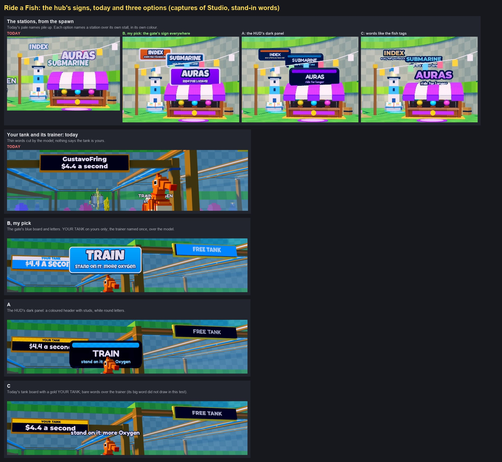

| | What it is | For | Against |
|---|---|---|---|
| **B (my pick)** | The gate's sign everywhere: white Luckiest Guy with a dark edge, on a board in the station's own colour with a white rim | It is the best sign the hub already has, and the user played with it. Colour tells the stations apart from far, as the stalls' own colours do. Loud flat colour is what the building study asks of a hub | A second font beside the HUD's round one |
| A | The HUD's dark see-through panel, a coloured header with studs, white Fredoka One | One look for world and screen | Dark boxes in a bright hub. The names read smallest of the three |
| C | No plate: Gotham Black in the station's colour with a thick dark edge, like the fish tags | Lightest on the view | Still words on a wall: the far ones run together, and small lines under them are lost. Its "TRAIN" did not draw in the test |

**The same in all three:**
- **A name sits over its own stall,** not 20 studs up in one row. Under it, one small line says what the station is for.
- **Seen from 420 studs,** not 900 (each floating label is a draw call on a phone).
- **Your tank's sign says "YOUR TANK"** over what it earns. The others say whose they are, or "FREE TANK", fainter.
- **The trainer is named once, over the model, on your own plot only,** with what it gives.
- **Auras, the submarine and the Index stand one behind the other from the spawn.** The signs are staggered in
  height, which helps; only moving one of the stations parts them for good. That is the map chat's, not asked yet.

**Not covered by a picture, proposed for after the pick:**

| # in the survey | Proposal |
|---|---|
| 5 The bottom left corner | The coins are made to fit the Oxygen box: its build (smoked glass, a gold top line), sitting on it as one piece. **The Oxygen box itself is not touched** (the user, 2026-11-16) |
| 7 Empty slots | No slots on the dock. In a dive, empty slots are hairlines with no water picture; a filled slot is as now |
| 8 The strip of lands | Hidden on the dock (it covers the gate's sign there). BEST moves under the strip, as on a phone |
| 10 The earners' board, 11 the floor's "DIVE IN" | The earners' board takes the picked sign style when it has names to show. The floor's words go: the gate says it |

`tools/ui/hub_sign_options.luau` builds any of the three in Studio as stand-ins and takes them away again.

### Step 3: the dock's panels as looks
Nothing is behind these. **Every word and number is a stand-in.** They are mock-ups built in Studio from Roblox's own
pieces and the stud tile that was already uploaded, then taken away again (`tools/ui/panel_mocks.luau`).

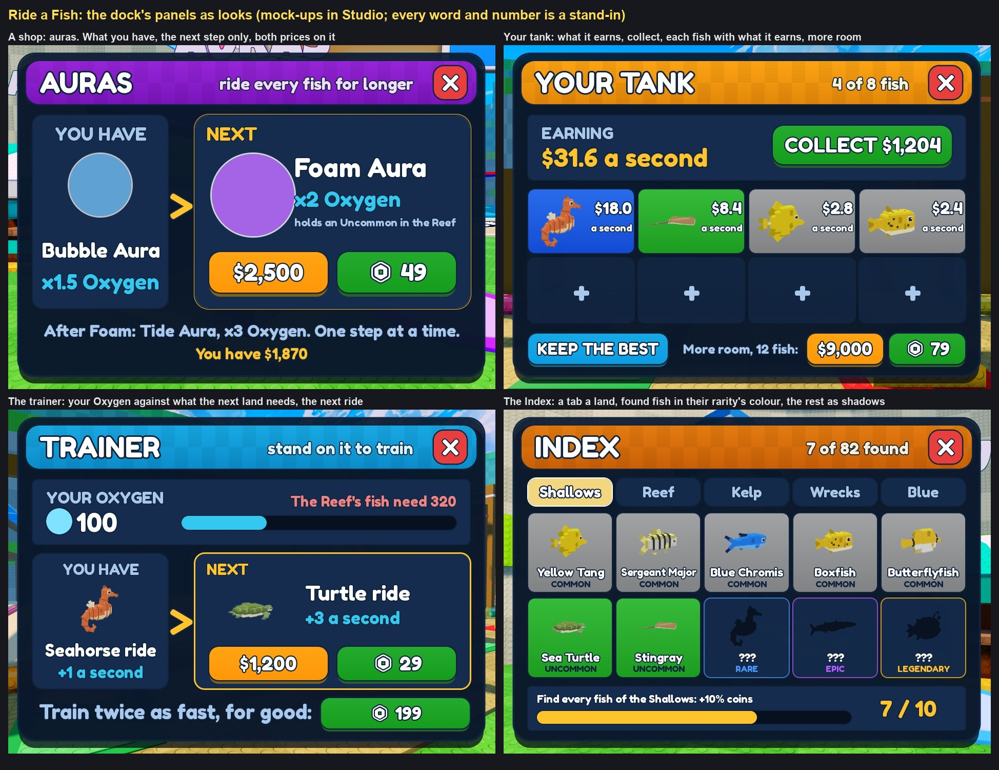

**One panel, four times,** by the rules in [the findings](../Findings.md):
- **Dark blue, a little see-through, never black,** with a darker copy nudged down as its shadow.
- **Studs on the header and the buttons only.** The header is the station's own colour, the one on its sign.
- **Every size is a share of the panel,** and the panel's shape is held, so a phone gets the same panel smaller.
- **A price sits on the thing it buys, coins and Robux side by side.** Gold is coins, green is Robux, everywhere.
- **A ladder shows your next step only:** what you have, an arrow, the next one. One line names the step after.
- **Nothing asks for Robux unasked.** The only Robux-only button (train twice as fast) is small, at the bottom.
- **A creature's picture is its own model in a small window,** so no picture is uploaded. An unfound fish in the
  Index is its shadow, with its rarity's colour on the frame.

| Panel | What it shows |
|---|---|
| A shop (auras) | What you have, the next aura with what it lets you hold, both prices, your coins |
| Your tank (**redone as a sidebar** after the user's pick, see "After the pick") | What it earns a second, COLLECT with the sum waiting, each fish on its rarity's colour with what it earns, empty places, KEEP THE BEST, more room with both prices |
| The trainer (**dropped by the user's pick:** the upgrade goes on the trainer's sign, see "After the pick") | Your Oxygen against what the next land's fish need, as a bar. The ride you have, the next ride, both prices. Twice as fast for Robux |
| The Index | A tab a land, found fish with name and rarity, the rest as shadows, a bar toward the land's reward |

**Seen in the pictures, to mend when it is built:** the auras have no picture yet (plain discs), and in the shop the
next aura's words touch its disc (moved in the script since).

**Not done:** a phone (on the user's word that waits; Studio's device simulator was not tried, a script can't drive
it), the sell and fuse stations, the submarine, a first-minute script, buttons that open any of this.

**For the user to pick:** the sign style (B, A or C), and whether the panels' look is right.

### After the pick (the user, 2026-11-16)
"for stations, C. For aquarium ss id go for B. and could we turn just the tank selection into more of a sidebar
looking thing like in ride a dino to shrink it and keep the aquarium visible whilst it being open. Remove the
trainer UI because we want it to be integrated into the model for upgrades like ride a dino": in
[Decisions](../Decisions.md). Four things follow; the station names in style C are the map chat's to build.

**1 and 2. The tank's sign and the trainer's sign are in the game, in style B.**
**State: in the game code, formatted, checked, built, and run in Studio: no errors.**

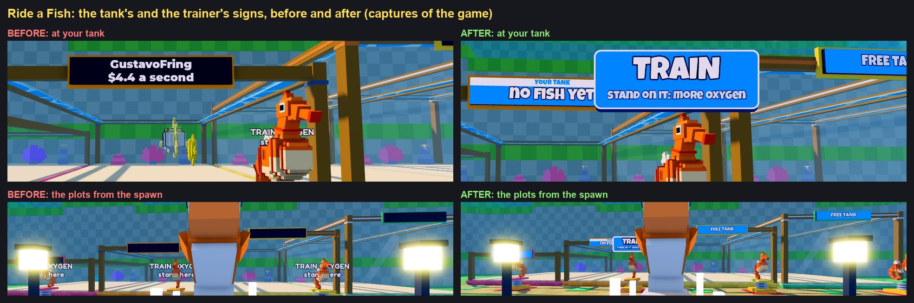

- **A tank's sign:** the gate's blue board. A white band across its top carries the owner's name in blue; under it,
  what the tank earns, in white letters with a dark edge. **On your own tank the band says "YOUR TANK".** A free
  tank says "FREE TANK", paler, with no band.
- **The trainer's sign:** a blue board with a white rim over the ride: "TRAIN", and under it "stand on it: more
  Oxygen". **You see it once, over your own ride;** the other plots' are hidden on your machine. It sits above the
  model's head, so the model no longer cuts the words. Only what is true today is on it.
- **How "yours" is known:** the server draws every sign the same. Each player's own machine then swaps the name on
  its own tank's band for "YOUR TANK" and hides the other trainers' signs (`src/client/UI/HubSigns.luau`, looked
  at once a second).
- **Seen in the run:** your tank read "YOUR TANK, NO FISH YET" and the seven others "FREE TANK"; one TRAIN sign,
  over your ride. **Not seen:** another player's name on a band (one player in the test), and a phone.

**3. Your tank's panel as a sidebar** (a mock-up; nothing is wired, every number is a stand-in).

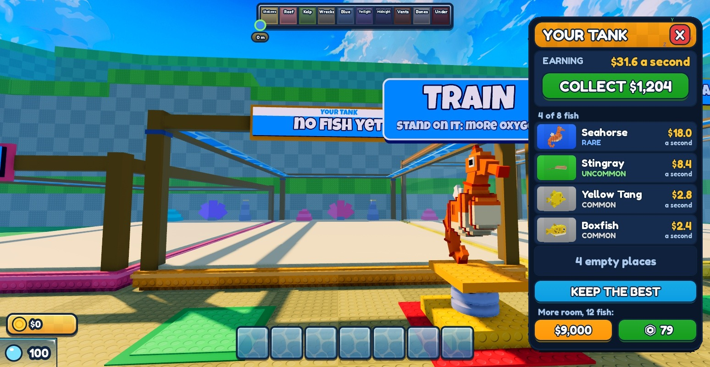

- **Narrow, at the right edge,** about a quarter of the screen wide, so the aquarium stays in view while it is
  open. Its shape is held and its width follows the screen's height, so a phone gets the same panel smaller.
- **Top to bottom:** what the tank earns and COLLECT with the sum waiting; the fish one a row, the best earner
  first, each with its picture on its rarity's colour, its name and what it earns; the empty places; KEEP THE
  BEST; more room, with both prices side by side.
- **The same build as the other panels:** dark blue, a little see-through, studs on the header and the buttons.
- **The picture is composed:** the panel as Studio drew it, laid over a real capture of the hub with today's HUD.
  Studio was drawing no 3D when it was made, so the fish in it are taken from the earlier wide panel's capture.
- **It replaces the wide tank panel** of step 3. The Auras and Index panels stay as they were.

**4. No trainer panel: the upgrade is on the trainer's sign** (a mock-up; the upgrade is not built).

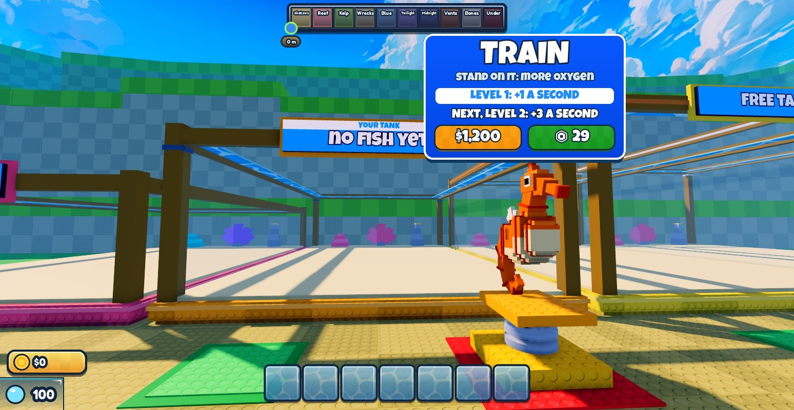

- **Today's two lines stay on top.** Under them: the ride's level and what it gives, the next level and what that
  gives, and its price in coins and in Robux side by side, as buttons on the sign.
- **None of that is in the game:** the live sign has only "TRAIN" and "stand on it: more Oxygen", and no price.
- **Open, for when it is built:** whether the two prices are pressed on the sign itself or by walking up and
  pressing a key; and that this taller sign needs more room above the ride (here it reaches the strip of lands).
- **The picture is composed** the same way as the sidebar's.

`tools/ui/dock_mocks2.luau` builds both mock-ups in Studio and takes them away again.

### More flavour (the user, 2026-11-16): options to pick from
"overall this UI just needs a bit more flavour in its look and style. It doesnst match the quality of similar slop
games in the overlays and stuff. Get it to do that": in [Decisions](../Decisions.md).

**State: options, as mock-ups built in Studio and taken away again (`tools/ui/flavour_options.luau`). Nothing is in
the game. Every number is a stand-in. No upload.**

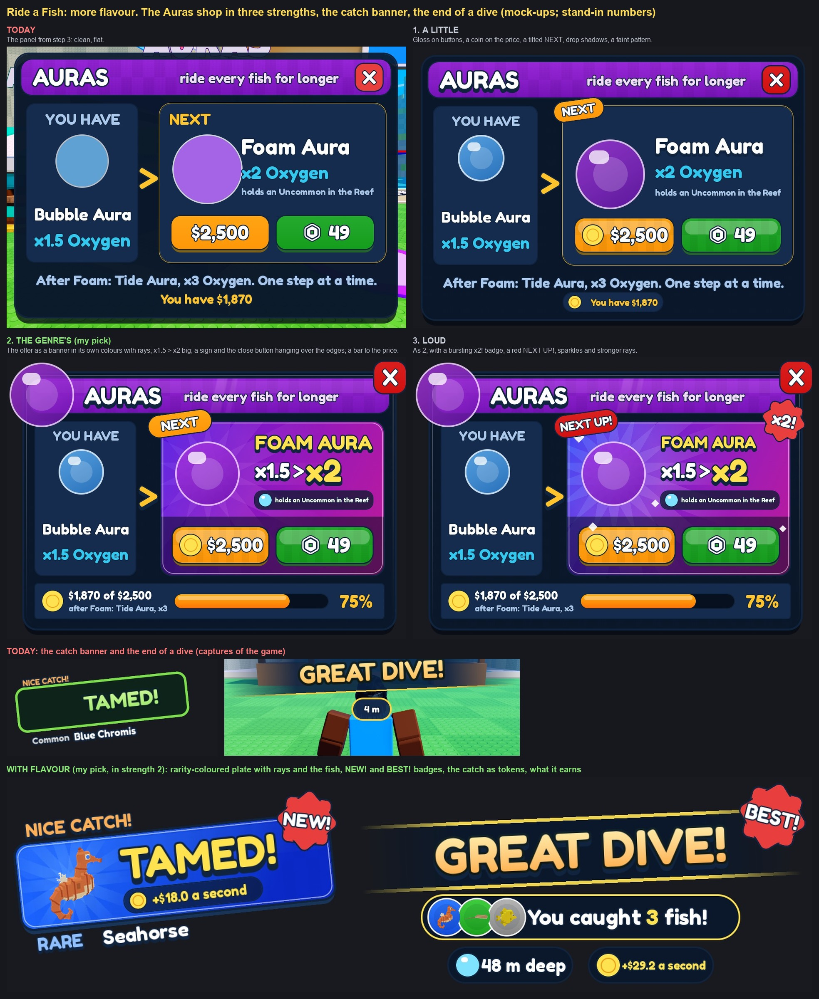

**What the reference's overlays have that ours lack.** Read from frames of four videos (its shop, its Index, its
fuse panel, its pen sidebar, its "GREAT RUN!", a sign at its trainer) and one tutorial's finished inventory. The
devices are taken, never the art.

| Theirs | Ours, today |
|---|---|
| **Each offer is its own banner in its own colours,** with rays behind the thing on offer | Every card is the same dark blue |
| **The thing itself is drawn big,** and breaks out of its box | A flat disc in a box |
| **A sign on every button and row:** the coin, the bolt, the Robux mark, a clover | Words and numbers only |
| **Tilted badges and ribbons** on corners: LIMITED TIME, EXCLUSIVE, 15 MIN, a red "!" on what waits for you | None |
| **What a thing does as two big numbers:** x1 > x2, the new one brighter | A line of small words |
| **Buttons with a light band across the top** and a thick dark edge | Flat gradient buttons |
| **Headings with a thick edge and a drop shadow** | A thin edge, no shadow |
| **The close button hangs over the panel's corner;** a sign hangs over the header's end | Everything sits inside the box |
| **Rarity as the whole tile's colour,** with the creature's head filling it | Ours do this in the Index and the tank |
| **The end of a run lists the catch as round tokens** and says "You caught 8 dinos!" | Metres and a count in words |
| **A bar wherever something is counted** (Unlocked 12/61) | Ours do this in the Index |

**Three strengths of the same shop:**

| | What it adds | For | Against |
|---|---|---|---|
| 1. A little | Gloss on buttons, a coin on the price, a tilted NEXT, drop shadows, a drawn aura, a faint pattern in the body | Safe; nothing shouts | Still reads as plain beside the genre. The user asked for more than this |
| **2. The genre's (my pick)** | All of 1, and: the offer is a banner in the aura's own colours with rays behind it; "x1.5 > x2" big; the aura's sign and the close button hang over the panel's edges; a bar from your coins to the price | It has the genre's devices and still reads at a glance. The bar says how near you are, which the reference doesn't | More pieces to build |
| 3. Loud | All of 2, and: a bursting "x2!" badge, a red "NEXT UP!", sparkles, stronger rays | Closest to the loudest games | The badge repeats what the big numbers say, and the sparkles are noise when they stand still |

**The catch banner and the end of a dive, in strength 2:**
- **The catch:** the plate takes the fish's rarity colours, with rays behind the fish's own picture; "TAMED!" in
  gold with a drop shadow; **what it will earn** on a chip; a "NEW!" badge the first time you catch that kind.
- **The end of a dive:** the title with a drop shadow and a "BEST!" badge on a new best; **the catch as round tokens
  with each fish's picture** and "You caught 3 fish!"; two chips, how deep and what the catch will earn.

**What moves, when built** (pictures can't show it): a panel opens with a small bounce; a button dips when pressed;
the rays turn slowly; coins and metres count up; badges pop in. Pictures and plates move; text never changes size.

**What it costs a phone:** about twice the pieces a panel, made once when it opens. The rays are bars on one plate
that turns; one number is tweened. Nothing is made per frame. Not measured.

**Uploads: none needed for any of this.** The coin, the bubble, the badges, the rays and the auras are made of
Roblox's own pieces. What would look better drawn, and would be an upload each (not asked for yet): a clover, a
bolt, a fish, a book and a cart as signs for the hub's buttons, about six small pictures; and one picture per aura.

**Honest about the pictures:** the shop is as Studio drew it. Studio is drawing no 3D at the moment, so the little
windows that show a fish's model came out empty; in the bottom row the fish are put in from an earlier capture of
the same models.

**Limits kept:** the taming ring, the Oxygen meter, the HUD and the fish tags are not touched or redrawn here.

**Picked (the user, 2026-11-16): "2, the genre's".** In [Decisions](../Decisions.md). It goes onto the Auras shop,
the Index, the tank's sidebar, the catch banner and the end of a dive.

**Strength 2 is in the game's two banners. State: in the code, and run and seen in Studio on 2026-11-16** (one
play test in the sandbox: three fish tamed, then out of air). Not seen: a phone, a rare fish's plate, the count-up
(a still picture can't show it).

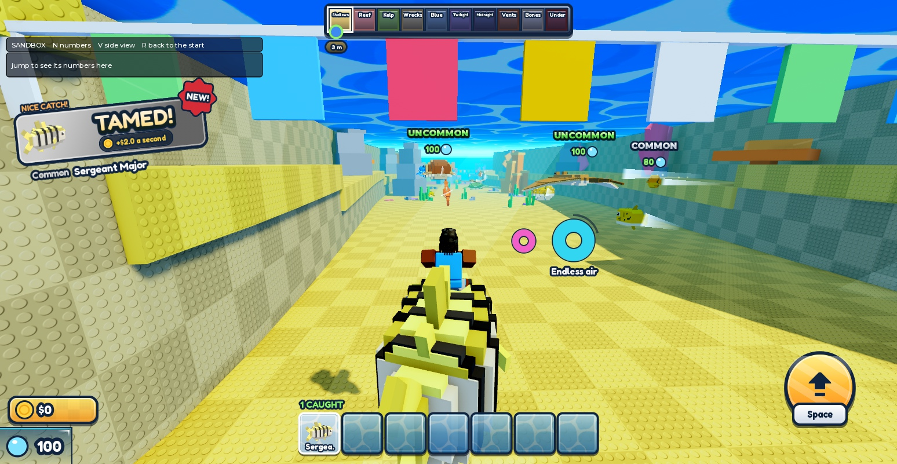

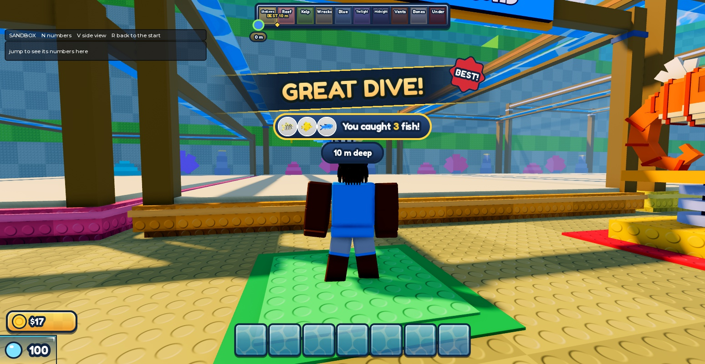

**What this pass did not touch, said plainly:** the rest of the dive's HUD (the coins, the slots, the hop button,
the land strip) is as Hugo and the user left it, and the dock's screens (the Auras shop, the Index, the tank's
sidebar) are still pictures, not in the game. Whether strength 2 goes onto the HUD's other pieces is asked of the
user; the taming ring and the Oxygen meter stay out of it either way.

| Piece | Before | Now |
|---|---|---|
| The catch banner's plate | A green brick plate for every fish | **The fish's rarity colours,** going darker, with pale rays turning slowly behind the fish's picture, a light band across the top, a dark edge with a pale line inside, and a shadow under it. Gold, the ember and the rainbow for the top three rarities |
| The fish's picture | Inside the plate | A little bigger, breaking out of the plate's top |
| "TAMED!" | Pale green | White to gold, with a drop shadow |
| What the fish is worth | Not shown | **A chip with a coin: "+$18.0 a second",** what this very fish earns in a tank. Its size and its colour count (the fish under you carries them) |
| A first catch | Not marked | **A bursting "NEW!" badge** on the plate's corner the first time you catch that kind. Until the game saves, "first" means since you joined |
| The end of a dive: the title | Gold letters | The same, with a drop shadow |
| A new best | The words "NEW BEST" in the pill | **A bursting "BEST!" badge** on the streak's end |
| The catch at the end | "3 CAUGHT" | **One round token a fish,** in its rarity's colours with its picture, and "You caught 3 fish!" with the number in gold |
| How deep | "48 m" | A chip under the catch, "48 m deep", **counting up** over half a second |

- **Left out of the game on purpose:** the mock-up's "+$29.2 a second" chip at the end of a dive. Only the best few
  fish in a tank earn, so a sum of the catch could promise more than the tank pays. The true number is the one the
  tank shows when the catch goes in.
- **What moves:** the rays turn (one number, only while the banner is up), the banners slide in with a small
  bounce, the metres count up. No text changes size.
- **Made of:** frames, gradients and outlines; the badges are two squares, one turned. Nothing is uploaded.
- **Files:** `src/client/UI/Banners.luau` (the two banners; `Banners.caught` and `Banners.greatDive` take a little
  more), `src/client/Controllers/HudController.luau` (what a catch earns, which kinds are new, the dive's catch kept
  for the end).

**Still to do for strength 2:** the Auras shop, the Index and the tank's sidebar are mock-ups, so they are redrawn
as pictures, not built: the shop is done (the sheet above); the Index and the sidebar wait for Studio.

**Also since the last note:** the trainer's sign sat across the end of the tank's sign when seen from the front of
your plot. It is raised (its foot is now above the tank sign's top). In the code and in Studio; checked by sums, not
by a picture, since Studio draws no 3D.

### The coins and Oxygen rows (the user, 2026-11-17)
"yes lets just get the coins, oxgen (stamina equivlent) looking to standard. Heavily ride a dino inspired. Copy their
placements and sizes for these elements. Dont change the inventory too much.": in [Decisions](../Decisions.md).

**State: in the code, and run and seen in Studio on 2026-11-17** (one play test in the sandbox, on a desktop). Not
seen: the red bar as a picture (it went red while drowning, read from the game, and was over before the capture), a
phone, a number in the thousands.

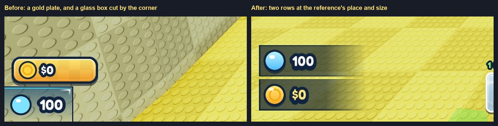

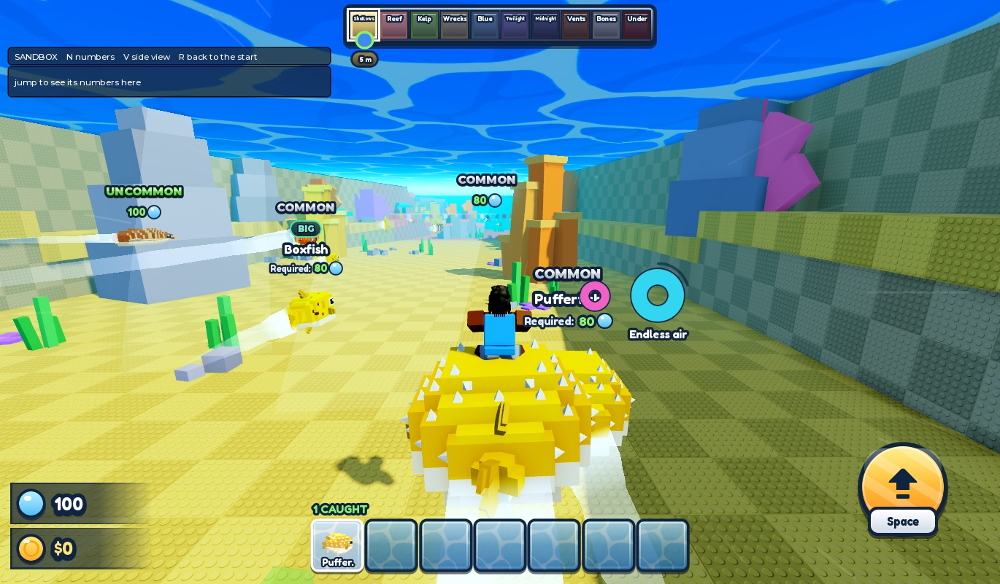

**Measured off the user's recording of the reference** (its stamina row and its cash row, at the lower left), then
matched as shares of the screen's height:

| | The reference's | Ours now | Ours before |
|---|---|---|---|
| A row's height | 7.2% | 7.1% | 5.2%, and the Oxygen box ran off the corner |
| The gap between rows | 0.6% | 0.5% | 1.4% |
| From the screen's left edge | 1.8% | 1.8% | 2.1% (coins); 0 (Oxygen) |
| From the screen's bottom | 2.6% | 2.5%, level with the slots | 2.5% (coins); 0 (Oxygen) |
| The bar's length | 24% | 24% | 19% |
| The sign's height | 4.9% | 5% | 4.1% |
| The number's capitals | 2.3% | 2.5% | 2.1% |
| Order, top to bottom | Stamina, cash | Oxygen, coins | Coins, Oxygen |

**How a row is built, as the reference builds its own:** a dark see-through bar that fades out to the right; a dark
line down its left and along its top and bottom; a sign; the number in thick outlined letters with a drop shadow.

**Ours, where it differs:** a bubble for Oxygen and a coin for coins (the reference has a bolt and a wad of cash,
which are its pictures); the coins' number is pale gold where its cash is pale green; no plus buttons beside the
rows, since nothing is sold there.

- **Replaced:** the gold plate for coins, and the glass box in the corner for Oxygen (Hugo, 2026-11-14). `Kit` still
  holds the glass box; the rows no longer use it.
- **Kept:** the row is your max Oxygen; it reads 0 and goes red and beats while you drown, and red in the last second
  on a fish. The coins row shows only when the game has coins.
- **Not touched:** the catch slots, the taming ring, the Oxygen ring beside the rider, the hop button, the land strip.
- **One thing that reaches further:** the coin and the bubble signs are now lit from above (pale at the top, deeper
  at the bottom; the coin has a small shine). The same signs are in the catch banner's chip and on the fish tags, so
  those small bubbles have the shading too.
- **On a phone:** the rows keep their place at the top left, in the new build. Not seen.
- **No upload.** Frames, gradients and outlines only.
- **Files:** `src/client/UI/StatRows.luau` (written again), `src/client/UI/Kit.luau` (`Kit.coin`, `Kit.bubble`);
  the picture by `tools/ui/rows_before_after.py`.

**Second round, the same day: one to one, with the plus buttons.** The user sent a sharp picture of the reference's
two rows: "you see how the dark parts fade out differently, and gradients are different. Fix that and make it 1:1
and then recreate the + icons next to it". In [Decisions](../Decisions.md).

**State: in the code, and run and seen in Studio on 2026-11-17, at the dock on a desktop.** Laid beside the user's
picture at the same size (private: `research/ride-a-dino/ui/compare-rows.png`, by `tools/ui/rows_compare.py`).
Not seen: a press on a plus, the rows while riding in this build, the red bar, a phone.

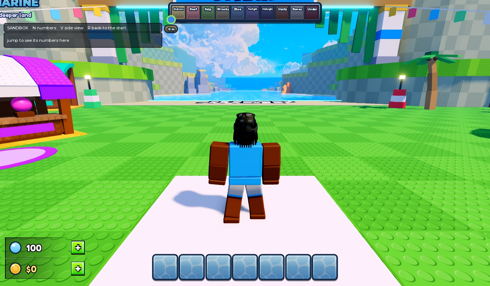

Everything was measured off that picture, where a row is 80 pixels tall, and matched:

| | The reference's | The first round | Now |
|---|---|---|---|
| The dark fill | 43% black at the left, thinning evenly to nothing along the whole bar | Too dark (70%), flat for most of the bar, then a quick fade | As the reference's |
| The edge lines | Black, nearly solid at the left, half gone at two thirds, then quickly to nothing; they run a little past the fill | Navy, fading with the fill | As the reference's |
| The gap between rows | 3.75% of a row | 7.5% | As the reference's |
| The number | White, capitals 31% of the row, a thin black outline, no shadow | Smaller capitals, a navy outline twice as thick, a drop shadow | As the reference's |
| The sign | 58% of the row tall | 70%, on a shadow | 61%, no shadow |
| The plus button | A green square 68% of the row, past the bar's end: black edge, pale rim, bright face going darker, a darker lip, a white plus with a black outline | None | Recreated from frames, at its size and place |

- **The plus buttons show at the dock only,** as the reference's show at its hub and not on a ride.
- **They do nothing yet.** A press dips the button and fires `StatRows.Pressed` with "Oxygen" or "Coins"; nothing
  listens. What a plus opens is for the user to say (asked).
- **Still ours:** the bubble and the coin for signs, and pale gold for the coins' number (the reference's cash is pale
  green).
- **Where it is not exact:** at this screen size our lines draw a pixel thinner than the reference's in places,
  and the font is ours (Fredoka One).
- **A fault found and fixed on the way:** with the fill laid beside the lines, a pale gap showed between the fill and
  the bottom line. The fill now runs under the lines.

**Third round, the same day: thicker lines, a little more room.** The user, seeing the rows beside the reference's:
"needs slightly thicker borders then a slight more degree of seperation to compensate for that. as it is somewhat
different to ride a dino in this aspect". In [Decisions](../Decisions.md).

- **The lines are 2 thick** (were 1.5, which drew a pixel thinner than the reference's on our screens). The plus
  button's black edge too.
- **The gap between the rows is 2.5** (was 1.5).
- **State: run and seen in Studio on 2026-11-17,** on the way into a dive (no plus buttons there, as meant).

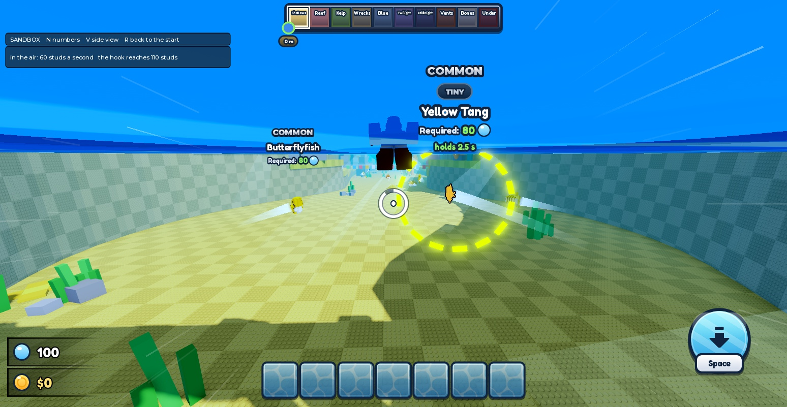

**The user's own icons are in.** The user sent two pictures, "use these icons ... for the 02 and cash": a blue O2
bubble with two small bubbles, and a green stack of cash with a $. The files were in the user's Downloads.

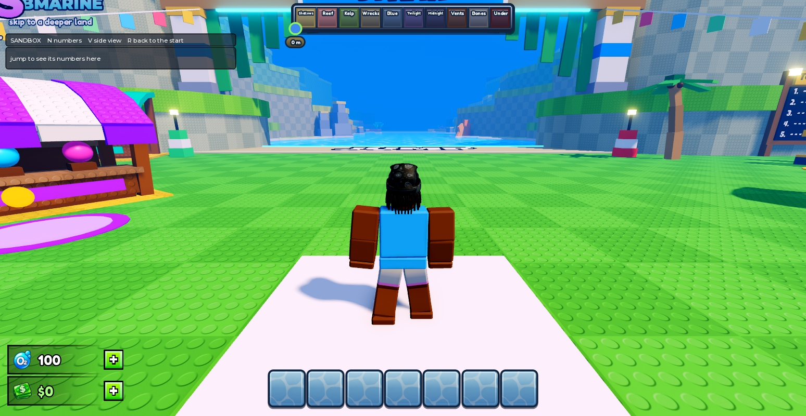

- **State: uploaded, in the code, run and seen in Studio on 2026-11-17,** at the dock on a desktop.
- **Cut out first:** each came with a pale sticker halo round its dark outline. `tools/ui/icon_cut.py` takes the
  halo off, trims the picture, makes it square at 256, and puts the outline's colour under the clear pixels so no
  pale fringe shows in the game. Sources in `art/ui/icons_src/`, results and previews in `art/ui/icons/`.
- **Uploaded to Roblox on the user's word,** the HUD's first two uploads: the O2 bubble is
  `rbxassetid://75102671889473`, the cash is `rbxassetid://90175555285878` (`art/ui/icons/roblox.json`).
- **In the rows:** `PICTURE` in `StatRows.luau` holds the two ids; a picture is 27 units square, which draws the
  cash as wide as the reference's.
- **The coins' number is now the reference's pale green,** to go with the cash.
- **Not changed:** the catch banner's chip ("+$2.0 a second") still has the small drawn gold coin, and the fish
  tags the small drawn bubble. Whether those take the new icons is for the user to say.

### The dock's Shop and Index buttons (the user, 2026-11-17)
"Now recreate the index and shop buttons", and, of the new cash icon, "yes the catch banner should take it": in
[Decisions](../Decisions.md).

**State: in the code, and run and seen in Studio on 2026-11-17, at the dock on a desktop.** Laid beside the
reference's at the same size (private: `research/ride-a-dino/ui/compare-hub-buttons.png`). Not seen: a press, the
red "!" going up by itself after a first catch (it was switched on by hand for the picture), a phone.

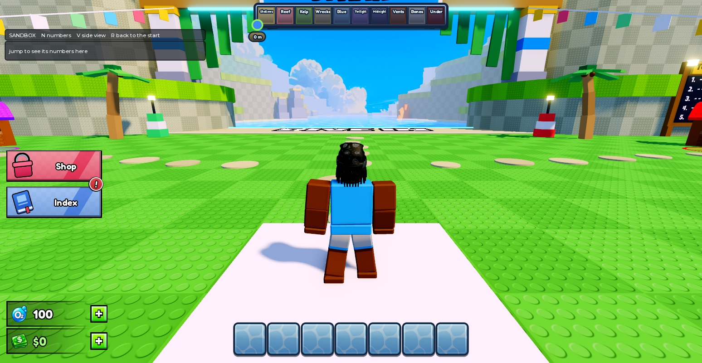

Measured off the user's recording of the reference's hub and matched as shares of the screen's height:

| | The reference's | Ours |
|---|---|---|
| A button | 26% wide, 8.6% tall | The same |
| The gap between the two | 1.5% | The same |
| Where | The left edge, 1.7% in; the pair's middle a hair under the screen's middle | The same |
| The plate | Black edge, a dark line inside it, paler at the top, a darker lip along the foot | The same |
| The slanted band | A band of stronger colour toward the right, leaning like a "/", running off the top right corner | The same place and lean; ours is one strength, theirs is faint at the top and strong at the foot |
| The pattern | Faint pale squares | Our stud tile, faint |
| The word | White, black outline, its middle 62% across | The same; the font is ours |
| The red "!" | A red disc in a white ring on the Index's upper right corner | The same |
| The pictures | A painted basket and a painted book | The same pack's basket and its blue book (see below). First built as a bag and a book drawn from frames |

- **They show at the dock only,** as the reference's show at its hub.
- **They open nothing yet.** A press dips the button and fires `HubButtons.Pressed` with "Shop" or "Index".
  Nothing listens: the panels are pictures so far (see "After the pick").
- **The red "!"** goes up when you catch a kind for the first time since joining, and comes off when the Index is
  pressed. That is the reference's use of it; with no Index to open, it is only a mark for now.
- **The pictures are the weak part.** A bag and a book made of rectangles read, but they are not at the level of
  the user's O2 and cash icons. Two icons of that kind, sent as files, would go in the same way (an upload each).
- **Files:** `src/client/UI/HubButtons.luau` (new), four lines in `src/client/Controllers/HudController.luau`.

**The catch banner takes the cash icon.** Its chip ("+$2.0 a second") has the cash in place of the small drawn
coin, and its number is the same pale green as the coins row (`Kit.Textures.Cash`, `Kit.Cash`). Seen in Studio, with
the banner held up by hand for the picture: it shows for 2.6 seconds and the captures kept missing it.

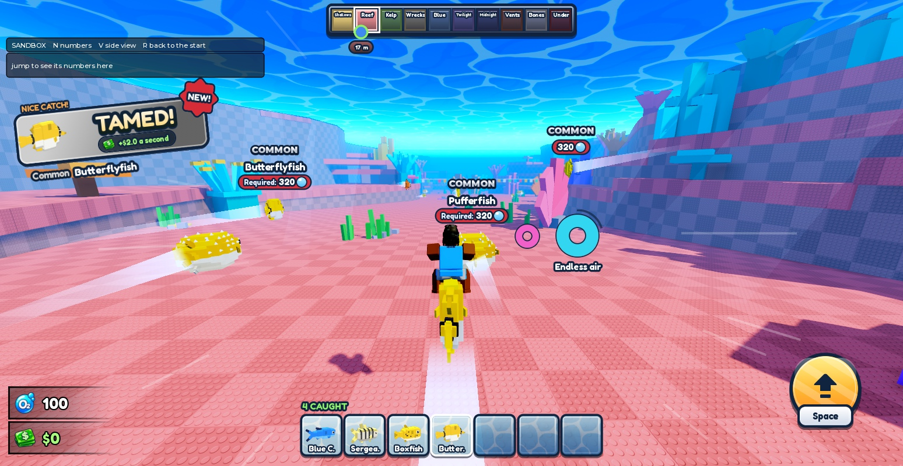

The fish tags keep their small drawn bubble: the user named the banner only.

**The pictures, from the icon pack the reference uses (the user, 2026-11-17).** "here is an asset pack that ride a
dino actually uses, its a free one. Should have everything we need except O2, which i will use chatgpt to gen": in
[Decisions](../Decisions.md).

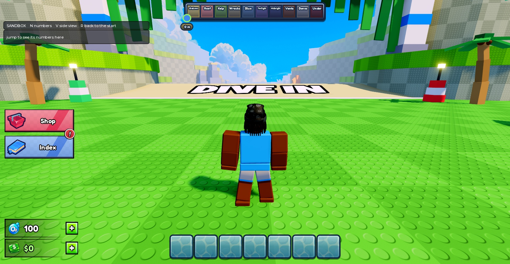

- **State: uploaded, in the code, run and seen in Studio on 2026-11-17,** at the dock on a desktop. The drawn bag
  and book are gone.
- **The pack:** "Free Icon Pack 3.0.1 (Basic)" by gvesster: about 170 icons (its own count), 2,044 pictures in all: each
  in several colours, with and without an outline, at 64 and 256 pixels. Its rules: free for commercial use; not to be resold or claimed as ours;
  credit optional. It stays out of the repo (unpacked to `D:\ResearchCache\packs`); only the icons in use are
  copied in, with the credit in `art/ui/icons/CREDITS.md`.
- **Shop:** its red basket ("Red Shopping Cart 1st Outline"). It is the very picture on the reference's button.
- **Index:** its blue book ("Blue Book 1st Outline"). The reference's book is another drawing (upright, with a red
  marker) that this version of the pack does not hold; this is the pack's nearest.
- **Two uploads, on the user's word:** `rbxassetid://139519009824812` (basket) and `rbxassetid://136062585112653`
  (book), in `Kit.Textures.Shop` and `Kit.Textures.Index`.
- **Also in the pack, not used yet:** the green cash and the yellow bolt the reference's rows use, a paw, a plus, a
  cross for closing, an exclamation mark, a clover, a trophy, a gift, a lock. No O2 or bubble, and no stud tile.
- **The cash is the pack's now** (the user, 2026-11-17: "yes use the packs for the cash"): its green cash ("Green
  Cash 1st Outline", the one on the reference's own row) is uploaded as `rbxassetid://119031387165673` and is
  `Kit.Textures.Cash`, so the coins row and the catch banner's chip both have it. Seen on the coins row; the banner
  not seen again. The user's own cash picture is kept as `art/ui/icons/cash_user.png`.
- **The O2 picture is the user's second one** (sent 2026-11-17 after "02 is coming"): a flat blue bubble with a dark
  outline and "O2" in white, in the pack's style. Cut out, uploaded as `rbxassetid://133981557523389`
  (`Kit.Textures.Oxygen`), run and seen in Studio at the dock. The first is kept as
  `art/ui/icons/oxygen_user_v1.png`. The fish tags' small bubbles are still the drawn ones.

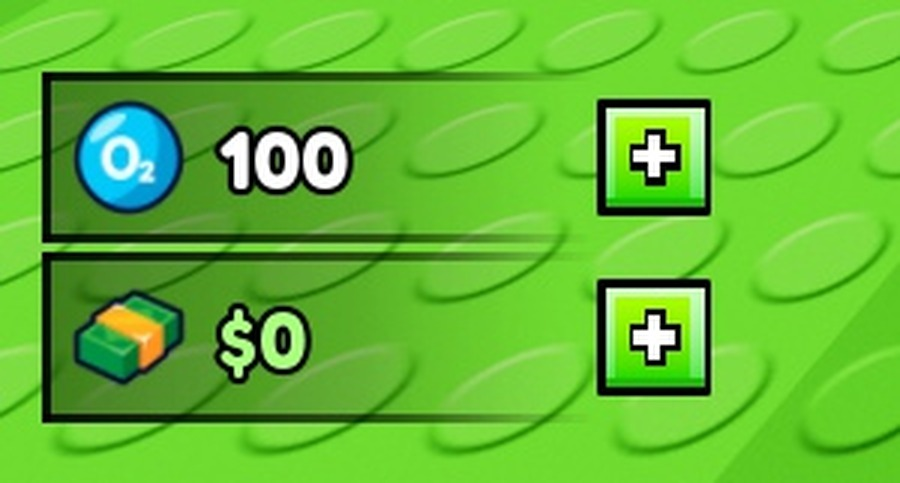

### How the reference does its stud pattern (the user, 2026-11-17)
"in the meantime before i do that i need you to figure out how they do that stud effect for the ui."

**State: worked out from pictures, not from their code. Our own tile is uploaded and on the Shop and Index buttons
(the user, 2026-11-17: "add the stud texture in to it"), run and seen in Studio at the dock on a desktop.**

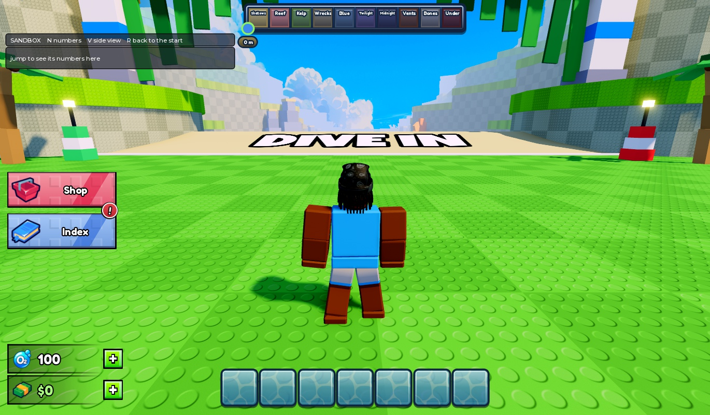

Beside the reference's at the same size (private: `research/ride-a-dino/ui/compare-hub-buttons.png`): the squares
are the same size, in the same places and about as strong.

**How it was read.** Their Shop and Index buttons, cut from the user's recording at 65 moments over 13 seconds and
averaged, so the video's noise goes and the faint pattern stays. Then the plate's own shading was taken out and one
tile read pixel by pixel on both buttons (private: `research/ride-a-dino/ui/buttons_avg.png`, `compare-stud-tile.png`).

**What it is:**

| | Read off the picture |
|---|---|
| The shape | **One raised square to a tile.** Not a grid of lines: between the squares the plate is plain |
| The tile | 36 pixels across at 720 high: **5% of the screen's height.** The same across and down |
| The square | 20 pixels, a little over half the tile |
| Its edges | **Top and right edges pale, left and bottom edges dark:** lit from the upper right. Each line about 3 pixels, inside the square. The right line is the brightest |
| Its face | A touch paler than the plate, 2 to 3 parts in 100 |
| How strong | The top line about 5 in 100 lighter than the plate, the right line about 8, the dark lines about 7 in 100 darker. On a red plate that is white at 13 and 18 in 100, and black at 8 in 100 |
| Where it starts | **From each button's own upper left corner.** Both buttons carry the squares at the same places, measured from their own corners: the first square flush with the left edge and 6.5 pixels down. It is not one sheet behind the whole screen |
| Where it ends | Cut off by the button's edges, mid-square if need be |
| Over or under | Over the top-to-bottom colour and over the slanted band: the squares show in the band too |
| Movement | **None.** The same place in every frame |
| What has it | Buttons and panel headers. Their stamina and cash rows and the green plus buttons have none |

**How it is built in Roblox** (what the pixels fit; their code is not seen):
- **One picture, tiled.** An image label the size of the button's face, its `ScaleType` set to `Tile` and its
  `TileSize` to one tile, lying over the colour and under the picture and the word.
- **The picture is white and black at a low strength on a clear ground,** so the same one works over red, blue or
  any colour: the white lightens, the black darkens.
- **Cut to the button** by the face clipping what is in it.
- **It grows with the screen** as the rest of their UI does (5% of the height at any size).
- One instance a button. Nothing is made per frame.

**Ours today:** the map's stud tile (round studs), 15 units across and faint. It is our own look, but it is not what
theirs does: theirs is nearly twice the size and square.

**In the game:** `tools/ui/make_ui_tile.py` draws the tile from the measures above (code, not an image
generator): `art/ui/tiles/emboss_square.png`, 144 across, uploaded as `rbxassetid://74391096180253`
(`Kit.Textures.Emboss`). `HubButtons` lays it at 28 units a tile, started where theirs starts. Only those two
buttons have it so far; the reference also has it on its panel headers, which we have not built.

**How sure:** the tile's size, the square's size, which edges are pale and dark, and that it does not move are
measured and agree across both buttons. The picture's own softness and exact strength are a guess from a blurred
video. Their file is not seen.

### The fish pictures (the user, 2026-11-17)
"could you find a way to frame all the fish icons better. For example in ride a dino they are all rendered nicely
at an angle which shows the most interesting facial part+neck area or the whole model if its small enough. With
black outlines, good lighting and easy readability": in [Decisions](../Decisions.md).

**State: in the code, and run and seen in Studio on 2026-11-17:** all 82 fish on a test sheet in Edit, and the catch
slots and the catch banner in a play test on a desktop. Not seen: the end-of-dive tokens, a phone, how much it
costs a phone.

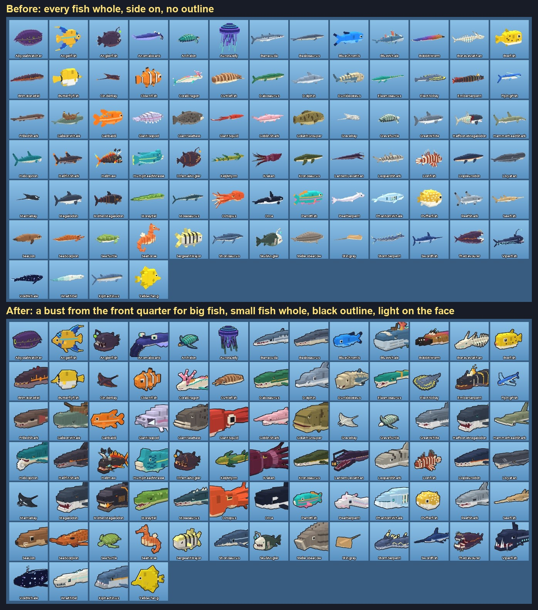

In the game:

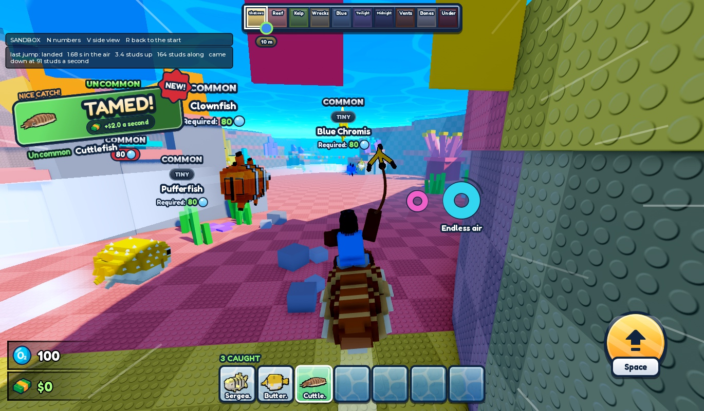

**What the reference does** (its slots, read from the user's recording): a creature's head and neck from the front
quarter, facing left, a little from above, with a thin dark outline and bright even light; a small creature whole.

**What ours do now.** Still the creature's own model drawn in a small window, so no picture is uploaded and a new
fish needs nothing made. What changed is where the viewer stands, what is framed, the light and the outline:

| A fish that is | Is shown | From |
|---|---|---|
| Big, with a head of its own (sharks, whales, eels, the sea monsters) | **A bust:** the head and a neck's length behind it; the rest runs off the window's edge | The front quarter, a little above |
| Small (14 studs long or under) | Whole | The front quarter |
| Thin and tall (an angelfish, a tang) | Whole | Nearly side on, where its shape is |
| Flat and wide (a ray, a turtle) | Whole | From above |
| Mostly face, with no head part (the anglers, a jelly) | Whole | The front quarter |

- **Every fish faces left,** as the reference's creatures do.
- **The outline** is the same fish drawn four more times in black just behind it, a hair to each corner. A window
  can't outline what it draws, and this needs no upload.
- **The light** comes from over the viewer's shoulder onto the face, with less fill light than before, so the
  boxes' steps show.
- **A bust goes by the part's names:** a model with a part called `Head` gets one, framed on `Head`, `Jaw`,
  `Crown`, `Brow`, `Eye` parts. All of today's 82 were built with those names.

**Where it is weak:**
- **The squid, the octopus and the kraken:** their bust is a block of head with one eye, and the arms are cut.
- **The rays and the turtles** are small in their window: from above, their tails and flippers set the frame.
- **Anomalocaris** is cut oddly: its arms count as part of its head.
- **Cost:** a picture is now five copies of the fish, not one: with seven slots, seven tokens and the banner that is
  75 small windows. A window that is not changing costs nothing to draw, but the copies are held in memory.
  **Not measured on a phone.**

**If more polish is wanted:** pictures rendered once outside the game (smooth outline, soft shadow) and uploaded as
two or three sheets would look cleaner and cost a phone less. It needs uploads and a new render for each new fish.
Not started; for the user to say.

- **Files:** `src/client/UI/Portrait.luau` (written again; `Portrait.new` and `show` take what they took, plus an
  optional `Outline`), `tools/ui/portrait_sheet.luau` (the test sheet of every fish, Edit mode).

### The catch slots, faded, with the pictures over them (the user, 2026-11-17)
"now lets do changes to the inventory bar, id like to retain the texture but make the texture fade out in a gradient
to some capacity alongside the outline to a different lesser capacity. then id like to scale the icons so that they
all overlap the inventory artistically and stay at the same size and silhouette placement depending on the icon
archetype": in [Decisions](../Decisions.md).

**State: in the code, and run and seen in Studio on 2026-11-17:** the slots in a play test on a desktop with four
small fish, and all 82 pictures on the test sheet. Not seen: a bust in a slot in the game (the sandbox's start has
only small fish), a full row of seven, a phone.

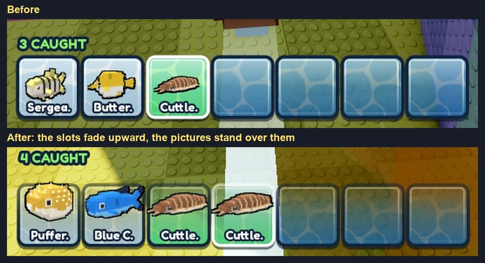

Every fish's picture with the new placement:

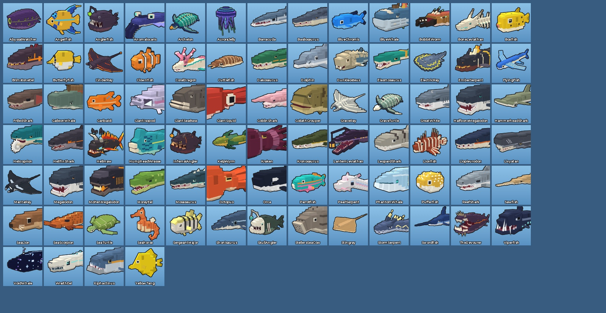

**The slots:**

| | Before | Now |
|---|---|---|
| The glass and its pattern | The same strength top to bottom | **Fade out toward the top:** nearly gone at the top edge, 40% gone at the middle, whole at the foot |
| The outline | Solid all round | **Firm:** whole for its lower three quarters, thinning only over the top quarter, to 30% see-through at the very top (second round, below) |
| The shadow under a slot | Solid | Fades with the glass |
| The pale band over the upper half | There | Gone: it sat where the glass now fades out |

**The pictures:**

| | Before | Now |
|---|---|---|
| A picture's window | Inside the slot | **Bigger than the slot:** 8% wider a side, and reaching a third of a slot above its top, so the fish stands over the slot's top and its sides |
| Where a fish sits | Fitted to a box round it, so fins and tails pushed the body about | **By its outline, the same for every fish of a kind of picture** (below) |
| "3 CAUGHT" | Just above the slots | Lifted clear of the pictures |

| Kind of picture | Its outline, in its window |
|---|---|
| A bust | The head alone is measured: its left edge at the window's left, its middle half way down, up to 80% of the width and 86% of the height. The neck and body run off the right |
| A small fish, whole | In the middle, up to 94% of the width and 84% of the height |
| A thin tall fish | In the middle, up to 90% of the width and 94% of the height |
| A flat wide one | A hair under the middle, up to 96% of the width and 80% of the height |

- **Second round, the same day:** asked whether upward was the direction meant, the user said "yes, but make the
  border more concrete and less transparent and fade differently". The outline was half gone at the top and fading
  all the way down; it is now whole for most of its height and thins only over the top quarter (`EDGE` in
  `Slots.luau`). **Seen in Studio over a plain backdrop only:** Studio had stopped drawing its 3D view (15 frames
  a second, a black scene), so the picture has no sea behind it and no fish pictures in the slots.

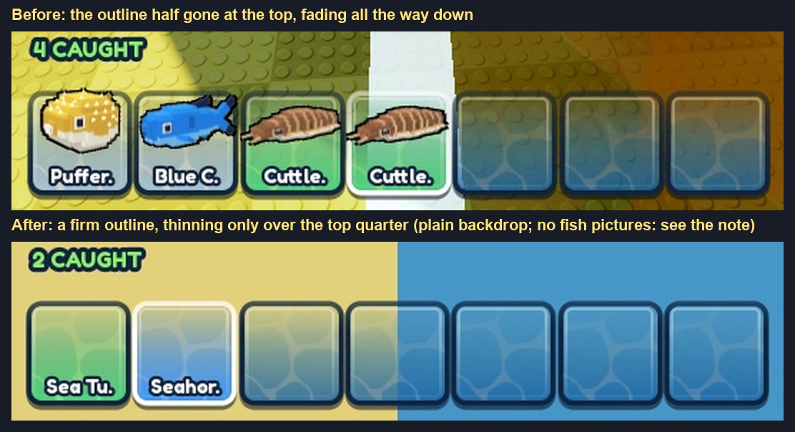

- **How it is found:** the corners of the fish's parts are worked out as the window would show them, and the viewer
  is stepped back, forward, sideways and up until the outline is the size and place its kind asks. Done when a
  picture changes, never per frame.
- **This also made the rays and the turtles bigger,** which were small in the first round.
- **Read by Claude, for the user to confirm:** the fade runs upward (the fish rises out of the slot), and "the
  texture" is the slot's whole glass, its colour and its pattern. Each is one number to turn round or change
  (`BODY`, `EDGE` and `WINDOW` in `Slots.luau`; `PLACE` in `Portrait.luau`).
- **Left as it was:** the thin pale line just inside a slot's outline; it is half as strong now.
- **A Secret fish's slot** (the rainbow, which runs side to side) can't fade top to bottom: it is evenly a third
  see-through instead.
- **Files:** `src/client/UI/Slots.luau`, `src/client/UI/Portrait.luau`.

### The catch slots, closer to the reference's (the user, 2026-11-17)
Six changes asked at once: square corners; a border mainly opaque and more black; a caught fish's slot less
see-through and brighter with a faint pattern, and a light rim "like ride a dino" ("if you catch a fish it feels more
satisfying"); a squarer font with a thinner outline; the fish more in the middle and nearer its name, still over the
top edge; the slots spaced as the reference's; and a small grow under the mouse. The user's words are in
[Decisions](../Decisions.md).

**State: in the code, and run and seen in Studio on 2026-11-17,** on a desktop with three small fish caught, and the
grow played on one slot. Not seen: a bust in a slot in the game, a full row, a real mouse over it (the grow was played
by script, the way the mouse would), a phone.

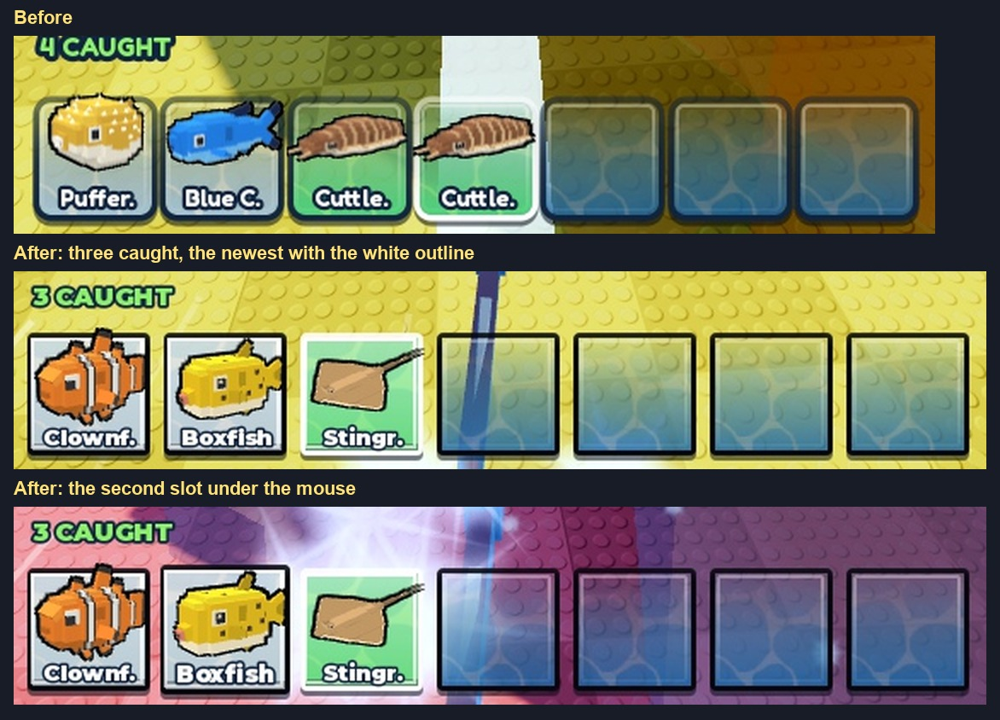

Beside the reference at the same size (private: `research/ride-a-dino/ui/compare-slots.png`).

| | Before | Now | The reference's, measured |
|---|---|---|---|
| Corners | Rounded 5 | **Square** | Square |
| The outline | Navy ink, 2.5, fading at the top | **Nearly black, 2, solid** (a touch of fade over the top eighth only) | Black, about 2 |
| A caught fish's slot | The rarity's colours, as see-through as an empty one, fading upward | **Nearly solid, its colours 14% brighter, the water's pattern faint behind** | Solid grey, a faint block pattern |
| Its rim | None | **A white line inside the outline, strong at the top, softer down the sides, over a darker lip at the foot** | A pale line inside the outline, a darker band at the foot |
| The newest catch | A white outline | The same | (the reference's chosen slot has one) |
| The names | Fredoka One, outline 1.6 | **Gotham Black** (the fish tags' rarity words use it too), **outline 1** | A heavy square sans, thin dark outline |
| The fish | In a window 16% wider than the slot, a third of a slot above it | **10% wider, a fifth of a slot above; a bust in the middle, not at the left.** The fish comes down to its name | Over the top edge a little, down to the name |
| The gap between slots | 6 on a keyboard (13% of a slot) | **10 (22%)**, so a fish's overhang and the grow never touch the next slot | About 24% of a slot |
| Under the mouse | Nothing | **Grows to 106% in an eighth of a second, and back** | Grows a little |

**Second round, the same day: the white ring, square slots, a thin even fish outline.** Three asks, each in
[Decisions](../Decisions.md): the white ring was "still rounded", and should be "on the last dino caught or the one
you select with the mouse when clicking, but should appear on hover"; the slots looked "rectangular ish"; the fish
outline was "thicker on one end than the other ... too thick all over and especially too thick at the top".
**Run and seen in Studio on 2026-11-17:** the ring on the newest catch, on a hovered slot and on a clicked one, each
with the game's own mouse; a slot measured 72 by 72 pixels outline to outline.

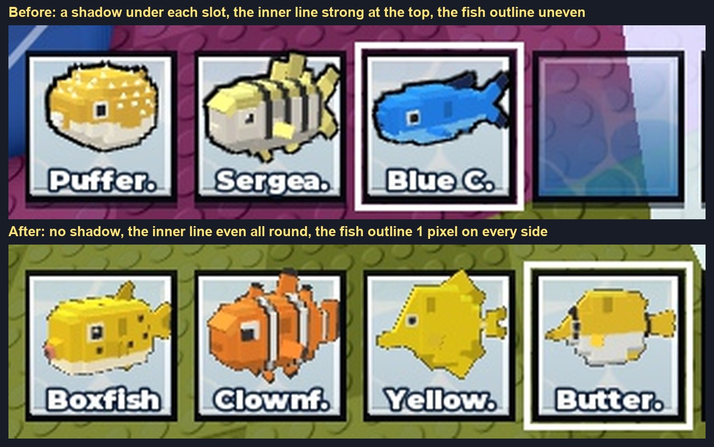

| | Before | Now |
|---|---|---|
| The chosen catch | Its outline turned white, with round corners | **A square white ring a little outside the black outline** (the reference's, measured off the user's screenshot: 5% of a slot thick, 3% out). The black outline stays |
| Which slot has it | The newest | The newest, until the player clicks another caught slot; the next catch takes it back. **Also any caught slot while the mouse is over it.** An empty slot shows none |
| A click | Nothing | Chooses the slot and fires `Slots.Selected`. **What choosing does is not decided;** nothing listens |
| Corners of the black outline | Rounded (every outline Kit draws has round joins) | Square |
| A shadow under each slot | 2 units down: the foot looked thicker, so the slot read 3 pixels taller than wide | **None** (the reference has none) |
| The pale line inside | Strong at the top, faint at the foot: an inner box that seemed to rest high | **Even all round,** square |
| A caught slot's foot band | Nearly black: a second outline | A darker tone of the slot's colour |
| The fish outline | 1.3 units, its four black copies a fraction of a pixel off, so one side drew 2 pixels and the other 1 | **0.8 units, rounded to whole pixels, the same on every side:** 1 pixel on this screen, 2 on a screen twice as tall |

- **Files:** `src/client/UI/Slots.luau`, `src/client/UI/Portrait.luau` (the outline: the catch banner and the end of a
  dive get it too).

**Third round: a caught slot's highlight, as the reference's.** "the highlight between the outline and the inner bit
isnt placed correctly, and isnt thick enough and doesnt fade correctly like ride a dino does. it also shouldnt be
present if you dont have a fish selected": in [Decisions](../Decisions.md). Measured off the user's screenshot of the
reference's caught slot and rebuilt; **run and seen in Studio on 2026-11-17** with an Uncommon and a Common caught.

| | Before | Now, as the reference's |
|---|---|---|
| Where | A thin line just inside the outline, on all four sides | **A band right inside the black outline, along the top and down both sides; not the foot** |
| How wide | 1.5 units (3% of a slot) | **2.3 units (5%)** |
| How it fades | Barely: strong all round | **Nearly white along the top; down the sides from strong to faint** |
| The foot | A faint dark strip | **A darker band of the slot's own colour,** 2.5 units |
| The slot's colour | The rarity's colour lightened 45% at the top, then 14% brighter again: a Common was nearly white, so the band did not show | **The rarity's colour as a mid tone,** a touch lighter at the top and darker at the foot. Legendary, Mythic and Secret keep their gold, ember and rainbow |
| An empty slot | A pale line inside its outline | **No line** |

- **Claude's reading, to confirm:** "if you dont have a fish selected" is read as a slot with no fish; the
  reference's other caught slots carry the band too. If it means only the chosen slot, it is one line.
- **Not seen:** a Rare, Epic or the top three with the band, a phone.

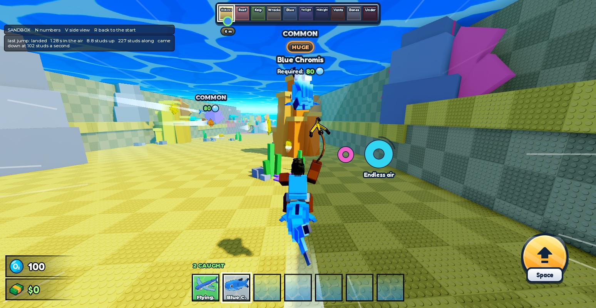

- **The font was picked from ten** that Roblox has built in, drawn side by side in Studio (Fredoka One, Gotham
  Heavy and Bold, Builder Sans, Montserrat, Nunito, Roboto, Arimo; private: `research/ride-a-dino/ui/font-sheet.jpg`).
  Gotham Black is the nearest to the reference's square, heavy letters and is already the fish tags' font. "3
  CAUGHT" takes it too.
- **The empty slots** keep the water-glass look and the upward fade; only their corners and outline changed.
- **A phone** keeps its own smaller size (34) and gets a gap of 8. The grow does nothing on a phone (no mouse).
- **Files:** `src/client/UI/Slots.luau`; one line in `src/client/UI/Portrait.luau` (a bust in the middle).

### The fish pictures, reworked after the reference's (the user, 2026-11-18)
"now id like you to do a rework of the icon renders for the fish icons. Some of them cut off and should be reduced to
just a certain part. Study ride a dino and how they do it, we also need a slightly thicker outline and generally its
more in the angle and what is shown of the fish and the quality of the lighting and the stuff in the render": in
[Decisions](../Decisions.md).

**State: in the code, and run and seen in Studio on 2026-11-18:** all 82 fish on the test sheet (Edit), and six in
the catch slots in a play test on a desktop. Not seen: the catch banner and the end-of-dive tokens with the new
pictures, a phone.

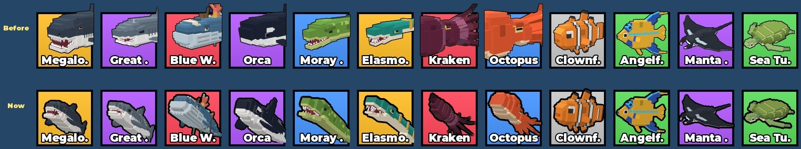

In the slots (the newest, Megalodon, chosen):

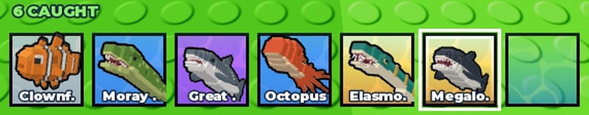

**What the reference does**, read off the user's recording (its seven creatures: Pachycephalosaurus, Dodo, a bird,
Ankylosaurus, Suzhousaurus, Brachiosaurus, Velociraptor): nearly every creature is a bust. The head is at the top,
facing left and toward the viewer, a little from above; the neck and body run down behind it and out through the
**bottom** of the picture, where the name covers the cut. Nothing is cut at the side. The outline is black, 2 pixels on
a 65-pixel slot at 720p (3% of the slot). The light is bright and even: a lit face is the creature's own colour, a
face in shade about two thirds of it. Private comparison: `research/ride-a-dino/ui/compare-fish-pictures.png`.

| | Before | Now |
|---|---|---|
| A big fish (sharks, whales, eels, sea monsters) | Its head at the window's middle, the body running off the **right** edge | **A bust as the reference's:** tipped nose up 30 degrees, as if rising, so its head is at the top and its body runs down and out through the bottom, behind the name |
| The angle | 42 degrees round from side on | **56 degrees**, more toward the face, a little from above |
| How big | Sized by the head alone | Sized by the head and one and a half head lengths of body, filling the window, so the cut falls under the name |
| Small, thin, flat ones | Whole | Whole, as before; a ray's or a turtle's tail no longer sets its size (it may run out of the picture) |
| The outline | 1 pixel at 720p, four copies at the corners | **2 pixels at 720p** (3 at 1080p): 2.8% of the picture's height in whole pixels, **eight copies** round the creature, so slanted edges are as thick as level ones |
| The light | Fixed in the world, so each kind of picture was lit differently; strong key, dim fill | **From over the viewer's left shoulder for every creature**, whichever way it is seen; more fill (200 grey) and a softer key, so colours stay bright and the shaded faces don't go dull |
| What goes in the picture | Every part, invisible ones too | Only parts you can see set the size (an invisible part no longer pushes a fish small) |

- **The squids, the octopus and the kraken** come out mantle up with their arms trailing down, which reads as a
  squid. The kraken is dark red and still the hardest to read.
- **Cost:** a picture is two windows now (the black one holds the eight outline copies), where it was five. The
  copies are nine, where they were five: more held in memory, fewer windows drawn. **Not measured on a phone.**
- **Test sheet:** `python tools/ui/portrait_sheet.py <studio_id> <all | names> [--before] [--try "Label={numbers}"]`
  draws each fish as a caught slot shows it, the repo's code sent in with it (no sync needed), and a `--before` row
  from the last commit. `off` takes it away.
- **Files:** `src/client/UI/Portrait.luau` (`Portrait.Settings` holds every number; `Portrait.reset()`; the
  optional `Outline` is now a share of the picture's height), `tools/ui/portrait_sheet.luau`, `tools/ui/portrait_sheet.py`.

**The highlight band on the chosen slot only** (the user, same day: "the outer highlight band should only be on the
chosen one, dont make it to anything for now"): the light rim and the darker foot inside the outline now show only
on the chosen catch (the newest, or the one clicked), with its white ring. Other caught slots are plain. A click still
does nothing but choose. In `src/client/UI/Slots.luau`.

### The fish pictures: a study of the reference's, and what we still lack (the user, 2026-11-18)
"doa study of ride a dino and how they do theirs and look for any remaining weaknesses. one id say is that some of
the larger fish really should be cut off similar to how theirs is, so the megaladon is more visible or something like
the kraken just has the head. things like this. But theres other differences i cant put my finger on, cover a broad
range of areas for ui and ux decisions they make for colour, shadow, positioning and more areas and see what we are
lacking": in [Decisions](../Decisions.md).

**Where the reference shows a creature's picture** (read off the user's two recordings, every frame with one): the
slot bar at the bottom, the "N SECURED" list over the stat rows at the left (the same pictures, smaller, four a row),
and the "IT'S YOURS!" catch banner (the same picture, no frame of its own, at the banner's left end). There is one
picture per creature, the same everywhere. Private study sheet: `research/ride-a-dino/ui/study-icons.jpg`.

| Area | The reference | Ours before this pass | Now |
|---|---|---|---|
| **What is shown of a big creature** | Head and neck only, big: the head takes 50 to 65% of the slot's width, its top just under the slot's top edge, the neck running down out of the bottom under the name. Never the whole body | The whole fish, tipped up, with a small head. Two causes: the body piece behind the head is as wide as the fins on it, so the "head" being sized was as wide as the fish; and from where the camera stands the body runs away from it and shrinks, so it fitted | **Sized by the head's own pieces:** the head is 60% of the picture's width and half its height, high and a little left. The body runs out of the bottom-right, under the name |
| **The kraken, the squids, the octopus** | (no such creature) | Head and arms, the mantle cut, upside down (a squid's front is its mantle) | **Its head:** the mantle and the eyes, tipped 60 degrees so the mantle leans back, and two pieces of each arm curling out under the name; the rest of the arms cut away |
| **The cut** | The body is cut clean through, and the outline runs round the cut (seen on the catch banner); in a slot the cut is under the name | The window's edge | **The body ends at a joint:** a bust keeps the pieces up to one head length behind its head (S1, and S2 or S3 on an eel) and drops the rest, so it ends in a clean, outlined cut. A mesh can't be cut through in the game, but every creature is built of pieces |
| **Where the head sits** | The same place in every slot, a little left of the middle, high | Wherever the whole fish's box put it | The head is what gets placed, so every bust's head is in the same place |
| **A small creature** | Whole (the bird) | Whole | Whole, as before |
| **Angle** | Front three quarters, facing left, a little from above | The same since the last pass | Unchanged |
| **Outline** | Black, 2 pixels on a 65-pixel slot (3%), none along the cut at the bottom | The same since the last pass | Unchanged |
| **Light** | A lit face in the creature's own colour, a side face about 85%, a shaded face about 60% | Measured the same: 100 / 85 / 62% | Unchanged. Their shade is a little more saturated (warmer) than ours, which only greys; small |
| **Shadow** | No drop shadow under the creature or the slot; no glow | None | Unchanged |
| **Size and mutation** | Every caught slot says its size (TINY, BIG, GIANT, HUGE) and mutation (SILVER, GOLDEN) in small heavy words at its top left, the mutation's above the size's; a mutated one gets a frame in its colour (silver, gold) round the black outline | **Nothing:** our fish have the same sizes (Tiny to Colossal) and variants (Silver, Gold, Rainbow), but the slots are only told which kind each catch is | Not done: see below |
| **A mutated creature's picture** | Drawn in its mutation's colours | Always the plain colours | Not done (same reason) |
| **Name** | White, heavy, about a quarter of the slot high, a thick dark outline, 7 letters and a full stop ("Pachyce.") | 6 letters and a full stop, and a stray space when the cut fell after a word ("Great .") | "Great." (the space fixed). The thinner outline stays, as the user asked on 2026-11-17 |
| **Empty slots** | Just the black outline, see-through inside | The water glass, fading upward | Unchanged (the user's pick) |
| **Under the mouse, and clicked** | Grows a little; a click chooses (white ring) | The same | Unchanged |
| **The catch banner** | The bust with no frame, at the left end of a dark slanted bar; "IT'S YOURS!"; the size word in gold before the name ("TINY Pachycephalosaur") | The picture in a grey rim; the rarity before the name ("Common Butterflyfish") | Unchanged; the size word needs the same data as the slots' tags |

**What is still lacking, in order of what it would add:**
1. **The size and mutation tags, and the mutated picture.** The biggest gap left: in the reference a Golden or a Huge
   catch is the moment the player sees in their bar. The fish already roll their sizes and variants; what is missing is
   the server telling the client each catch's size and variant (today it sends only which kind). That is in the game
   code (`src/server/Services/RideService.luau` sends the list, `src/client/Controllers/TameController.luau` reads it),
   which is the game-code chat's. Once it arrives, the slots can show the words, the frame and the variant's colours
   (`ReplicatedStorage.FishVariants.<Variant>.<Id>` or `Shared/Variants`).
2. **The banner's size word** ("HUGE Megalodon"), from the same data.
3. **Their shade's warmth:** a small colour tweak to try by eye (a warmer, lower fill light).

**State: in the code, and run and seen in Studio on 2026-11-18:** all 82 fish on the test sheet (Edit), and seven
in the catch slots in a play test on a desktop. Not seen: the catch banner and the end-of-dive tokens with these
pictures, a phone.

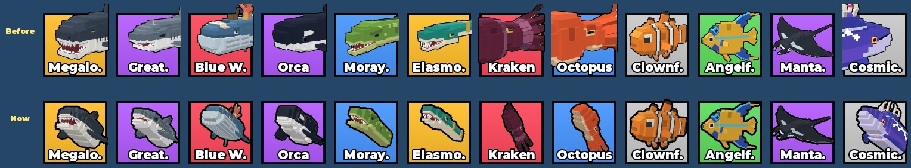

Before these two passes (top) and now. In the slots:

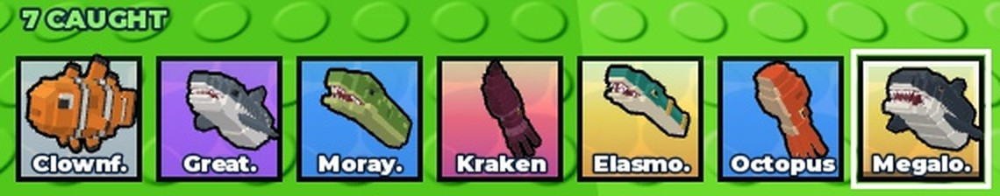

Private comparison with the reference: `research/ride-a-dino/ui/compare-fish-pictures-cut.png`.

- **A creature installed facing the other way** (CosmicHollow's template has its head at the back) is turned round
  by the picture when its head is clearly at the back end; it was drawn head down, from behind.
- **The pectoral fins and the whales' flippers** stay on a bust: they are part of the front body piece (or attached
  to it), so a shark keeps a fin trailing down, as a dinosaur's bust keeps its shoulder.
- **Every number** is in `Portrait.Settings` (`Cut`, `ArmPieces`, `Places.Bust`, `Poses.Squid`...); the test sheet
  tries others: `python tools/ui/portrait_sheet.py <studio_id> <names> --try "Label={Cut=0.6}"`.
- **Files:** `src/client/UI/Portrait.luau`, `src/client/UI/Slots.luau` (the name fix), `tools/ui/portrait_sheet.luau`.

### The fish pictures made even, and renders for drawn icons (the user, 2026-11-19)
"im still thinking these are off, the crops are still too irregular in angularity, silhouette general size and
plcaement. Could we adjust that to be better for some and then im thinking we could use the icons to chatgpt generate
the icons from those": in [Decisions](../Decisions.md).

**State: in the code, and seen in Studio on 2026-11-19** on the test sheet, all 83 fish. Not seen in a play test
this time (only the sizing changed since the last one).

| | Before | Now |
|---|---|---|
| **The angle** | A different one per kind: busts 56 degrees round from side on, whole fish 36, thin ones 22 | **One for all:** busts 50, whole fish 46, thin tall ones 30 (any more and they are seen edge on); all a little from above and tipped a little nose up |
| **How big a bust is** | Sized by its head: a long-snouted or hammer-headed fish came out small, a big-headed one huge | **Sized by its whole shape after the cut:** every bust fills the picture the same, its cut end low at the right, under the name |
| **Where** | Each wherever its head put it | Every bust centred the same way |

The thin ones (the giant squid, the kelp wyrm) still read a little small; they are fine as starting points for drawn
icons.

**Renders for drawn icons.** The user's idea: an image model redraws our renders as icons, as the reference's look
drawn rather than rendered. Every fish is now saved as a 380-pixel PNG on white (`art/ui/fish_icons/renders`), and
nine to a 3 x 3 sheet in rarity order (`art/ui/fish_icons/sheets`, ten sheets), with the prompt and the steps in
[the README](../../art/ui/fish_icons/README.md). Nothing has been generated: that costs credits and waits for the
user's word. Tools: `tools/ui/export_portraits.py` (pages of pictures on screen, captured and cut up),
`tools/ui/icon_sheets.py` (`make` the sheets; `cut` a generated sheet back into one see-through PNG per fish, with a
check picture), `tools/ui/portrait_sheet.py --plain`.

- **Files:** `src/client/UI/Portrait.luau` (`Settings.Measure = "Shape"`; `"Head"` sizes by the head as before).

**Then, the squids' heads and a thinner outline** (the user, same day: "giant squid, octopus and kraken need to be
more head focused with some face. Could we slightly shrink the black border too"). Seen in Studio on the test sheet;
the renders and sheets made again with both.

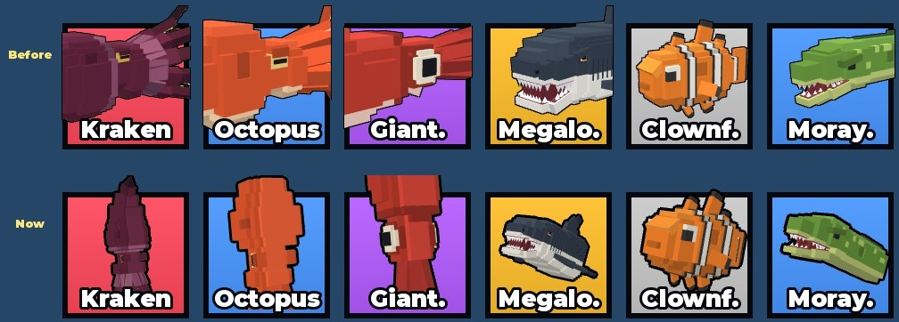

- **A squid is stood up on its arms and seen from the front quarter where the arms come out,** so its eyes face the
  viewer (from the side it was a tube with one small eye). The octopus and the kraken show their mantle whole, as
  their head, with the eyes at its base and three pieces of each arm under the name. The giant squid's mantle is
  too long and thin to read whole, so it shows its head close, the big eye in the middle and the mantle running out of
  the top (`Settings.SquidBy = "Auto"`: the close head for a squid over 3.5 times longer than it is wide).
- **Their faces stay weak in the models:** the octopus's and the kraken's eyes are small and dark. The image-model
  prompt now asks for every creature's eyes to be clearly visible.
- **The outline: 2.2% of the picture's height, from 2.8%,** so 2 pixels at both 720p and 1080p, where it was 2 and 3.

### A large study of the reference's creature icons, before drawing ours (the user, 2026-11-19)
"do higgsfield but trial some methods first to get it as close to ride a dinos dispersion as possible. do a large
scale study of different animals in the inventory from clips to understand better": in [Decisions](../Decisions.md).

**How:** every half second of the user's four recordings, each of the seven slots cut out, empty ones dropped,
repeats matched, the sharpest copy of each kept (1,600 slot pictures; private: `research/ride-a-dino/ui/icons_all/`,
sheet `icons_all.jpg`), plus the sell panel's larger icons and the dinosaurs seen close in the world.

**What is there:** eight creatures in the inventories (Ankylosaurus, Brachiosaurus, Dodo, Pachycephalosaurus,
Sauropelta, Suzhousaurus, a terror bird, Velociraptor), several in size and mutation versions, and a ninth in the sell
panel (a sand mantis, shown whole).

**What their icons do** (private comparisons: `study-icon-vs-model.jpg`, `study_sell.jpg`, `study-icons.jpg`):

| Area | The reference's icons |
|---|---|
| **Drawn, not a straight render** | The Ankylosaurus in the world is a blocky voxel model; its icon's head is another shape, fatter and curled, its blocks softly rounded. The Velociraptor's icon is a clean faceted low-poly bust. So the icons are a separate, cleaner version of each creature: made from a render and redrawn, or modelled for the icon. Our plan (an image model redrawing our renders) matches that |
| **One picture per creature** | The same picture in the slot bar, the "SECURED" list, the catch banner and the sell panel. A Silver or Golden one is the same picture: its mutation shows only as a word and a frame round the slot |
| **What is shown** | Head and neck, or head and shoulders, the head 50 to 65% of the slot's width, its top 5 to 8% under the slot's top; the body runs out of the bottom under the name. A small creature (the bird, the mantis) whole. Never cut at the side |
| **Angle** | Front three quarters, facing left, a little from above, the same for all |
| **Shading** | Three clear tones (lit 100%, side about 85%, shade about 60%); the shade warmer and more saturated, not greyer; small crisp glossy highlights on top edges and spikes; no texture noise |
| **Colour** | Saturated, a little brighter than the world model |
| **Outline** | Dark, nearly black, about 3% of the slot (2 pixels at 720p), round the outer shape only; no inner lines |
| **Shadow, glow, background** | None |

**Where ours stands against that:** the framing, angle, outline and light levels now match. What a drawn icon would
add is the clean, softly rounded shapes, the warmer saturated shade and the glossy highlights.

**The trials (waiting: the user's Higgsfield account has 0 credits, free plan).** One mixed sheet
(`art/ui/fish_icons/trials/trial_sheet.png`: Megalodon, Clownfish, Octopus, Moray eel, Manta ray, Angelfish,
Elasmosaurus, Pufferfish, Great white) through five methods, each judged against the table above:

| Method | Model, settings | Credits |
|---|---|---|
| A. The sheet, the prompt alone, a quick pass | GPT Image 2.6, medium, 1k | 0.5 |
| B. The same, full quality | GPT Image 2.6, high, 2k | 2.75 |
| C. One fish alone (Megalodon), full quality | GPT Image 2.6, high, 2k | 2.75 |
| D. The sheet on another model | FLUX 3, 2k | 3 |
| E. The sheet with the best result so far as a style reference | GPT Image 2.6, high, 2k | 2.75 |

About 12 credits for the trials, then about 28 for the ten sheets by the chosen method (or about 230 for one fish at
a time, if only that holds the look). The prompts are in [the README](../../art/ui/fish_icons/README.md).

### The icons through ChatGPT: a folder and a two-step prompt (the user, 2026-11-19)
"could you write me a prompt and attach the photos needed to edit and photos needed for reference for chatgpt so i can
do a batch edit. Make it a two step prompt, it does 10 images of a few fish variety first before the whole thing": in
[Decisions](../Decisions.md). (Higgsfield had no credits.)

**State: the folder is made; nothing generated yet.** Private, as it holds the reference game's art:
`research/fish_icons_chatgpt/` (git never commits `research/`). In it:
- `PROMPTS.md`: the two steps word for word. Step 1: the style sheet first ("ready"), then ten fish of every shape
  (a shark, a small fish, a thin fish, a ray, the octopus, an eel, a pufferfish, a long-necked one, a turtle, a
  monster), one icon each, judged together before going on. Step 2: the other 73 in eight batches of ten.
- `0_style_reference/style_reference.png`: six of the reference's icons, the words (SILVER, GIANT...) and price dots
  taken off, for how things are drawn only. The prompt says not to copy their creatures.
- `1_test/`, `2_batches/batch_01` to `08`: our renders at 1024 pixels; `3_results/`: where ChatGPT's icons are saved,
  numbered as attached.

**After:** `python tools/ui/icon_sheets.py align research/fish_icons_chatgpt/3_results` cuts the white away and moves
and scales each icon so its shape sits exactly where its render's did (ChatGPT drifts), into `art/ui/fish_icons/drawn`
with a check picture. Tried on shifted copies of the renders: all ten came back in place.

**Then, the new colours** (the user, relayed by the map chat, same day: "update the icons according to the new
models"): the 29 fish the creature chat recoloured are re-rendered from their new models, and the four fish cut from the
game (Boxfish, Butterflyfish, Blue Chromis, Flying Fish) are out of the renders, the sheets and the ChatGPT folder:
79 fish, ten in the test and 69 in seven batches. Remade with `python tools/ui/export_portraits.py <studio_id> --tile
380`, `python tools/ui/chatgpt_pack.py` and `python tools/ui/icon_sheets.py make`. (The live pictures in the game take
the new colours by themselves: they draw the models.)

**Then, the squids cut like the busts** (the user, same day: "the octopi and kraken stuffs are cut off the wrong way,
should be cut off liek the head"). They stood up on their arms, cut straight across (the giant squid's mantle ran
out of the top). Now a squid is posed as a bust: tipped up 40 degrees (a fish's 26), seen from the same side as
every fish, its mantle and eyes up at the left and its arms cut off at the bottom right; its mantle and head are
sized and placed as a bust's shape is. The three are re-rendered and the ChatGPT folder and the sheets made again.

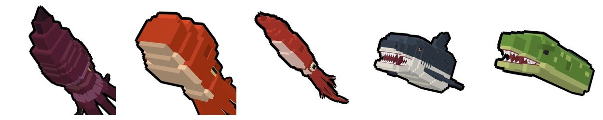

The kraken, the octopus and the giant squid, with a shark and an eel for comparison.

## The short version
- **Today's HUD says the wrong thing.** It shows a tank, "OXYGEN 68 / 100", at the bottom edge. With 2 to 3 seconds on a
  fish, what a player needs is "how long do I have on this fish", next to the fish, and "which fish next".
- **The HUD follows the reference's riding screen piece for piece:** the strip of lands across the top, two rings
  beside the rider, the jump button at the lower right, a stacked tag on every wild fish, your stats, a row of slots
  for what you carry, the tilted catch banner, the revive bar, the end-of-dive banner.
- **The look is chosen (the user, 2026-11-11): A, Brick,** because it is the simplest, with E's pattern, and from
  there more like Ride a Dino. Pass 3 draws that.
- **What is still ours:** the word HOP or GRAB on a phone's button, a "needs" number that warns in red, the ring in
  our Oxygen's aqua, bubbles as the pattern. (The seconds inside the ring and the fish's name under it were ours
  too; they are switched off since piece 3, below, to match the reference's ring.)
- **Four questions** are at the end.

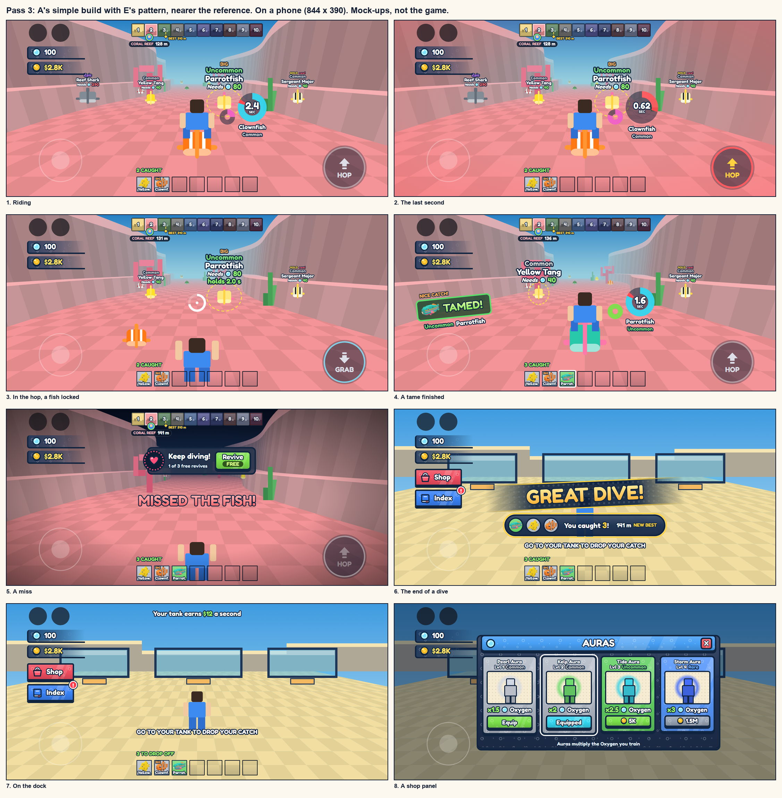

**Since 2026-11-13 (later) the Oxygen row is a see-through box with highlights, five options for Hugo to pick from;
the game shows option 5 until he picks** (the section "The Oxygen row as a glass box", right below).
**Since 2026-11-14 Hugo has picked 5, and it sits in the screen's bottom left corner with a fade** (the section "The
Oxygen box in the corner", below).
**Since 2026-11-14 the tags over fish have six options behind `Kit.FishTags`, left on 0 (today's) until Hugo picks**
(the section "Fish tag options", below).
**Since 2026-11-14 (later) the game's tag is Hugo's own three lines, look 7** (the section "Every rarity's tag",
right below); looks 0 to 6 stay behind `Kit.FishTags`.
**Since 2026-11-14 (later still) the size word sits on line 1 beside the rarity, and the rarity word has four designed
styles per rarity behind `Kit.RarityWords`, the game left on r1's word until Hugo picks** (the section "Rarity word
options", right below).
**Since 2026-11-14 (evening) the rarity word is Gotham Black for every rarity, and Legendary, Mythic and Secret move**
(the section "The rarity word in Gotham Black", right below).

## The rarity word in Gotham Black, Legendary and up moving (2026-11-14, Hugo: on the rarity word sheet)
Hugo, on `fish-tags-rarity-text-options-1.png`: "use the gotham black and make sure legendary + are animated and
integrated".

**State: live in the game (`Kit.RarityWords` = 5 for every rarity). Run in Hugo's Studio by script (each rarity's fish
close up, a crowd, far fish, darker water in the Wrecks, then 26 frames each of the Legendary, Mythic and Secret words
at a held clock): no errors. Pictures judged, not played by hand; not seen on a phone.**

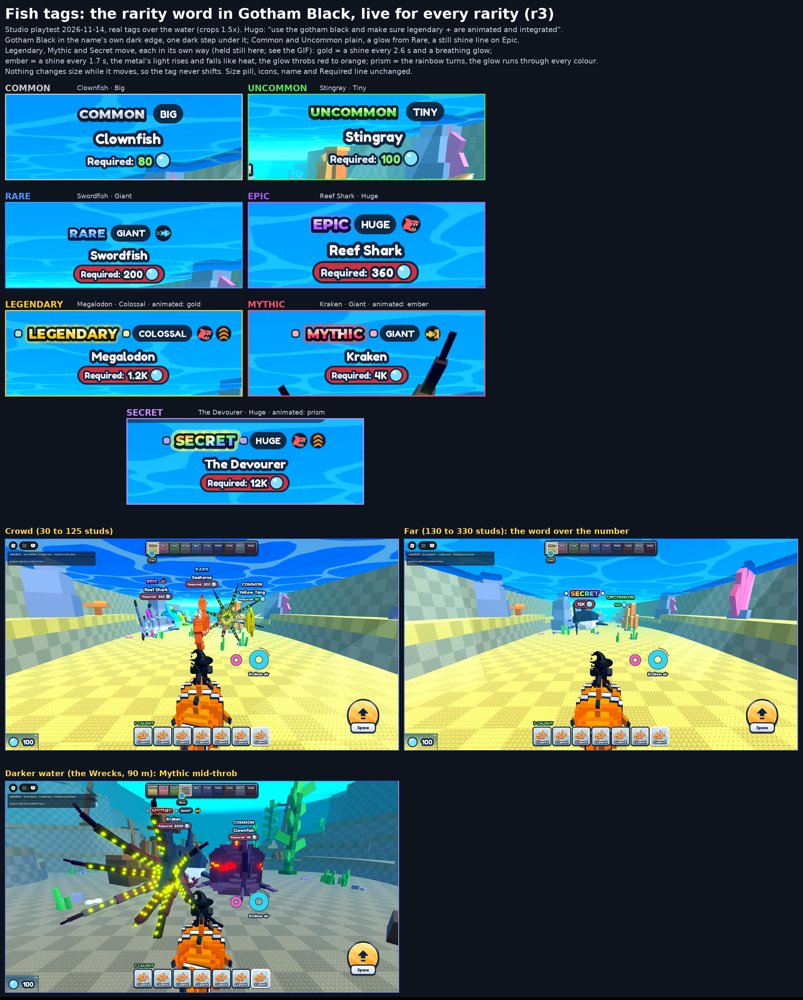

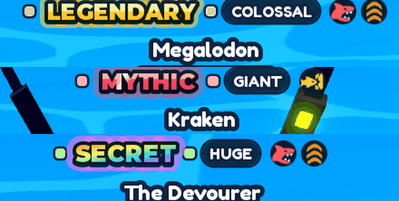

- **The word (style 5, "Live"):** Gotham Black, Chrome's metal shading split at the middle in the rarity's colours,
  but edged in the name's own dark ink (2.4) with one dark step under it, so the word and the white name read as one
  tag. Its box hugs the letters (`Tight`), so the gap to the size pill is the line's own 5 points. The ladder: Common
  and Uncommon plain; a soft glow of the colour from Rare, stronger on Epic with a still shine line; Legendary,
  Mythic and Secret bigger, a star either side, and moving.
- **The motion, louder up the ladder (`liveWord` in `Tags.luau`):** Legendary "gold": a white shine crosses the word
  every 2.6 s, the glow breathes, the stars twinkle. Mythic "ember": the shine every 1.7 s, the metal's light rises
  and falls like heat, the glow throbs from its red to a hot orange, the stars spin. Secret "prism": the rainbow
  letters turn round, the glow runs through every colour, the shine every 1.5 s, the stars spin fast in a moving hue.
- **Cheap:** only gradient offsets and turns, transparencies, colours and the stars' turn change, never a size, so
  the tag never moves. Only Legendary and up are touched per frame, and only while their tag is drawn; Common to Epic
  cost nothing after they are built.
- **Far and crowded:** the word keeps its look and motion over the number (a Legendary or rarer mark is 1.3 times
  bigger, as before).
- **Kept:** r1's word and the four option columns stay behind the switch (`RarityWord` "0" to "4" in Studio). New
  Studio attribute `WordClock` (a number) holds the motion at that time, for frames; `ShineAt` still holds the sweep.
- **Not checked:** the locked fish in the hop (it only scales the same tag 1.2 times), the deepest dark lands, a phone.

## Rarity word options, and the size beside the rarity (2026-11-14, Hugo: on the rarities sheet)
Hugo, on `fish-tags-rarities-1.png`: "move size next to/behind rarity instead of title, improve upon the rarity text,
needs different font and they all need a look with highlights shading and gradients, send me a spreadsheet with
options for each one".

**State: in the game code. The size move is live; the word styles are behind a switch left on r1's word. Run in
Hugo's Studio by script (one ride per pass: each rarity's fish close up in r1's word and the four options, the size
in four places, a crowd and far fish with my picks): no errors. Pictures judged, not played by hand.** The sheet:

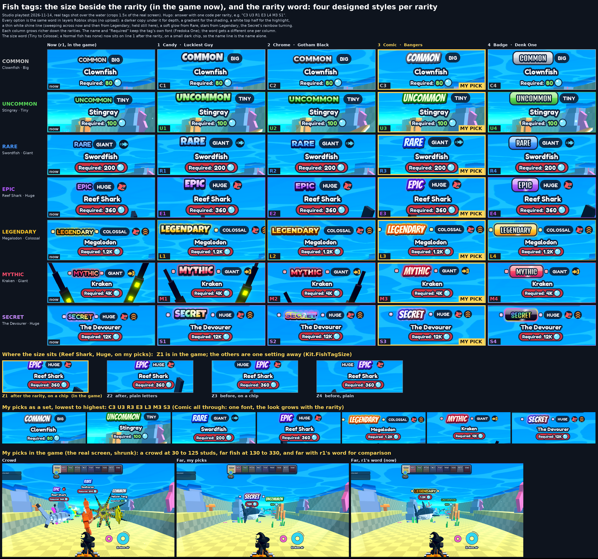

- **The size (live):** the fish's size word (Tiny to Colossal; a Normal fish has none) left the name's line and sits
  on line 1 after the rarity's word, in capitals on a small dark pill (`Kit.FishTagSize = "chip-after"`; also
  `"plain-after"`, `"chip-before"`, `"plain-before"`, codes Z1 to Z4 on the sheet). Line 2 is the name with its
  variant only ("Rainbow Great White"). Far or crowded, the size is left out with the icons. Looks 1 to 6 keep the
  size in the name as before.
- **The rarity word (proposal):** four styles per rarity, codes C1 to C4, U1 to U4, R, E, L, M, S. Each column is
  one family growing richer down the rarities, all from what Roblox ships (no upload): the same word in layers, a
  darker copy or two under it for depth, a gradient for the shading, a white copy cut to its top half for the
  highlight, a thin white shine line (sweeping across now and then from Legendary), a soft glow from Rare, stars from
  Legendary, the Secret's rainbow turning. 1 Candy (Luckiest Guy): soft light-to-dark letters, dark edge, gloss.
  2 Chrome (Gotham Black): metal shading split at the middle, a shine line, a deeper extrusion. 3 Comic (Bangers):
  pale letters, a thick edge in the rarity's own gradient, a dark shadow down and right. 4 Badge (Denk One): white
  letters on a plate of the rarity's colours, lit on top. Every family's word is bigger than the name.
- **My pick: column 3 (Comic) all through, C3 U3 R3 E3 L3 M3 S3:** one font for the set, it reads clearly beside
  the name's round font, and its gradient edge carries the rarity's colour from far. Runner-up: L4 (the gold plate)
  for Legendary. S2 (the dark Chrome Secret) is the weakest.
- **Switching:** `Kit.RarityWords` names each rarity's column, e.g. `{ Common = 3, Uncommon = 3, ... }`; empty is
  r1's word. In Studio the workspace's `RarityWord` string overrides it ("0", "3", or "C3 U3 R1 ..."), and `FishTagSize`
  the size's place; `ShineAt` (a number) holds the sweep still for pictures.
- **How:** `WordStyle`, `PAL`, `FAMILIES`, `Tags.wordStyle`, `putArt` (the layers in `Art`), the size in `SizeBox`,
  the animation in `shimmer`, all in `src/client/UI/Tags.luau`.

## Every rarity's tag (2026-11-14, Hugo: his own layout)
Hugo, after the options sheet: "Make the names white, give me a spreadsheet of all rarities with a cool design like
in ride a dino, it should be -> RARITY (class icons) / NAME / Required: n Oxygen icon".

**State: built as look 7 and switched on (`Kit.FishTags = 7`; 0 to 6 kept). Run in Hugo's Studio by script (one
ride: one fish of each of the seven rarities close up, a long name, a crowd, far fish, and the old tag for the same
long name): no errors. Pictures judged, not played by hand.** Read "spreadsheet" as a picture sheet like the options
sheet:

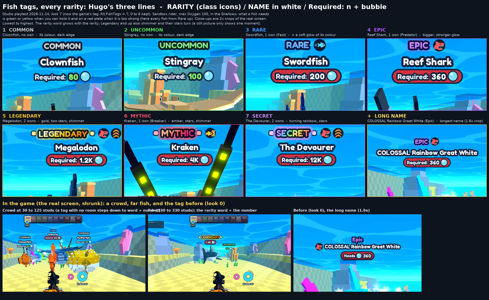

- **Line 1:** the rarity's word in capitals, then the fish's archetype (class) icons on the same line (none, one or
  two; 18 px). **Line 2:** the name (with its size and variant, "COLOSSAL Rainbow Great White"), white for every
  rarity, 16 pt with a thick dark edge so it reads on sand and on the pink reef. **Line 3:** "Required:" in pale
  white, the number, the Oxygen bubble. The number is what the fish needs where it swims now (`Config.required`, as
  before): green or yellow when you can hold it, and the whole line on a red plate when it is too strong (the old
  "Needs" pill's warning, kept). 3 points between lines.
- **The rarity's word grows with the rarity** (the reference's tags make the rare ones loud; its look isn't copied):
  Common and Uncommon their colour lighter at the top with the dark edge; Rare adds a soft glow of its colour round
  the letters; Epic a little bigger and a stronger glow; Legendary gold, Mythic ember and Secret the rainbow, bigger
  again, with a small star either side; from Legendary the gradient swings and the glow breathes, the stars turn, and
  the Secret's rainbow goes round (all in `Tags.luau`: `WORD_SIZE`, `WORD_GLOW`, `shimmer`).
- **Far (110 studs on) or with no room in a crowd:** only the rarity's word (no icons, the stars kept) over the number
  and the bubble. So a rare fish still reads from far by its word, and what a fish needs is never lost.
- **The locked fish in the hop** is 1.2 times bigger and has "holds 2.3 s" or "TOO STRONG!" under it, as before.
- **Seen on the sheet:** in the sandbox (max Oxygen 100, the Shallows) every fish from Rare up is too strong, so
  their line 3 is red; with more Oxygen it is plain like the Common's. A big fish swimming high puts its tag under the
  strip of lands (every look does; the shots were taken with the big fish lower). The archetype icons show only on
  Hugo's PC until they are uploaded (`Shared/Archetypes`).
- **How:** `Tags.Looks[7]` (`Stack`, `ChipClear`), `makeStack`, `putStack`, `shimmer` in `src/client/UI/Tags.luau`;
  it shares the options' updating, crowding and pinning. The options' own pieces moved into `Opt` on each tag (no
  change to how 1 to 6 look).

## Fish tag options (2026-11-14, Hugo: options sheet 1)
Hugo: "send me a sheet of possible changes to the whole ui/text above fishes. It should attract the player more and feel
less clumped".

**State: six options built behind one number, `Kit.FishTags` in `src/client/UI/Kit.luau` (0 = today's stacked tag, left
on 0: the game looks as before). Run in Hugo's Studio by script (one ride, the same four scenes for every option): no
errors. Not played by hand. Hugo picks.**

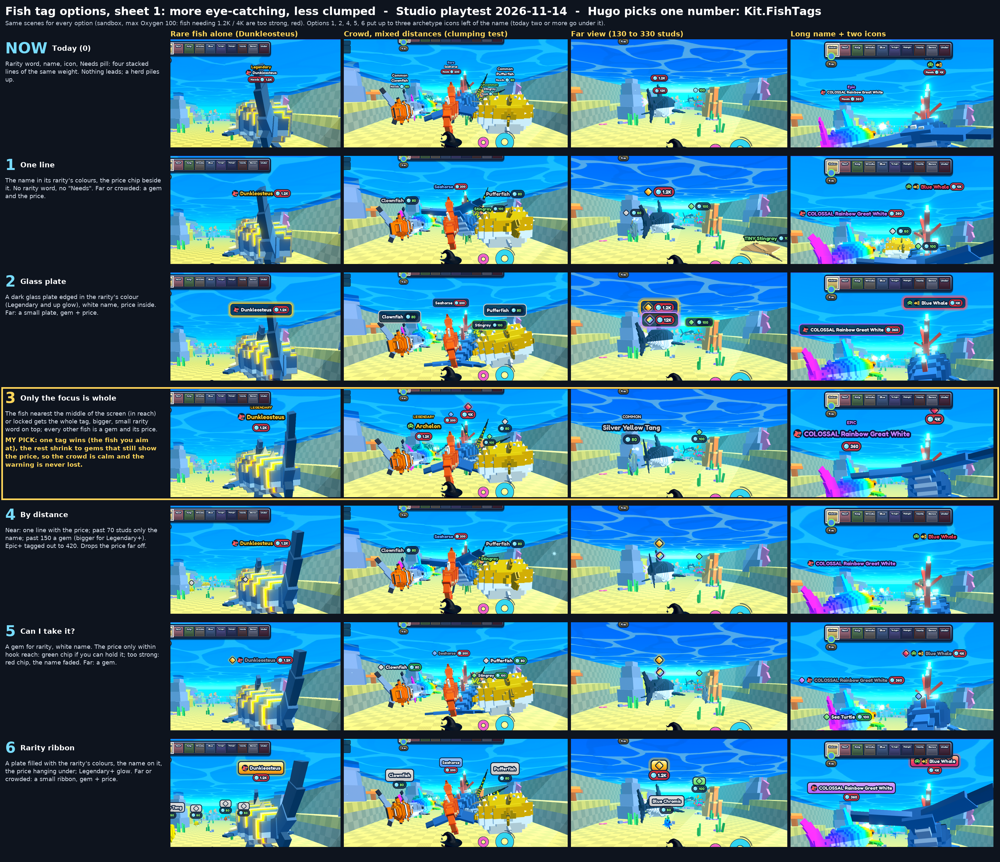

Today's tag is four stacked lines of the same size and weight (rarity word, name, icon, a "Needs" pill), so nothing
leads the eye and a herd piles into one lump. Every option shows the rarity by colour (the name's letters, a plate's
edge or fill, or a small diamond "gem" in the rarity's colours) instead of a word, and gives far or crowded fish less
than the whole tag. A crowded tag steps down (whole to a gem, a gem to left out), as today's does.

| # | Look | What changed |
|---|---|---|
| 0 | Today | Rarity word, name with one icon, two or more icons under, the Needs pill; far fish only the number |
| 1 | One line | The name in its rarity's colours, the price chip at the end of the line; no rarity word, no "Needs". Far (110+) or crowded: a gem and the price |
| 2 | Glass plate | The line on a dark see-through plate edged in the rarity's colour; Legendary and up glow. Far or crowded: a small plate with the gem and the price |
| 3 | Only the focus is whole | The locked fish, or else the fish nearest the middle of the screen within hook reach, gets the whole tag: a small rarity word, the name bigger, the price under. Every other fish is only a gem and its price. Two or more icons stay under the name |
| 4 | By distance | Near: one line with the price; from 70 studs only the name; from 150 a gem (bigger for Legendary and up). Epic and up are tagged out to 420 studs. **Drops the price far off** (today the price is the one thing never lost) |
| 5 | Can I take it? | A gem for the rarity, the name white. The price only within the hook's longest reach (`Jump.GrabRange`): a green chip if you can hold the fish; too strong, a red chip and the name faded. Far: a gem |
| 6 | Rarity ribbon | A plate filled with the rarity's colours, the name on it, the price hanging under it; Legendary and up glow. Far or crowded: a small ribbon with the gem and the price |

- **Changed on purpose in 1, 2, 4, 5 and 6:** up to three archetype icons sit left of the name (today two or more go
  in a row under it). 3 keeps today's rule. The single icon left of the name and the icons-not-words rule are kept by all.
- **My pick: 3.** One tag wins (the fish you are aiming at), the crowd shrinks to small gems that still carry the
  price, so a herd stays calm and the too-strong warning is never lost; rare fish still read from far by their gem's
  colour. Second choice: 2 (the clearest single tag, but a crowd still shows several plates).
- **Seen on the sheet:** a Mythic name (ember) reads close to the red of a too-strong price; a fish very high on the
  screen (the Blue Whale) can sit under the strip of lands, in every option and today.
- **How:** `Tags.Looks` in `src/client/UI/Tags.luau` (one row of settings per option: plate, name size and colour,
  gem, icons left, price under or beside, focus, distances, reach, glow, padding); `makeAlt`, `updateAlt`. Today's
  tag code is unchanged. In Studio the workspace's number attribute `FishTags` overrides `Kit.FishTags` live (the
  sheet was made that way).

## Bigger number, filling the box (2026-11-14, Hugo: on the corner sheet)
Hugo: "make the text a bit bigger and make sure it fills out the box better than it does right now".

**State: built and run in Hugo's Studio by script (before and after, full and with the warning forced on, over the sand
and the pink reef; 100, 45, 7 and 1.2K): no errors. Not played by hand.**

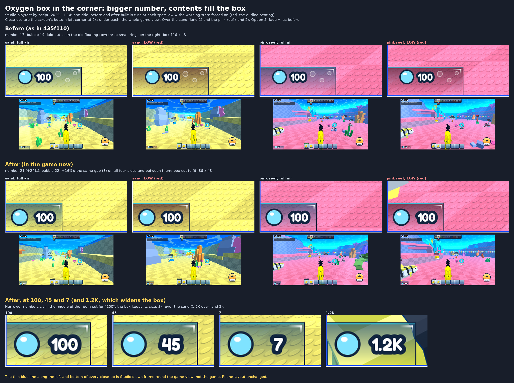

- **In the corner (keyboard):** the number is 21 points (was 17, +24%), the bubble 22 (was 19). The same 8-point gap
  runs on all four sides (counted from the outlines) and between the bubble and the number. The box is cut to fit: 86
  wide (was 116), still 43 tall, still flush with the screen's left and bottom edges; option 5 with fade A as before.
- **Numbers:** the box is cut for "100"; a shorter number (45, 7, the 0 while drowning) sits in the middle of that room,
  a longer one (1.2K) widens the box to keep the gap. The three small rings are left out in the corner (no room).
- **The warning** reads as before: the fill goes red and the outline beats (as weak over the pink reef as it was).
- **Phone layout:** unchanged (the floating row, number 17), since its row size is shared with the coins row.
- **How:** `StatRows.luau`, `CORNER` (Pad, Icon, Gap, Text, Room) and `fitCorner`.

## The Oxygen box in the corner (2026-11-14, Hugo: drawn on the options sheet)
Hugo picked option 5 and drew on the sheet: the box's top edge carried on to the left and its right edge carried on
down, so the box no longer floats but fills the screen's bottom left corner; and "a fade going from top to bottom".

**State: built and run in Hugo's Studio by script (one ride; the before, fade A and fade B each built in turn, full and
with the warning forced on, over the sand and the pink reef): no errors. Not played by hand. Fade A is in the game;
Hugo picks A or B.**

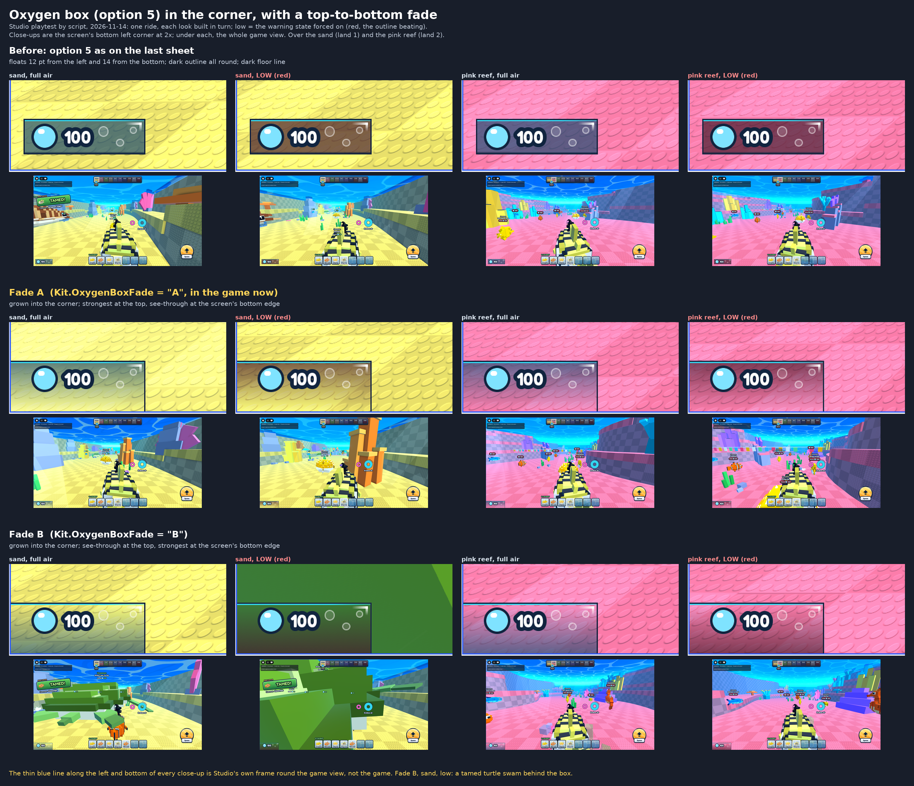

- **The corner (keyboard layout):** the box's glass runs out to the screen's left and bottom edges (the rows' own
  12 and 14 point gaps), so only its top edge (with the aqua line) and its right edge show. The bubble and the number
  stay where they were. The dark floor line is gone (it would sit on the screen's edge). Measured in the run: the
  face starts at x 0 and ends on the screen's bottom pixel. The warning still beats: the outline's left and bottom
  parts are off the screen, so the beat runs along the top and right only. If coins ever show, their row sits above.
- **The fade** is on the fill's own gradient (top to bottom), so the red of the warning fades the same way.
  `Kit.OxygenBoxFade`: **"A"** strongest at the top, see-through at the screen's bottom edge (in the game); **"B"**
  see-through at the top, strongest at the bottom; **""** no fade. How see-through each end is: `Kit.FadeEnds`.
- **Phone layout:** unchanged: the rows sit at the top left there (clear of Roblox's stick), so the box floats as
  before, with the fade. Not tried on a real phone or the device emulator; the HUD's ScreenGui keeps to the device's
  safe area, so on a phone with a notch a corner box would stop at the safe area (it is not in the corner there).
- **How it is made:** a box with `Corner = true` (option 5) gets the fade and no floor line (`Kit.luau`, `dressBox`);
  `StatRows.place` grows the Oxygen row's face into the corner on a keyboard and moves the row's `Inner` frame (the
  bubble, the number, the three bubbles) back by as much. Options 1 to 4 and 0 are still in `Kit.Boxes`.

## The Oxygen row as a glass box (2026-11-13, Hugo: options)
Hugo: "For now only change the oxygen meter in the left bottom (stamina) to be a see through box with highlights, not a
custom rounded thing. Send spreadsheet to let me choose between options here".

**State: built, five options and the flat plate before them, each run in Hugo's Studio by script on the same ride,
full and in the red: no errors. Not played by hand. Waiting for Hugo's pick.**

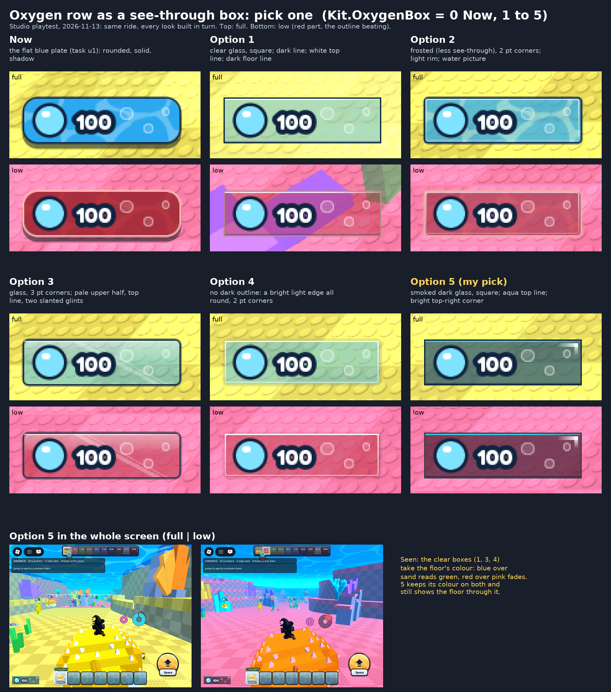

| `Kit.OxygenBox` | What it is |
|---|---|
| 0 | Now: u1's flat blue plate (rounded, solid, shadow) |
| 1 | Clear glass, square corners; the thin dark line; a white line inside the top edge; a dark line inside the bottom |
| 2 | Frosted (less see-through), 2-point corners; a light rim all round, brighter at the top; the water's picture kept |
| 3 | Glass, 3-point corners; the upper half paler; a faint top line; two slanted glints at the right |
| 4 | No dark line: a bright light edge all round, 2-point corners, a bright top line |
| 5 | Smoked dark glass (the colour two thirds of the way to the HUD's dark navy), square; an aqua top line; a bright top-right corner. **In the game now (my pick)** |

**Seen in the run:** the clear boxes (1, 3, 4) take the floor's colour, and the floor is what is behind the row
while you ride: blue over the yellow sand reads green, and the warning's red over the pink reef nearly fades into it.
Option 5 keeps its colour over both and still shows the floor through it; that is why it is the pick.

**Kept:** the row's size and place, the bubble sign, the number and its three bubbles; in the red the box is red
(the same theme colours, through the same glass) and its outline beats pale, as before. On option 4 the dark line is
kept nearly clear (85% see-through) so the beat still has something to beat: the weakest warning of the five.
The rings, tags and every other plate are as they were.

**How it is made:** `Kit.OxygenBox` (one number at the top of `Kit.luau`) picks a box in `Kit.Boxes`; the Oxygen
theme has `Box = true`, so `Kit.dress` builds the box (`dressBox`) and `Kit.panel` leaves out the shadow (it would
show through the glass). 0, or a style without `Box`, is dressed as before. Each box is a short table (see-through,
corners, dark line, tint, top line, rim, sheen, streak, corner, floor line, picture), so a new one is a new row.
`StatRows.luau` is not changed. Picking another option is one line: `Kit.OxygenBox = <n>`.

**Since 2026-11-13 the Oxygen row and the two rings beside the rider are plainer than pass 4** (Hugo: "a little less
detail"): a flat fill and a thin outline. The section right below.

## The Oxygen and tame pieces with a little less detail (2026-11-13, Hugo)
Hugo: "edit the capturing and oxygen ui to have a little less detail -> no gradient thin outline".

**State: built, and run in Hugo's Studio by script (before and after, the same ride): no errors.** From captures of
the game:

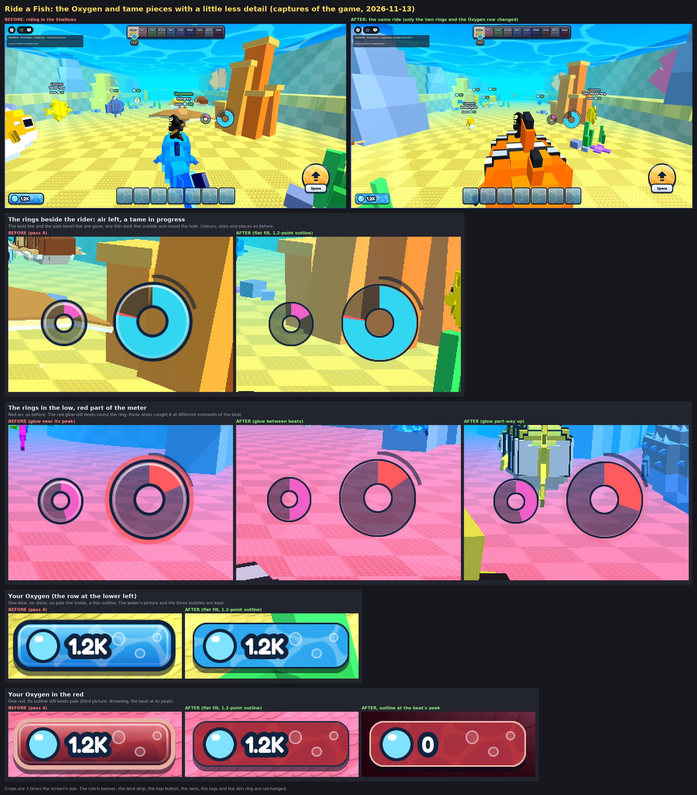

**What it was read to mean (the Boss's reading; Hugo can correct it):** only the pieces that show the Oxygen and the
tame. Every other plate keeps pass 4's bold look.

| Piece | Pass 4 | Now |
|---|---|---|
| The big ring (the time left on this fish) | A bold dark line (2 points) outside and round the hole, a pale line on the band, brighter at the top | One dark line of 1.2 points outside and round the hole. No pale line |
| The tame ring | The same, at 1.6 points | The same as the big ring: 1.2 points, no pale line |
| Your Oxygen (the row) | Blue, lighter at the top; a shine over the upper half; a pale line inside; a 3-point outline | One blue (56, 172, 241); no shine, no pale line; a 1.2-point outline. In the red: one red (179, 38, 50) |

**Kept, and seen in the run:** sizes, places and colours; the red arc in the low part of the meter; the red glow
that beats round the ring; the thin red line of what was just lost; the white landing flash and the hop's arc (code
not touched); the tame ring's pink; the row's outline beating pale in the red and its 0 while you drown.

**Kept on purpose, to judge from the picture:** the water's picture on the row and its three bubbles. On the flat
blue the picture still reads as water, not as noise (my call). The bubble sign at the row's left keeps its own
thicker outline and its white dot: it is the same sign the fish tags use, and the tags were not to change.

**Weaker than before:** the row's warning is its outline going pale, and a 1.2-point outline is a much thinner
signal than a 3-point one. The red plate and the ring's glow carry the warning now. If it reads too quiet: beat the
plate's colour instead (a change in `StatRows.luau`).

**How it is made:** `Kit.Style` has a `Flat` switch (one colour, 30% of the way from the theme's top colour to its
bottom one; a `Kit.Outline.Hair` outline of 1.2; no bevel, no shine) and the Oxygen theme has it on. `Kit.ring`
takes a sixth argument, `plain`: the dark line without the pale one. `Rings.luau` asks for both rings that way.
The aim ring (`Aim.luau`) and every other plate are built as before.

## Pass 4: bolder, and themed by purpose (2026-11-12, Hugo)
Hugo: "the game's UI is overall too bland; there should be more bold bordering, gradients and texture overlays on
different UI elements. Make every part of the UI cohesive with these new parts and make sure each matches the theming
of what the element is for." In [Decisions](../Decisions.md) as Hugo's row. It turns back one thing of pass 3's second
round, the hairline frames on the strip and the slots; the places, sizes and spacing of that round stay.

**State: built, and run in Hugo's Studio (through `~/Projects/studio-runner`, driven by script): no errors.** Every
screen before and after:

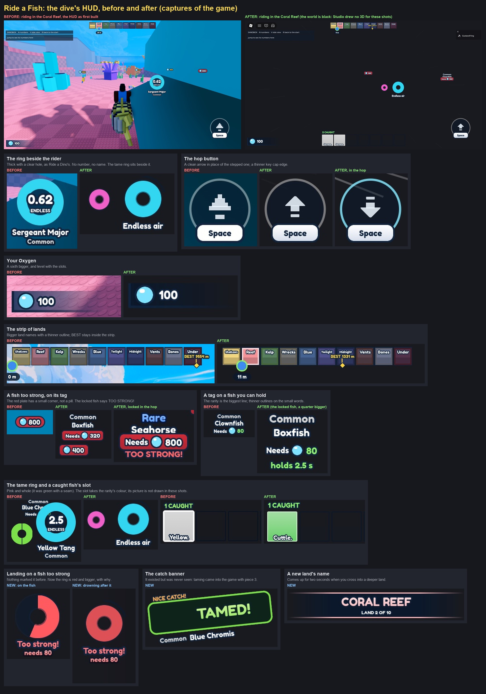

With what you carry, coins, the tame ring and the catch banner filled in for the picture
([bigger](../attachments/ui4-game-inventory.jpg)), and [the phone layout](../attachments/ui4-game-phone-layout.jpg)
(forced on a desktop screen; a real phone is not seen yet).

### The rule: one plate, everywhere
Every plate in the HUD is the same build, from `Kit.dress` and `Kit.panel` in `src/client/UI/Kit.luau`:
- **A thick dark outline** (3 points; 4 on the jump button, 2 to 2.5 on small things).
- **A pale line just inside it,** brighter at the top: the bevel.
- **A top-to-bottom gradient** for the fill.
- **A faint pattern over the fill.**
- **A shadow under it,** 3 points down.
- **Chunky round corners:** 5 on tiles, 9 on plates, full circles and pills where the piece is round.
- **Letters with a thick dark outline,** thicker on bigger letters.
- **Spacing from one scale:** 2, 4, 8, 12, 16.

Words on the world (the tags, a fish's name under the ring) stay without a plate, as in pass 3.

### One theme a purpose
| Piece | Theme | What it looks like |
|---|---|---|
| Your Oxygen (the row) | Water | Blue, lighter at the top, the water's picture and three bubbles, a shine. **In the last second on a fish and while you drown it is deep red and its outline beats** |
| The ring (the seconds on this fish) | Water | A dark outline round the ring and round its hole; the hole is deep blue. **Under a second: the arc and the hole red, and a red glow beats round the ring** |
| Your coins | Gold | Yellow to orange, the stud pattern |
| The strip of lands | Each land's own colour | A dark tray of bricks with the thick outline and a shadow; each tile in the map's colour for that land, lighter at the top; the land you are in framed in white; the pill under your badge takes that land's colour |
| The jump button | Action | A disc, yellow to orange, slanted motion stripes, a shine, the heaviest outline, a dark arrow. In the hop with a fish locked: aqua. Nothing to grab: grey. **The last second: a red ring beats round it.** The Space cap is a key: white, a little grey at its foot |
| A rarity (tags, the name under the ring, slots, the catch banner) | The rarity's colour | Its colour, lighter at the top. **A Legendary is gold, a Mythic an ember (pale orange through red to magenta), a Secret the rainbow, side to side** |
| A fish too strong (the tag's "Needs") | Danger | A red plate, darker at its foot |
| A miss ("OUT OF AIR!", "MISSED THE FISH!") | The abyss | Pale red words on a streak that goes from deep red to black and fades out at both ends, a red line along each edge. The edges that close in as you drown are red-black |
| The end of a dive | Gold | As pass 3; the pill is a dark brick with a gold outline |
| The catch banner | Good news | A green brick plate, the stud pattern |
| The slots | Aquarium glass | See-through blue glass, the water's picture, a shine over the upper half. Filled: the rarity's colours behind the glass. The newest: a white outline |
| The sandbox panel (Studio only) | A tool | Dark slate, squared paper, a thick black outline, an amber title with a line under it, thin black edges on every button and box. It is ours, not the player's, and looks it |

### The patterns
**Two pictures, both uploaded before this pass; nothing new is uploaded:**
- **The stud tile** (the map's, `tile2` in `art/map/textures.json`): the brick pattern on the tray, the coins, the
  catch banner.
- **The water's picture** (the one the moving water drifts, `tools/map/water_look.luau`): on the Oxygen row and the
  slots.

The rest is made of frames, once: the motion stripes are one gradient, the bubbles three small rings, the squared
paper thin lines. The small signs (question 2) are still not drawn.

### What it costs a phone
- **Nothing is made per frame,** as before. A plate is about ten small objects, made once.
- **Only a warning is tweened:** the beat of the Oxygen row's outline, the ring's glow and the button's red ring, and
  only while the warning is on (`Kit.pulse`). Text still never changes size.
- **One group** (the miss's words) is drawn to its own picture so that it fades in as one number.

### Changed from pass 3, on purpose
| Pass 3 | Now | Why |
|---|---|---|
| Hairline frames on the strip and the slots | The thick outline | Hugo's ask |
| The jump button a dark see-through circle | A solid yellow to orange disc | "Themed by what it is for": it is the press that is the game. Pass 2's "yellow, then aqua, then grey" is back |
| Stat rows that fade out to the right | Solid plates | The same build as everything else |
| The plates had no pattern | Two patterns | The two pictures were already uploaded for the map |

### Not done
- **Not seen on a real phone,** and not with a second player.
- **A Mythic's and a Secret's colours are seen only in the slots** (the picture's made-up catch); no such fish swam
  past in the run.
- **The dock's screens** (shop, Index) are not built; when they are, they take these themes.

## Piece 2: the dive's HUD in the game (2026-11-12)
The user, through the game-code chat: "I'd like to add the Ride a Fish UI as we've done it currently". Built from
pass 3. The user was away and asked not to be asked, so each open point took its recommended answer; they are listed
under "What was taken where the design was open".

**State: run once in Studio by the game-code chat, 2026-11-12, at desktop size: no errors.** The ring, the strip of
lands, the best marker, the Oxygen row, the jump button and the aim all drew ([riding](../attachments/ui-game-riding-ring.jpg),
[the hop](../attachments/ui-game-hop.jpg)). A second run the same day confirmed two fixes (the ring under the sandbox's
endless air, the button's arrow). A third run showed the tags drawing ([a lone fish reads well](../attachments/ui-game-tags.jpg)), but a
clump of fish piled its tags on each other. **A crowding rule was added and a fourth run, with all 82 creatures, showed it working**
([the Twilight](../attachments/game-twilight-all-creatures.jpg)): tags are placed nearest first, and one whose words
would land on a tag already placed is left out; far tags are smaller. While you float off a fish the ring shows the
air you have left and says "Floating".

**A fifth run, with endless air off, showed the rest:** [the last second on a fish](../attachments/ui-game-last-second.jpg)
(the ring red at "0.90", the button's ring red with a yellow arrow), [a part-empty ring](../attachments/ui-game-riding-real.jpg),
[GREAT DIVE! on the dock](../attachments/ui-game-great-dive.jpg) and [drowning](../attachments/ui-game-drowning.jpg).
No errors. Three things were changed from those pictures, **written and not run yet**:

| What the picture showed | Change |
|---|---|
| "GREAT DIVE!" sat on the player's head | It sits higher: about a third of the way down the screen, clear of the player and of the strip of lands, on a phone as on a wide screen |
| Drowning with an empty meter, the only number on screen was the Oxygen row's "100" (the most you can carry, not what is left) | The ring stays up while you drown: empty, red, "0.00", and "Out of air" under it. It goes when the words come up over the middle. Not shown after a missed hop, which has its own words |
| Far tags were too small to read, and a fish in a clump could lose its tag whole | See the next paragraph |

**What a fish needs is the one warning before a hop.** The game marks nothing while you ride, and a fish too strong
throws you off at once (the tuning chat: a quarter of dives end that way). So that line of the tag is never the part
that is lost:
- A fish too strong to hold has its "Needs" on a **red plate, the number in white**. Green and yellow stay as they were.
- A far fish (110 studs or more) shows **only the bubble and the number**, at a size that reads. The whole tag
  shrunk with distance was too small to read.
- A near fish whose whole tag has no room shows just the bubble and the number. It is left out only when even that
  has no room.

**A fish's passive archetypes on its tag are icons** (Hugo, 2026-11-13; the pictures and their words:
[archetypes](archetypes.md)). A fish with **one** has its icon (18 px, the round dark badge kept) on the name's own line,
**left of the name**, the two centred together; a fish with **two or more** has them in a row **under the name** (22 px);
a fish with none shows only its name, centred. The line under the ring is unchanged (24 px icons). Before and after:
[archetype-icons-tag-left-before-after](../attachments/archetype-icons-tag-left-before-after.png).

**A sixth run tried those three: no errors.** [The ring stays up while you drown](../attachments/ui-game-out-of-air.jpg),
and GREAT DIVE! sits higher (measured, not pictured: it is up for 3.2 seconds, which is the length meant). Two
things from that picture, **written and not run yet**:
- The empty ring was grey, not red: with nothing left there is no arc to carry the red. Now the whole ring goes red
  when the meter is empty.
- The Oxygen row still said "100" while the player drowned. It is the most you can carry, but a drowning player
  reads it as what is left. While you drown out of air it now shows a **red 0**, and goes back after.

**A seventh run confirmed all of it, with no errors:** the ring red all round and the red 0 while drowning (the
same picture, retaken), and [the tags' warning in the Coral Reef](../attachments/ui-game-reef-needs.jpg): far fish
show a bubble and a number, yellow for a short hold, and the fish too strong has its number on a red plate.

**Not seen yet:** a phone-size screen and a miss's words. Not type-checked (no luau-lsp on this PC). One thing
noticed in the Reef picture and left as it is: a fish behind a wall still gets its tag.

## Piece 3: a fish too strong, the rings and the taming (2026-11-12)
The user, to the game-code chat: "A fish shouldn't refuse landing, the landing should just drain all stamina /
oxygen insanely quickly. Stamina bar goes red etc. Also ping the ui chat to make the ui more accurate to ride a fish
in the o2/stamina circle, alongside the taming ui and add that. Let's add those."

**Read by both chats, to confirm:** "ride a fish" there is the reference, Ride a Dino: our ring and our taming
screen are to look more like its own.

**State: run once in Studio by the game-code chat, 2026-11-12: no errors.** Studio was drawing no 3D at the time
(the world and the rider were black), so three things could not be seen: the creature's picture in the banner and
the slots, the ring's place beside the rider, and the shake. What did show:
- [The catch banner, a full tame ring and a filled slot](../attachments/ui-game-p3-tamed-banner.jpg): the banner
  tilted at the left with "NICE CATCH!", "TAMED!" and "Common Butterflyfish"; the tame ring pink and whole, level
  with the big ring; "1 CAUGHT" and the slot labelled "Butter.".
- [The tame ring filling](../attachments/ui-game-p3-tame-filling.jpg). It had **a thin dark line down from its hole
  at 6 o'clock.** The first fix had only cured a full ring. The cause: the right half's cut there is soft, one pixel
  of it half see-through, and the left half stopped short of that pixel. The left half now draws 2 units over it.
  **Written, not run yet.**
- [A fish too strong](../attachments/ui-game-p3-too-strong-drowning-first.jpg): the ring red, "Too strong!" and "needs 100" under
  it. The picture is of the drowning after the throw, not of the ride: the hop button is gone, the edges are closing
  in, and the ring is red all round at its normal size. So the red 0 in the Oxygen row there is the one meant
  (while you drown out of air). During the ride itself the row keeps the most you can carry, the ring is a fifth
  bigger with red sweeping round it, and the hop button is still up with a red ring.
- The banner sat a little close to the screen's left edge, so it is moved 8 units in.

**A second run, the same day, with no errors, confirmed the rest that a black world can show:**
- [A ride on a fish too strong](../attachments/ui-game-p3-too-strong-ride.jpg) (slowed down for the picture): the
  ring bigger and red, half drained, "Too strong!" and "needs 80" under it, the hop button up with a red ring and a
  yellow arrow, the corner row still at 30, every tag on a red plate.
- [The drowning after it](../attachments/ui-game-p3-too-strong-drowning.jpg): the ring red all round at its normal
  size, the same two lines, a red 0 at the corner.
- [The tame ring past half](../attachments/ui-game-p3-tame-filling.jpg): the dark line is gone.

**Still not seen:** the creature's picture in the banner and in a slot, and the ring's place beside the rider (all
three need Studio to draw the world); the banner's new place; "TOO STRONG!" as the last words; the shake; a phone.

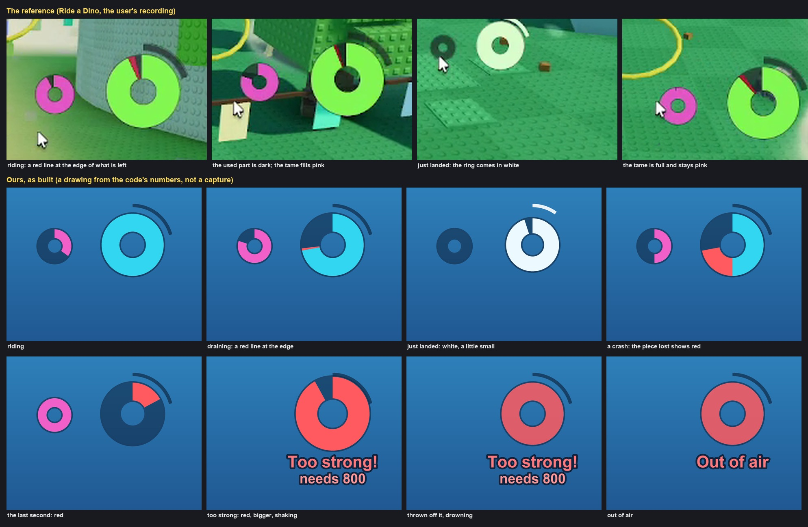

The top row is the reference. The other rows are ours, drawn from the code's numbers: a drawing, not a capture.

### What the reference's rings do (off the user's recording, frame by frame)
- The big ring is **thick with a small clear hole**: the band is a third of the ring across. It is 8.6% of the
  screen's height, the tame ring 4.6%.
- The part left runs clockwise from the top. **The used part is dark and see-through. The edge of what is left has a
  thin red line,** and a sudden loss shows as a red wedge for a moment.
- **A landing brings the ring in white and a little small;** it is green again a fifth of a second later.
- **A hop takes it away:** it goes pale, shrinks and is gone.
- **A thin arc outside the ring,** from the top to the upper right, grows for half a second after a landing and then
  sits dark. My reading: the hop coming ready again.
- **The tame ring** sits to the left, level with the big one. It is dark, fills pink, and stays pink when full.
- **The rings follow the rider** on the screen. They are not fixed to a spot.
- **The catch banner** comes up as the tame ring fills and stays nearly three seconds: tilted, a dark see-through
  plate with a bright green edge, the animal's picture at its left, big pale green words, small orange words above,
  the animal's name under. **A filled slot** has the animal's picture on its rarity's colour, a pale edge, and the
  name along the bottom.

### What changed
| Piece | Before | Now |
|---|---|---|
| The big ring | Thin, with the seconds in a dark hole, on a fixed spot | The reference's: thick, a clear hole, a thin dark edge, the used part dark, a red line at the edge of what is left, a red wedge after a crash. It follows the rider |
| A landing | The ring just filled | It comes in white and a little small |
| A hop | The ring vanished | It goes pale and shrinks away |
| The arc outside the ring | None | Pale while the hop comes ready after a landing (0.3 seconds), then dark |
| The ring's colours | Aqua, yellow under 60%, red in the last second | Aqua, red in the last second. The yellow step is gone: the reference has one colour, and with the new rule a fish is either fine or too strong |
| A full ring | A dark seam down the middle on some screens (seen on the tame ring) | No seam: a full ring is one piece, and the two halves lap over each other |
| The tame ring | At the big ring's lower left; green when full | Level with it, to the left; pink, and pink when full. Hidden on a fish too strong (it can't be tamed) |
| The catch banner | Small, no picture, up 1.8 seconds, at a fixed height | The reference's size and place (a fifth of the way down the left side), **the creature's picture in it**, up 2.6 seconds. The small words get louder with the rarity: NICE CATCH!, GREAT CATCH!, INCREDIBLE CATCH! |
| A filled slot | A flat colour with the name; the newest in a white frame | **The creature's picture** on its rarity's colour, a pale edge, the name along the bottom; every filled slot alike, as the reference's |
| GREAT DIVE! | The depth, and NEW BEST | Also "3 CAUGHT" when creatures came home |
| A tag's number | The fish's number at home | **What it needs in the land it swims in now,** the rule the server throws you off by. A fish that strayed into a deeper land needs more there, and the old number could sit on a red plate looking small enough |
| The locked fish's extra line in the hop | "holds 0.25 s" on a fish too strong | "TOO STRONG!" |

**The pictures need no upload:** a creature's picture is its own model drawn in a small window. The model comes
from the place's creature models when it is there, else from a fish of that kind swimming near by (the one just
tamed always is). A creature with no model to draw yet shows its name alone.

### A fish too strong for you
The rule (the user's, built by the game-code chat): a landing is never refused. The whole meter empties in a
quarter of a second, then the fish throws you off and you drown. The HUD tells it four ways:
1. **Before the hop:** the red plate on the fish's tag, and "TOO STRONG!" on the locked fish in the air.
2. **On the landing:** the ring is red from the first frame, a fifth bigger, and shakes, while red sweeps round it.
   Under it: **"Too strong!"** and **"needs 800"** (what that fish needs there). The hop button's ring goes red too.
3. **While you drown:** the ring stays up, red all round, with the same two lines (in place of "Out of air").
4. **The last words** are "TOO STRONG!" in place of "OUT OF AIR!".

The server's word that a fish is too strong takes a moment to arrive. For the first 0.3 seconds after a landing the
HUD judges it itself, by the same rule, so the red is there at once.

### What was taken while the user was away (to confirm)
| Point | Taken | Why | To undo |
|---|---|---|---|
| The seconds written in the big ring | **Off** | The reference's ring has no number, and its hole is too small to hold one. The ring's own red says "now" | `SECONDS_ON_RING` at the top of `Rings.luau`: the number is then drawn over the ring |
| The ridden fish's name and rarity under the ring | **Off** | The reference has neither. Words stay only for what the ring can't show: "Floating", "Out of air", "Too strong!" | `NAME_UNDER_RING`, the same file |
| The ring's colour | **Stays our aqua** | It is our Oxygen's colour everywhere else on the HUD. The reference's is green | `Kit.Aqua` in `Rings.luau`'s colour line |
| The banner's words | **Stay ours:** "TAMED!", "NICE CATCH!" | The reference's words are not copied | |
| The reference's "N SECURED" list at the left | **Not built** | Our catch comes home whatever happens, so there is no second, safer list to show. "3 CAUGHT" over the slots says it | |

**Not seen in the game yet:** all of piece 3. The first things to look at: the ring's place beside the rider (it
follows a point at the rider's shoulder, and sits a little over a quarter of the screen's height to the right), a
landing on a fish too strong, the picture in the banner and in a slot, and a full tame ring (the seam).

## Piece 4: a pass for cohesion (2026-11-12)
**Before and after, side by side, from captures of the game:** [the sheet](../attachments/ui4-before-after-hud.jpg)
(`python tools/ui/before_after.py` draws it again). It covers pieces 3 and 4. The "after" captures have a black
world, because Studio drew no 3D when they were taken; the HUD in them is the real one.

The user: "Do another pass to make the ui more cohesive, any highlights, overlays, box sizes, missing elements,
things too small, things too tacky, things too rounded, too thick, improperly placed etc".

**State: run once in Studio by the game-code chat, 2026-11-12: no errors.** Studio still drew no 3D, so the
pictures are the HUD on black: [riding, with a best](../attachments/ui-game-p4-riding-best.jpg) (the new arrow, the
thinner key cap, the Oxygen row bigger and level with the slots, "BEST 1331 m" inside the strip),
[the catch banner fully on the screen](../attachments/ui-game-p4-riding-tamed.jpg),
[a new land's name](../attachments/ui-game-p4-new-land.jpg) and [the hop](../attachments/ui-game-p4-hop.jpg).
Three things from those pictures, **written and not run yet**:
- **On a small tag the red plate covered the lower half of the name.** The tag's rows lapped over each other by 3,
  and that lap is not sized with the tag, so the smaller the tag the more it covered. The rows no longer lap, and
  the plate sits a little lower, clear of the name's tails.
- **The new land's name nearly touched the metres pill.** It sits 10 lower.
- **In the hop picture the big tag said a fish was locked while the button said nothing was** (a grey arrow, up).
  The tags looked at the lock four times a second, so a tag could stay big for a quarter of a second after its
  lock was gone. A change of lock is now looked at within a twelfth of a second. Grey-and-up is not a look for a
  fish too strong: with any fish locked the arrow turns over.

**A second run confirmed the first two** ([the new land's name clear of the pill, and a small tag's name
whole](../attachments/ui-game-p4-new-land.jpg)). The third showed the other side of the same fault:
[in the hop, the button said GRAB and no tag was big](../attachments/ui-game-p4-hop-locked.jpg). My reading, not
proved (the world was black in the picture): the locked fish was under the rider or behind the camera, so its tag
was off the screen. **The locked fish's tag is now kept on the screen:** over the fish when the fish is in view,
else held at the nearest edge, clear of the strip of lands and the slots. So whenever the button says GRAB, a big
tag says which fish and what it needs. **A third run showed the two agreeing** (the same picture, retaken:
the arrow turned over, and a big "Common / Boxfish / Needs 80 / holds 2.5 s" beside the aim). One picture, so it
shows them agreeing once; the case the fix was for, a locked fish out of view, has not been seen.

**Left as it is:** a slot's name is cut short with a dot ("Sergea."). The reference cuts its own the same way
("Pachyce."), and the whole name is on the catch banner.

The whole HUD was gone through piece by piece, against the captures from the game and the reference's frame. What
was off, and what was done:

| What was off | Where | Now |
|---|---|---|
| **Too thick:** every piece chose its own outline for its letters. Small words had the thickest for their size (the land names' outline was a quarter of the letters' height) and were clogged | Everywhere | **One rule for the whole HUD:** the outline follows the letters' size, about a tenth of big letters and a fifth of small ones, as the reference's. No piece sets its own |
| **Eight dark blues** for the see-through fills, and four greens | Bars, slots, pills, the button, the rings | **One dark fill** (`Kit.Deep`), one outline colour, one green for "good", one for "tamed" |
| **Too small:** the stat rows were 5.2% of the screen's height beside slots of 8.2%; the reference's are 6.4% beside 8.6% | The Oxygen row | A sixth bigger: the bar, the bubble and the number. A little smaller again on a phone |
| **Too small:** the land names on the tiles, the "BEST" words, "Needs" on a tag, "CAUGHT" | The strip, the tags, the slots | Each a step bigger, as far as it fits its box |
| **Tacky:** the hop button's arrow was four bars stepping in to a point. It read as a little tree | The hop button | A clean pointed head, a short stem and a small bar under them, as the reference's arrow |
| **Too thick:** the "Space" key cap's outline was half again the reference's | The hop button | Thinner |
| **Too rounded:** the red plate on a fish too strong was a full pill. The HUD's rule is that plates have small corners and only the reference's round things are round | The tags | A plate with a small corner |
| **No highlight:** solid plates were one flat colour | The key cap, the red plate | One shared highlight: lit from above, a little darker toward the bottom edge |
| **Sizes the wrong way round:** on a tag the name was bigger than the rarity. The reference's biggest line is the rarity | The tags | The rarity is the biggest line, the name a little smaller |
| **Improperly placed:** the stat rows and the slots sat at different heights off the bottom edge, and tight to it | The bottom of the screen | Level with each other, a little further up, as the reference's |
| **Improperly placed:** a best dive in the last land had its "BEST 9554 m" run off the strip's right end | The strip of lands | Kept inside the strip |
| **Overlay:** the edges that close in as you drown were purple-black, the only purple on the HUD | The drowning | The HUD's own dark blue |
| **Missing:** nothing marked crossing into a new land | The dive | **A new land's name** comes up for two seconds under the strip, in that land's colour, with "LAND 3 OF 10". It is drawn on the same dark streak as GREAT DIVE!, smaller. Not for the land a dive starts in |

**Looked at and left as it is:** the strip's tiles and badge, the rings (piece 3), the aim, the slots' frames, the
catch banner, GREAT DIVE!, the words of a miss, the speed lines.

**Still missing, and not built here** (each needs a decision or a system): a creature's picture on the strip's
tiles and patterns on the plates (uploads), the first-minute hints, the revive bar, the coins row (it shows when the
game has coins), the dock's buttons and panels.

**To look at in the game, one capture each:** riding on a desktop (the stat row's new size, the tags, the arrow),
the hop (the arrow turned over), crossing into the second land (the new banner), and a best in a far land.

## The files
| File | What it is |
|---|---|
| `src/client/Controllers/HudController.luau` | Makes the two screens, lays the pieces out for a phone or a keyboard, and feeds them each frame. Rewritten: the Oxygen bar, the rate, the speed, the depth gauge and the bracket are gone |
| `src/client/UI/Kit.luau` | The colours, the outlined letters, the ring that empties (and the arc it is made of), the bubble and the coin, the number forms. Since Hugo's pass 4 also the look itself: the themes, the plate (`dress`, `panel`), the stripes, the bubbles, the squared paper, the beat |
| `src/client/UI/LandStrip.luau` | The ten lands across the top, your marker and metres, your best |
| `src/client/UI/Rings.luau` | Beside the rider: the time left on this fish, the tame ring, the hop's arc, the landing's flash, the words for floating, out of air and too strong |
| `src/client/UI/HopButton.luau` | The jump button: the arrow turns over in the air; HOP and GRAB on a phone, "Space" on a keyboard |
| `src/client/UI/StatRows.luau` | Your Oxygen; coins when the game has them |
| `src/client/UI/Tags.luau` | Tags on the nearest wild fish: rarity, name, what each needs where it swims; a red plate on a fish too strong; far or crowded fish show only the number |
| `src/client/UI/Aim.luau` | In the hop: the aim, and the window as a ring |
| `src/client/UI/Slots.luau` | The seven slots for what you carry, each with its creature's picture |
| `src/client/UI/Banners.luau` | A miss, the end of a dive, a catch, a new land |
| `src/client/UI/Portrait.luau` | A creature's picture: the partner's render (`FishIcons`), else its own model drawn in a small window |
| `src/client/UI/FishIcons.luau` | Generated by `tools/ui/fish_icons/cut.py`: where each fish's render sits in the icon pages, and the pages' ids |
| `tools/ui/ring_sheet.py` | Draws the sheet above: the reference's rings over ours |

**Works with today's game:** the strip of lands, the metres and the best of this session; the big ring; the jump
button; the aim and the window; the tags; your Oxygen; the words of a miss; "GREAT DIVE!" with the depth and the
catch when you are back on the dock; and, since taming is in the game (2026-11-12), the tame ring, the catch banner
and the slots.

**Built and hidden until its system exists:** the coins row (the player's `Coins`).

**From the game code, in since 2026-11-12:** the player's `Drain`, `Actions.jump()` for the button, and for piece 3
`State.Tame`, `State.Caught`, `State.Tamed`, `State.Strained`, `State.tooStrong(fish)`, `Config.required`,
`Config.strained` and `Config.secondsOn`.

**Not built yet:** the revive bar, the new-land banner, the first-minute hints, the dock's buttons and shop panels.

### What was taken where the design was open
| Open point | Taken | Why |
|---|---|---|
| The pattern on the plates (studs, bubbles) | **None** | A pattern needs an uploaded picture, and no upload is allowed without the user's yes |
| The signs | **Made of frames:** the bubble and the coin are circles; the button's arrow is a letter-shape with a bar under it | The same: no uploads |
| Revives after a miss | **Not built** | The game has none, and whether it should is not decided |
| On a phone, Oxygen and coins | **Top left** | Clear of Roblox's stick |
| The locked fish's bigger tag | **Only in the hop** | The game-code chat checked the user's recording: the reference marks no animal while you still ride, only once you are in the air. The game follows it (`Lock.Preview` 0), so nothing is locked until the hop. One switch at the top of `Tags.luau` (`LOCKED_WHILE_RIDING`) would bring it back |
| The reference's eighth slot (the "Q") | **Left out** | Its job isn't known |
| The best depth | **The best of this session, kept by the HUD** | Nothing is saved yet |
| The seconds on a fish | **Your Oxygen divided by the server's own rate** (the player's `Drain`, added by the game-code chat 2026-11-12). The server sends the meter about ten times a second; between those the HUD counts down itself, so the ring turns smoothly | The game's number, not a second sum |
| A tag's colour and "holds 2.0 s" | **`State.secondsOn(fish)`,** the game's own sum for any fish (added the same day) | The same |
| Roblox's own jump button on a phone | **Hidden by the HUD while ours shows,** given back on the dock | The game-code chat's ask; it stays for the normal jump on the dock |
| The size on a big screen | **One design at phone size, scaled by the screen's height:** 1 up to 560 high, 1.9 at 1080, never more than 2.2 | Pass 3's rule |

### How it is made, for a phone
- **No pictures** (pass 3; since pass 4 two pictures that were already uploaded are laid over plates as patterns).
  Frames, corners, outlines and gradients otherwise.
- **The ring that empties** is two half rings. Each is an outlined circle inside a frame that clips it to its half;
  the outline's gradient is see-through past its middle, and turning that gradient sweeps the half open. Only two
  numbers change, in half-degree steps. A full ring is one whole outline, so it has no seam. The red part behind
  what is left is a second such arc under the first.
- **The rings follow the rider:** one point turned from the world to the screen each frame, and one place written.
- **A creature's picture** is made when a creature is caught, never per frame: a kind's model is copied and cleaned
  once and kept, and a window that is not changing costs nothing to draw.
- **Nothing is made per frame.** Ten tags are made once and moved from fish to fish. The herd is looked over four
  times a second. The tags are frames on the screen, put over their fish each frame (six points turned from the
  world to the screen). They were BillboardGuis first; those attached to the fish but drew nothing in Studio, for a
  reason not found, so they are drawn the way the rest of the HUD is.
- **A label's text is set only when it changes,** and the seconds at most fifteen times a second.
- **What moves all the time is throttled** (2026-11-12, from a review of the whole game's cost): the speed lines move
  thirty times a second, half as many on a phone, and the rings turn thirty times a second.
- **Text never changes size.** The HUD's one scale is set when the screen changes, not animated.
- **Two screens:** the speed lines, the closing edges and the black cover the whole display; the HUD keeps clear of a
  phone's notch.

## Pass 3: A's build, E's pattern, nearer the reference
The user, 2026-11-11: "A looks the best", some of the rounding simplified, the sizes more accurate, more like the dino
game; then: E's texture, but with A's style because it is more simplistic, and from there more like Ride a Dino.

**Read by Claude, to confirm:** "E's texture" is taken as the pattern E carries (small bubbles) on A's plain shapes.
The picture below shows that reading in the middle, with the two neighbours either side, so it is one look to say
which was meant.

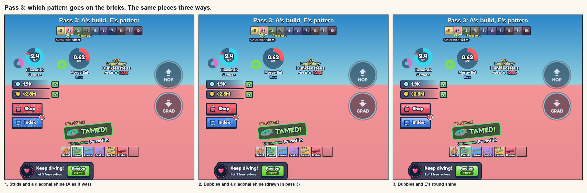

What changed from look A in pass 2, each one toward how the reference builds its own:

| Piece | Pass 2, look A | Pass 3 |
|---|---|---|
| Corners | Rounded a little everywhere | Nearly square: tiles and slots 2 to 3, plates 4. Only what is round in the reference stays round (the jump button, the rings, the pills, the revive bar) |
| The rings | Outlined, with a lip and studs | Flat, thick, a little see-through, no outline, as the reference's. The tame ring is pink, as its is, and turns green when full. Ours: the seconds stay in the big ring |
| The jump button | A yellow brick disc | The reference's: a dark see-through circle, a thin pale ring, a pale arrow that turns over in the air, the key's name on a white cap on a keyboard. Ours: the word HOP or GRAB under the arrow on a phone; the ring goes red in the last second |
| The strip of lands | Stepped down land by land | Straight, as the reference's. "BEST" carries its metres |
| The catch banner and the revive bar | Solid plates | See-through dark plates with a bright edge, as the reference's |
| The slots | Rounded, studded | Square with a thin dark edge, nearly clear when empty |
| The nearest fish's tag | One size | A quarter bigger, at the reference's share of the screen |
| The pattern | Round studs | E's bubbles (see above) |
| Sizes on a desktop | By eye | Measured off the reference's frame and matched as a share of the screen: strip tiles 5%, rings 9% and 4.5%, stat rows 6%, slots 8.5%, the jump button 15% |

**Second round (the user, 2026-11-12):** thinner frames on the strip of lands and on the slots; the slots' fill more
see-through and fading; the strip's tiles closer together and one to one with the reference; the Space key cap a
little higher.

| Piece | Before | Now, as the reference builds it |
|---|---|---|
| The strip's tiles | A thick navy frame, a gap of 3 between tiles | A hairline dark edge and a thin border in the land's own colour, lighter on the land you are in. The tiles nearly touch (a gap of 1). On a desktop the whole strip is 28% of the screen's width, as the reference's |
| Your marker | A white-ringed badge and a wide plate with the land's name | A small round badge on the tiles' lower edge with a green ring, and a small dark pill with the metres only. (On a phone the pill keeps the land's name, because the tiles there carry numbers) |
| Your best | A thick line and "BEST" under the strip | A thin yellow line with a small diamond at the tiles' lower edge, and "BEST 310 m" across the tile |
| The slots | A thick navy frame, a flat dark fill | A hairline dark frame. Empty: almost clear, darkening a little toward the bottom. Filled: the rarity's colour, lighter at the top. The newest has a white frame |
| The Space key cap | Just touching the button | Further up, over the button's lower edge |

The close-up beside the reference (private): [strip, slots and button](../../research/ride-a-dino/ui/compare3-close.jpg).

Beside the reference at the same size (private pictures, on this PC only):
[riding](../../research/ride-a-dino/ui/compare3-riding.jpg), [a tame](../../research/ride-a-dino/ui/compare3-tamed.jpg),
[a miss](../../research/ride-a-dino/ui/compare3-miss.jpg), [the end](../../research/ride-a-dino/ui/compare3-end.jpg),
[a shop panel](../../research/ride-a-dino/ui/compare3-panel.jpg).

On a desktop:

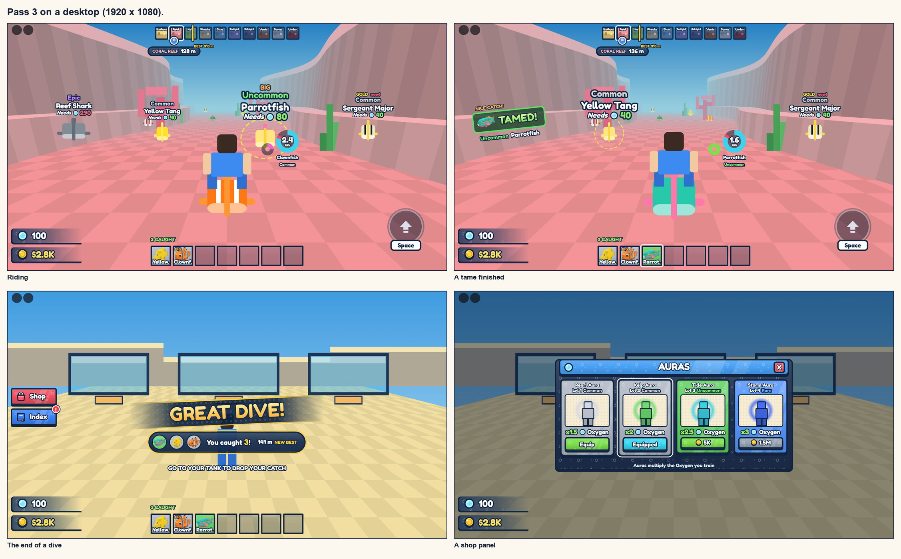

Where it still differs from the reference, and why:
- **The seconds in the ring, and the fish's name under it.** A new player has 2.5 seconds; a ring alone is too slow
  to read.
- **The big ring is thinner than the reference's,** to leave room for that number.
- **No first slot set apart.** The reference has an eighth slot at the left with a "Q" on it. Its job isn't clear from
  the recording, so it is left out until we know what ours would hold.
- **The land tiles are plain colour with a block or two,** where the reference has a painted picture of each zone.
  Ten small pictures could be drawn by code later.
- **The signs are simple shapes,** where the reference has small 3D pictures.
- **On a phone** the stats sit at the top left, clear of Roblox's stick, and the land tiles carry numbers.

## Pass 2: much closer to the reference (five looks; A was picked)
The user, 2026-11-11: get much closer to Ride a Dino, to the overlays, gradients and textures on its overlays and
everything else; keep the riding loop's screen as accurate as possible; slight improvements and slight artistic
differences where they work for our game; draw Brick, Bubble, a mix, and bubble over brick.

### What the reference's HUD is made of
Read from the user's 5-minute recording, each piece cut out and enlarged (the crops are private, in
`research/ride-a-dino/ui/`; `grab.py` and `study.py` there make more).

| Piece | How it is built |
|---|---|
| The zone strip, top middle | Ten small square tiles, each a painted picture of its zone in a border of the zone's colour, the name across the top. The tile you are in has a lighter border. Your avatar's head hangs under the strip in a round badge, with the metres in a dark pill under it. Your best is a yellow line with "BEST 7,590 m" |
| The two rings | Flat, thick, a little see-through, beside the rider at shoulder height. The big one is green, with the used part as a red wedge. The small one is pink (the tame). No outline, no number |
| The jump button | A dark see-through circle with a thin lighter ring, a pale arrow that turns over in the air, and under it a white key cap that says "Space". It is there on a PC too |
| A wild animal's tag | No plate. Stacked words with a thick dark outline and a small shadow: a line of kind words (SILVER, BIG, a red "new!"), the rarity in its colour with a top-to-bottom gradient, the name in white, "Required:" in italics with a bolt and a green number |
| The stat rows, bottom left | Dark bars that fade out to the right, with a darker edge down the left and along the bottom. A small 3D picture, then the number: a timed boost, your stamina, your cash. Green plus buttons beside them at the hub |
| The carry slots, bottom middle | Seven squares with a thin dark edge. A filled one is a tile in the rarity's colour with the animal's bust, its name cut short at the bottom, its size at the top. The chosen one has a white edge |
| The catch banner | At the left, tilted: a dark green see-through plate with a bright green edge, the animal's picture, "IT'S YOURS!". A smaller shout above it ("INCREDIBLE CATCH!"), the animal's tag under it |
| The revive bar, top middle | A dark rounded bar. A heart in a round badge at its left end, two lines of words, a green button with a second word in a dark pill ("FREE") |
| The end of a run | "GREAT RUN!" in a gold gradient on a dark streak that fades out at both ends, a little tilted. Under it a dark pill with a gold edge: the catch as round portraits, "You caught 6 dinos!" with the 6 in gold |
| The hub's buttons | Bright rectangles (red Shop, blue Index) with a dark edge, a painted picture at the left, a red "!" badge. On the colour: a faint pattern of blocks, and a paler diagonal band like a shine |
| A shop panel | A bright header bar with the title, a picture at its left and a red X at its right. A dark body. Cards in the rarity's colour, each with a cream window for the picture, a line of small words, the gain in big words, a green button with the price (grey when you can't pay) |
| On everything | **A faint pattern of small bricks,** a little lighter than the colour under it. Top-to-bottom gradients. A dark outline. Thick outlined letters. This is the "texture" |

### What pass 1 got wrong, measured against it
- **Plates everywhere.** Pass 1 put every word on a solid plate. The reference puts words straight on the world with
  an outline, and keeps plates for buttons and panels. Plates hid more of the view and looked heavier.
- **Flat colour.** No gradient, no pattern, no shine. That is why it read as a sketch beside the reference.
- **The wrong places.** The depth ladder down the left, a "caught" chip at the top right and a card at the end were
  my own. The reference's places are learned by every player of the genre: strip on top, slots at the bottom,
  stats at the lower left, banner at the left.
- **No pictures of creatures.** The reference shows the animal in the slot, the banner and the end. Pass 1 had a
  generic fish sign.
- **Nothing for the dock or a shop.** Pass 2 draws both.

### The same as the reference, and ours
| The same job in the same place | Ours |
|---|---|
| The strip of ten lands, your marker, the metres, your best | **It steps down, land by land:** depth is our progress. Tiles are in the map's own colour for each land. On a phone the tiles carry numbers and the land's name sits with the metres |
| Two rings beside the rider | **The seconds are written in the big ring** (a new player has 2.5). The fish's name and rarity sit under it. The tame ring fills in the fish's rarity colour |
| The jump button at the lower right; the arrow turns over in the air | **On a phone it says HOP, then GRAB,** and it is yellow, then aqua, then grey when there is nothing to grab. A red ring in the last second |
| A stacked tag on every wild fish | **The "needs" number has three colours:** green you can hold it, yellow it will be short, red too strong. The locked fish also says how long it holds ("holds 2.0 s") |
| Stat rows: Oxygen and coins | **A bubble is the sign for Oxygen.** On a phone the rows move to the top left, because Roblox's stick sits at the lower left |
| Seven slots for what you carry | One word above them, "3 CAUGHT", in place of the reference's second list |
| A tilted catch banner at the left, with the animal's picture | It says TAMED! |
| A revive bar at the top after a miss | **Not decided for our game.** Drawn so the place is known |
| The end: a gold title on a fading streak, the catch in a pill | The metres and NEW BEST sit in the pill |
| Shop and Index at the left, a prompt in the middle | |
| A panel with a bright header, cards by rarity, green price buttons | Coins only. No Robux buttons are drawn: that is not decided |

Left out on purpose: the reference's night timer and its paw button (we have no day and night, and no such menu).

### The five looks
All five use the same pieces in the same places. They differ in the surface.

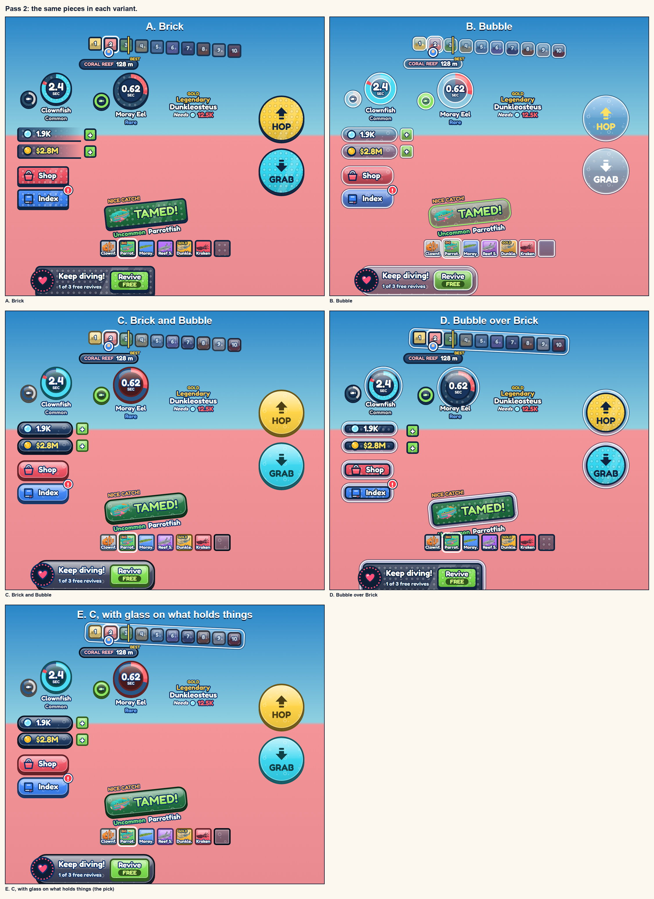

| Look | What it is | For | Against |
|---|---|---|---|
| **A. Brick** | The reference's own build in our colours: square corners, a navy outline, a lip, round studs as the pattern, a diagonal shine, stat bars that fade out | The closest to the reference. The cheapest to draw. Reads over any water | The plainest. Hard edges and navy everywhere look a little heavy on a small phone |
| **B. Bubble** | Glass: see-through blue, a white rim, a dome of shine on top, small bubbles as the pattern | The most "under water". Hides the least | The weakest to read. Over the pink reef and the pale sand the glass goes grey, and rarity colours dull inside it |
| **C. Brick and Bubble** | Brick's solid colour and lip, Bubble's round corners and dome of shine. Each plate is outlined in a darker shade of its own colour, not navy. Bubbles as the pattern | Reads as well as Brick and looks more finished: the "polished mobile game" look | The least unusual of the five |
| **D. Bubble over Brick** | Every big piece is a brick held inside a glass capsule: the stat rows, the rings, the buttons, the strip, the slots, the panels | The most our own. It says "aquarium": things kept behind glass | The busiest. Two edges on everything eat room on a phone, and it is about twice the pieces to draw |
| **E. The pick** | C for everything, with D's glass only round the things that hold other things: the strip of lands, the row of slots, a shop panel | C's clear reading, and D's idea where it means something: a tray of lands, a tray of catch, a tank of cards | One more rule to keep |

**The user picked A, with E's pattern** (pass 3, above). What was recommended before that: E. The glass then has a job (it marks a container), and nothing a thumb presses is harder to read.
If one of the four is wanted as it is, C.

The riding screen in each, on a phone and on a desktop:

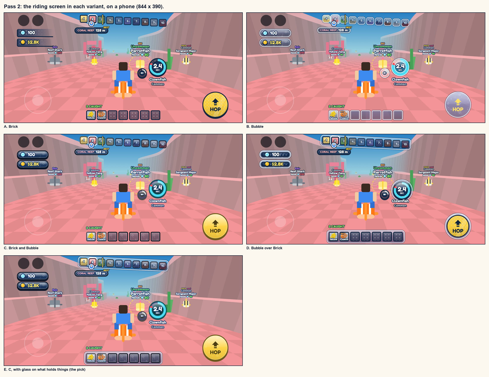

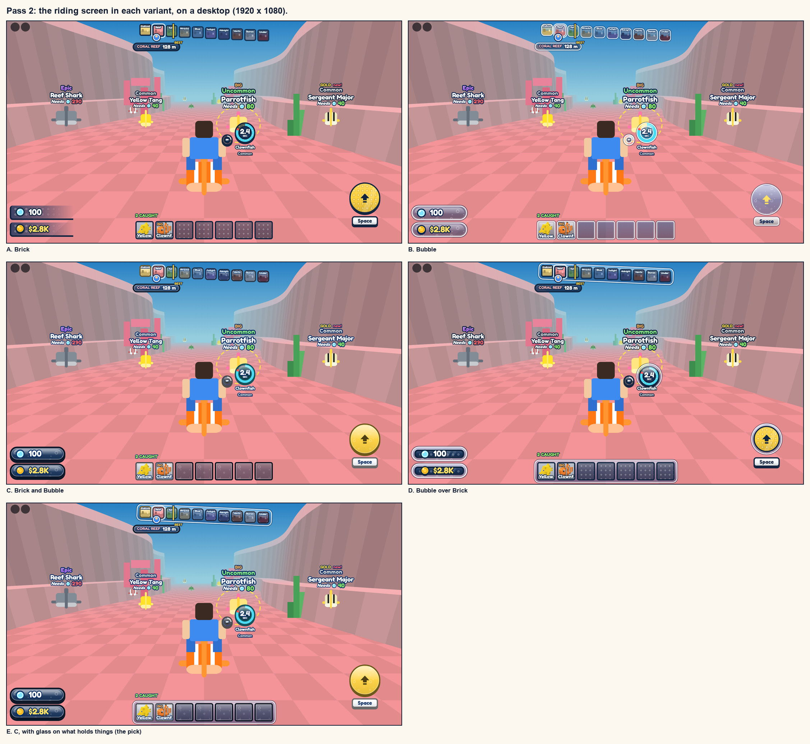

All eight states in each look:
[A Brick](../attachments/ui2-phone-brick.jpg), [B Bubble](../attachments/ui2-phone-bubble.jpg),
[C Brick and Bubble](../attachments/ui2-phone-mix.jpg), [D Bubble over Brick](../attachments/ui2-phone-over.jpg),
[E the pick](../attachments/ui2-phone-pick.jpg).

Beside the reference, at the same size (private pictures, on this PC only):
[riding](../../research/ride-a-dino/ui/compare-riding.jpg), [a tame](../../research/ride-a-dino/ui/compare-tamed.jpg),
[a miss](../../research/ride-a-dino/ui/compare-miss.jpg), [the end](../../research/ride-a-dino/ui/compare-end.jpg),
[a shop panel](../../research/ride-a-dino/ui/compare-panel.jpg).

### What it takes to build
Most of it is Roblox's own UI: frames, round corners, outlines, gradients, see-through colours.
- **No picture needed:** every plate, lip, outline and gradient; the dome of shine; the rings; outlined letters with
  a gradient in them; the bubble and the coin (they are circles).
- **Creature pictures need no upload:** Roblox can draw the creature's own model in a small window in the UI. That
  is what fills a slot, the banner and the end.
- **Eight small pictures would need uploading** to get the full look: two patterns (the studs, the bubbles) and six
  signs (the arrow, the heart, the bag, the book, the small fish, the flag). I draw them by code, so they cost no
  credits. Uploads are permanent, so this waits for the user's yes (question 2). Without them: no pattern, and plainer
  signs made of frames.
- **The diagonal shine** (look A only) needs a clipped group for each plate, which costs a phone some memory. The dome
  of shine in the other looks is free.
- **The cheapest to the dearest for a phone:** A, C, E, B, D.

### What the pictures take for granted
None of this is decided. It is drawn so the pictures are whole.
- **Revives** (the bar after a miss).
- **Coins, written with a $,** as the money.
- **A row of seven slots.** Whether you can carry only seven is the game's rule, not the HUD's.
- **Kind words on a tag** (BIG, GOLD, "new!"). Sizes and the gold look exist in the creature notes; "new!" needs the
  Index.
- **The auras' names and prices** are made up for the picture.

## 1. What is on screen today
All of it is `src/client/Controllers/HudController.luau`. The picture is drawn from the sizes in that file, with
Roblox's own stick and jump button added. The numbers match the table.

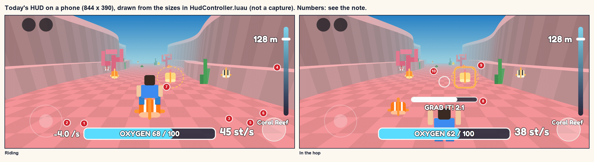

| # | What | What is wrong with it, for a new player on a phone | Does it still mean anything at 2 to 3 seconds a fish? |
|---|---|---|---|
| 1 | The Oxygen bar, bottom middle, "OXYGEN 68 / 100" | It is at the bottom edge, far from the fish, where nobody looks while steering. The words are about 20 high | No. A bank of 68 says nothing. The player has to divide it by number 2 in their head to learn they have 17 seconds, or 2 |
| 2 | "-4.0 /s", left of the bar | A rate. It sits where the left thumb rests on the stick | No. It is half of a sum |
| 3 | "45 st/s", right of the bar | A number for us, not for a player. It runs under Roblox's jump button | No. Speed is felt, and the speed lines already show it |
| 4 | The depth gauge, a thin bar down the right edge, 260 tall | It takes two thirds of the screen's height, under the thumb that drags to look. Nothing marks your best | Yes, the idea is right: depth is the progress bar |
| 5 | The land's name under the gauge, and "needs 96 OXYGEN" when you are short | 18 high, and it lands on the jump button. "Needs" is for a Common, and no Common swims past the Coral Reef, so from the third land on it says too little | The name, yes. The number: the tuning chat proposes the land's commonest fish |
| 6 | The hop is Roblox's own jump button | It has no word on it. Nothing tells a new player that this button is the whole game. It never changes between "hop" and "grab" | It matters more than before: it is pressed every 2 to 3 seconds |
| 7 | Nothing says what you are riding, or what any fish is | No name, no rarity, no tag over wild fish (fish carry their rarity and "Required" as hidden values; nothing draws them) | Rarity is the chase. Today it cannot be seen at all |
| 8 | In the hop: a bar under the middle, "GRAB IT! 2.1" | It sits on top of your own character. The tenths flicker. The pull-in starts by itself now, so "GRAB IT!" asks for a press that isn't needed | The window still matters, as a shape, not as a number to read |
| 9 | In the hop: a square bracket on the locked fish | A third mark on one fish (the world already has the glow and the dashed ring). It says which fish, never what it is or whether you can hold it | The lock matters. What is missing is the fish's name, rarity and how long you would last |
| 10 | In the hop: a small ring in the middle (the aim) | Fine. Small on a big screen | Yes |
| | A miss or out of air: the screen goes black, "MISSED THE FISH!" or "OUT OF AIR!" | Readable. It doesn't say what happens next (back to the dock, with your catch) | Yes |
| | Speed lines, the edges closing in | Fine | Yes |
| | On the dock | Only "0 m, THE DOCK". Nothing says where to go or what to do | |

Three things under the hood, to put right when the HUD is built:
- **Sizes are fixed in pixels.** The same 30-high bar is a fair size on a phone and tiny on a big monitor.
- **Every word is redrawn every frame,** and every label sizes its own text to fit its box. Both cost on a phone.
- **Two places animate text size** (the timer's pulse and the pop of the drowning words). That is against the
  project's rule for phones.

## 2. What the reference shows, and when
How each piece is built is in pass 2, above ("What the reference's HUD is made of"). This is the order of events.

From [the Ride a Dino breakdown](../reference/ride-a-dino.md) and its frames. We copy what its screen tells the player
and when. We never copy how it looks.

| When | What its screen tells the player |
|---|---|
| Riding | **A green ring beside the rider: the time left on this dino.** A smaller pink ring: the tame. A circle on the dino you would jump to. A big round button with an up arrow and the word "Space". A strip of the ten zones across the top with your place, the metres and your best. Bottom left: your stamina (one number, it never moves in a run) and your cash. Bottom middle: seven slots for what you carry |
| Every wild dino | A tag: mutation, size, the rarity in its colour, the name, "Required" and a number |
| In the jump | The button's arrow turns to point down. A dashed ring travels under you. The dino you will come down on glows |
| Landing | A flash and a ring at the saddle. Nothing to read |
| A tame finishes | "IT'S YOURS!" on a banner with the dino's tag, and the dino joins an "N SECURED" list with a small picture each |
| A miss | "Keep riding! Revive FREE (1 of 3 free revives)" with one green button. Then "GREAT RUN! You caught 6 dinos" |
| Back at the hub | "GO TO YOUR PEN TO DEPOSIT" in the middle. Shop and Index buttons on the left, the Index with a red mark when something is new. Plus buttons beside stamina and cash |
| At the pen | Each dino's tag shows what it earns a second. "+$240" floats up. "You earn $4M/Day offline!" across the top. Keys to press shown beside the thing they act on |

What to take from it:
- **The clock for this animal is next to the rider,** not at an edge of the screen.
- **The jump button is big and says what it does.** It changes when what it does changes.
- **Every animal says what it is and what it needs** before you jump to it.
- **Good news is loud and short** ("IT'S YOURS!"). Bad news comes with what happens next.
- **The permanent numbers are small and out of the way** (stamina, cash).

## 3. The screens the game will need
Written for pass 1. Where pass 2 differs, pass 2 holds: the depth ladder is the strip of lands across the top, the
fish plate and the lock plate are outlined words with no plate, the caught chip is the row of slots, and the end of a
dive is the banner, not a card.

"Waits for" is the system that has to exist first. "Now" means today's code is enough.

### In the dive
| Piece | What it is for | What it shows | Waits for |
|---|---|---|---|
| **The ride ring** | The one thing to watch: how long you have on this fish | A ring beside the rider that empties, the seconds in it. Aqua, then yellow, then red and bigger for the last second. A landing on another fish fills it again. A crash knocks a piece off it, with a red flash. In the hop it is hidden: nothing drains there, and the landing fills it | Now: the seconds are your Oxygen divided by what this fish takes a second here |
| **The fish plate** | What you are riding | The name on a plate in the rarity's colour, with the rarity in small letters, under the ring | Now |
| **The tame ring** | How close this fish is to being yours | A small ring on the ride ring's corner, filling in the fish's rarity colour, a small fish in it. Full: it flashes and the banner comes | Taming |
| **The hop button** (touch) or **the key hint** (keyboard, gamepad) | The press that is the whole game | A round yellow button, 92 across, bottom right: an up arrow and HOP. In the hop it turns aqua: a down arrow and GRAB. With no fish locked it is grey. In the last second it grows a red ring. On a keyboard the same words sit beside a SPACE key at the bottom middle | Now for the hint. The button needs a hook from the game-code chat (see Asks) |
| **The lock plate** | Which fish is next, and whether to take it | Over the locked fish: its name plate, and one line under it. Riding: "NEXT 2.1 s". In the hop: "HOLD 2.1 s". The line's colour goes by the seconds you would get: white for 2 or more, yellow for 0.5 to 2, red under 0.5 ("TOO STRONG 0.2 s") | Now: the seconds are your max Oxygen divided by what that fish takes a second. The three colours are the tuning chat's proposal |
| **Name tags on wild fish** | Seeing rarity before you jump, so there is something to chase | Over the nearest few fish: the name on its rarity plate, and the Oxygen it needs with the bubble sign (the max Oxygen that gives 2 seconds on it). White, yellow or red by the same three steps as the lock plate | The values are on every fish now. Today the number is for the fish's home land; the tuning chat proposes the land it is in |
| **The aim and the window** | In the hop: where you are aiming and how long is left | A small ring in the middle of the screen that empties over the 3 seconds. Red and bigger for the last 0.8. With no fish locked near the end: "FIND A FISH!" under it. No tenths to read | Now |
| **The depth ladder** | Depth is the progress bar | Ten bricks down the left edge, one a land, in the map's own colour for each land. A marker for you, a yellow tick for your best. Beside the marker: the land's name on a plate in its colour, and the metres | Now. The best needs saves (until then: the best of this session) |
| **A new land** | The border is felt | The land's name drops in at the top for two seconds, in its colour. If your Oxygen is short for it: "needs 336, you have 100" under the name, once | Now. Today the number is for a Common; the tuning chat proposes the land's commonest fish |
| **The caught chip** | What you carry home | Top right: a small fish, the count, and one small square a creature in its rarity colour. It jumps when a tame finishes | Taming |
| **The TAMED! banner** | The reward, loud and short | At the top middle for about a second and a half: TAMED! and the fish's name plate | Taming |
| **Warnings** | Trouble, before it is too late | The last second on a fish: the ring red, the button ringed red, the screen's edges tinted. A crash: the ring flashes red. A rarer fish you can't hold: the red tag and the red lock line. Never a warning that needs reading mid-hop | Now |
| **A miss, or out of air** | What happened and what comes next | The edges close in. A red plate: "MISSED THE FISH!" or "OUT OF AIR!", and under it "back to the dock with what you caught" | Now |
| **The end of a dive** | The pay-off, and a reason to go again | A card: GREAT DIVE!, the metres and the land, NEW BEST when it is, "you caught 3" with a tile each in its rarity colour, one green button: TO THE DOCK | Taming. A revive offer, if there is one, waits for the money decisions |
| **Server news** | "A Secret Leviathan appeared in Midnight" | One line at the top that slides away | Secrets as server events |

### On the dock
No pictures yet: these are drawn when their systems are decided, so the pictures don't decide the design.

| Screen | What it is for | What it shows | Waits for |
|---|---|---|---|
| **The dock's HUD** | Where am I, what do I have, where do I go | Top right: Oxygen (the bubble and your max) and coins with what you earn a second. Left edge: two or three square buttons (Shop, Index, Settings), 48 across. A word in the middle when there is one thing to do ("DIVE IN", "PUT YOUR CATCH IN YOUR TANK") with an arrow that points the way | Income for the coins. The rest now |
| **The training machine** | Turning time into Oxygen | While you are on it: your max Oxygen ticking up, the gain a second, and one button: the next machine level and its price | Training (the tuning chat's question 6) |
| **The shop and auras** | Spending income | A list of cards, one an aura or upgrade: a name, what it does in one number ("x2 Oxygen"), the price on a green button, grey when you can't pay | Income and prices |
| **The base (your tank)** | Showing off, and choosing who earns | Over each creature: its name plate and what it earns a second. A panel for the tank: the creatures inside, the ones stored, "equip best", the tank's next level | The base and income |
| **Picking your starting fish** | "Start on your own creature" | The same panel with one "RIDE" button on each creature | The base |
| **The Index** | Every creature, and which you have found | A grid of tiles by land: a picture or a dark shape, the rarity colour as the tile's edge, a count of how many found. A red dot on the button when one is new | The roster in the game, and saves |
| **Settings** | The few switches a phone needs | Sound, music, camera turn speed, low detail | Whatever settings exist |

### The first minute
A new player has to learn one thing: **when the ring runs low, hop to the next fish.** Three small helps, no tutorial
screen:
1. On the dock: one line, "DIVE IN", and an arrow at the water.
2. On the first fish: when the ring turns red, a white plate points at the button (or the SPACE key): "TAP TO HOP TO
   THE NEXT FISH". It goes away after the first landed hop.
3. On the first miss: the red plate adds one line, "hop before the ring runs out".

After three landed hops none of it shows again. Until saves exist it comes back each time the player joins.

### Where things go on a phone
Roblox's stick takes the lower left and the right thumb drags to look, so nothing of ours that is pressed goes in
either place, except the hop button at the lower right. Everything else lets touches through.

## 4. The style (pass 1, replaced by pass 2)
Kept for the record. The rules at the end still hold.

Three directions. Each is made only from what Roblox's own UI has: frames with round corners, outlines, gradients,
circles, turning, and Roblox's built-in fonts. No picture is uploaded for any of them. The pieces are the same in each.

| | A. Brick (recommended) | B. Bubble | C. Sticker |
|---|---|---|---|
| The idea | Pressed plastic. The HUD is made of the same stuff as the map and the fish | Glass and air. The HUD floats on the water | Loud paper stickers, a little crooked |
| Shapes | Solid plates, corners rounded a little, a dark navy outline, a lip under each (a second plate 4 lower). Two studs on top of the big plates only | See-through dark pills and circles, a thin white edge, a small shine on buttons | White plates, a thick black outline, a hard black shadow, tilted 3 degrees |
| Letters | Fredoka One: round and chunky, white with a navy outline | Builder Sans, extra bold: clean and modern | Luckiest Guy, all capitals |
| Rarity colour | Fills the whole name plate | A dot and an edge in the colour; the plate stays dark | Fills the whole name plate |
| Good at | Reads over any water, from the bright Shallows to the black Underworld. Big, clear things to press. Looks like our world | Calm. Hides less of the view | Shouts. The genre's usual look |
| Weak at | Solid plates hide a little more of the view | Rarity is a small dot, so the chase reads weaker. Pale text over pale water needs care. Plain: it could be any game | The closest to the reference's look, which we said we would not copy. Tilted letters blur a little in Roblox |

**Recommended: A, Brick.** The map is studs on squares and the fish are blocks, so a HUD of chunky plates belongs to
the same toy box. Solid colour with a dark outline is the one treatment that stays readable over every land's water.
It is also the cheapest for a phone to draw.

Rules that hold in any of the three:
- **One colour, one meaning.** Aqua is Oxygen and time. Yellow is "press this". Red is danger. Green is good news and
  buying. A rarity's colour appears only on a creature's own plate, ring or tile, never on a button or a warning. Each
  land's colour (the map's) appears only on the depth ladder and the land's name.
- **Rarity colours are the game's own** (`Config.Tiers`): grey, green, blue, purple, gold, red, black. Two sit close
  to HUD colours: the Mythic's red to the danger red, and the Legendary's gold to the button's yellow. They never share
  a shape (a rarity is always a plate with a name on it), so it should hold. If it confuses in play, danger moves to
  orange.
- **A sign for Oxygen: a bubble.** A circle with a small shine, made of two circles. It goes before every Oxygen
  number: on tags, on the dock, in the shop.
- **Numbers.** Seconds: two decimals under a second (0.62), one from 1 to 10 (2.4), whole seconds above, and past
  a minute just a full ring. Oxygen: a short form for big numbers (12.5K, 2.25M), since the tenth land's fish need
  millions.
- **Sizes on a phone** (in the phone's own points): the hop button 92 across; any other button at least 48, with 8
  between; the ride ring 70; the seconds 24 high; names 12 to 14; nothing smaller than 11, and that only on far tags.
- **One design, scaled.** The HUD is drawn once at phone size. Bigger screens scale it up by the screen's height,
  less than in proportion (1 on a phone, about 1.3 on a tablet, about 1.9 at 1080p), so a desktop gets a smaller HUD
  against its screen than a phone does. The scale is set when the screen changes size, never animated.
- **Movement** is plates sliding, flashing and rings turning. Text never changes size (the project's rule). Numbers
  change at most ten times a second.
- **A ring that empties** is two half circles whose outline is cut off by a gradient that turns. It is the first
  thing to prove in Roblox when building starts. If it doesn't hold up on a phone, the ring becomes twelve small studs
  in a circle that go out one by one.

The alternative, drawn as the same HUD:

On a desktop, both:

## 5. Build order
Piece 2 starts on the user's pick of a look. The HUD's parts go in `src/client/UI/`; `HudController` keeps only the
wiring.

**Now, against today's code:**
1. **The kit:** the colours, the plate, the ring, the chip and the scale rule, as one small module every screen uses.
   Proving the ring on a phone is the first job.
2. **The two rings and the fish's name,** with the last-second warning. The old bar, the rate and the speed come out
   (the speed stays on the Studio tuning panel's side, for us).
3. **The key hint,** and the hop button on touch once the hook is there.
4. **The hop:** the aim with the window as a ring, "holds 2.0 s" on the locked fish, "FIND A FISH!". The bracket comes out.
5. **The strip of lands,** the land's name and metres, the new-land banner.
6. **The miss and out-of-air plate.**
7. **Tags on the nearest wild fish,** and the stat rows.
8. **The first minute's three helps.**

**Waits:**
| Piece | Waits for |
|---|---|
| The tame ring filling, TAMED!, the slots filling, the end-of-dive banner | Taming |
| The patterns and the six signs | The user's yes to eight small uploads |
| The revive bar | Whether we have revives |
| The red "too strong" mark as a rule of the game, a tag that counts the land the fish is in | The tuning chat's proposals, and the user's answer to its question 6 |
| Coins on the dock, the shop, auras | Income and prices |
| The training machine's screen | The training spot |
| The base's panel, picking your fish | The base |
| The Index | The roster in the game, saves |
| Your best on the ladder, the first-minute helps shown only once ever | Saves |
| A revive offer | The money decisions |

## Open points
**Answered by the tuning chat** (2026-11-11; the same is in [progression](progression.md), "What the HUD should
show"). The mock-ups follow these.
- **In the game today:** one Oxygen bank on the server. Riding drains it by the land you are in and the fish's
  rarity, so the seconds left are the bank divided by that. Nothing drains in the hop. A landing on another fish fills
  the bank whole. A crash takes a tenth of max, a small prop 3%. Floating off a fish drains a flat 4 a second.
- **"Needs" on a tag** is the max Oxygen that gives 2 seconds on that fish. It is a hint, not a gate: nothing stops a
  landing.
- **A fish you can't hold:** you land, get a full ring, and it empties in a blink. At nothing the fish throws you off
  and you drown. Under about 0.3 seconds you are thrown before you can hop again.
- **How long a ride lasts:** a new player has 2.5 seconds on a Shallows Common, 2.0 on an Uncommon, 1.0 on a Rare,
  0.56 on an Epic, 0.17 on a Legendary. A trained player has 10 to 20 seconds on the land before theirs, and minutes
  two lands back.
- **Still proposals, not built:** the red mark on a fish you can't hold; the tag counting the land the fish is in; the
  land's "needs" line counting its commonest fish; the short number form. Whether the game should refuse a landing on
  a fish you can't hold is with the user (the tuning chat's question 6).

**Answered by the game-code chat** (2026-11-11, after checking pass 1: today's HUD is read right):
- **The ring's number** (what the fish under you takes a second, as the server counts it), **the locked fish's
  seconds** and **the hook for the hop button** (with Roblox's own jump button hidden): it adds these to `State` and
  `Actions` when piece 2 starts.
- **Tags on fish:** the UI chat builds them (a few, reused, on the nearest fish, on the player's own screen).
- **The bracket on the locked fish** may come out of the HUD. The glow and the dashed ring in the world stay.
- **Still to ask when piece 2 starts** (new with pass 2): a creature's model drawn in a small window in the UI, the
  list of what the player carries this dive, and the best depth.

**Measured in play by the game-code chat, 2026-11-11:** a new player has 2.3 to 2.6 seconds on a Shallows Common and
2.0 on an Uncommon; a hop takes 2.4 seconds; the meter is full again on every landing. So the ring is near full or
near empty most of the time. What follows for the ring:
- **It is a countdown, not a gauge.** The number carries it; the arc is the glance. The last second has to be
  unmistakable (red, bigger, the button ringed), because for a new player it is nearly half the ride.
- **A landing should be felt on the ring:** it snaps back to full with a flash, so "full again" is seen, not read.
- **For a trained player** on an easy fish (minutes), the ring just stays full and quiet: no number past a minute.

## Questions for the user
1. **The pattern:** is the middle picture of the three right (A's build with bubbles), or did you mean the first or
   the third?
2. **Seven small pictures:** may I draw them by code and upload them (the bubble pattern and six signs: arrow, heart,
   bag, book, small fish, flag)? Uploads are permanent. Without them the HUD has no pattern and plainer signs.
3. **Revives:** does our game have them (the reference: three free, then sold)? The screen after a miss depends on it.
4. **On a phone, your Oxygen and coins:** at the top left (drawn, clear of the stick), or at the lower left as the
   reference has them?
5. **The ring (piece 3):** the seconds and the fish's name are off it now, to match the reference's ring. Keep them
   off, or bring one back? And the ring stays our aqua where the reference's is green: right?
