# UI: what the player sees on screen

The plan for the dive's HUD and the dock's screens. Written 2026-11-11 by the UI chat ([Sessions](../Sessions.md)).
**Pass 3, the same day, is the current proposal:** the user picked look A for its simple build, with E's pattern, and
asked for it to go nearer still to Ride a Dino's HUD. Pass 2 (five looks) and pass 1 are kept below.

**Everything here is proposed. Nothing is built and no game code was changed.** The pictures are mock-ups drawn by code
(`python tools/ui/render_mockups.py` draws them again); the scene behind the HUD in them is a stand-in, not the game.
What the user decides goes in [Decisions](../Decisions.md).

Most players are on phones, so every picture is drawn for a phone held sideways first (844 by 390), then for a desktop.

## The short version
- **Today's HUD says the wrong thing.** It shows a tank, "OXYGEN 68 / 100", at the bottom edge. With 2 to 3 seconds on a
  fish, what a player needs is "how long do I have on this fish", next to the fish, and "which fish next".
- **The HUD follows the reference's riding screen piece for piece:** the strip of lands across the top, two rings
  beside the rider, the jump button at the lower right, a stacked tag on every wild fish, your stats, a row of slots
  for what you carry, the tilted catch banner, the revive bar, the end-of-dive banner.
- **The look is chosen (the user, 2026-11-11): A, Brick,** because it is the simplest, with E's pattern, and from
  there more like Ride a Dino. Pass 3 draws that.
- **What is still ours:** the seconds inside the ring, the name of the fish you are on, the word HOP or GRAB on a
  phone's button, a "needs" number in three colours, bubbles as the pattern.
- **Four questions** are at the end.

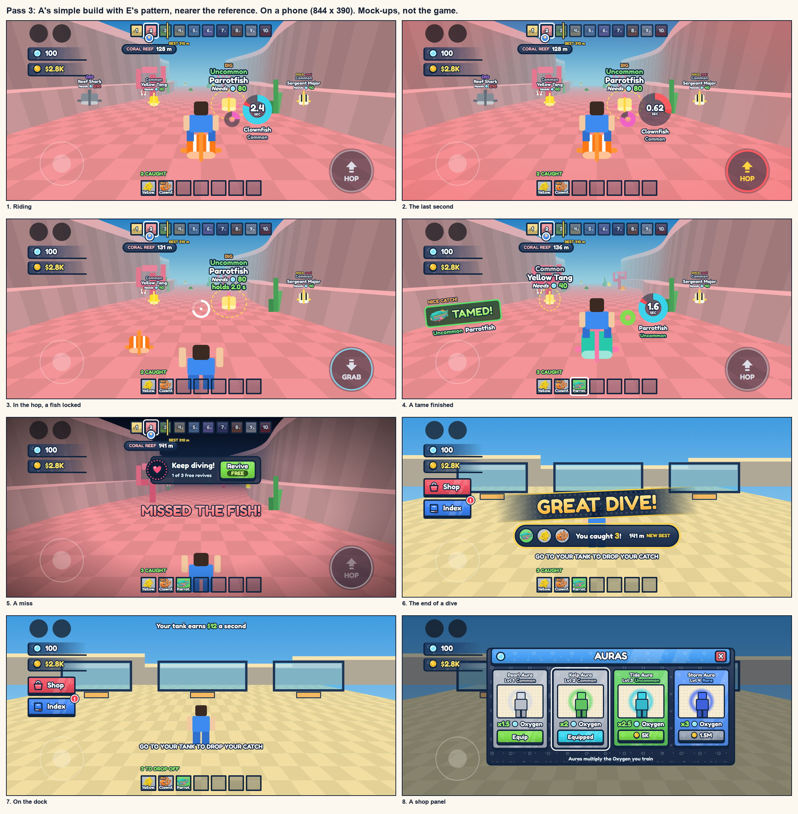

## Pass 3: A's build, E's pattern, nearer the reference
The user, 2026-11-11: "A looks the best", some of the rounding simplified, the sizes more accurate, more like the dino
game; then: E's texture, but with A's style because it is more simplistic, and from there more like Ride a Dino.

**Read by Claude, to confirm:** "E's texture" is taken as the pattern E carries (small bubbles) on A's plain shapes.
The picture below shows that reading in the middle, with the two neighbours either side, so it is one look to say
which was meant.

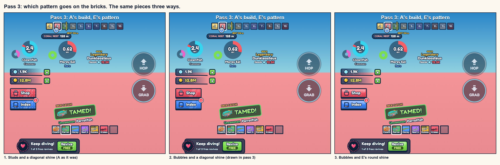

What changed from look A in pass 2, each one toward how the reference builds its own:

| Piece | Pass 2, look A | Pass 3 |
|---|---|---|
| Corners | Rounded a little everywhere | Nearly square: tiles and slots 2 to 3, plates 4. Only what is round in the reference stays round (the jump button, the rings, the pills, the revive bar) |
| The rings | Outlined, with a lip and studs | Flat, thick, a little see-through, no outline, as the reference's. The tame ring is pink, as its is, and turns green when full. Ours: the seconds stay in the big ring |
| The jump button | A yellow brick disc | The reference's: a dark see-through circle, a thin pale ring, a pale arrow that turns over in the air, the key's name on a white cap on a keyboard. Ours: the word HOP or GRAB under the arrow on a phone; the ring goes red in the last second |
| The strip of lands | Stepped down land by land | Straight, as the reference's. "BEST" carries its metres |
| The catch banner and the revive bar | Solid plates | See-through dark plates with a bright edge, as the reference's |
| The slots | Rounded, studded | Square with a thin dark edge, nearly clear when empty |
| The nearest fish's tag | One size | A quarter bigger, at the reference's share of the screen |
| The pattern | Round studs | E's bubbles (see above) |
| Sizes on a desktop | By eye | Measured off the reference's frame and matched as a share of the screen: strip tiles 5%, rings 9% and 4.5%, stat rows 6%, slots 8.5%, the jump button 15% |

Beside the reference at the same size (private pictures, on this PC only):
[riding](../../research/ride-a-dino/ui/compare3-riding.jpg), [a tame](../../research/ride-a-dino/ui/compare3-tamed.jpg),
[a miss](../../research/ride-a-dino/ui/compare3-miss.jpg), [the end](../../research/ride-a-dino/ui/compare3-end.jpg),
[a shop panel](../../research/ride-a-dino/ui/compare3-panel.jpg).

On a desktop:

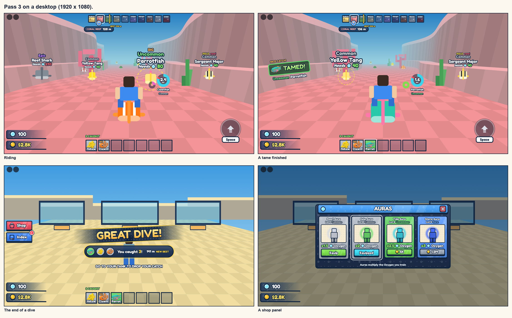

Where it still differs from the reference, and why:
- **The seconds in the ring, and the fish's name under it.** A new player has 2.5 seconds; a ring alone is too slow
  to read.
- **The big ring is thinner than the reference's,** to leave room for that number.
- **No first slot set apart.** The reference has an eighth slot at the left with a "Q" on it. Its job isn't clear from
  the recording, so it is left out until we know what ours would hold.
- **The land tiles are plain colour with a block or two,** where the reference has a painted picture of each zone.
  Ten small pictures could be drawn by code later.
- **The signs are simple shapes,** where the reference has small 3D pictures.
- **On a phone** the stats sit at the top left, clear of Roblox's stick, and the land tiles carry numbers.

## Pass 2: much closer to the reference (five looks; A was picked)
The user, 2026-11-11: get much closer to Ride a Dino, to the overlays, gradients and textures on its overlays and
everything else; keep the riding loop's screen as accurate as possible; slight improvements and slight artistic
differences where they work for our game; draw Brick, Bubble, a mix, and bubble over brick.

### What the reference's HUD is made of
Read from the user's 5-minute recording, each piece cut out and enlarged (the crops are private, in
`research/ride-a-dino/ui/`; `grab.py` and `study.py` there make more).

| Piece | How it is built |
|---|---|
| The zone strip, top middle | Ten small square tiles, each a painted picture of its zone in a border of the zone's colour, the name across the top. The tile you are in has a lighter border. Your avatar's head hangs under the strip in a round badge, with the metres in a dark pill under it. Your best is a yellow line with "BEST 7,590 m" |
| The two rings | Flat, thick, a little see-through, beside the rider at shoulder height. The big one is green, with the used part as a red wedge. The small one is pink (the tame). No outline, no number |
| The jump button | A dark see-through circle with a thin lighter ring, a pale arrow that turns over in the air, and under it a white key cap that says "Space". It is there on a PC too |
| A wild animal's tag | No plate. Stacked words with a thick dark outline and a small shadow: a line of kind words (SILVER, BIG, a red "new!"), the rarity in its colour with a top-to-bottom gradient, the name in white, "Required:" in italics with a bolt and a green number |
| The stat rows, bottom left | Dark bars that fade out to the right, with a darker edge down the left and along the bottom. A small 3D picture, then the number: a timed boost, your stamina, your cash. Green plus buttons beside them at the hub |
| The carry slots, bottom middle | Seven squares with a thin dark edge. A filled one is a tile in the rarity's colour with the animal's bust, its name cut short at the bottom, its size at the top. The chosen one has a white edge |
| The catch banner | At the left, tilted: a dark green see-through plate with a bright green edge, the animal's picture, "IT'S YOURS!". A smaller shout above it ("INCREDIBLE CATCH!"), the animal's tag under it |
| The revive bar, top middle | A dark rounded bar. A heart in a round badge at its left end, two lines of words, a green button with a second word in a dark pill ("FREE") |
| The end of a run | "GREAT RUN!" in a gold gradient on a dark streak that fades out at both ends, a little tilted. Under it a dark pill with a gold edge: the catch as round portraits, "You caught 6 dinos!" with the 6 in gold |
| The hub's buttons | Bright rectangles (red Shop, blue Index) with a dark edge, a painted picture at the left, a red "!" badge. On the colour: a faint pattern of blocks, and a paler diagonal band like a shine |
| A shop panel | A bright header bar with the title, a picture at its left and a red X at its right. A dark body. Cards in the rarity's colour, each with a cream window for the picture, a line of small words, the gain in big words, a green button with the price (grey when you can't pay) |
| On everything | **A faint pattern of small bricks,** a little lighter than the colour under it. Top-to-bottom gradients. A dark outline. Thick outlined letters. This is the "texture" |

### What pass 1 got wrong, measured against it
- **Plates everywhere.** Pass 1 put every word on a solid plate. The reference puts words straight on the world with
  an outline, and keeps plates for buttons and panels. Plates hid more of the view and looked heavier.
- **Flat colour.** No gradient, no pattern, no shine. That is why it read as a sketch beside the reference.
- **The wrong places.** The depth ladder down the left, a "caught" chip at the top right and a card at the end were
  my own. The reference's places are learned by every player of the genre: strip on top, slots at the bottom,
  stats at the lower left, banner at the left.
- **No pictures of creatures.** The reference shows the animal in the slot, the banner and the end. Pass 1 had a
  generic fish sign.
- **Nothing for the dock or a shop.** Pass 2 draws both.

### The same as the reference, and ours
| The same job in the same place | Ours |
|---|---|
| The strip of ten lands, your marker, the metres, your best | **It steps down, land by land:** depth is our progress. Tiles are in the map's own colour for each land. On a phone the tiles carry numbers and the land's name sits with the metres |
| Two rings beside the rider | **The seconds are written in the big ring** (a new player has 2.5). The fish's name and rarity sit under it. The tame ring fills in the fish's rarity colour |
| The jump button at the lower right; the arrow turns over in the air | **On a phone it says HOP, then GRAB,** and it is yellow, then aqua, then grey when there is nothing to grab. A red ring in the last second |
| A stacked tag on every wild fish | **The "needs" number has three colours:** green you can hold it, yellow it will be short, red too strong. The locked fish also says how long it holds ("holds 2.0 s") |
| Stat rows: Oxygen and coins | **A bubble is the sign for Oxygen.** On a phone the rows move to the top left, because Roblox's stick sits at the lower left |
| Seven slots for what you carry | One word above them, "3 CAUGHT", in place of the reference's second list |
| A tilted catch banner at the left, with the animal's picture | It says TAMED! |
| A revive bar at the top after a miss | **Not decided for our game.** Drawn so the place is known |
| The end: a gold title on a fading streak, the catch in a pill | The metres and NEW BEST sit in the pill |
| Shop and Index at the left, a prompt in the middle | |
| A panel with a bright header, cards by rarity, green price buttons | Coins only. No Robux buttons are drawn: that is not decided |

Left out on purpose: the reference's night timer and its paw button (we have no day and night, and no such menu).

### The five looks
All five use the same pieces in the same places. They differ in the surface.

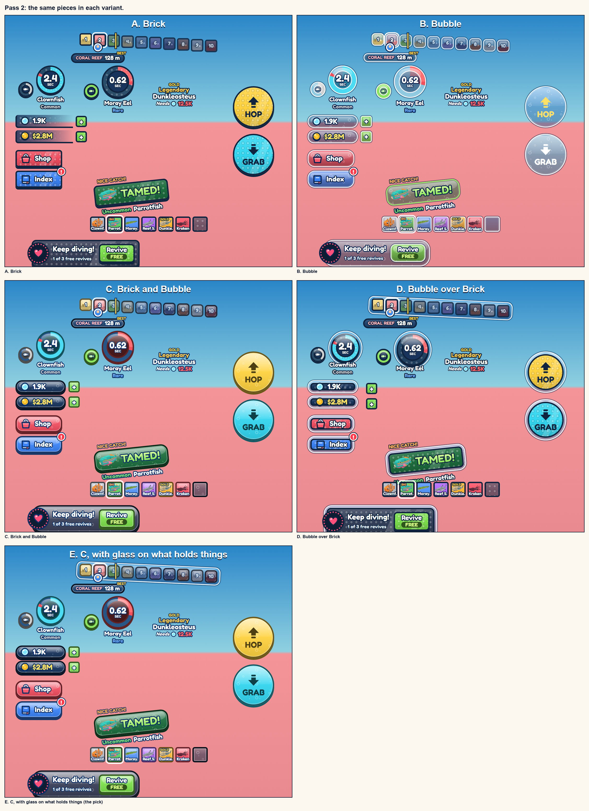

| Look | What it is | For | Against |
|---|---|---|---|
| **A. Brick** | The reference's own build in our colours: square corners, a navy outline, a lip, round studs as the pattern, a diagonal shine, stat bars that fade out | The closest to the reference. The cheapest to draw. Reads over any water | The plainest. Hard edges and navy everywhere look a little heavy on a small phone |
| **B. Bubble** | Glass: see-through blue, a white rim, a dome of shine on top, small bubbles as the pattern | The most "under water". Hides the least | The weakest to read. Over the pink reef and the pale sand the glass goes grey, and rarity colours dull inside it |
| **C. Brick and Bubble** | Brick's solid colour and lip, Bubble's round corners and dome of shine. Each plate is outlined in a darker shade of its own colour, not navy. Bubbles as the pattern | Reads as well as Brick and looks more finished: the "polished mobile game" look | The least unusual of the five |
| **D. Bubble over Brick** | Every big piece is a brick held inside a glass capsule: the stat rows, the rings, the buttons, the strip, the slots, the panels | The most our own. It says "aquarium": things kept behind glass | The busiest. Two edges on everything eat room on a phone, and it is about twice the pieces to draw |
| **E. The pick** | C for everything, with D's glass only round the things that hold other things: the strip of lands, the row of slots, a shop panel | C's clear reading, and D's idea where it means something: a tray of lands, a tray of catch, a tank of cards | One more rule to keep |

**The user picked A, with E's pattern** (pass 3, above). What was recommended before that: E. The glass then has a job (it marks a container), and nothing a thumb presses is harder to read.
If one of the four is wanted as it is, C.

The riding screen in each, on a phone and on a desktop:

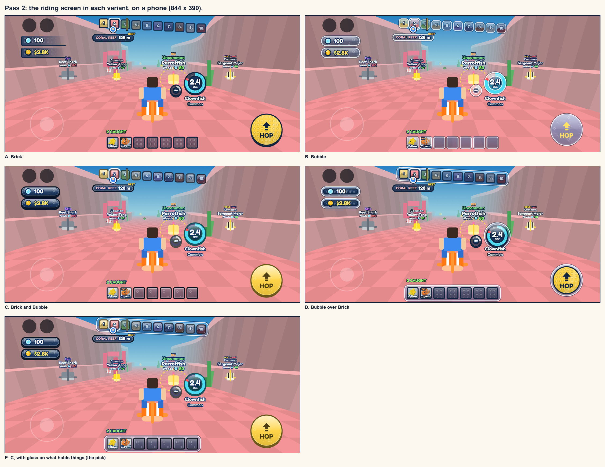

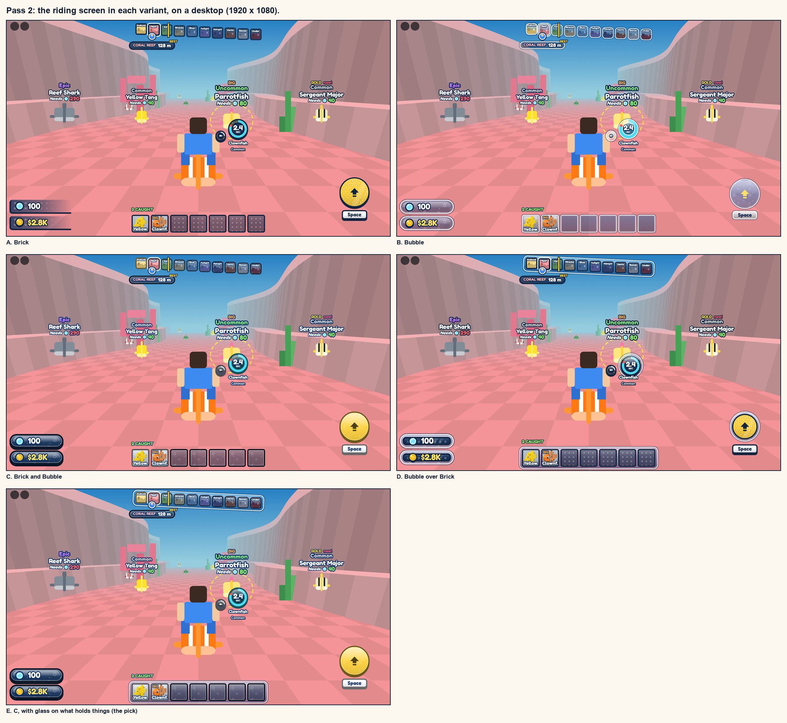

All eight states in each look:
[A Brick](../attachments/ui2-phone-brick.jpg), [B Bubble](../attachments/ui2-phone-bubble.jpg),
[C Brick and Bubble](../attachments/ui2-phone-mix.jpg), [D Bubble over Brick](../attachments/ui2-phone-over.jpg),
[E the pick](../attachments/ui2-phone-pick.jpg).

Beside the reference, at the same size (private pictures, on this PC only):
[riding](../../research/ride-a-dino/ui/compare-riding.jpg), [a tame](../../research/ride-a-dino/ui/compare-tamed.jpg),
[a miss](../../research/ride-a-dino/ui/compare-miss.jpg), [the end](../../research/ride-a-dino/ui/compare-end.jpg),
[a shop panel](../../research/ride-a-dino/ui/compare-panel.jpg).

### What it takes to build
Most of it is Roblox's own UI: frames, round corners, outlines, gradients, see-through colours.
- **No picture needed:** every plate, lip, outline and gradient; the dome of shine; the rings; outlined letters with
  a gradient in them; the bubble and the coin (they are circles).
- **Creature pictures need no upload:** Roblox can draw the creature's own model in a small window in the UI. That
  is what fills a slot, the banner and the end.
- **Eight small pictures would need uploading** to get the full look: two patterns (the studs, the bubbles) and six
  signs (the arrow, the heart, the bag, the book, the small fish, the flag). I draw them by code, so they cost no
  credits. Uploads are permanent, so this waits for the user's yes (question 2). Without them: no pattern, and plainer
  signs made of frames.
- **The diagonal shine** (look A only) needs a clipped group for each plate, which costs a phone some memory. The dome
  of shine in the other looks is free.
- **The cheapest to the dearest for a phone:** A, C, E, B, D.

### What the pictures take for granted
None of this is decided. It is drawn so the pictures are whole.
- **Revives** (the bar after a miss).
- **Coins, written with a $,** as the money.
- **A row of seven slots.** Whether you can carry only seven is the game's rule, not the HUD's.
- **Kind words on a tag** (BIG, GOLD, "new!"). Sizes and the gold look exist in the creature notes; "new!" needs the
  Index.
- **The auras' names and prices** are made up for the picture.

## 1. What is on screen today
All of it is `src/client/Controllers/HudController.luau`. The picture is drawn from the sizes in that file, with
Roblox's own stick and jump button added. The numbers match the table.

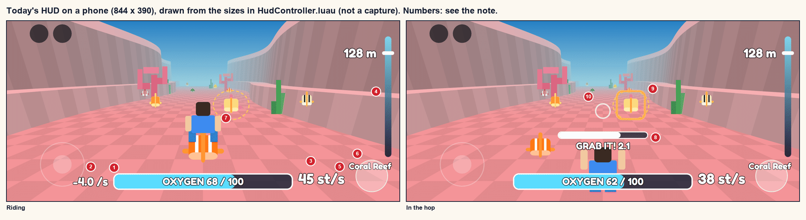

| # | What | What is wrong with it, for a new player on a phone | Does it still mean anything at 2 to 3 seconds a fish? |
|---|---|---|---|
| 1 | The Oxygen bar, bottom middle, "OXYGEN 68 / 100" | It is at the bottom edge, far from the fish, where nobody looks while steering. The words are about 20 high | No. A bank of 68 says nothing. The player has to divide it by number 2 in their head to learn they have 17 seconds, or 2 |
| 2 | "-4.0 /s", left of the bar | A rate. It sits where the left thumb rests on the stick | No. It is half of a sum |
| 3 | "45 st/s", right of the bar | A number for us, not for a player. It runs under Roblox's jump button | No. Speed is felt, and the speed lines already show it |
| 4 | The depth gauge, a thin bar down the right edge, 260 tall | It takes two thirds of the screen's height, under the thumb that drags to look. Nothing marks your best | Yes, the idea is right: depth is the progress bar |
| 5 | The land's name under the gauge, and "needs 96 OXYGEN" when you are short | 18 high, and it lands on the jump button. "Needs" is for a Common, and no Common swims past the Coral Reef, so from the third land on it says too little | The name, yes. The number: the tuning chat proposes the land's commonest fish |
| 6 | The hop is Roblox's own jump button | It has no word on it. Nothing tells a new player that this button is the whole game. It never changes between "hop" and "grab" | It matters more than before: it is pressed every 2 to 3 seconds |
| 7 | Nothing says what you are riding, or what any fish is | No name, no rarity, no tag over wild fish (fish carry their rarity and "Required" as hidden values; nothing draws them) | Rarity is the chase. Today it cannot be seen at all |
| 8 | In the hop: a bar under the middle, "GRAB IT! 2.1" | It sits on top of your own character. The tenths flicker. The pull-in starts by itself now, so "GRAB IT!" asks for a press that isn't needed | The window still matters, as a shape, not as a number to read |
| 9 | In the hop: a square bracket on the locked fish | A third mark on one fish (the world already has the glow and the dashed ring). It says which fish, never what it is or whether you can hold it | The lock matters. What is missing is the fish's name, rarity and how long you would last |
| 10 | In the hop: a small ring in the middle (the aim) | Fine. Small on a big screen | Yes |
| | A miss or out of air: the screen goes black, "MISSED THE FISH!" or "OUT OF AIR!" | Readable. It doesn't say what happens next (back to the dock, with your catch) | Yes |
| | Speed lines, the edges closing in | Fine | Yes |
| | On the dock | Only "0 m, THE DOCK". Nothing says where to go or what to do | |

Three things under the hood, to put right when the HUD is built:
- **Sizes are fixed in pixels.** The same 30-high bar is a fair size on a phone and tiny on a big monitor.
- **Every word is redrawn every frame,** and every label sizes its own text to fit its box. Both cost on a phone.
- **Two places animate text size** (the timer's pulse and the pop of the drowning words). That is against the
  project's rule for phones.

## 2. What the reference shows, and when
How each piece is built is in pass 2, above ("What the reference's HUD is made of"). This is the order of events.

From [the Ride a Dino breakdown](../reference/ride-a-dino.md) and its frames. We copy what its screen tells the player
and when. We never copy how it looks.

| When | What its screen tells the player |
|---|---|
| Riding | **A green ring beside the rider: the time left on this dino.** A smaller pink ring: the tame. A circle on the dino you would jump to. A big round button with an up arrow and the word "Space". A strip of the ten zones across the top with your place, the metres and your best. Bottom left: your stamina (one number, it never moves in a run) and your cash. Bottom middle: seven slots for what you carry |
| Every wild dino | A tag: mutation, size, the rarity in its colour, the name, "Required" and a number |
| In the jump | The button's arrow turns to point down. A dashed ring travels under you. The dino you will come down on glows |
| Landing | A flash and a ring at the saddle. Nothing to read |
| A tame finishes | "IT'S YOURS!" on a banner with the dino's tag, and the dino joins an "N SECURED" list with a small picture each |
| A miss | "Keep riding! Revive FREE (1 of 3 free revives)" with one green button. Then "GREAT RUN! You caught 6 dinos" |
| Back at the hub | "GO TO YOUR PEN TO DEPOSIT" in the middle. Shop and Index buttons on the left, the Index with a red mark when something is new. Plus buttons beside stamina and cash |
| At the pen | Each dino's tag shows what it earns a second. "+$240" floats up. "You earn $4M/Day offline!" across the top. Keys to press shown beside the thing they act on |

What to take from it:
- **The clock for this animal is next to the rider,** not at an edge of the screen.
- **The jump button is big and says what it does.** It changes when what it does changes.
- **Every animal says what it is and what it needs** before you jump to it.
- **Good news is loud and short** ("IT'S YOURS!"). Bad news comes with what happens next.
- **The permanent numbers are small and out of the way** (stamina, cash).

## 3. The screens the game will need
Written for pass 1. Where pass 2 differs, pass 2 holds: the depth ladder is the strip of lands across the top, the
fish plate and the lock plate are outlined words with no plate, the caught chip is the row of slots, and the end of a
dive is the banner, not a card.

"Waits for" is the system that has to exist first. "Now" means today's code is enough.

### In the dive
| Piece | What it is for | What it shows | Waits for |
|---|---|---|---|
| **The ride ring** | The one thing to watch: how long you have on this fish | A ring beside the rider that empties, the seconds in it. Aqua, then yellow, then red and bigger for the last second. A landing on another fish fills it again. A crash knocks a piece off it, with a red flash. In the hop it is hidden: nothing drains there, and the landing fills it | Now: the seconds are your Oxygen divided by what this fish takes a second here |
| **The fish plate** | What you are riding | The name on a plate in the rarity's colour, with the rarity in small letters, under the ring | Now |
| **The tame ring** | How close this fish is to being yours | A small ring on the ride ring's corner, filling in the fish's rarity colour, a small fish in it. Full: it flashes and the banner comes | Taming |
| **The hop button** (touch) or **the key hint** (keyboard, gamepad) | The press that is the whole game | A round yellow button, 92 across, bottom right: an up arrow and HOP. In the hop it turns aqua: a down arrow and GRAB. With no fish locked it is grey. In the last second it grows a red ring. On a keyboard the same words sit beside a SPACE key at the bottom middle | Now for the hint. The button needs a hook from the game-code chat (see Asks) |
| **The lock plate** | Which fish is next, and whether to take it | Over the locked fish: its name plate, and one line under it. Riding: "NEXT 2.1 s". In the hop: "HOLD 2.1 s". The line's colour goes by the seconds you would get: white for 2 or more, yellow for 0.5 to 2, red under 0.5 ("TOO STRONG 0.2 s") | Now: the seconds are your max Oxygen divided by what that fish takes a second. The three colours are the tuning chat's proposal |
| **Name tags on wild fish** | Seeing rarity before you jump, so there is something to chase | Over the nearest few fish: the name on its rarity plate, and the Oxygen it needs with the bubble sign (the max Oxygen that gives 2 seconds on it). White, yellow or red by the same three steps as the lock plate | The values are on every fish now. Today the number is for the fish's home land; the tuning chat proposes the land it is in |
| **The aim and the window** | In the hop: where you are aiming and how long is left | A small ring in the middle of the screen that empties over the 3 seconds. Red and bigger for the last 0.8. With no fish locked near the end: "FIND A FISH!" under it. No tenths to read | Now |
| **The depth ladder** | Depth is the progress bar | Ten bricks down the left edge, one a land, in the map's own colour for each land. A marker for you, a yellow tick for your best. Beside the marker: the land's name on a plate in its colour, and the metres | Now. The best needs saves (until then: the best of this session) |
| **A new land** | The border is felt | The land's name drops in at the top for two seconds, in its colour. If your Oxygen is short for it: "needs 336, you have 100" under the name, once | Now. Today the number is for a Common; the tuning chat proposes the land's commonest fish |
| **The caught chip** | What you carry home | Top right: a small fish, the count, and one small square a creature in its rarity colour. It jumps when a tame finishes | Taming |
| **The TAMED! banner** | The reward, loud and short | At the top middle for about a second and a half: TAMED! and the fish's name plate | Taming |
| **Warnings** | Trouble, before it is too late | The last second on a fish: the ring red, the button ringed red, the screen's edges tinted. A crash: the ring flashes red. A rarer fish you can't hold: the red tag and the red lock line. Never a warning that needs reading mid-hop | Now |
| **A miss, or out of air** | What happened and what comes next | The edges close in. A red plate: "MISSED THE FISH!" or "OUT OF AIR!", and under it "back to the dock with what you caught" | Now |
| **The end of a dive** | The pay-off, and a reason to go again | A card: GREAT DIVE!, the metres and the land, NEW BEST when it is, "you caught 3" with a tile each in its rarity colour, one green button: TO THE DOCK | Taming. A revive offer, if there is one, waits for the money decisions |
| **Server news** | "A Secret Leviathan appeared in Midnight" | One line at the top that slides away | Secrets as server events |

### On the dock
No pictures yet: these are drawn when their systems are decided, so the pictures don't decide the design.

| Screen | What it is for | What it shows | Waits for |
|---|---|---|---|
| **The dock's HUD** | Where am I, what do I have, where do I go | Top right: Oxygen (the bubble and your max) and coins with what you earn a second. Left edge: two or three square buttons (Shop, Index, Settings), 48 across. A word in the middle when there is one thing to do ("DIVE IN", "PUT YOUR CATCH IN YOUR TANK") with an arrow that points the way | Income for the coins. The rest now |
| **The training machine** | Turning time into Oxygen | While you are on it: your max Oxygen ticking up, the gain a second, and one button: the next machine level and its price | Training (the tuning chat's question 6) |
| **The shop and auras** | Spending income | A list of cards, one an aura or upgrade: a name, what it does in one number ("x2 Oxygen"), the price on a green button, grey when you can't pay | Income and prices |
| **The base (your tank)** | Showing off, and choosing who earns | Over each creature: its name plate and what it earns a second. A panel for the tank: the creatures inside, the ones stored, "equip best", the tank's next level | The base and income |
| **Picking your starting fish** | "Start on your own creature" | The same panel with one "RIDE" button on each creature | The base |
| **The Index** | Every creature, and which you have found | A grid of tiles by land: a picture or a dark shape, the rarity colour as the tile's edge, a count of how many found. A red dot on the button when one is new | The roster in the game, and saves |
| **Settings** | The few switches a phone needs | Sound, music, camera turn speed, low detail | Whatever settings exist |

### The first minute
A new player has to learn one thing: **when the ring runs low, hop to the next fish.** Three small helps, no tutorial
screen:
1. On the dock: one line, "DIVE IN", and an arrow at the water.
2. On the first fish: when the ring turns red, a white plate points at the button (or the SPACE key): "TAP TO HOP TO
   THE NEXT FISH". It goes away after the first landed hop.
3. On the first miss: the red plate adds one line, "hop before the ring runs out".

After three landed hops none of it shows again. Until saves exist it comes back each time the player joins.

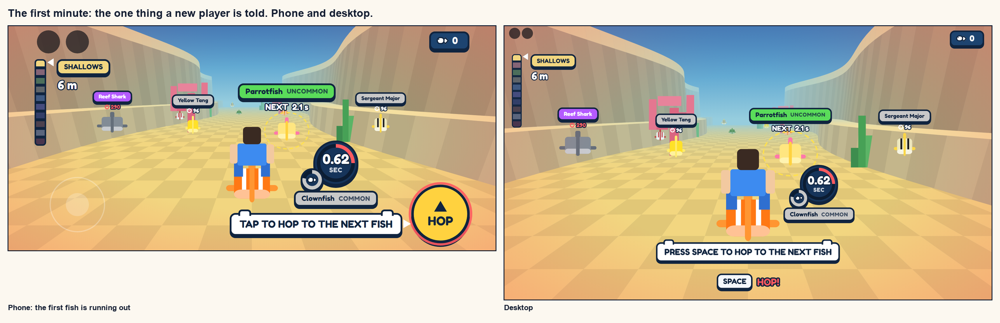

### Where things go on a phone
Roblox's stick takes the lower left and the right thumb drags to look, so nothing of ours that is pressed goes in
either place, except the hop button at the lower right. Everything else lets touches through.

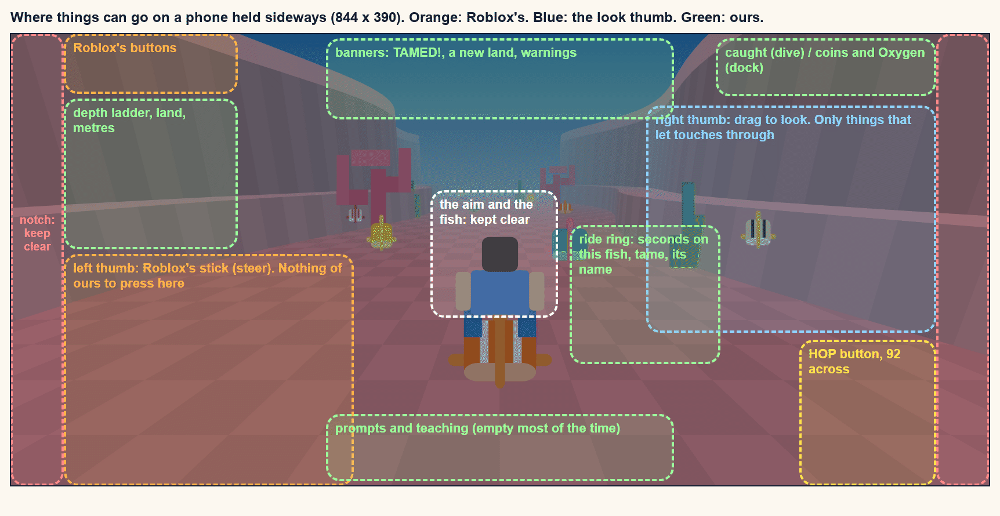

## 4. The style (pass 1, replaced by pass 2)
Kept for the record. The rules at the end still hold.

Three directions. Each is made only from what Roblox's own UI has: frames with round corners, outlines, gradients,
circles, turning, and Roblox's built-in fonts. No picture is uploaded for any of them. The pieces are the same in each.

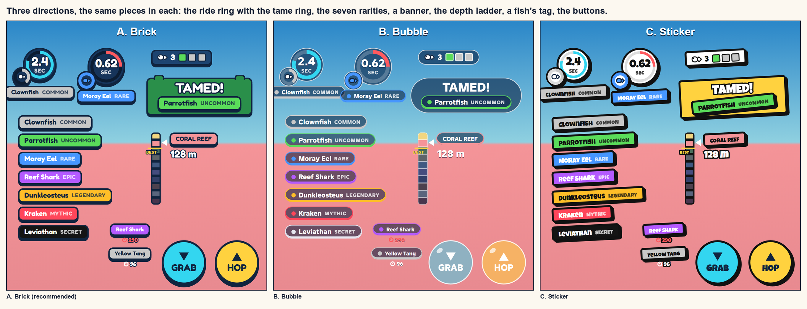

| | A. Brick (recommended) | B. Bubble | C. Sticker |
|---|---|---|---|
| The idea | Pressed plastic. The HUD is made of the same stuff as the map and the fish | Glass and air. The HUD floats on the water | Loud paper stickers, a little crooked |
| Shapes | Solid plates, corners rounded a little, a dark navy outline, a lip under each (a second plate 4 lower). Two studs on top of the big plates only | See-through dark pills and circles, a thin white edge, a small shine on buttons | White plates, a thick black outline, a hard black shadow, tilted 3 degrees |
| Letters | Fredoka One: round and chunky, white with a navy outline | Builder Sans, extra bold: clean and modern | Luckiest Guy, all capitals |
| Rarity colour | Fills the whole name plate | A dot and an edge in the colour; the plate stays dark | Fills the whole name plate |
| Good at | Reads over any water, from the bright Shallows to the black Underworld. Big, clear things to press. Looks like our world | Calm. Hides less of the view | Shouts. The genre's usual look |
| Weak at | Solid plates hide a little more of the view | Rarity is a small dot, so the chase reads weaker. Pale text over pale water needs care. Plain: it could be any game | The closest to the reference's look, which we said we would not copy. Tilted letters blur a little in Roblox |

**Recommended: A, Brick.** The map is studs on squares and the fish are blocks, so a HUD of chunky plates belongs to
the same toy box. Solid colour with a dark outline is the one treatment that stays readable over every land's water.
It is also the cheapest for a phone to draw.

Rules that hold in any of the three:
- **One colour, one meaning.** Aqua is Oxygen and time. Yellow is "press this". Red is danger. Green is good news and
  buying. A rarity's colour appears only on a creature's own plate, ring or tile, never on a button or a warning. Each
  land's colour (the map's) appears only on the depth ladder and the land's name.
- **Rarity colours are the game's own** (`Config.Tiers`): grey, green, blue, purple, gold, red, black. Two sit close
  to HUD colours: the Mythic's red to the danger red, and the Legendary's gold to the button's yellow. They never share
  a shape (a rarity is always a plate with a name on it), so it should hold. If it confuses in play, danger moves to
  orange.
- **A sign for Oxygen: a bubble.** A circle with a small shine, made of two circles. It goes before every Oxygen
  number: on tags, on the dock, in the shop.
- **Numbers.** Seconds: two decimals under a second (0.62), one from 1 to 10 (2.4), whole seconds above, and past
  a minute just a full ring. Oxygen: a short form for big numbers (12.5K, 2.25M), since the tenth land's fish need
  millions.
- **Sizes on a phone** (in the phone's own points): the hop button 92 across; any other button at least 48, with 8
  between; the ride ring 70; the seconds 24 high; names 12 to 14; nothing smaller than 11, and that only on far tags.
- **One design, scaled.** The HUD is drawn once at phone size. Bigger screens scale it up by the screen's height,
  less than in proportion (1 on a phone, about 1.3 on a tablet, about 1.9 at 1080p), so a desktop gets a smaller HUD
  against its screen than a phone does. The scale is set when the screen changes size, never animated.
- **Movement** is plates sliding, flashing and rings turning. Text never changes size (the project's rule). Numbers
  change at most ten times a second.
- **A ring that empties** is two half circles whose outline is cut off by a gradient that turns. It is the first
  thing to prove in Roblox when building starts. If it doesn't hold up on a phone, the ring becomes twelve small studs
  in a circle that go out one by one.

The alternative, drawn as the same HUD:

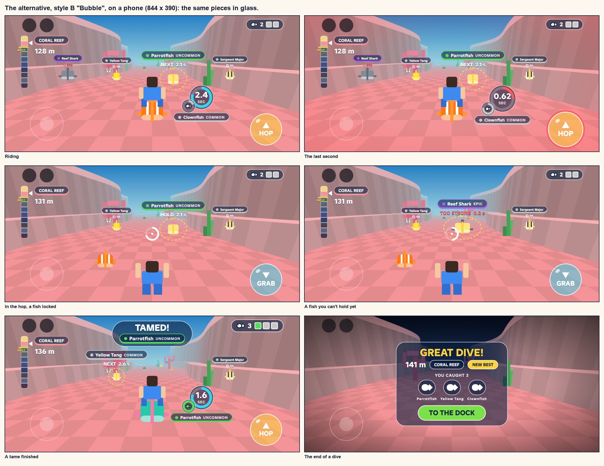

On a desktop, both:

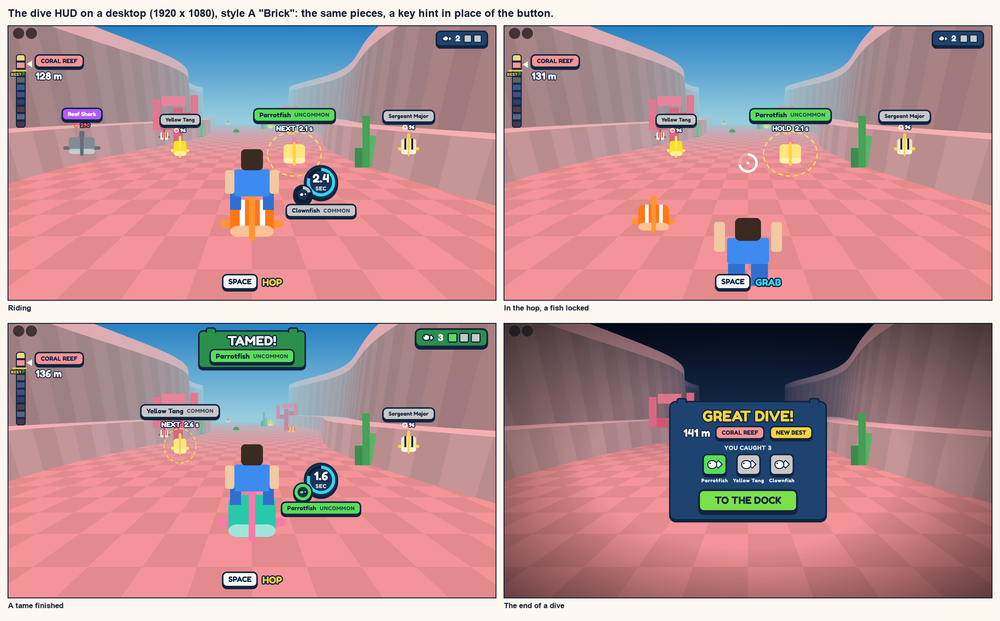

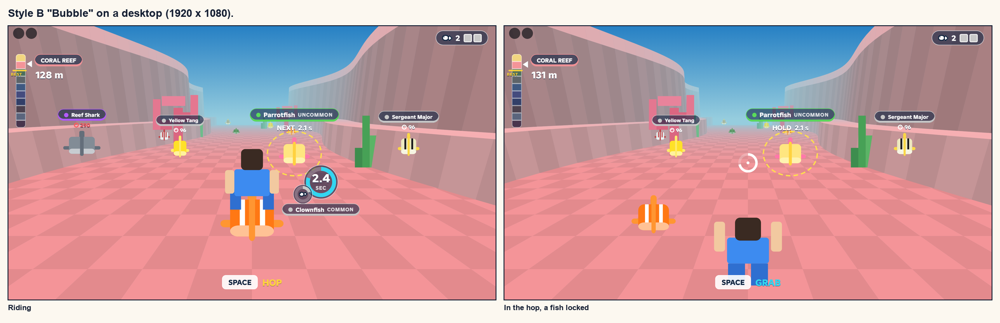

## 5. Build order
Piece 2 starts on the user's pick of a look. The HUD's parts go in `src/client/UI/`; `HudController` keeps only the
wiring.

**Now, against today's code:**
1. **The kit:** the colours, the plate, the ring, the chip and the scale rule, as one small module every screen uses.
   Proving the ring on a phone is the first job.
2. **The two rings and the fish's name,** with the last-second warning. The old bar, the rate and the speed come out
   (the speed stays on the Studio tuning panel's side, for us).
3. **The key hint,** and the hop button on touch once the hook is there.
4. **The hop:** the aim with the window as a ring, "holds 2.0 s" on the locked fish, "FIND A FISH!". The bracket comes out.
5. **The strip of lands,** the land's name and metres, the new-land banner.
6. **The miss and out-of-air plate.**
7. **Tags on the nearest wild fish,** and the stat rows.
8. **The first minute's three helps.**

**Waits:**
| Piece | Waits for |
|---|---|
| The tame ring filling, TAMED!, the slots filling, the end-of-dive banner | Taming |
| The patterns and the six signs | The user's yes to eight small uploads |
| The revive bar | Whether we have revives |
| The red "too strong" mark as a rule of the game, a tag that counts the land the fish is in | The tuning chat's proposals, and the user's answer to its question 6 |
| Coins on the dock, the shop, auras | Income and prices |
| The training machine's screen | The training spot |
| The base's panel, picking your fish | The base |
| The Index | The roster in the game, saves |
| Your best on the ladder, the first-minute helps shown only once ever | Saves |
| A revive offer | The money decisions |

## Open points
**Answered by the tuning chat** (2026-11-11; the same is in [progression](progression.md), "What the HUD should
show"). The mock-ups follow these.
- **In the game today:** one Oxygen bank on the server. Riding drains it by the land you are in and the fish's
  rarity, so the seconds left are the bank divided by that. Nothing drains in the hop. A landing on another fish fills
  the bank whole. A crash takes a tenth of max, a small prop 3%. Floating off a fish drains a flat 4 a second.
- **"Needs" on a tag** is the max Oxygen that gives 2 seconds on that fish. It is a hint, not a gate: nothing stops a
  landing.
- **A fish you can't hold:** you land, get a full ring, and it empties in a blink. At nothing the fish throws you off
  and you drown. Under about 0.3 seconds you are thrown before you can hop again.
- **How long a ride lasts:** a new player has 2.5 seconds on a Shallows Common, 2.0 on an Uncommon, 1.0 on a Rare,
  0.56 on an Epic, 0.17 on a Legendary. A trained player has 10 to 20 seconds on the land before theirs, and minutes
  two lands back.
- **Still proposals, not built:** the red mark on a fish you can't hold; the tag counting the land the fish is in; the
  land's "needs" line counting its commonest fish; the short number form. Whether the game should refuse a landing on
  a fish you can't hold is with the user (the tuning chat's question 6).

**Answered by the game-code chat** (2026-11-11, after checking pass 1: today's HUD is read right):
- **The ring's number** (what the fish under you takes a second, as the server counts it), **the locked fish's
  seconds** and **the hook for the hop button** (with Roblox's own jump button hidden): it adds these to `State` and
  `Actions` when piece 2 starts.
- **Tags on fish:** the UI chat builds them (a few, reused, on the nearest fish, on the player's own screen).
- **The bracket on the locked fish** may come out of the HUD. The glow and the dashed ring in the world stay.
- **Still to ask when piece 2 starts** (new with pass 2): a creature's model drawn in a small window in the UI, the
  list of what the player carries this dive, and the best depth.

**Measured in play by the game-code chat, 2026-11-11:** a new player has 2.3 to 2.6 seconds on a Shallows Common and
2.0 on an Uncommon; a hop takes 2.4 seconds; the meter is full again on every landing. So the ring is near full or
near empty most of the time. What follows for the ring:
- **It is a countdown, not a gauge.** The number carries it; the arc is the glance. The last second has to be
  unmistakable (red, bigger, the button ringed), because for a new player it is nearly half the ride.
- **A landing should be felt on the ring:** it snaps back to full with a flash, so "full again" is seen, not read.
- **For a trained player** on an easy fish (minutes), the ring just stays full and quiet: no number past a minute.

## Questions for the user
1. **The pattern:** is the middle picture of the three right (A's build with bubbles), or did you mean the first or
   the third?
2. **Seven small pictures:** may I draw them by code and upload them (the bubble pattern and six signs: arrow, heart,
   bag, book, small fish, flag)? Uploads are permanent. Without them the HUD has no pattern and plainer signs.
3. **Revives:** does our game have them (the reference: three free, then sold)? The screen after a miss depends on it.
4. **On a phone, your Oxygen and coins:** at the top left (drawn, clear of the stick), or at the lower left as the
   reference has them?
