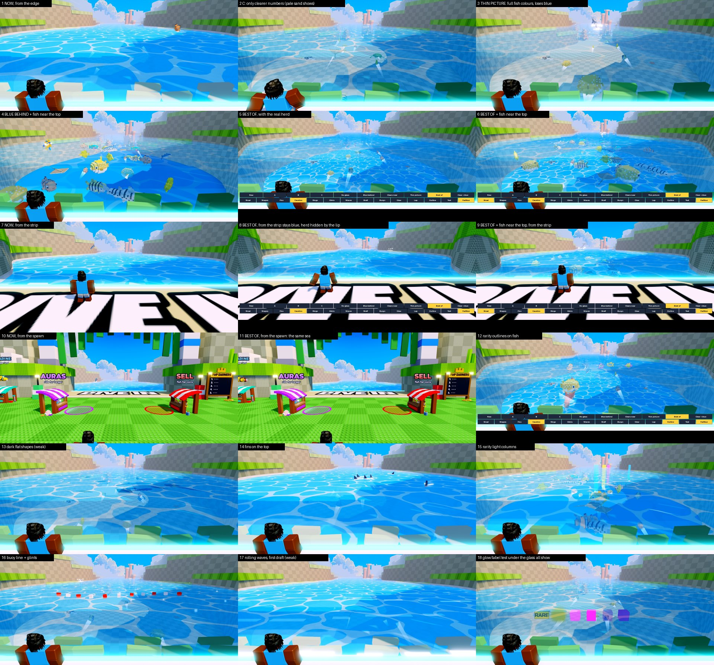

# The water from the hub: ideas and what they look like

Up: [the moving water](water.md), [hub review 2](hub-review-2.md) (§4 and §5, which this carries on).

The user (2026-11-25): "draft up a ton of ways we could make this water look better. research all ways game devs and roblox
devs with this style do water. we will probably just keep it the same but im wondering if we could do any addons. Im
reffering to the water from the top when the player is looking from the hub. But I will want you to make the water more
transparent, easier to see the fish through but still visible as water."

**Nothing is in the game.** Everything marked "tried" was seen in Play on one machine, over the real hub and herd, and went
when Play stopped. Try it yourself: press Play, then run [water_trial.luau](../../tools/studio/water_trial.luau) on the Client
(or ask the map chat). It puts two rows of buttons on the screen: how clear (one at a time) and add-ons (any together). "Best
of" presses FarBlue and Caustics with it; press Shoal for the fish near the top.

## What we found
1. **The picture hides the fish as much as the layers do.** We counted the four layers as letting 18% through. The drifting
   picture on top of them is solid blue between its white lines and covers about 40% more, so it is nearer **11%**. Thinning
   the picture (0.6 to 0.82 or 0.88) did more for the fish's colours than any layer number (views 2 and 3).
2. **Clearer alone trades the blue for pale sand.** The first room's floor is pale sand and its fish are yellow, orange and
   tan. By plain colour sums (the fish's colours taken by eye, flat blending), the yellow tang and sergeant major sit 0 to 1 L*
   from the sand at every clearness, A to C. With blue behind them they sit 17 to 18 apart (our floor-to-wall rule is 14). The
   clownfish, turtle and stingray come to 1 to 3 in lightness on that blue, but their hue stands out (colour difference 36 to
   75; now it is 6 to 10). So put **the blue behind the fish, not over them** (view 4).
3. **Clear everywhere loses the sea.** From the spawn a clear sea turns grey and hazy and stops reading as water. Clear near
   you and blue far away keeps both (10 and 11 are the same view, before and after).
4. **The lip hides the herd.** Near the gate the herd swims 32 to 39 studs down, past the strip's edge. From the spawn, no
   fish at that depth shows nearer than about 400 studs **at any clearness**; from the middle of the strip, about 110
   (view 8); from the edge, about 58 (view 5). Fish must be within about 14 studs of the top to be seen from the strip
   (view 9), or show on the surface.
5. **Glass does not hide glows here.** Builders report that glass hides see-through things behind it. Ours didn't: half
   see-through parts, Neon, particles and a label all showed (view 18), and so did
   outlines, of the kind walls hide (view 12). That was Studio at its
   top graphics level; **not checked on a phone or at low graphics.**
6. **From below, nothing changed:** the underwater ceiling is its own sheets, so it looks as it did.

## The recommendation: "Best of" (views 5, 6, 8, 9, 11)
Four parts, no upload. The first three touch only the water script.

| Part | What it does | How | Cost | Whose |
|---|---|---|---|---|
| **Clears as you come** | The sea is as it is now from the spawn, and clears as you walk to the edge | layers 0.35/0.76/0.78/0.85 to 0.78/0.90/0.93/0.93, picture 0.6 to 0.82, by how far the camera is from the edge (none at 42 studs, all at 12) | none | map |
| **Blue floor light** | The floor is blue with moving light lines, so it still looks like water and fish stand out | the water's own picture on the first 280 studs of floor, sliding; only while your camera is above the water | 26 Textures | map |
| **Far blue** | The clear patch fades into blue further out, with no joins | one flat Beam under the layers, see-through near, blue far; camera above water only | 1 Beam: one more see-through sheet | map |
| **Fish near the top at the gate** | You see them from the strip, the only fix for the lip | copies on each screen, 5 to 12 studs down (made as the leaping fish are), gone as the camera dives since they can't be ridden; or the herd itself rising in its first 150 studs | about 20 models, moved on each screen | game code |

**One of the user's rules this may break:** on 2026-11-11 a second copy of the picture at another size was disliked and
removed. Views 5 and 6 show two cell patterns at once, one on the surface and one 47 studs down on the floor. If it bothers
them, the floor light comes off (the floor plain blue) or the surface gets the lines-only picture, and one pattern is left.
No joins were seen. The numbers are a first setting, to tune with the buttons.

**The smallest version is the first three parts** (view 5). It pays only at the edge: from the strip the sea stays as blue as now
and no fish show (view 8), because the herd is under the lip. Seeing fish from the strip takes the fourth part (view 9).

## Every way to show the fish
| # | Way | Tried | Verdict |
|---|---|---|---|
| 1 | Clearer layer numbers (A 34%, B 50%, C 65%, D no glass) | yes | Works, but shows pale sand and loses the water. D is no better than B |
| 2 | Thinner surface picture | yes | The biggest single gain for fish colour |
| 3 | Our own picture: white lines, cells see-through | no, needs an upload | The proper version of 2: the lines stay bright. The picture we use is solid between its lines |
| 4 | Blue behind the fish, not over them | yes | Best contrast. A flat sheet looks like paint (view 4); the floor light looks like water |
| 5 | Clears as you come to the edge | yes | Keeps today's view from the spawn |
| 6 | Clear looking down, blue at a glance | no | Close to 5, but it changes with every turn of the camera; 5 is calmer |
| 7 | Fish near the top at the gate | yes | The only one that shows fish from the strip |
| 8 | Rarity outlines (Roblox Highlights) | yes | Show clearly through the water. The first costs up to about 1 ms on phones and each is a draw call: Rare and better only, a few at once |
| 9 | Light columns over rare fish | yes | Seen over the lip. Says "something is here", not "a fish". Needs thin, soft columns |
| 10 | Dark flat shapes under the surface | yes | Weak: at this angle a flat shape is a sliver |
| 11 | Fins cutting the top, with foam | yes | Read at once, from anywhere; small at that distance. Sharks and swordfish only |
| 12 | Rings on the top over a fish | yes | Good with 7. The stand-in is dashed; the real one is a ring picture (one is built in) |
| 13 | Bubbles over a fish | no | Stardew marks fishing spots this way; one emitter each |
| 14 | Leaping fish | in the game | Already the strongest sign of fish from the spawn |
| 15 | Labels over fish, from the dock | only that one shows (view 18) | Clutters the view |
| 16 | A darker floor in the first room | no | Same idea as 4 but it changes the dive too: the user's call, [colour](colour.md) |
| 17 | The herd rises at the gate (real fish, not copies) | no | Better than copies if its line allows; may make the first mount easier too. Game code |
| 18 | Near fish drawn lifted, as real water bends light | no | Hard, and easily looks wrong |

## Add-ons for the water itself
| # | Add-on | Tried | Verdict |
|---|---|---|---|
| 1 | Moving light on the floor (caustics) | yes | **The best add-on.** Part of "Best of" |
| 2 | Sun glints: twinkles on the top | yes | Small, cheap (one emitter), nice. Yes |
| 3 | Buoy line | yes | Scale, and something that bobs; fits a dive site. Cheap. Taste |
| 4 | Foam lapping at the strip's edge | yes | Too bright beside the strip's glowing edge (view 17). Only if that glow comes down |
| 5 | Rolling waves to the shore | yes | As plain strips it looks like glass slabs (view 17). Needs a foam picture on Beams to be worth it |
| 6 | Steps of sand down from the edge | yes | Hard to see under the lip. No |
| 7 | Foam where the water meets walls and props | no | Most toon water has it; thin white parts along the two walls would do |
| 8 | Darker edges along the walls (a vignette) | no | One Roblox builder says most people miss it. "Far blue" does part of it |
| 9 | Colour by depth: turquoise near, deep blue far | partly (Far blue) | A very common look; ours would come from the Beam's colours |
| 10 | Splash and foam ring when a player dives in | no | The leaping fish already have a splash to reuse. Game code |
| 11 | Wake behind a fish near the top | no | The herd's trails already show through |
| 12 | Waterfalls off the cliffs | no | Beams with the same picture; strong from the hub, but a map piece rather than water |
| 13 | Floating things: crates, rings, a duck | no | Same use as buoys |
| 14 | Light shafts seen from above | no | Clear water only; the underwater ones exist |
| 15 | Gulls, and their shadows on the water | no | Life, not water |
| 16 | Real moving waves (a mesh) | no | About 8,000 triangles, borderline on phones; also breaks the flat look |
| 17 | Refraction ripple (glass see-through above 1) | no | A bug that only shows at high graphics. No |
| 18 | Reflections | no | Flat, unreflecting water is a toon look of its own (Wind Waker). No |
| 19 | A paid water pack (Devoted, $5) | no | 13 looks, foam, caustics; we would lose our own layers. No |
| 20 | Roblox's terrain water | no | Ruled out before |

## What the research says
- **Roblox layers like ours** are a standard recipe: stacked see-through meshes, a glass top with an empty
  SurfaceAppearance, one picture; plus a vignette, particles and decorations
  ([RoBuilder](https://www.youtube.com/watch?v=mSKJg066mbQ)). Lower the floor, raise the see-through, make one layer larger; too
  much see-through looks fake ([devforum 2911358](https://devforum.roblox.com/t/2911358),
  [2580001](https://devforum.roblox.com/t/2580001)).
- **Caustics in Roblox:** two crossed Beams with a black-and-white picture ([2842131](https://devforum.roblox.com/t/2842131)).
- **Glass hiding see-through things:** the [release post](https://devforum.roblox.com/t/64231) and
  [259336](https://devforum.roblox.com/t/259336); our own test above says not for this mesh.
- **Highlights' limits:** [Roblox's page](https://create.roblox.com/docs/effects/highlighting). **Overdraw:** stacked
  see-through sheets cost, no figure per sheet ([optimising](https://create.roblox.com/docs/performance-optimization/improve)).
- **Other games:** colour from shallow to deep plus a foam line
  ([toon water](https://roystan.net/articles/toon-water), [stylised water](https://ameye.dev/notes/stylized-water-shader));
  clear near and cheap opaque far (Assassin's Creed 3, on fxguide); two drifting patterns for caustics, and things under water
  kept darker than the mid-tone so they read (Nimue, on 80.lv); clear straight down and opaque at a glance, and a ripple that
  follows a fish ([keobkeig](https://keobkeig.dev)); bubbles mark a spot
  ([Stardew](https://stardewvalleywiki.com/Bubbles)).
- **Not found:** how any named Roblox fishing game builds its water; Animal Crossing's and Dredge's fish shadows; any phone
  measure of layers like ours. Reddit's archive timed out; two silent tutorials weren't read.

## Not checked
Phones and low graphics (the glass finding, the layers' cost, the Beam, the 26 Textures); the clearing while walking (three
spots were seen); the moment of diving through (the floor light switches off as the camera goes under); more than one player;
the frame rate; clicking the buttons by hand (a script pressed them; they were seen and fit). The herd may come in at the
gate in sight ([the herd, rethought](herd-revamp.md), point 5: the lane's start is the one exception, fish fading in over 0.6
seconds), which clear water will show: look for it at the edge.

## To decide
1. **The second cell pattern on the floor: fine, or not?** (above)
2. "Best of" (all four), its first three parts, or leave it.
3. If all four: fish near the top as copies, or the real herd rising (with the game-code chat).
4. Any of: glints, buoys, rings, fins, rarity outlines.
5. A lines-only picture: one upload, on the user's word.
