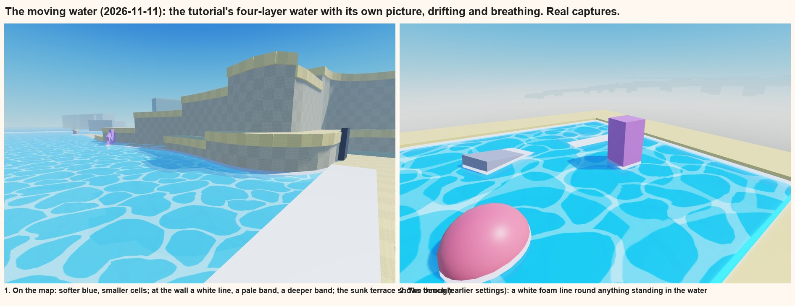
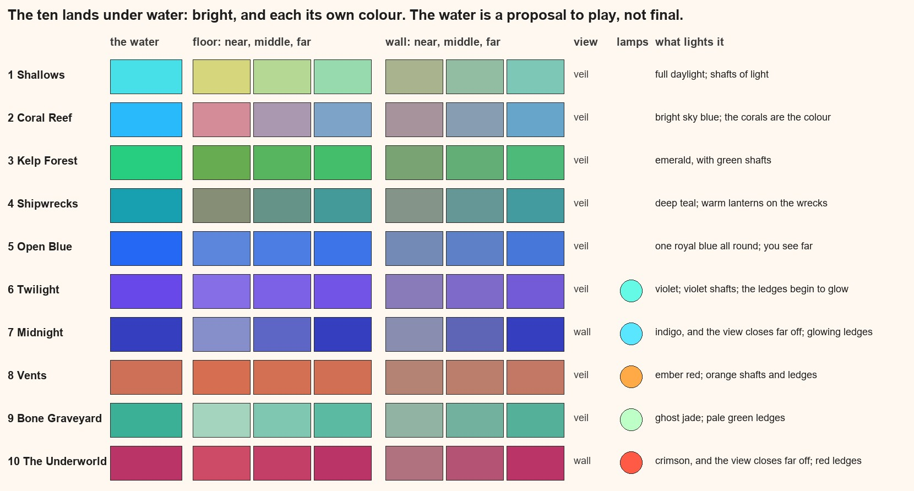
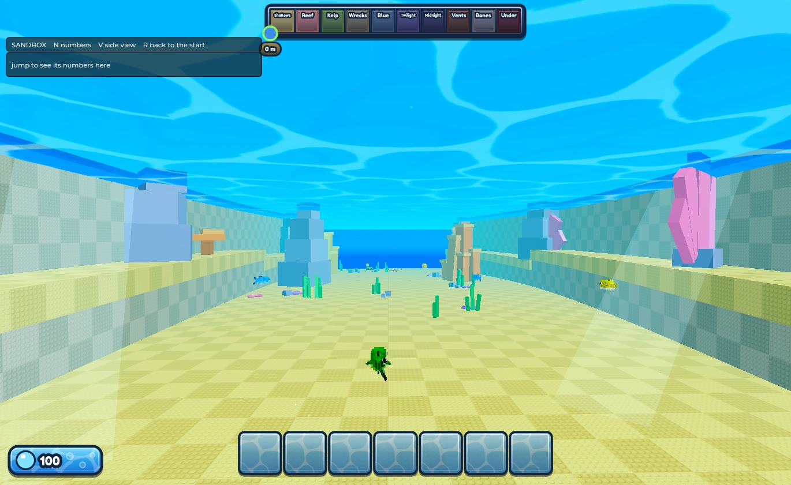
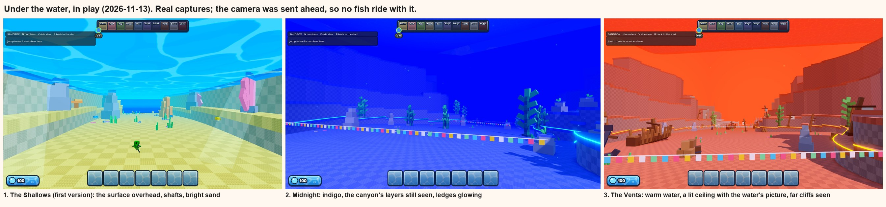
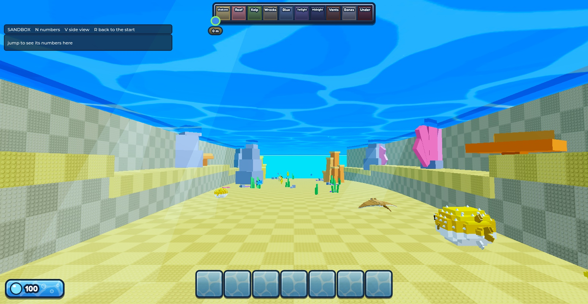
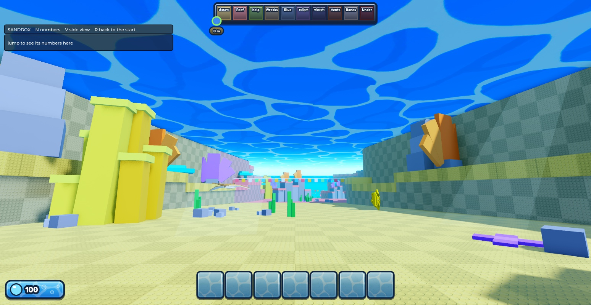

# The moving water

Up: [the map: how we build it](map-method.md). Made 2026-11-11 by the map chat, from a video tutorial the user sent
("moving water here") and the free texture pack it uses, which the user found and linked.

## What the tutorial does
The water is **four flat layers stacked a stud apart**, from the top down:

| Layer | What it is |
|---|---|
| Foam | white Glass, 0.15 see-through, with an empty SurfaceAppearance inside it |
| Water1 | the water's colour, Neon, half see-through, with the water picture on its top |
| Water2 | near black, SmoothPlastic, 0.7 see-through |
| Water3 | a dark "Earth blue", Neon, half see-through |

- **Why it gives foam:** the glass layer is drawn before the three under it, so they show through it as water. Where
  something solid stands in the water, it hides the lower layers and only the white glass is left: a white line round
  it. The further apart the layers, the wider the line.
- **The layers must be meshes, not Parts:** a SurfaceAppearance only works on a MeshPart, and without it the glass
  hides the layers under it.
- **From underneath** (where our riders are) it reads as a bright blue ceiling, with things above it tinted. The
  tutorial warns it can look plain white from below; on our bench it didn't.

## The tutorial gone over again (2026-11-11, on the user's word)
What the first build had missed or got wrong, read from the tutorial's finished scenes:
- **The bottom layer is dark** (BrickColor "Earth blue"), not a bright blue. I had guessed bright, which washed the
  whole thing to one cyan. With it dark, each layer down darkens the water a step.
- **The steps.** At an edge the tutorial shows a white line, then a paler band, then the water: one band for each
  layer the edge cuts off. The user wants these more visible. They are as wide as the layers are far apart, so the
  layers now sit 2.6 studs apart (the tutorial's are about 1). On a sloping shore they spread wide; against our
  upright walls they stay narrow, and show best looking along a wall.
- **The colour is a soft sky blue,** not a glowing cyan, and **the picture's lines are faint**: only a little paler
  than the water (in the pack the picture is 0.9 see-through).
- **The cells are small:** about the size of a rock or a player.
- Not built: the waterfall (beams carrying the same picture) and the white spray at its foot.

**Where ours now differs on purpose:** the user wants the water somewhat see-through, so the glass layer is 0.25
see-through (theirs 0.15) and the three under it are thinner (0.7, 0.72 and 0.8, theirs 0.5, 0.7 and 0.5). The sunk
terrace beside the hub's mouth now shows through as a darker shape. More see-through means fainter foam and steps:
the two pull against each other.

| | The tutorial | Ours now |
|---|---|---|
| Layers apart | about 1 stud | 2.6 |
| Glass | 0.15 see-through | 0.35 (0.25 first; the user asked for a bit more see-through) |
| Water1, Water2, Water3 | 0.5, 0.7, 0.5 | 0.76, 0.78, 0.85 (0.7, 0.72, 0.8 first) |
| Picture | one layer, 9 studs to a tile, faint | one layer, 48 studs to a tile (the sea is far bigger than a pond), 0.6 see-through |

## What we added: the movement
The tutorial's water stands still. Ours, on the user's word ("a slight breathing and dynamic"):
- **The picture drifts,** slowly, in one direction. There is one layer of it, as in the tutorial; 48 studs to a tile now (128 was tried and the user asked for smaller).
  (The first build laid a second copy over it at another size, sliding the other way. That was my addition, not the
  tutorial's; the user saw the two didn't match up, and it was taken out.)
- **The water breathes.** The three lower layers rise and fall about a third of a stud, two slow waves of different
  lengths (5.3 and 8.9 seconds) added together, so the foam lines swell and shrink like small waves lapping, never
  quite repeating. The pictures swing a little with it.

## One block, not tiles (the user, 2026-11-11)
The first build dressed each of the map's 2,000-stud sea tiles separately. Two of them met in a line straight down
the middle of the hub's mouth, each block looked a little different from its neighbour, and the join showed as a
bright band. The user: no line should show at all, only the picture, and bigger; make it one huge block.
- **The sea is now one block, 2,048 studs on a side** (the biggest a part can be), **that stays under the camera.** It
  moves a whole tile of the picture at a time, so the picture never jumps.
- **Round it lies a ring of plain water,** eight flat parts of the same size, so the sea reaches the horizon. The
  nearest join is over 1,000 studs from the camera.
- The map's own sea tiles are turned unseen.

Every number is in one table, `LOOK`, at the top of `tools/map/water_look.luau`: colours, how far apart the layers
are (foam width), the pictures' sizes, speeds and strength, the breath's size and timing.

## How it is built here
- **`tools/map/water_look.luau`** is the whole thing: a script that runs on each player's machine. It hides the map's
  flat sea tiles (`ClaudeBlockout.Surface.SeaTile`, as they arrive: the map streams in by distance), builds the one
  block and its ring in `Surface.WaterLayers`, and keeps them under the camera and moving.
- **`python tools/map/water_luau.py`** writes the installer, `tools/studio/greybox/98_water.luau`. It sorts after the
  map's own loader files, so loading the map installs the water too. (`greybox_luau.py` clears that folder, so it
  now writes the water's installer again itself.) It puts in `Surface.WaterLook` (the script) and
  `Surface.WaterKit.Slab` (the mesh the layers are copies of, in a model marked Persistent so it reaches every
  player however far away).
- **It shows in Play, not in Edit.** In Edit mode the sea is still the plain flat tiles.
- **Checked in a play test:** one block of four layers and eight plain parts round it, no plain sea tile showing,
  the picture sliding, the lower layers moving.

## From inside and from underneath (play check, 2026-11-11, at the riding chat's prompting)
The layers reach from the surface down to about y = -8, and players are in that band: a player floating off a fish
rests at y = -3, a hop tops out at -6, a ridden fish may rise to -7.
- **From underneath** (camera at y = -30): a clean blue ceiling; things above the water show through it, tinted.
- **From inside the band** (camera at y = -5): the same ceiling, and a thin pale line across the view at eye level,
  where a layer is seen edge on. The layers were 0.4 thick; they are now 0.1, so the line is a hairline.

## Queued: making the water feel like water (the user, 2026-11-11)
**The aim, in the user's words:** make it obvious what's going on instantly when you're in the hub. "You walk up to
the water, you see the fish in the water slightly, you see the depth of the water." And inside: "feel like you're in
water when you're in the water", with the darkness and depth visible from outside. Not built yet; this is the plan to
talk through. It builds on [workout 1, going down](../style/01-going-down.md), which already tested fog by depth.

**From the hub, looking in** (the map chat's, in `water_look.luau`):
1. **Depth you can see from above.** Fog only works for a camera that is under water, so from the hub the sea has no
   depth of its own. The same trick as the foam, carried deeper: a few more faint dark-blue sheets well under the
   surface (say at 12, 25 and 40 studs down). Each one darkens what lies under it a step, so the floor fades to deep
   blue with depth and a fish near the top reads brighter than one near the floor.
2. **Fish as shapes under the surface.** With (1) and the clearer water, a fish below shows as a darker, bluer shape.
   Whether enough fish swim near the mouth, and near the top, is the herd's doing: a question for the riding chat.
3. **The mouth as the darkest water in view,** so the eye goes to where you dive: the floor's colour there, and
   nothing pale under the surface near the edge.
4. Later, with the parked dive-edge step: a sloping edge, where the foam's steps spread wide.

**Inside the water** (mostly the game's code, with the numbers set from here):
5. **Colour and distance by the camera's depth:** workout 1's main signal. The moment the camera goes under, the
   picture tints and fog closes in; deeper, darker and shorter. Needs Lighting's classic fog, which only works with
   no Atmosphere in Lighting, so the game's look controller has to swap them at the surface.
6. **Crossing the surface:** a splash, a short flash of bubbles across the view, and the sound going muffled.
7. **Things drifting in the water:** specks that hang and slide past the camera (they show speed too), bubble trails
   off fish.
8. **Light from above in the shallows:** the surface as a bright ceiling (already there), moving light on the floor
   (one drifting sheet of the cell picture just over the floor, following the camera, as the sea's block does), and
   a few shafts of light near the top. Deeper, these fade and glowing things take over.

**Suggested order:** 1 and 3 (small, mine, and they serve the hub's first look), then 5 (the biggest change inside),
then 7 and 8, then 6. **To settle first:** workout 1's open choice between look A (bright and saturated all the way
down) and look B (the light really goes); and how this sits with the game's new light, which is tuned for above
water.

## Under the water (first version, 2026-11-13)
The user, on the water colours first proposed for the ten lands: too murky and low quality for a Roblox game that is
going to be vibrant and bright. The player must still really feel the change from land to land, so progress feels
good. Nice effects where needed, lit correctly, its own dynamics; you must be able to see the water's texture when
you look up at the surface from below; "you must feel being underwater but not feel like you're in a realistic game".

**The rule now: a land is told apart by its hue, not by how dark it is.** Every land's water is a full, clean
colour: aqua, sky blue, emerald, teal, royal blue, violet, indigo, ember red, jade, crimson. Brightness steps down
only gently, and even the last lands are a deep colour, never black or grey. The list is one file,
`tools/map/water_zones.py`; the sheet above (`tools/map/zone_looks.py`) and the game's script are both made from it.

**What happens when the camera goes under** (all in `tools/map/water_look.luau`, so it travels with the map):
1. **The distance fades into the land's water colour,** at that land's own distance (900 studs in the Shallows down
   to 340 in the Underworld). This is what makes the water a place and not air.
2. **The near view is washed with a light tint of it,** and colours are made a little stronger, more so the deeper
   the land. Things keep their own colour.
3. **The surface from below:** a bright sheet over your head with the water's picture moving on it, shown only from
   below (from the hub you still see down into the water).
4. **Shafts of light** stand in the water in the first five lands, strongest in the Shallows, gone by 320 studs
   down. They stand still in the world, so you swim past them.
5. **Small specks drift past,** in each land's own colour: they show you are moving and that there is water.
6. **A slight softness in the distance,** so it reads as under water and still as a cartoon.
7. **Lands blend into each other** over 260 studs either side of a border, and the look comes on over the first 6
   studs of going under.

**How it sits with the game's light:** it changes only Lighting's fog (colour, start, end), takes the Atmosphere
out of Lighting while under water (Roblox's fog doesn't work with one) and puts it back at the surface, and adds two
effects of its own, `WaterColour` and `WaterSoft`. It never writes the numbers `Config.Look` owns.

**Seen in play, in the Shallows only** (2026-11-13, the capture above): the surface overhead with its picture, the
shafts, the sand floor and the walls bright and clean. Read back by number in three lands (Shallows, Coral Reef,
Kelp Forest): each takes its own fog colour, distance and tint, and all of it goes back when the camera comes up.
- **The deeper lands are not seen:** the map only reaches a player's machine near their character, so a camera
  sent ahead alone sees nothing there. They need a ride down, or the user's eye.
- **The end of the view:** Roblox's fog leaves the sky showing where nothing stands, so four walls and a floor in
  the water's colour ride round the camera where the view ends (`WaterEnd`). In the capture the far end of the lane
  is still a deeper blue than the water's aqua: to look at again.

### Seeing far, and the deep lands (2026-11-13, second version)
The user, after diving: the deeper lands are too obscured, "once you can't see far enough ahead it doesn't work".
Only the darkest lands should have fog that fully hides what is past a point; in most it should be translucent.
The first few lands look the best; the deep ones must feel as immersive, and navigable.

**What was limiting the view, in order of how much:**
1. **The place only sent a player the map within 1,024 studs** (Roblox's own streaming radius). Past that there was
   nothing to see, whatever the fog did. The loader now sets `workspace.StreamingTargetRadius` to 2,400.
2. **The fog was a wall:** full at 340 to 900 studs. It is now a veil. Each land has a distance (`see`) and a share
   of the view the water has taken by then (`thick`): at 1,800 studs the water has taken 45% in the Shallows, up to
   70% in the Vents and the Bone Graveyard. Things stay visible beyond, more and more in the land's colour.
3. **Only Midnight and the Underworld close the view,** at 1,300 and 1,200 studs.
4. Past everything the map shows, a ring in the water's colour rides 2,300 from the camera, so the view ends in
   water and never in sky.

**Why the first lands looked best, and what the deep ones were missing:** bright moving water overhead, shafts of
light, and a light floor. Deep down the surface was out of sight, the shafts stopped, and the floors were dark
first guesses. So:
- **A ceiling of lit water all the way down.** While the real surface is within 520 studs it is the surface you
  see. Deeper, a sheet of lit water in the land's own colour rides 520 over the camera, with the same moving picture.
- **Shafts in every land,** from that ceiling, in the land's colour: violet in the Twilight, orange in the Vents.
  Fewer and fainter the deeper the land.
- **The deep lands' floors are lighter** (`GROUND` in `tools/map/water_zones.py`), so the canyon keeps its shape
  under coloured water.
- **Ledges that glow,** from the Twilight down: a line of light along the low terrace's edge on both sides, in the
  land's glow colour. Two lines running ahead show the lane's shape and which way it goes.
- **The cliffs fade into each land's own water** (they all faded to one pale teal).

**Seen in play** (the captures above; a test sends the map to the camera's place by moving the player's
`ReplicationFocus` to a part there):
- **Midnight and the Vents:** the canyon's layers show far down the lane, the ledges glow, the view is navigable.
- **First numbers were too strong and were turned down the same day:** Midnight was one electric blue and the Vents
  a blinding pure red. The script's extra colour strength stacks on the game's own, so the deep lands now take
  very little (the hot ones take some away), and the hot lands' water is a warm colour, never pure red.
- **The deep ceiling was a flat glare** (a pale Neon sheet burns out): it is now the land's own water colour turned
  down, and its picture shows.
- **Midnight's floor** was the water's own blue, so floor, walls and water read as one. It is now a light grey-blue
  (152, 160, 202; in `tools/map/water_zones.py`, `GROUND`), on the user's yes, 2026-11-13. Not yet looked at in play.
- **Still to do:** the Twilight, Bone Graveyard and Underworld are not yet seen.
- **From the game-code chat:** fish are only shown within 700 studs of a player (`Config.Spawn.StreamRadius`), so
  walls are seen to 2,300 and fish to 700. And the 2,400 loading distance sends each player about five times the
  map: the first number to turn down on a phone. It is one line in the loader's `00_start`.

**Not built, and worth working through together:**
- Light rippling on the floor (the water's picture, slid slowly over the floor near the camera).
- Bubbles: off the fish, and a burst with a splash when you cross the surface. Needs a bubble picture uploaded.
- The dark lands' own lamps ([the map's feel](map-feel.md), "Lighting the dark lands").
- Speed in the water: streaks when a fish goes fast.
- The pull of a current at the edge you can't pass.

### The sky showing, the water overhead "loading", the fog coming and going (2026-11-13)
The user, after playing: the water layers don't reach the end of the view, so the sky shows in the gaps; the water
overhead keeps loading a new part as you swim; the mist is there half the time.

**What it was.** Three things, one of them not ours:
- **The water overhead was one sheet**, 2,048 across. Past its edge, 1,024 from you, was sky, and the edge jumped
  forward as you swam. Now nine sheets, three by three, over 3,000 each way; they move a whole tile of their
  picture at a time, so nothing jumps.
- **The fog was mixed in by its far end** as you went under, so until the camera was about 7 studs down there was
  almost none: riding near the surface, it came and went. Now its thickness is mixed in, over 1.5 studs.
- **Roblox's own graphics quality.** It moves by itself when frames get slow, and it decides how far anything is
  drawn. Measured in Studio at the lowest level: **nothing further than about 500 studs is drawn**, whatever is
  loaded. So the ring of sheets that closed the view 2,300 away was not drawn either, the outer sheets overhead
  were gone, and the sky showed in its own blue. And with the far map gone there was nothing for the thin fog to
  fade: it looked switched off. This is the "half and half": the level going up and down.

**The fix for the last one.** The view's end is now one box round the camera, turned inside out (the layers' cube
mesh scaled by a negative number shows its inside). Roblox judges "too far" by a thing's own box, and the camera is
inside this one, so it is drawn at every quality level. It stands just past where the fog is whole, so it is exactly
the water's colour whatever lights it. Checked at the lowest and the highest level:

**What it can't fix.** At a low quality level the far map still isn't drawn: the lane now ends in water instead of
sky, but it ends sooner and more sharply than at a high level. Two things would help, neither done:
- A script in the game can't read the level Roblox has chosen by itself, only the one a player sets by hand. For
  hand-set levels the fog could be pulled in to end where drawing ends, so nothing pops. It needs the draw distance
  measured for each level (only the lowest is measured).
- Keeping the level from dropping: the frame rate has never been measured in a focused window. That is the thinning
  step. (My own tests ran with Studio in the background, where it is held to 15 frames a second, so the level sat at
  its lowest: that is not what a player gets.)

Tried and no use: a sky with blank pictures (Roblox draws its default sky), an Atmosphere in the water's colour
(not drawn at the lowest level), a panel drawn far off by a mesh whose part is at the camera (judged by where it is
drawn), a ball with a negative scale (the built-in ball ignores the sign; a mesh from a file doesn't).

## What it depends on
| Thing | Where it comes from | Note |
|---|---|---|
| The water picture | `rbxassetid://6126332496`, from the free pack the tutorial uses (Creator Store asset 6127206197, the user's link) | Someone else's asset: fine to use, but it could be taken down. Our own drawing is ready as a replacement (below) |
| The layers' mesh | `rbxassetid://446556804`, a plain cube from the Creator Store ("Smooth Cube", asset 446556868, free) | Same caution. A slab of our own would remove it |

## Tried and dropped
- **Making the mesh and the picture in the script** (so nothing depends on an asset). It works from Studio's own
  tools, but inside a running game both are refused unless a security setting is switched on in the experience
  ("EditableMesh / EditableImage is not accessible"). That setting is the user's to decide, so this way isn't used.
- **The creatures' own box meshes** (seven tail blocks are plain boxes). They are painted dark, and a mesh's paint
  darkens every layer: the foam came out black.
- **The first store cube tried** didn't show the picture and gave blue foam.

## Our own picture
`python tools/art/water_texture.py` draws one (`art/style/water/cells.png`): pale lines round bent cells, seamless,
drawn from shapes. It is **not uploaded**: the upload was asked for and is waiting on the user's plain yes. Once it
has an id, it goes in `LOOK.Picture`, and the two can be compared side by side.

## Still to do or decide
- Which picture: the pack's or ours.
- The colour: it is a bright pool blue now. It will want choosing with the light and fog (one of the
  [parked steps](map-structure.md#what-makes-their-map-read-and-where-ours-should-go)).
- The aquariums' water is still plain glass boxes; the same water could top them.
- Cost on phones: four see-through layers over the whole view. To measure with the thinning step.
- Waterfalls and currents (the tutorial's showcase uses beams with the same picture): not built.
