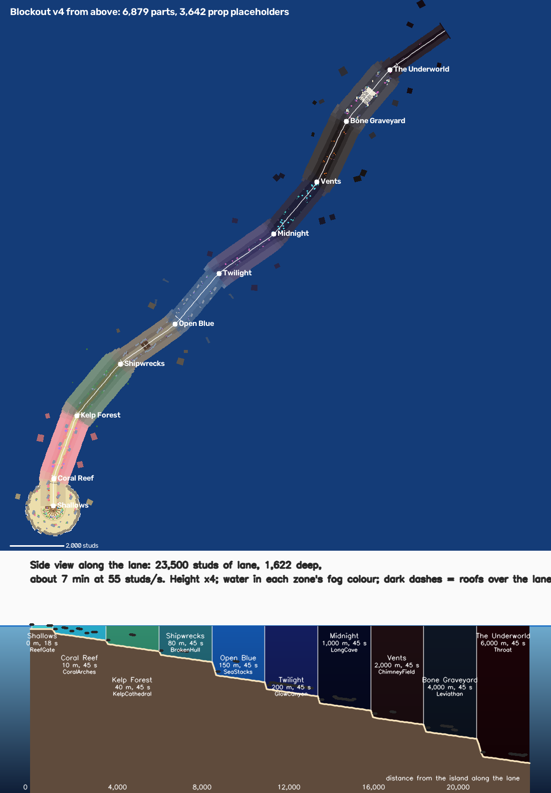
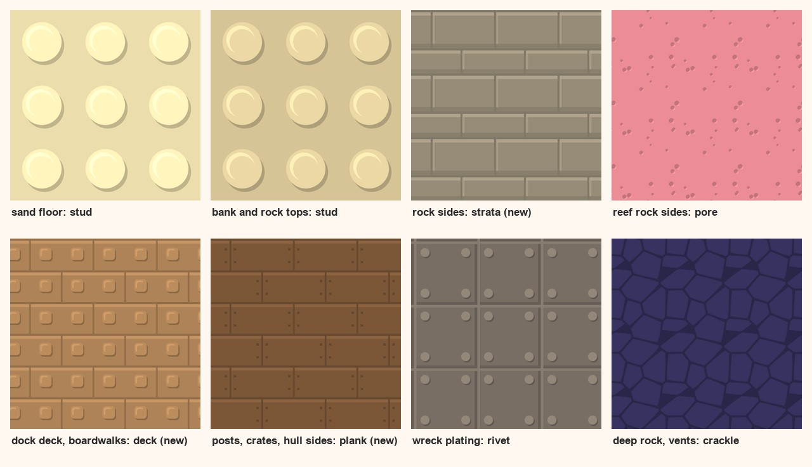
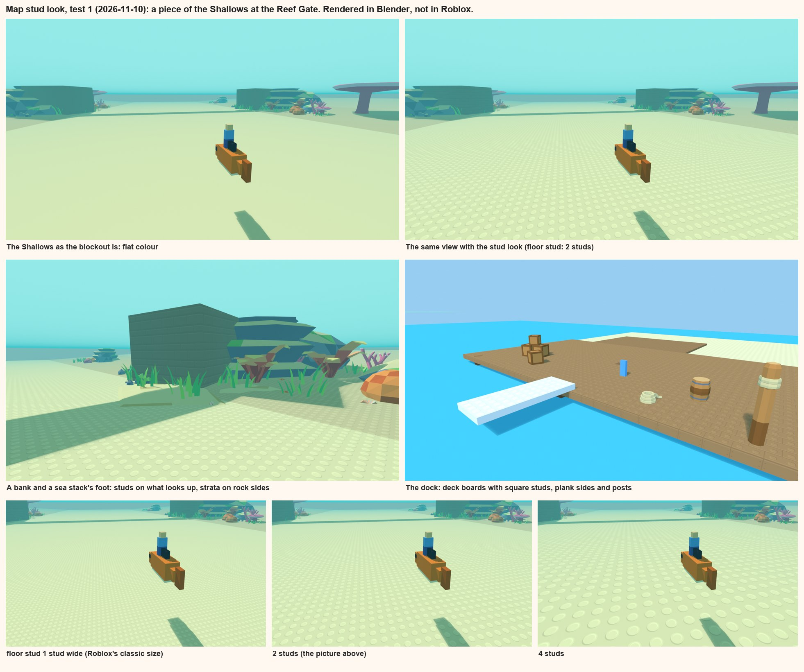

# Map state, and the stud look for the map

> **Set aside 2026-11-10.** The user abandoned blockout v4 and the way this note lays the map out. The map starts
> again, built the way Ride a Dino builds its own: [the map: how we build it](design/map-method.md). Still useful
> here: what the game code reads from the map, and the tiles.

Up: [Home](../Home.md). The map itself is described in [Blockout](blockout.md). Written 2026-11-10 by the map chat
([Sessions](Sessions.md)). **Nothing here is decided: the texture part is a proposal with one test picture, made in Blender,
not in Roblox. Nothing was uploaded.**

## Where the map stands
**Blockout v4**, built by one script (`tools/studio/claude_blockout.luau`) into `Workspace.ClaudeBlockout`:
- **The island:** a half circle, flat edge to the dive. Spawn 110 studs from the board's end; the dock along the flat
  edge with the shops on its wings; eight plots with tanks round the curve.
- **The dive:** one lane, 23,500 studs, through ten zones, each with its own formation, prop clusters along both banks
  and a fog look. About 7 minutes end to end.
- **Size:** 6,879 parts, 3,642 prop placeholders in 175 clusters. All plain Parts in flat colour (SmoothPlastic).

**What the game code reads from it** (changing any of these needs a word with the riding chat first):
- The sea surface is y = 0.
- `Dive.Path`: the lane's centreline on the floor, `{ s, x, y, z, w, c }` every 100 studs (`w` the lane's width, `c` the
  clearance under a roof, 0 where the water is open).
- Each zone's `Floor` marker with `ZoneName` and `Metres`, and the `Looks` attribute.
- Open water over the lane: the fish swim 5 to 16 studs above the floor and a jump rises 21 more.

### Redrawn today for the deeper lagoon
The lagoon floor went from 30 to 39 studs down (`LAGOON_Y`, [Decisions](Decisions.md)). `art/blockout/v4_zones.json`
and the views are redrawn for it:

| Zone | Floor at its start | at its end |
|---|---|---|
| Shallows | 38 | 42 |
| Coral Reef | 42 | 174 |
| Kelp Forest | 174 | 301 |
| Shipwrecks | 301 | 429 |
| Open Blue | 429 | 666 |
| Twilight | 666 | 833 |
| Midnight | 833 | 1,000 |
| Vents | 1,000 | 1,168 |
| Bone Graveyard | 1,168 | 1,335 |
| The Underworld | 1,335 | 1,622 |

- Every floor height is 9 studs lower; nothing moved sideways. The dive is now 1,622 studs deep (was 1,613).
- One roof changed: the Reef Gate's span hangs from the surface, not from the floor, so its clearance went from 31 to
  40 studs (`c` at s = 800 and 900). It is 2 studs above the water, so in the Shallows the surface is the real roof.
- The lowest roofs over the lane are now the zone gates' signs (50 studs, one per zone) and the reef's two coral
  shelves (56). The Shallows have 38 studs of water over the lane, 37 where the jump needs it most (16 + 21).
- **How it was redrawn:** from the script's own maths, not from a new build. This PC has no Lune (the offline
  builder), so the part counts are still the v4 build's, and the view from above is the old picture (a deeper floor
  looks the same from above). A real offline build needs Lune installed here: that is a download, so it waits for the
  user's yes.

### What is open
From [Blockout](blockout.md), the design notes and the script itself:
1. **The user's verdict on v4.** v4 answers their notes on v3 (the walk to the board, formations, composed clusters).
   No verdict on v4 itself is written down.
2. **The look per zone.** [Workout 1](style/01-going-down.md) still has look A, look B or a mix to pick. The map
   carries a look per zone as data (`Looks`), but nothing in the game reads it yet, so Studio shows plain daylight.
3. **Surfaces.** Everything is flat colour. This note's second half.
4. **Props.** The clusters are stand-ins for the prop kit's meshes (`art/props/`, 73 props). The meshes are not
   uploaded. They are faceted low-poly, made before the creatures went to big blocks: see "The props" below.
5. **The lane's edge.** Workout 1 proposes an invisible wall shown as a current. It isn't built: a rider can swim up
   the banks and away.
6. **How much to finish.** The first version ships four zones ([first version](design/first-version.md)). Zones 5 to
   10 are blocked out to the same level as the first four.
7. **The dock.** Shops and stations are boxes with signs. Open in [the dock](design/the-dock.md): players per server
   (the map has eight plots), the tank, the trainer.
8. **Who shapes it.** [Working together](Working%20together.md) says the user blocks out by hand in Studio. So far
   the map is all script. Saving hand-built pieces as model files in the repo isn't set up.
9. **Small things seen while reading the script:**
   - The Shallows' gate sign stands 54 studs in front of the dive board and rises 32 studs out of the water (its posts
     are 70 tall from a floor 38 down). Worth a look in Studio: is that the first thing a diver should see?
   - The lane's floor and banks are separate slabs every 150 to 300 studs, each turned a little. A tiled texture starts
     again on each slab, so stud rows will not line up across the joins (below).

## The stud look for the map (proposed)
**The aim:** the map and the creatures read as one toy world. The creature side is [workout 6](style/06-textures.md):
grey tiles drawn by code, laid over a model's colours; a mix of round and square studs; most creatures studded from
the top only. The map takes the same tiles and the same rules.

### The rules
1. **The same tiles and the same maths.** A tile is grey; mid grey leaves the part's colour alone. The zone colours
   stay in the parts, so the blends between zones keep working. The map uses the creatures' tiles as they are and adds
   three of its own, drawn with the creatures' grey levels (`tools/art/map_tiles.py`, into `art/style/map_tiles/`).
2. **Studs on what looks up.** The sand, the tops of banks, rocks and stacks, the deck. It is the creatures' "from the
   top only", and it is where a toy brick has its studs.
3. **Sides say what the thing is made of,** quietly: rock sides in strata, wood in planks. Undersides stay plain.
4. **Round studs on what grew, square studs on what was built.** Sand and rock get the round stud; the dock, the
   boardwalks, crates and wrecks get the square one. That is the user's "mix of round and square" given a meaning on
   the map. (Ride a Dino happens to do the same: round on its grass, square on its pen floors.)
5. **The map is quieter than the creatures.** Same strength on the sheet for now (0.5), but the map's tiles should end
   up weaker than the creatures', so a fish always stands out against the floor it swims over.
6. **Glow, water and signs are never tiled.**

### Which tile where

| Surface | Top | Sides | From |
|---|---|---|---|
| Sand floor, lagoon floor, island | round stud | (none) | the creatures' set |
| Banks, rock formations, sea stacks, arches | round stud | strata | strata is new |
| Reef rock, coral shelves | round stud | pore | the creatures' set |
| Dock deck, boardwalks, plot pads | deck: boards with square studs | plank | both new |
| Posts, stilts, crates, the wreck's hull | square stud | plank | new |
| Wreck plating | (plain) | rivet | the creatures' set |
| Deep rock, vents, the Underworld | round stud | crackle | the creatures' set |
| Bone | round stud | pore | the creatures' set |

**What the creatures' set lacks for a map:** strata, plank and deck (drawn). Could follow if wanted: sand ripples for
stretches without studs, kelp bark, barnacles, rust.

### The test picture
A piece of the Shallows at the Reef Gate, rebuilt in Blender from the script's numbers, with the kit's lagoon clusters
(`tools/blender/map_stud_test.py`). The orange block fish is a stand-in for scale, 13 studs long, studded one to a
cube (0.45 studs) like the creatures.

**What it shows:**
- The floor stops being a blank sheet: there is something to see speed against, and it reads as a toy baseplate.
- **Stud size is the main choice.** A creature's stud is one of its cubes, and the cube differs by creature: 0.35
  studs on small fish up to 0.7 on the Blue Whale, and it scales with the spawn size. So there is no one creature
  size to match, and any of them is invisible on a floor 260 studs wide: the map gets its own fixed, bigger stud (the
  creature chat agrees; the size is the user's call). With a stud every 1 stud (Roblox's classic size) the floor is a fine grain that is gone
  a short way ahead of the rider; with one every 2 studs it reads clearly near the rider and fades out before the
  gate; with one every 4 the floor looks like a giant's toy and the fish looks small on it. My pick is 2.
- The sea stacks are still bare boxes. Strata on their sides helps a little; they need shape, not texture.
- The dock takes the look most easily: boards, square studs, plank edges.
- **The props don't take it.** Their faces are slanted triangles, so a stud tile has nowhere flat to sit. In the
  picture they are untouched, and they look like they come from another game than the floor.

### The props
The prop kit was made before the creatures turned to big blocks, in the first faceted style. Three ways on:
- **A. Rebuild the kit's rocks and corals in blocks** (stacked slabs, turned boxes, studs on top), the way the
  creatures were rebuilt. The slab rocks (mesa, pillar, wall, slab stack) are nearly there already; boulders, arches
  and corals are not. The most work, and the only way the map fully matches the creatures.
- **B. Keep the faceted props, stud only the ground and the formations.** Cheapest. Two languages on screen.
- **C. Blocks for rocks, faceted for plants.** Rocks and formations are the big shapes and carry the look; grass, kelp
  and coral branches stay as they are, as soft things among the blocks.

My pick is C. The prop kit (`tools/blender/prop_kit.py`) is Hugo's, so this needs his word too.

### How it would work in Roblox (not tried)
- **Flat parts:** a `Texture` on the part's top face, tiled in studs. The tile is turned into a see-through picture
  first (white where it lifts, black where it shades, clear at mid grey), so the part's own colour shows through. One
  picture then works on every colour, as on the creatures. A plain grey tile tinted by the part's colour would not
  do: it can only darken, so the lit edges would go. Neither has been tried; one test would settle it for the
  creatures' flat faces as well (the creature chat has the same question open in workout 6).
- **The big seabed:** a custom material (a MaterialVariant) could do the same without an extra object on each of a
  thousand slabs, but it covers every face, not only the top. To be tried.
- **The joins:** each slab tiles from its own corner, so stud rows jump at every join along the lane. Ways round it:
  hide the joins under clusters, line the slabs up to a whole number of tiles, or leave it. To be seen in Studio.
- **A test costs three small uploads** (round stud, square stud, deck). Uploads are permanent, so it waits for a yes.

### Open, for the user
- Is this the right way to tie the map to the creatures: same tiles, studs on what looks up, round for grown and
  square for built?
- Floor stud size: a stud every 1, 2 or 4 studs?
- The props: A, B or C?
- What the map chat does first (asked in the chat): texturing, a zone's layout, the dock, or props.
