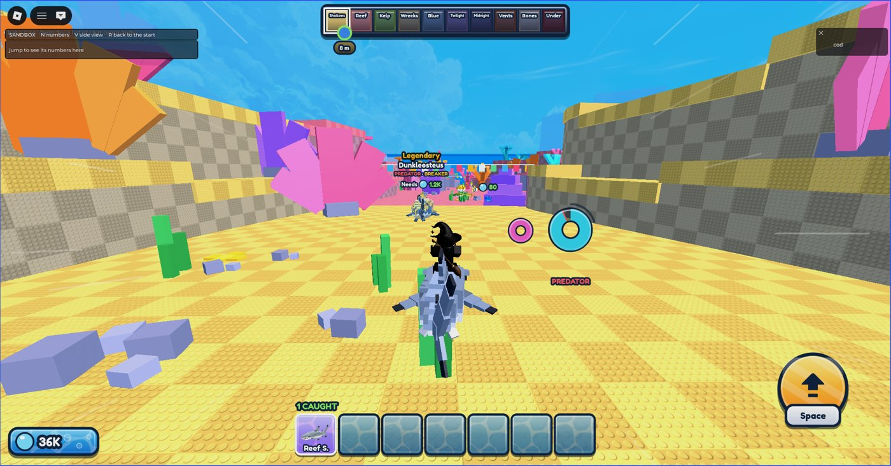
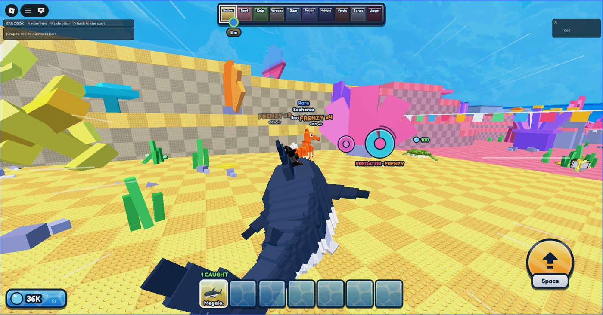
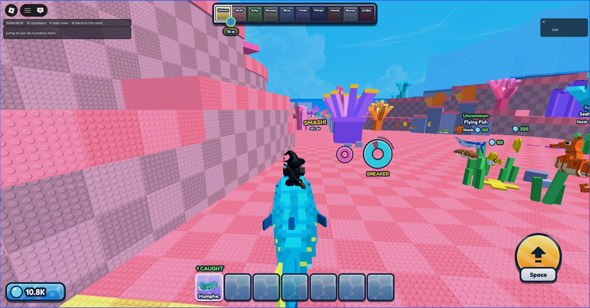

# The passive archetypes: scripted playtest

2026-11-12, a Claude worker on Hugo's PC. What was tested: the six passives of [archetypes](../design/archetypes.md)
as built that day, the per-fish speeds and the variants. Studio was driven only through
`~/Projects/studio-runner/studio-run.mjs` (never Roblox's Studio MCP). No keyboard or mouse: **nobody has played
this by hand yet.**

## How
A temporary LocalScript and Script were put in the place for the run and taken out after (they are kept in
`tools/playtest/archetypes/`, with how to install them). The LocalScript rode each fish through the sandbox's new
"Ride" (a chosen fish put at the lane's start), steered by turning the view the way a player does
(`RideController.look`), pressed the real hop (`Actions.jump`) and read the server's words; the Script measured
the ridden fish from the server's side and wrote the log. Endless air was switched off, and max Oxygen was set for
each fish so the meter could be seen to move. Seven playtests in all; the first one ended by itself after two
minutes for a reason not found (nothing in the output), the rest ran to the end.

**One thing to know:** another worker (the hop-off boost, the second hook and the wall ride) was editing the same
folder during the later runs, and Rojo syncs the folder into Studio. The hop and landing numbers below match what
this work alone should give (a plain hop's window read 3.19 s, so the other worker's airtime by speed was not in
yet), but the last runs, the pictures among them, may have had some of that work live. What is committed with
this note is this work alone; it was rebuilt by itself and passes StyLua, selene and `rojo build`, and should be
measured once more after the other work lands.

## Speed
Ridden, steady, 3.6 s after getting on, the median over 1.5 s, as the rider's machine and as the server saw it.

| Fish | Archetypes | The table says | Rider's machine | Server |
|---|---|---|---|---|
| Clownfish | none | 43.0 | 43.0 | 43.0 |
| Clownfish, Gold | none | 47.3 (x1.1) | 47.3 | 47.3 |
| Clownfish, Rainbow | none | 51.6 (x1.2) | 51.6 | 51.6 |
| Reef Shark | Predator | 70.0 | 70.0 | 70.0 |
| Reef Shark, Gold | Predator | 77.0 (x1.1) | 77.0 at its top; the median was 69.9, it hit a prop in the window | 69.9 |
| Humphead Wrasse | Breaker | 60.0 | 60.0 | 60.0 |
| Swordfish | Fast | 84.0 | 84.0 at its top; the median was 78.6, it hit a prop in the window | 76.7 |
| Swordfish, Rainbow | Fast | 100.8 (x1.2) | 100.8 | 100.8 |
| Dolphin | Leaper | 76.0 | 76.0 | 76.0 |
| Giant Sea Bass | Tank | 54.0 | 54.0 | 54.0 |
| Megalodon | Predator, Frenzy | 112.0 | not steady: it ate fish through the whole window (top 159) | |
| Dunkleosteus | Predator, Breaker | 76.0 | not steady: it smashed a prop in the window (top 85.2 = x1.12) | |

A second Reef Shark run read 70.0 on both sides. The two plain-speed rows that read low were slowed by a prop for
a moment, which is the game working (a fish that is not a Breaker drops to x0.8).

## The passives
| What | Designed | Measured |
|---|---|---|
| **Predator** (Reef Shark): a bite | x1.25 for 1.5 s, +10% air, 2.5 s between bites | three bites at 0.5, 3.1 and 5.6 s; top speed x1.27 to x1.29; the meter went up 9.5 to 9.9% (10% less what drained meanwhile) |
| Eaten fish come back | the herd's top-up replaces them | 750 fish before, 746 right after three bites, 751 a minute later |
| Never a ridden or a reserved fish | | asked of the server's own function on five fish: free, it is prey; with a rider, no; kept for a hop, no; too long, no. **Not tried with a second player** |
| The hop right after a bite | always works | pressed in the middle of a burst: in the air at once |
| **Frenzy** (Megalodon) | stacks to 3: x1.33, x1.41, x1.49; 1.2 s between bites | stacks 2, 3, 3, 3, 3, 3 logged (the first bites came before the log began); bites 1.2 to 1.3 s apart; the server sent x1.41 for 2.5 s, then x1.49 for 3.0 s; top speed x1.47 to x1.57 |
| **Breaker** (Humphead Wrasse): a prop | no cost; x1.12 for 1 s, +4% air | 60.0 to 67.2 (x1.00 to x1.12), the meter +3.7% |
| A plain fish at the same prop (Clownfish) | x0.8, -3% air | 43 to 34.4 (x0.80), the meter -3.4% |
| **Combo** (Dunkleosteus: Predator, Breaker) | both | two bites (x1.25, top x1.29 to x1.33) and a prop paid (x1.12, +3.6%) on one ride |
| **Tank** (Giant Sea Bass, a Rare) | drain x0.65; red from 18% | 65.0 Oxygen a second (a plain Rare, the Seahorse: 100.0); turned angry at 18% of the meter (Seahorse and Clownfish: 30%) |
| **Fast** (Swordfish): landing on one | dips to x0.8, then a burst of x1.44 | 66.9 (x0.80), then 120.7 (x1.44) 1.3 s after the landing, then 84 |
| A plain fish's landing (Clownfish) | dips to x0.8, back to its speed, no more | 34.5 (x0.80), then 43.0 (x1.00) |
| **Leaper** (Dolphin): the hop | window 3.5 s, rise 27, glide x1.2 | window 3.50 s, rose 27.0 studs, glide 77.5 (0.85 x 76 x 1.2) |
| A plain hop (Clownfish) | window 3.2 s, rise 21 | window 3.19 s, rose 22.3 (it rises over the fish it is aimed at), glide 36.5 |

## What must not have changed
| What | Measured |
|---|---|
| Steering: A held for a second | 129 degrees on a Clownfish, 127 on a Reef Shark, 9 more after letting go (the control pass: 129 and 9) |
| The landing's slow-down | x0.80 on both fish landed on |
| Angry mode | a Clownfish turned angry at 30% and slowed in its own style (Zigzag); the Seahorse (Wobble) and the Giant Sea Bass (Drag) too; the hop off an angry fish worked each time |
| The hop's window | 3.2 s off a plain fish |
| Output | no errors on the server or the client in any run. One warning, there before this work and not from the game's code: "ContentId rbxassetid://203785492 failed: asset type does not match" |

## Pictures
The words were held on the screen for 3 s for these two stills (they stay 0.9 s in play).

A Dunkleosteus ahead: its tag says PREDATOR · BREAKER under its name; under the rider's ring, the Reef Shark's own PREDATOR.

A bite: "FRENZY x4, +10% air", speed lines, PREDATOR · FRENZY under the ring.

A smash on a Humphead Wrasse: "SMASH! +4% air".

Full size: `~/Pictures/ride-a-fish/archetypes-2026-11-12/` (`tag-on-a-fish.png`, `bite-frenzy.png`, `smash.png`).

## Not tested
- **By hand: nothing.** How it feels (the kick, the words, the sounds, whether the bursts are too strong or the
  words too small) is unjudged. Sounds were never heard: a script can't hear.
- Two players: a second player's ridden fish next to a predator, and what the others see of a bite.
- The deep lands. Everything ran in the Shallows and the start of the Coral Reef; a Megalodon there has far more
  to eat than at home in the Vents, where most fish are over 0.7 of its length.
- A phone or a gamepad.
- The test steered straight at fish and props, better than a player would: bites came as fast as the cooldown
  allows.

## Found on the way
- Twice the test steered a fish at a prop standing against or beyond the lane's wall: the wall stops the fish, as
  it does every fish. A Breaker breaks props, not walls.
- A plain Clownfish (43) is too slow to catch the herd (about 38 ahead of it), so "a plain fish never eats" was
  not seen in the water; it rests on the code, which asks for the Predator archetype first.
