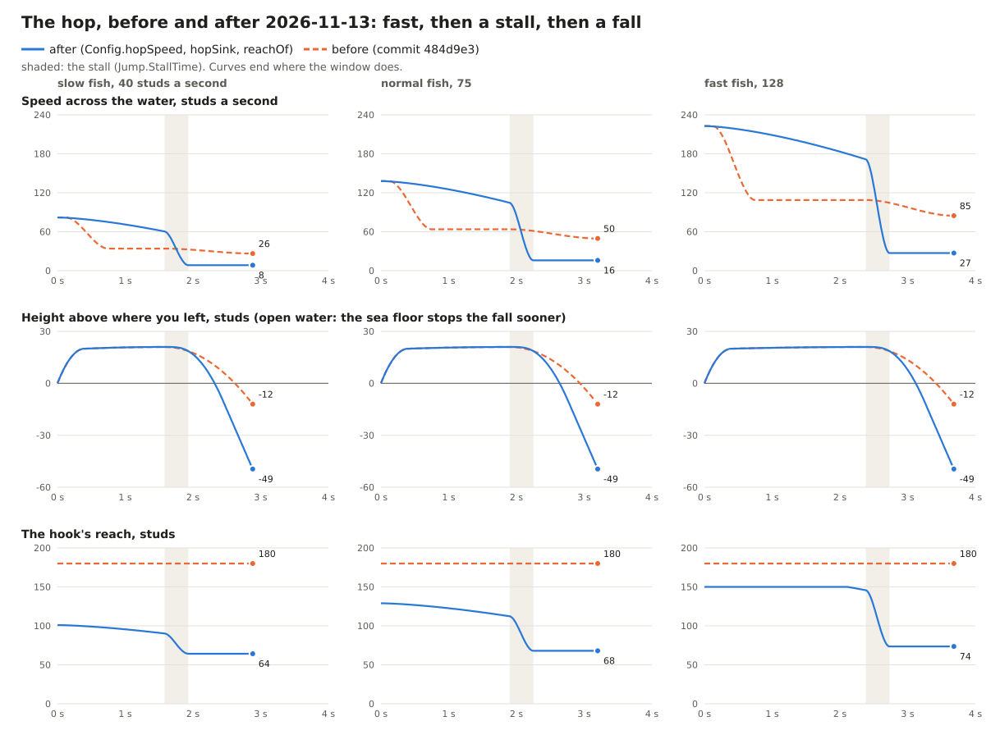

# The wait between fish, the air's shape, the hook's reach: scripted playtest on grey-box 15

2026-11-13, a Claude worker on Hugo's PC, on Hugo's three notes after playing by hand
([riding feel](../design/riding-feel.md), "The wait between fish, the air's shape, the hook's reach"). Studio was
driven only through `~/Projects/studio-runner/studio-run.mjs`, nothing was uploaded, the place was not saved.
No keyboard or mouse: **nobody has played this by hand yet.** Every number is from the final code unless a line
says otherwise.

## How
The driver in `tools/studio/movement_w1/` (temporary scripts, installed for the run and removed after), with new
commands: `spacing`, `air`, `relock`, `rate`, `serverreach`, and a press cadence on `mounts`. It presses the real
hop (`Actions.jump`) and reads the server's words. It does not go through `InputController`, so the new reading of
a held key is **not covered by these runs** (see "Not done"). The only warning in the output is the asset type
mismatch on `rbxassetid://203785492`, which was there before.

## 1. The wait between fish
What blocked a second hop before, and what is left:

| Timer | Before | Now |
|---|---|---|
| `Jump.Cooldown` on the client | 0.3 s from the mount | 0.08 s from the touch (the pull-in's end); a hop is possible from the mount on |
| The same on the server | 0.3 s from its mount | half of `Jump.Cooldown` from its mount; 0.3 s (`Jump.StrainLock`) on a fish too strong for you |
| `Jump.HopGuard`, `MashMost` (presses mashed through the pull-in) | 0.25 s, 1.5 s | unchanged: this is what keeps the second hook shut |
| `Jump.InputGap` (what counts as a new press) | 0.2 s for every device | a key or gamepad button is read itself: held is one press, a new press counts at once; 0.2 s on the mobile button only |
| `Jump.MinFlight` (one press can't leave and grab) | 0.15 s | unchanged |
| `LandWait`, `AckTime`, `RehookGuard` | | unchanged: they are the wait for the server's word, or only hold the hands-off pull-in |

**When the landing animation starts.** It starts on the server's word, the same word that mounts you. In 47
landings over four runs (the last 7 on the final code), from the touch: the animation started after 0.061 s
(median; 0.04 to 0.11, and once 0.203), the mount came 0.001 s after that. So in Studio the gap is about 0.06 s; on a real
connection it is the round trip to the server.

**A hop made on purpose** (one press to grab, none in the pull-in, then a press every frame from the mount):

| | Before (measured 2026-11-13, wall-hop note) | Now (47 landings, four runs) |
|---|---|---|
| The next hop begins, after the mount | 0.302 to 0.316 s | 0.03 s (median; worst 0.056) |
| The next hop begins, after the touch | about 0.36 s | 0.094 s (median of the runs: 0.090 to 0.095; least 0.082, worst 0.129; 0.219 in the one landing whose word took 0.2 s) |
| Hops the server refused | 0 | 0 |

**A whole chain**, fish to fish as fast as presses allow for 45 s (hop the first frame it is allowed, grab the
first frame a fish is locked), three runs each. "Old lock" is the same code with `Jump.Cooldown` set to 0.36 from
the touch, which is the old 0.3 from the mount.

| | Old lock | Now |
|---|---|---|
| Landings in 45 s | 43, 45, 50 | 65, 65, 81 |
| Landing to landing, median | 0.83, 0.83, 0.87 s | 0.55, 0.55, 0.55 s |
| Landing to landing, least | 0.73 s | 0.44 s |

What is left of the 0.55 s is the hop itself: `MinFlight` (0.15 s) and the pull-in (0.14 s plus the distance).

**The second hook.** Space pressed again and again from the grab until a second after the landing, and plain
landings with one press:

| Presses | Landings | Hopped off the fish landed on | A second landing |
|---|---:|---:|---:|
| every 0.05 s | 69 | 0 | 0 |
| every 0.10 s | 117 | 0 | 0 |
| every 0.20 s | 38 | 0 | 0 |
| one press (the grab only) | 87 | 0 | 0 |

311 landings over the day's runs (the last 60 on the final code): **no hop off the fish landed on, no second
landing.** In 3 of them the server refused the first grab before any landing ("Blocked": something solid between
the rider and the fish), the hop went on and took a fish afterwards, once. That is a refused grab, not the bug
(the same case as in the wall-hop note). No grab was refused for range.

A press every 0.3 s or slower is past `HopGuard` and counts as presses made on purpose: land, hop, grab.

**A fish too strong for you** keeps the old 0.3 s (`Jump.StrainLock`). Not run: the sandbox has endless air, so
no fish is too strong there. Checked by reading: the server sets it at the mount where it decides `Strained`.

## 2. The air

Drawn from the formulas by `python tools/movement/hop_curves.py` (before: `JumpController` at commit 484d9e3;
after: `Config.hopSpeed`, `Config.hopSink`, `Config.reachOf`). The height row is open water; in the lane the sea
floor stops the fall 16 to 35 studs under where you left.

Flown in Studio with no grab (six hops each; the first three rows are land 1 fish):

| Hop off | Speed leaving | The pop | End of the fast part | 0.35 s later | Fast part ends | Window | Studs along (before) | Fastest fall |
|---|---:|---:|---:|---:|---:|---:|---:|---:|
| Boxfish, angry | 29 | 64 | 51 | 8 | 1.49 s | 2.79 s | 106 (107) | 90 |
| Boxfish | 40 | 82 | 60 | 8 | 1.58 s | 2.88 s | 136 (115) | 91 |
| Anglerfish | 74 | 136 | 103 | 16 | 1.90 s | 3.20 s | 268 (about 224) | 91 |
| Ember Serpent | 138 | 239 | 184 | 29 | 2.41 s | 3.71 s | 557 (about 470) | 92 |

"Before" along: the angry and plain slow fish measured in the wall-hop note (Pufferfish, the same speeds); the
other two from the old formula (224 and 470).

- **Fast, fading slowly:** at the end of the fast part 55% of the boost is still there (`FastKeep`). Before, all
  of it was gone 0.75 s after the press.
- **The stall:** in 0.35 s the speed falls to a quarter of the glide's pace (8 to 29 studs a second).
- **The fall:** from the top of the hop down to the sea floor (16 to 35 studs under where you left) in 0.9 to
  1.2 s after the fast part ends, at up to 90 studs a second. Before, the sink took the whole 1.3 s to come 33
  studs down, and most of that at the very end.
- **Less speed, a shorter fast part:** 1.49 s off the slowest, 2.41 s off the fastest, as before (airtime by speed).
- **Smoothness.** The most the speed across the water changes between two frames: 3 to 4 studs a second off a
  slow fish, 7 off a normal one, 12 to 14 off the fastest, all in the stall (that is the stall: 150 studs a second
  lost in 0.35 s). No step where the parts join. The camera's biggest change of speed in a frame through the whole
  hop: 8 to 9 studs a second (24 off the Ember Serpent, at 0.53 s, early in the fast part and far from any join;
  not measured on the old code). For scale, a landing's own jolt is about 83.
- **One hard edge, left as it is:** the fall ends on the sea floor in one frame (the rider's fall speed drops by
  47 to 88 studs a second there). The camera shows 8 to 9 of it. After it you lie over the floor at the stalled
  speed until the window ends (0.1 to 0.4 s).
- **Steering:** D held for a second turns 126 and 129 degrees (the control pass measured 129): unchanged.

## 3. The hook's reach
**The herd's spacing, measured.** Riding straight down the lane, the distance from the rider to every free fish,
twice a second:

| Where | Looks | Nearest free fish: median | 90% | 95% | worst | None within 60 | within 80 | within 100 |
|---|---:|---:|---:|---:|---:|---:|---:|---:|
| Lands 1 and 2 (s 400 to 4,900), on a Barracuda | 138 | 38 | 61 | 68 | 84 | 12% | 1% | 0% |
| Down to s 11,200, on a Hellmaw | 157 | 42 | 74 | 82 | 101 | 25% | 7% | 1% |

Fish inside 180 studs of the rider: 9.7 on average in the first lands, 7.7 further down.

**The numbers proposed, from that:** `GrabNear` 60, `GrabRange` 150, `GrabFullSpeed` 180.

| Hop | Reach as it leaves | At the end of the fast part | Stalled | Before |
|---|---:|---:|---:|---:|
| Off a fish standing still (the slowest hop there is: 44 studs a second) | 82 | 80 | 64 | 180 |
| Boxfish, angry (29) | 92 | 85 | 64 | 180 |
| Boxfish (40) | 101 | 90 | 64 | 180 |
| Anglerfish (74) | 128 | 112 | 68 | 180 |
| Ember Serpent (138) | 150 | 150 | 75 | 180 |

**The least there is, and why it is enough:** the slowest hop reaches 80 to 82 studs through its fast part. Slow
fish live in the first lands, where the nearest free fish was inside 80 studs in 99% of looks and never past 84.
Deeper, where fish are further apart (worst 101), the fish are faster and the reach is 112 to 150. Stalled, the
reach is 60 to 75: the nearest fish is inside 60 in 88% of looks in the first lands, 75% further down.

**Fish in reach during a hop** (counted every 0.1 s, 6 hops each; "before" is the same hops counted at 180):

| Hop off | Fast part: before | now | Stall: before | now | Fall: before | now |
|---|---:|---:|---:|---:|---:|---:|
| Boxfish, angry (low) | 8.6 | 4.0 | 8.9 | 3.1 | 9.8 | 2.9 |
| Boxfish (low) | 10.5 | 3.7 | 11.0 | 2.6 | 11.3 | 2.3 |
| Anglerfish (normal) | 10.1 | 7.2 | 11.1 | 4.0 | 11.1 | 2.3 |
| Ember Serpent (high) | 9.8 | 7.7 | 9.2 | 3.9 | 9.7 | 1.2 |

**Hands off, off the slowest fish** (Hugo's standing rule: a hop from the slowest fish must still reach a fish
that is near). With only the shorter reach, 2 of 12 slow hops found no fish and sank: with the camera looking down
the lane, no fish was inside both the reach and the aim's cone. So `Lock.LastChance` was added: once the fast part
is over the lock takes any fish inside the reach you still have, all round, the one nearest the aim first. On the
final code: **24 hands-off hops off slow, angry fish (32 to 43 studs a second), 24 landings, none sank.** 22
landed on another fish, 2 back on the fish they had left (which is close behind a slow hop). Each landing came
2.5 to 2.7 s after the press.

**Aiming at one fish 45 to 165 studs away** (the mounts above; the view held on that fish): with the shorter
reach alone, 7 of 158 hops never locked anything and sank (the fish aimed at stayed out of reach); with a last
chance only ahead, 4 of 104; with it all round, the final code: 0 of 60.

**The ring shows the reach:** the lock only takes a fish inside the reach of that frame, so the ring and the glow
drop off a fish the moment it is out of it; from 80% of the reach outward the ring thins (`Jump.RingEdge`). The
sandbox's line under the panel reads the speed and the reach live. Not judged by eye.

**The server's own check** (it works out the hop's speed itself; nothing the client says about speed or reach is
used). Asked straight through the remote, on the final server code, 24 grabs in two runs:
- 13 after the stall, for a fish 97 to 105 studs away with the client's reach at 68: **13 refused, "Range"**.
- 11 in the fast part, for the furthest fish inside the client's reach (95 to 122 studs of 127): **11 granted**.
- In the 311 real landings above the server refused no grab for range.

Found on the way: the speed the server read off the fish at the hop's word was the hopping rider's, not the
fish's (a first version of the check was too generous by it). It now measures the fish's speed itself, from
where it sees the fish go.

## Still as they were
- The landing's slow-down: least speed 0.15 to 0.45 s after a landing x0.78 and x0.79 (`Ride.StartleSlow` 0.80),
  full speed again 1.6 s after.
- Angry mode: a Giant Isopod 72 calm, 63 angry (x0.87 and x0.88), the `Angry` attribute set.
- A and D, above. The wall glide and the camera's ceiling were not touched and not measured again; the hop still
  goes through `WallRide.step` and `Course.clearMove` exactly as before, with the new speed.
- The archetypes ran throughout (a Leaper's higher and longer hop goes through the same `Config.hopFrom`); not
  measured one by one.

## Not done, and to know
- **Not played by hand.** Whether the fast part feels fast, the stall sudden and the fall like a fall is Hugo's
  to judge. Every number is in `Config.Jump` and in the N panel.
- **The held key is not tested.** `InputController` now reads Space and gamepad A going down, so a held key is
  one press at any frame rate. The driver can't press keys, so this was read, not run. If Space ever fails to
  hop, this is the first place to look.
- The fast part now carries you further: a normal hop goes about 270 studs (was about 224), the fastest about
  557 (was about 470). You pass more of the herd.
- The window is as long as it was, so after the fall there is still time on the floor before the miss.
- The last chance can pull you to a fish behind you, the one you left included. It is one number
  (`Lock.LastChance` 0 turns it off).
- The partner's landing animation is often cut by the next hop now. The fall may want its own pose.

The raw logs are on Hugo's PC in `~/Projects/sharedDH-local/j1-logs/` (not in the repo).
