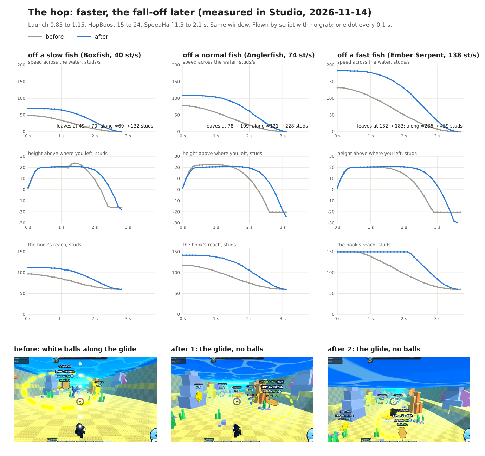

# The faster, slow-mo hop: scripted playtest on grey-box 15

2026-11-14, a NULLROOM worker on Hugo's PC (task h2). Studio was driven only through
`~/Projects/studio-runner/studio-run.mjs`, nothing was uploaded, the place was not saved. No keyboard or mouse:
**nobody has played this by hand yet.** What was built: [riding feel](../design/riding-feel.md), "Faster, in
slow-mo".

Hugo, word for word: "The Player gets way too little speed when jumping off a fish, it should feel like youre moving
fast but in like a slowmo mode, still faster than right now, also remove the trail of balls when gliding and make the
falloff impact speed with a later delay".

## How
The movement driver (`tools/studio/movement_w1/`, installed for the run and removed after): `air 2` (two hops with
no grab off a slow, a normal and a fast fish, sampled every 0.1 s), `serverreach 8`, `fair`, `mounts 16 1 1 0.1`, and
`pose hop` for the pictures. "Before" was run on commit 7dc3980, "after" on the new code. Rojo was not syncing that
day: the three changed scripts were pushed into the place by `tools/studio/push_scripts.py` before the "after" run.
The chart: `python tools/movement/hop_slowmo_chart.py <before.log> <after.log> <out.png> <shots...>`. The raw logs and
screenshots are on Hugo's PC in `~/Projects/sharedDH-local/h2-logs/` (not in the repo).

## The hop, flown (two hops each, both the same to the stud)

| Hop off | Fish's speed | Leaves at (before) | At 1 s (before) | At 1.5 s (before) | 90% of the speed until (before) | Studs along (before) | Fastest fall (before) | Ends under where it left (before) |
|---|---:|---:|---:|---:|---:|---:|---:|---:|
| Boxfish, angry | 29 | 57 (40) | 53 (26) | 41 (15) | about 1.0 s (0.5) | 102 (52) | 78 (66 to 73) | 17 (15) |
| Boxfish | 40 | 70 (49) | 65 (34) | 52 (21) | 1.1 s (0.5) | 129 (67) | 78 (67 to 70) | 18 (16) |
| Anglerfish | 74 | 109 (78) | 104 (58) | 89 (38) | 1.2 s (0.6) | 222 (117) | 78 (65 to 66) | 24 (20) |
| Ember Serpent | 138 | 183 (132) | 177 (105) | 161 (79) | 1.4 s (0.7) | 409 (227) | 78 (60 to 61) | 30 (20) |

- **Faster:** 40% faster as it leaves (+21 to +51 studs a second), about 90% faster a second in, and the hop goes
  1.8 to 2 times as far. You no longer fall behind the herd in a hop.
- **The fall-off later:** nine tenths of the speed is still there 1.0 to 1.4 s in (0.5 to 0.7 s before). Half of it
  is gone at 1.9 to 2.4 s (1.4 to 1.7 before). The fall comes in by the speed lost, so it comes later too: the hop is
  still level at the top until about 1.8 s off a slow fish and 2.2 s off a fast one (1.3 to 1.6 before), then falls a little harder (78 studs a second
  at the most, 60 to 73 before), and ends 2 to 10 studs lower, on the sea floor.
- **Same times:** the glide ends at 1.48, 1.58, 1.90 and 2.42 s, and the window at 2.78 to 3.72 s, as before. The
  speed still runs out to 0 by the window's end.
- **Smooth:** the most the speed changed between two frames anywhere in a hop: 0.5 to 1.9 studs a second (the same
  as before).

## The hook's reach, the server and landings
The reach is by speed (`Config.reachOf`, unchanged: 60 at no speed, 150 at 120 or more). With the faster hop it is
longer and held longer: off the Anglerfish 142 as it leaves (118 before) and 127 at 1.5 s (89 before); off the Ember
Serpent the whole 150 until 2.1 s (until 0.6 s before). Both ends meet at 60 when the speed has gone.

- **The server's own check** (it counts the hop's speed itself from the speed it saw the fish leave at: the same
  `Config.hopFrom` and `hopSpeed`, so the new numbers apply on both sides at once): 4 grabs 0.67 s in for a fish 88 to
  126 studs away (the client's reach 142): **granted**. 4 grabs 3.4 s in for a fish 112 to 114 away (reach 61):
  **refused, "Range"**. 0 of 8 answered wrongly.
- **Hands off, off the slowest fish** (Hugo's standing rule): 6 hops off slow, angry fish (33 to 43 studs a second),
  no press: **6 landings, none sank**, each 2.4 to 2.7 s after the press, all on another fish (2 of 6 were back on
  the fish they had left before: the faster hop carries you past it).
- **Mashed presses** (every 0.1 s from the grab to a second after the landing): 16 landings, **16 clean**: no hop off
  the fish landed on, no second landing.

## The trail of balls
Two trails were in the hop:
1. **The sandbox's arc trace:** a white neon ball every 0.04 s along the whole flight, left in the water until the
   next jump (`SandboxController`). This is the line of balls in Hugo's view (the "before" picture). It is now **off
   by default**; the N panel's "Arc trace" switch turns it back on for judging an arc.
2. **The bubble trail** (`Feel.trail`, 70 white bubbles a second behind the rider through the fast part of the
   glide). No longer in the glide; it stays in the pull-in.

Pictures from the same pose before and after (a hop off a Barracuda in land 1, about 1 s in): the line of white
balls in front of the camera before, none after. The yellow dashes are the lock's ring on the locked fish
(unchanged). The pull-in's yellow dots (`Jump.TrailDots`) were not touched.

## The slow-mo look (on the hopping player's screen only)
While most of the leaving speed is there (`Jump.SlowFull` 0.85 to `SlowUntil` 0.45 of it): the view held 6 degrees
wider (`SlowFov`, on top of the speed's own widening), the colours a little drained (`SlowSaturation` -0.22) with the
contrast up (`SlowContrast` 0.08) and a faint cold tint, by a `ColorCorrectionEffect` under the camera, coming in over
0.2 s and going over 0.35 s (or at once into the pull-in's own zoom); a low, stretched whoosh as you leave
(`SlowWhoosh` 0.45, pitch 0.55, 1.3 s); the camera 1.35 times the riding distance back in the hop (1.2 before). The
game's clock and the hop's real speed are not changed for anyone (co-op), and other players see nothing of it.
**Not judged:** the pictures were taken about 1 s in; the colour change is slight on purpose and hard to see on a
still. The sound was not heard (no audio on the runner).

## Not done, and to know
- **Not played by hand.** Whether it feels "fast but in slow-mo" is Hugo's to say. The sliders: `Jump.Launch` (1.15),
  `HopBoost` (24), `SpeedHalf` (2.1), `CameraZoom` (1.35) are on the N panel. The new `Jump.Slow*` numbers are in
  Config but **not on the N panel** (`SandboxController`'s list belongs to another chat; one row each would add them).
- The rider's animation was not slowed (`AnimController` is another chat's).
- Hops from floating (`FreeLaunch` 60) and a Leaper's `Air` were not changed: a Leaper's hop is now 1.2 x the faster
  hop. Not run.
- The wall glide in a hop and the chain's pace (`rate`) were not run again. A hop that fast into a wall goes through the
  same `WallRide.step` and `Course.clearMove` as the old 239 studs a second off the fastest fish did.
- `tools/balance/model.py` and `tools/playtest/archetypes/client.luau` still model the old hop; other chats'.
