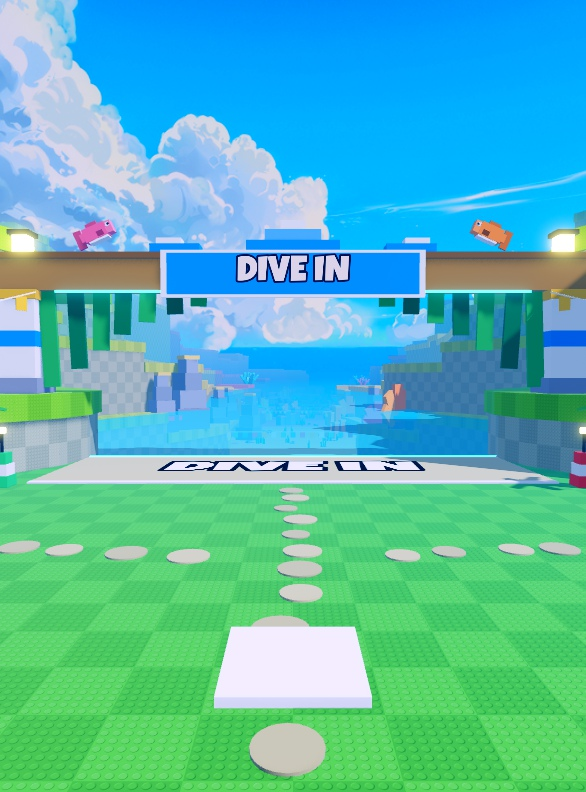
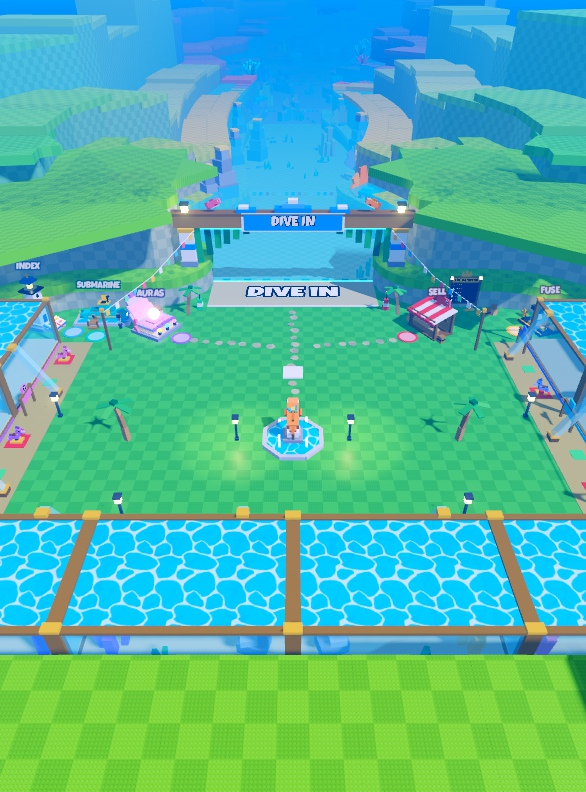
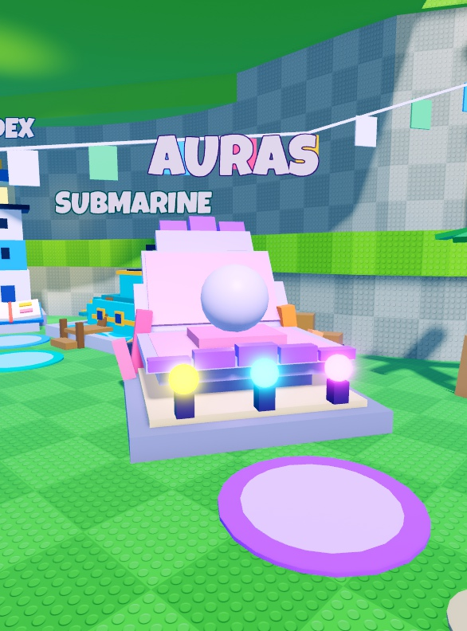
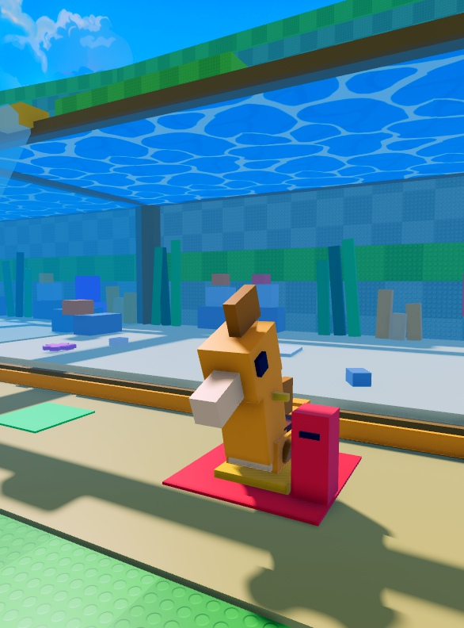

# How stud-style games build their stalls, plots and props

Up: [Home](../../Home.md).

**Second pass, 2026-11-16: 21 videos read, 29 stretches of frames seen, 16 Reddit threads read.**
**What changed most:** in every trending game seen, studs go by what a piece is made of (ground, wall, leaf, awning: studded on every face that shows; signs, eyes, glass and the reference's timber: plain), not by which way it faces, and a plot is an open fenced pen, never a box: both go against our brief's rule 8 and our tanks (section 0 has the full list).

Read 2026-11-16 by a research agent of the map chat, then revised the same day by a second one once YouTube's frames
and Reddit could be read ([how](research-tools.md)). It is the test of [the building brief](../style/building-brief.md):
what do Roblox's own documents, working developers, the builds themselves and the reference's frames say about building
the hub's models?

First pass: 15 pages of Roblox's creator documentation, 22 DevForum threads, 18 video transcripts (captions only), and
the private frames in `research/ride-a-dino/map/`. Second pass: the builds were **watched**. 26 short stretches of video
were fetched and looked at as contact sheets, 3 more were seen from the shared cache of the other chats' fetches: 18
videos in all, 5 of them gameplay of four trending games. 5 videos were heard as text, 2 of them also seen (captions
were refused again, so the sound was turned into text on this PC: names and numbers in those can be wrong). 16 Reddit
threads were read whole and about 250 comments found by word. Nothing was inserted, downloaded or opened in Studio.

Limits to know. **Roblox's pages were read through a tool that answers questions about a page** rather than showing it
whole, so a `docs` figure is as that tool gave it: check the page before leaning on a number. **A frame is 640 pixels
wide on its sheet,** so sizes "by eye" are against the avatar and are rough. **Reddit has answer-bots:** two accounts
that answer many building questions there say or show they are AI agents (one admitted it when challenged in a thread
on Steal an Egg's models). Their answers are marked `bot` below and never counted as a developer's voice. And **nobody
who made one of the trending games was found saying how it is built**: what is below is what shows on screen.

**How sure, in every rule below:** `docs` = Roblox's own page. `several` = several sources agree. `one` = one source.
`frames` = seen in our own frames of the reference. `seen <tag> <time>` = seen in that video's frames in the second
pass. `guess` = ours.

**The short of it.** The documents and the two best developer articles agree on one thing above all: on a phone you pay
for **draw calls** (each different mesh-and-material pair in view, each particle emitter, each beam, each floating
label, each see-through part), not for the number of plain parts. So our parts are fine. What the sources and the
builds question is where we lay studs, how much glass and water we stack, whether a plot should be a box at all, how
close our raised plates sit, and whether a stall has to be a one-off shape.

## 0. What the second pass changed
| # | Before | Now | From |
|---|---|---|---|
| 1 | "Studs on what faces up; sides plain" stood as the reference's rule | **Studs go by material, not by facing.** The reference's walls and green terraces are studded on their upright faces; its timber posts are plain. Throw an Egg, Pull an Egg and a polished stud showcase stud every face of every mass; Pull an Egg studs even its fence rails. Top-only is the **classic** (old Roblox) rule, and Reddit's builders defend it loudly | seen RAD2 0:20, EGG-T, EGG-P 1:35, VOXQ; RED |
| 2 | "One stall three times" was the reference alone | **One stall, recoloured, is the habit.** Seen again in Throw an Egg (red and green awnings), in Pull an Egg (orange and purple), and in the dino devlog's own model sheet (four stalls, one model, four awnings). A builder's street of houses is one kit of pieces in three colourways, by eye | seen EGG-T 1:18, EGG-P 1:25 to 1:39, DINO 4:25, KK 1:40 to 3:12 |
| 3 | Plots: one source and our frames | **Four trending games, one plot:** a fence of posts and two rails on the open floor, one gap for a gate, a small slab sign at the gate, the owner's label in the air. No roof, no glass, no water, in any of them | seen RAD1, EGG-T 0:53, EGG-P, EGG-S 0:58 |
| 4 | "No arrows in the reference's hub" | **Wrong.** The reference floats a "!" with the distance in metres over the next goal. Three neighbours lay a **trail of white chevrons on the floor** from the player to the plot or the shop, and paint **huge words flat on the floor** (START ZONE, Safe Zone, Common) | seen RAD2 0:24, EGG-T 0:19 and 1:26, EGG-P 0:51, EGG-S 0:56 |
| 5 | "No source uses outlines on buildings" | **An outline is built, not drawn:** a dark core block with a lighter plate set a little in from its edges on each face, so a dark border shows all round | seen GKL 4:55 to 6:15 |
| 6 | Reddit unread | Read. Developers there mostly **dislike** the stud look ("stud slop"; "not studded" wins a 118-comment thread) and agree it is what performs with children. Their rule for studs: tops only, inlets below, sides smooth; fit the stud to the piece; build thick. The building teachers they name are RoBuilder, BONES and DatBoiEle; Kingkade 3D is not named once | RED |
| 7 | The palette: no source | **Two or three flat, loud colours fill the screen** (lime floor, red or orange walls, yellow or sand paths); stalls and fences take the wall's colour or brown. Our hub's stations are pastel | seen EGG-T, EGG-P, RAD1; our pictures |
| 8 | A shop "made from a giant prop" (ROB) stood beside the stall | ROB's shops are the **older smooth simulator look** (2021): neon, no studs. Good for ideas, not for our style | seen ROB 1:35 to 2:10, 9:50 to 11:30 |

## 1. The sources

| Tag | What | By | Do developers recommend it, and where seen | Why it was worth reading |
|---|---|---|---|---|
| D-PERF | [Improve performance](https://create.roblox.com/docs/performance-optimization/improve) | Roblox docs | Roblox's own | The rules for batching, shadows, see-through parts, collision flags |
| D-MESH | [Meshes](https://create.roblox.com/docs/parts/meshes) and [modelling specifications](https://create.roblox.com/docs/art/modeling/specifications) | Roblox docs | own | The triangle limit, the detail levels by distance, collision kinds |
| D-STREAM | [Instance streaming](https://create.roblox.com/docs/workspace/streaming) | Roblox docs | own | Atomic, Persistent, the radii |
| D-TEX | [Textures and decals](https://create.roblox.com/docs/parts/textures-decals) | Roblox docs | own | What a Texture on a face can do |
| D-MAT | [Materials](https://create.roblox.com/docs/parts/materials) | Roblox docs | own | Custom materials (MaterialVariant) |
| D-HL | [Highlighting](https://create.roblox.com/docs/effects/highlighting) | Roblox docs | own | What a Highlight costs on a phone |
| D-PP | [Proximity prompts](https://create.roblox.com/docs/ui/proximity-prompts) | Roblox docs | own | How "press E" prompts behave |
| D-IMP | [3D Importer](https://create.roblox.com/docs/studio/importer) and [export requirements](https://create.roblox.com/docs/art/modeling/export-requirements) | Roblox docs | own | Blender to Roblox |
| D-PKG | [Packages](https://create.roblox.com/docs/projects/assets/packages) | Roblox docs | own | One model, many copies, kept in step |
| D-PART | [Particle emitters](https://create.roblox.com/docs/effects/particle-emitters) | Roblox docs | own | Limits on a phone |
| D-PLANT | [Plant reference project](https://create.roblox.com/docs/resources/plant-reference-project) | Roblox docs | own | Roblox's own game with a plot per player, open to edit |
| MCR | [Real world building and scripting optimization for Roblox](https://devforum.roblox.com/t/real-world-building-and-scripting-optimization-for-roblox/3127146) (2024) | MrChickenRocket (Fruit Ninja, Jetpack Joyride; consults for Roblox studios) | **Yes, strongly.** Roblox published it as a guest article by "a community expert"; quoted by BC and WOLO below and in CF's video; **and on Reddit** a developer with heavy maps calls it "a great resource" (2026-08) | The best single source. A phone budget in numbers, and a simulator built to it, open to copy |
| BC | [Optimization For Roblox Environments](https://devforum.roblox.com/t/optimization-for-roblox-environments/3844846) (2025) | BlackoutCedar, environment artist | DevForum tutorial, praised in replies; builds on MCR's talk | The artist's side: limits, see-through parts, shadows, collision per piece |
| WOLO | [The definitive tutorial to game optimization](https://devforum.roblox.com/t/4629258) (2026-05) | WoloPoints | DevForum tutorial | Measured: plain parts batch; colour is free, a second material is not |
| BULL | [MeshParts: usage, performance and optimizations](https://devforum.roblox.com/t/meshparts-when-and-how-to-actually-use-them/1319217) (2021, updated 2022) | BullfrogBait | DevForum tutorial, long praised | When a mesh is the right tool and when a part is |
| ZF | [Z-fight rendering issues that occur on mobile](https://devforum.roblox.com/t/z-fight-rendering-issues-that-occur-on-mobile-which-do-not-occur-on-pclaptop/3134388) (2024) | HealthyKarl, bug report with a test place | one developer's report | Faces that are fine on a PC flicker on a phone |
| STUD | Four DevForum threads on the stud look: [Trendy stud texture](https://devforum.roblox.com/t/trendy-stud-texture/4876870) (2026-09), [How do you build like this?](https://devforum.roblox.com/t/how-do-you-build-like-this/3152921) (2024-26), [Where do I find this stud material collection](https://devforum.roblox.com/t/where-do-i-find-this-stud-material-collection/4082953) (2025-11), [Low quality stud textures](https://devforum.roblox.com/t/4974911) (2026-11) | several builders | working builders answering each other | How the current stud look is made, in their words |
| MISC | Short DevForum threads: [texture instances on every face](https://devforum.roblox.com/t/is-applying-texture-instances-to-every-face-of-a-mesh-a-viable-alternative-to-textureid/805311), [do MaterialVariants cost](https://devforum.roblox.com/t/do-materialvariants-have-an-impact-on-performance/2590033), [how many BillboardGuis](https://devforum.roblox.com/t/whats-the-practical-limit-for-billboardguis-how-many-can-there-be-in-a-scene-before-i-have-to-worry/3958385), [hundreds of billboards](https://devforum.roblox.com/t/how-to-render-hundreds-of-billboards-without-lag/4025769), [should I use parts or MeshParts](https://devforum.roblox.com/t/should-i-use-roblox-parts-or-meshparts/3753133), [increase the triangle limit](https://devforum.roblox.com/t/increase-the-max-triangle-limit/4650221) (2026-05), [should I move to Blender?](https://devforum.roblox.com/t/4988889) (2026-11-13) | various | forum answers, each one voice | Small facts and where developers disagree |
| RED | **Reddit, 16 threads read whole** (r/robloxgamedev and r/ROBLOXStudio, 2026-07 to 2026-11). On studs: [How to use stud texture accurately?](https://www.reddit.com/r/robloxgamedev/comments/1xl4r82/), [How are creators making the stud type models](https://www.reddit.com/r/robloxgamedev/comments/1wy8c5d/), [I tried to build in stud form](https://www.reddit.com/r/robloxgamedev/comments/1xeo2x9/), [Please help me decide](https://www.reddit.com/r/robloxgamedev/comments/1xow6al/) (studded or not), [a Subway Surfers remake](https://www.reddit.com/r/robloxgamedev/comments/1x3bw3h/), [How do i make my builds look better?](https://www.reddit.com/r/ROBLOXStudio/comments/1wl1fao/) (**a studded sell stall on a plot**, 19 comments), [Slop or not?](https://www.reddit.com/r/ROBLOXStudio/comments/1x07tvz/), [my cute stud animals](https://www.reddit.com/r/ROBLOXStudio/comments/1xitt8j/), [Studded or no?](https://www.reddit.com/r/ROBLOXStudio/comments/1vvxefo/) (**162 points, 118 comments**, 45 read), [a studded asset pack](https://www.reddit.com/r/robloxgamedev/comments/1wwpggj/). On Steal an Egg's models: [one](https://www.reddit.com/r/robloxgamedev/comments/1wypqz7/), [two](https://www.reddit.com/r/robloxgamedev/comments/1x61e7h/). On cost: [2M triangles on mobile](https://www.reddit.com/r/robloxgamedev/comments/1vw81zo/), [800 parts into a union](https://www.reddit.com/r/robloxgamedev/comments/1v3qwlf/), [optimizing parts](https://www.reddit.com/r/robloxgamedev/comments/1uvdojk/). On craft: [tips for better building](https://www.reddit.com/r/ROBLOXStudio/comments/1xu6z0h/) | many voices; a few are bots | Reddit's own cross-section: the most upvoted answer in a thread is the best signal there is | What working developers and hobbyists say to each other about the stud look, and who they send beginners to |
| CF | [Your Roblox Game LAGS (and how to fix it)](https://www.youtube.com/watch?v=YWyJHwynM1M), 39 min | Crusherfire | **Yes.** "I heavily recommend watching crusherfire's video" in a 2025 DevForum thread; his modules are cited in several 2025-26 threads; named a handful of times on Reddit | Shows the Studio tools in use; adds what occlusion culling does not hide |
| DINO | [This Roblox dino game was built in 3 days (Ride a Dino Devlog #1)](https://www.youtube.com/watch?v=ihhXpxSCd08), 11 min | RideADinoRoblox | not found (414 views) | A collect-and-earn game's own build diary. **Not our reference, and not stud style:** a second game of the same name, smooth low-poly meshes painted by vertex (seen 3:25 to 5:00) |
| GKL | [How to build in the Steal a Brainrot / Grow a Garden art style](https://www.youtube.com/watch?v=1t3jvqovQvo), 13 min | GKLGames | not found | The only tutorial found that names how the trending games lay studs. Now seen: the layering, plate by plate |
| ROB | [How to make creative and unique simulator shops](https://www.youtube.com/watch?v=mlUscye5tf8) and [How to make good simulator maps](https://www.youtube.com/watch?v=Y3eUDs3FFGQ) | RoBuilder | **Yes, as a teacher:** named on Reddit for modelling and building in threads from 2025 and 2026; credited in older DevForum threads | A simulator builder on what a shop and a spawn area need. **The older smooth look,** not studs |
| KK | [How to get stud textures](https://www.youtube.com/watch?v=Ak9Xd8DALqM), [10 building tips](https://www.youtube.com/watch?v=J57CWAn7-34), [import from Blender with colour](https://www.youtube.com/watch?v=6A23SZwEqVQ) | Kingkade 3D | **Not found:** no mention on the DevForum, none in about 7,100 Reddit comments looked through | Plain working method, no padding. Take it as one builder's way |
| PLOT | [How to make a plot system in Roblox](https://www.youtube.com/watch?v=T-ZHbbtZelU), 19 min | Supdoggy 2 (says the system ran in games with 17 million visits) | not found | How plots are handed out and signed |
| SMALL | Short ones: [stud assets quick](https://www.youtube.com/watch?v=fpPpb_edVgY) (Blue Baery), [stud texture](https://www.youtube.com/watch?v=ZuCBDGkEklY) (PineappleDev), [brainrot models in Blender](https://www.youtube.com/watch?v=MHmrHfpbkKI) and [4 Blender tips](https://www.youtube.com/watch?v=2n41VvZRULc) (Clonemace), [turn your map into studs](https://www.youtube.com/watch?v=wSetlYrQtT8) (AEPBR) | various | not found | One fact each |
| THORNS | [Beginner's guide for stud building](https://www.youtube.com/watch?v=sobV1hipMdU), 1:25, no speech | Thorns | a builder on the DevForum points beginners to it | The classic stud build, step by step, all of it seen |
| VOXQ | [Ultimate Stud Build: map showcase](https://www.youtube.com/watch?v=u2So_II589Y), 1:25, no speech | Voxq (sells the map) | not found | The most polished stud build seen: what "low poly stud" looks like finished. All of it seen |
| DEH | [How to build PRO Roblox maps](https://www.youtube.com/watch?v=I-AB6pJ-y5g), 5:35 | DeHapy | not found (243,000 views) | A simulator map laid out in an hour, in his words. Heard, not seen |
| ICE | [5 building tips](https://www.youtube.com/watch?v=7kqghm8oqa8), 5:47 | Ice Guy | not found | Realistic interiors, so thin for us. Heard |
| GM8 | [Tips to get better at building](https://www.youtube.com/watch?v=0inGfrbe24U), 4:23 | Gamer M8 | named twice on Reddit (467,000 views) | Colour, texture size and step sizes in plain words. Heard, not seen |
| KIT-B | [How to make a Steal a Brainrot game #1](https://www.youtube.com/watch?v=Tz0tu3HdAi0), "Making the base" 4:07 to 9:50 | ZeDarkAlien | not found | A look-alike kit's plot ("base") taken apart in the Explorer. Seen, not heard. Sells its finished game: structure only |
| RAD1, RAD2 | Gameplay of **Ride a Dino, the reference**: [RoBros](https://www.youtube.com/watch?v=AHSi1nml8iw) 0:20 to 1:20; [BemmyBlox](https://www.youtube.com/watch?v=PIet23DxjZc) 0:00 to 0:32 (the game's own intro) and 5:36 to 6:08 | players | the reference itself | Its hub, stalls, pens, walls and signs from more sides than our own frames. Rules only |
| EGG-T | Gameplay of **Throw an Egg**: [Foltyn](https://www.youtube.com/watch?v=dSK2g5GwSwg) 0:15 to 1:40 | a player | a neighbour | Hub, plots, stalls, trails |
| EGG-S | Gameplay of an egg-stealing game ([FoltynPlays, "Don't steal my eggs"](https://www.youtube.com/watch?v=39i0kjHXseU), 0:15 to 1:15). The search for Steal An Egg returned it; **the game's name is not on screen in the frames seen** | a player | a neighbour | Hub labels, floor, a plot's fence and sign |
| EGG-P | Gameplay of **Pull an Egg**: [Foltyn](https://www.youtube.com/watch?v=LkJ6X7WTgC4) 0:15 to 1:15 | a player | a neighbour | Hub, plots, a booth, floor words and trails |
| FRAMES | `research/ride-a-dino/map/hubA.jpg`, `hubB.jpg`, `H1.jpg`, `A.jpg`, `full_12.png` | our own recordings | the reference itself | How its stalls, pens and signs are made. Rules only |

Read and found thin (as the last study warned): VainOath's three art styles, DatBoiEle's "how all games make their maps"
(an advert for a model shop), MeinDevv's "make a game like Steal an Egg" (it installs someone's kit from a Discord).
Their one or two facts are used below with a `one` tag.

**Who Reddit sends a beginner builder to** (names counted in about 7,100 comments that another chat's scan had already
fetched through the shared reader, 2025-01 to 2026-11; the scan looked for recommendations, so it is a sample, not all
of Reddit; scripting teachers left out): RoBuilder 11 comments by 9 people, Crusherfire 10 by 8 (for performance),
BONES about 10 by about 6 ("for building I recommend BONES"), SmartyRBX 16 by 9 (mostly for getting started),
DatBoiEle 3 by 3 ("a good environmental artist"), Imphenzia 2 (Blender low-poly), Gamer M8 2. Kingkade 3D, GKLGames,
DeHapy: none. `several` for RoBuilder and BONES, as teachers of building in general. Nobody on Reddit names a teacher
of the **stud** look. The usual advice instead: practise, build from a real reference, add the small things (a sill, a
step, a frame), and look at other people's builds.

## 2. The rules, by question

### 2.0 What the trending games look like, now seen
For rules only. We never copy a game's models or its look. Sizes are by eye against the avatar.

| | Ride a Dino (the reference) | Throw an Egg | Pull an Egg | The egg-stealing game |
|---|---|---|---|---|
| Floor | One green, two tones in a big checker, small studs. Pens' floors sand | One lime green, studs. The throwing lane yellow | One lime green, round studs | One green, a pattern of big rounded squares |
| Walls | Pale and green stepped blocks, **studded on their upright faces** | **Red**, studded, closing the hub in | **Orange**, studded, closing the hub in | Navy with green tops, patterned; brick towers at the hub |
| Plot | Sand pad, brown fence of posts and two rails, plain wood | The floor itself, red fence of posts and two rails, a gate gap with X-braced leaves | Orange fence of posts and two rails, **studded on every face** (close-up at 1:35) | Brown fence of posts and two rails |
| Sign at the plot | Black slab on a post, white and coloured words ("Upgrade Pen Level 1 > Level 2 $1M") | Blue slab lying low at the gate ("Upgrade Pen") | not seen | Small board on a post ("Upgrade Base") |
| "This one is yours" | Owner's face, name and money a second in the air | A big red arrow in the air over it | not seen | Pink "Your Base" in the air |
| Stalls | Three of one model: thick brown posts, a curved awning of two-colour stripes, a counter; a coloured disc on the floor; a coloured name in the air | Small barn-red stalls, the same one with red-and-white and green-and-white awnings; a red arrow in the air over the one to visit | Small booths of one model with orange-and-white and purple-and-white awnings, about a player and a half tall; a name board over the counter ("GEARS") and **a shopkeeper figure standing behind it** | Coloured pill-shaped labels in the air with icons ("Sell", "Play!", "Buy") |
| Showpiece | Giant dinosaurs at the pens; the fuse egg glows in the middle | A crowned shark on a red pad raised on short posts, roped off | Giant eggs along the wall | A T-rex and other giants over the gate |
| Guidance | A "!" with metres to go; a yellow ring on the ground in the first catch; one line of words on screen | White chevron trail on the floor; red arrows in the air; "Safe Zone" painted on the floor | White chevron trail; "Common" painted huge on the floor | White arrow trail on the floor |
| Trees | Flat studded plates on a plain trunk | Stepped cones of studded plates on a red trunk | none seen | Blocky, studded all over |
| Colours that fill the screen | green, sand, pale stone, brown | lime, red, yellow | lime, orange | green, navy |

`seen RAD1, RAD2, EGG-T, EGG-P, EGG-S` throughout; `frames` for the reference's columns too.

What the table says:
- **A plot is an open pen.** Four games, the same thing: posts taller than the two rails, low enough to see over, a
  gap for a gate where one was seen. The creatures stand in the open air with their labels. `several`, seen
- **A stall is small and is one model.** A player and a half to two players tall, two to three wide. It is told apart
  by the awning's colour, the name and what floats over it. `several`, seen (RAD2 5:48 shows two side by side; EGG-T
  1:18 and EGG-P 1:25 to 1:39 show two colours of one booth)
- **Every big mass is studded on every face that shows:** floors, walls, terraces, leaves. `several`, seen. The wall
  close-up is RAD2 0:20: a pale wall and a green block, both studded upright, with a plain brown post between them.
- **Timber is the one place the games differ.** The reference leaves its brown posts and rails plain. Pull an Egg
  studs its orange fence on every face, rails and all. `seen RAD2 0:20, EGG-P 1:35`. Sign faces are plain in all.
- **The hub is a closed bowl or box of a second loud colour.** `several`, seen (3 of 4)
- **Nobody trusts the player to find the plot.** A trail, an arrow or a marker with metres leads there. `several`, seen
- **Words are on the floor** as well as in the air, very large, white with a dark edge. `several`, seen (3 of 4)
- **A giant creature on show at the spawn.** `several`, seen (4 of 4), and said by DEH: he puts the costliest pet by
  the spawn "to always throw it in their face". `one`

Still true from the first pass:
- **Steal a Brainrot, Grow a Garden, Build a Zoo:** built from plain parts with a small-stud custom material on
  every face, and small slabs layered on every big block. `one` (GKL, a builder copying the look, not their makers),
  now `seen GKL 2:14 to 2:58`. Their characters are made in Blender with the Remesh modifier set to Blocks. `one` (SMALL)
- **A look-alike kit's base:** green round-stud floor, a sand road down the middle, bases in two rows either side, a
  brown brick wall all round. Each base is a grey frame with a big white board on top ("Empty Base"), a row of green
  collect pads beside grey plinths, a yellow disc on the floor with "Lock Base" in the air. `seen KIT-B 4:10 to 9:34`
- **Steal an Egg's models:** nobody on Reddit knows. Two threads ask; the answers are guesses (hand-made by hired
  modellers; AI; bought packs), and the one long confident answer was a bot that then said so. `several` that it is
  unknown
- **The "trendy" outlined stud** can be had with two Textures stacked. `several` (STUD)
- **A dino collect-and-earn game built in three days** began as 4,000 blocks, was told "make everything real 3D
  models, no unnecessary parts", and became 463 Blender models painted with vertex colours: 3,790 parts down to 721.
  `one` (DINO), the figures `seen DINO 4:41`. Its fix list after the first review: map cramped, gates need
  significance, signs are flat text, **zone labels overlap**, lobby bare and boring. `seen DINO 6:40`

### 2.1 How a hub and its plots are put together
- **Everything you use is in view from where you appear.** A simulator builder lays the spawn in the middle, the
  boards close by, the shops and the thing you collect on opposite sides, a little way out so there is a reason to
  walk. `one` (ROB), his plan and his finished spawn `seen ROB 4:30 to 5:26`: a round island in a ring path, sand
  paths out to a shop, two leaderboards, a chest on a red pad. Onett's talk says the same of veterans' collections
  ([the videos note](roblox-videos.md)). `several`
- **Or the spawn at one side,** so the player is led across the map past everything. `one` (DEH)
- **A spawn area is 250 to 300 studs square** in most simulators. `one` (ROB); DEH starts from a floor "about 250 by
  250". `several` now. The reference's is about 230 by 180. `frames` ([the map note](ride-a-dino-map.md)). Ours is in
  that range.
- **Mark the places first, build second.** Both builders begin with a flat floor and a coloured block where each
  point of interest will stand, and only then model. `several` (ROB `seen 4:30`, DEH)
- **Paths:** one big ring and short spokes to each point of interest, with one grander path to the main way out.
  Points of interest stand on a pad of their own colour. `one` (DEH)
- **A ring of plots round a hub confused players; one road did not.** The dino devlog's first map was a hub with
  ranches in a ring: "nobody could tell where to go next". It was rebuilt as one road from the town past the ranches.
  `one` (DINO), the road `seen DINO 6:48`. The look-alike kit and KK's own map do the same: plots in two rows either
  side of a road. `seen KIT-B 9:34, KK tips 1:12`
- **Put the shared machine where others can watch.** The same game moved its fusing lab out of each ranch into the
  town "so that fusing is something you travel for and something other players can watch". `one` (DINO)
- **Plots are placed by hand, numbered, and handed out on joining:** the first free number. The player is put on their
  plot when they appear. The sign shows the owner's name **and their avatar picture**, and is switched off when the
  plot is empty. `one` (PLOT). The sign itself is the plainest thing there is: a slab on two short legs, a SurfaceGui
  on its face, a picture in the left third and a line of text beside it. `seen PLOT 9:50 to 11:50`. The reference does
  the same in the air: a face, a name and money a second float over each pen. `frames`
- **Roblox's own sample clones a plot from a template** kept in ServerStorage when the player joins, and removes it
  when they leave. It prefers cloning a ready-made model to building one from code. `docs` (D-PLANT)
- **Six plots is usual.** `one` (PLOT); six pads in KK's map `seen KK tips 1:09`. We have eight; the reference shows
  more than six pens. `frames`
- **Make plots a different colour from the map** so they stand out. `one` (KK): flat yellow studded pads on a green
  floor, `seen KK tips 1:09 to 1:21`. The reference's pens are sand on green. `frames`. But Throw an Egg's plots are
  the floor itself, with only the fence. `seen EGG-T 0:53`. So: a floor of its own **or** a fence; the reference has both.
- **A station is read by three cheap things, not by its model:** a big coloured floating name, a flat coloured disc on
  the floor, and one colour shared by both. `frames`, `seen RAD2 5:48`. In the reference **sell, auras and the airline
  are the same stall three times**, with a red, a purple and a blue-grey striped awning. Only the fuse machine, the board
  and the rocking toy have shapes of their own. `frames`. The disc can be a thin ring line instead of a filled disc:
  the sell stall's is. `seen RAD1 0:52`
- **A badge on the name pulls you over:** a red "!" beside AURAS, a count "0/3" under Fuse Machine. `frames`
- **Stalls are small against the avatar:** about two players tall with the awning, two to three wide. The creatures
  and the text are what is big. `frames`, `seen RAD2 5:48, EGG-T 1:18, EGG-P 0:27`
- **Prompts.** A proximity prompt shows inside a set distance; a hold time of 0 fires at once; on a phone a tap on the
  prompt always works. **It needs a clear line from the camera by default** (`RequiresLineOfSight`), so a prompt
  behind glass will not show. Prompts on different keys show together; prompts on the same key show one at a time.
  `docs` (D-PP). The reference shows three at once at a pen: E Ride, F Deposit, R Manage. `frames`. Throw an Egg shows
  "E Hatch" on the egg and "E Mailbox" at the gate. `seen EGG-T 0:53`
- **Or no prompt:** the dino devlog's stalls open their shop when you walk up. `one` (DINO). The reference's rings
  suggest the same for stations. `frames`, `guess`
- **Leading the player.** See 2.0: a marker with metres (the reference), a chevron trail on the floor (three
  neighbours), a big arrow in the air over the plot or the stall to visit. `several`, seen. One Reddit voice, on a
  game with one arrow path already: "kids don't like reading, so just have arrows pointing to stuff". `one` (RED)

### 2.2 Parts or meshes
- **Plain parts are meshes inside the engine and batch the same way.** Parts of one material draw together whatever
  their colour, size or turn. A second material adds draw calls; a second colour does not. `several` (MCR, WOLO
  measured it, D-PERF)
- **Identical MeshParts batch too,** when the mesh id and the texturing match. A mesh imported twice gets two ids and
  stops batching: import once and copy. `docs` (D-PERF), `several` (MCR, CF, BULL)
- **What does not batch:** see-through parts (each is its own draw call, and layers of them are drawn over and over),
  particle emitters and beams (one draw call each, however few particles), floating and surface labels, shadows.
  `several` (MCR, BC, WOLO, CF, D-PERF)
- **Textures and decals on faces "don't batch well".** `docs` (D-PERF). A Texture with its own picture id counts as
  its own material. `one` (MCR). Whether hundreds of Textures sharing **one** picture batch is not settled: one old
  forum answer says they do. `one` (MISC). This is our case: see test 1.
- **A phone's budget, from the developer Roblox asked to write it:** about 500 draw calls and 500,000 triangles in
  view, labels under about 150 draw calls, under 1.3 GB of memory, for 60 frames a second on nine phones in ten at
  the top quality setting. His own simulator sits near 100 draw calls and 150,000 triangles. `one` (MCR), repeated by
  CF and WOLO. On Reddit a developer reports 60 frames a second on his own phone at about 524 draw calls and 2 million
  triangles; the answers: test on a cheap Android (one says about half of Android players have 4 GB or less), a warm
  phone is normal, and triangles alone are the wrong thing to count. `one` each (RED)
- **Why games still turn part builds into meshes:** fewer instances and fewer draw calls where a build mixes
  materials. His houses went from 100 parts and 12 draw calls to 6 meshes and 6 draw calls, one mesh a material,
  made inside Studio (union by material, Export Selection, import again). `one` (MCR). The dino devlog went from 3,790
  parts to 721 by moving every prop to a mesh. `one` (DINO). Reddit says the same of trees by the thousand: one mesh,
  one small colour picture. `several` (RED, three voices)
- **Why not to:** parts need no download and no upload; a mesh has to be fetched; equal models as parts came out
  slightly lighter than as meshes. Use a mesh when the shape cannot be made well from blocks. `several` (BULL, BC,
  MISC). "A part is the most efficient thing your game can render, then a well-made mesh, then a union." `one` (RED)
- **Unions:** messy triangles, odd collisions, and each different union is its own draw call. `several` (BULL, WOLO,
  RED). One Reddit voice disagrees: unions draw as meshes do and are fine for moderate shapes; meshes win because
  copies batch. `one` (RED)
- **A MeshPart's limits today:** 20,000 triangles a mesh. `docs` (D-MESH). Detail drops by distance on its own:
  full under 250 studs, medium to 500, lowest beyond. `docs`. Collision kinds from cheapest: Box, Hull, Default,
  Precise; a mesh nobody can touch should still be set to Box, because the collision shape is kept in memory.
  `docs`, `several` (CF, BULL, BC)
- **Texture memory goes by pixels:** 1024 square costs four times 512 square. Keep most pictures at 512 or less.
  `docs` (D-PERF)
- **So for our hub:** 1,106 plain parts is about 13,000 triangles and, if they share one material, a handful of draw
  calls. The parts are not the cost. The glass, the water, the labels, the lights and the stud pictures are where to
  look. `guess`, from the rules above

### 2.3 Studs
- **Three ways are in use now.**
  1. **A custom material** (a MaterialVariant in MaterialService) picked on the part. It covers every face, follows
     the part when it is resized, and carries a bump map, so studs catch the light. The one tutorial on the Steal a
     Brainrot look uses a free pack called "2022 Stud Material" and says most of those games use its **small stud**.
     `one` (GKL): the pack's materials sit in MaterialService, about seven of them by the Explorer's list (big stud,
     diamond, inlet, small stud, stud, universal, weld: small print, a name may be misread), and one click puts studs
     on all six faces of a block, `seen GKL 1:52 to 2:58`. A second builder
     shows the same with five kinds in a folder (inlet, studs, small studs, universal, weld). `one` (KK), `seen KK 0:39
     to 1:09`
  2. **Pictures on faces** (Texture instances). The "trendy" stud with a grey line round each one is two Textures
     stacked: Roblox's baseplate grid and the classic stud over it, each a little see-through. `several` (two
     builders in STUD, with a file). This is the way we use today, with one picture. A Reddit answer gives it as the
     cheapest way, one stud a tile so it lines up with the grid: but that answer is a `bot`.
  3. **The old surface setting** brought back by a plugin (Resurface, Restuds), face by face. `several` (SMALL, STUD,
     THORNS, RED). Resurface's bar has three buttons, "Studs", "All Faces" and "Set Plastic", and a second mode named
     "MaterialVariants" (small print; what that mode does was not shown): so it lays studs on tops or on every face
     of a whole selection in one click. `seen SMALL (Blue Baery) 0:27 to 0:39`. His tree: leaves studded on every
     face, trunk plain. Roblox's own stud pictures change with the graphics setting, so they look
     different on a weak phone. `one` (STUD)
- **Nobody models studs** as geometry. "Avoid fabricating studs with hundreds of tiny parts." `several` (STUD)
- **On a mesh:** bake the studs into its colour picture, or give it the custom material. `one` (STUD). "A low-poly
  model with a stud texture, and probably a normal map" is Reddit's most upvoted answer on how the stud animals are
  made. `one` (RED)
- **What a custom material costs:** next to nothing to draw; some loading time and memory for its pictures. `several`
  (MISC, forum voices, not measured)
- **Where they go: two schools, and they do not agree.**
  - **Classic (old Roblox):** studs on tops, inlets underneath, sides smooth, or "weld" and "universal" on sides;
    whole-number sizes on the grid; plates 0.4 studs tall; no studs "spammed" on every side. `several` (RED: at least
    six voices in three threads; THORNS shows it, `seen THORNS 0:45`). On a thread showing **a studded sell stall on a
    plot**, the top answer by far is "maybe don't make all sides have studs". `one` thread, many votes (RED)
  - **Trending ("stud style"):** the stud material on **every** face of every mass, varied by role. `several` (GKL,
    KK), and seen in play: the reference's walls and terraces, Throw an Egg's and Pull an Egg's walls, every rock,
    wall and leaf of the showcase map. `seen RAD2 0:20, EGG-T, EGG-P, VOXQ`. KK's houses use "weld" (a diamond
    lattice) on plaster walls and studs on roofs, beams and steps. `seen KK 2:04 to 2:20`
  - **What both leave plain:** sign faces, eyes and mouths (flat plates of pure colour), glass, tree trunks.
    `seen RAD1 0:56, GKL 11:44, EGG-T 0:53, SMALL 0:36`. Thin timber (posts, rails) is plain in the reference and
    studded in Pull an Egg. `seen RAD2 0:20, EGG-P 1:35`
- **So the rule the reference follows is "by material":** ground, stone, leaves, cloth and counters are studded
  wherever they show; wood frames are not. `seen RAD1, RAD2`, `frames`. Our own floor and walls already follow it.
- **Fit the stud to the piece.** Cut studs are what a hostile eye sees first: "the studs don't even match the part's
  size". `one` (RED), and the reason builders keep whole-number sizes (below).
- **Size.** Small studs, because a big stud is cut in half on a small piece. `one` (GKL): on his block the small stud
  runs about twice as dense as the plain one, `seen GKL 2:22 and 2:56`. The other builder uses the big stud on
  buildings and keeps small for tiny things. `one` (KK). The reference's floor has a stud every 0.64 studs. `frames`.
  **Ours is one a stud** (eight across a square of 8, by `tools/map/greybox_luau.py`'s notes): about one and a half
  times the reference's spacing. Pull an Egg and the look-alike kit use round studs at about one a stud, by eye.
  `seen EGG-P, KIT-B`. So both sizes ship.
- **Lining up.** A material or a Texture tiles in studs, so a piece whose size is not a whole number of studs cuts
  one. A Texture can be slid (`OffsetStudsU/V`); a material cannot. Builders keep sizes on whole steps for this.
  `docs` (D-TEX) for the sliding; `several` for the habit (STUD, RED)
- **What Reddit thinks of the look.** The biggest thread found ("Studded or no?", 162 points, 118 comments, a build
  shown both ways) answers "not studded" by a wide margin: studded "looks like those cheap two-second games", and
  "lots of fishing games have it". Developers call it "stud slop" and "so overused", and one who asked "slop or not?"
  took the studs off. In the same threads: the studded version "is definitely going to perform better", a friend
  insists "if we don't use this texture the game won't blow up", "if it's a super kids game then studs are the way to
  go", and the colourful stud style reads as "a dopamine-heavy game" for young players. `several` (RED). So it is a
  choice of audience, made knowingly: the people answering are not the people playing.
- **What they object to is the lazy version,** and they say which: "slap the stud texture on every part and call it
  a day"; "the studs don't even match the part's size"; too thin; plain boxes. A stud build is judged on **craft**
  first. `several` (RED)

### 2.4 The craft
- **Order of work,** seen from start to finish in a classic build: a base slab; a few big blocks for the form; then
  1-stud blocks filling the steps between them; then half-stud blocks and the odd wedge; studs last. `seen THORNS 0:00
  to 0:54`. Big shapes first, detail last, and detail at the edges of the play space; props in clusters of two or
  three in different sizes, never one alone. `one` (KK). Big fillers first so the small ones are not overdone; rocks
  at the foot of every raised piece as a join. `one` (DEH). `several` for the order.
- **Step sizes.** Half a stud for most work, a quarter when it must be fine. `one` (ROB). One stud and half a stud.
  `seen THORNS 0:27`. One or a half for big pieces, a quarter or an eighth for small detail, with snapping always on.
  `one` (GM8). Start from 2, 1, 0.5, 0.25 and go finer only when you must. `one` (RED). `several` for "one and a
  half, a quarter for detail". Whole numbers for the classic look. `several` (RED, STUD)
- **Thick.** "Too thin: if you go for that stud style you should make the builds thicker." `one` (RED, on the sell
  stall thread). The reference's stall posts are about half a torso thick, near 1 stud by eye; its fence posts a
  little less; rails thinner than posts. `seen RAD1 0:52, RAD2 5:48`
- **No big face stays flat.** Each big block gets one or two smaller slabs standing a little proud of it, and corners
  are stepped in with small blocks: "you should not have any flat parts at all". Build one limb and copy it. `one`
  (GKL). What it looks like: a flat torso becomes a dark block with a lighter plate on each face, the plate **set in
  from the edges** so the dark shows as a border; then a second, smaller plate on that. The plates are thin, about a
  tenth of a stud by the readout on screen (small print: it may be misread). `seen GKL 3:25 to 6:15`
- **Or tilt the patch.** The showcase map breaks its big stone faces with small square plates of a nearby tone, each
  **turned a few degrees** and half sunk in the face. A tilted plate is never in one plane with the face under it.
  `seen VOXQ 0:12, 0:30, 1:12`
- **Stepped stacks are the idiom for round and sloping things:** trees are cones of stacked plates, hills are
  terraces, an arch is a ring of blocks. `seen EGG-T 0:27, VOXQ 0:30, RAD2 0:08`. Timber leans as whole pieces.
  `frames`
- **Tones.** Three on a surface: a light base, a middle, a dark; two on grass. `one` (KK), `seen KK tips 3:08 to
  3:28` as patches of darker sand laid on a sand path. The reference's floor is two greens in a checker. `seen RAD2
  0:12`. A character is one colour in two tones on a darker core, plus one or two small accents. `seen GKL 11:40 to
  12:36`. In the games the tones come as **patches, checkers and plates**; none was seen painted by which way a face
  points. The light and the stud's bump do that.
- **How many colours.** A stall in the reference: brown, two stripe colours, one or two on the counter. `seen RAD1
  0:52`. A whole hub: two or three loud ones (2.0). No source gives a number; this is what shows. For a cartoon
  game go brighter and more saturated than feels safe, and pick colours that sit together from a scheme, not one by
  one. `one` (GM8). "Don't overcomplicate the colors." `one` (RED)
- **A picture on a face can be turned down.** A Texture's `StudsPerTile` sets its size and its `Transparency` how
  loud it is: a stud picture too big or too strong is the usual fault. `one` (GM8), `docs` (D-TEX) for the properties
- **Not quite symmetric.** "I don't like having perfect symmetry in my builds." `one` (ROB). The reference's posts
  lean. `frames`. Nudge the turn and the size of every prop you repeat. `several` (ICE, KK, RED)
- **A reusable bevelled cube.** One 80-triangle cube with bevels and a touch of vertex colour is used all over his
  map for walls, because every copy batches. `one` (MCR)
- **Shade with small lights.** A few small lights that cast no shadow break up flat faces and cost little. `one` (MCR)
- **Signs.** Four kinds are in use:
  1. **Words in the air** in the station's colour, with a dark edge: every game seen. `several`, seen
  2. **A dark slab on a post** with white words (a SurfaceGui): at each pen in the reference, at each plot gate in
     two neighbours. `seen RAD1 0:56, EGG-T 0:53, EGG-S 0:58`
  3. **Letters you can walk round:** the dino game threw out flat text for 3D lettering on dark boards. `one` (DINO),
     `seen DINO 7:00 to 7:08`. The simulator builder makes his with a 3D-text plugin on a thick board. `one` (ROB),
     `seen ROB 9:50 to 11:25`. KK's shop fronts carry a raised name too. `seen KK 2:40`
  4. **A picture made of bricks:** a skull laid out in white studded blocks on a wall. `seen VOXQ 0:45`
  And **words on the floor** (2.0). Not seen anywhere in a stud game: a sign with a frame, a roof or a hanging board.
- **Flickering faces.** Two faces in one plane flicker. A gap of 0.001 studs cures it close up and fails far off.
  `several` (forum). **On phones faces flicker that do not on a PC:** a thin plate needed about 0.1 studs clear of
  the face under it. Textures and decals did not flicker. `one` (ZF). Our gate is 0.05. GKL's plates sit about that
  far proud, by eye. `seen GKL 5:15`
- **Outlines.** Nothing is drawn round buildings in any game seen. The dark line is inside the stud picture
  (`several`, STUD) or is the dark core showing round an inset plate (`seen GKL`). For a round thing, one Reddit
  answer builds a black copy a little bigger and thinner behind it: a `bot`'s answer, untested.
- **Glow.** The reference's fuse egg glows yellow and lights the floor. `seen RAD2 0:14`. The showcase hangs yellow
  lanterns on black strings, each a small glowing block. `seen VOXQ 0:15`. KK's windows are lit yellow. `seen KK 2:12`.
  No stall glows in any game seen.

### 2.5 Making one object say what it is for
- **Build the shop out of a thing from the game, made giant:** a potion bottle with a door and windows for a science
  game, a crown with a door for the VIP gate. Then add what makes it a shop: a door, a window, a thick sign with
  letters, a ring on the floor. `one` (ROB), `seen ROB 1:35 to 2:08 and 9:50 to 11:25`: smooth plastic and neon, a
  thick dark board with raised letters over the door, a dashed neon ring of eight pieces on the floor. **An older
  look than ours.**
- **Someone behind the counter.** Pull an Egg stands a shopkeeper figure in its booth, under a name board. `seen
  EGG-P 1:39`. The reference's stalls are unmanned. `frames`
- **The trending games do less:** one stall, recoloured, and the name does the work (2.0, `several`). The reference
  keeps special shapes for the three things that are not shops: an egg with a "?" for fusing, a leaning dark board
  with two lamps for the earners, a small creature on a spring for the upgrade. `frames`
- **Even the game built from one-off meshes reuses its stall:** the dino devlog's model sheet shows four stalls
  (eggs, gems, gifts, spin) that are one model with yellow, blue, pink and purple awnings. `seen DINO 4:25`
- **Weight.** Gates "had no weight" until they became gatehouses with doors and a padlock that breaks. `one` (DINO),
  `seen DINO 6:52`: twin timber towers, a name board across, a plank door.
- **A board for the best players goes on a raised place** at the back: "a hall of fame". `one` (DINO). The
  reference's stands against the wall by the start. `frames`. Leaderboards go by the spawn. `several` (ROB, DEH)
- **Showing what a player owns:** the things themselves, in the open, each with its rarity, name and money a second
  floating over it. A low fence, no roof, no glass. `frames`, and now four games (2.0). `several`, seen
- **A showpiece gets a stage:** a coloured pad, raised a little, posts and a rope round it. `seen EGG-T 0:19`

### 2.6 Cheap life, and what each costs
| Thing | Cost | Source |
|---|---|---|
| Bob or spin by moving parts | Free on the client. **Never tween on the server:** every step is sent to every player. Move many at once with `BulkMoveTo` | `several` (CF, MCR) |
| Sliding a picture on a face | Tween a Texture's offset. Cheap; Roblox's page shows it | `docs` (D-TEX), `one` (MCR) |
| ParticleEmitter | One draw call each, even at one particle. Not hidden when behind a wall. 100 particles a second at most on a phone | `several` (MCR, CF), `docs` (D-PART) |
| Beam | One draw call each; simpler at low quality | `several` (MCR, CF) |
| Highlight | The first one in view costs up to 1 ms of a phone's graphics time, more as it covers more screen; more of them add little. Switch `Enabled`, don't add and remove | `docs` (D-HL) |
| Floating label (BillboardGui) | "Can chew up draw calls very quickly": set `MaxDistance` on every one. One developer counted a draw call a label | `one` (MCR), `one` (MISC) |
| Label on a face (SurfaceGui) | As above, and no distance cut-off of its own | `one` (MISC) |
| Light | Small, no shadow: cheap. Shadows are the cost, and are off below quality 4 anyway. A Light instance is a few hundred bytes; removing far ones costs more than it saves | `docs` (D-PERF), `one` (MCR), `one` (RED) |
| See-through part | Its own draw call; stacked ones are drawn again and again | `several` |
| Neon glow | No source gives a cost or a cure for the blob. Ours (the pearl) is the only evidence | `guess` |
| A chevron trail on the floor | Not priced by any source. If it is one Beam or one sliding Texture it is one draw call | `guess` |

Small things can be switched off by distance: tag them, and a client loop hides those over 300 studs away. `one` (MCR)
Turning off collide, touch and query on things nobody touches "can result in a great performance boost". `several`
(D-PERF, RED)

### 2.7 How models are organised in the place
- **A Model with a PrimaryPart, not a Folder,** for anything code finds or hides. A reader of MCR's kit broke its
  distance check by using Folders. `one` (MCR thread)
- **A plot, as one kit lays it out:** `Base` (a Model) holding `Slots` (`Slot1` to `Slot10`, each with a `Collect`
  pad, a `Spawn` point and a `Configuration`), then `Map` (the scenery), `CollectZone`, `Friends`, `Lock`. The parts
  code needs have plain names and sit apart from the scenery. `seen KIT-B 9:10`. Ours does the same with `TankWater`,
  `Pad`, `SignBoard`.
- **Tags and attributes carry the behaviour.** Tag a part "Water" or "Detail_Small" and one client script serves
  every copy; keep lists and settings in attributes. `several` (MCR, D-PLANT). Our `HubRipple` tag is this.
- **Attributes set before a model is parented arrive with it,** so the client need not wait for them. `docs` (D-PLANT)
- **Packages** keep copies of one model in step. Wrap the thing in a Model first. Attributes on the root are each
  copy's own settings and survive an update; moving or turning a copy does not count as a change. Ownership cannot
  be passed on later. `docs` (D-PKG)
- **Streaming.** With the default setting an anchored model arrives part by part. **Atomic** makes it arrive whole;
  client code waits for the model, not its parts. **Persistent** is "only in very rare cases", for a few parts a
  client script must always have. Inside 64 studs nothing leaves; things arrive out to 1,024. `docs` (D-STREAM). One
  Reddit voice keeps a few big landmarks Persistent so the skyline never pops. `one` (RED)
- **Keep what moves apart from what stands.** Many parts in one Model can force more rebuilds when one part's
  property changes. `docs` (D-PERF)
- **Decoration:** anchored; `CanCollide`, `CanTouch` and `CanQuery` off; `CastShadow` off on small pieces. `docs`
  (D-PERF), `several`
- **Bake, don't build on joining.** The dino game built its map from code each time a player joined: slow, with
  things popping in. It now builds once and saves the result in the place. `one` (DINO). We already do.

### 2.8 Blender to Roblox
- **FBX or glTF,** not OBJ: OBJ comes in as one lump without colour. `several` (D-IMP, BC, KK, RED)
- **Vertex colours come through** in FBX and glTF. `docs` (D-IMP). The dino game paints every model that way and has
  "not a single texture". `one` (DINO)
- **Blender's FBX settings Roblox gives:** scale 0.01 with "FBX Unit Scale", no leaf bones, no baked animation.
  `docs` (D-IMP); the 0.01 again from a Reddit builder. `several`
- **Importer switches that matter:** "Set Pivot to Scene Origin" (on), "Use Imported Pivot" (on), "Anchored" (off by
  default: turn on), "Merge Meshes" (off), "Upload to Roblox" (on: **turn off to try something without a permanent
  upload**). `docs` (D-IMP)
- **Quirks:** glTF makes each mesh primitive its own MeshPart inside an extra Model. `docs`. The importer turned
  every model round backwards for the dino game; they put marker shapes in each file and a script read them. `one`
  (DINO). Up to 200 objects an FBX. `one` (BC)
- **One part of the mesh a colour** if you mean to recolour it in Studio. `one` (SMALL)
- **Blocky models from a smooth shape:** Blender's Remesh modifier set to Blocks. `several` (SMALL, STUD)
- **Studs in Blender, for renders only:** an add-on switches a stud picture onto every material at a chosen scale and
  keeps the colours. `seen SMALL (AEPBR) 0:42 to 1:12`. It is for thumbnails, not for the game.

### 2.9 Open things worth opening later
Nothing here was inserted or downloaded. Votes are as listed on 2026-11-16. "No scripts" is the listing's own flag.

| What | Id or link | Why |
|---|---|---|
| **Cardboard Box Simulator** (open to copy) | place [17841214558](https://www.roblox.com/games/17841214558/Cardboard-Box-Simulator) | MCR's simulator built to a phone budget. Take apart: the bevelled cube, the baked houses, the zone and distance scripts, the tagged water. The best one |
| **Plant** (Roblox's sample, Edit in Studio) | place [14353060924](https://www.roblox.com/games/14353060924/Plant) | A plot per player cloned from a template; tags, attributes, prompts |
| **2022 Stud Material** by FrostenOfficial | asset [13719188279](https://create.roblox.com/store/asset/13719188279), a material pack, free, 658 up / 42 down, no scripts | **First to open now.** The pack the Steal a Brainrot tutorial uses, seen in use: seven materials. Measure its small stud's pitch against our 1 and the reference's 0.64; see what "inlet", "weld" and "universal" look like on a stall |
| **Resurface** (plugin) by cxmeels | asset [5070921519](https://create.roblox.com/store/asset/5070921519), 5,820 / 180 | Named by Thorns, Blue Baery, the DevForum and Reddit alike: the one tool everyone agrees on. Studs, inlets, weld per face or "All Faces", and a MaterialVariants mode (seen). A plugin: the user's word first |
| **2026 Stud & Baseplate Material Simulator Trendy** by Ferrous Games | asset [86089779846877](https://create.roblox.com/store/asset/86089779846877), free, 29 up / 1 down, no scripts | Tagged for the Steal an Egg look: the outlined stud on a baseplate |
| **2008-2024 Stud Materials [PBR]** by ReeceTheUncancelable | asset [11120912366](https://create.roblox.com/store/asset/11120912366), free, 712 / 88 | Every era of stud as a material, side by side |
| **HD Stud Materials (+Weld)** by DudeAx | asset [17042355690](https://create.roblox.com/store/asset/17042355690), free, 67 / 3 | Sharp versions of stud, inlet, universal, weld. Its pictures with their bump maps are also on the maker's GitHub (named on Reddit): a download from outside Roblox, ask first |
| **My Primary Stud Materials** by untitledwavv | asset [12770312287](https://create.roblox.com/store/asset/12770312287), a material pack, free, 285 / 15 | A builder's own working set |
| **Classic-Look.rbxl** | a file on the [Trendy stud texture](https://devforum.roblox.com/t/trendy-stud-texture/4876870) thread, 58 KB | The two-Texture stud with grey lines, ready made. A download: ask first |
| **Asset Pack Stud** by ColourFullGaming123 | asset [140611220879649](https://create.roblox.com/store/asset/140611220879649), free, 99 / 1, no scripts | A stud prop pack: count its parts, measure its thicknesses, see where its studs are |
| **Studded Asset Pack** by fendicubek | asset [99116018297305](https://create.roblox.com/store/asset/99116018297305), free, 10 / 0, no scripts | A second, to compare |
| **Studded Natural Asset Pack** | asset [71319504153439](https://create.roblox.com/store/asset/71319504153439), shown on Reddit by its maker; marked "SALE", so likely paid: not checked | Studded trees with flared roots. Look at the listing's pictures only |
| **Restuds** (plugin) by raylessrayman | asset [115342051454267](https://create.roblox.com/store/asset/115342051454267/Restuds) | "Studs on top, inlet below" in one click |
| **The mobile flicker test place** | game [116952067102122](https://www.roblox.com/games/116952067102122/Bug-Repro-Z-Fighting-Rendering-Issue-Mobile) | Join on a phone, nothing to insert: shows which gaps flicker there |
| **asimo3089's open games** | [the thread](https://devforum.roblox.com/t/4908296) (2026-10) | Jailbreak's builder opened his old places. Part-building craft, not the stud look |
| **The four trending games themselves** | on Roblox: Ride a Dino, Throw an Egg, Pull an Egg, Steal An Egg | The cheapest research left: ten minutes in each **on a phone**, standing at a stall and a plot. Nothing to insert. It would settle stud size, thickness and what glows better than any video |

Not to open: the "Steal an Egg kit" handed out through a Discord in the MeinDevv video (a whole copied game with
scripts, from outside Roblox); the "Template Model" under the KIT-B video (a whole look-alike game with scripts; its
maker sells the finished one); DeHapy's map download (a link outside Roblox); and the many "brainrot" free models with
scripts and no votes. One Reddit thread this year walks through a free model whose script loads fresh code from an
asset id each time the server starts, so "I read it and it was clean" proves nothing. `one` (RED). The paid packs on
BuiltByBit and itch.io were left out.

### 2.10 The usual mistakes
- **Building without a budget,** then redoing the work. Open the render figures and look round the map often.
  `several` (MCR, CF)
- **The same mesh imported twice** (a whole scene in one file), so nothing batches. `several` (D-PERF, CF)
- **Unions** to tidy a build. `several`
- **Layers of see-through parts.** `several`
- **A particle emitter or a label on every prop,** with no distance cut-off. `several`
- **Labels that run into each other.** On the dino game's own fix list. `seen DINO 6:40`
- **Collision left on** decoration, and precise collision on meshes nobody touches. `several`
- **Every face flat; one prop alone; one height everywhere; a square box of border walls; perfect symmetry.**
  `several` (GKL, KK, ROB)
- **Thin pieces in a stud build,** and **studs pasted on every side of a small build** without thought: the two
  things Reddit jumps on first. `several` (RED)
- **Bricks that are only boxes.** "The trains just look like giant rectangles": a studded block has to be shaped
  into the thing. `one` (RED, 13 points)
- **Tweens and animations run on the server.** `one` (CF)
- **A lobby that is "lackluster, cramped, rushed":** the dino game's own first review. `one` (DINO)
- **Judging only on a PC.** Phones flicker and blur where a PC does not. `one` (ZF), `one` (STUD). And only on your
  own phone: test the cheap one. `several` (RED)

## 3. Where the sources disagree
| On | One side | The other |
|---|---|---|
| The triangle limit | 20,000 (Roblox's page; a 2026 thread) | 21,000 through the 3D Importer and 10,000 through the Asset Manager (BC); 10,000 (an older video); the dino game had letters "up to 19,000" refused |
| Parts or meshes | "By default, use parts" (BULL, forum voices); parts batch like meshes (MCR, WOLO); "a part is the most efficient thing to render" (RED) | Turn part builds into a mesh a material (MCR); "make everything real 3D models, no unnecessary parts" (DINO); one mesh a tree (RED) |
| How to lay studs | A custom material on the whole part (GKL, KK) | Two Textures stacked on each face (STUD); the old surface setting by plugin (SMALL, THORNS, RED) |
| **Which faces get studs** | Every face of every mass (GKL, KK; seen in four games and the showcase) | Tops only, inlets below, sides smooth (RED, many voices; THORNS). **The first is what the games we follow ship; the second is what builders call correct** |
| Which stud | Small (GKL; the reference, 0.64) | Big, small only for tiny things (KK); about one a stud (Pull an Egg, the look-alike kit, by eye) |
| Is the stud look good | "Stud slop", "so overused" (RED, developers) | "Definitely going to perform better"; "for a super kids game studs are the way to go" (RED, the same threads) |
| Unions | The worst of both (BULL, WOLO, RED) | "Debunked": they draw as meshes do (one RED voice) |
| Hidden things | "Geometry behind walls still costs you" (MCR, 2024) | Roblox now hides what is behind other things (D-PERF, CF, 2025). But not particles, beams or characters (CF) |
| Mesh detail setting | "Performance" on 95% of meshes (BC) | "Automatic" for most (Roblox's page, CF) |
| See-through parts | Only 0 or 1, never between (WOLO) | Used freely for water and glass by everyone else |
| Floating labels | "Well optimized", give them a 100-stud cut-off and forget them | A draw call each, "really lags lower end devices" |
| Highlights at once | 255 (the guide page today) | 31 (older pages and threads) |
| The shape of a hub | Open, not boxed in, with paths leading off (ROB, DEH: the smooth simulators) | A closed bowl or box (the reference, Throw an Egg, Pull an Egg) |
| A shop's shape | One of a kind, made from a giant prop (ROB, 2021) | One stall recoloured, told apart by colour and name (the reference, Throw an Egg, the dino devlog) |
| A plot's floor | Its own colour (KK, the reference) | The hub's floor, fenced (Throw an Egg) |
| Where the spawn stands | The middle (ROB) | One side, so the map is crossed (DEH) |

## 4. Our building brief, checked again
Redone after watching the builds. "Seen" means in the second pass's frames.

### "What a hub is" and "what the reference's buildings do"
| The brief says | Verdict | What was seen |
|---|---|---|
| The hub is a toy shelf; nothing in it is scenery | **Right.** | Every object in four hubs is for use or is a creature on show. The only scenery is the wall, trees at the edge and a few blocks |
| Every object is its own icon, known before its name can be read | **Wrong for shops, right for machines.** | Stalls are one model recoloured in the reference, in Throw an Egg and in the dino devlog's sheet. Colour, name, floor mark and what floats over it are the icon. Only the special machines have their own shape |
| The plot is the heart; its first job is to show the creatures | **Right, and stronger than the brief says.** | Four games: an open pen, the creatures in the air with labels. **Not one puts what you own behind anything.** Our tanks put the fish behind glass, tinted water and a patterned top |
| Each plot carries the same small kit: display, sign, pad, upgrade machine | **Right. Missing two pieces.** | Also seen at every plot: **a gate gap** in the fence facing the hub, and **something in the air that says "yours"** (owner's face and name; a red arrow; "Your Base") |
| Stations stand loose with a floating name and a ring in one colour | **Right.** | Add the badge on the name ("!", "0/3"), and that the floor mark may be a filled disc or a thin ring |
| "A stall is two to four players tall" | **Too tall.** | About two with the awning in the reference; a player and a half to two in the neighbours. Only the fuse machine, the board and the showpieces go higher |
| Read from 150 studs at 28 studs a second | **Not what does the reading.** | At range the name in the air, the floor mark, the arrow and the trail read. The model reads from about a stall's length away |
| Everything is big, bright and chunky | **Bright and chunky: right. Big: the creatures and words, not the buildings.** | Two or three flat loud colours fill each hub |
| Everything is made of the same studded stuff | **Right.** | All four games and the showcase |
| Thick pieces: posts about a third of a player's width or more | **Right.** | Stall posts near 1 stud by eye, about half a torso |
| A stall is 30 to 50 bricks | **About right, perhaps high.** | The reference's stall counts to roughly 20 to 40 by eye: four posts, a few braces, a counter of a few blocks, an awning of striped rows |
| Studs on what faces up; sides plain | **Wrong as a reading of the reference.** | Its walls and green blocks are studded on upright faces (RAD2 0:20). Its **timber** is plain. The rule is by material, not by facing |
| An awning is rows of bricks in two colours, stepping down in a curve | **Right.** | RAD1 0:52, RAD2 5:48 |
| Slightly crooked | **Right for the reference.** | Throw an Egg's and Pull an Egg's fences and stalls stand square. So it is this game's charm, not the genre's |
| One thing glows at each station at most; stalls don't glow | **Right.** | The fuse egg glows and lights the floor. No stall glows in any game |
| The upgrade toy is a small creature on a spring, on a bright pad | **Right.** | RAD1 1:04: a blue-grey plinth, a black spring, a slab sign beside it |
| The board is a dark slab leaning back in a thick frame | **Right.** | `frames` |
| A fence is posts and two rails, posts taller, low enough to see over | **Right, in all four games.** | The strongest single confirmation of this pass |

### The fourteen rules
| Rule | Verdict | What was seen, and what to change |
|---|---|---|
| 1. Outline first; no two alike | **Ours, not theirs. Keep it for the machines; drop it for the shops, or test it.** | Four sightings of one stall recoloured (the reference, Throw an Egg, Pull an Egg, the dino devlog's sheet). A one-off for every shop costs three sets of pieces and buys what a name already gives. But nothing seen says a one-off **hurts**: test 5 |
| 2. Big blocks first, 30 to 80 | **Right as an order of work.** | THORNS shows it block by block; KK and DEH say it. The count is still a `guess`; the reference's stall sits at or under the low end |
| 3. Three sizes of detail, small touches where the camera gets close | **Right.** | THORNS: big blocks, 1-stud fills, half-stud pebbles. GKL: a plate on the block, a smaller plate on that |
| 4. Thick sections, posts 2 studs and up, frames 3 on a tank | **Right in spirit; the number is heavier than the reference.** | Its stall posts are near 1 stud. Reddit's one voice: stud builds must be thick. 2 studs suits a tank; on a stall two players tall it may read as a bunker. Test 13 |
| 5. One step size to a building | **Right.** | 1 and 0.5 (THORNS), whole numbers (RED, STUD). **Still missing:** which step, and that sizes should be whole multiples of the **stud's** pitch so no stud is cut |
| 6. A slope is a whole block turned, never a stair of small blocks | **Half wrong.** | True for timber: posts and beams lean as whole pieces. **False for anything round or natural:** trees, hills, arches and awnings are stepped stacks in every game seen. "A curve is a wide flat and one or two broad steps" is the part that holds |
| 7. Three tones by one rule (lighter up, darker under); 3 to 5 colours | **Tones: right. "By facing": not seen anywhere. Colours: right.** | Tones come as patches, checkers and inset plates. Nobody paints an up-facing plate lighter; the sun does it. Keep ours if it reads well in our light, but know it is ours. Missing: the hub-wide palette. Theirs is two or three loud colours; our stations are pastel |
| 8. Studs on what faces up, and only there | **Wrong for this style as written. Right for a classic build.** | The games stud every showing face of ground, stone, leaf, cloth and counter, and leave signs, eyes and glass plain; the reference leaves its timber plain too (one neighbour does not). Reddit's "tops only" is the classic rule, and its top-voted use is on exactly a small studded stall on a plot. **Change to: stud by material, and test it against tops-only (test 1).** A stall's awning, counter and base carry studs on every face that shows; its posts, rails and sign do not. Sizes fit the stud so none is cut. The second half of rule 8 (glass, water, eyes, signs and glow are never studded) is **right**, seen |
| 9. Raised colour raised a little, never where the shape changes size | **Right.** | GKL's inset plates. Add from him: **set the plate in from the edge** so the core shows as a border. Add from VOXQ: or tilt it a few degrees |
| 10. Bury roots; nothing floats; no two faces under 0.05 apart | **Right in idea. The number is still unproven on a phone.** | No new evidence. GKL's plates stand about a tenth proud by eye, which is the gap the one phone report needed. Test 4 before 0.05 goes into eight tanks |
| 11. Glow needs a reason; one a station, none on a stall | **Right.** | Seen as stated. Lanterns and lit windows are small blocks, never a big ball |
| 12. Fish on buildings are our fish | **Right, and it is bigger than the brief makes it.** | Every hub puts **giant** creatures of its own on show at the spawn. The trainer toy is one of them in small. A cloned creature should also batch with its other copies (`guess`) |
| 13. Judge it where it is seen | **Right. Add a phone, and add the player's path.** | The first thing a new player sees in these games is a trail and a marker, then the plot |
| 14. Lean does not mean careless | Nothing to check | Reddit judges stud builds on craft first: this rule matters more in this style, not less |

### "The aquarium" and "the shops"
- **"Its job is to show fish. Rarity and size should read from the middle of the hub."** Right, and it is the test
  our tank fails. In four games the display is open air and a label. Nothing seen is shown through glass or water.
- **"The body of the tank is where the modelling goes: a thick base, heavy corner posts with caps, a deep rim."**
  This is the brief's own invention. No game seen builds a body round its display; a fence is the whole of it. It may
  still be right for fish, which need water. But it pulls the opposite way from every plot seen: more box, less show.
  Test 3 decides it, not the brief.
- **"Inside, less."** Right, and further: in the games there is nothing inside a plot but what the player owns and a
  floor.
- **"The owner's sign is a real sign: a board with a frame, big enough to read a name across the hub."** Not what is
  done. The owner's name is **in the air** with a face; the board at the plot is a small plain slab on a post that
  carries the upgrade and its price. A framed board was not seen in any stud game.
- **"Light it."** Not seen at any plot. The games' hubs are in flat daylight.
- **The shops table** asks each station for its own picture. For sell, auras and the sub (three shops), the games
  would use one stall three times. Fuse, index, earners and the trainer are machines: one-offs, as the brief says.

### "How to work" and the open question
- **"Parts are not the worry."** **Confirmed for drawing** (MCR, WOLO; RED: "a part is the most efficient thing to
  render"). Two caveats the brief lacks: it is true only while the parts share a material, and the 59,000 parts of
  the whole map are 59,000 instances to send and hold in memory, which no source prices.
- **"Decoration can't be bumped, touched or hit by a ray, small pieces cast no shadow."** **Confirmed** (`docs`, RED).
- **"Pictures go on top faces only."** Follows rule 8, so it changes with it. If studs go on every showing face of
  the studded materials, a Texture a face becomes many Textures: this is where the custom material earns its place.
  Test 1.
- **"Each building is one Model on its own foot, with a PrimaryPart and pivot."** **Confirmed** (MCR, D-PKG; the kit
  in KIT-B is laid out so). Add: make stations and plots Atomic, and keep the parts that move in their own small Model.
- **"Parts, as now, or meshes?"** The sources back "parts, and look again if the hub runs slow", with one change: the
  thing to watch is draw calls at the spawn, and the cheap half-step is a mesh a material made inside Studio, with
  no Blender and no art change. A mesh is a permanent upload either way. The stud look itself is easier in parts:
  the material and the plugin both work on parts at a click.

### What the brief is missing
1. **The budget.** No number for draw calls or labels anywhere in it.
2. **Glass and water.** Eight tanks of see-through walls over see-through water over 27 pieces each is the costliest
   thing in the hub by the rules above, and the opposite of how four games show what a player owns.
3. **The way to the plot.** A trail, a marker or an arrow. Seen in every game; nowhere in the brief.
4. **Words on the floor.** START, the zones, the plot's number.
5. **"Yours."** What marks the player's own plot from across the hub: a face and a name in the air, or an arrow.
6. **The hub's palette.** Two or three loud colours for the whole hub; the stations' own colours sit on top.
7. **Labels.** A name over every station and, soon, over every fish. Their cut-off distance, their count, and that
   they must not overlap from the spawn.
8. **The stud's size and the way it is laid** (material or Texture), and **which materials carry studs.**
9. **Streaming.** Whether a plot arrives whole.
10. **Prompts and glass.** A prompt needs a clear line from the camera.
11. **A phone.** Every check in it is in Studio on a PC.
12. **Movement.** Nothing bobs yet; when it does, it must be on the client.
13. **A showpiece.** The games put a giant creature on a stage by the spawn. Our landmark fish is this: say so, and
    build it by the creature rules.

### What looks wrong in our hub today, from the pictures
Plainly, without a phone to hand, and now with four hubs to hold it against:
- **From the spawn you see no station at all,** in this tall picture at least. The gate fills the view; the stalls
  are off both edges. The reference's first view is full of things to want, and a marker says where to go.
  
- **The tanks read as pools, not as showcases.** From above each is a flat blue patterned slab in a thin brown
  frame. The ripple picture is the loudest thing in the hub, and it sits on top of the fish. In the reference the
  loudest things at a pen are the creatures and the green money figures over them.
  
- **The fish are behind tinted water, glass and reef.** Every plot seen in four games is open air behind a fence you
  can see over. Ours is the opposite of "its job is to show fish".
- **The tank's frame is thinner than a fence post in the games,** on a thing many times a fence's size.
- **The stations are specks on the floor.** Each is a few studs of colour on 230 studs of green. That part matches the
  games: their stalls are small too. What they have and we lack is the **name, the floor mark and the arrow doing the
  work**: in the clam's picture the names run into each other where stations line up (AURAS over SUBMARINE, INDEX
  cut off). Overlapping labels are on the dino game's own fix list.
  
- **Nothing in the hub's models is studded,** on a studded floor under a studded wall. The brief says so too. By the
  games' rule the awning, the counter, the clam's shell, the lighthouse's body and every base would be.
- **The stations are pastel** (lilac, pink, cream, pale teal) on a loud green floor. The games' stalls are brown and
  two loud stripes. Ours read as belonging to a softer game than the floor does.
- **The clam reads as a bed or a cake.** Its three small pearls still glow (the big one no longer does): three lit
  things where the brief allows one and the games show none on a stall.
- **The seahorse and its coin box are bare boxes of one colour each.** The red pad under them is paper-thin: it
  looks like a sheet, and is the kind of plate that flickers on a phone. The reference's toy stands on a plinth with
  height.
  
- **Inside the tank the reef is blockout:** plain blue and grey boxes and posts. It adds parts and see-through
  layers without adding a reef.
- **Thin things everywhere:** the tank's frame, the palms, the bunting, the lamp posts.
- **"DIVE IN" twice,** on the gate and on the floor under it. The floor words are right by the games; the two
  together are one too many.
- **What is right already:** the floor's two-green checker with studs, the studded stepped wall, the stepping
  stones, the coloured disc under each station, the striped awning on the sell stall. These are the games' own moves.

## 5. Tests for Studio
Most promising first. Read the figures in View > Stats > Render (Ctrl+Shift+F2 in Studio). Under "Draw Counts" it
lists Total, Scene, Depth, Shadow and UI, each with its draw calls, triangles and materials; **Scene** is the line to
hold against the 500-draw-call, 500,000-triangle budget; in his city scene the Shadow line is bigger than the Scene
line. `seen CF 16:30 to 17:00`.
Its wireframe view shows what is still drawn behind a wall. `seen CF 17:40`. Take each test on a PC and on a phone.
Tests 1, 3, 5 and 13 are the ones the second pass sharpened.

1. **Studs by material, three ways, on one stall and one tank base.** (a) As the brief has it: a Texture on top faces
   only. (b) By material with Textures: every showing face of awning, counter and base; posts and rails plain. (c)
   By material with a stud material on those parts. Look from the ring and from the spawn, with a player beside it:
   which reads as "made of our stuff", and which looks pasted on? Note the draw calls, how the studs take the light,
   and the lowest quality on a phone. This settles rule 8.
2. **Where the hub's draw calls go.** Stand on the spawn and note the scene, shadow and label counts. Then hide one
   group at a time (the tanks' glass and water, the labels, the lights, the Textures) and note the drop.
3. **One plot five ways:** as now; with no front glass and a low rim; **an open pen: posts and two rails round a pool
   sunk in the floor, the fish in clear water or leaping, labels over them**; glass kept but the water clear and the
   ripple only on a rim; a fence with the fish swimming in the air above a sand floor (as the reference's creatures
   stand). For each: draw calls, and can a Rare fish be told from the middle of the hub?
4. **The flicker board, on a phone.** Plates 0.02, 0.05, 0.1 and 0.15 studs proud of a face, and one tilted three
   degrees, seen from 20, 100 and 300 studs. First join the open test place in 2.9 on the same phone.
5. **One stall three times against three one-offs.** Black shapes from the spawn, names off, then names on. Which
   does a new player find faster? Then the same with a trail on the floor to the right one. This settles rule 1 for
   shops.
6. **Labels.** A hundred fish labels with a cut-off of 60, 120 and none: the label draw count and the frame rate on
   a phone. Then the station names: a size and height at which no two overlap from the spawn.
7. **The way to the plot.** A chevron trail on the floor from the spawn to the player's tank, as a Beam and as a
   sliding Texture on a strip; a big arrow over the tank; a marker with metres. Draw calls for each, and which one a
   first-time player follows.
8. **The stall as parts, as a mesh a material, as one mesh:** eight copies of each, draw calls and instance count.
9. **Glow that stays a shape:** a small Neon piece, a plain bright piece with a small light, and a flat glow picture
   on a label, each at quality 1 and 10.
10. **Does a plot arrive whole?** Atomic against the default, walking 1,100 studs down the lane and back, with the
    game's client code reading `TankWater` and `SignBoard`.
11. **The switches.** Filter the Explorer for anything in the hub still solid, touchable, or casting a shadow under
    3 studs; note the "PhysicsParts" memory before and after (F9, Memory).
12. **A prompt through glass.** Does the deposit prompt show from the front of a tank with `RequiresLineOfSight` on?
13. **How thick.** One stall with posts 1, 1.5 and 2 studs thick, a player beside each, from the ring and from the
    spawn. And the tank's frame at 2 and 3. This puts a number on rule 4.
14. **The stud's size.** One patch of floor and one awning at 1 a stud and at the reference's 0.64, on a phone at
    the lowest quality. Which still reads as studs?
15. **The palette.** The sell stall and the clam in their colours now, and again in brown with two loud stripes of
    the station's colour. From the spawn, which belongs on this floor?
16. **Inset plates.** One tank base three ways: flat; a lighter plate set in from the edges on each face; the same
    with a second, smaller plate. Parts added, and whether it still reads from the next plot.
17. **One stall from Blender,** flat shaded with vertex colours, as FBX and as glTF, with "Upload to Roblox" off
    until it is right. Which way does it face, and does a stud material tile on it?

## 6. Frames wanted
All fifteen ranges of the first pass have been seen, with the gameplay of four games. What is left, if a third look is
ever wanted. Times are seconds.

| Video | From, to | What it would show |
|---|---|---|
| [GKL](https://www.youtube.com/watch?v=1t3jvqovQvo) | 380 to 700 | The arms, legs and head after the torso: how he steps a corner and copies a limb |
| [KK: a Fisch-style map](https://www.youtube.com/watch?v=wSzIE4NCiSE), 53 min | the finished map near the end | A whole map by the builder of the houses. Low-poly, not studs |
| [TwinPlayz: Steal a Brainrot bases](https://www.youtube.com/watch?v=cgNKWThx8RU), 39 min | wherever a base is shown whole | A second look-alike base, with floors and skins |
| [BONES: building tutorial, basics](https://www.youtube.com/watch?v=EAtKeffHRRI) | start to end by parts | Reddit's most named building teacher. Not stud style; craft only |
| Any long play of Throw an Egg or Pull an Egg | a slow walk round the hub | The shops close up: nobody stood still at one in what was seen |

Better than all of these: ten minutes in each game on a phone (2.9).

## 7. What could not be found out
- **How the reference itself is built:** parts or meshes, a material or Textures. No developer of it has said, on the
  DevForum or on Reddit. What it looks like is now seen from many sides; how it is made is not.
- **How Throw an Egg, Pull an Egg and Steal An Egg are built.** Seen, not explained. Reddit asks and guesses.
- **Whether the reference's awning and counter are studded on their undersides and edges.** The frames are too small.
- **Exact sizes.** Every thickness and height here is by eye against an avatar in a 640-pixel frame.
- **Whether many Textures sharing one picture batch,** and whether vertex colours break batching (asked in MCR's
  thread, not answered).
- **How a custom material tiles on a MeshPart,** and the pixel size and pitch of the stud packs.
- **What bloom does to Neon at each quality level,** and any cure for the blob.
- **A floating label's real cost** from Roblox: its pages give none.
- **What a floor trail is made of** in these games, and what it costs.
- **What a phone bears in instances** (our 59,000 parts): the budgets found are for draw calls, triangles and memory.
- **Whether shipped games make plots Atomic or Persistent.**
- **Reddit's search by phrase over all years** timed out in the archive; searches were run from mid-2026 on. Older
  threads on studs went unread. "Part count", "simulator map" and "building tips" found nothing in that window.
- **Videos not heard:** DatBoiEle's [build study](https://www.youtube.com/watch?v=nnLCa2235Fw) and the spoken half
  of the KIT-B video. Both were listened to and **came back as gibberish** (the speech model failed on them: music
  under the voice, most likely), so nothing from either is used here, and the bad text now sits in the cache under
  their ids: do not trust `captions <id> --listen` for those two. They need YouTube's own captions, once it stops
  refusing. YouTube refused captions again during the pass; nothing was retried against the refusal. The first
  pass's 18 transcripts were not read again.
- **MCR's conference talk** (2024) was not found by search.
- **Mesh limits beyond triangles** (file size, objects a file): Roblox's page gives only the 20,000.
