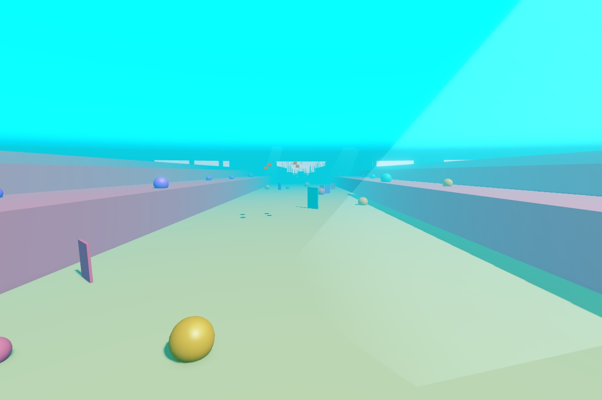
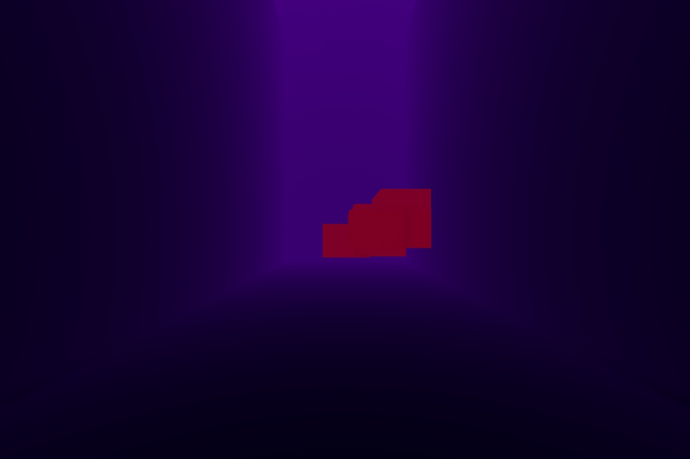

# Workout 1: going down, and the ocean round it

**The question** (the user, 2026-11-09): Ride a Dino builds the feeling of a big world from blocks of land round its track. We
need our own way to make it look like we're going down into the ocean, with a big ocean all round that you can't get into, there
just to build the world.

## Decided
- The descent is gradual and the dive long, so the depth lasts the whole game (v1's 30-degree slope used it up at once).
- The world: a big ocean round the lane, seen but not reachable.

## The method (ideas not agreed)
Seven pieces, each cheap:
1. **Water colour and distance by depth.** Lighting's fog sets the water's colour and how far you can see, and it changes
   smoothly with the camera's depth. Shallow: turquoise, you see far. Deep: darker, you see less. This is the main signal.
2. **The surface overhead.** A bright ceiling at sea level, seen from below in the shallows. Deeper, the fog swallows it.
3. **Light shafts near the top,** giving way to things that glow in the deep: jellies, vents, cracks.
4. **Terraces either side of the lane,** our "blocks of land": reef shelves and rock steps stepping up and away, built
   differently in each zone (low and far apart in the Open Blue, sheer walls in the Trench).
5. **Huge silhouettes far off in the fog:** seamounts, kelp towers, whales, wrecks. They say the ocean goes on.
6. **Drop-offs at zone borders:** you ride off a cliff edge and look down into the next zone, darker below. The biggest are
   the shelf break into the Open Blue and the plunge into the Trench.
7. **The depth gauge in real-ocean metres:** the twilight zone really starts at 200 m, the midnight zone at 1,000 m, and the
   trench ends at the Challenger Deep, 10,935 m. Kids who love ocean facts will know these numbers.

**The edge you can't pass:** the first terrace on each side is the lane's edge; beyond it is scenery. An invisible wall there,
shown as a current (streams of bubbles and drifting specks pushing back) rather than a wall. Above water, the dock sits in a
lagoon ringed by reef: the open ocean beyond runs to the horizon, but the reef ring is the edge.

## The test (2026-11-09)
Pieces 2 to 6 are in the blockout (v2, see [blockout](../blockout.md)). Two looks tried in Studio at four depths with
`tools/studio/depth_look_test.luau` (in Edit mode; it saves the place's lighting and puts it back):
- **A, Toy ocean:** bright and saturated all the way down; you see far (1,100 studs in the shallows, 700 in the trench); the deep
  turns violet instead of black.
- **B, Deep dive:** the light really goes and you see less (800 down to 260 studs); past the twilight, glowing things carry it.

Done so far, look A in the shallows and in the trench (the rest stopped when Studio's window was covered; still to take: A at
the shelf break and in the twilight, all four of B, and the dock from above):

## Learned (Roblox)
- **Atmosphere can't make underwater haze:** in daylight its haze stays sky-blue whatever its Color. Lighting's classic fog
  (FogColor, FogEnd) takes an exact colour and covers the sky too, but only works with no Atmosphere in Lighting. So underwater
  the look controller takes the Atmosphere out, and puts it back at the surface.
- **The sky must be hidden and must not light anything:** an opaque ceiling overhead, EnvironmentDiffuseScale low (0.15) and
  EnvironmentSpecularScale 0. Otherwise every surface turns sky-blue.
- **A Neon ceiling glows much brighter than its colour:** use about 40% of the colour you want.
- **Night just goes black:** light the deep with Ambient and glowing parts, not the time of day.
- **Parts are at most 2,048 studs a side:** the sea is a grid of tiles.

## To decide
- Look A, look B, or a mix (A's colours with B's shorter view in the deep zones).

## Next, once the look is picked
- Moving light on the floor (caustics), drifting specks, bubble trails, a rippled surface texture.
- The game's version: a client controller blending the stops by the camera's depth.
- The deep zones' own colours: the blockout's are near-black, which fights look A.
