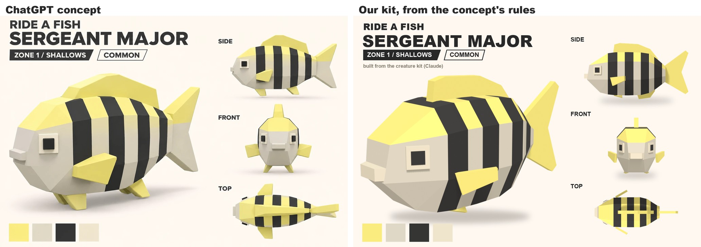
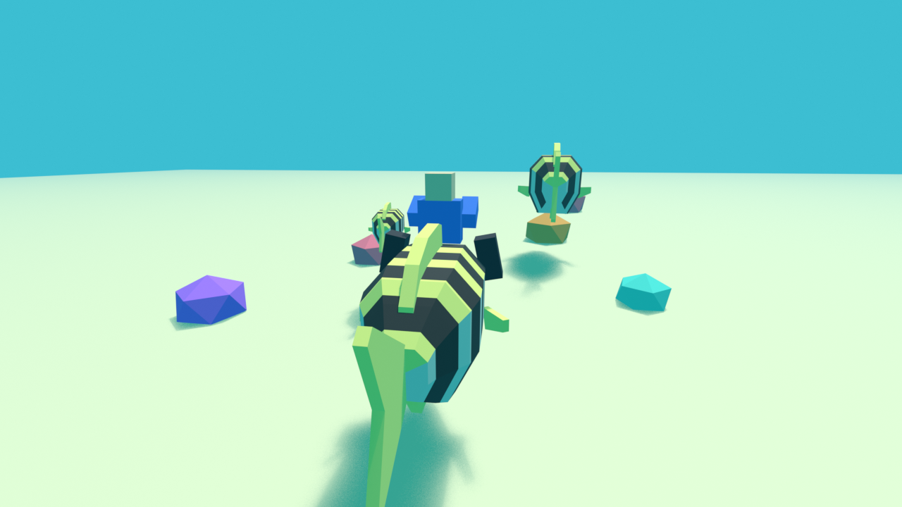
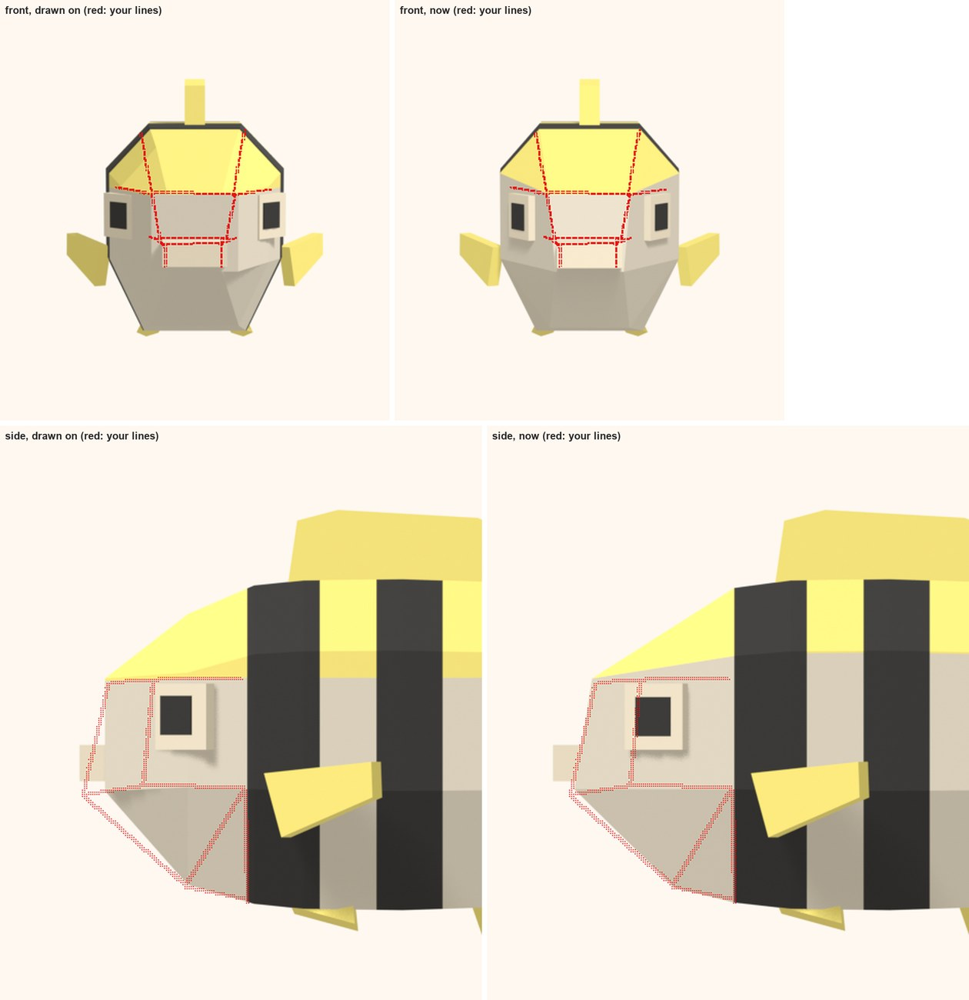
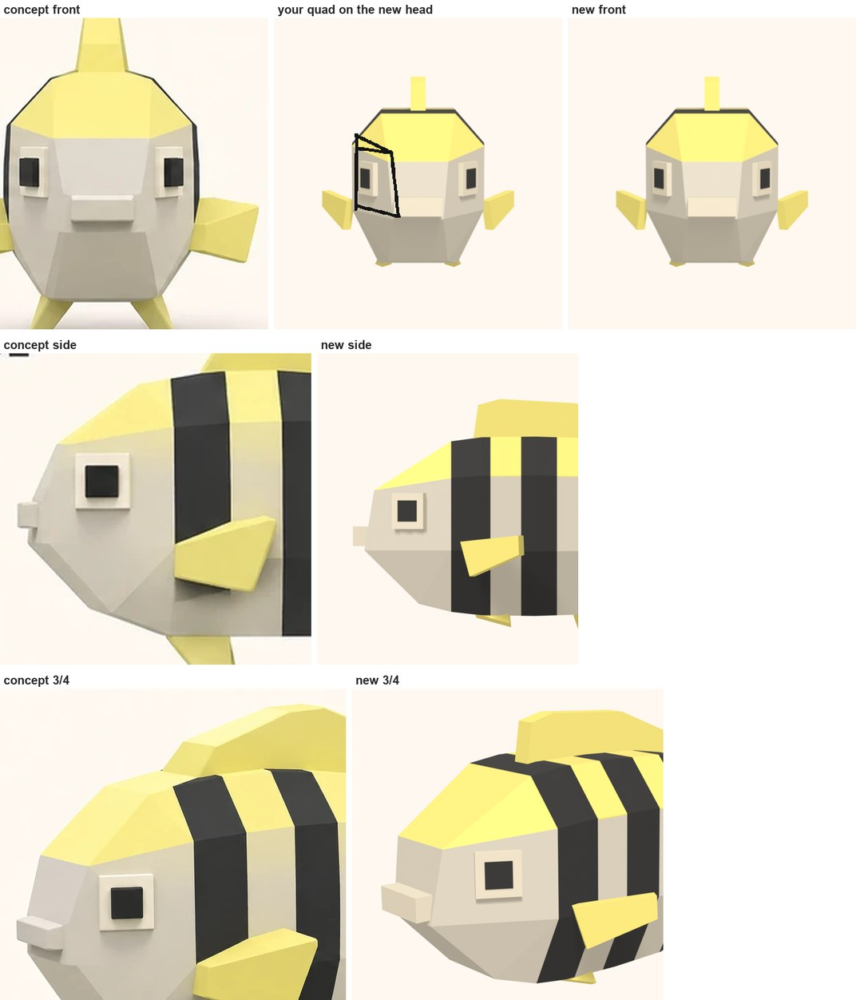
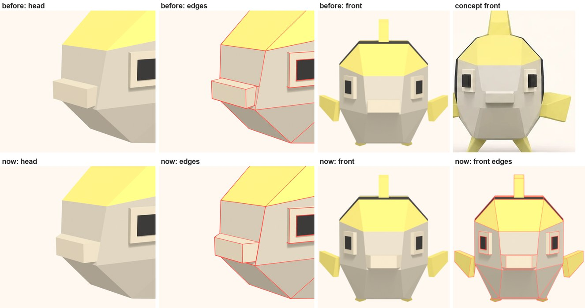
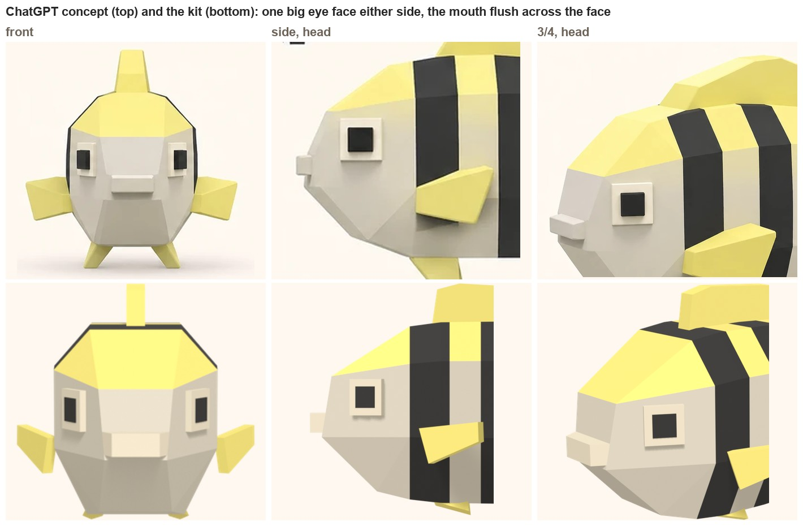
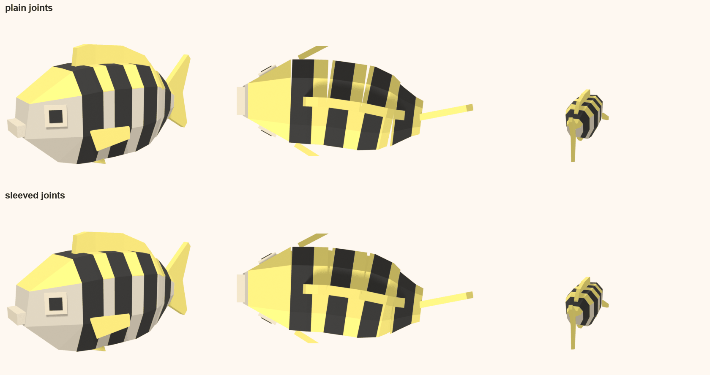

# Workout 2: the creature look

**The question:** how do the creatures look? First test: the striped starter, the Sergeant Major, built by the
[creature method](creature-method.md) from the user's ChatGPT concept (2026-11-09,
`art/concepts/creatures/sergeant-major-gpt.webp`). The user's doubt going in: the image generator doesn't understand the shapes
as well.

## Step 1: reading the concept (rules, not shapes)
**The style, what to keep:**
- Low-poly and faceted: about 8 flat sides round the body, hard edges, no smoothing.
- Flat colours, no texture, no outlines, soft studio light. Four colours: lemon yellow `#FBEC7F`, pale grey-beige `#DFD8C6`,
  near-black `#353534`, cream `#EFE5CD` (sampled from the concept's swatches, not its shaded render).
- Square, pixel-like eyes: a cream square plate with a black square pupil, flush on the side of the head.
- A boxy lip block on the snout.
- Fins as thick flat plates.
- Chunky toy proportions: a deep body, a big head, a short tail.

**The Sergeant Major's signature:** a yellow back, a pale body, five black bars, yellow fins, a forked tail.

**What not to copy (picture cheats):**
- The belly fins are drawn as little legs it stands on, like a toy on a shelf. A fish in the game swims.
- The views don't agree: the side view is deep and round, the top view slim.
- The top view shows a flat, horizontal tail. A fish's tail is upright (only whales and dolphins have flat tails).

## Step 2-3: the kit and the hero creature
`tools/blender/fish_kit.py <spec.json> <out>` builds a fish from a spec (`art/creatures/SergeantMajor/spec.json`): the body as
5 rigid segments along the spine (so every fish swims the same way later), a 10-point ring round the body (an octagon plus the
line where the top colour ends), colour areas per face (top, body, bars, belly), plate fins placed like a real fish's (dorsal,
anal, forked tail, a pair of pectorals, a pair of pelvics), square eyes turned to the head's surface, a lip block. About 15
seconds to build and render. `tools/art/creature_sheet.py` lays the renders out like the concept's sheet and puts them side by
side.

**From the riding camera** (behind and above, Roblox's field of view, the reef's water colour, a 5-stud rider on the shoulders, a
Tiny and a Big one ahead):

## What it showed
- **The style carries over cleanly:** the kit makes the same look from the rules, and all views are one model, so they agree.
- **The concept was cuter, ours more fish-like:** the concept's body is plumper, rounder and wider (from the front it's almost as
  wide as tall); ours was longer and narrower. The shape pass below brought that in.
- **From the riding camera you mostly see the back and the tail blade,** not the side with the eye and the face. Patterns need to
  wrap onto the back (the bars do), and the dorsal fin and tail are the shapes that read.
- **The water changes the colours:** under the shallows' cyan light the lemon yellow reads as lime green. Colours have to be picked
  in the water, not on white.
- **The rider sits on the shoulders, in front of the dorsal fin,** which works for this body. Every fish needs that seat.
- Not yet checked in Studio: getting the model there means uploading it to Roblox, which is permanent, so that waits for the user.

## Step 6: the shape pass (done 2026-11-09, the user: "plump it up", then "just match the reference")
- **Chunky by width, not by being short:** the first try (depth 0.79 of the length) came out ball-like. The concept is chunky
  because it's wide. Measured in the end (below): depth 0.57 of the length to the tail base, width 0.86 of the depth.
- **A big, thick dorsal** from just behind the rider's seat.

## The face, measured off the concept (the user's notes, 2026-11-09)
The first faces ran to a point, then got over-built: no personality, a bit uncanny. The user: match the concept's face
carefully; the body comes from the kit, but the face doesn't move much, so it can leave the body's structure. So the concept's
side, front and top views were measured on a grid, in units of the body's height H. What still holds:
- **One big square eye:** a cream square 0.2H across with a black square 0.12H centred in it, just under the yellow line.
- **The mouth strip:** a cream block 0.28H wide and 0.11H tall, sticking out 0.08H, low on the face.
- **Longer than ours was:** depth 0.57 of the length to the tail base, width 0.86 of the depth; the first bar starts 0.43H behind
  the face. Four bars in the concept's side view.
- **Its front view is a perspective shot,** so ours is too (an orthographic one shows the whole bar ring round the face). Our
  front view is lit from in front and above, like the concept's, so the face's planes read; the other views keep the 3/4 light.
- **Where the concept's views disagree** (its side and top views give a narrower head than its front view), the front view wins:
  that's the one the user judges the face by.

## The head's topology: the user's drawings (2026-11-09)
**First drawing,** red lines over our front and side views
(`art/concepts/creatures/notes/sergeant-major-face-topology-user.png`), mapped back onto the renders by
`tools/art/lines_overlay.py` (left: the model they drew on; right: the head now):

What it showed was wrong: from the front, the face was a rectangle, so it didn't narrow to the mouth. From the side, the head
flared out in two facets with the eye across the fold, so the eye sat on no flat face, and, turned 12 degrees, it stuck out at one
edge. The rebuild gave the face a narrowing plane, a narrow front strip and a separate flat side wall for the eye.

**Second drawing,** one black quad on that rebuild's front view
(`art/concepts/creatures/notes/sergeant-major-eye-face-user.png`). The front strip and the wall were two faces, so the front looked
flared out and not inward enough: the wall faced too far sideways and the eye sat at the outer edge, thin. The user: connect them
into one larger face, the way the concept builds it, so the eye can sit where it reads from both the front and the side. Grey it
all the way up its outline: the yellow wedges above the eyes shouldn't be there.

**The head now,** the concept's construction:
- **One big eye face either side:** a flat face from the face's edge out to the head's outline at the first bar. It's grey up to its
  slanted top edge, which rises from the face's top corner to the top chamfer at the first bar. The eye sits in its middle, parallel
  to it, so from the front it shows at about 0.54 of its width (the concept about 0.57) and from the side it's square.
- **The face:** a plane narrowing from its top edge down to the mouth. It leans back a little at the top, so the mouth comes forward,
  as in the concept's profile. The forehead carries the same lines up to the top corners, with a yellow corner facet between the
  forehead and each eye face.
- **Below:** the chin runs from the face's bottom back to a chin point, and a diagonal from the eye face's back corner down to that
  point splits the jaw.
- **The yellow line:** straight across the face's top, rising along each eye face to the first bar, then level along the body at the
  top chamfers' lower edge. The concept's side view shows yellow only on the top and its chamfers. Before, the body's yellow came
  lower, which left a step at the first bar.

- **The mouth is part of the head mesh,** pushed out of the face (the user, later the same day). A line runs across the face
  at the mouth's top and another at its bottom, edge to edge. The mouth takes the face's whole width there: its back corners
  are where those lines meet the face's edges, shared with the eye faces. Its sides follow the eye faces' angle and lie flush
  on their planes, so its front comes out narrower than its back, about the concept's mouth width (1.17 studs). From the
  front, the face's diagonals now run straight into the mouth's corners. The first try kept the old box width inside the
  face, with thin strips of face beside it; the user wanted it connected to those side vertices and flush instead.
  `lips.sideFollow` sets how far the sides follow that angle (1 flush, 0 straight); `lips.size[1]`, the old width, isn't
  used with a head. `fish_kit.py --wire` draws every edge in red.

Spec fields (`art/creatures/SergeantMajor/spec.json`):
- `head.faceTop` and `chin` are corners, each [back from the face line, half width, height]. `faceBottom` is [back, height]: its half
  width comes from the eye face, so the eye face stays flat.
- `eye.onWall`, with `eye.dx` (back from the face line).
- `topLineZ: "chamfer"`: the top colour ends with the top chamfers (the ring's two points there are welded into one).
- The ring at the first joint (station 0.244) is nearly full width (2.18 of the body's 2.24), so the eye faces turn 29 degrees
  toward the front. A wider ring there, or a narrower face top, turns them further.
- The head's joint is at the front edge of the first bar (`segments[0]`), so the bar starts on the body.

## Does it work with blocky-parts animation? (the user's question)
Yes. The fish is already built from blocky parts: the body is a chain of 5 rigid segments plus the tail fin as a sixth, each
turning at its front joint like a Motor6D chain in Roblox. The kit was changed so it bends cleanly:
- **The long fins are cut at the same joints,** each piece riding its own segment, so the dorsal and anal fins bend with the body
  instead of poking out of it.
- **The tail fin has its own joint,** so it flicks hardest.
- **Every joint cap is coloured like the surface beside it,** so an opening joint shows matching colours, not a pale seam.
- **Sleeved joints:** each segment carries a short tube (0.4 studs) forward inside the one in front. From above, plain joints show
  small notches on the outside of a bend; sleeved ones keep the bars continuous. Sleeves are the default.

The swim is one wave down the chain (3, 6, 9, 12 and 18 degrees from the head back, each a step behind the one in front, the head
countering slightly), so every fish built from the kit swims the same way. Looping, 1 second (`fish_kit.py --swim`,
`tools/art/swim_gif.py`):

**In Roblox (proposed):** each segment and the tail a MeshPart with its fins and eyes merged in, joined by Motor6Ds; one swim for
every fish driven by code (a wave on the joints, faster when swimming faster; far-off fish don't animate); colours as vertex
colours or a tiny palette texture, so a Golden or Silver mutation is a palette swap and Tiny to Colossal is a scale.

## Next
- The head and the mouth are good enough for now (the user, 2026-11-09). Next creatures: the Sea Turtle, the Yellow Tang and
  the Stingray, from the user's three new concepts (notes in `docs/style/creatures/`).
- The plain starter (Yellow Tang) and zone 1's giant (Archelon) from the same kit, to test the style at both ends of the size range.
- Into Studio once the user is happy to upload one test model (uploads are permanent).
