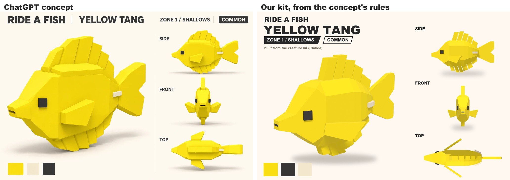
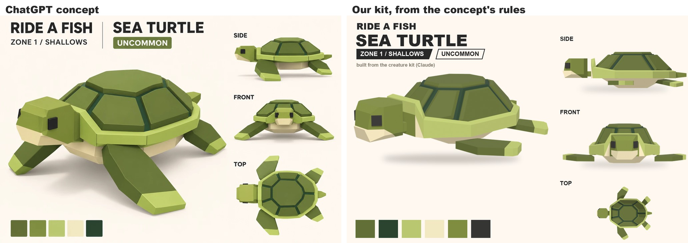
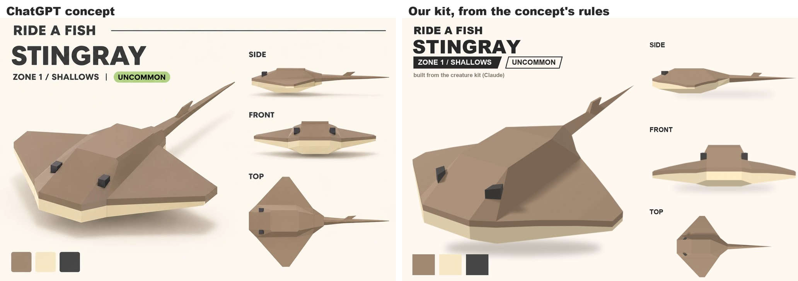

# Workout 3: the creature set

**The question:** do the Sergeant Major's style rules ([workout 2](02-creature-look.md)) carry over to other body shapes? The
user's next three ChatGPT concepts, all zone 1 (2026-11-09): the Yellow Tang (Common, the plain starter), the Sea Turtle and the
Stingray (both Uncommon). One agent each read its concept by the [creature method](creature-method.md) and wrote a note. Then all
three were built (the user, 2026-11-09 and 10: "build it", "build the rest"): the tang by the lead, the turtle and the ray by an
agent each. Each note ends with a **Build** section: what was built, the options used, what still differs, what's open.

| Creature | Note | Body plan | Built |
|---|---|---|---|
| Yellow Tang | [Yellow Tang](creatures/YellowTang.md) | fish: `tools/blender/fish_kit.py` | a tall yellow disc with a stepped comb of slat fins, a snout pushed out of a face that folds at the mouth, a cream spine on each flank |
| Sea Turtle | [Sea Turtle](creatures/SeaTurtle.md) | shell: `tools/blender/shell_kit.py` | 7 parts, 719 triangles: a domed shell of raised, bevelled plates in a pale rim arching over the neck, a blocky head, four flippers with pale tips, a tail |
| Stingray | [Stingray](creatures/Stingray.md) | disc: `tools/blender/disc_kit.py` | 11 parts, 362 triangles: a kite-shaped disc with a cream band round the edge, a ridge with a saddle, dark block eyes on top, a whip tail with a barb |

All three plans share `tools/blender/kit_common.py`: materials, mesh helpers and the views every creature is judged in (the
turnaround, `--wire` for the edges, the riding view, the swim). Moving those out of the fish script changed nothing: both fish
render exactly as before. Each build compares itself with its concept through `tools/art/creature_sheet.py`:

## Three body plans, three swims
- **Fish** (Sergeant Major, Yellow Tang): rigid segments along the spine, one wave down the chain, as in workout 2. On the tang
  the slats fan apart on the outside of a bend and close up on the inside, like fin rays.
  [The tang's swim](../attachments/creature-yellowtang-swim.gif).
- **Shell** (Sea Turtle; later Archelon and the Grave Turtle): the shell is the root, with the head (neck joint under the rim's
  arch), two front flippers (shoulders), two rear flippers (hips) and the tail. Both front flippers beat together, up and forward
  then down and swept back, twisting edge-first on the way up; the rear flippers paddle half a beat later; the shell heaves and
  pitches a little. 1.6 seconds a beat at cruise. A clearance check (`shell_kit.py --check`) proves no flipper, the head or the
  tail cuts the shell anywhere in the stroke. [The turtle's swim](../attachments/creature-seaturtle-swim.gif).
- **Disc** (Stingray; later other rays): an invisible root, the body, each wing in three hinged pieces (pivots on the top so seams
  open only underneath, a hidden cream web closing them), and the tail in four pieces with the barb on the second. A flap travels
  from each wing's root to its tip (8, 10 and 14 degrees), and each piece twists as it rises, so the ripple also runs front to
  back. 1.2 seconds a beat; the tail sways at half the rate, so the loop holds two beats.
  [The ray's swim](../attachments/creature-stingray-swim.gif).

## Rules for every creature (proposed by the three notes, not agreed yet)
1. **Judge every creature with the rider in place.** The rider hides whatever is ahead of the seat, so the ridden view is what
   sits beside and behind it. Every seat is measured: on a fish, about 1.2 studs of back between the head and the dorsal's first
   ray, and a concept's front rays go if its dorsal starts at the head.
2. **Everything that sticks out is pushed out of the surface,** with flush sides and shared vertices, as the Sergeant Major's
   mouth is: snouts, beaks, spines, raised plates and ridges, each raised face flat. A snout or beak ends in a flat face at
   least the eye's size. Tips and bands on limbs are colour lines across the plate, never caps.
3. **One flapping-limb piece for every flipper and wing:** a thick hinged plate. The flap travels from the root to the tip, with
   a twist, and the pivots sit on the surface the camera sees. It covers rays, turtles, the plesiosaurs, the sea lion and the
   flying fish. (Built: the turtle's flipper piece and the ray's hinged wing pieces; not yet one shared piece.)
4. **Every swim runs on an added-up phase,** its speed and size scaled with swimming speed, so a change never makes the pose
   jump. The rider sits on the body; the riding camera follows the smoothed path, not the bob.
5. **Reading ChatGPT sheets:** take widths from the front view and lengths from the side. The top view is the least reliable
   (both fish concepts drew the tail flat there). The views are drawn from a few degrees above, so measure heights to the near
   top edge: silhouettes come out about 10% too tall.
6. **Colour:** strong colours with little blue hold their hue under the shallows' cyan light (the tang's yellow drifts less than
   the Sergeant Major's lemon). Allow up to 5 colours where the method says 3 or 4: the turtle uses 5 and black. On a two-tone
   creature the colour line sits just under the top edge.
7. **Creatures of one tier share a body height** (5.2 studs for the starters), so the riding camera frames them alike.
8. **One kit, three plans:** done (`kit_common.py`, 2026-11-10).

## The kit, next
What the builds asked to share, so the next creatures come faster (proposed):
- **The turtle's face builder** (shared vertices and coloured faces) and its plane and polygon maths.
- **The flapping-limb piece:** one piece for the turtle's flippers and the ray's wings.
- **The clearance check:** the turtle's, proving no part cuts another through the swim.
- **A check that every face is flat.**
- **The rider:** one shared rider helper.
- **Per-creature cameras:** a 3/4 camera and light per spec, a top view framed separately, and swim cameras that can frame a flat
  creature with the rider in the riding panel. The ray and the turtle each work round the fish framing in their own script.

## Decisions for the user
The ones that touch every creature:
1. **The eye:** **Decided 2026-11-09 (the user): go by the reference:** each creature's eye follows its concept. The Sergeant
   Major keeps the cream square with a black square in it; the Yellow Tang, the Sea Turtle and the Stingray have a plain black
   square or block, as drawn.
2. **Colours:** 3 or 4 a creature, as the method says, or up to 5 (the turtle's build uses 5).
3. **Sizes:** the turtle was built at a shell height of 3.5 studs, the starters at 5.2. How big should an Uncommon be?

Each creature was built with its note's recommended options. Every one of them is still the user's to change; the open questions
are at the end of each note:
- **Yellow Tang:** the body's width, the snout, the slit, the seat and slat count, the yellow (judged in Studio), how far the eye
  stands proud, bigger accents for the riding camera.
- **Sea Turtle:** where the front flippers attach, how high the stroke lifts, the plate over the neck, the side plates' steepness
  (65 degrees against the concept's 40 to 50), the bevels' cost, idle, glide and turn poses.
- **Stingray:** the eye's construction, how strong the twist is (it leaves small steps at the hinges), whether to keep the cream
  web, the barb, the tail's length, the underside.

## Next
- The user's verdict on the three, and their picks.
- A first look in Studio needs the models uploaded to Roblox, which is permanent, so that waits for the user's go-ahead.
- The other zone-1 creatures follow the same three plans.
