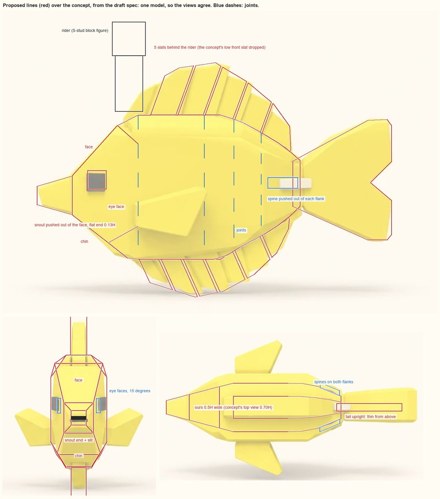
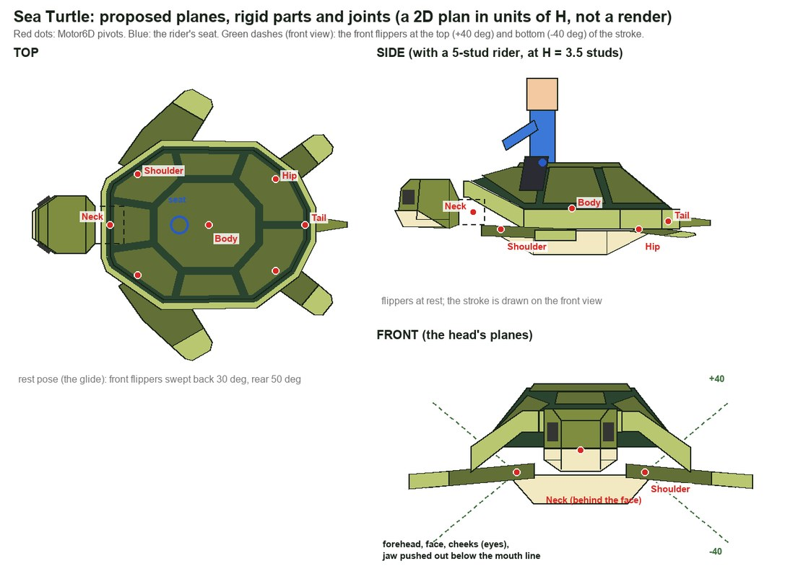

# Workout 3: the creature set

**The question:** do the Sergeant Major's style rules ([workout 2](02-creature-look.md)) carry over to other body shapes? The
user's next three ChatGPT concepts, all zone 1 (2026-11-09): the Yellow Tang (Common, the plain starter), the Sea Turtle and the
Stingray (both Uncommon). One agent each read its concept by the [creature method](creature-method.md) and wrote a note. Nothing
is built yet.

| Creature | Note | Body plan | Signature |
|---|---|---|---|
| Yellow Tang | [Yellow Tang](creatures/YellowTang.md) | fish (the kit as it is) | a tall yellow disc, a comb of slat fins, a white spine on each flank at the tail base, a snout |
| Sea Turtle | [Sea Turtle](creatures/SeaTurtle.md) | shell (new) | a domed shell of raised plates inside a pale rim, long swept front flippers with pale tips, a blocky head |
| Stingray | [Stingray](creatures/Stingray.md) | disc (new) | a kite-shaped disc with a cream band round the edge, a raised ridge with a saddle, eyes on top, a whip tail with a barb |

## Three body plans, three swims
- **Fish** (Sergeant Major, Yellow Tang): rigid segments along the spine, one wave down the chain, as in workout 2. The tang adds
  slat fins (each slat rides one segment whole, so a joint always falls in a gap), a spine pushed out of each flank and a snout.
- **Shell** (Sea Turtle; later Archelon and the Grave Turtle, from the same plan): 7 parts: the shell, the head (its neck joint
  under the rim's arch), two front flippers (shoulders), two rear flippers (hips) and the tail, about 650 triangles. Both front
  flippers beat together: up and down 40 degrees each way, swept back 30 degrees give or take 15 so the tip draws a loop, twisting
  25 degrees. The rear flippers paddle 8 degrees half a beat later and steer. The shell heaves and pitches a little. 1.6 seconds a
  beat at cruise, 1.0 fast, 3.2 idle.
- **Disc** (Stingray; later other rays): an invisible root, the body (ridge, head, eyes, belly), each wing in three hinged pieces
  cut along the spine, and the tail in four pieces with the barb on the second: 11 parts. A flap travels from the wing's root to
  its tip (8, 10 and 14 degrees on the hinges), and each piece twists as it rises, so the ripple also runs front to back. 1.2
  seconds a beat, 0.8 fast, 2.4 idle; the tail sways at half the rate.

## Rules for every creature (proposed by the three notes, not agreed yet)
1. **Judge every creature with the rider in place.** The rider hides whatever is ahead of the seat, so the ridden view is what
   sits beside and behind it. Every seat is measured: on a fish, about 1.2 studs of back between the head and the dorsal's first
   ray, and a concept's front rays go if its dorsal starts at the head.
2. **Everything that sticks out is pushed out of the surface,** with flush sides and shared vertices, as the Sergeant Major's
   mouth is: snouts, beaks, spines, raised plates and ridges, each raised face flat. A snout or beak ends in a flat face at
   least the eye's size. Tips and bands on limbs are colour lines across the plate, never caps.
3. **One flapping-limb piece for every flipper and wing:** a thick hinged plate. The flap travels from the root to the tip, with
   a twist, and the pivots sit on the surface the camera sees. It covers rays, turtles, the plesiosaurs, the sea lion and the
   flying fish.
4. **Every swim runs on an added-up phase,** its speed and size scaled with swimming speed, so a change never makes the pose
   jump. The rider sits on the body; the riding camera follows the smoothed path, not the bob.
5. **Reading ChatGPT sheets:** take widths from the front view and lengths from the side. The top view is the least reliable
   (both fish concepts drew the tail flat there). The views are drawn from a few degrees above, so measure heights to the near
   top edge: silhouettes come out about 10% too tall.
6. **Colour:** strong colours with little blue hold their hue under the shallows' cyan light (the tang's yellow drifts less than
   the Sergeant Major's lemon). Allow up to 5 colours where the method says 3 or 4: the turtle needs 5. On a two-tone creature
   the colour line sits just under the top edge.
7. **Creatures of one tier share a body height** (5.2 studs for the starters), so the riding camera frames them alike.
8. **One kit, three plans:** the parts every plan shares (the head, eyes, colours, views and the riding view) move out of
   `fish_kit.py` into a module that the fish, shell and disc plans all use.

## Decisions for the user
The ones that touch every creature:
1. **The eye:** **Decided 2026-11-09 (the user): go by the reference:** each creature's eye follows its concept. The Sergeant Major keeps the cream square with a
   black square in it; the Yellow Tang, the Sea Turtle and the Stingray get a plain black square, as drawn. The kit's eye
   piece gets the two looks.
2. **Colours:** 3 or 4 a creature, as the method says, or up to 5.

Then each creature's own questions, with options and recommendations, at the end of its note:
- **Yellow Tang:**
  - Body width: 0.5H recommended.
  - The snout: flush, ending in a flat face the eye's size (recommended).
  - A mouth slit or none.
  - Drop the front slat for the seat.
  - The yellow: the concept's `#F9DF12`, a warmer gold `#FFCC14`, or decide in Studio.
  - The eye: standing proud or flush.
  - Bigger accents for the riding camera.
- **Sea Turtle:**
  - Where the eye sits: on a cheek turned 35 degrees (recommended).
  - The head's colour.
  - The stroke's feel: 1.6 seconds recommended.
  - The plates: raised with bevels, raised without, or flat strips.
  - The seat: the top plate's front quarter recommended.
- **Stingray:**
  - The eyes' look.
  - Whether the eyes need to show from the saddle.
  - The barb.
  - The tail's length.
  - 2, 3 or 6 pieces a wing: 3 recommended.
  - The underside.

## Next
- The user's picks, in chat or written into the notes.
- Build the Yellow Tang first, since the kit already makes fish. Then the shell plan (Sea Turtle) and the disc plan (Stingray).
